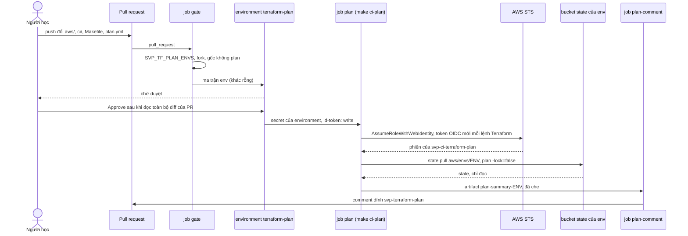
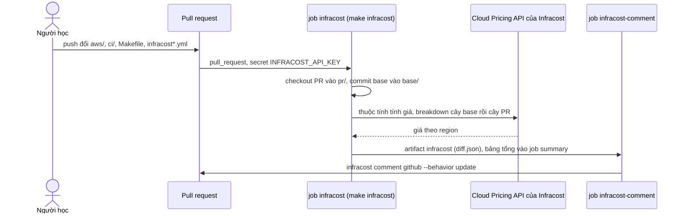
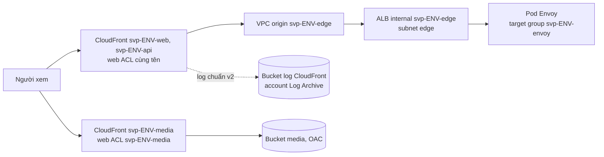
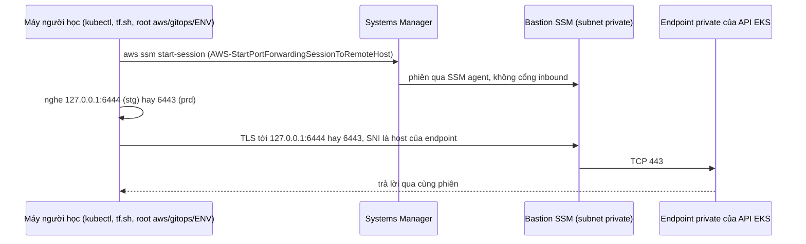
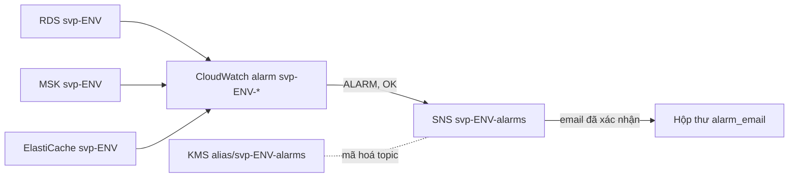
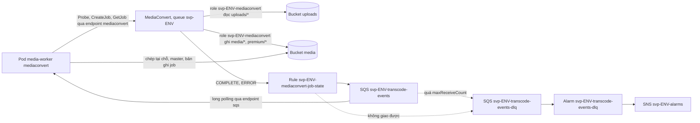
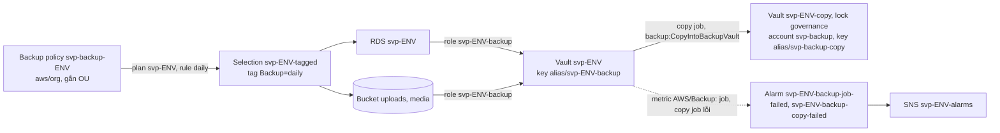
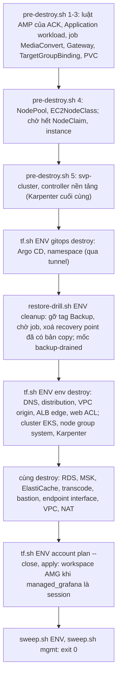

# svp-infra

Terraform của nền tảng video ngắn [svp-backend](https://github.com/anhnvcoder/svp-backend): nền mà Argo CD triển khai lên trên AWS
(mạng, cluster, dữ liệu managed, registry, observability, DNS) và cài đặt GitHub của các repo, viết thành code.

## Mục lục

- [Bối cảnh](#bối-cảnh)
- [Cài đặt](#cài-đặt)
- [Sử dụng](#sử-dụng)
- [Bố cục](#bố-cục)
- [Lệnh kiểm](#lệnh-kiểm)
- [Plan và apply](#plan-và-apply)
- [Plan trên PR](#plan-trên-pr)
- [Chi phí trên PR](#chi-phí-trên-pr)
- [Luồng vận hành](#luồng-vận-hành)
- [Luật an toàn](#luật-an-toàn)
- [Đóng góp](#đóng-góp)
- [Giấy phép](#giấy-phép)

## Bối cảnh

Repo code giữ service, chart và CI build image; [svp-gitops](https://github.com/anhnvcoder/svp-gitops) giữ cái gì chạy ở mỗi env; repo
này dựng chỗ để chạy. Thiết kế và lý do ở
[ADR-0034](https://github.com/anhnvcoder/svp-backend/blob/main/docs/adr/0034-aws-stage7.md) §2; cài đặt GitHub của repo ở
[runbook `svp-infra-setup.md`](https://github.com/anhnvcoder/svp-backend/blob/main/docs/runbooks/svp-infra-setup.md).

Repo public: **không account ID, IP, email, tên miền thật, state hay plan nào ở đây** (mục [Luật an toàn](#luật-an-toàn)).

## Cài đặt

```sh
git clone https://github.com/anhnvcoder/svp-infra.git
cd svp-infra
```

Lệnh kiểm cần Docker và `make`; mọi công cụ chạy từ image ghim digest, không cài gì thêm. `plan`, `apply` (chỉ người học) cần thêm
Terraform 1.15 (Homebrew) và AWS CLI v2 với một profile SSO mỗi account (mục [Plan và apply](#plan-và-apply)).

## Sử dụng

```sh
make check                            # mọi phép kiểm tĩnh, không chạm account
make check DIRS=aws/modules/network   # chỉ các phép Terraform của một thư mục
make hooks                            # bật hook pre-commit (một lần mỗi clone)
make help                             # liệt kê target
```

Mục lục mọi runbook, các bước còn giữ tay, script và target dựng, và thứ tự dựng một lần ở
[`docs/runbooks/README.md`](docs/runbooks/README.md).
Dựng, đo và gỡ một env theo runbook [`docs/runbooks/session-stg.md`](docs/runbooks/session-stg.md) hay
[`docs/runbooks/session-prd.md`](docs/runbooks/session-prd.md) (mục [Plan và apply](#plan-và-apply)).
Dựng mỗi buổi, xoay và thay khi lộ khoá ký URL media premium theo runbook
[`docs/runbooks/media-signing-keys.md`](docs/runbooks/media-signing-keys.md).
Nâng minor EKS của cả hai env theo runbook [`docs/runbooks/eks-upgrade.md`](docs/runbooks/eks-upgrade.md).
Áp nền bảo mật của tổ chức lần đầu (account Log Archive, Security Tooling, policy, dịch vụ phát hiện, baseline) theo runbook
[`docs/runbooks/org-security-setup.md`](docs/runbooks/org-security-setup.md); đường vào khẩn cấp ở
[`docs/runbooks/break-glass.md`](docs/runbooks/break-glass.md).
Áp phần sống lâu của edge lần đầu (log CloudFront, `CAA`, DNSSEC của zone prd, chuỗi tin cậy ở DNS cha) và tắt ký DNSSEC theo runbook
[`docs/runbooks/edge-setup.md`](docs/runbooks/edge-setup.md).
Áp nền tảng managed lần đầu (Inspector, nhóm nền tảng, registry ECR và role CI, observability, credential của pull-through cache, quota chu kỳ
luật AMP) và xoay PAT của cache theo runbook [`docs/runbooks/platform-setup.md`](docs/runbooks/platform-setup.md).
Áp backup lần đầu (account `svp-backup`, Backup policy, vault copy và vault env) theo runbook
[`docs/runbooks/backup-setup.md`](docs/runbooks/backup-setup.md); diễn tập khôi phục và xoá backup cuối buổi nằm ở runbook buổi.
Cài đặt GitHub của các repo (Terraform `github/`, GitHub App từ manifest, phần provider không quản) theo runbook
[`docs/runbooks/github-setup.md`](docs/runbooks/github-setup.md); `make github-check` đọc lại phần ngoài Terraform.
Đổi cờ chi phí của một account (dịch vụ tốn tiền mà hệ thống không cần để chạy) theo runbook
[`docs/runbooks/paid-features.md`](docs/runbooks/paid-features.md).

**Cờ chi phí.** Khác biệt về dịch vụ tốn tiền giữa các account là dữ liệu của một file commit,
[`aws/paid-features.json`](aws/paid-features.json): mỗi account một object cờ, chỉ ghi giá trị khác `always`. Giữa các
buổi mọi account giữ giá trị rẻ nhất mà validation của module cho phép; chỉ `svp-security` (delegated administrator) giữ
Security Hub và Config, và account vắng khỏi file là chuẩn production (mọi cờ `always`). Module
[`paid-features`](aws/modules/paid-features/README.md) kiểm giá trị; root
`aws/security` (Security Hub CSPM, Inspector ECR), `aws/baseline` (AWS Config recorder) và `aws/accounts/<env>` (Amazon Managed Grafana, kiểu
quét ECR) đọc cờ qua nó, root `aws/envs/<env>` đọc cờ `managed_grafana` để biết có workspace AMG để đọc không, script buổi đọc cùng file.
Cờ `managed_grafana` là `session` thì workspace AMG của env chỉ có trong buổi, mở và đóng bằng `aws/scripts/tf.sh <env> account`; là `off`
thì không bao giờ có, và cluster nhận `grafanaUrl` rỗng. Thiết kế, giá trị mỗi account và chi phí:
[ADR-0071](https://github.com/anhnvcoder/svp-backend/blob/main/docs/adr/0071-paid-features.md) và
[ADR-0078](https://github.com/anhnvcoder/svp-backend/blob/main/docs/adr/0078-paid-features-lean-defaults.md) (giá trị rẻ
giữa các buổi).

## Bố cục

```text
Makefile                      make check (fmt, validate, tflint, tfdocs, trivy, shellcheck, zizmor, docs, test), make lock, make fmt, make tfdocs, make ci-plan (chỉ job CI)
CODEOWNERS                    đường có chủ: CODEOWNERS, .github/, renovate.json, infracost.yml, infracost-usage.yml, Makefile, .tflint.hcl, .trivyignore.yaml, github/, aws/, ci/
infracost.yml                 project Infracost: mỗi root của gốc plan được, với tfvars đã commit nếu có
infracost-usage.yml           giả định mức dùng của Infracost, mỗi giả định một lý do
LICENSE                       Apache-2.0
.markdownlint.yaml            luật markdownlint của make docs-check (cùng file của repo code)
lychee.toml                   cấu hình lychee của make docs-check (cùng file của repo code)
.tflint.hcl                   ruleset terraform (recommended) và aws ghim version
.trivyignore.yaml             ngoại lệ của trivy trong module tải từ registry
renovate.json                 provider, module, ruleset tflint, image ghim của Makefile, action
.github/workflows/check.yml   PR và push main: mỗi nhóm check-* một job song song (bỏ qua khi PR chỉ tài liệu), docs-check; infra-ok
.github/workflows/plan.yml    PR đổi aws/, ci/, Makefile: terraform plan bằng role chỉ đọc qua OIDC, comment tóm tắt đã che (mục Plan trên PR)
.github/workflows/cost.yml    PR đổi aws/, ci/, Makefile, infracost*.yml: chi phí tháng của HCL ở base và ở PR qua Infracost, comment diff (mục Chi phí trên PR)
.github/workflows/pr-title.yml  PR: tiêu đề theo Conventional Commits (check pr-title)
.github/workflows/scorecard.yml push main và lịch tuần: OpenSSF Scorecard, kết quả công khai và lên code scanning
.github/zizmor.yml            ngoại lệ của zizmor, mỗi mục một lý do (tạo khi có ngoại lệ đầu tiên)
aws/
  bootstrap/                  management account, một lần, giữ giữa các buổi: bucket state (KMS key), budget, Cost Anomaly Detection, tag phân bổ chi phí của org; không hosted zone nào
  org/                        management account: Organizations, OU Security và Workloads/Prod, Workloads/NonProd, các account thành viên svp-*, policy của tổ chức (cả Backup policy), cross-account backup và opt-in AWS Backup, delegated admin, root tập trung, liên hệ SECURITY, IAM Identity Center (SvpAdmin, SvpReadOnly, SvpLogReader), organization trail
  log-archive/                account svp-log-archive (chạy từ management qua OrganizationAccountAccessRole): bucket log của org (cả log CloudFront), hai KMS key, delivery destination svp-cloudfront-<env> của log CloudFront
  paid-features.json          cờ chi phí của mỗi account (chỉ giá trị khác always), đọc qua modules/paid-features và lib.sh
  security/                   account svp-security (như trên): GuardDuty, Security Hub CSPM, aggregator Config, Access Analyzer của org, Inspector ECR theo cờ; bus và SNS cảnh báo bảo mật
  baseline/                   mọi account của tổ chức (như trên): baseline bảo mật của mỗi account (Config recorder theo cờ), CMK EBS của stg, prd
  backup/                     account svp-backup (như trên): KMS key, vault svp-stg-copy, svp-prd-copy có vault lock governance nhận bản copy của AWS Backup
  accounts/<env>/             baseline của mỗi account thành viên (stg, prd), giữ giữa các buổi: bucket state, KMS key của nó, zone của env với CAA (prd aws.<domain>, giữ cả bản ghi NS uỷ quyền stg.aws.<domain>, DNSSEC, query log, topic alarm DNSSEC; stg stg.aws.<domain>), budget; registry ECR, pull-through cache, role CI và observability (AMP, log group ứng dụng, X-Ray, AMG theo cờ: giữa các buổi hay chỉ trong buổi) của env; vault AWS Backup svp-<env>, key, role svp-<env>-backup, opt-in
  envs/<env>/                 cấu hình gốc của mỗi env (stg, prd: cùng *.tf kể cả bastion SSM, khác ở <env>.tfvars; prd thêm teardown.tfvars)
  gitops/<env>/               bootstrap GitOps của cluster EKS của env (GitOps Bridge): namespace, Argo CD, AppProject, cluster Secret, ApplicationSet svp-bootstrap
  modules/                    module nội bộ; lock file không commit
    network, eks, rds, media  nền của mỗi env (network: bốn tầng subnet mỗi AZ, public chỉ NAT, private, database, edge chỉ ALB edge, NACL không mở 22, 3389, flow log về Log Archive, endpoint guardduty-data, endpoint interface có private DNS cho API AWS (cả mediaconvert, sqs); eks: nhóm node hệ thống, IAM, SQS, EventBridge của Karpenter, add-on agent GuardDuty, role Pod Identity của controller nền tảng và telemetry; media: bucket, distribution media.<domain> công khai media/*, preview/*, mọi path khác chỉ nhận URL ký bằng key group hai ô a, b, Malware Protection cho uploads, lifecycle transcode-jobs/)
    transcode                 transcode của env bằng AWS Elemental MediaConvert: queue svp-<env>, role svp-<env>-mediaconvert, rule EventBridge svp-<env>-mediaconvert-job-state, SQS svp-<env>-transcode-events và DLQ, alarm DLQ; JSON policy của bridge cho role Pod Identity media-worker
    edge                      đường vào của web và API: distribution svp-<env>-web, svp-<env>-api, VPC origin, ALB internal svp-<env>-edge ở tầng edge, target group của Envoy, cert ACM, response headers policy, log chuẩn v2, bản ghi DNS
    msk                       Kafka của env: Amazon MSK provisioned, một broker mỗi AZ ở subnet database, SASL/SCRAM-SHA-512 trên TLS 9096
    elasticache               Valkey của env: ElastiCache for Valkey, cluster mode tắt, ở subnet database, TLS 6379, user RBAC theo db và tiền tố
    alarms                    topic SNS mã hoá bằng KMS key của module, subscription email: svp-<env>-alarms nhận alarm của RDS, MSK, ElastiCache; svp-prd-dns-alarms (root accounts/prd, us-east-1) nhận alarm DNSSEC; svp-security-alarms (root security) nhận sự kiện bảo mật
    waf                       web ACL của CloudFront (mỗi root env gọi ba lần: web, api, media; provider us-east-1), log về bucket WAF của Log Archive
    ssm-bastion               bastion SSM tới endpoint private của API EKS (cả hai env)
    external-secrets          vỏ entry Secrets Manager svp/<env>/*, role của External Secrets theo namespace, Pod Identity
    gitops-bridge             giá trị của bootstrap GitOps (không resource): cluster Secret, values Argo CD, root
    org-policies              mọi policy của tổ chức: SCP, RCP data perimeter, declarative policy EC2, tag policy, Backup policy svp-backup-<env>
    backup-vault              vault AWS Backup từ một KMS key có sẵn, vault lock và vault access policy tuỳ chọn (root backup, accounts/<env>)
    backup-alarms             alarm svp-<env>-backup-job-failed, svp-<env>-backup-copy-failed của AWS Backup (root envs/<env>)
    paid-features             cờ chi phí của mọi account (không resource): kiểm aws/paid-features.json, trả cờ đủ của mỗi account cho các root
    security-baseline         baseline bảo mật của một account: S3 BPA cấp account, EBS mã hoá mặc định, Config recorder (bật, tắt theo biến), rule svp-security-*
    account-baseline          bucket state, KMS key, zone (cùng bản ghi NS uỷ quyền zone con, chỉ prd dùng), CAA, DNSSEC và query log (prd bật), budget của một account thành viên
    registry                  ECR private của một account env (root accounts/<env>): repo phát hành bất biến, pull-through cache, quét Inspector hay quét cơ bản, KMS, OIDC provider GitHub, role CI svp-ci-*
    observability             nơi nhận telemetry của một account env (root accounts/<env>): workspace AMP, log group /svp/<env>/otel, Transaction Search của X-Ray, Amazon Managed Grafana và tham số SSM id của nó (bật, tắt theo biến), KMS
  backend.hcl                 backend của management (bucket của aws/bootstrap; không commit, sinh từ output backend_hcl)
  backend-<env>.hcl           backend của account stg, prd (bucket, region, KMS; không key, mỗi root truyền key riêng; không commit, sinh từ output của accounts/<env>)
  scripts/                    script buổi AWS theo bảng env (mgmt, stg, prd) của lib.sh: kiểm account, DNS, Terraform ba root (account, env, gitops), cờ chi phí, secret và token Grafana, làm nóng pull-through cache, chờ Argo CD, đo, diễn tập khôi phục và xoá backup cuối buổi (restore-drill.sh), pre-destroy, sweep
ci/                           script của job CI: terraform-plan.sh (gác và plan của plan.yml), infracost.sh (cost.yml), test với lệnh giả, testdata/ (show -json mẫu)
github/                       cài đặt GitHub của các repo trong `local.repositories` (repo, quyền Actions, ruleset, environment promote, promote-prd, ecr-rescan); state trong bucket của aws/bootstrap
docs/diagrams/                sơ đồ AWS svp-aws.drawio (trang stg, prd, flows), PDF, PNG nhúng ở docs của repo code; sinh từ spec
.claude/skills/aws-drawio-diagram/   spec và checker của sơ đồ (luật vẽ ở SKILL.md)
```

**Sơ đồ** ([`docs/diagrams/svp-aws.pdf`](docs/diagrams/svp-aws.pdf)): sinh bằng
`python3 .claude/skills/aws-drawio-diagram/scripts/build_svp.py --pdf --docs`, không sửa tay trong draw.io. Cỡ của mỗi trang env đọc từ
`aws/envs/<env>/<env>.tfvars` cộng mặc định ở `variables.tf` của root đó, nên đổi cỡ thì build lại. Kiểm trước khi commit:
`check_diagram.py docs/diagrams/svp-aws.drawio` (hình học) và `check_svp_counts.py` (số AZ, subnet, NAT, node hệ thống, node Karpenter,
bastion, RDS, broker MSK, node ElastiCache khớp cỡ của env),
cả hai chạy offline, không cần credential. Xuất PDF, PNG cần CLI draw.io (`brew install --cask drawio`, hay biến `DRAWIO`).

**Root và module:** thư mục nằm dưới một thư mục `modules/` là module, mọi thư mục `*.tf` khác là cấu hình gốc (root). Root commit
`.terraform.lock.hcl` (hash của `darwin_arm64`, `linux_amd64`, `linux_arm64`) và `make check` dùng nó ở chế độ chỉ đọc
(`init -lockfile=readonly`), nên đổi provider của root phải chạy `make lock DIRS=<root>` trước. Module không commit lock file
(`.gitignore`): root gọi nó quyết version provider.

## Lệnh kiểm

Chạy từ gốc repo, không cần credential AWS, cần Docker và mạng (registry Terraform, GitHub cho plugin tflint, GHCR cho bộ luật trivy):

| Lệnh | Làm gì |
| --- | --- |
| `make check` | `fmt-check`, `validate`, `tflint`, `tfdocs-check`, `trivy` trên mọi thư mục có `*.tf`, rồi `shellcheck` trên mọi `*.sh`, `zizmor` trên mọi workflow, `docs-check` trên mọi `.md`, `session-test`, `test-guard`, `test` trên mọi module, `github-app-test`, `ci-plan-test`, `infracost-test` |
| `make check-terraform` / `check-lint` / `check-test` / `check-scripts` | từng nhóm của `make check`, mỗi nhóm một job của CI |
| `make hooks` / `make pre-commit [FILES='<file …>']` | bật hook / chạy phép kiểm nhanh của hook (mục [Hook pre-commit](#hook-pre-commit)) |
| `make check DIRS="aws/modules/x aws/envs/stg"` | như trên, sáu phép Terraform chỉ trên các thư mục đó; thư mục không có, không có `*.tf` hay nằm ngoài repo thì dừng, nêu thư mục |
| `make fmt-check` / `make fmt` | `terraform fmt -check -diff -recursive` / viết lại file |
| `make validate` | mỗi thư mục: `terraform init -backend=false -input=false`, rồi `terraform validate`; provider và module nằm ở thư mục tạm (`TF_DATA_DIR`), nên `.terraform/` của người học đã `init` với backend S3 không bị đọc hay ghi |
| `make tflint` | mỗi thư mục: `tflint --init`, rồi `tflint` với `.tflint.hcl` |
| `make trivy` | `trivy config` mỗi thư mục; HIGH và CRITICAL làm đỏ |
| `make shellcheck [SH='<file …>']` | shellcheck trên mọi `*.sh` (bản image, `--network none`; máy không cài shellcheck); `SH` chỉ kiểm các file đó, cho lúc sửa một script |
| `make session-test` | tự kiểm script của `aws/scripts` với lệnh giả trên PATH, không account, cluster hay mạng: `session-test.sh` (mọi bước của buổi, khớp bảng bước của runbook buổi với `session.sh --print`), rồi mỗi `*-test.sh` còn lại; mỗi file lỗi một dòng `FAIL: <file>` |
| `make zizmor` | lint bảo mật workflow bằng zizmor (`--persona=regular`), mọi finding làm đỏ; có `GH_TOKEN` thì chạy thêm audit online (impostor commit, action có lỗ hổng), không thì offline; `ZIZMOR_FORMAT=github` in annotation |
| `make docs-check [DOCS='<file hay glob>']` | markdownlint-cli2 theo `.markdownlint.yaml`, rồi lychee `--offline --include-fragments` (link tương đối và anchor heading; link ra ngoài không kiểm), container `--network none`; mặc định mọi `.md` git theo dõi và file mới chưa theo dõi, trừ `.claude/` (cấu hình agent, không phải tài liệu của repo) |
| `make lock [DIRS=<root>]` | `init -backend=false` rồi `terraform providers lock` cho ba nền tảng; module bị bỏ qua |
| `make tfdocs` / `make tfdocs-check` | terraform-docs ghi / kiểm khối sinh (requirements, providers, resources, inputs, outputs) giữa `<!-- BEGIN_TF_DOCS -->` và `<!-- END_TF_DOCS -->` của `README.md` mỗi module; `tfdocs-check` đỏ khi README lệch `.tf`, root bị bỏ qua; container `--network none` |
| `make test` | `terraform test` của mỗi module (`tests/*.tftest.hcl`): `init -backend=false` trong một container, rồi `terraform test` trong container `--network none` với image `TERRAFORM_IMAGE` ghim digest, chỉ thư mục module và cache provider được mount (chỉ đọc), không biến `AWS_*` nào (bỏ bằng `env -u`), không `~/.aws`, `.envrc`, `backend.hcl`; file test chỉ được nhận khi theo khuôn: đúng một dòng `mock_provider "aws" {`, mỗi `run "<tên>" {` có `command = plan` ở dòng không trống đầu tiên, không dòng nào khác bắt đầu bằng `run`, `mock_provider`, `provider`, `override_`, `module`, `command`, `/*`, không `alias`, `*/`, heredoc, symlink hay `*.tftest.json`; sai thì bị từ chối, nêu file và dòng; root bị bỏ qua |
| `make test-guard` | tự kiểm ba luật của `make test` với `docker` giả trên PATH: file test sai bị từ chối, lệnh docker có `--network none`, image ghim digest, chỉ mount thư mục dữ liệu, module và cache provider (chỉ đọc), không biến hay file credential AWS nào tới container |
| `make ci-plan-test` | tự kiểm `ci/terraform-plan.sh` với `docker`, `curl`, `gh` giả trên PATH và một bản chép của repo ở thư mục tạm: từ chối chạy ngoài Actions, cổng (biến bật plan, fork, gốc không plan, PR Renovate), buổi mở hay không, thứ tự lệnh Terraform, token mới mỗi lệnh, secret account cần và không cần, khoá media lấy từ state, giá trị che vắng khỏi log và tóm tắt, stdout của `plan` không vào log, lỗi `init`, `plan` làm đỏ với stderr đã che, tóm tắt đúng số và address của `ci/testdata/plan.json`; bước đăng comment của `plan.yml` chạy đúng như trong file với `gh` giả (đăng mới, sửa comment dính, cắt khi quá dài) |
| `make ci-plan ENV=<stg\|prd>` | plan của job `plan` trong `plan.yml` (mục [Plan trên PR](#plan-trên-pr)); từ chối chạy khi thiếu `GITHUB_ACTIONS=true` và `ACTIONS_ID_TOKEN_REQUEST_URL`, nên không bao giờ chạy trên máy dev |
| `make infracost-test` | tự kiểm `ci/infracost.sh` với `docker` giả trên PATH và một bản chép của script ở thư mục tạm: không khoá thì từ chối trên máy, bỏ qua có notice trong Actions, PR từ fork bỏ qua, thứ tự lệnh (breakdown cây base, breakdown cây PR, `diff`), hai cây mount chỉ đọc, khoá và token GitHub chỉ vào container theo tên, không bao giờ trong tham số, output hay job summary, bảng tổng mỗi project, lệnh `comment` đúng cờ; `INFRACOST_IMAGE` ghim digest có dòng `# renovate:` |
| `make infracost BASE=<cây base>` | chi phí tháng theo HCL của các project trong `infracost.yml` ở cây base và ở cây này, rồi `diff`, cho job `infracost` của `cost.yml` (mục [Chi phí trên PR](#chi-phí-trên-pr)); cần `INFRACOST_API_KEY`, thiếu thì từ chối trên máy |
| `make infracost-comment` | đăng diff của `make infracost` lên PR `PR` của `REPO` bằng `infracost comment github --behavior update`, cho job `infracost-comment`; cần `INFRACOST_API_KEY`, `GITHUB_TOKEN` |
| `make help` | liệt kê target |

Chưa có thư mục `*.tf` nào thì sáu phép Terraform in một dòng và qua. Mọi công cụ chạy bằng image ghim digest trong `Makefile`
(`TERRAFORM_IMAGE` 1.15.8, `TFLINT_IMAGE`, `TRIVY_IMAGE`, `ZIZMOR_IMAGE`, `MARKDOWNLINT_IMAGE` và `LYCHEE_IMAGE` cùng bản ghim của repo code,
`SHELLCHECK_IMAGE`, `INFRACOST_IMAGE`, `TFDOCS_IMAGE_AMD64` và `TFDOCS_IMAGE_ARM64`:
terraform-docs chỉ có tag theo kiến trúc nên ghim cả hai cùng bản, `Makefile` chọn theo `uname -m`), cùng một tham chiếu trên máy dev và trong CI,
nên không cài gì thêm và không tin action setup nào. Trên máy chủ chạy năm target tự kiểm, không container: `session-test` chỉ cần bash, git và jq
mà máy Mac và runner CI đều có, `test-guard` chạy với `docker` giả, `github-app-test` dùng python3, `ci-plan-test` chạy với `docker`,
`curl`, `gh` giả, `infracost-test` chạy với `docker` giả. Image chạy qua `env -u DOCKER_DEFAULT_PLATFORM docker run` (shell của máy đặt `linux/amd64` cho dự án khác), container
chạy dưới uid của người gọi.
Không target nào gọi `apply`, `destroy`, `import`, `output` hay `aws`. Chỉ `ci-plan`, target của job CI, đọc account: `state pull` và
`plan` chỉ đọc (mục [Plan trên PR](#plan-trên-pr)); ngoài nó không target nào gọi `state`, và `plan` duy nhất là các `run` của `make test`,
trên provider AWS giả (`mock_provider`), không mạng, không credential.

**Khối sinh của README module** nằm giữa `<!-- markdownlint-disable MD033 -->` và `<!-- markdownlint-enable MD033 -->`: terraform-docs viết
giá trị mặc định dạng danh sách bằng HTML (`<pre>`, `<br/>`) và chép nguyên mô tả của biến, output, nên `docs-check` không đòi luật
inline HTML trong khối đó; phần viết tay ngoài khối vẫn theo đủ luật.

**Test của module** (`aws/modules/<module>/tests/*.tftest.hcl`): mỗi rule `validation` trong `variables.tf` có một `run` với giá trị chỉ rule đó
từ chối và `expect_failures` trỏ biến, mỗi module một `run` giá trị hợp lệ; data source cần giá trị có hình (JSON của policy, ARN, danh sách
zone) lấy từ `mock_data` của file test vì provider giả vẫn kiểm đối số. Policy IAM được kiểm qua đối số của các data source
`aws_iam_policy_document` (provider giả trả JSON cố định cho chúng), nên JSON đó phải là một policy. Ví dụ, test của `account-baseline` kiểm
ai dùng được key state, bucket state được bảo vệ ra sao, tên zone, uỷ quyền zone con và bốn cảnh báo budget, rồi mỗi rule `validation` một
plan. Thêm rule `validation` thì thêm `run` trong cùng thay đổi.

**Chạy song song trên hai thư mục khác nhau** (`make check DIRS=a` và `make check DIRS=b` cùng lúc) an toàn: mỗi lượt ghi dưới thư mục
nó kiểm, còn cache dùng chung chỉ có một người ghi mỗi lúc:

- thư mục tạm của lượt (`TF_DATA_DIR`): module tải về và link tới provider trong cache, xoá khi lượt kết thúc;
- `.plugin-cache/` (gitignore): provider Terraform (`TF_PLUGIN_CACHE_DIR`, bản Linux của container, hàng trăm MB cho provider AWS) và
  ruleset tflint (`TFLINT_PLUGIN_DIR`), mỗi version tải một lần cho mọi thư mục. `init` và `tflint --init` chỉ thêm version còn thiếu, lần
  lượt (khoá `.plugin-cache/lock`, `mkdir` nguyên tử); `TF_PLUGIN_CACHE_MAY_BREAK_DEPENDENCY_LOCK_FILE` cho module chưa có lock file dùng
  bản trong cache, hash trong lock của root vẫn được kiểm. Container `terraform test` thấy cache chỉ đọc. Cache giữ mọi version đã tải: xoá
  `.plugin-cache/` cùng lock file của module (`aws/modules/**/.terraform.lock.hcl`) khi không có `make` nào chạy, để lấy lại đĩa hay sửa
  một bản giải nén dở;
- `<dir>/.terraform.lock.hcl` của module (root chỉ đọc lock của nó; `make lock` thì ghi);
- cache của trivy, zizmor nằm trong container (`/tmp/trivy`, `/tmp/zizmor`) và mất khi container dừng; `session-test` chỉ ghi trong một thư mục
  tạm riêng của nó và xoá thư mục đó; shellcheck, `docs-check` không ghi gì.

`.terraform/` mà người học `init` với backend thật không bị `make check` đọc hay ghi.

### Hook pre-commit

`make hooks` (một lần mỗi clone) cài hook `pre-commit` của git chạy `make pre-commit`; hook khác đã có thì không bị ghi đè. Hook chỉ kiểm
bản đã stage của file đổi, chép ra thư mục tạm, mỗi phép một container ghim digest không mạng, vài giây mỗi lần commit:

- `terraform fmt -check` trên `*.tf`, `*.tfvars`, `*.tftest.hcl`;
- markdownlint trên `*.md` (trừ `.claude/`), shellcheck trên `*.sh`;
- gitleaks (cùng version với repo code) trên các dòng commit thêm vào, không cả file: fixture của test đã commit chứa khoá giả.

`validate`, `tflint`, `trivy`, `test` và link của `docs-check` để CI chạy. `make pre-commit FILES='<file …>'` kiểm các file đó trong cây làm
việc (cả file) mà không cần stage. Hook cần Docker đang chạy; `git commit --no-verify` bỏ qua hook, CI vẫn chặn. Mọi worktree của clone
dùng chung hook: ở nhánh mà `Makefile` chưa có target `pre-commit`, hook cho commit qua kèm một dòng nhắc.

**Ngoại lệ của trivy:** finding trong file `.tf` của repo này bỏ qua ngay cạnh resource bằng dòng `#trivy:ignore:<id>`, lý do ở comment
ngay trên; finding trong module tải từ registry (không comment được) vào `.trivyignore.yaml`, `paths` tương đối với thư mục được kiểm. Sửa
được thì sửa, không ghi ngoại lệ. Mỗi mục của `.trivyignore.yaml` có `id`, `paths` (không bao giờ một id cho mọi file), `statement` (lý do) và,
khi quyết định đang chờ việc khác, `expired_at` (yyyy-mm-dd). trivy so `paths` với đường nó báo, với module registry là
`<namespace>/<name>/<provider>/<file>` (ví dụ `terraform-aws-modules/eks/aws/main.tf`). Luật ghi phạm vi (`Scope:`) trong lý do, và vì sao
ngoại lệ chỉ-stg không che finding của prd, ở mục "Ngoại lệ trivy" của [`AGENTS.md`](AGENTS.md).

**Cách `make trivy` quét:** finding HIGH hoặc CRITICAL làm đỏ; ngoại lệ có chủ đích nằm ở `.trivyignore.yaml`, mỗi mục kèm lý do.
`--skip-dirs` bỏ thư mục `examples/` mà module registry kèm theo (manifest Kubernetes và root mẫu mà Terraform không bao giờ apply), dù
module được gọi từ root nào, nên không ngoại lệ nào phải lặp theo từng root. `--skip-check-update` giữ bộ luật dựng sẵn trong image ghim:
bộ luật trivy sẽ tải về nằm sau một tag trôi, nên luật mới có thể làm check bắt buộc đỏ trên code không đổi, hay một luật biến mất mà không
ai hay. Module registry do chính trivy tải về và được quét với cấu hình gọi nó. Mỗi root được quét với giá trị của env nó chạy:
`<thư mục>/<phần cuối của tên thư mục>.tfvars` (`aws/envs/prd/prd.tfvars`), khi file đó có, đi vào `--tf-vars`, nên ngoại lệ chỉ đúng cho
một env (ignore có điều kiện thuộc tính, ignore trên lời gọi module trong root của env đó) không bao giờ che finding của env khác. Module,
hay root không có file đó, được quét với giá trị mặc định của biến.

**CI** (`.github/workflows/check.yml`): mỗi PR và push `main` chạy `make check` trên `ubuntu-24.04`, chia thành các job song song của
matrix `check`, mỗi job một nhóm `check-*` của `Makefile` (nhóm chia theo thời lượng từng target trong CI); `docs-check` là job `docs`. Thêm
target vào một nhóm thì CI chạy nó mà không sửa workflow. Mỗi job chỉ `contents: read`; token của lượt chỉ vào hai nhóm gọi GitHub (`lint`:
container tflint, giới hạn tải plugin; `scripts`: container zizmor, audit online, finding thành annotation); không secret, không OIDC, không
credential AWS. Trong một job, provider và ruleset tflint tải một lần vào `.plugin-cache/` (không `actions/cache`). Job `infra-ok` là check
duy nhất ruleset `main` đòi từ workflow này, đỏ khi bất kỳ nhóm nào đỏ, nên job khác đổi tên hay thêm mà không đụng ruleset. Job `changes`
đọc danh sách file của PR qua API: PR chỉ đổi tài liệu (`.md`, `docs/`, `LICENSE`, trừ `README.md` của thư mục Terraform mà terraform-docs
viết một phần) bỏ qua mọi job `check`; job `docs` (`make docs-check`) luôn chạy; đổi `Makefile` hay `check.yml` và push thì chạy hết (file
đổi tên xét cả tên cũ; API liệt kê thiếu file thì cũng chạy hết); `infra-ok` chỉ nhận skip đó.

**Phút billable:** GitHub tính phút của từng job, làm tròn lên phút. Chạy song song cho kết quả sau thời lượng của nhóm chậm nhất thay vì
tổng các nhóm, nhưng tổng phút tính tiền là tổng các job, cộng thêm phần checkout và kéo image mỗi job lặp lại, nên không ít hơn một job
tuần tự. Repo public: runner chuẩn (`ubuntu-24.04`) miễn phí, nên cái giá chỉ là số runner chạy cùng lúc.

Repo public và PR từ fork chạy workflow với code của fork, nên workflow này theo các luật:

- Không credential AWS nào, không OIDC (không quyền `id-token`), không secret, không environment: `make check` không bao giờ chạm account (`init` chạy
  với `-backend=false`; không gì gọi `apply` hay AWS CLI; các plan duy nhất là của `terraform test`, trên provider AWS giả, trong container không mạng
  và không biến AWS).
- Không `pull_request_target`, không `workflow_run`: PR không bao giờ chạy với token ghi.
- Các job chạy code của repo chỉ có `contents: read`.
- Mọi action của workflow là của GitHub và ghim SHA đầy đủ của commit; terraform, tflint, trivy, shellcheck và zizmor chạy từ image ghim digest trong
  `Makefile`, nên không tin action bên thứ ba nào ở đây.
- `actions/checkout` không để token trong `.git/config` (`persist-credentials: false`).

**Tiêu đề PR** (`.github/workflows/pr-title.yml`, check `pr-title`): `main` chỉ nhận squash merge, tiêu đề PR thành tiêu đề commit, nên
tiêu đề theo [Conventional Commits](https://www.conventionalcommits.org/en/v1.0.0/): `<type>[(<scope>)][!]: <mô tả>`, `type` là một trong
`feat fix chore docs refactor test ci build perf revert`, scope tuỳ ý (không danh sách), hoặc `Revert "<tiêu đề>"` của nút Revert. Tiêu đề
bot qua nguyên dạng (`chore(stg): …`, `chore(prd): …` của app promote, `chore(deps): …`, `fix(deps): …` của Renovate). Sửa tiêu đề chỉ chạy lại `pr-title`, không chạy lại `make check`; job
không quyền, không checkout, tiêu đề vào script qua `env`. Regex và bộ thử dùng chung với ba repo có CI khác
([ADR-0041](https://github.com/anhnvcoder/svp-backend/blob/main/docs/adr/0041-github-hardening.md) (h)).

**Scorecard** (`.github/workflows/scorecard.yml`): [OpenSSF Scorecard](https://scorecard.dev/viewer/?uri=github.com/anhnvcoder/svp-infra)
khi push `main`, mỗi tuần và khi branch protection cổ điển đổi: kiểm ghim, quyền token, ruleset, mẫu workflow nguy hiểm và các
[check khác](https://github.com/ossf/scorecard/blob/main/docs/checks.md); kết quả công khai (`publish_results: true`) ở API Scorecard và lên code
scanning. Không chạy trên PR. Check Branch-Protection đọc ruleset bằng `GITHUB_TOKEN` nên không cần `repo_token`. `ossf/scorecard-action` là
action duy nhất không của GitHub (API Scorecard chỉ nhận kết quả từ nó), được cho phép theo tên ở cài đặt Actions của repo (`github/`); nó chạy
trong workflow riêng, không kiểm PR nào và không chạy code của repo.

Publish ràng buộc file này theo "Workflow Restrictions" mà API Scorecard kiểm trước khi nhận kết quả (README của `ossf/scorecard-action`, mã ở
`api/app/server/verify_workflow.go` của `ossf/scorecard-infra`): không `env` hay `defaults` ở mức workflow và ở job, không quyền ghi ở mức
workflow, `id-token: write` chỉ ở job Scorecard, không container hay service, một nhãn runner Ubuntu do GitHub host (`ubuntu-latest` hay
`ubuntu-YY.MM`, 22.04 trở lên), và chỉ `actions/checkout`, `actions/upload-artifact`, `github/codeql-action/upload-sarif`,
`ossf/scorecard-action`, `step-security/harden-runner` làm step của job đó, mỗi step là một `uses:` (không step `run:`). API nhận hay không thì
hiện ở log của step Scorecard. Mọi action ghim SHA đầy đủ của commit; checkout không để token trong `.git/config`.

## Plan và apply

Hai đường vào:

- **Dựng tổ chức, một lần, từ management account:** `aws/bootstrap` (bucket state, budget của org), `aws/org` (tổ chức, account, policy,
  Identity Center, trail) và nền bảo mật (account Log Archive và Security Tooling, root `aws/log-archive`, `aws/security`, `aws/baseline`) theo
  thứ tự áp lần đầu và phần kiểm sau áp của runbook [`docs/runbooks/org-security-setup.md`](docs/runbooks/org-security-setup.md): `aws/org`
  áp hai lượt, trước và sau `aws/log-archive`. Đổi về sau thì theo README của từng root
  ([`aws/bootstrap/README.md`](aws/bootstrap/README.md), [`aws/org/README.md`](aws/org/README.md), …). Đường vào khẩn cấp:
  [`docs/runbooks/break-glass.md`](docs/runbooks/break-glass.md).
- **Một lần mỗi account thành viên:** [`aws/accounts/README.md`](aws/accounts/README.md) (baseline, uỷ quyền zone của env: zone gốc `aws.<domain>`
  của prd ở DNS cha, zone `stg.aws.<domain>` ở zone prd).
- **Edge, một lần:** runbook [`docs/runbooks/edge-setup.md`](docs/runbooks/edge-setup.md) (`aws/log-archive`, `aws/org`, hai root
  `aws/accounts/<env>`, `DS` ở DNS cha), trước buổi đầu có edge; tắt ký DNSSEC ở cùng runbook.
- **Nền tảng managed, một lần:** runbook [`docs/runbooks/platform-setup.md`](docs/runbooks/platform-setup.md) (`aws/org`, `aws/security`,
  `github/`, hai root `aws/accounts/<env>`, credential của cache, secret của CI, quota AMP), trước buổi đầu có registry và observability.
- **Backup, một lần:** runbook [`docs/runbooks/backup-setup.md`](docs/runbooks/backup-setup.md) (`aws/org` tạo account `svp-backup` và
  Backup policy, `aws/baseline`, `aws/security` áp lại, `aws/backup`, hai root `aws/accounts/<env>`), trước buổi đầu có diễn tập khôi phục.
- **Cài đặt GitHub** (thêm repo hay App): runbook [`docs/runbooks/github-setup.md`](docs/runbooks/github-setup.md).
- **Mỗi buổi dựng, đo, gỡ một env:** runbook [`docs/runbooks/session-stg.md`](docs/runbooks/session-stg.md) (stg, cùng mọi mục chung) và
  [`docs/runbooks/session-prd.md`](docs/runbooks/session-prd.md) (prd: cổng promote, diễn tập, final snapshot); diễn tập khôi phục và xoá
  backup của buổi (`restore-drill.sh`) ở cả hai. Xem trước
  toàn bộ lệnh của buổi, không chạy gì và không cần credential: `aws/scripts/session.sh --print stg` (hay `prd`). Chi phí và trần một buổi
  4 giờ: mục "Giới hạn" của `session-stg.md`, "Chi phí và giới hạn" của `session-prd.md`; phần edge mỗi buổi và lúc không buổi:
  [phụ lục ADR-0061 §13](https://github.com/anhnvcoder/svp-backend/blob/main/docs/adr/appendix/0061-edge-cloudfront-waf-acm.md#13-chi-phí-edge).
- **Nâng minor EKS:** runbook [`docs/runbooks/eks-upgrade.md`](docs/runbooks/eks-upgrade.md).
- **Đổi cờ chi phí** (giữa hai buổi): runbook [`docs/runbooks/paid-features.md`](docs/runbooks/paid-features.md) (`aws/security`,
  `aws/baseline`, `aws/accounts/<env>` theo thứ tự của hướng đổi).

Chỉ người học chạy, từ máy, bằng SSO, theo script và runbook của repo. Mỗi account một biến chứa 12 số của account (export trong terminal
của buổi, không ghi vào file nào); mọi lệnh viết sẵn ghi profile ngay trong lệnh, `TF_VAR_account_id` từ biến của account mà profile vào, và
`--region`:

| Account | Profile ghi | Profile chỉ đọc | Biến account | Root |
| --- | --- | --- | --- | --- |
| management (account sandbox) | `anhnv-sso` | — | `SVP_AWS_MGMT_ACCOUNT_ID` | `aws/bootstrap`, `aws/org`, `aws/log-archive`, `aws/security`, `aws/baseline`, `aws/backup`, `github/` |
| `svp-log-archive` | — (qua management) | `anhnv-log-ro` | `SVP_AWS_LOG_ACCOUNT_ID` | không root riêng |
| `svp-security` | — (qua management) | `anhnv-security-ro` | `SVP_AWS_SECURITY_ACCOUNT_ID` | không root riêng |
| `svp-backup` | — (qua management) | `anhnv-backup-ro` | `SVP_AWS_BACKUP_ACCOUNT_ID` | không root riêng |
| `svp-stg` | `anhnv-stg` | `anhnv-stg-ro` | `SVP_AWS_STG_ACCOUNT_ID` | `aws/accounts/stg`, `aws/envs/stg`, `aws/gitops/stg` |
| `svp-prd` | `anhnv-prd` | `anhnv-prd-ro` | `SVP_AWS_PRD_ACCOUNT_ID` | `aws/accounts/prd`, `aws/envs/prd`, `aws/gitops/prd` |

**Root chạy từ management qua role.** `aws/log-archive`, `aws/security`, `aws/baseline`, `aws/backup` chạy bằng `anhnv-sso` với
`TF_VAR_account_id` của management; provider của mỗi account đích assume `OrganizationAccountAccessRole` của account đó,
`allowed_account_ids` đúng account đó, id từ `TF_VAR_<log_archive|security|backup|stg|prd>_account_id` đặt trong lệnh từ biến tương ứng.
Account của OU `Security` (`svp-log-archive`, `svp-security`, `svp-backup`) không có profile ghi, bucket state riêng hay root chạy trong chính
nó: baseline và vault áp từ một chỗ, như execution role của Control Tower. Root `aws/envs/<env>` cần thêm `SVP_AWS_LOG_ACCOUNT_ID` (tên
bucket flow log, log WAF và ARN delivery destination của log CloudFront ở account Log Archive) và `SVP_AWS_BACKUP_ACCOUNT_ID` (account mà key
RDS cho dùng khi copy snapshot của AWS Backup); `tf.sh` đặt `TF_VAR_log_archive_account_id`, `TF_VAR_backup_account_id` từ chúng và dừng khi
rỗng. Root `aws/accounts/<env>` nhận `TF_VAR_backup_account_id` trong lệnh của README (key policy của key vault env).

Region `ap-southeast-1` cho dịch vụ theo region và STS, `us-east-1` cho Organizations, IAM, Cost Explorer, WAF, cert ACM và log chuẩn của
CloudFront (delivery destination ở `aws/log-archive`, delivery source và delivery ở account env), KMS key, alarm và query log của DNSSEC
Route 53, Pricing Plan Manager và API Free Tier, region của instance Identity Center cho `sso-admin`, `identitystore`. Terraform của
máy (Homebrew) phải nằm trong `required_version` của root (`~> 1.15`). Backend S3,
khoá bằng lock file native của S3 (`use_lockfile`): root của management đọc `aws/backend.hcl` (sinh từ output của `aws/bootstrap`); root
của account thành viên đọc `aws/backend-<env>.hcl` (sinh từ output `backend_hcl` của `aws/accounts/<env>`, không có `key`) cộng một
`-backend-config=key=<key của root>` thứ hai, `init -reconfigure` (script buổi `tf.sh` làm vậy). Không file nào trong hai loại được commit.

**Profile AWS không nằm trong code** (khuyến nghị của HashiCorp và AWS: thông tin đăng nhập là của môi trường chạy, không của cấu hình; CI
cần credential thì dùng OIDC, máy khác đặt tên profile khác). Code chỉ chặn nhầm account bằng `allowed_account_ids = [var.account_id]`.
Vì mỗi root thuộc một account, không đặt một `TF_VAR_account_id` chung cho cả thư mục, và `AWS_PROFILE` chung chỉ như mặc định cá nhân của
lệnh tay ở root management: `.envrc` của [direnv](https://direnv.net/) ở gốc repo (file cá nhân, git bỏ qua, không commit) đặt
`AWS_PROFILE=anhnv-sso` và `AWS_REGION=ap-southeast-1`. Luật không đổi: lệnh viết sẵn và script vẫn ghi profile, `--region` trong lệnh
(ghi đè mặc định của direnv), lệnh tay ở account thành viên phải ghi profile, và `allowed_account_ids = [var.account_id]` chặn nhầm account.
Script buổi lấy profile và account từ bảng env của `aws/scripts/lib.sh`.

**Script của `aws/scripts/`** gồm hai nhóm, dùng chung `lib.sh`, chạy từ terminal của máy Mac (bash 3.2 là đủ). Script buổi
chạy theo thứ tự ở runbook [`session-stg.md`](docs/runbooks/session-stg.md) và
[`session-prd.md`](docs/runbooks/session-prd.md). Script dựng thay lệnh gõ tay của các runbook dựng một lần
(`sso-profiles.sh`, `accounts.sh`, `platform-member.sh`, `tfvars.sh`, `verify.sh`, `preflight.sh`, `cache-secrets.sh`,
`grafana-tokens.sh`); bảng việc và runbook dùng chúng ở [`docs/runbooks/README.md`](docs/runbooks/README.md). `profiles.sh`
(bảng profile của các account ngoài env của buổi, nạp sau `lib.sh`) và `testlib.sh` (bộ chung của các `*-test.sh`) là thư
viện dùng chung, không chạy riêng. Mỗi script nhận `--print` làm đối số đầu để in, theo thứ tự, mọi lệnh nó sẽ chạy rồi không
chạy lệnh nào: không gọi `aws`, `kubectl`, `helm`, `terraform`, `make`, `git`, `nc` hay `dig`, không đọc gì từ account và
không ghi gì. Mọi lệnh chạm AWS mang profile và region ngay trong lệnh (`AWS_PROFILE=anhnv-stg ... --region ap-southeast-1`),
không qua biến shell mà người đọc phải tra. Mỗi bước in một dòng: `ok`, `FAIL` (script dừng), `note` hay `skip`. Không giá
trị bí mật nào được in hay ghi vào file. Mỗi script `<tên>.sh` có test `<tên>-test.sh` cạnh nó, chạy với `aws`, `terraform`,
`gh` giả; `make session-test` chạy tất cả.

Bảng env của `lib.sh` (`env_table`) mỗi env một dòng và là nơi duy nhất các env khác nhau: không script nào rẽ nhánh theo tên env, script
đọc các trường của dòng:

| Trường | Nghĩa |
| --- | --- |
| `name` | đối số của script; cluster, kubectl context và các root Terraform mang tên này |
| `profile` | AWS profile (IAM Identity Center) của account của env, người học ghi bằng `aws/scripts/sso-profiles.sh write` |
| `account` | biến chứa 12 số của account đó, export trong terminal của buổi, không bao giờ ghi vào file |
| `zone` | `1` khi account có hosted zone, tên là `zone_name` của `aws/accounts/<name>/<name>.auto.tfvars` (`env_zone`); `-` khi không có |
| `kept` | tag `Stack` của thứ ở lại account giữa các buổi (`sweep.sh`), cách nhau bằng dấu phẩy |
| `tunnel` | cổng local của tunnel SSM tới endpoint API private; `-` khi endpoint public |
| `teardown` | file của `aws/envs/<name>` nhấc các bảo vệ mà destroy cần; `-` khi không có |
| `ladder` | `1` khi `measure.sh` chạy thang k6 sau smoke; `-` khi chỉ có smoke và seed |
| `session` | `1` khi env có ba root của buổi, `aws/accounts/<name>`, `aws/envs/<name>` và `aws/gitops/<name>` |

`bootstrap.sh` mỏng có chủ đích: secret và GlitchTip là target `make` của repo code, Argo CD là của Terraform; script chỉ chạy chúng theo thứ
tự, có kiểm account và có giới hạn cho mỗi lần chờ. `secrets` chạy sau `tf.sh <env> env apply` và trước root gitops (nguồn của các Secret
trong cluster có trước Argo CD); `wait` chạy sau `tf.sh <env> gitops apply`.

`tf.sh <env> env|gitops|account <thao tác>` chạy Terraform của ba root buổi (`env`, `gitops`, `account`); dòng `Usage`
đầu file liệt kê đủ thao tác và cờ. Mọi thao tác kiểm account trước và đặt `TF_VAR_*` của root. Root env có thêm hai
thao tác sửa state bằng tay, dùng khi khôi phục RDS thay chỗ (instance cũ đổi tên, bản khôi phục mang tên cũ, state
vẫn trỏ instance cũ); mỗi thao tác ghi một mốc vào timeline của buổi:

| Thao tác | Lệnh Terraform | Mốc timeline |
| --- | --- | --- |
| `tf.sh <env> env state-rm <địa chỉ>` | `terraform state rm <địa chỉ>` | `env-state-rm` |
| `tf.sh <env> env import <địa chỉ> <id>` | `terraform import -input=false -var-file=<env>.tfvars <địa chỉ> <id>` | `env-import` |

Địa chỉ đi nguyên một đối số (giữ `[` và `"` của khoá `for_each`). Root gitops và root account từ chối cả hai; không
có thao tác state nào khác (`mv`, `pull`, `push`, `list`). Sau `import`, `tf.sh <env> env plan` không được thay
(replace) hay xoá instance vừa nhập; nó vẫn sửa tại chỗ các thiết lập mà bản khôi phục không mang theo (tag,
`copy_tags_to_snapshot`, monitoring, deletion protection, `skip_final_snapshot`, `delete_automated_backups`). Đọc plan
rồi `tf.sh <env> env apply` để đưa chúng về như code.

`tf.sh <env> account init|plan --open|plan --close|apply` chạy root `aws/accounts/<env>` trong buổi: `plan --open`
plan với `-var session_open=true` (phần của cờ `session` của env trong `aws/paid-features.json`, như workspace AMG),
`plan --close` với `false`, `apply` áp plan đã lưu và ghi mốc `account-open-applied` hay `account-close-applied`. `env
plan` từ chối tới khi phần đó mở, `plan --close` tới khi root env đã destroy; env không có cờ `session` thì mọi lệnh
`account` in `ok no session feature …` và không chạy gì.

**Luồng secret** của một env: root `aws/envs/<env>` (module `external-secrets`) tạo các entry `svp/<env>/*` của Secrets Manager. Mật khẩu
Kafka và Valkey do chính apply đó sinh (ephemeral `random_password`, 32 chữ và số) và ghi bằng đối số write-only, không vào plan hay state,
cùng một giá trị vào secret SCRAM `AmazonMSK_svp-<env>-<user>` (module `msk`, khoá KMS của module) và entry `kafka-admin`, `kafka-users`, vào
user ElastiCache và entry `valkey-users` (module `elasticache`); đổi bằng cách tăng `msk_password_version`, `valkey_password_version` rồi
apply. Mọi entry khác `bootstrap.sh <env> secrets` ghi từ `.env` của repo code (`make eks-secrets`, chỉ kiểm ba entry kia có), trừ
`grafana-operator`: cùng lệnh đó xoá token cũ của service account `svp-grafana-operator` ở Amazon Managed Grafana, tạo token sống một ngày và
ghi thẳng vào entry qua pipe, mỗi buổi một token; cờ `managed_grafana` của env là `off` thì không có entry đó, lệnh bỏ qua bước token.
External Secrets Operator dựng Secret trong cluster từ entry; Reloader restart pod khi Secret đổi. Bước, lệnh và cách đổi một
secret: runbook
[`session-stg.md`](docs/runbooks/session-stg.md#đổi-một-secret-của-env-đang-chạy). `pre-destroy.sh` để lại tới bước cuối các Application nền tảng,
vì finalizer và webhook của chúng cần cho việc xoá object của workload.

## Plan trên PR

Mỗi PR từ chính repo này đổi `aws/**`, `ci/**`, `Makefile` hay `.github/workflows/plan.yml` có một lượt `terraform plan` thật trên account
env, bằng role chỉ đọc `svp-ci-terraform-plan`, và một comment tóm tắt: số tạo, sửa, xoá, thay, address và hành động của mỗi thay đổi, không
giá trị thuộc tính. CI không `apply`; apply vẫn là việc của người học bằng SSO (mục [Plan và apply](#plan-và-apply)). Workflow không nằm
trong cổng PR (`infra-ok`): lượt bỏ qua hay đỏ không chặn merge. Quyền của role, tập Deny, lý do và cái giá:
[ADR-0076](https://github.com/anhnvcoder/svp-backend/blob/main/docs/adr/0076-terraform-plan-infracost-pr.md).



Job `gate` (`ci/terraform-plan.sh gate`) chọn env từ biến Actions `SVP_TF_PLAN_ENVS` (mảng JSON, Terraform `terraform_plan_envs` của
`github/`). Job `plan` chạy mỗi env một lượt, nêu environment `terraform-plan` nên chờ người học duyệt; được duyệt thì nhận secret của
environment và token OIDC. `make ci-plan ENV=<env>` chạy `ci/terraform-plan.sh plan <env>`: trước mỗi lệnh Terraform lấy token mới
(audience `sts.amazonaws.com`, sống 5 phút), ghi đè file mode 600 dưới `RUNNER_TEMP`; Terraform trong container `TERRAFORM_IMAGE` tự assume
role qua `AWS_ROLE_ARN`, `AWS_WEB_IDENTITY_TOKEN_FILE`, không action bên thứ ba. Thứ tự: `init`, `state pull` của `aws/envs/<env>`, rồi
`init`, `plan`, `show -json` của `aws/accounts/<env>`, rồi `plan`, `show -json` của `aws/envs/<env>` khi buổi mở. `init -lockfile=readonly`
và `plan -lock=false`: không ghi state, khoá state hay lock file. Repo mount chỉ đọc; dữ liệu Terraform, file plan và tfvars nằm dưới
`RUNNER_TEMP`, xoá khi script dừng.

**Giá trị của biến**, như `aws/scripts/tf.sh` đặt cho người học: `TF_VAR_account_id`, `TF_VAR_log_archive_account_id`,
`TF_VAR_backup_account_id` từ secret `SVP_AWS_<ENV>_ACCOUNT_ID`, `SVP_AWS_LOG_ACCOUNT_ID`, `SVP_AWS_BACKUP_ACCOUNT_ID` (id của env kia không
bắt buộc); secret tfvars thành file mode 600, `-var-file` trước `<env>.tfvars`. `media_signing_public_keys` của `aws/envs/<env>` lấy từ state
của root đó: khoá công khai `aws_cloudfront_public_key.media` của module `media` theo ô, bỏ bản deposed. File
`media-signing.auto.tfvars.json` trên máy người học không lên CI, nên plan chỉ cho thấy thay đổi của PR, không cho thấy khoá đang xoay mà
chưa apply. State có resource mà không có khoá nào (apply dở) thì plan của root env đỏ.

**Root được plan**, với mỗi env của `SVP_TF_PLAN_ENVS`:

| Root | Khi nào |
| --- | --- |
| `aws/accounts/<env>` | luôn: `-var session_open=true` khi buổi mở, `false` khi không, như người học đã apply nó |
| `aws/envs/<env>` | khi buổi mở: state của nó có ít nhất một resource; không thì tóm tắt ghi "Not planned" |

Root khác không bao giờ plan trong CI; PR đổi chúng thì job `gate` ghi notice và job summary nêu tên, lý do: `aws/bootstrap`, `aws/org`
(management account, không đặt role CI ở đó), `aws/log-archive`, `aws/security`, `aws/baseline`, `aws/backup` (chạy từ management qua
`OrganizationAccountAccessRole`), `aws/gitops/<env>` (API EKS chỉ qua tunnel), `github/` (cần token admin GitHub).

**Bỏ qua** (job xanh, có `::notice::`): `SVP_TF_PLAN_ENVS` rỗng hay chưa đặt (job `plan` không chạy nên environment không bị nêu); PR từ
fork (secret và token không tới code của fork; job `plan` kiểm lại điều này từ event); PR chỉ đổi root không plan. Mọi lỗi khác (assume
role, `init`, `plan`) là đỏ thật, stderr của Terraform in ra đã che. Exit code 2 của `plan -detailed-exitcode` là "có thay đổi", không phải lỗi.

**Giá trị che:** account ID của mọi secret `SVP_AWS_*_ACCOUNT_ID` có đặt, mọi chuỗi và số của secret tfvars (`SVP_TFVARS_ACCOUNT_<ENV>`,
`SVP_TFVARS_ENV_<ENV>`: nội dung `<env>.auto.tfvars` của hai root), token OIDC: `::add-mask::` trước khi in gì, và `***` trong tóm tắt
(add-mask chỉ che log, không che comment). Text plan và stdout của `plan` không in, không upload. Secret tfvars có heredoc, khối comment
hay chuỗi không đóng thì script đỏ: mỗi giá trị trên một dòng. Khoá công khai media không bị che: chúng công khai, và tên ô `a`, `b` mà
bị che thì mọi address mất chữ.

**Đọc comment:** một comment dính (marker `<!-- svp-terraform-plan -->`), mỗi lượt sửa comment cũ. Mỗi env một mục, mỗi root một mục: dòng
số (`N to create, N to update, N to delete, N to replace`, hay `No changes.`), danh sách trong khối thu gọn, mỗi dòng
`` `<address>`: <hành động> `` (`create`, `update`, `delete`, `replace`, `forget`); data source và resource không đổi không hiện. `***` trong
address là giá trị bị che (key `for_each` là domain hay account). Plan đỏ giữa chừng: dòng **Failed:**; env không có tóm tắt: "No summary".
Comment quá giới hạn của GitHub chỉ giữ dòng số, danh sách đủ ở job summary của lượt. Artifact `plan-summary-<env>` giữ một ngày, chỉ bản đã che.
Job `plan-comment` không checkout, không credential, nên bước đăng comment viết thẳng trong `plan.yml`; `make ci-plan-test` chạy chính bước
đó.

**Duyệt environment `terraform-plan`** (mọi PR, kể cả PR Renovate): code của PR chạy với role khi lượt được duyệt, và lượt duyệt là kiểm
soát duy nhất giữa code đó và account.

1. Ở tab Files của PR, đọc toàn bộ diff: workflow, `ci/`, `Makefile`, HCL và lock file dưới `aws/`.
2. PR của Renovate (nâng provider, module, lock dưới `aws/**`): đọc changelog của bản mới trước khi duyệt, vì provider mới chạy với
   credential của role; `init -lockfile=readonly` chỉ nhận provider khớp hash của lock file trong PR. Thấy thay đổi do nâng provider là giá
   trị chính của plan trên PR này.
3. Duyệt lượt chờ, bằng trang hay bằng `gh api`:
   - Trang: `gh run list -R anhnvcoder/svp-infra --workflow plan.yml --status waiting`, rồi
     `gh run view <run-id> -R anhnvcoder/svp-infra --web`, chọn **Review deployments**, tick `terraform-plan`, **Approve and deploy**.
   - `gh api`
     ([Review pending deployments](https://docs.github.com/en/rest/actions/workflow-runs#review-pending-deployments-for-a-workflow-run)):

     ```sh
     gh api repos/anhnvcoder/svp-infra/actions/runs/<run-id>/pending_deployments \
       --jq '.[] | {id: .environment.id, name: .environment.name, can: .current_user_can_approve}'
     gh api -X POST repos/anhnvcoder/svp-infra/actions/runs/<run-id>/pending_deployments \
       -F 'environment_ids[]=<id của terraform-plan>' -f state=approved -f comment='diff read'
     ```

     Lệnh đầu mong một dòng `terraform-plan` với `"can":true`. `gh` không có lệnh con cho việc duyệt, nên đường này là REST.

Duyệt giữ tay có chủ đích: lượt duyệt là cổng người đọc diff trước khi code của PR chạy với role, script tự duyệt sẽ bỏ cổng đó.

**Lượt chờ của PR đã đóng** không tự hết: mở lượt như bước 3, **Review deployments**, **Reject**; hay lệnh `POST` ở trên với
`-f state=rejected -f comment='PR closed'`. Không Reject thì GitHub huỷ lượt sau 30 ngày; cổng PR không bị ảnh hưởng. Push mới vào PR huỷ
lượt cũ, cả lượt đang chờ duyệt (`concurrency` theo số PR).

**Bật plan cho một env:** sau khi role plan của env đã apply (root `aws/accounts/<env>`), đặt secret của environment rồi thêm env vào
`terraform_plan_envs` theo mục [Environment `terraform-plan`](docs/runbooks/github-setup.md#environment-terraform-plan) của runbook
`github-setup.md`; danh sách secret job đọc là khối `env` của bước `make ci-plan` trong `plan.yml`.

## Chi phí trên PR

Mỗi PR từ chính repo này đổi `aws/**`, `ci/**`, `Makefile`, `infracost.yml`, `infracost-usage.yml` hay `.github/workflows/cost.yml` có một
comment Infracost: chi phí tháng của từng project ở commit base và ở PR, và phần chênh theo resource. Infracost CLI (image
`INFRACOST_IMAGE` của `Makefile`) đọc thẳng HCL và tfvars đã commit: không `plan`, không state, không credential AWS, nên workflow không có
environment hay lượt duyệt. Workflow không nằm trong cổng PR (`infra-ok`). Phương án, mức dùng miễn phí, dữ liệu gửi đi, cái giá:
[ADR-0076](https://github.com/anhnvcoder/svp-backend/blob/main/docs/adr/0076-terraform-plan-infracost-pr.md) §10.



**Hai job.** Job `infracost` (`contents: read`, secret repo `INFRACOST_API_KEY`) chạy `make infracost BASE=../base`
(`ci/infracost.sh estimate`): `infracost breakdown` của cây base, rồi của cây PR, cả hai với `infracost.yml` và `infracost-usage.yml` của PR,
rồi `infracost diff`. Hai cây mount chỉ đọc; module registry tải vào thư mục tạm dưới `RUNNER_TEMP`. Job `infracost-comment`
(`contents: read`, `pull-requests: write`) tải artifact `infracost` (chỉ `diff.json`, giữ một ngày) rồi chạy `make infracost-comment`; lệnh
`comment` của CLI cũng đòi khoá API. Khoá và token GitHub vào container chỉ theo tên biến (`-e NAME`), không bao giờ trong tham số hay log.
`INFRACOST_ENABLE_CLOUD=false`: JSON của lượt chạy không lên Infracost Cloud, CLI chỉ gửi thuộc tính tính giá tới Cloud Pricing API.

**Bỏ qua** (job xanh, có `::notice::`): PR từ fork (secret không tới code của fork; job `infracost-comment` kiểm lại điều này từ event);
secret `INFRACOST_API_KEY` chưa đặt. Lỗi khác (HCL không đọc được, API từ chối) là đỏ thật, không chặn merge. Đặt và xoay khoá: mục
[Khoá Infracost](docs/runbooks/github-setup.md#khoá-infracost) của runbook `github-setup.md`.

**Project** (`infracost.yml`): mỗi root mà CI plan một project, `aws/envs/<env>` với `<env>.tfvars`, `aws/accounts/<env>` không file tfvars
nào (mọi giá trị của root account nằm ở `<env>.auto.tfvars`). Cờ của `aws/paid-features.json` hiện qua chính HCL: module
`paid-features` đọc file, nên PR đổi cờ có chênh ở project của root đọc cờ đó. File không đặt cờ nào là `session`, nên buổi không
mở gì ở root account và `accounts-<env>` có cùng giá trong và ngoài buổi. Env đặt lại một cờ `session` thì thêm project
`accounts-<env>-session`: cùng `path`, `terraform_vars` là `session_open: true`, để phần chỉ có trong buổi hiện giá.

**Đọc comment:** bảng mỗi project (chi phí tháng trước, sau, chênh), dưới đó danh sách resource đổi giá. Bảng tổng mỗi project của cả hai cây
nằm ở job summary của lượt. Infracost tính một tháng 730 giờ; phần theo lượng dùng chỉ có các giả định của `infracost-usage.yml`, phần
khác hiện "depends on usage". So với số đã ghi ở ADR:

- Phần theo giờ (control plane, node, NAT, RDS, ElastiCache, MSK): chia số tháng của Infracost cho 730 là số mỗi giờ, so với bảng H₀ của
  [phụ lục ADR-0048](https://github.com/anhnvcoder/svp-backend/blob/main/docs/adr/appendix/0048-prd-aws.md#chi-phí) (prd) và bảng mỗi giờ
  của buổi stg ở [phụ lục ADR-0034](https://github.com/anhnvcoder/svp-backend/blob/main/docs/adr/appendix/0034-aws-stage7.md).
- Phần theo lượng: mỗi giả định của `infracost-usage.yml` là lượng của một buổi 4 giờ, lấy từ bảng O₀ của phụ lục ADR-0048 và bảng cờ của
  [phụ lục ADR-0071](https://github.com/anhnvcoder/svp-backend/blob/main/docs/adr/appendix/0071-paid-features.md), lý do ở comment của
  từng dòng; nên phần đó so thẳng với số mỗi buổi.

**Giới hạn của chế độ HCL:**

- Biến không default và không ở `<env>.tfvars` (domain, email, account ID, id nhóm) để trống, vì giá trị của chúng chỉ ở `*.auto.tfvars`,
  không commit, không lên CI. Resource mà `count`, `for_each` hay cỡ phụ thuộc các biến đó có thể vắng hay sai; cỡ, số node, retention
  nằm ở `<env>.tfvars` nên đúng.
- Thứ không do Terraform tạo (node của Karpenter, volume của PVC, load balancer của controller trong cluster) không có trong ước lượng.
- Cả hai cây dùng `infracost.yml` và `infracost-usage.yml` của PR: chênh chỉ do code đổi. PR chỉ đổi giả định mức dùng có tổng mới ở bảng,
  chênh bằng 0. PR thêm project cho root chưa có ở base thì breakdown của cây base đỏ.
- `make infracost BASE=<cây base>` trên máy cần `INFRACOST_API_KEY`, thiếu thì từ chối. Khoá lấy từ CLI Infracost đã `auth login` (mục
  [Khoá Infracost](docs/runbooks/github-setup.md#khoá-infracost)), chỉ cho một lệnh, không ghi vào file:
  `INFRACOST_API_KEY="$(infracost configure get api_key)" make infracost BASE=<cây base>`. Lệnh đọc cả `*.auto.tfvars` có trong
  thư mục root, vì Infracost nạp chúng như Terraform: số khác của CI. Image chỉ có bản `linux/amd64`, Mac chạy qua giả lập.

## Luồng vận hành

Các luồng của một buổi; tên tài nguyên khớp code (trong sơ đồ, `ENV` là `stg` hay `prd`), bước và lệnh ở runbook buổi.

**Đường vào của người xem.** Web, API và media chỉ vào từ internet qua CloudFront, mỗi tên một distribution có web ACL
riêng và cert ACM ở `us-east-1`; không load balancer nào internet-facing. Web và API đi qua VPC origin tới ALB
internal ở tầng edge, rồi tới pod Envoy mà `TargetGroupBinding` của chart đăng ký vào target group; media đọc bucket
qua OAC. Segment của video premium (`premium/*`) chỉ trả cho URL video-service ký bằng khoá của key group
`svp-<env>-media`; `media/*`, `preview/*` công khai, mọi path khác cần chữ ký. Chi tiết từng chặng: README module
[`edge`](aws/modules/edge/README.md), [`media`](aws/modules/media/README.md).



**Đường tới API EKS.** Endpoint công khai của API tắt ở cả hai env. Máy của người học mở phiên port forwarding của Session Manager tới
bastion `t4g.nano` trong subnet private (module `ssm-bastion`, output `api_tunnel_command`); security group của API nhận 443 từ security group
của bastion. `kubectl`, script buổi và provider của root `aws/gitops/<env>` gọi `https://127.0.0.1:<cổng>` (stg 6444, prd 6443: cột `tunnel`
của `env_table`), TLS server name là host của endpoint private.



**Đường alarm.** CloudWatch alarm của RDS, MSK, ElastiCache (trong module của mỗi dịch vụ, tên `svp-<env>-<alarm>`) gửi `ALARM` và `OK` tới
topic `svp-<env>-alarms` của module `alarms`; topic mã hoá bằng KMS key của module, key policy cho `cloudwatch.amazonaws.com` giải và sinh
data key; subscription email từ `alarm_email` của `<env>.auto.tfvars`, người học xác nhận sau mỗi apply. Alarm sống ngoài cluster: cluster
chết vẫn báo. Hai alarm DNSSEC của zone prd sống lâu như zone: ở `us-east-1` (nơi Route 53 gửi metric), gửi topic `svp-prd-dns-alarms` của root
`aws/accounts/prd` ([`edge-setup.md`](docs/runbooks/edge-setup.md#alarm-dnssec)).



**Đường transcode.** Ở stg, prd release `media-worker` chạy lệnh con `mediaconvert` (bridge): mỗi `video.uploaded` thành một
`Probe` rồi một job trên queue `svp-<env>` của module [`transcode`](aws/modules/transcode/README.md), gọi qua endpoint interface
`mediaconvert`. Job chạy với role `svp-<env>-mediaconvert`: đọc `uploads/*` của bucket uploads, ghi `media/*` (video premium: `premium/*`)
của bucket media. Trạng thái
cuối của job (`COMPLETE`, `ERROR`) đi qua rule EventBridge vào SQS `svp-<env>-transcode-events`; bridge đọc hàng đợi qua endpoint `sqs`,
đặt header của output, tạo master và phát `transcode.*`. Message bridge không hành động được, hay event EventBridge không giao được, vào
`svp-<env>-transcode-events-dlq`, nơi alarm mức page gửi topic `svp-<env>-alarms`. Mọi tài nguyên này ở root `aws/envs/<env>`, gỡ cùng buổi.
Luồng của bridge (Probe, bản ghi job, quyết định kết quả): `docs/explanation/transcode.md` của repo code;
[ADR-0066](https://github.com/anhnvcoder/svp-backend/blob/main/docs/adr/0066-mediaconvert-transcode.md).



**Đường backup.** Backup policy `svp-backup-<env>` của `aws/org` (gắn OU của env) sinh plan `svp-<env>` trong account env. Rule `daily`
chọn instance RDS và hai bucket mang tag `Backup = "daily"` (module `rds`, `media`), chụp vào vault `svp-<env>` (root `aws/accounts/<env>`,
key `alias/svp-<env>-backup`) bằng role `svp-<env>-backup`, rồi copy sang vault `svp-<env>-copy` của account `svp-backup` (root `aws/backup`,
vault lock governance, key `alias/svp-backup-copy` mã hoá lại bản copy). Admin của account env không chạm được bản copy. Env chỉ sống trong
buổi nên lịch hiếm khi gặp nó: trong buổi, `restore-drill.sh <env> backup` chạy job on-demand theo cùng đường, `rds` khôi phục point-in-time từ
backup tự động gốc của RDS ra `svp-<env>-pitr`, `s3` restore một object từ recovery point của buổi; `cleanup` gỡ tag và xoá recovery point đã
có bản copy trước destroy. Job hay copy job lỗi: alarm `svp-<env>-backup-job-failed`, `svp-<env>-backup-copy-failed` (module
[`backup-alarms`](aws/modules/backup-alarms/README.md), `Severity=ticket`) tới topic `svp-<env>-alarms`. Lịch, retention, lock, mục tiêu
RTO/RPO: [ADR-0067](https://github.com/anhnvcoder/svp-backend/blob/main/docs/adr/0067-backup-dr.md); thứ tự áp lần đầu:
[`backup-setup.md`](docs/runbooks/backup-setup.md).



**Thứ tự gỡ.** Thứ Kubernetes tạo trong account đi trước, khi controller tạo ra nó còn chạy; cluster đi trước mạng. `pre-destroy.sh` xoá
luật và Alertmanager của AMP (CR của ACK, khi ACK còn chạy), Application workload, job MediaConvert còn dở (huỷ, khi `media-worker` đã gỡ) và
Gateway (target của Envoy trong target group edge),
PVC (volume EBS), rồi NodePool và EC2NodeClass (Karpenter drain và tắt node của nó, trần `terminationGracePeriod`), rồi controller nền
tảng; root gitops gỡ qua tunnel; `restore-drill.sh <env> cleanup` gỡ tag `Backup`, chờ job AWS Backup và xoá recovery point của vault env
đã có bản copy (`tf.sh` từ chối destroy root env tới khi nó xong sau apply cuối); root env gỡ edge (bản ghi DNS, ba distribution, VPC
origin, ALB, web ACL), cluster, node group hệ thống, dịch vụ dữ liệu, endpoint interface, rồi VPC; `tf.sh <env> account` đóng phần của cờ
`session` (workspace AMG và tham số SSM của nó); `sweep.sh` tìm phần còn sót (instance,
launch template, instance profile của Karpenter, ENI và security group mà CloudFront tạo cho VPC origin cả, rule groups namespace của AMP,
queue MediaConvert, role MediaConvert, recovery point, job và vault của AWS Backup).



## Luật an toàn

- **AI** (Claude, Codex) chỉ chạy `make check` và các phép trong đó (kể cả `make test`: `terraform test` trên provider giả, `--network none`,
  không credential; `make ci-plan-test`, `make infracost-test`: lệnh giả), `make tfdocs`, `terraform fmt`, `terraform init -backend=false`, `terraform validate`,
  `terraform providers lock` (`make lock`). Mọi lệnh chạm account (`terraform test` trần, `plan`, `apply`, `destroy`, `import`, `state`, `output`, `aws` trừ
  `--version`, script dùng SDK) do người học chạy; `make ci-plan` chỉ chạy trong job CI; trước mọi lệnh ghi, `aws sts get-caller-identity`
  với profile của chính account đó (`aws/scripts/check-account.sh mgmt|stg|prd`) và so account. Provider của root ghim account bằng
  `allowed_account_ids` từ `TF_VAR_account_id` (root chạy qua role: từ biến id của account đích).
- **`make test` từ chối file test sai khuôn thay vì dò từng cách phá luật** (một `run` không có `command` thì apply; một mock đặt dưới
  `alias` để provider thật làm mặc định). Chỉ `init`, trong một container riêng, tải provider và module registry; container chạy test có
  `HOME` là `/tmp` của container và chỉ mount thư mục module (chỉ đọc), không bao giờ `~/.aws`, gốc repo hay thư mục env. Chuỗi trong HCL không
  xuống dòng, nên khi khối comment và heredoc bị cấm thì mỗi dòng được đọc đúng như HCL đọc nó. Vì thế dòng chứa `*/` (kể cả dòng comment, vì
  `/*` có thể nằm trong chuỗi như một origin) hay `<<` (heredoc) bị từ chối: dòng của hai thứ đó có thể giả làm dòng khuôn. Khuôn đủ ở
  [`AGENTS.md`](AGENTS.md); `make test-guard` kiểm ba luật mà không khởi động container nào.
- **Không commit:** state (`*.tfstate*`), plan (`*.tfplan`), `backend.hcl`, `*.auto.tfvars`, `terraform.tfvars`, override
  (`*_override.tf`), `.terraform/`, thư mục số đo `.session/`. Giá trị cá nhân (account ID, IP được gọi API EKS, email, tên miền thật,
  tên bucket) chỉ qua `*.auto.tfvars` không commit hay `TF_VAR_*`; repo có file `*.example` với `svp.example`, `000000000000`.
- Tên bucket theo `<tên>-<account>-<region>` (như bucket của AWS CDK, Control Tower): duy nhất toàn cầu không cần phần ngẫu nhiên.
  Account thật vẫn không nằm trong file commit nào: tên tính từ `var.account_id` lúc chạy.
- **Guardrail của tổ chức** (policy ở module [`org-policies`](aws/modules/org-policies/README.md)): account thành viên không tạo được IAM user,
  access key hay mật khẩu IAM; không tắt hay đổi trail, dịch vụ phát hiện, rule `svp-security-*`; không đổi baseline bảo mật (S3 BPA cấp
  account, EBS mã hoá mặc định, Config, CMK EBS) trừ qua `OrganizationAccountAccessRole`, tức root `aws/baseline` chạy từ management; root của
  account thành viên không có credential (root tập trung). Lệnh bị guardrail từ chối và đổi quản trị gửi email (README
  [`aws/security`](aws/security/README.md#luồng-cảnh-báo)). Đường vào khi Identity Center hỏng hay cần root: runbook
  [`break-glass.md`](docs/runbooks/break-glass.md).
- **Plan trên PR là ngoại lệ duy nhất của repo này có credential AWS trong CI** (mục [Plan trên PR](#plan-trên-pr)): role chỉ đọc, mỗi
  lượt người học duyệt, không `apply`, không ghi hay khoá state, chỉ tóm tắt đã che lên PR. `check.yml` giữ không credential.
- **Secret duy nhất ngoài environment `terraform-plan` là `INFRACOST_API_KEY` của `cost.yml`** (mục [Chi phí trên PR](#chi-phí-trên-pr)):
  khoá của API giá, không phải credential AWS; chỉ vào container theo tên biến, không trong tham số hay log. `make infracost` cần khoá của
  người học: AI không chạy nó (không khoá thì nó từ chối, không gọi docker).
- Nghi đã lộ khoá AWS hay giá trị cá nhân: mục "Giảm thiểu" của runbook `svp-infra-setup.md`.

## Đóng góp

Quy ước chung (ngôn ngữ, tài liệu, ADR, Git, repo public) ở
[`CONTRIBUTING.md`](https://github.com/anhnvcoder/.github/blob/main/CONTRIBUTING.md) của `anhnvcoder/.github`; luật riêng của repo, luật
an toàn cloud ở [`AGENTS.md`](AGENTS.md). Mọi thay đổi vào `main` đi qua pull request có `infra-ok` xanh.

## Giấy phép

[Apache-2.0](LICENSE).
