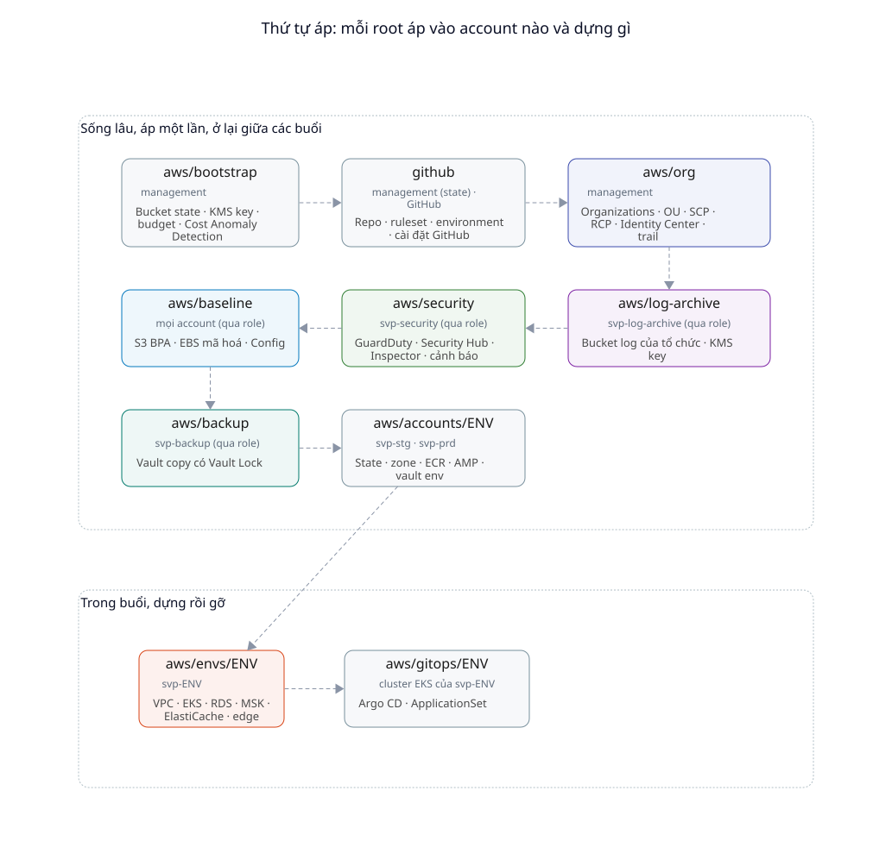
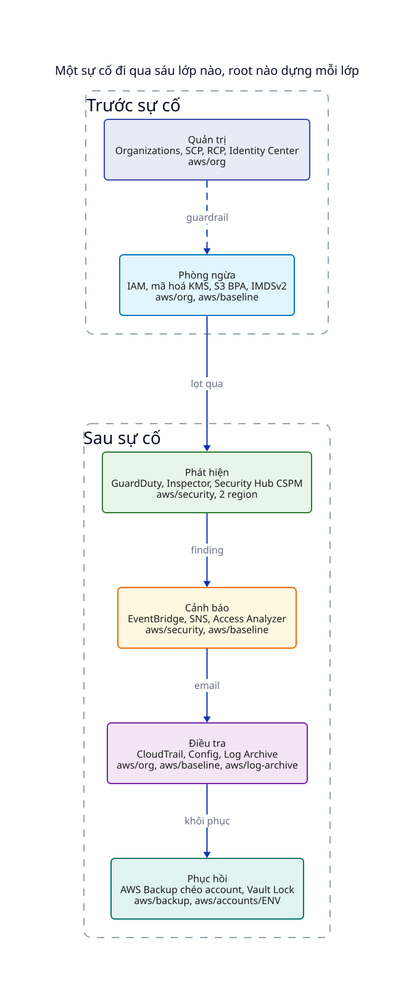

# svp-infra

Terraform của nền tảng video ngắn [svp-backend](https://github.com/anhnvcoder/svp-backend): tổ chức AWS nhiều account, nền bảo mật, nền mà
Argo CD triển khai lên (mạng, cluster EKS, dữ liệu managed, registry, observability, DNS, edge) và cài đặt GitHub của các repo, viết thành
code. Repo code giữ service, chart và CI build image; [svp-gitops](https://github.com/anhnvcoder/svp-gitops) giữ cái gì chạy ở mỗi env; repo
này dựng chỗ để chạy. Thiết kế và lý do:
[ADR-0034](https://github.com/anhnvcoder/svp-backend/blob/main/docs/adr/0034-aws-stage7.md) §2 và các ADR mà từng chương handbook trỏ tới.

## Hệ thống trong một phút

Phần sống lâu (tổ chức, log, bảo mật, backup, nền của mỗi account env) áp một lần và ở lại giữa các buổi. Phần tính tiền theo giờ (VPC,
EKS, dữ liệu, edge, Argo CD) dựng rồi gỡ trong một buổi. Root áp lần đầu theo thứ tự dưới đây, thứ tự mà các runbook dựng một lần nối
nhau. Mỗi khối ghi tên root, account nó áp vào và việc chính; `ENV` là `stg` hay `prd`.

<picture>
  <source media="(prefers-color-scheme: dark)" srcset="docs/diagrams/readme-apply-flow-dark.svg">
  
</picture>

`aws/org` áp hai lượt, trước và sau `aws/log-archive`; bước của từng lượt ở runbook trong bảng [Bản đồ](#bản-đồ).

Bảo mật xếp thành sáu lớp bổ sung nhau: quản trị và phòng ngừa áp lên mọi workload; phát hiện (dẫn tới cảnh báo) và điều tra (dẫn
tới phục hồi) chạy song song. Đây là sơ đồ khái niệm về trách nhiệm, không phải luồng API:

<picture>
  <source media="(prefers-color-scheme: dark)" srcset="docs/diagrams/security-layers-dark.svg">
  
</picture>

## Bắt đầu

- **Học:** [handbook](docs/handbook/README.md), khi muốn hiểu hệ thống dựng gì, vì sao, giá bao nhiêu và nó nối với đề AWS SAP ở đâu.
  Đọc chương 00 trước, rồi theo số chương.
- **Làm:** [runbook](docs/runbooks/README.md), khi dựng lần đầu, chạy một buổi stg hay prd, đổi cờ chi phí hay gỡ: checklist từng bước có
  lệnh, kết quả mong đợi và cách kiểm.

## Bản đồ

Mỗi root một dòng, theo thứ tự áp. "Qua role": root chạy bằng profile của management, provider assume `OrganizationAccountAccessRole`
của account đích.

| Root | Account | Chương | Runbook |
| --- | --- | --- | --- |
| [`aws/bootstrap`](aws/bootstrap/README.md) | management | [01. Bootstrap](docs/handbook/01-bootstrap.md) | [`org-security-setup.md`](docs/runbooks/org-security-setup.md) |
| [`github`](github/README.md) | management (state), GitHub | [02. GitHub](docs/handbook/02-github.md) | [`github-setup.md`](docs/runbooks/github-setup.md) |
| [`aws/org`](aws/org/README.md) | management | [03. Tổ chức](docs/handbook/03-org.md) | [`org-security-setup.md`](docs/runbooks/org-security-setup.md) |
| [`aws/log-archive`](aws/log-archive/README.md) | `svp-log-archive`, qua role | [04. Log Archive](docs/handbook/04-log-archive.md) | [`org-security-setup.md`](docs/runbooks/org-security-setup.md) |
| [`aws/security`](aws/security/README.md) | `svp-security`, qua role | [05. Bảo mật](docs/handbook/05-security.md) | [`org-security-setup.md`](docs/runbooks/org-security-setup.md) |
| [`aws/baseline`](aws/baseline/README.md) | mọi account, qua role | [06. Baseline](docs/handbook/06-baseline.md) | [`org-security-setup.md`](docs/runbooks/org-security-setup.md) |
| [`aws/backup`](aws/backup/README.md) | `svp-backup`, qua role | [07. Backup](docs/handbook/07-backup.md) | [`backup-setup.md`](docs/runbooks/backup-setup.md) |
| [`aws/accounts/<env>`](aws/accounts/README.md) | `svp-stg`, `svp-prd`, sống lâu | [08. Account env](docs/handbook/08-accounts.md) | [`accounts-setup.md`](docs/runbooks/accounts-setup.md), [`edge-setup.md`](docs/runbooks/edge-setup.md), [`platform-setup.md`](docs/runbooks/platform-setup.md) |
| `aws/envs/<env>` ([stg](aws/envs/stg/README.md), [prd](aws/envs/prd/README.md)) | `svp-<env>`, trong buổi | [09–12: mạng, EKS, dữ liệu, media và edge](docs/handbook/09-envs-network.md) | [`session-stg.md`](docs/runbooks/session-stg.md), [`session-prd.md`](docs/runbooks/session-prd.md) |
| [`aws/gitops/<env>`](aws/gitops/README.md) | cluster EKS của `svp-<env>`, trong buổi | [13. GitOps](docs/handbook/13-gitops.md) | [`session-stg.md`](docs/runbooks/session-stg.md), [`session-prd.md`](docs/runbooks/session-prd.md) |
| `.github/workflows/`, `ci/` | GitHub Actions; role plan chỉ đọc ở `svp-<env>` | [14. CI](docs/handbook/14-ci.md) | [`github-setup.md`](docs/runbooks/github-setup.md) |
| [`aws/paid-features.json`](aws/paid-features.json) | mọi account | [15. Chi phí](docs/handbook/15-cost.md) | [`paid-features.md`](docs/runbooks/paid-features.md) |

Phí giữ giữa các buổi và phí một buổi của mỗi root: chương [15. Chi phí](docs/handbook/15-cost.md). Mỗi root tạo bao nhiêu tài nguyên
trên account trống, theo phần và dịch vụ: [`docs/reference/inventory.md`](docs/reference/inventory.md).

## Cài đặt

```sh
git clone https://github.com/anhnvcoder/svp-infra.git
cd svp-infra
```

Lệnh kiểm cần Docker và `make`; mọi công cụ chạy từ image ghim digest, không cài gì thêm. `plan`, `apply` (chỉ người học) cần thêm
Terraform (Homebrew, bản nằm trong `required_version` của root), AWS CLI v2 với một profile SSO mỗi account và direnv: profile, biến
account, region ở [`docs/reference/operations.md`](docs/reference/operations.md).

## Lệnh kiểm

```sh
make check                            # mọi phép kiểm tĩnh, không chạm account
make check DIRS=aws/modules/network   # chỉ các phép Terraform của một thư mục
make inventory                        # sinh lại bảng tài nguyên mỗi root (plan giả, không mạng, không credential)
make hooks                            # bật hook pre-commit (một lần mỗi clone)
make help                             # liệt kê target
```

Mỗi target làm gì, chạy song song, hook pre-commit, ngoại lệ trivy: [`docs/reference/checks.md`](docs/reference/checks.md). Đổi root,
module, cờ hay `<env>.tfvars` thì chạy `make inventory` trong cùng PR: `make check` (`inventory-check`) đỏ khi bảng lệch code.

## Luật an toàn

Đủ ở [`AGENTS.md`](AGENTS.md); năm luật chính:

- **Chỉ người học chạy lệnh chạm account** (`plan`, `apply`, `destroy`, `aws`, script của `aws/scripts/`), bằng SSO, sau
  `aws/scripts/check-account.sh`. AI chỉ chạy phép kiểm tĩnh (danh sách đủ ở `AGENTS.md`).
- **Repo public, không commit** state, plan, `backend*.hcl`, `*.auto.tfvars`, `.terraform/`, `.session/`; ví dụ dùng `000000000000`,
  `svp.example`. Không account ID, IP, email hay tên miền thật nào ở đây.
- **Guardrail của tổ chức** ([`org-policies`](aws/modules/org-policies/README.md)): account thành viên không tạo được IAM user, không tắt
  trail, dịch vụ phát hiện hay baseline; đường khẩn cấp ở [`break-glass.md`](docs/runbooks/break-glass.md).
- **CI có đúng hai ngoại lệ credential:** role plan chỉ đọc trong environment `terraform-plan` mà người học duyệt từng lượt, và khoá
  `INFRACOST_API_KEY` của API giá; `check.yml` không credential nào.
- **Nghi lộ khoá AWS hay giá trị cá nhân:** mục "Giảm thiểu" của runbook
  [`svp-infra-setup.md`](https://github.com/anhnvcoder/svp-backend/blob/main/docs/runbooks/svp-infra-setup.md) của svp-backend.

## Tài liệu

- [`docs/handbook/`](docs/handbook/README.md): giải thích, một chương mỗi bước của luồng áp (Explanation).
- [`docs/runbooks/`](docs/runbooks/README.md): việc từng bước, theo thứ tự làm (How-to).
- `docs/reference/`: tra cứu, [`checks.md`](docs/reference/checks.md) (lệnh kiểm), [`operations.md`](docs/reference/operations.md)
  (profile, biến, script, đọc plan), [`ci.md`](docs/reference/ci.md) (plan và chi phí trên PR),
  [`inventory.md`](docs/reference/inventory.md) (tài nguyên mỗi root tạo trên account trống, sinh từ code).
- `docs/diagrams/`: sơ đồ AWS, nhúng ở chương 00 và các chương liên quan.
- README của mỗi root và module: tài nguyên, đầu vào, đầu ra. ADR và explanation chung của lab ở `docs/` của svp-backend.

Code trỏ ghi chú thiết kế bằng dòng `Design notes: README.md`. File nằm trong thư mục có README riêng (root, module, `github/`) trỏ README
đó; file ở gốc repo, `aws/scripts/`, `ci/` trỏ README này, và ghi chú nằm ở:

| Code | Ghi chú thiết kế |
| --- | --- |
| `Makefile`, `.trivyignore.yaml` | [`docs/reference/checks.md`](docs/reference/checks.md) |
| `aws/scripts/*.sh` | [`docs/reference/operations.md`](docs/reference/operations.md) (script, bảng env, `tf.sh`); thứ tự gỡ, đường backup: [chương 00](docs/handbook/00-tong-quan.md#các-đường-của-một-buổi) |
| `.github/workflows/*.yml`, `ci/*.sh`, `infracost.yml`, `infracost-usage.yml` | [14. CI](docs/handbook/14-ci.md), [`docs/reference/ci.md`](docs/reference/ci.md) |

**Khoá Infracost** (`ci/infracost.sh` đòi `INFRACOST_API_KEY`): đăng ký, đặt vào secret và xoay theo runbook
[`github-setup.md`](docs/runbooks/github-setup.md) [mục "Khoá Infracost"](docs/runbooks/github-setup.md#khoá-infracost);
chạy `make infracost` trên máy với khoá của CLI: [`docs/reference/ci.md`](docs/reference/ci.md).

## Đóng góp

Quy ước chung (ngôn ngữ, tài liệu, ADR, Git, repo public) ở
[`CONTRIBUTING.md`](https://github.com/anhnvcoder/.github/blob/main/CONTRIBUTING.md) của `anhnvcoder/.github`; luật riêng của repo, luật
an toàn cloud ở [`AGENTS.md`](AGENTS.md). Mọi thay đổi vào `main` đi qua pull request có `infra-ok` xanh.

## Giấy phép

[Apache-2.0](LICENSE).
