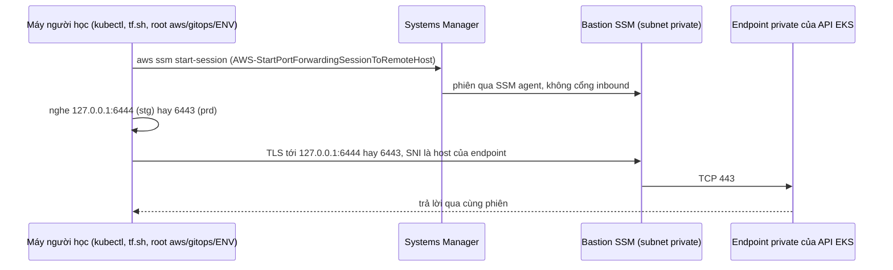
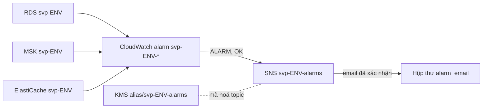
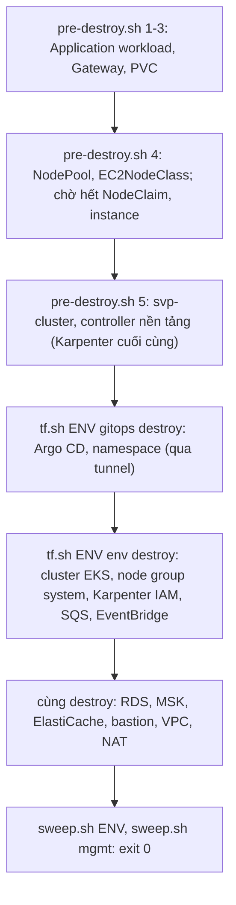

# svp-infra

Terraform của nền tảng video ngắn [svp-backend](https://github.com/anhnvcoder/svp-backend): nền mà Argo CD triển khai lên trên AWS
(mạng, cluster, dữ liệu managed, DNS) và cài đặt GitHub của các repo, viết thành code.

## Mục lục

- [Bối cảnh](#bối-cảnh)
- [Cài đặt](#cài-đặt)
- [Sử dụng](#sử-dụng)
- [Bố cục](#bố-cục)
- [Lệnh kiểm](#lệnh-kiểm)
- [Plan và apply](#plan-và-apply)
- [Luồng vận hành](#luồng-vận-hành)
- [Luật an toàn](#luật-an-toàn)
- [Đóng góp](#đóng-góp)
- [Giấy phép](#giấy-phép)

## Bối cảnh

Repo code giữ service, chart và CI build image; [svp-gitops](https://github.com/anhnvcoder/svp-gitops) giữ cái gì chạy ở mỗi env; repo
này dựng chỗ để chạy. Thiết kế và lý do ở
[ADR-0034](https://github.com/anhnvcoder/svp-backend/blob/main/docs/adr/0034-aws-stage7.md) §2; cài đặt GitHub của repo ở
[runbook `svp-infra-setup.md`](https://github.com/anhnvcoder/svp-backend/blob/main/docs/runbooks/svp-infra-setup.md).

Repo public: **không account ID, IP, email, tên miền thật, state hay plan nào ở đây** (mục [Luật an toàn](#luật-an-toàn)).

## Cài đặt

```sh
git clone https://github.com/anhnvcoder/svp-infra.git
cd svp-infra
```

Lệnh kiểm cần Docker và `make`; mọi công cụ chạy từ image ghim digest, không cài gì thêm. `plan`, `apply` (chỉ người học) cần thêm
Terraform 1.15 (Homebrew) và AWS CLI v2 với một profile SSO mỗi account (mục [Plan và apply](#plan-và-apply)).

## Sử dụng

```sh
make check                            # mọi phép kiểm tĩnh, không chạm account
make check DIRS=aws/modules/network   # chỉ các phép Terraform của một thư mục
make help                             # liệt kê target
```

Dựng, đo và gỡ một env theo runbook [`docs/runbooks/session-stg.md`](docs/runbooks/session-stg.md) hay
[`docs/runbooks/session-prd.md`](docs/runbooks/session-prd.md) (mục [Plan và apply](#plan-và-apply)).
Nâng minor EKS của cả hai env theo runbook [`docs/runbooks/eks-upgrade.md`](docs/runbooks/eks-upgrade.md).
Cài đặt GitHub của các repo (Terraform `github/`, GitHub App từ manifest, phần provider không quản) theo runbook
[`docs/runbooks/github-setup.md`](docs/runbooks/github-setup.md); `make github-check` đọc lại phần ngoài Terraform.

## Bố cục

```text
Makefile                      make check (fmt, validate, tflint, tfdocs, trivy, shellcheck, zizmor, docs, test), make lock, make fmt, make tfdocs
CODEOWNERS                    đường có chủ: CODEOWNERS, .github/, renovate.json, Makefile, .trivyignore.yaml, github/, aws/
LICENSE                       Apache-2.0
.markdownlint.yaml            luật markdownlint của make docs-check (cùng file của repo code)
lychee.toml                   cấu hình lychee của make docs-check (cùng file của repo code)
.tflint.hcl                   ruleset terraform (recommended) và aws ghim version
.trivyignore.yaml             ngoại lệ của trivy trong module tải từ registry
renovate.json                 provider, module, ruleset tflint, image ghim của Makefile, action
.github/workflows/check.yml   PR và push main: make check (bỏ qua khi PR chỉ tài liệu), docs-check; check tổng infra-ok; không secret
.github/workflows/pr-title.yml  PR: tiêu đề theo Conventional Commits (check pr-title)
.github/workflows/scorecard.yml push main và lịch tuần: OpenSSF Scorecard, kết quả công khai và lên code scanning
.github/zizmor.yml            ngoại lệ của zizmor, mỗi mục một lý do (tạo khi có ngoại lệ đầu tiên)
aws/
  bootstrap/                  management account, một lần, giữ giữa các buổi: bucket state, budget của org; không hosted zone nào
  org/                        management account: Organizations, OU Workloads, account svp-stg và svp-prd, SCP, IAM Identity Center (SvpAdmin), organization trail
  accounts/<env>/             baseline của mỗi account thành viên (stg, prd), giữ giữa các buổi: bucket state, KMS key của nó, zone của env (prd aws.<domain>, giữ cả bản ghi NS uỷ quyền stg.aws.<domain>; stg stg.aws.<domain>), budget
  envs/<env>/                 cấu hình gốc của mỗi env (stg, prd: cùng *.tf kể cả bastion SSM, khác ở <env>.tfvars; prd thêm teardown.tfvars)
  gitops/<env>/               bootstrap GitOps của cluster EKS của env (GitOps Bridge): namespace, Argo CD, AppProject, cluster Secret, ApplicationSet svp-bootstrap
  modules/                    module nội bộ; lock file không commit
    network, eks, rds, media  nền của mỗi env (network: ba tầng subnet mỗi AZ, public, private, database; eks: nhóm node hệ thống, IAM, SQS, EventBridge của Karpenter)
    msk                       Kafka của env: Amazon MSK provisioned, một broker mỗi AZ ở subnet database, SASL/SCRAM-SHA-512 trên TLS 9096
    elasticache               Valkey của env: ElastiCache for Valkey, cluster mode tắt, ở subnet database, TLS 6379, user RBAC theo db và tiền tố
    alarms                    topic SNS svp-<env>-alarms mã hoá bằng KMS key của module, subscription email; alarm của RDS, MSK, ElastiCache gửi tới nó
    waf                       web ACL của CloudFront (cả hai root env gọi, provider us-east-1; gói flat-rate Free của media đòi nó)
    ssm-bastion               bastion SSM tới endpoint private của API EKS (cả hai env)
    external-secrets          vỏ entry Secrets Manager svp/<env>/*, role của External Secrets theo namespace, Pod Identity
    gitops-bridge             giá trị của bootstrap GitOps (không resource): cluster Secret, values Argo CD, root
    org-policies              ba SCP của OU Workloads
    account-baseline          bucket state, KMS key, zone (cùng bản ghi NS uỷ quyền zone con, chỉ prd dùng), budget của một account thành viên
  backend.hcl                 backend của management (bucket của aws/bootstrap; không commit, sinh từ output backend_hcl)
  backend-<env>.hcl           backend của account stg, prd (bucket, region, KMS; không key, mỗi root truyền key riêng; không commit, sinh từ output của accounts/<env>)
  scripts/                    script buổi AWS theo bảng env (mgmt, stg, prd) của lib.sh: kiểm account, DNS, Terraform hai root, secret và chờ Argo CD, đo, pre-destroy, sweep
github/                       cài đặt GitHub của các repo trong `local.repositories` (repo, quyền Actions, ruleset, environment promote); state trong bucket của aws/bootstrap
docs/diagrams/                sơ đồ AWS svp-aws.drawio (trang stg, prd, flows), PDF, PNG nhúng ở docs của repo code; sinh từ spec
.claude/skills/aws-drawio-diagram/   spec và checker của sơ đồ (luật vẽ ở SKILL.md)
```

**Sơ đồ** ([`docs/diagrams/svp-aws.pdf`](docs/diagrams/svp-aws.pdf)): sinh bằng
`python3 .claude/skills/aws-drawio-diagram/scripts/build_svp.py --pdf --docs`, không sửa tay trong draw.io. Cỡ của mỗi trang env đọc từ
`aws/envs/<env>/<env>.tfvars` cộng mặc định ở `variables.tf` của root đó, nên đổi cỡ thì build lại. Kiểm trước khi commit:
`check_diagram.py docs/diagrams/svp-aws.drawio` (hình học) và `check_svp_counts.py` (số AZ, subnet, NAT, node hệ thống, node Karpenter,
bastion, RDS, broker MSK, node ElastiCache khớp cỡ của env),
cả hai chạy offline, không cần credential. Xuất PDF, PNG cần CLI draw.io (`brew install --cask drawio`, hay biến `DRAWIO`).

**Root và module:** thư mục nằm dưới một thư mục `modules/` là module, mọi thư mục `*.tf` khác là cấu hình gốc (root). Root commit
`.terraform.lock.hcl` (hash của `darwin_arm64`, `linux_amd64`, `linux_arm64`) và `make check` dùng nó ở chế độ chỉ đọc
(`init -lockfile=readonly`), nên đổi provider của root phải chạy `make lock DIRS=<root>` trước. Module không commit lock file
(`.gitignore`): root gọi nó quyết version provider.

## Lệnh kiểm

Chạy từ gốc repo, không cần credential AWS, cần Docker và mạng (registry Terraform, GitHub cho plugin tflint, GHCR cho bộ luật trivy):

| Lệnh | Làm gì |
| --- | --- |
| `make check` | `fmt-check`, `validate`, `tflint`, `tfdocs-check`, `trivy` trên mọi thư mục có `*.tf`, rồi `shellcheck` trên mọi `*.sh`, `zizmor` trên mọi workflow, `docs-check` trên mọi `.md`, `session-test`, `test-guard`, `test` trên mọi module |
| `make check DIRS="aws/modules/x aws/envs/stg"` | như trên, sáu phép Terraform chỉ trên các thư mục đó; thư mục không có, không có `*.tf` hay nằm ngoài repo thì dừng, nêu thư mục |
| `make fmt-check` / `make fmt` | `terraform fmt -check -diff -recursive` / viết lại file |
| `make validate` | mỗi thư mục: `terraform init -backend=false -input=false`, rồi `terraform validate`; provider và module nằm ở thư mục tạm (`TF_DATA_DIR`), nên `.terraform/` của người học đã `init` với backend S3 không bị đọc hay ghi |
| `make tflint` | mỗi thư mục: `tflint --init`, rồi `tflint` với `.tflint.hcl` |
| `make trivy` | `trivy config` mỗi thư mục; HIGH và CRITICAL làm đỏ |
| `make shellcheck` | shellcheck trên mọi `*.sh` (bản image, `--network none`; máy không cài shellcheck) |
| `make zizmor` | lint bảo mật workflow bằng zizmor (`--persona=regular`), mọi finding làm đỏ; có `GH_TOKEN` thì chạy thêm audit online (impostor commit, action có lỗ hổng), không thì offline; `ZIZMOR_FORMAT=github` in annotation |
| `make docs-check [DOCS='<file hay glob>']` | markdownlint-cli2 theo `.markdownlint.yaml`, rồi lychee `--offline --include-fragments` (link tương đối và anchor heading; link ra ngoài không kiểm), container `--network none`; mặc định mọi `.md` git theo dõi và file mới chưa theo dõi, trừ `.claude/` (cấu hình agent, không phải tài liệu của repo) |
| `make lock [DIRS=<root>]` | `init -backend=false` rồi `terraform providers lock` cho ba nền tảng; module bị bỏ qua |
| `make tfdocs` / `make tfdocs-check` | terraform-docs ghi / kiểm khối sinh (requirements, providers, resources, inputs, outputs) giữa `<!-- BEGIN_TF_DOCS -->` và `<!-- END_TF_DOCS -->` của `README.md` mỗi module; `tfdocs-check` đỏ khi README lệch `.tf`, root bị bỏ qua; container `--network none` |
| `make test` | `terraform test` của mỗi module (`tests/*.tftest.hcl`): `init -backend=false` trong một container, rồi `terraform test` trong container `--network none` với image `TERRAFORM_IMAGE` ghim digest, chỉ thư mục module được mount (chỉ đọc), không biến `AWS_*` nào (bỏ bằng `env -u`), không `~/.aws`, `.envrc`, `backend.hcl`; file test chỉ được nhận khi theo khuôn: đúng một dòng `mock_provider "aws" {`, mỗi `run "<tên>" {` có `command = plan` ở dòng không trống đầu tiên, không dòng nào khác bắt đầu bằng `run`, `mock_provider`, `provider`, `override_`, `module`, `command`, `/*`, không `alias`, `*/`, heredoc, symlink hay `*.tftest.json`; sai thì bị từ chối, nêu file và dòng; root bị bỏ qua |
| `make test-guard` | tự kiểm ba luật của `make test` với `docker` giả trên PATH: file test sai bị từ chối, lệnh docker có `--network none`, image ghim digest, không biến hay file credential AWS nào tới container |
| `make help` | liệt kê target |

Chưa có thư mục `*.tf` nào thì sáu phép Terraform in một dòng và qua. Mọi công cụ chạy bằng image ghim digest trong `Makefile`
(`TERRAFORM_IMAGE` 1.15.8, `TFLINT_IMAGE`, `TRIVY_IMAGE`, `ZIZMOR_IMAGE`, `MARKDOWNLINT_IMAGE` và `LYCHEE_IMAGE` cùng bản ghim của repo code,
`SHELLCHECK_IMAGE`, `TFDOCS_IMAGE_AMD64` và `TFDOCS_IMAGE_ARM64`:
terraform-docs chỉ có tag theo kiến trúc nên ghim cả hai cùng bản, `Makefile` chọn theo `uname -m`), cùng một tham chiếu trên máy dev và trong CI,
nên không cài gì thêm và không tin action setup nào. Trên máy chủ chạy ba target tự kiểm, không container: `session-test` chỉ cần bash, git và jq
mà máy Mac và runner CI đều có, `test-guard` chạy với `docker` giả, `github-app-test` dùng python3. Image chạy qua
`env -u DOCKER_DEFAULT_PLATFORM docker run` (shell của máy đặt `linux/amd64` cho dự án khác), container chạy dưới uid của người gọi.
Không target nào gọi `apply`, `destroy`, `import`, `state`, `output` hay `aws`; `plan` duy nhất là các `run` của `make test`, trên provider AWS giả
(`mock_provider`), không mạng, không credential.

**Khối sinh của README module** nằm giữa `<!-- markdownlint-disable MD033 -->` và `<!-- markdownlint-enable MD033 -->`: terraform-docs viết
giá trị mặc định dạng danh sách bằng HTML (`<pre>`, `<br/>`) và chép nguyên mô tả của biến, output, nên `docs-check` không đòi luật
inline HTML trong khối đó; phần viết tay ngoài khối vẫn theo đủ luật.

**Test của module** (`aws/modules/<module>/tests/*.tftest.hcl`): mỗi rule `validation` trong `variables.tf` có một `run` với giá trị chỉ rule đó
từ chối và `expect_failures` trỏ biến, mỗi module một `run` giá trị hợp lệ; data source cần giá trị có hình (JSON của policy, ARN, danh sách
zone) lấy từ `mock_data` của file test vì provider giả vẫn kiểm đối số. Policy IAM được kiểm qua đối số của các data source
`aws_iam_policy_document` (provider giả trả JSON cố định cho chúng), nên JSON đó phải là một policy. Ví dụ, test của `account-baseline` kiểm
ai dùng được key state, bucket state được bảo vệ ra sao, tên zone, uỷ quyền zone con và bốn cảnh báo budget, rồi mỗi rule `validation` một
plan. Thêm rule `validation` thì thêm `run` trong cùng thay đổi.

**Chạy song song trên hai thư mục khác nhau** (`make check DIRS=a` và `make check DIRS=b` cùng lúc) an toàn vì mỗi lượt chỉ ghi dưới
thư mục nó kiểm:

- thư mục tạm của lượt (`TF_DATA_DIR`): provider (bản Linux của container, ~700 MB cho provider AWS) và module tải về, xoá khi lượt kết thúc;
- plugin tflint ở `<dir>/.terraform/tflint.d/` (`TFLINT_PLUGIN_DIR`, ~70 MB);
- `<dir>/.terraform.lock.hcl` của module (root chỉ đọc lock của nó; `make lock` thì ghi);
- cache của trivy, zizmor nằm trong container (`/tmp/trivy`, `/tmp/zizmor`) và mất khi container dừng; `session-test` chỉ ghi trong một thư mục
  tạm riêng của nó và xoá thư mục đó; shellcheck, `docs-check` không ghi gì.

Không có cache plugin dùng chung (`TF_PLUGIN_CACHE_DIR` không đặt, không thư mục plugin tflint chung): hai lượt không bao giờ cùng ghi một
file, đổi lại mỗi lượt tải provider riêng. `.terraform/` mà người học `init` với backend thật không bị `make check` đọc hay ghi (trừ
`tflint.d/`).

**Ngoại lệ của trivy:** finding trong file `.tf` của repo này bỏ qua ngay cạnh resource bằng dòng `#trivy:ignore:<id>`, lý do ở comment
ngay trên; finding trong module tải từ registry (không comment được) vào `.trivyignore.yaml`, `paths` tương đối với thư mục được kiểm. Sửa
được thì sửa, không ghi ngoại lệ. Mỗi mục của `.trivyignore.yaml` có `id`, `paths` (không bao giờ một id cho mọi file), `statement` (lý do) và,
khi quyết định đang chờ việc khác, `expired_at` (yyyy-mm-dd). trivy so `paths` với đường nó báo, với module registry là
`<namespace>/<name>/<provider>/<file>` (ví dụ `terraform-aws-modules/eks/aws/main.tf`). Luật ghi phạm vi (`Scope:`) trong lý do, và vì sao
ngoại lệ chỉ-stg không che finding của prd, ở mục "Ngoại lệ trivy" của [`AGENTS.md`](AGENTS.md).

**Cách `make trivy` quét:** finding HIGH hoặc CRITICAL làm đỏ; ngoại lệ có chủ đích nằm ở `.trivyignore.yaml`, mỗi mục kèm lý do.
`--skip-dirs` bỏ thư mục `examples/` mà module registry kèm theo (manifest Kubernetes và root mẫu mà Terraform không bao giờ apply), dù
module được gọi từ root nào, nên không ngoại lệ nào phải lặp theo từng root. `--skip-check-update` giữ bộ luật dựng sẵn trong image ghim:
bộ luật trivy sẽ tải về nằm sau một tag trôi, nên luật mới có thể làm check bắt buộc đỏ trên code không đổi, hay một luật biến mất mà không
ai hay. Module registry do chính trivy tải về và được quét với cấu hình gọi nó. Mỗi root được quét với giá trị của env nó chạy:
`<thư mục>/<phần cuối của tên thư mục>.tfvars` (`aws/envs/prd/prd.tfvars`), khi file đó có, đi vào `--tf-vars`, nên ngoại lệ chỉ đúng cho
một env (ignore có điều kiện thuộc tính, ignore trên lời gọi module trong root của env đó) không bao giờ che finding của env khác. Module,
hay root không có file đó, được quét với giá trị mặc định của biến.

**CI** (`.github/workflows/check.yml`): mỗi PR và push `main` chạy đúng `make check` trên `ubuntu-24.04`; job `check` chỉ `contents: read`,
token của lượt chỉ vào container tflint (giới hạn tải plugin từ GitHub) và container zizmor (audit online, finding thành annotation), không
secret, không OIDC, không credential AWS; job `infra-ok` là check duy nhất ruleset `main` đòi từ workflow này, nên job khác đổi tên hay thêm mà không đụng ruleset. Job `changes` đọc danh sách file của PR
qua API: PR chỉ đổi tài liệu (`.md`, `docs/`, `LICENSE`, trừ `README.md` của thư mục Terraform mà terraform-docs viết một phần) bỏ qua
`make check`; job `docs` (`make docs-check`) luôn chạy; đổi `Makefile` hay `check.yml` và push thì chạy hết (file đổi tên xét cả tên cũ; API liệt kê thiếu file thì cũng chạy hết); `infra-ok` chỉ nhận skip đó.

Repo public và PR từ fork chạy workflow với code của fork, nên workflow này theo các luật:

- Không credential AWS nào, không OIDC (không quyền `id-token`), không secret, không environment: `make check` không bao giờ chạm account (`init` chạy
  với `-backend=false`; không gì gọi `apply` hay AWS CLI; các plan duy nhất là của `terraform test`, trên provider AWS giả, trong container không mạng
  và không biến AWS).
- Không `pull_request_target`, không `workflow_run`: PR không bao giờ chạy với token ghi.
- Job duy nhất chạy code của repo chỉ có `contents: read`.
- Mọi action của workflow là của GitHub và ghim SHA đầy đủ của commit; terraform, tflint, trivy, shellcheck và zizmor chạy từ image ghim digest trong
  `Makefile`, nên không tin action bên thứ ba nào ở đây.
- `actions/checkout` không để token trong `.git/config` (`persist-credentials: false`).

**Tiêu đề PR** (`.github/workflows/pr-title.yml`, check `pr-title`): `main` chỉ nhận squash merge, tiêu đề PR thành tiêu đề commit, nên
tiêu đề theo [Conventional Commits](https://www.conventionalcommits.org/en/v1.0.0/): `<type>[(<scope>)][!]: <mô tả>`, `type` là một trong
`feat fix chore docs refactor test ci build perf revert`, scope tuỳ ý (không danh sách), hoặc `Revert "<tiêu đề>"` của nút Revert. Tiêu đề
bot qua nguyên dạng (`chore(stg): …`, `chore(prd): …` của app promote, `chore(deps): …`, `fix(deps): …` của Renovate). Sửa tiêu đề chỉ chạy lại `pr-title`, không chạy lại `make check`; job
không quyền, không checkout, tiêu đề vào script qua `env`. Regex và bộ thử dùng chung với ba repo có CI khác
([ADR-0041](https://github.com/anhnvcoder/svp-backend/blob/main/docs/adr/0041-github-hardening.md) (h)).

**Scorecard** (`.github/workflows/scorecard.yml`): [OpenSSF Scorecard](https://scorecard.dev/viewer/?uri=github.com/anhnvcoder/svp-infra)
khi push `main`, mỗi tuần và khi branch protection cổ điển đổi: kiểm ghim, quyền token, ruleset, mẫu workflow nguy hiểm và các
[check khác](https://github.com/ossf/scorecard/blob/main/docs/checks.md); kết quả công khai (`publish_results: true`) ở API Scorecard và lên code
scanning. Không chạy trên PR. Check Branch-Protection đọc ruleset bằng `GITHUB_TOKEN` nên không cần `repo_token`. `ossf/scorecard-action` là
action duy nhất không của GitHub (API Scorecard chỉ nhận kết quả từ nó), được cho phép theo tên ở cài đặt Actions của repo (`github/`); nó chạy
trong workflow riêng, không kiểm PR nào và không chạy code của repo.

Publish ràng buộc file này theo "Workflow Restrictions" mà API Scorecard kiểm trước khi nhận kết quả (README của `ossf/scorecard-action`, mã ở
`api/app/server/verify_workflow.go` của `ossf/scorecard-infra`): không `env` hay `defaults` ở mức workflow và ở job, không quyền ghi ở mức
workflow, `id-token: write` chỉ ở job Scorecard, không container hay service, một nhãn runner Ubuntu do GitHub host (`ubuntu-latest` hay
`ubuntu-YY.MM`, 22.04 trở lên), và chỉ `actions/checkout`, `actions/upload-artifact`, `github/codeql-action/upload-sarif`,
`ossf/scorecard-action`, `step-security/harden-runner` làm step của job đó, mỗi step là một `uses:` (không step `run:`). API nhận hay không thì
hiện ở log của step Scorecard. Mọi action ghim SHA đầy đủ của commit; checkout không để token trong `.git/config`.

## Plan và apply

Hai đường vào:

- **Một lần ở management account:** [`aws/bootstrap/README.md`](aws/bootstrap/README.md) (bucket state, budget của org), rồi
  [`aws/org/README.md`](aws/org/README.md) (tổ chức, account stg và prd, SCP, Identity Center, trail).
- **Một lần mỗi account thành viên:** [`aws/accounts/README.md`](aws/accounts/README.md) (baseline, uỷ quyền zone của env: zone gốc `aws.<domain>`
  của prd ở DNS cha, zone `stg.aws.<domain>` ở zone prd).
- **Cài đặt GitHub** (thêm repo hay App): runbook [`docs/runbooks/github-setup.md`](docs/runbooks/github-setup.md).
- **Mỗi buổi dựng, đo, gỡ một env:** runbook [`docs/runbooks/session-stg.md`](docs/runbooks/session-stg.md) (stg, cùng mọi mục chung) và
  [`docs/runbooks/session-prd.md`](docs/runbooks/session-prd.md) (prd: cổng promote, diễn tập, final snapshot). Xem trước
  toàn bộ lệnh của buổi, không chạy gì và không cần credential: `aws/scripts/session.sh --print stg` (hay `prd`). Chi phí và trần một buổi
  4 giờ: mục "Giới hạn" của `session-stg.md`, "Chi phí và giới hạn" của `session-prd.md`.
- **Nâng minor EKS:** runbook [`docs/runbooks/eks-upgrade.md`](docs/runbooks/eks-upgrade.md).

Chỉ người học chạy, từ máy, bằng SSO, theo script và runbook của repo. Mỗi account một profile và một biến chứa 12 số của account (export
trong terminal của buổi, không ghi vào file nào); mọi lệnh viết sẵn ghi profile ngay trong lệnh, `TF_VAR_account_id` từ biến của account đó
và `--region`:

| Account | Profile SSO | Biến account | Root |
| --- | --- | --- | --- |
| management (account sandbox) | `anhnv-sso` | `SVP_AWS_MGMT_ACCOUNT_ID` | `aws/bootstrap`, `aws/org`, `github/` |
| `svp-stg` | `anhnv-stg` | `SVP_AWS_STG_ACCOUNT_ID` | `aws/accounts/stg`, `aws/envs/stg`, `aws/gitops/stg` |
| `svp-prd` | `anhnv-prd` | `SVP_AWS_PRD_ACCOUNT_ID` | `aws/accounts/prd`, `aws/envs/prd`, `aws/gitops/prd` |

Region `ap-southeast-1` cho dịch vụ theo region và STS, `us-east-1` cho Organizations, WAF của CloudFront, Pricing Plan Manager và API Free
Tier, region của instance Identity Center cho `sso-admin`, `identitystore`. Terraform của máy (Homebrew) phải nằm trong `required_version` của root (`~> 1.15`). Backend S3,
khoá bằng lock file native của S3 (`use_lockfile`): root của management đọc `aws/backend.hcl` (sinh từ output của `aws/bootstrap`); root
của account thành viên đọc `aws/backend-<env>.hcl` (sinh từ output `backend_hcl` của `aws/accounts/<env>`, không có `key`) cộng một
`-backend-config=key=<key của root>` thứ hai, `init -reconfigure` (script buổi `tf.sh` làm vậy). Không file nào trong hai loại được commit.

**Profile AWS không nằm trong code** (khuyến nghị của HashiCorp và AWS: thông tin đăng nhập là của môi trường chạy, không của cấu hình; CI
cần credential thì dùng OIDC, máy khác đặt tên profile khác). Code chỉ chặn nhầm account bằng `allowed_account_ids = [var.account_id]`.
Vì mỗi root thuộc một account, không đặt một `AWS_PROFILE` hay `TF_VAR_account_id` chung cho cả thư mục (`.envrc` của direnv, `~/.zshrc`):
profile và account ghi trong từng lệnh, script buổi lấy chúng từ bảng env của `aws/scripts/lib.sh`.

**Script buổi** (`aws/scripts/`) dùng chung `lib.sh` và chạy từ terminal của máy Mac (bash 3.2 là đủ); các bước theo thứ tự ở runbook
[`session-stg.md`](docs/runbooks/session-stg.md) và [`session-prd.md`](docs/runbooks/session-prd.md). Mỗi script nhận `--print` làm đối số đầu
để in, theo thứ tự, mọi lệnh nó sẽ chạy rồi không chạy lệnh nào: không gọi `aws`, `kubectl`, `helm`, `terraform`, `make`, `git`, `nc` hay
`dig`, không đọc gì từ account và không ghi gì. Mọi lệnh chạm AWS mang profile và region ngay trong lệnh (`AWS_PROFILE=anhnv-stg ... --region
ap-southeast-1`), không qua biến shell mà người đọc phải tra. Mỗi bước in một dòng: `ok`, `FAIL` (script dừng), `note` hay `skip`. Không giá
trị bí mật nào được in hay ghi vào file.

Bảng env của `lib.sh` (`env_table`) mỗi env một dòng và là nơi duy nhất các env khác nhau: không script nào rẽ nhánh theo tên env, script
đọc các trường của dòng:

| Trường | Nghĩa |
| --- | --- |
| `name` | đối số của script; cluster, kubectl context và các root Terraform mang tên này |
| `profile` | AWS profile (IAM Identity Center) của account của env, người học tạo bằng `aws configure sso` |
| `account` | biến chứa 12 số của account đó, export trong terminal của buổi, không bao giờ ghi vào file |
| `zone` | `1` khi account có hosted zone, tên là `zone_name` của `aws/accounts/<name>/<name>.auto.tfvars` (`env_zone`); `-` khi không có |
| `kept` | tag `Stack` của thứ ở lại account giữa các buổi (`sweep.sh`), cách nhau bằng dấu phẩy |
| `tunnel` | cổng local của tunnel SSM tới endpoint API private; `-` khi endpoint public |
| `teardown` | file của `aws/envs/<name>` nhấc các bảo vệ mà destroy cần; `-` khi không có |
| `ladder` | `1` khi `measure.sh` chạy thang k6 sau smoke; `-` khi chỉ có smoke và seed |
| `session` | `1` khi env có hai root của buổi, `aws/envs/<name>` và `aws/gitops/<name>` |

`bootstrap.sh` mỏng có chủ đích: secret và GlitchTip là target `make` của repo code, Argo CD là của Terraform; script chỉ chạy chúng theo thứ
tự, có kiểm account và có giới hạn cho mỗi lần chờ. `secrets` chạy sau `tf.sh <env> env apply` và trước root gitops (nguồn của các Secret
trong cluster có trước Argo CD); `wait` chạy sau `tf.sh <env> gitops apply`.

**Luồng secret** của một env: root `aws/envs/<env>` (module `external-secrets`) tạo các entry `svp/<env>/*` của Secrets Manager. Mật khẩu
Kafka và Valkey do chính apply đó sinh (ephemeral `random_password`, 32 chữ và số) và ghi bằng đối số write-only, không vào plan hay state,
cùng một giá trị vào secret SCRAM `AmazonMSK_svp-<env>-<user>` (module `msk`, khoá KMS của module) và entry `kafka-admin`, `kafka-users`, vào
user ElastiCache và entry `valkey-users` (module `elasticache`); đổi bằng cách tăng `msk_password_version`, `valkey_password_version` rồi
apply. Mọi entry khác `bootstrap.sh <env> secrets` ghi từ `.env` của repo code (`make eks-secrets`, chỉ kiểm ba entry kia có). External
Secrets Operator dựng Secret trong cluster từ entry; Reloader restart pod khi Secret đổi. Bước, lệnh và cách đổi một secret: runbook
[`session-stg.md`](docs/runbooks/session-stg.md#đổi-một-secret-của-env-đang-chạy). `pre-destroy.sh` để lại tới bước cuối các Application nền tảng,
vì finalizer và webhook của chúng cần cho việc xoá object của workload.

## Luồng vận hành

Ba luồng của một buổi; tên tài nguyên khớp code (trong sơ đồ, `ENV` là `stg` hay `prd`), bước và lệnh ở runbook buổi.

**Đường tới API EKS.** Endpoint công khai của API tắt ở cả hai env. Máy của người học mở phiên port forwarding của Session Manager tới
bastion `t4g.nano` trong subnet private (module `ssm-bastion`, output `api_tunnel_command`); security group của API nhận 443 từ security group
của bastion. `kubectl`, script buổi và provider của root `aws/gitops/<env>` gọi `https://127.0.0.1:<cổng>` (stg 6444, prd 6443: cột `tunnel`
của `env_table`), TLS server name là host của endpoint private.



**Đường alarm.** CloudWatch alarm của RDS, MSK, ElastiCache (trong module của mỗi dịch vụ, tên `svp-<env>-<alarm>`) gửi `ALARM` và `OK` tới
topic `svp-<env>-alarms` của module `alarms`; topic mã hoá bằng KMS key của module, key policy cho `cloudwatch.amazonaws.com` giải và sinh
data key; subscription email từ `alarm_email` của `<env>.auto.tfvars`, người học xác nhận sau mỗi apply. Alarm sống ngoài cluster: cluster
chết vẫn báo.



**Thứ tự gỡ.** Thứ Kubernetes tạo trong account đi trước, khi controller tạo ra nó còn chạy; cluster đi trước mạng. `pre-destroy.sh` xoá
Application workload và Gateway (NLB, bản ghi DNS), PVC (volume EBS), rồi NodePool và EC2NodeClass (Karpenter drain và tắt node của nó,
trần `terminationGracePeriod`), rồi controller nền tảng; root gitops gỡ qua tunnel; root env gỡ cluster, node group hệ thống, dịch vụ dữ liệu,
rồi VPC; `sweep.sh` tìm phần còn sót (instance, launch template, instance profile của Karpenter cả).



## Luật an toàn

- **AI** (Claude, Codex) chỉ chạy `make check` và các phép trong đó (kể cả `make test`: `terraform test` trên provider giả, `--network none`,
  không credential), `make tfdocs`, `terraform fmt`, `terraform init -backend=false`, `terraform validate`,
  `terraform providers lock` (`make lock`). Mọi lệnh chạm account (`terraform test` trần, `plan`, `apply`, `destroy`, `import`, `state`, `output`, `aws` trừ
  `--version`, script dùng SDK) do người học chạy; trước mọi lệnh ghi, `aws sts get-caller-identity` với profile của chính account đó
  (`aws/scripts/check-account.sh mgmt|stg|prd`) và so account. Provider của root ghim account bằng `allowed_account_ids` từ `TF_VAR_account_id`.
- **`make test` từ chối file test sai khuôn thay vì dò từng cách phá luật** (một `run` không có `command` thì apply; một mock đặt dưới
  `alias` để provider thật làm mặc định). Chỉ `init`, trong một container riêng, tải provider và module registry; container chạy test có
  `HOME` là `/tmp` của container và chỉ mount thư mục module (chỉ đọc), không bao giờ `~/.aws`, gốc repo hay thư mục env. Chuỗi trong HCL không
  xuống dòng, nên khi khối comment và heredoc bị cấm thì mỗi dòng được đọc đúng như HCL đọc nó. Vì thế dòng chứa `*/` (kể cả dòng comment, vì
  `/*` có thể nằm trong chuỗi như một origin) hay `<<` (heredoc) bị từ chối: dòng của hai thứ đó có thể giả làm dòng khuôn. Khuôn đủ ở
  [`AGENTS.md`](AGENTS.md); `make test-guard` kiểm ba luật mà không khởi động container nào.
- **Không commit:** state (`*.tfstate*`), plan (`*.tfplan`), `backend.hcl`, `*.auto.tfvars`, `terraform.tfvars`, override
  (`*_override.tf`), `.terraform/`, thư mục số đo `.session/`. Giá trị cá nhân (account ID, IP được gọi API EKS, email, tên miền thật,
  tên bucket) chỉ qua `*.auto.tfvars` không commit hay `TF_VAR_*`; repo có file `*.example` với `svp.example`, `000000000000`.
- Tên bucket theo `<tên>-<account>-<region>` (như bucket của AWS CDK, Control Tower): duy nhất toàn cầu không cần phần ngẫu nhiên.
  Account thật vẫn không nằm trong file commit nào: tên tính từ `var.account_id` lúc chạy.
- Nghi đã lộ khoá AWS hay giá trị cá nhân: mục "Giảm thiểu" của runbook `svp-infra-setup.md`.

## Đóng góp

Quy ước chung (ngôn ngữ, tài liệu, ADR, Git, repo public) ở
[`CONTRIBUTING.md`](https://github.com/anhnvcoder/.github/blob/main/CONTRIBUTING.md) của `anhnvcoder/.github`; luật riêng của repo, luật
an toàn cloud ở [`AGENTS.md`](AGENTS.md). Mọi thay đổi vào `main` đi qua pull request có `infra-ok` xanh.

## Giấy phép

[Apache-2.0](LICENSE).
