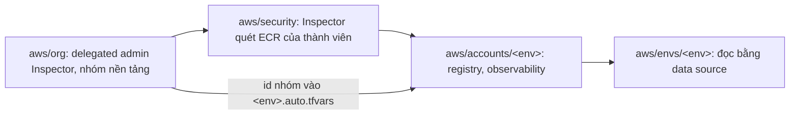

# `aws/accounts`: baseline của account stg và prd (chạy một lần mỗi account)

Mỗi account thành viên của org (`svp-stg`, `svp-prd`) có một root ở đây, gọi module
[`account-baseline`](../modules/account-baseline/README.md): bucket state và KMS key của nó, zone DNS của env với bản
ghi `CAA` ở đỉnh, budget tháng; cùng module [`registry`](../modules/registry/README.md) và
[`observability`](../modules/observability/README.md) (mục [Registry và observability](#registry-và-observability)) với
phần tốn tiền theo cờ (mục [Cờ chi phí](#cờ-chi-phí)), và vault AWS Backup `svp-<env>` cùng key, opt-in, role của nó
(mục [Backup](#backup)). Root prd bật thêm DNSSEC (key KMS, KSK, hai alarm `page`) và query log cho zone prd, cùng topic
SNS `svp-prd-dns-alarms` ở `us-east-1` (module [`alarms`](../modules/alarms/README.md)) nhận hai alarm đó. Mọi thứ sống
giữa các buổi AWS, mang tag `Stack=baseline` (script quét sót của buổi giữ lại tag này).

Zone của prd là zone gốc của lab, `aws.<domain>` (web prd ở đỉnh zone, API `api.aws.<domain>`), được DNS của domain cha (Cloudflare) uỷ
quyền bằng bốn bản ghi `NS` tên `aws`. Zone của stg là `stg.aws.<domain>`, zone con mà zone prd uỷ quyền bằng bản ghi `NS` của biến
`delegated_subdomains` (chỉ root prd có). Management account không giữ hosted zone nào. Lý do và cái giá (đổi name server của zone stg cần
`apply` ở account prd): [ADR-0051](https://github.com/anhnvcoder/svp-backend/blob/main/docs/adr/0051-dns-prd-apex.md).

| Root | Profile SSO | Biến account | State |
| --- | --- | --- | --- |
| `stg/` | `anhnv-stg` | `SVP_AWS_STG_ACCOUNT_ID` | key `aws/accounts/stg/terraform.tfstate` trong bucket của account stg |
| `prd/` | `anhnv-prd` | `SVP_AWS_PRD_ACCOUNT_ID` | key `aws/accounts/prd/terraform.tfstate` trong bucket của account prd |

Hai root chỉ khác `local.env` và các giá trị theo env cạnh nó trong `locals` của `main.tf` (`ci_roles`, retention),
`key` của backend (`versions.tf`), những gì chỉ prd có (biến `delegated_subdomains`, `dnssec_signing`, `alarm_email`;
`dnssec_enabled = true`, `query_log_enabled = true` và module `alarms` trong `main.tf`) và mô tả của biến, output theo
zone của env. stg không DNSSEC, không query log (lý do:
[ADR-0061](https://github.com/anhnvcoder/svp-backend/blob/main/docs/adr/0061-edge-cloudfront-waf-acm.md) §11). Trong
bucket của mỗi account còn có state của root `aws/envs/<env>` (key `aws/<env>/terraform.tfstate`) và `aws/gitops/<env>`
(key `aws/gitops/<env>/terraform.tfstate`), cả hai đọc `-backend-config=../../backend-<env>.hcl`.

## Phí giữ giữa các buổi

Mỗi account, trong khi baseline còn:

| Tài nguyên | Phí | Nguồn |
| --- | --- | --- |
| KMS key `alias/svp-tfstate` | $1/tháng (tính theo giờ); xoay vòng tự động cộng $1/tháng ở lần xoay thứ nhất và thứ hai (mỗi năm một lần), từ lần thứ ba không cộng thêm: $1, $2 rồi $3/tháng | [AWS KMS pricing](https://aws.amazon.com/kms/pricing/), đọc 2026-11-05 |
| Request KMS của state | trong 20 000 request/tháng miễn phí (vài lần `plan`, `apply` mỗi buổi, S3 Bucket Key bật) | như trên; lượng là ước lượng |
| Hosted zone của env (`aws.<domain>` ở prd, `stg.aws.<domain>` ở stg); bản ghi uỷ quyền stg trong zone prd không tính thêm (10 000 bản ghi đầu mỗi zone nằm trong phí zone) | $0,50/tháng (không chia theo ngày) | [Route 53 pricing](https://aws.amazon.com/route53/pricing/), đọc 2026-11-05 |
| Bucket state | < $0,01/tháng (vài file state, cả version cũ) | ước lượng |
| Budget `svp-<env>-monthly` | miễn phí (budget không có action) | [AWS Budgets pricing](https://aws.amazon.com/aws-cost-management/aws-budgets/pricing/), đọc 2026-11-05 |

Tổng R mỗi account khoảng $1,51/tháng năm đầu ($3,02 cho hai account), tăng lên $2,51 rồi $3,51 sau mỗi lần xoay key. Key đang chờ xoá
(`PendingDeletion`) không tính phí. Management account không giữ hosted zone: mỗi account prd, stg đúng một zone, tổng hai zone. Bản ghi
`CAA` nằm trong phí zone.

Registry và observability của mỗi account (key KMS, secret của cache, lưu trữ ECR tăng theo số bản phát hành, workspace
Grafana tính cả tháng không buổi khi cờ `managed_grafana` là `always`): bảng chi phí lúc không buổi của
[ADR-0062](https://github.com/anhnvcoder/svp-backend/blob/main/docs/adr/0062-ecr-registry-ci-oidc.md) §11 và
[ADR-0063](https://github.com/anhnvcoder/svp-backend/blob/main/docs/adr/0063-managed-observability.md) §12; phần đổi
theo cờ ở bảng tháng không buổi của
[ADR-0071](https://github.com/anhnvcoder/svp-backend/blob/main/docs/adr/0071-paid-features.md).

Key `alias/svp-<env>-backup` của vault (mục [Backup](#backup)) tính như key state: $1/tháng, cộng $1 ở mỗi lần xoay thứ nhất
và thứ hai ([AWS KMS pricing](https://aws.amazon.com/kms/pricing/)); request của nó chỉ có khi job backup, copy chạy trong buổi.
Vault không tính phí; recovery point trong vault bị xoá cuối mỗi buổi. Chi phí đủ của backup (bản copy ở `svp-backup`, mỗi buổi):
[ADR-0067](https://github.com/anhnvcoder/svp-backend/blob/main/docs/adr/0067-backup-dr.md) §13.

Account prd giữ thêm key KMS DNSSEC, key KMS và topic của alarm DNSSEC, hai alarm và log query DNS; phí của chúng (có nguồn) ở bảng chi phí
lúc không buổi của [ADR-0061](https://github.com/anhnvcoder/svp-backend/blob/main/docs/adr/0061-edge-cloudfront-waf-acm.md) §13.

## Dựng baseline

**Người học chạy mọi lệnh dưới đây** (AI không chạy lệnh nào chạm account). Làm sau khi root `aws/org` đã tạo account và
gán permission set `SvpAdmin` và `aws/security` đã apply ([Thứ tự apply](#thứ-tự-apply)), trước buổi AWS đầu của env đó.
Dựng mới cả hai env thì prd trước: zone stg được uỷ quyền từ zone prd (mục 5). Ví dụ dưới là stg; với prd thay `stg`
bằng `prd`, `anhnv-stg` bằng `anhnv-prd`, `SVP_AWS_STG_ACCOUNT_ID` bằng `SVP_AWS_PRD_ACCOUNT_ID`.

Cần: Terraform 1.15, AWS CLI v2, `jq`, `dig`; profile `anhnv-stg` đã tạo bằng `aws configure sso` (permission set `SvpAdmin` của account
stg) và `aws sso login --profile anhnv-stg`; trong terminal của buổi (không file commit nào) đã `export SVP_AWS_STG_ACCOUNT_ID=<12 số>` và
`export SVP_AWS_BACKUP_ACCOUNT_ID=<12 số>` (output `backup_account_id` của `aws/org`; account `svp-backup` phải có trước).

### 1. Kiểm account và role

```sh
cd infra/aws/accounts/stg
AWS_PROFILE=anhnv-stg aws sts get-caller-identity --region ap-southeast-1 --query '{Account:Account,Arn:Arn}' --output table
echo "$SVP_AWS_STG_ACCOUNT_ID"
```

`Account` phải bằng số vừa in, `Arn` phải chứa `assumed-role/AWSReservedSSO_SvpAdmin_`. Sai một trong hai thì dừng: key policy chỉ cho role
SSO của `SvpAdmin` mã hoá, giải mã, nên apply bằng role khác (vd `OrganizationAccountAccessRole`) tạo được key nhưng không ghi được state vào
bucket ở bước 4.

### 2. Giá trị cá nhân

```sh
cp stg.auto.tfvars.example stg.auto.tfvars
```

Sửa `stg.auto.tfvars` (git bỏ qua): `budget_emails`, `zone_name` (không dấu chấm cuối: `stg.aws.<domain>` ở stg,
`aws.<domain>` ở prd), `budget_limit_usd` nếu muốn khác $20, `platform_admin_group_id`, `platform_viewer_group_id`
(output cùng tên của `aws/org`); ở prd thêm `alarm_email` (hộp thư của topic `svp-prd-dns-alarms`). Ở prd bỏ khối
`delegated_subdomains` của file ví dụ cho tới mục 5 (zone stg chưa có).

### 3. Apply lần đầu, state local

Bucket state chưa có, nên lần đầu chạy trên state local: file override (git bỏ qua) thay khối `backend "s3"` của `versions.tf`.

```sh
printf 'terraform {\n  backend "local" {}\n}\n' > local_override.tf
AWS_PROFILE=anhnv-stg TF_VAR_account_id="$SVP_AWS_STG_ACCOUNT_ID" terraform init
AWS_PROFILE=anhnv-stg TF_VAR_account_id="$SVP_AWS_STG_ACCOUNT_ID" TF_VAR_backup_account_id="$SVP_AWS_BACKUP_ACCOUNT_ID" terraform plan -out=stg.tfplan
```

Đọc plan (số ứng với cờ `managed_grafana` của stg là `session`, của prd là `always`, không buổi nào mở; mục [Cờ chi
phí](#cờ-chi-phí)): ở stg `Plan: 62 to add, 0 to change, 0 to destroy`: 11 của `module.baseline` (KMS key và alias,
bucket cùng 5 cấu hình của nó, hosted zone, bản ghi `caa`, budget; không bản ghi `delegation` nào), 42 của
`module.registry`, `module.observability` (danh sách ở [Thêm vào account đã có
baseline](#thêm-vào-account-đã-có-baseline); không phần AMG vì không buổi nào mở) và 9 của `backup.tf` (danh sách ở
[Backup](#backup)). Ở prd `Plan: 81 to add, 0 to change, 0 to destroy`: 47 của hai module đó, 11 của `module.baseline`
và 9 của `backup.tf` như stg, thêm 6 của DNSSEC (`aws_kms_key.dnssec` và alias ở `us-east-1`,
`aws_route53_key_signing_key.this`, `aws_route53_hosted_zone_dnssec.this`, hai `aws_cloudwatch_metric_alarm.dnssec`), 3
của query log (log group, resource policy, `aws_route53_query_log.this`) và 5 của `module.alarms` (key KMS, alias,
topic, topic policy, subscription email). Rồi:

```sh
AWS_PROFILE=anhnv-stg TF_VAR_account_id="$SVP_AWS_STG_ACCOUNT_ID" TF_VAR_backup_account_id="$SVP_AWS_BACKUP_ACCOUNT_ID" terraform apply stg.tfplan
AWS_PROFILE=anhnv-stg TF_VAR_account_id="$SVP_AWS_STG_ACCOUNT_ID" terraform output -raw backend_hcl > ../../backend-stg.hcl
cat ../../backend-stg.hcl     # bucket, region, encrypt, kms_key_id, use_lockfile của account stg
```

`aws/backend-stg.hcl` (git bỏ qua) là cấu hình backend mà mọi root của account stg đọc bằng `-backend-config`.

### 4. Chuyển state vào bucket

```sh
rm local_override.tf stg.tfplan
AWS_PROFILE=anhnv-stg TF_VAR_account_id="$SVP_AWS_STG_ACCOUNT_ID" terraform init -migrate-state -backend-config=../../backend-stg.hcl   # trả lời yes
AWS_PROFILE=anhnv-stg TF_VAR_account_id="$SVP_AWS_STG_ACCOUNT_ID" TF_VAR_backup_account_id="$SVP_AWS_BACKUP_ACCOUNT_ID" \
  terraform plan    # mong đợi: No changes.
AWS_PROFILE=anhnv-stg aws s3api head-object --region ap-southeast-1 \
  --bucket "$(AWS_PROFILE=anhnv-stg TF_VAR_account_id="$SVP_AWS_STG_ACCOUNT_ID" terraform output -raw state_bucket)" \
  --key aws/accounts/stg/terraform.tfstate --query '{SSE:ServerSideEncryption,Key:SSEKMSKeyId}'   # SSE: aws:kms, Key: ARN của key state
```

Ba lệnh đều đúng mong đợi thì xoá state local còn lại: `rm -f terraform.tfstate terraform.tfstate.backup`.

### 5. Uỷ quyền zone của env

Zone của env chỉ trả lời được khi zone ở trên có bốn bản ghi `NS` trỏ về bốn name server của nó, theo
[Route 53: tạo subdomain dùng Route 53 mà không chuyển domain cha](https://docs.aws.amazon.com/Route53/latest/DeveloperGuide/CreatingNewSubdomain.html).
Mỗi buổi AWS bắt đầu bằng phép kiểm uỷ quyền (`aws/scripts/check-dns.sh <env>`); sai thì không `apply`. Output `zone_id` là
`hosted_zone_id` của root `aws/envs/<env>`.

**prd: DNS của domain cha uỷ quyền `aws.<domain>`.** Lấy bốn name server:

```sh
cd infra/aws/accounts/prd
AWS_PROFILE=anhnv-prd TF_VAR_account_id="$SVP_AWS_PRD_ACCOUNT_ID" terraform output -json name_servers | jq -r '.[]'
```

Trong Cloudflare (DNS đang phục vụ domain): **DNS** → **Records** của `<domain>`, bốn bản ghi **Type** `NS`, **Name** `aws`, mỗi bản ghi
**Nameserver** một trong bốn tên vừa in (không dấu chấm cuối), **TTL** Auto. Đã có bốn bản ghi `NS` `aws` thì sửa **Nameserver** của chúng,
không thêm bản ghi thứ năm. Không đổi gì khác của domain (không đổi name server của domain, không xoá bản ghi nào khác).

Kiểm lan truyền (lặp lại tới khi qua; thường vài phút, có thể tới 48 giờ do cache):

```sh
ns=$(AWS_PROFILE=anhnv-prd TF_VAR_account_id="$SVP_AWS_PRD_ACCOUNT_ID" terraform output -json name_servers | jq -r '.[]' | sort)
for r in 1.1.1.1 8.8.8.8; do
  diff <(dig NS aws.<domain> +short @"$r" | sed 's/\.$//' | sort) <(echo "$ns") && echo "$r: delegation OK"
done
dig NS aws.<domain> +short          # resolver của máy: cũng đúng bốn name server đó
```

**stg: zone prd uỷ quyền `stg.aws.<domain>`.** Làm sau khi baseline của stg và của prd đã apply. Lấy bốn name server của zone stg:

```sh
cd infra/aws/accounts/stg
AWS_PROFILE=anhnv-stg TF_VAR_account_id="$SVP_AWS_STG_ACCOUNT_ID" terraform output -json name_servers | jq -r '.[]'
```

Thêm vào `aws/accounts/prd/prd.auto.tfvars` (git bỏ qua; dạng ở `prd.auto.tfvars.example`), tên zone kết thúc bằng `.<zone_name của prd>`,
đúng bốn name server:

```hcl
delegated_subdomains = {
  "stg.aws.<domain>" = ["<ns 1>", "<ns 2>", "<ns 3>", "<ns 4>"]
}
```

Rồi với profile prd:

```sh
cd ../prd
AWS_PROFILE=anhnv-prd aws sts get-caller-identity --region ap-southeast-1 --query '{Account:Account,Arn:Arn}' --output table   # Account = $SVP_AWS_PRD_ACCOUNT_ID
AWS_PROFILE=anhnv-prd TF_VAR_account_id="$SVP_AWS_PRD_ACCOUNT_ID" TF_VAR_backup_account_id="$SVP_AWS_BACKUP_ACCOUNT_ID" terraform plan -out=prd.tfplan
```

Đọc plan: `Plan: 1 to add, 0 to change, 0 to destroy`, đúng `module.baseline.aws_route53_record.delegation["stg.aws.<domain>"]`, không gì
khác. Validation của biến chỉ chạy lúc `plan`: tên không phải con của zone prd hay số name server khác bốn thì dừng ở đó. Rồi:

```sh
AWS_PROFILE=anhnv-prd TF_VAR_account_id="$SVP_AWS_PRD_ACCOUNT_ID" TF_VAR_backup_account_id="$SVP_AWS_BACKUP_ACCOUNT_ID" terraform apply prd.tfplan && rm prd.tfplan
ns=$(cd ../stg && AWS_PROFILE=anhnv-stg TF_VAR_account_id="$SVP_AWS_STG_ACCOUNT_ID" terraform output -json name_servers | jq -r '.[]' | sort)
for r in 1.1.1.1 8.8.8.8; do
  diff <(dig NS stg.aws.<domain> +short @"$r" | sed 's/\.$//' | sort) <(echo "$ns") && echo "$r: delegation OK"
done
```

Zone stg bị thay (gỡ rồi dựng lại baseline stg) thì có bốn name server mới. Bản ghi `NS` ở zone prd không bao giờ được trỏ tới zone stg đã
xoá, nên thứ tự là:

1. Bỏ mục `stg.aws.<domain>` khỏi `delegated_subdomains` trong `prd.auto.tfvars`, plan và apply prd như bước 1 của mục
   [Gỡ baseline](#gỡ-baseline-có-chủ-đích) (mong đợi `0 to add, 0 to change, 1 to destroy`, đúng
   `module.baseline.aws_route53_record.delegation["stg.aws.<domain>"]`).
2. Gỡ baseline stg theo các bước còn lại của mục đó, rồi dựng lại từ [Dựng baseline](#dựng-baseline).
3. Thêm lại mục `stg.aws.<domain>` với bốn name server mới (output `name_servers` của `aws/accounts/stg`) và làm lại các lệnh trên với
   profile prd (plan mong đợi `1 to add, 0 to change, 0 to destroy`, đúng bản ghi `delegation` đó).

Từ bước 1 tới khi apply ở bước 3 xong, `stg.aws.<domain>` không phân giải.

### 6. Alarm và DNSSEC của prd

Apply của prd tạo subscription email của topic `svp-prd-dns-alarms` ở trạng thái chờ: mở link trong thư "AWS Notification - Subscription
Confirmation" gửi tới `alarm_email`, rồi kiểm (`SubscriptionArn` là ARN thật, không còn `PendingConfirmation`):

```sh
AWS_PROFILE=anhnv-prd aws sns list-subscriptions --region us-east-1 \
  --query "Subscriptions[?ends_with(TopicArn, ':svp-prd-dns-alarms')].[Protocol,SubscriptionArn]" --output text
```

Zone prd ký ngay sau apply, nhưng chuỗi tin cậy chỉ nối khi DNS cha của `<domain>` có bản ghi `DS` tên `aws`. Xem trạng thái ký, KSK và bản ghi
`DS` của nó:

```sh
cd infra/aws/accounts/prd
AWS_PROFILE=anhnv-prd aws route53 get-dnssec --region us-east-1 \
  --hosted-zone-id "$(AWS_PROFILE=anhnv-prd TF_VAR_account_id="$SVP_AWS_PRD_ACCOUNT_ID" terraform output -raw zone_id)" \
  --query '{Signing:Status.ServeSignature,KSK:KeySigningKeys[].[Name,Status,DSRecord]}' --output json
```

Mong đợi `Signing` là `SIGNING`, KSK `svp_prd_ksk` ở `ACTIVE`; `DSRecord` là giá trị bản ghi `DS` cần đặt ở DNS cha. Thứ tự đặt `DS` (domain cha ký
trước, TTL, kiểm `dig +dnssec`, `delv`) và đường lui ở runbook `docs/runbooks/edge-setup.md` của repo này; tắt ký và gỡ DNSSEC ở mục
[Tắt ký DNSSEC](../modules/account-baseline/README.md#tắt-ký-dnssec) của module.

Account đã dựng baseline từ một bản trước của root này (chưa có `CAA`, DNSSEC, query log, registry, observability hay
backup) thì áp phần còn thiếu theo mục [Thêm vào account đã có baseline](#thêm-vào-account-đã-có-baseline).

## Registry và observability

Dữ liệu và cấu hình phải sống qua `destroy` của buổi nằm ở root này, không ở `aws/envs/<env>`:

- [`registry`](../modules/registry/README.md): registry ECR private của account (repo phát hành, pull-through cache,
  quét Inspector hay quét cơ bản theo cờ `inspector_ecr`, key `alias/svp-<env>-ecr`), IAM OIDC provider của GitHub
  Actions và các role CI chép bản phát hành vào registry.
- [`observability`](../modules/observability/README.md): workspace AMP `svp-<env>`, log group `/svp/<env>/otel`,
  Transaction Search của X-Ray, key `alias/svp-<env>-observability`; workspace Amazon Managed Grafana `svp-<env>` và
  tham số SSM `/svp/<env>/grafana-workspace-id` theo cờ `managed_grafana`.

Root `aws/envs/<env>` tìm chúng bằng data source theo tên, alias. Giá trị theo env nằm trong `locals` của `main.tf`,
cạnh `env`:

- `ci_roles`: bộ role của bảng **Role CI ECR**
  ([ADR-0062](https://github.com/anhnvcoder/svp-backend/blob/main/docs/adr/0062-ecr-registry-ci-oidc.md) §5). stg có
  role release của `svp-backend`, `svp-frontend` (nhận bản từ `main`) và hai role rescan; prd có `svp-ci-ecr-promote`
  (environment `promote-prd` của `svp-backend`) và hai role rescan, không role nào nhận `ref:refs/heads/main`. Trust
  dùng `sub` dạng bất biến `repo:<owner>@<owner-id>/<repo>@<repo-id>:...`; `github_backend`, `github_frontend` giữ phần
  đầu đó, id là số công khai của API GitHub.
- `amp_retention_days`, `log_retention_days`, `span_retention_days`: retention của metric, log ứng dụng và span
  ([ADR-0063](https://github.com/anhnvcoder/svp-backend/blob/main/docs/adr/0063-managed-observability.md) §10; stg ngắn
  hơn prd).

Biến `platform_admin_group_id`, `platform_viewer_group_id` là id nhóm `svp-platform-admins`, `svp-platform-viewers` của
`aws/org` (vai trò `ADMIN`, `VIEWER` của Grafana); chỉ nằm trong `<env>.auto.tfvars` (git bỏ qua).

| Output | Dùng ở |
| --- | --- |
| `registry_host` | khoá `ecrRegistry` của cluster values; host registry trong lệnh kiểm |
| `ci_role_arns` | đối chiếu tên role mà workflow của `svp-backend`, `svp-frontend` dựng từ secret `SVP_AWS_<ENV>_ACCOUNT_ID` |
| `amp_workspace_id` | khoá `ampWorkspaceId` của cluster values; lệnh kiểm metric còn sau `destroy` |
| `grafana_url` | khoá `grafanaUrl` của cluster values; địa chỉ đăng nhập Grafana bằng IAM Identity Center; `null` khi workspace không có |
| `session_features` | danh sách cờ có giá trị `session` của env; rỗng thì mọi tài nguyên của root sống giữa các buổi |
| `spans_retention_command` | lệnh đặt retention của log group `aws/spans`, chạy một lần mỗi account |

### Thứ tự apply



`aws/org` tạo delegated admin của Inspector và hai nhóm nền tảng (id nhóm là biến của root này); `aws/security` bật
Inspector cho ECR của mọi account thành viên có cờ `inspector_ecr` là `always`, nên registry của account đó quét
`ENHANCED` ngay khi tạo. Root `aws/envs/<env>` cần tài nguyên của root này có sẵn.

## Cờ chi phí

Root gọi module [`paid-features`](../modules/paid-features/README.md) với file commit `aws/paid-features.json` và đọc
hai cờ của env mình; thiết kế, giá trị của từng env và chi phí:
[ADR-0071](https://github.com/anhnvcoder/svp-backend/blob/main/docs/adr/0071-paid-features.md).

| Cờ | Truyền vào | `always` | Giá trị kia |
| --- | --- | --- | --- |
| `inspector_ecr` | `enhanced_scanning` của `module.registry` | `ENHANCED`, `CONTINUOUS_SCAN` | `off`: `BASIC`, `SCAN_ON_PUSH`, cùng filter repo cache |
| `managed_grafana` | `grafana_enabled` của `module.observability`: cờ là `always` hay `session_open` là `true` | workspace AMG và tham số sống giữa các buổi | `session`: chỉ có khi `session_open = true` |

Biến `session_open` (bool, mặc định `false`) không nằm trong file nào: chỉ lệnh `account` của
[`aws/scripts/tf.sh`](../scripts/tf.sh) đặt nó (`plan --open` là `true`, `plan --close` là `false`), nên
`terraform plan` trần không có `-var` luôn tính trạng thái giữa buổi. Với cờ `always`, `session_open` không đổi gì: điều
kiện của `grafana_enabled` đã đúng, plan với `true` và `false` như nhau. Output `session_features` liệt kê cờ `session`
của env; lệnh `account` của `tf.sh` đọc cùng danh sách từ file JSON.

Đổi cờ thì `plan` đổi đúng phần tài nguyên ở bảng trên: `inspector_ecr` sửa tại chỗ
`module.registry.aws_ecr_registry_scanning_configuration.this`; `managed_grafana` từ `always` sang `session` (giữa buổi)
xoá workspace, role `svp-<env>-grafana` và policy, hai `aws_grafana_role_association`, service account
`svp-grafana-operator` và tham số SSM, mất dashboard trong workspace (Grafana Operator dựng lại trong buổi), không chạm
key, workspace AMP, log group. Thứ tự apply giữa các root khi đổi cờ: ADR-0071.

## Backup

`backup.tf` giống hệt ở hai root (giá trị theo `local.env`) và giữ phần của account env trong backup của tổ chức
([ADR-0067](https://github.com/anhnvcoder/svp-backend/blob/main/docs/adr/0067-backup-dr.md) §3, §5–§7):

- Key `alias/svp-<env>-backup`: xoay hằng năm, chờ xoá 30 ngày, không `prevent_destroy` (vault không giữ recovery point nào giữa các
  buổi). Key policy giữ statement quản trị mặc định của account và thêm hai statement cho account `svp-backup` (biến
  `backup_account_id`): giải mã recovery point để copy, và `kms:CreateGrant` chỉ cho grant của AWS Backup trên vault; action, điều
  kiện ở phụ lục §6 của ADR.
- Vault `svp-<env>` qua module [`backup-vault`](../modules/backup-vault/README.md), mã hoá bằng key trên, không vault lock: cuối mỗi
  buổi `aws/scripts/restore-drill.sh <env> cleanup` xoá recovery point đã có bản copy. Bản không xoá được là bản copy trong vault
  khoá `svp-<env>-copy` của root `aws/backup`.
- Opt-in loại tài nguyên của account ở `ap-southeast-1` (`aws_backup_region_settings`): job on-demand và restore của account theo
  opt-in này. Resource ghi cả map, nên liệt kê mọi loại AWS Backup hỗ trợ ở region, tất cả bật như AWS bật cho account mới dùng AWS
  Backup; `RDS`, `S3` là hai loại cần. Danh sách và nguồn: phụ lục §3 của ADR.
- Role `svp-<env>-backup`: trust `backup.amazonaws.com` với `aws:SourceAccount` là account env; chỉ gắn bốn managed policy của AWS
  Backup (backup, restore, backup S3, restore S3; tên và statement KMS ở §7 của ADR), không inline policy. Tên không bắt đầu bằng
  `svp-security-`: SCP `ProtectBaselineRoles` khoá các role đó.

Backup policy của tổ chức (root `aws/org`) nhắm vault và role này bằng tên: job theo lịch của account `FAILED` khi root này chưa apply
phần backup.

Plan của phần backup có 9 tài nguyên, giống nhau ở hai env: `aws_kms_key.backup`, `aws_kms_alias.backup`,
`module.backup_vault.aws_backup_vault.this["svp-<env>"]`, `aws_backup_region_settings.this`, `aws_iam_role.backup` và bốn
`aws_iam_role_policy_attachment.backup`.

| Output | Dùng ở |
| --- | --- |
| `backup_vault_arn` | vault đích của job on-demand trong buổi; đối chiếu `target_backup_vault_name` của Backup policy |
| `backup_key_arn` | đối chiếu key của vault (`describe-backup-vault`) |
| `backup_role_arn` | `--iam-role-arn` của job on-demand và restore |

## Thêm vào account đã có baseline

**Người học chạy mọi lệnh dưới đây.** Dùng khi account đã apply một bản trước của root này, và root nay có phần mà account chưa có.
`plan` luôn tính cả root: một lượt `plan`, `apply` tạo mọi phần còn thiếu cùng lúc, không áp riêng từng phần. Ví dụ là stg; với prd thay
`stg` bằng `prd`, `anhnv-stg` bằng `anhnv-prd`, `SVP_AWS_STG_ACCOUNT_ID` bằng `SVP_AWS_PRD_ACCOUNT_ID`.

Các phần của root và số tài nguyên `plan` thêm cho phần account chưa có:

| Phần | Tài nguyên | stg | prd |
| --- | --- | --- | --- |
| `CAA` | `module.baseline.aws_route53_record.caa` | 1 | 1 |
| DNSSEC, query log của zone prd | 6 của DNSSEC, 3 của query log, 5 của `module.alarms` ([bước 3](#3-apply-lần-đầu-state-local)) | — | 14 |
| Registry, observability | `module.registry`, `module.observability` (danh sách dưới bảng) | 42 | 47 |
| Backup | 9 của `backup.tf` (danh sách ở mục [Backup](#backup)) | 9 | 9 |

- `module.registry` (stg 33, prd 31): key KMS và alias, 7 `aws_ecr_repository.release`,
  `aws_ecr_registry_scanning_configuration.this`, 5 `aws_ecr_pull_through_cache_rule.this`, 2
  `aws_secretsmanager_secret.cache`, 5 `aws_ecr_repository_creation_template.cache`, role `svp-<env>-ecr-template` và
  policy của nó, `aws_iam_openid_connect_provider.github`, mỗi role của `ci_roles` một `aws_iam_role.ci` và một
  `aws_iam_role_policy.ci` (stg 4, prd 3);
- `module.observability` (stg 9, prd 16): key KMS và alias, workspace AMP và `aws_prometheus_workspace_configuration`,
  log group `/svp/<env>/otel` và stream `otel-collector`, `aws_cloudwatch_log_resource_policy.xray_spans`,
  `aws_xray_trace_segment_destination.this`, `aws_xray_indexing_rule.default`; khi cờ `managed_grafana` là `always`
  (prd) thêm 7 của AMG: role `svp-<env>-grafana` và policy, workspace Grafana, hai `aws_grafana_role_association`,
  service account `svp-grafana-operator`, tham số SSM `/svp/<env>/grafana-workspace-id`.

Mọi biến của root không có `default` đều bắt buộc, kể cả biến của phần account đã có, nên trước `plan` luôn cần:

- `aws/org` và `aws/security` đã apply bản có Inspector và nhóm nền tảng
  ([`aws/org`](../org/README.md#thêm-inspector-và-nhóm-nền-tảng-vào-tổ-chức-đã-áp)), `aws/org` đã tạo account `svp-backup`
  ([`aws/org`](../org/README.md#thêm-account-backup-và-backup-policy-vào-tổ-chức-đã-áp));
- `stg.auto.tfvars` có `platform_admin_group_id`, `platform_viewer_group_id` (dạng ở `stg.auto.tfvars.example`); `prd.auto.tfvars` có
  thêm `alarm_email`;
- terminal có `SVP_AWS_STG_ACCOUNT_ID` và `SVP_AWS_BACKUP_ACCOUNT_ID` như mục [Dựng baseline](#dựng-baseline).

```sh
cd infra/aws/accounts/stg
AWS_PROFILE=anhnv-stg aws sts get-caller-identity --region ap-southeast-1 --query '{Account:Account,Arn:Arn}' --output table
echo "$SVP_AWS_STG_ACCOUNT_ID $SVP_AWS_BACKUP_ACCOUNT_ID"
AWS_PROFILE=anhnv-stg TF_VAR_account_id="$SVP_AWS_STG_ACCOUNT_ID" terraform init -backend-config=../../backend-stg.hcl
AWS_PROFILE=anhnv-stg TF_VAR_account_id="$SVP_AWS_STG_ACCOUNT_ID" TF_VAR_backup_account_id="$SVP_AWS_BACKUP_ACCOUNT_ID" terraform plan -out=stg.tfplan
```

`Account` phải bằng `$SVP_AWS_STG_ACCOUNT_ID`, `Arn` chứa `assumed-role/AWSReservedSSO_SvpAdmin_`; dòng `echo` in hai số
12 chữ số khác nhau. Plan chỉ thêm (`0 to change, 0 to destroy`); mọi tài nguyên của plan thuộc một phần của bảng; phần
nào có trong plan thì có đủ số tài nguyên ở cột của env; số `to add` bằng tổng các phần đó. Ví dụ: account chỉ có
baseline (cùng `CAA` và, ở prd, DNSSEC, query log) thì stg `Plan: 51 to add, 0 to change, 0 to destroy`, prd
`Plan: 56 to add, 0 to change, 0 to destroy`; account đã có registry, observability thì
`Plan: 9 to add, 0 to change, 0 to destroy` ở cả hai env, đúng phần backup. Dừng (không apply, dán plan lại) nếu có
`change`, `destroy`, tài nguyên ngoài bảng hay phần thiếu tài nguyên; trừ khi account đã có observability với AMG từ
trước mà cờ `managed_grafana` của env là `session`, hay đã quét `ENHANCED` mà cờ `inspector_ecr` là `off`: plan còn xoá,
sửa đúng phần đổi cờ của mục [Cờ chi phí](#cờ-chi-phí), và áp theo thứ tự của ADR-0071. Rồi:

```sh
AWS_PROFILE=anhnv-stg TF_VAR_account_id="$SVP_AWS_STG_ACCOUNT_ID" TF_VAR_backup_account_id="$SVP_AWS_BACKUP_ACCOUNT_ID" terraform apply stg.tfplan && rm stg.tfplan
AWS_PROFILE=anhnv-stg TF_VAR_account_id="$SVP_AWS_STG_ACCOUNT_ID" TF_VAR_backup_account_id="$SVP_AWS_BACKUP_ACCOUNT_ID" \
  terraform plan    # expect: No changes.
```

Sau apply, việc của từng phần vừa thêm:

- DNSSEC, query log: bước [6. Alarm và DNSSEC của prd](#6-alarm-và-dnssec-của-prd) (xác nhận subscription, bản ghi `DS`).
- Registry, observability: lệnh `output` dưới đây in đúng tên role của `ci_roles` của env. Rồi ba việc tay theo README module: ghi giá
  trị hai secret `ecr-pullthroughcache/ghcr`, `ecr-pullthroughcache/docker-hub` (module chỉ tạo vỏ;
  [Pull-through cache](../modules/registry/README.md#pull-through-cache)); sau buổi đầu có span, chạy lệnh của output
  `spans_retention_command` ([Bước tay](../modules/observability/README.md#bước-tay-retention-của-awsspans)); gán người vào hai nhóm
  nền tảng ([`aws/org`](../org/README.md#nhóm-nền-tảng)) để đăng nhập `grafana_url`.
- Backup: lệnh `describe-region-settings` dưới đây in `RDS` và `S3` là `True`.

```sh
AWS_PROFILE=anhnv-stg TF_VAR_account_id="$SVP_AWS_STG_ACCOUNT_ID" terraform output -json ci_role_arns | jq -r 'keys[]'
AWS_PROFILE=anhnv-stg aws backup describe-region-settings --region ap-southeast-1 \
  --query 'ResourceTypeOptInPreference.{RDS:RDS,S3:S3}' --output table
```

## Gỡ baseline (có chủ đích)

Chỉ khi bỏ hẳn env đó: bucket giữ state của mọi root của account, key giữ quyền đọc state. Gỡ hẳn cũng xoá bản phát
hành trong ECR (GHCR còn bản gốc), metric, log, span và workspace Grafana của env. Trước hết mọi root của account đã
`destroy` (`aws/gitops/<env>`, `aws/envs/<env>`), quét sót của buổi sạch. AWS Backup không xoá vault còn recovery point: vault
`svp-<env>` phải trống (`restore-drill.sh <env> cleanup` của buổi cuối đã chạy). Bản copy trong `svp-<env>-copy` của account
`svp-backup` không bị gỡ cùng env và giữ tới hết retention.

1. Bỏ uỷ quyền trước khi xoá zone: bản ghi `NS` ở zone cha còn trỏ tới name server của zone đã xoá thì người khác tạo zone cùng tên trên
   các name server đó chiếm được tên (subdomain takeover).
   - stg: xoá mục `stg.aws.<domain>` khỏi `delegated_subdomains` trong `aws/accounts/prd/prd.auto.tfvars`, rồi từ `aws/accounts/prd`:
     `AWS_PROFILE=anhnv-prd TF_VAR_account_id="$SVP_AWS_PRD_ACCOUNT_ID" TF_VAR_backup_account_id="$SVP_AWS_BACKUP_ACCOUNT_ID" terraform plan -out=prd.tfplan` (mong đợi
     `0 to add, 0 to change, 1 to destroy`, đúng `module.baseline.aws_route53_record.delegation["stg.aws.<domain>"]`), rồi
     `AWS_PROFILE=anhnv-prd TF_VAR_account_id="$SVP_AWS_PRD_ACCOUNT_ID" TF_VAR_backup_account_id="$SVP_AWS_BACKUP_ACCOUNT_ID" terraform apply prd.tfplan && rm prd.tfplan` (kiểm account prd
     bằng `AWS_PROFILE=anhnv-prd aws sts get-caller-identity --region ap-southeast-1` trước).
   - prd: gỡ stg trước (zone prd chứa uỷ quyền của stg; bước 3 đòi zone chỉ còn `NS`, `SOA`, `CAA` ở đỉnh). Rồi theo đường lui của
     [Tắt ký DNSSEC](../modules/account-baseline/README.md#tắt-ký-dnssec): gỡ bản ghi `DS` `aws`, chờ TTL của nó, apply
     `-var dnssec_signing=false`. Rồi xoá bốn bản ghi `NS` `aws` trong Cloudflare; `dig NS aws.<domain> +short @1.1.1.1` không còn ra name server nào của zone prd (cache có thể giữ tới 48 giờ).
2. Kiểm account của env trước lệnh đầu tiên bằng profile env (các bước dưới đây ghi vào account đó):
   `AWS_PROFILE=anhnv-stg aws sts get-caller-identity --region ap-southeast-1 --query '[Account,Arn]' --output text`:
   `Account` phải bằng `$SVP_AWS_STG_ACCOUNT_ID`, `Arn` là role SSO `SvpAdmin`. Khác thì dừng.
3. Kiểm zone chỉ còn `NS`, `SOA` và `CAA` ở đỉnh (`CAA` thuộc baseline, `destroy` xoá nó; bản ghi sót của buổi chặn việc xoá zone, xoá
   chúng trước):
   `AWS_PROFILE=anhnv-stg aws route53 list-resource-record-sets --region ap-southeast-1 --hosted-zone-id "$(AWS_PROFILE=anhnv-stg TF_VAR_account_id="$SVP_AWS_STG_ACCOUNT_ID" terraform output -raw zone_id)" --query 'ResourceRecordSets[].[Name,Type]' --output text`
4. Đưa state về local (bucket và key sắp bị xoá): tạo lại `local_override.tf` như bước 3 của mục dựng, rồi
   `AWS_PROFILE=anhnv-stg TF_VAR_account_id="$SVP_AWS_STG_ACCOUNT_ID" terraform init -migrate-state` (trả lời yes).
5. Gỡ bảo vệ, chỉ trong bản sửa local này (không commit): đổi `prevent_destroy = true` thành `false` trong
   `aws/modules/account-baseline/state.tf`, `kms.tf`, `aws/modules/registry/kms.tf` và
   `aws/modules/observability/kms.tf`; thêm `force_destroy = true` vào `aws_s3_bucket.state` (xoá được bucket còn
   version cũ và state của các root khác) và `force_delete = true` vào `aws_ecr_repository.release` của
   `aws/modules/registry/repositories.tf` (ECR không xoá repo còn image). Rồi
   `AWS_PROFILE=anhnv-stg TF_VAR_account_id="$SVP_AWS_STG_ACCOUNT_ID" TF_VAR_backup_account_id="$SVP_AWS_BACKUP_ACCOUNT_ID" terraform apply` (ở prd, khi mặc định của
   `dnssec_signing` còn `true`, thêm `-var dnssec_signing=false` như bước 1): mong đợi
   `0 to add, 8 to change, 0 to destroy`, chỉ đổi `force_destroy` của bucket và `force_delete` của 7 repo phát hành.
6. Xoá repo do pull-through cache tạo: ECR tạo chúng khi node kéo image qua cache, nên chúng nằm ngoài state, mã hoá
   bằng key `alias/svp-<env>-ecr` mà bước 8 lên lịch xoá. Liệt kê theo tiền tố của các rule cache:

   ```sh
   AWS_PROFILE=anhnv-stg aws ecr describe-pull-through-cache-rules --region ap-southeast-1 \
     --query 'pullThroughCacheRules[].ecrRepositoryPrefix' --output json | jq -r '.[]' > cache-prefixes.txt
   while read -r p; do
     AWS_PROFILE=anhnv-stg aws ecr describe-repositories --region ap-southeast-1 --output json \
       --query "repositories[?starts_with(repositoryName, '$p/')].repositoryName" < /dev/null | jq -r '.[]'
   done < cache-prefixes.txt > cache-repos.txt
   cat cache-prefixes.txt cache-repos.txt
   ```

   `cache-prefixes.txt` là tiền tố của `local.cache_rules` (module `registry`); mỗi dòng của `cache-repos.txt` bắt
   đầu bằng một tiền tố đó, không dòng nào là `svp-backend/`, `svp-frontend/`. Đúng vậy thì xoá chúng cùng image
   (upstream còn bản gốc):

   ```sh
   while read -r r; do
     AWS_PROFILE=anhnv-stg aws ecr delete-repository --region ap-southeast-1 --force --repository-name "$r" \
       --query repository.repositoryName --output text < /dev/null
   done < cache-repos.txt
   rm cache-prefixes.txt cache-repos.txt
   ```

7. Chỉ prd: Terraform không bao giờ xoá key DNSSEC (`dnssec.tf` giữ `prevent_destroy`). Ngay trước `destroy`, bỏ key
   và alias của nó khỏi state như bước 1 của mục Gỡ hẳn ở
   [Tắt ký DNSSEC](../modules/account-baseline/README.md#tắt-ký-dnssec):
   `AWS_PROFILE=anhnv-prd terraform state rm 'module.baseline.aws_kms_key.dnssec[0]' 'module.baseline.aws_kms_alias.dnssec[0]'`.
   Không apply sau lệnh này: config còn DNSSEC thì Terraform tạo key mới.
8. `AWS_PROFILE=anhnv-stg TF_VAR_account_id="$SVP_AWS_STG_ACCOUNT_ID" TF_VAR_backup_account_id="$SVP_AWS_BACKUP_ACCOUNT_ID" terraform destroy` (ở prd: tắt DNSSEC của zone
   trước, rồi xoá KSK). Key của state, `alias/svp-<env>-ecr`, `alias/svp-<env>-observability` và `alias/svp-<env>-backup` vào
   `PendingDeletion`
   30 ngày (không tính phí), huỷ được trong thời gian đó (id mỗi key in ở output của `destroy`):
   `AWS_PROFILE=anhnv-stg aws kms cancel-key-deletion --key-id <id key> --region ap-southeast-1`. Hai secret
   `ecr-pullthroughcache/ghcr`, `ecr-pullthroughcache/docker-hub` cũng chờ xoá 30 ngày, trong thời gian đó không tạo
   được secret cùng tên: dựng lại env này sớm hơn thì xoá hẳn chúng trước (giá trị ghi lại sau apply như lần đầu):

   ```sh
   for s in ghcr docker-hub; do
     AWS_PROFILE=anhnv-stg aws secretsmanager delete-secret --secret-id "ecr-pullthroughcache/$s" \
       --force-delete-without-recovery --region ap-southeast-1
   done
   ```

9. Chỉ prd: lên lịch xoá key DNSSEC (còn ở AWS, ngoài state) bằng hai lệnh ở bước 3 của mục Gỡ hẳn đó (profile
   `anhnv-prd`, `--region us-east-1`, chờ 30 ngày, huỷ được trong thời gian đó).
10. Gỡ thứ của X-Ray còn lại ngoài state: `destroy` không đổi đích segment của account (vẫn `CloudWatchLogs`), và log
    group `aws/spans` (cùng `/aws/application-signals/data` nếu có) do X-Ray tạo vẫn giữ span. Đưa đích về `XRay`,
    kiểm, rồi xoá hai log group (`ResourceNotFoundException` của một group nghĩa là X-Ray chưa từng tạo nó):

    ```sh
    AWS_PROFILE=anhnv-stg aws xray update-trace-segment-destination --destination XRay --region ap-southeast-1
    AWS_PROFILE=anhnv-stg aws xray get-trace-segment-destination --region ap-southeast-1   # Destination: XRay
    for g in aws/spans /aws/application-signals/data; do
      AWS_PROFILE=anhnv-stg aws logs delete-log-group --log-group-name "$g" --region ap-southeast-1
    done
    ```

11. `rm -f terraform.tfstate* ../../backend-stg.hcl stg.auto.tfvars local_override.tf`, hoàn tác sửa của bước 5
    (`git checkout -- ../../modules/account-baseline ../../modules/registry ../../modules/observability`).
