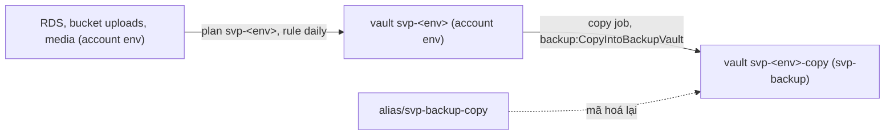

# `aws/backup`: vault copy của backup stg, prd (account `svp-backup`)

Root này dựng nơi giữ bản copy của recovery point stg, prd ở account `svp-backup` (Central Backup account của AWS SRA):
một KMS key và hai vault copy có vault lock governance. Admin của account env (`svp-stg`, `svp-prd`) xoá được instance,
bucket và recovery point trong account của mình, nhưng không chạm được bản copy ở đây; admin của management thì được,
qua `OrganizationAccountAccessRole` mà root này dùng để apply. Thiết kế và lý do ở
[ADR-0067](https://github.com/anhnvcoder/svp-backend/blob/main/docs/adr/0067-backup-dr.md) §3, §5, §6; JSON policy và
nguồn ở
[phụ lục](https://github.com/anhnvcoder/svp-backend/blob/main/docs/adr/appendix/0067-backup-dr.md#5-vault-copy-alarm).

Root chạy từ management (`AWS_PROFILE=anhnv-sso`): provider duy nhất assume role `OrganizationAccountAccessRole` của
`svp-backup`, `allowed_account_ids` chỉ gồm account đó. State nằm ở bucket của `aws/bootstrap`, key
`aws/backup/terraform.tfstate`. Account `svp-backup` không có bucket state hay profile SSO ghi riêng; profile chỉ đọc
`anhnv-backup-ro` đọc vault, lock, recovery point và job.

## Vì sao account riêng

- **Ngoài tầm admin của account env:** người chiếm được `svp-prd` xoá được instance RDS, backup tự động gốc của RDS và
  vault `svp-prd` trong account đó, không xoá được bản copy ở account khác. Vault access policy chỉ cho account env
  `backup:CopyIntoBackupVault`; AWS Backup từ chối mọi action khác từ account khác bất kể policy.
- **Không gộp vào `svp-log-archive` hay `svp-security`:** mỗi account một việc, quyền của người đọc log hay người điều
  tra không chạm bản copy. Control Tower còn tách account quản Backup policy khỏi account đích; ở đây management giữ
  Backup policy như SCP, RCP.
- **Plan không nằm ở đây:** Backup policy `svp-backup-<env>` của `aws/org` sinh plan `svp-<env>` trong account env, rule
  `daily` copy recovery point vừa tạo sang vault `svp-<env>-copy` của account này.

## Tài nguyên

| Tài nguyên | Tên | Ghi chú |
| --- | --- | --- |
| KMS key (`kms.tf`) | `alias/svp-backup-copy` | Mã hoá mọi bản copy của hai vault; xoay khoá hằng năm, chờ xoá 30 ngày, `prevent_destroy` |
| Vault (module [`backup-vault`](../modules/backup-vault/README.md)) | `svp-stg-copy` | Lock governance min 1, max 7 ngày; nhận copy từ account stg |
| Vault (như trên) | `svp-prd-copy` | Lock governance min 7, max 35 ngày; nhận copy từ account prd |

- **Key policy chỉ có statement mặc định:** account `svp-backup` quản key qua IAM. AWS Backup mã hoá lại bản copy bằng
  key của vault đích thay mặt account này, nên không account nào khác cần key này. Account env chia sẻ key nguồn của nó
  (key RDS, key vault env) cho `svp-backup`, không ngược lại.
- **Bản copy sống độc lập với nguồn:** mã hoá bằng key ở đây, nên dùng được cả khi key RDS (xoá cuối buổi) hay key vault env (xoá khi gỡ lab) không còn.
- **Lock governance, không compliance:** khoảng [min, max] chứa retention mà Backup policy đặt cho bản copy (module
  `org-policies`); copy job có retention ngoài khoảng đó lỗi. Recovery point không xoá được trước `min_retention_days`,
  kể cả bởi admin của `svp-backup`, cho tới khi người có quyền IAM `backup:DeleteBackupVaultLockConfiguration` gỡ lock
  (mục [Gỡ có chủ đích](#gỡ-có-chủ-đích)).
- **Không restore tại chỗ:** AWS Backup không restore chéo account. Mất account env thì copy ngược từ vault ở đây về
  account đích rồi restore; quyền cho việc đó (statement của key, vault access policy, role copy) thêm lúc sự cố theo
  runbook, không có sẵn.

Mọi tài nguyên mang tag `Project=svp`, `ManagedBy=terraform`, `Stack=backup` và sống giữa các buổi. Key có
`prevent_destroy`: root này không bao giờ `terraform destroy` cả khối, gỡ theo mục [Gỡ có chủ đích](#gỡ-có-chủ-đích).



## Phí

Key tính theo key mỗi tháng; bản copy tính theo dung lượng lưu ở account này (snapshot RDS, backup S3). Giá và ước theo
tháng ở [ADR-0067 §13](https://github.com/anhnvcoder/svp-backend/blob/main/docs/adr/0067-backup-dr.md#13-chi-phí) và mục
"Chi phí" của phụ lục.

## Apply lần đầu

Theo thứ tự của runbook `docs/runbooks/backup-setup.md`: sau khi `aws/org` đã tạo account `svp-backup` và bật
cross-account backup, trước `aws/accounts/<env>` (vault env và role của nó) và trước lần chạy đầu của plan `svp-<env>`:
copy job tới vault chưa có thì lỗi. **Người học chạy mọi lệnh dưới đây** (AI không chạy lệnh nào chạm account). Cần
Terraform 1.15, AWS CLI v2, `aws sso login --profile anhnv-sso`.

### 1. Kiểm account và biến

```sh
cd infra
aws/scripts/check-account.sh mgmt
printf '%s\n' "$SVP_AWS_MGMT_ACCOUNT_ID" "$SVP_AWS_BACKUP_ACCOUNT_ID" "$SVP_AWS_STG_ACCOUNT_ID" \
  "$SVP_AWS_PRD_ACCOUNT_ID"
cd aws/backup
```

Script in account của `anhnv-sso` và dừng nếu khác `SVP_AWS_MGMT_ACCOUNT_ID`. Bốn dòng sau đều là 12 số, khác nhau:
account backup từ output `backup_account_id` của `aws/org`. Khác hay thiếu thì dừng.

### 2. Init và plan

```sh
AWS_PROFILE=anhnv-sso terraform init -backend-config=../backend.hcl
AWS_PROFILE=anhnv-sso TF_VAR_account_id="$SVP_AWS_MGMT_ACCOUNT_ID" \
  TF_VAR_backup_account_id="$SVP_AWS_BACKUP_ACCOUNT_ID" TF_VAR_stg_account_id="$SVP_AWS_STG_ACCOUNT_ID" \
  TF_VAR_prd_account_id="$SVP_AWS_PRD_ACCOUNT_ID" \
  terraform plan -out=backup.tfplan
```

Mong đợi `Plan: 8 to add, 0 to change, 0 to destroy`: key và alias, hai vault, hai lock, hai vault access policy. Đọc:
`kms_key_arn` của hai `module.vaults.aws_backup_vault.this` là key mới; `min_retention_days`, `max_retention_days` của
hai lock khớp bảng [Tài nguyên](#tài-nguyên); policy của `svp-stg-copy` chỉ nêu `arn:aws:iam::<stg>:root`, của
`svp-prd-copy` chỉ `arn:aws:iam::<prd>:root`. Lỗi `AccessDenied` khi assume role là account chưa tạo xong hay profile
sai; lỗi `account_id is not the management account` là `SVP_AWS_MGMT_ACCOUNT_ID` hay `SVP_AWS_BACKUP_ACCOUNT_ID` sai.
Dừng và dán output nếu có dòng `change` hay `destroy`.

### 3. Apply và kiểm

```sh
AWS_PROFILE=anhnv-sso TF_VAR_account_id="$SVP_AWS_MGMT_ACCOUNT_ID" \
  TF_VAR_backup_account_id="$SVP_AWS_BACKUP_ACCOUNT_ID" TF_VAR_stg_account_id="$SVP_AWS_STG_ACCOUNT_ID" \
  TF_VAR_prd_account_id="$SVP_AWS_PRD_ACCOUNT_ID" \
  terraform apply backup.tfplan
rm backup.tfplan
AWS_PROFILE=anhnv-sso terraform output vault_arns
for v in svp-stg-copy svp-prd-copy; do
  AWS_PROFILE=anhnv-backup-ro aws backup describe-backup-vault --backup-vault-name "$v" --region ap-southeast-1 \
    --query '[BackupVaultName,Locked,MinRetentionDays,MaxRetentionDays,EncryptionKeyArn]' --output text
done
```

`vault_arns` có hai ARN dạng `arn:aws:backup:ap-southeast-1:<backup>:backup-vault:svp-<env>-copy`. Mỗi vault in `True`,
min và max như bảng, và cùng ARN key. `Locked` là `False` nghĩa là lock chưa áp: dừng, dán output lại.

## Gỡ có chủ đích

Chỉ khi lab kết thúc và không cần bản copy nữa: mục này xoá mọi bản copy, kể cả bản còn trong hạn lock. Thứ tự với root
khác:

1. Mọi env đã gỡ, vault env `svp-<env>` của `aws/accounts/<env>` đã gỡ theo README của nó: không copy job nào còn tới
   đây.
2. Mục này.
3. [Gỡ có chủ đích của `aws/org`](../org/README.md#gỡ-có-chủ-đích): sau khi đóng account, management không assume role
   vào đây được nữa.

Các bước, chạy trong `infra/aws/backup` với bốn biến như mục [Apply lần đầu](#apply-lần-đầu):

1. **Kiểm account của phiên gỡ** (trước lệnh ghi đầu tiên), từ `infra`: `aws/scripts/check-account.sh mgmt`. Account
   khác `SVP_AWS_MGMT_ACCOUNT_ID` thì dừng.

2. **Sửa local, không commit**: ở `kms.tf`, `aws_kms_key.copy` đổi `prevent_destroy = true` thành `false`; ở
   `../modules/backup-vault/main.tf`, thêm `force_destroy = true` vào `aws_backup_vault.this`. `force_destroy` cho
   provider xoá mọi recovery point của vault trước khi xoá vault. Không apply root nào khác khi sửa này còn.

3. **Ghi `force_destroy` vào state**, rồi gỡ:

   ```sh
   AWS_PROFILE=anhnv-sso TF_VAR_account_id="$SVP_AWS_MGMT_ACCOUNT_ID" \
     TF_VAR_backup_account_id="$SVP_AWS_BACKUP_ACCOUNT_ID" TF_VAR_stg_account_id="$SVP_AWS_STG_ACCOUNT_ID" \
     TF_VAR_prd_account_id="$SVP_AWS_PRD_ACCOUNT_ID" \
     terraform apply
   AWS_PROFILE=anhnv-sso TF_VAR_account_id="$SVP_AWS_MGMT_ACCOUNT_ID" \
     TF_VAR_backup_account_id="$SVP_AWS_BACKUP_ACCOUNT_ID" TF_VAR_stg_account_id="$SVP_AWS_STG_ACCOUNT_ID" \
     TF_VAR_prd_account_id="$SVP_AWS_PRD_ACCOUNT_ID" \
     terraform destroy
   ```

   Plan của `apply` phải là `0 to add, 2 to change, 0 to destroy`, chỉ `force_destroy` của hai
   `module.vaults.aws_backup_vault.this`; khác thì trả lời `no` và dán plan lại. `destroy` phải là `8 to destroy`, theo
   thứ tự phụ thuộc: bỏ hai lock (governance gỡ được bằng `OrganizationAccountAccessRole`) và hai vault access policy,
   xoá recovery point rồi xoá hai vault, cuối cùng key vào `PendingDeletion` 30 ngày: huỷ được trong thời gian đó, sau
   đó bản copy nào còn mã hoá bằng key không đọc được nữa. Copy job đang chạy làm việc xoá vault lỗi: chờ nó xong rồi
   chạy lại `destroy`.

4. **Kiểm sạch** bằng profile chỉ đọc:

   ```sh
   AWS_PROFILE=anhnv-backup-ro aws backup list-backup-vaults --region ap-southeast-1 \
     --query "BackupVaultList[?starts_with(BackupVaultName, 'svp-')].BackupVaultName" --output text
   ```

   Không in tên nào (vault mặc định của AWS không bắt đầu bằng `svp-`).

5. Hoàn tác sửa local (`git checkout -- kms.tf ../modules/backup-vault/main.tf`), rồi chạy bước tiếp theo của `aws/org`.
