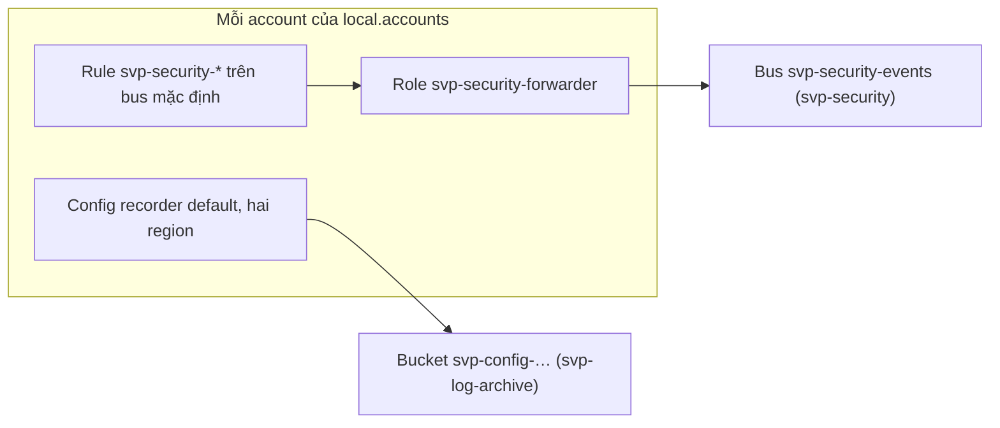

# `aws/baseline`: baseline bảo mật của mọi account và CMK EBS

Root này áp baseline bảo mật (module [`security-baseline`](../modules/security-baseline/README.md)) cho mọi account của org (bảng ở mục
"Áp gì ở account nào"), và tạo CMK EBS cho `svp-stg`, `svp-prd`. Thiết kế và lý do ở
[ADR-0059](https://github.com/anhnvcoder/svp-backend/blob/main/docs/adr/0059-org-structure-guardrails.md) §2, §9 và
[ADR-0060](https://github.com/anhnvcoder/svp-backend/blob/main/docs/adr/0060-org-detection-logging.md) §4, §10; rule theo account và region ở
[phụ lục ADR-0060](https://github.com/anhnvcoder/svp-backend/blob/main/docs/adr/appendix/0060-org-detection-logging.md). Account `svp-backup`
(đích bản copy của AWS Backup) nhận baseline như mọi account:
[ADR-0067](https://github.com/anhnvcoder/svp-backend/blob/main/docs/adr/0067-backup-dr.md) §3.

## Vì sao chạy từ management

Root chạy bằng `AWS_PROFILE=anhnv-sso`. Provider của management không assume role; provider của mỗi account thành viên assume
`OrganizationAccountAccessRole` của account đó, mỗi provider có `allowed_account_ids` đúng một account. State nằm ở bucket của `aws/bootstrap`,
key `aws/baseline/terraform.tfstate`. Đây là khuôn execution role của Control Tower (`AWSControlTowerExecution`): baseline áp từ một chỗ, admin
của workload không đụng được.

SCP `svp-protect-baseline` (gắn ở root của org, module `org-policies`) chặn mọi principal của account thành viên, kể cả `SvpAdmin` ở stg, prd,
đổi những gì root này tạo: S3 BPA cấp account, EBS mã hoá mặc định và key mặc định, recorder và delivery channel của Config, rule và role
`svp-security-*`, CMK EBS (theo tag `Stack=security-baseline` và alias `alias/svp-ebs`). Chỉ `OrganizationAccountAccessRole` được miễn, nên chỉ
root này đổi được baseline. Management không chịu SCP: baseline của nó chỉ được giữ bằng quyền của Identity Center.

Terraform không lặp được qua provider, nên mỗi account một provider và một lời gọi module, viết tường minh. Tài nguyên ở `us-east-1` (và
`us-east-2`, `us-west-2` của management) đặt đối số `region` trong module, không thêm provider.

## Áp gì ở account nào

Khác biệt giữa account là dữ liệu của bảng `local.accounts` trong [`main.tf`](main.tf) và cờ `config_recording` của
[`aws/paid-features.json`](../paid-features.json) (mục [Cờ chi phí](#cờ-chi-phí)):

| Account | Key EBS mặc định ở `ap-southeast-1` | Rule đổi quản trị (`admin_events`) | Rule chỉ của management |
| --- | --- | --- | --- |
| management | `aws/ebs` | có | `svp-security-org`, `svp-security-root-session`, `svp-security-admin-sso`; `svp-security-root-signin` thêm ở `us-east-2`, `us-west-2` |
| `svp-log-archive` | `aws/ebs` | có | — |
| `svp-security` | `aws/ebs` | có | — |
| `svp-backup` | `aws/ebs` | có | — |
| `svp-stg` | CMK EBS của account | không | — |
| `svp-prd` | CMK EBS của account | không | — |

- Mọi account: S3 BPA cấp account, EBS mã hoá mặc định ở `ap-southeast-1` và `us-east-1` (`us-east-1` luôn `aws/ebs`), Config recorder ghi
  liên tục ở hai region (trừ account có `config_recording` `off`), nhóm rule chuyển sự kiện chung (trail, dịch vụ phát hiện, rule
  `svp-security-*`, lệnh bị SCP từ chối), rule `svp-security-root-signin` (đăng nhập console của root) ở `us-east-1`.
- `admin_events` tắt ở stg, prd: mỗi buổi tạo và xoá hàng chục role, key, bucket.
- `svp-security-admin-sso` ở region của Identity Center (`sso_region`), vì CloudTrail chỉ ghi sự kiện `sso.amazonaws.com` ở đó.
- Đích của mọi rule là bus `svp-security-events` của `svp-security` ở region nhà; ARN suy từ id account đó, không đọc state của `aws/security`.
- Delivery channel của Config ghi vào bucket `svp-config-<id account log>-ap-southeast-1` của `aws/log-archive`, mã hoá bằng key
  `alias/svp-log-archive`. Root đọc ARN dạng `key/<id>` của key đó bằng data source `aws_kms_alias` qua provider của `svp-log-archive`: ARN alias
  thì plan không bao giờ sạch.



## Cờ chi phí

Root đọc [`aws/paid-features.json`](../paid-features.json) qua module [`paid-features`](../modules/paid-features/README.md), không tự đọc giá
trị trong file. Mỗi lời gọi `security-baseline` truyền `config_recording` là `true` khi cờ `config_recording` của account đó (cùng khoá với
`local.accounts`) là `always`. `off` thì module của account không có recorder, delivery channel, recorder status ở hai region; service-linked
role `AWSServiceRoleForConfig`, rule và role `svp-security-*` giữ. Luật giá trị (`security_hub` `always` cần `config_recording` `always`) do
`validation` của module kiểm. Mất gì và chi phí lúc bật lại:
[ADR-0071](https://github.com/anhnvcoder/svp-backend/blob/main/docs/adr/0071-paid-features.md) §6, §10 và phụ lục.

### Thứ tự apply cờ

- Tắt cờ của một account: [`aws/security`](../security/README.md) trước (Security Hub, Inspector), rồi root này (Config), rồi
  `aws/accounts/<env>` (quét cơ bản của registry).
- Bật cờ: root này trước, rồi `aws/security`, rồi `aws/accounts/<env>`.
- Lý do: control của Security Hub là rule Config, cần recorder đang ghi trước khi Security Hub bật lại, và còn ghi tới khi Security Hub đã tắt.

## CMK EBS

Mỗi account `svp-stg`, `svp-prd` có một KMS key ở `ap-southeast-1` (nơi duy nhất chạy EC2), alias `alias/svp-ebs`, xoay khoá hằng năm, chờ xoá 30
ngày. Module đặt key này làm key mặc định của EBS ở region nhà. Key policy theo khuôn của key AWS managed `aws/ebs`: IAM của account quản key, và
mọi principal của account dùng được key khi đi qua EC2 của region nhà (`kms:CallerAccount`, `kms:ViaService`). Nhờ vậy node group (service-linked
role của AutoScaling), Karpenter và bastion dùng key mà không thêm IAM. Statement đủ ở
[phụ lục ADR-0059 §9](https://github.com/anhnvcoder/svp-backend/blob/main/docs/adr/appendix/0059-org-structure-guardrails.md#9-cmk-ebs).

- Đổi key mặc định không chạm volume đã có; env stg, prd dựng mới mỗi buổi nên mọi volume của buổi sau dùng CMK.
- Volume mã hoá bằng CMK EBS không được GuardDuty Malware Protection for EC2 quét (ADR-0059 §4).
- Mọi tài nguyên mang tag `Project=svp`, `ManagedBy=terraform`, `Stack=security-baseline` từ `default_tags`, sống giữa các buổi; script quét
  sót của buổi bỏ qua stack này.

## Phí

Hai CMK EBS tính theo key mỗi tháng; Config tính theo config item ghi được, tăng trong buổi khi env tạo tài nguyên; rule EventBridge và chuyển sự
kiện giữa account tính theo sự kiện. Giá và ước theo tháng ở
[phụ lục ADR-0060 §12](https://github.com/anhnvcoder/svp-backend/blob/main/docs/adr/appendix/0060-org-detection-logging.md#12-chi-phí-liên-tục).
Account `svp-backup` thêm phần của một account không chạy workload (check Security Hub, item Config, GuardDuty), ước ở
[phụ lục ADR-0067, Chi phí](https://github.com/anhnvcoder/svp-backend/blob/main/docs/adr/appendix/0067-backup-dr.md#sống-giữa-buổi).

## Apply lần đầu

Bước (6) của thứ tự áp nền bảo mật org: sau `aws/log-archive` (bucket Config và key), `aws/org` áp đủ (SCP `svp-protect-baseline`) và
`aws/security` (bus `svp-security-events`, topic đã xác nhận email). **Người học chạy mọi lệnh dưới đây** (AI không chạy lệnh nào chạm account).
Cần Terraform 1.15, AWS CLI v2, `aws sso login --profile anhnv-sso`.

Account thêm vào org khi root đã áp (như `svp-backup`): sau khi `aws/org` tạo account đó, chạy bước 1, 3, 4 và bỏ bước 2. Role, recorder của các
account cũ đã nằm trong state của root này, nên bước 2 không còn mong đợi role hay recorder trống; account mới chỉ có cái `aws/org` tạo. Bucket
Config và bus nhận account mới theo id của org, không đổi policy.

### 1. Kiểm account và biến

```sh
cd infra/aws/baseline
AWS_PROFILE=anhnv-sso aws sts get-caller-identity --region ap-southeast-1 --query '[Account,Arn]' --output text
printf '%s\n' "$SVP_AWS_MGMT_ACCOUNT_ID" "$SVP_AWS_LOG_ACCOUNT_ID" "$SVP_AWS_SECURITY_ACCOUNT_ID" "$SVP_AWS_BACKUP_ACCOUNT_ID" \
  "$SVP_AWS_STG_ACCOUNT_ID" "$SVP_AWS_PRD_ACCOUNT_ID"
cp -n baseline.auto.tfvars.example baseline.auto.tfvars
```

`Account` phải bằng `SVP_AWS_MGMT_ACCOUNT_ID`, `Arn` là role SSO của người học. Mỗi dòng sau đều là 12 số. Sửa `sso_region` trong
`baseline.auto.tfvars` (không commit) cho bằng `sso_region` của `aws/org/org.auto.tfvars`. Khác hay thiếu thì dừng.

### 2. Kiểm cái đã có

Lần đọc hiện trạng trước khi thiết kế không thấy gì cần nhập vào state: management, stg, prd không có `AWSServiceRoleForConfig`, recorder hay
delivery channel; S3 BPA cấp account chưa đặt, EBS mã hoá mặc định tắt (đặt hai thứ này không cần import). Đọc lại ngay trước apply, vì root khác
hay dịch vụ khác có thể đã tạo service-linked role của Config (`svp-log-archive`, `svp-backup` không đọc: chỉ `aws/log-archive`, `aws/backup` ghi
vào chúng):

```sh
for p in anhnv-sso anhnv-security-ro anhnv-stg-ro anhnv-prd-ro; do echo "== $p"
  AWS_PROFILE=$p aws iam get-role --role-name AWSServiceRoleForConfig --query Role.Arn --output text --region us-east-1 2>&1 | tail -1
  for r in ap-southeast-1 us-east-1; do
    AWS_PROFILE=$p aws configservice describe-configuration-recorders --region $r --query 'ConfigurationRecorders[].name' --output text
  done
done
```

Mong đợi mỗi account một dòng `NoSuchEntity` và hai dòng rỗng. Có role hay recorder thì dừng, dán output, và nhập chúng vào state bằng khối
`import` trước plan, theo địa chỉ trong README của module (`module.<mgmt|security|stg|prd>.aws_iam_service_linked_role.config`,
`…aws_config_configuration_recorder.this["<region>"]`, `…aws_config_delivery_channel.this["<region>"]`).

### 3. Init và plan

```sh
AWS_PROFILE=anhnv-sso terraform init -backend-config=../backend.hcl
AWS_PROFILE=anhnv-sso TF_VAR_account_id="$SVP_AWS_MGMT_ACCOUNT_ID" TF_VAR_log_archive_account_id="$SVP_AWS_LOG_ACCOUNT_ID" \
  TF_VAR_security_account_id="$SVP_AWS_SECURITY_ACCOUNT_ID" TF_VAR_backup_account_id="$SVP_AWS_BACKUP_ACCOUNT_ID" \
  TF_VAR_stg_account_id="$SVP_AWS_STG_ACCOUNT_ID" TF_VAR_prd_account_id="$SVP_AWS_PRD_ACCOUNT_ID" terraform plan -out=baseline.tfplan
```

Mong đợi với `aws/paid-features.json` chỉ tắt `config_recording` của stg `Plan: 252 to add, 0 to change, 0 to destroy`: 54 ở `module.mgmt`, 42
ở mỗi `module.log_archive`, `module.security`, `module.backup`, 37 ở `module.prd` (thêm `aws_ebs_default_kms_key`), 31 ở `module.stg` (37 trừ
recorder, delivery channel, recorder status của hai region), 4 key và alias EBS. Mỗi account `off` khác bớt 6 ở module của nó. Root đã áp
trước khi có account mới thì plan chỉ thêm module của account đó: `Plan: 42 to add, 0 to change, 0 to destroy`, toàn bộ ở `module.backup`.
Đọc: `aws_ebs_default_kms_key` chỉ ở stg, prd, `key_arn` là key `svp-ebs` của chính account đó; `svp-security-root-signin` của management ở ba
region; `s3_kms_key_arn` của mọi delivery channel dạng `key/<id>`. Lỗi `AccessDenied` khi assume role là account hay profile sai; lỗi đọc
alias `alias/svp-log-archive` là `aws/log-archive` chưa áp. Dừng và dán output nếu có dòng `change` hay `destroy`.

### 4. Apply

```sh
AWS_PROFILE=anhnv-sso TF_VAR_account_id="$SVP_AWS_MGMT_ACCOUNT_ID" TF_VAR_log_archive_account_id="$SVP_AWS_LOG_ACCOUNT_ID" \
  TF_VAR_security_account_id="$SVP_AWS_SECURITY_ACCOUNT_ID" TF_VAR_backup_account_id="$SVP_AWS_BACKUP_ACCOUNT_ID" \
  TF_VAR_stg_account_id="$SVP_AWS_STG_ACCOUNT_ID" TF_VAR_prd_account_id="$SVP_AWS_PRD_ACCOUNT_ID" terraform apply baseline.tfplan
rm baseline.tfplan
AWS_PROFILE=anhnv-sso terraform output ebs_kms_key_arns
```

`ebs_kms_key_arns` có hai ARN `arn:aws:kms:ap-southeast-1:<stg|prd>:key/<id>`. Apply có thể sinh email `svp-security-detection`
(`PutConfigurationRecorder`, `PutDeliveryChannel` thành công) từ các account: trong cùng apply, recorder có thể được tạo trước rule và target
chuyển sự kiện, nên account hay region nào thiếu email ở đây không phải lỗi. Đường cảnh báo kiểm thật ở bước (7) của runbook (cảnh báo thử,
phép thử guardrail).

## Gỡ

Chỉ khi lab kết thúc, sau khi mọi env đã gỡ và trước khi `aws/security`, `aws/log-archive` gỡ. `terraform destroy` với cùng biến gỡ S3 BPA cấp
account, tắt EBS mã hoá mặc định, xoá recorder, delivery channel, rule, role, và đưa hai CMK EBS vào `PendingDeletion` 30 ngày; volume, snapshot
còn mã hoá bằng chúng phải xoá trước.
