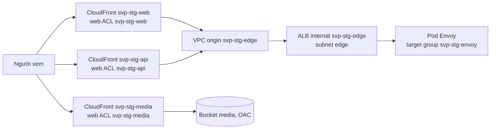

# `aws/envs/stg`: cấu hình gốc của env stg

Tầng platform của stg trên AWS (ADR-0034 §2, ADR-0024 §6A, ADR-0048, ADR-0053, ADR-0055…0058, ADR-0060, ADR-0061,
ADR-0067): ghép các module `network`, `eks`, `rds`, `msk`, `elasticache`, `alarms`, `media`, `transcode`, `edge`, `waf`,
`ssm-bastion`, `external-secrets`, `backup-alarms`, thêm role IAM và Pod Identity association cho `svp/video-service`,
`svp/media-worker`, đọc tài nguyên sống lâu của account (`baseline.tf`), xuất output `cluster_values` theo hợp đồng
`cluster.*` và các output của cluster cho root bootstrap `aws/gitops/stg`. Ứng dụng trong cluster không ở đây: Argo CD
triển khai từ `svp-gitops`.

## Account, profile, state

| Mục | Giá trị |
| --- | --- |
| Account | `svp-stg`, account thành viên của org (OU `Workloads`), không phải management account |
| Profile SSO | `anhnv-stg` (permission set `SvpAdmin`), người học tự tạo bằng `aws configure sso` |
| Biến account | `SVP_AWS_STG_ACCOUNT_ID`, export trong terminal của buổi; mọi lệnh đặt `TF_VAR_account_id` từ nó (`allowed_account_ids`) |
| Biến account Log Archive | `SVP_AWS_LOG_ACCOUNT_ID` (output `log_archive_account_id` của `aws/org`), export cùng terminal; mọi lệnh đặt `TF_VAR_log_archive_account_id` từ nó (tên bucket flow log, log WAF và delivery destination của log CloudFront, mục "Log và phát hiện") |
| Biến account backup | `SVP_AWS_BACKUP_ACCOUNT_ID` (output `backup_account_id` của `aws/org`), export cùng terminal; mọi lệnh đặt `TF_VAR_backup_account_id` từ nó (account được dùng key RDS khi copy backup, mục [Backup và mã hoá](#backup-và-mã-hoá)) |
| Backend | `../../backend-stg.hcl` (bucket `svp-tfstate-<account stg>-<region>`, KMS key `alias/svp-tfstate`, lock file S3), sinh từ output `backend_hcl` của `aws/accounts/stg`, dạng ở `backend.hcl.example` |
| Key của state | `aws/stg/terraform.tfstate`, truyền bằng `-backend-config` thứ hai lúc `init`; khối `backend "s3" {}` trong `versions.tf` trống |
| Zone | `stg.aws.<domain>` của account stg (output `zone_id` của `aws/accounts/stg`), uỷ quyền từ zone `aws.<domain>` của account prd (bản ghi `NS` do `aws/accounts/prd` tạo) |

Root chạy được khi baseline `aws/accounts/stg` đã apply, uỷ quyền DNS đã xong
([`aws/accounts/README.md`](../../accounts/README.md)) và root `aws/log-archive` đã apply (bucket nhận flow log, log WAF, log CloudFront và
delivery destination `svp-cloudfront-stg`, [`aws/log-archive/README.md`](../../log-archive/README.md)).

## Tài nguyên sống lâu của account

Registry, telemetry và Grafana của env sống qua `destroy` của buổi nên nằm ở baseline `aws/accounts/stg` (module
`registry`, `observability`). Root này không đọc state của root đó: `baseline.tf` tìm từng tài nguyên bằng data source
theo tên suy từ `svp-stg`. Baseline chưa apply (hay thiếu một tài nguyên) thì `plan` dừng ở đúng data source đó, nêu tên
tài nguyên thiếu; apply `aws/accounts/stg` trước rồi plan lại.

| Tài nguyên | Tìm bằng | Dùng ở |
| --- | --- | --- |
| Workspace AMP `svp-stg` | alias đúng `svp-stg` trong `aws_prometheus_workspaces` (data source workspace chỉ nhận id); không có thì precondition dừng | `module.eks` (role Pod Identity), `module.alarms` (publisher `aps`), `ampWorkspaceId`, `ampEndpoint` |
| Log group `/svp/stg/otel` | tên | `module.eks` (role Collector), `logGroup` |
| Khoá KMS `alias/svp-stg-observability`, `alias/svp-stg-ecr` | alias | `module.eks` (Collector ghi log mã hoá; node giải mã image qua ECR) |
| Repo phát hành `svp-backend/*`, `svp-frontend/*` | mọi repo của registry có tên bắt đầu bằng hai tiền tố đó | `module.eks` (role admission controller Kyverno) |
| Rule pull-through cache `ghcr`, `docker-hub`, `quay`, `k8s`, `ecr-public` | tiền tố, một data source mỗi rule | `module.eks` (quyền cache của role node) |
| Workspace AMG `svp-stg` | id đọc từ tham số SSM `/svp/stg/grafana-workspace-id` mà `aws/accounts/stg` ghi cùng workspace (AMG không tìm được theo tên); postcondition kiểm tên là `svp-stg` | `grafanaUrl` |

Host registry (`ecrRegistry`) dựng từ `account_id` và `region`, không đọc API.

Workspace AMG và tham số của nó theo cờ `managed_grafana` của env trong `aws/paid-features.json` (mục [Cờ chi
phí](../../accounts/README.md#cờ-chi-phí) của `aws/accounts`): với `session`, cả hai chỉ có trong buổi, sau bước mở của
lệnh `account` của `aws/scripts/tf.sh`. Thiếu tham số thì `plan` dừng ở `data.aws_ssm_parameter.grafana_workspace`
(`ParameterNotFound`): chạy bước mở đó rồi plan lại. Root đọc tham số bằng profile ghi của account env, cùng account với
tham số.

## Cái gì khác giữa các env

Root prd chép thư mục này: mọi `*.tf` giống hệt, trừ dòng `env = "<env>"` của `locals` (`main.tf`); prd thêm `teardown.tfvars`. Mọi lời gọi
module chỉ tham chiếu biến hay output; khác biệt giữa hai env chỉ là dữ liệu ở `<env>.tfvars`
([ADR-0055](https://github.com/anhnvcoder/svp-backend/blob/main/docs/adr/0055-environment-matrix.md) §6, lệnh `diff` kiểm ở đó). Cả hai
root có cùng đường vào (mục [Đường vào](#đường-vào)) với ba web ACL AWS WAF giống hệt nhau. Mọi tên tài nguyên bắt đầu
bằng `svp-<env>` (cluster, role IAM, bucket, instance RDS, cluster MSK, replication group Valkey, entry Secrets Manager), trừ secret SCRAM
của MSK: `AmazonMSK_svp-<env>-<user>` (MSK chỉ đọc secret có tiền tố `AmazonMSK_`).
Cỡ, mức bảo vệ, log, mã hoá và gói CloudFront của media nằm ở `<env>.tfvars`:

| Tệp | Commit | Nội dung |
| --- | --- | --- |
| `stg.tfvars` | có | cỡ, dự phòng, retention, log, mã hoá và mức bảo vệ của stg; không giá trị cá nhân nào |
| `stg.auto.tfvars` | **không** (git bỏ qua) | giá trị cá nhân, chép từ `example.auto.tfvars.example` |
| `../../backend-stg.hcl` | **không** | phần chung của backend trong account stg |
| `TF_VAR_account_id` | biến môi trường, đặt ngay trong lệnh | account được phép đổi (`allowed_account_ids`) |
| `TF_VAR_log_archive_account_id` | biến môi trường, đặt ngay trong lệnh | account `svp-log-archive`, chủ bucket flow log, log WAF, log CloudFront |
| `TF_VAR_backup_account_id` | biến môi trường, đặt ngay trong lệnh | account `svp-backup`, nơi nhận bản copy backup của env |

**Vì sao `stg.tfvars` mà không `terraform.tfvars`:** repo bỏ qua mọi `terraform.tfvars` và `*.auto.tfvars` (hai tên Terraform tự nạp) vì
chúng là chỗ giá trị cá nhân hay nằm. Tệp cỡ của env cần commit nên mang tên khác và phải truyền bằng `-var-file=stg.tfvars` ở **mọi**
`plan`, `apply`, `destroy`. Quên thì Terraform dừng ngay ở "No value for required variable" (các biến cỡ có từ đầu không có mặc định),
không dựng gì sai.

Mỗi nhóm biến của `stg.tfvars` và `prd.tfvars` (mạng, `eks`, `rds`, `msk`, `valkey`, `media`, `edge`) có một comment nói
vì sao; hai file cùng thứ tự dòng để đọc cạnh nhau. Thành phần nào phải giống prd, được giảm hay giảm có điều kiện (mất
gì, kiểm bù ở đâu) và nguồn của từng quyết định: bảng của
[`environments.md`](https://github.com/anhnvcoder/svp-backend/blob/main/docs/explanation/environments.md) ở repo code.
Tóm tắt: stg giữ cùng dịch vụ, version, cấu hình, xác thực, mã hoá (KMS key cho Secret của EKS, RDS, MSK, SNS, bucket
`uploads`), versioning của media, loại log (năm loại log control plane, flow log, export log RDS, Database Insights,
enhanced monitoring, broker log MSK, slow-log Valkey, access log media), cùng bộ alarm và cùng đường tới API (tunnel
SSM); stg giảm số AZ (2), NAT (một), số AZ đặt ENI của endpoint interface (một: `interface_endpoint_az_count`), lớp và
số lượng (RDS một AZ, MSK RF 2, Valkey một node), retention của log CloudWatch (1 ngày), bảo vệ xoá (cả ALB edge:
`edge_alb_deletion_protection = false`) và distribution media (gói flat-rate Free, không log chuẩn:
`media_flat_rate_free = true`); mọi phần khác của đường vào giống prd. Flow log, log WAF và log CloudFront nằm ở Log
Archive, retention theo mục [Log và phát hiện](#log-và-phát-hiện).

Số broker MSK là `az_count` (một broker mỗi AZ); phiên bản Kafka (`4.1.x.kraft`), Valkey (`9.1`) và EBS khởi đầu mỗi broker lấy mặc định
của module, như ADR-0053 §2, §7; trần dung lượng broker (`msk_broker_volume_max_size`) là của env. Nhóm node hệ thống (loại, min = desired =
số AZ, max = 2 × số AZ) do module `eks` và `main.tf` tính, không biến theo env; node Karpenter (capacity type, `limits`) đặt ở
`envs/<env>/svp-cluster.yaml` của `svp-gitops`.

Biến có mặc định mà `<env>.tfvars` không đặt: `region` (`ap-southeast-1`), `msk_password_version`, `valkey_password_version` (`1`; cả hai
env chỉ đặt chúng qua `TF_VAR_*` hay `*.auto.tfvars` khi xoay mật khẩu, mục "Secret Kafka và Valkey").

Giá trị cá nhân (`stg.auto.tfvars` hay `TF_VAR_*`):

| Biến | Lấy ở đâu |
| --- | --- |
| `hosted_zone_id` | output `zone_id` của `aws/accounts/stg`, dán tay (root này không đọc state của root khác); module `edge`, `media` ghi bản ghi alias và bản ghi validation ACM vào zone này |
| `domain` | tên zone stg (`stg.aws.<domain>`, web ở apex) hay một tên trong zone đó; API là `api.<tên này>`, media là `media.<tên này>`; plan dừng ở precondition của `cluster_values` nếu tên khác |
| `alarm_email` | hộp thư nhận CloudWatch alarm và cảnh báo của luật trên AMP (subscription email của topic `svp-stg-alarms`, biến `sensitive`); người học mở link xác nhận SNS gửi sau apply |

Không có IP của máy người học: endpoint công khai của API tắt.

## Dùng root này

**Người học chạy mọi lệnh dưới đây** (AI chỉ chạy `make check`, `make lock`). Trình tự cả buổi (kiểm DNS, ghi secret, bootstrap Argo CD,
đo, dọn trước destroy, quét) ở runbook [`docs/runbooks/session-stg.md`](../../../docs/runbooks/session-stg.md) và script buổi của
`aws/scripts/`.

Kiểm account trước (cột `Account` phải bằng `$SVP_AWS_STG_ACCOUNT_ID`, `Arn` là role SSO `SvpAdmin`; khác thì dừng):

```sh
cd infra/aws/envs/stg
AWS_PROFILE=anhnv-stg aws sts get-caller-identity --region ap-southeast-1 --query '{Account:Account,Arn:Arn}' --output table
echo "$SVP_AWS_STG_ACCOUNT_ID"
```

Dựng:

```sh
cp example.auto.tfvars.example stg.auto.tfvars          # rồi sửa bốn giá trị
AWS_PROFILE=anhnv-stg terraform init -reconfigure -backend-config=../../backend-stg.hcl -backend-config=key=aws/stg/terraform.tfstate
AWS_PROFILE=anhnv-stg TF_VAR_account_id="$SVP_AWS_STG_ACCOUNT_ID" TF_VAR_log_archive_account_id="$SVP_AWS_LOG_ACCOUNT_ID" \
  TF_VAR_backup_account_id="$SVP_AWS_BACKUP_ACCOUNT_ID" terraform plan -var-file=stg.tfvars -out=stg.tfplan
AWS_PROFILE=anhnv-stg TF_VAR_account_id="$SVP_AWS_STG_ACCOUNT_ID" TF_VAR_log_archive_account_id="$SVP_AWS_LOG_ACCOUNT_ID" \
  TF_VAR_backup_account_id="$SVP_AWS_BACKUP_ACCOUNT_ID" terraform apply stg.tfplan
```

`-reconfigure` bỏ cấu hình backend cũ trong `.terraform` (kể cả của bucket management trước đây) và không migrate state.

Sau `apply`: xác nhận email của topic `svp-stg-alarms` (link trong thư SNS gửi tới `alarm_email`), rồi mở tunnel và kubeconfig (mục dưới);
`AWS_PROFILE=anhnv-stg terraform output -raw rds_master_user_secret_arn` cho script buổi. Tiếp theo: ghi giá trị secret
(`AWS_PROFILE=anhnv-stg make eks-secrets CONTEXT=svp-stg` ở repo code), rồi apply root `aws/gitops/stg` khi tunnel đang mở.

### Tới API: tunnel SSM

Endpoint công khai của API tắt. Máy người học tới endpoint private qua phiên port forwarding của Session Manager tới instance `t4g.nano`
không inbound, không khoá SSH trong subnet private (module [`ssm-bastion`](../../modules/ssm-bastion/README.md)); security group của API nhận
443 từ security group của bastion. Cổng local là `api_tunnel_port` của `stg.tfvars` (`6444`; prd `6443`, để một lệnh nhầm context không tới
cluster kia). Cần AWS CLI và Session Manager plugin.

```sh
# terminal 1: tunnel 127.0.0.1:6444 → endpoint private:443, chạy tới khi Ctrl-C
eval "$(AWS_PROFILE=anhnv-stg terraform output -raw api_tunnel_command)"
# terminal 2: context svp-stg, server https://127.0.0.1:6444, tls-server-name là host của endpoint
eval "$(AWS_PROFILE=anhnv-stg terraform output -raw kubeconfig_command)"
AWS_PROFILE=anhnv-stg kubectl --context svp-stg get nodes
```

Root `aws/gitops/stg` tới API qua cùng tunnel (`api_server_url` của `aws/gitops/stg/stg.tfvars`, TLS server name tính từ `cluster_endpoint` của
state root này).

Kết thúc buổi: `aws/scripts/pre-destroy.sh stg` (tunnel mở; nó xoá cả NodePool, EC2NodeClass và chờ hết node của
Karpenter), destroy `aws/gitops/stg`, `aws/scripts/restore-drill.sh stg cleanup` (mục [Backup và mã
hoá](#backup-và-mã-hoá)), rồi root này, rồi lệnh quét tài nguyên sót:

```sh
AWS_PROFILE=anhnv-stg TF_VAR_account_id="$SVP_AWS_STG_ACCOUNT_ID" TF_VAR_log_archive_account_id="$SVP_AWS_LOG_ACCOUNT_ID" \
  TF_VAR_backup_account_id="$SVP_AWS_BACKUP_ACCOUNT_ID" terraform destroy -var-file=stg.tfvars
```

Instance, launch template và instance profile do Karpenter tạo nằm ngoài state: `pre-destroy.sh` gỡ chúng khi controller
còn chạy, `sweep.sh stg` tìm phần sót. `destroy` gỡ cả plan Malware Protection (GuardDuty gỡ theo rule EventBridge
`DO-NOT-DELETE-AmazonGuardDutyMalwareProtectionS3*` nó quản), endpoint `guardduty-data` và cấu hình log của web ACL;
`sweep.sh stg` liệt kê plan và endpoint còn sót của một `destroy` dở. Distribution CloudFront tắt mất nhiều phút trước khi xoá được; ENI và
security group `CloudFront-VPCOrigins-Service-SG` do CloudFront tạo cho VPC origin nằm ngoài state và giữ subnet edge, VPC tới khi chúng mất
(mục "Thứ tự gỡ" của [README module `edge`](../../modules/edge/README.md)).

## Đường vào

Web, API và media chỉ vào từ internet qua CloudFront; không load balancer nào internet-facing, tầng public chỉ còn NAT gateway. Thiết kế:
[ADR-0061](https://github.com/anhnvcoder/svp-backend/blob/main/docs/adr/0061-edge-cloudfront-waf-acm.md).



| Phần | Ở đâu | Ghi chú |
| --- | --- | --- |
| Distribution `svp-<env>-web` (`<domain>`), `svp-<env>-api` (`api.<domain>`), VPC origin, ALB internal, target group, cert ACM, bản ghi DNS | module `edge` (`main.tf`) | ALB ở `edge_subnet_ids` của `network`; SG ALB tới SG node của `eks`; `edge_alb_deletion_protection` |
| Distribution `svp-<env>-media` (`media.<domain>`), cert ACM, bản ghi DNS | module `media` (`main.tf`) | gói theo `media_flat_rate_free` |
| Web ACL `svp-<env>-web`, `-api`, `-media` | module `waf` gọi ba lần (`waf.tf`, provider `aws.us_east_1`: CloudFront chỉ nhận web ACL ở `us-east-1`) | web: `SizeRestrictions_BODY` chỉ đếm, Bot Control `COMMON` chỉ gắn nhãn; api: ATP cho `POST /auth/login` |

Output `target_group_arn` của `edge` vào `cluster_values` (`edgeTargetGroupArn`): `TargetGroupBinding` của Envoy đăng ký pod vào đó. Không
controller nào trong cluster ghi zone hay xin cert công khai.

## Log và phát hiện

Log của env không nằm trong account stg mà trong bucket của account `svp-log-archive`. Tên bucket suy trong `main.tf`
(`local.log_archive_buckets`) theo khuôn của root `aws/log-archive`; retention do lifecycle của bucket đó giữ, không biến
nào ở `stg.tfvars` ([ADR-0060](https://github.com/anhnvcoder/svp-backend/blob/main/docs/adr/0060-org-detection-logging.md)
§7, §9):

| Log | Đích | Ghi bởi |
| --- | --- | --- |
| Flow log của VPC (mọi lưu lượng, Parquet) | `svp-flowlogs-<account log>-<region>` | module `network`, giao thẳng vào S3, không role IAM |
| Log web ACL (che header `authorization`, `cookie`) | `aws-waf-logs-svp-<account log>-us-east-1` | module `waf` (`waf.tf`), ba ACL |
| Log chuẩn v2 của CloudFront (web, api; media khi `media_flat_rate_free = false`), không trường `cs(Cookie)` | `svp-cloudfront-<account log>-us-east-1`, qua delivery destination `svp-cloudfront-<env>` của account log (`local.cloudfront_log_destination_arn`) | module `edge`, `media`: delivery source và delivery ở account env |

GuardDuty bật ở mức tổ chức (root `aws/security`). Root này thêm phần GuardDuty không tự quản:

- add-on `aws-guardduty-agent` của module `eks` (Runtime Monitoring), cài sau interface endpoint `guardduty-data` của
  module `network` (output `guardduty_data_endpoint_id`), để agent có đường gửi ngay từ đầu;
- plan Malware Protection for S3 của module `media` trên bucket `uploads`.

## Transcode

Module [`transcode`](../../modules/transcode/README.md) dựng phần MediaConvert của env: queue on-demand `svp-stg`, role
`svp-stg-mediaconvert` mà job chạy với (đọc `uploads/*` của bucket uploads và giải mã bằng key `uploads`, ghi `media/*`
của bucket media), rule EventBridge `svp-stg-mediaconvert-job-state`, SQS `svp-stg-transcode-events` và dead-letter
queue `svp-stg-transcode-events-dlq`, alarm `page` `svp-stg-transcode-events-dlq` gửi topic `svp-stg-alarms`. Root
truyền ARN hai bucket và ARN key `uploads` của module `media`, topic của module `alarms`. Không tài nguyên nào giữ dữ
liệu cần sống qua buổi, nên tất cả nằm ở root này và bị gỡ cùng `destroy`. Thiết kế:
[ADR-0066](https://github.com/anhnvcoder/svp-backend/blob/main/docs/adr/0066-mediaconvert-transcode.md).

## Backup và mã hoá

AWS Backup chụp instance RDS và hai bucket của env mỗi ngày theo Backup policy của Organizations, copy bản chụp sang
vault `svp-stg-copy` của account `svp-backup`. Thiết kế:
[ADR-0067](https://github.com/anhnvcoder/svp-backend/blob/main/docs/adr/0067-backup-dr.md). Plan nằm ở policy của
`aws/org`; vault `svp-stg`, key `alias/svp-stg-backup` và role `svp-stg-backup` sống giữa các buổi ở `aws/accounts/stg`,
root này không đọc chúng. Phần của root này sống theo buổi:

| Phần | Ở đâu | Ghi chú |
| --- | --- | --- |
| Tag `Backup = "daily"` trên instance RDS, bucket `uploads`, `media` | module `rds`, `media` | selection của plan chọn tài nguyên theo tag này |
| Key RDS cho account `svp-backup` dùng khi copy snapshot | module `rds` (`backup_copy_account_id = var.backup_account_id`) | bản copy mã hoá lại bằng key của vault đích, dùng được sau khi key RDS bị xoá |
| Key `alias/svp-stg-uploads`, SSE-KMS với Bucket Key của bucket `uploads` | module `media` (output `uploads_kms_key_arn`, truyền vào `transcode`) | bucket `media` giữ SSE-S3: nội dung công khai qua CloudFront |
| Versioning của hai bucket (`media_versioning_enabled = true`) | `stg.tfvars` | AWS Backup chỉ backup bucket có versioning; version cũ giữ 30 ngày như prd |
| Alarm `svp-stg-backup-job-failed`, `svp-stg-backup-copy-failed` (`Severity=ticket`) | module [`backup-alarms`](../../modules/backup-alarms/README.md) (`backup.tf`) | gửi topic `svp-stg-alarms` |

`media_force_destroy = true` vẫn đúng khi bật versioning: `destroy` xoá mọi version và delete marker của bucket trước
khi xoá bucket, nên `teardown.tfvars` không cần cho stg. Recovery point của vault `svp-stg` thì không thuộc state: trước
`destroy` của root này, `aws/scripts/restore-drill.sh stg cleanup` gỡ tag `Backup`, chờ mọi job của account kết thúc và
xoá recovery point đã có bản copy `COMPLETED` (mục "Xoá cuối buổi" của ADR-0067, §11). Key RDS, key `uploads` chỉ vào
`PendingDeletion` ở `destroy` sau bước này.

## Output

| Output | Nội dung |
| --- | --- |
| `cluster_values` | map hợp đồng `cluster.*` (ADR-0034 §7), đọc bằng `terraform output -json cluster_values` |
| `cluster_name`, `cluster_endpoint`, `cluster_certificate_authority_data` | tên cluster, URL API server, CA (base64 PEM) |
| `rds_master_user_secret_arn` | ARN secret Secrets Manager giữ mật khẩu master của RDS (ARN không phải bí mật) |
| `api_tunnel_command` | `AWS_PROFILE=anhnv-stg aws ssm start-session --region ap-southeast-1 --target <bastion> --document-name AWS-StartPortForwardingSessionToRemoteHost --parameters '…'` |
| `kubeconfig_command` | `aws eks update-kubeconfig … --alias svp-stg && kubectl config set-cluster <ARN cluster> --server=https://127.0.0.1:6444 --tls-server-name=<host endpoint>` |

Root `aws/gitops/stg` đọc state của root này qua `terraform_remote_state` (bucket state của account stg, key `aws/stg/terraform.tfstate`):
`cluster_name`, `cluster_endpoint`, `cluster_certificate_authority_data` cho provider `helm`, `kubernetes`, và `cluster_values` cho cluster
Secret của Argo CD.

Khoá của `cluster_values`:

| Khoá | Nguồn |
| --- | --- |
| `name` | `module.eks.cluster_name` (`svp-stg`) |
| `region` | `var.region` (`ap-southeast-1`) |
| `vpcId`, `vpcCidr` | `module.network` |
| `serviceCidr` | `module.eks.cluster_service_cidr` |
| `dbCidrs` | `module.network.database_subnet_cidrs` (subnet database của VPC: RDS, broker MSK, node ElastiCache) |
| `edgeCidrs` | `module.network.edge_subnet_cidrs` (subnet edge: chỉ ALB của đường vào có địa chỉ ở đó, nên NetworkPolicy của Envoy nhận đúng các dải này) |
| `edgeTargetGroupArn` | `module.edge.target_group_arn` (target group `svp-stg-envoy`) |
| `domain` | biến cá nhân |
| `rdsAddress` | `module.rds.address` |
| `kafkaBrokers` | `module.msk.bootstrap_brokers`: một chuỗi `host:9096,host:9096` (SASL/SCRAM trên TLS), một mục mỗi broker |
| `valkeyHost` | `module.elasticache.primary_endpoint_address`: tên host của node primary, không cổng (client nối TLS cổng 6379) |
| `uploadsBucket`, `mediaBucket`, `mediaDomain` | `module.media` |
| `s3Cidrs` | `data "aws_ip_ranges"` dịch vụ `s3` của region, sắp xếp: NetworkPolicy của VPC CNI lọc theo địa chỉ, nên pod gọi S3 được mở đúng các dải này cổng 443. Danh sách đọc lại ở mỗi plan; dải AWS thêm giữa buổi chỉ tới được sau lần apply sau |
| `externalSecretsRoles` | output `roles` của `module.external_secrets`: namespace (`svp`, `svp-data`, `svp-obs`, `keda`, `argocd`) → ARN role IAM của SecretStore namespace đó |
| `ecrRegistry` | `<account_id>.dkr.ecr.<region>.amazonaws.com`: registry private của account, nơi cluster kéo image phát hành và image bên thứ ba qua pull-through cache |
| `ampWorkspaceId` | id `ws-<uuid>` của workspace AMP `svp-stg` (`baseline.tf`): luật và Alertmanager của ACK đặt trên workspace này |
| `ampEndpoint` | `prometheus_endpoint` của workspace, kết thúc bằng `/`: `api/v1/remote_write`, `api/v1/query` nối sau |
| `logGroup` | `/svp/stg/otel`: Collector ghi log OTLP của service và web vào đây |
| `grafanaUrl` | `https://` + endpoint của workspace AMG, không `/` cuối: Grafana Operator đẩy dashboard và data source tới đây |
| `alarmTopicArn` | `module.alarms.topic_arn` (topic `svp-stg-alarms`): Alertmanager của AMP gửi cảnh báo tới đây |
| `mediaconvertQueueArn` | `module.transcode.queue_arn` (queue MediaConvert `svp-stg`): bridge tạo job trên queue này |
| `mediaconvertRoleArn` | `module.transcode.role_arn` (role `svp-stg-mediaconvert`): role mà job chạy với, bridge truyền nó bằng `iam:PassRole` |
| `transcodeEventsQueueUrl` | `module.transcode.events_queue_url` (SQS `svp-stg-transcode-events`): bridge đọc trạng thái cuối của job ở đây |

Dạng từng khoá (regex) là validation của module [`gitops-bridge`](../../modules/gitops-bridge/README.md)
(`variables.tf`); dạng các khoá của AMP, AMG, SNS đối chiếu với tài liệu AWS ở [phụ lục
ADR-0063](https://github.com/anhnvcoder/svp-backend/blob/main/docs/adr/appendix/0063-managed-observability.md). Thêm hay
đổi khoá thì sửa mọi nơi giữ hợp đồng: output này ở hai root env, bảng này, `variables.tf` (danh sách khoá, validation
dạng) và test của module `gitops-bridge`, `$shapes` của `argocd/apps/templates/applications.yaml`, mẫu
`platforms/eks/*.values.tpl` và bảng ở `README.md` của `svp-gitops`, fixture `deploy/ci/cluster-values.example.yaml` của
repo code.

## Quyền AWS trong cluster

| ServiceAccount (`svp`) | Role | Policy (inline `service`) |
| --- | --- | --- |
| `video-service` | `svp-stg-video-service` | `video_service_policy_json` của module `media` (S3, `kms:GenerateDataKey` trên key `uploads` để ký form upload) |
| `media-worker` | `svp-stg-media-worker` | `media_worker_policy_json` của module `media` (S3, giải mã bằng key `uploads`) gộp với `bridge_policy_json` của module `transcode` (MediaConvert, `iam:PassRole`, SQS) |

Trên EKS, `media-worker` chạy lệnh con `mediaconvert` (bridge tới MediaConvert), nên role của nó mang quyền bridge của
[phụ lục ADR-0066](https://github.com/anhnvcoder/svp-backend/blob/main/docs/adr/appendix/0066-mediaconvert-transcode.md)
§9. Data source `aws_iam_policy_document.media_worker` (`pod-identity.tf`) gộp hai policy bằng
`source_policy_documents`: từng statement giữ nguyên, không chép tay; `sid` của hai module phải khác nhau (luật của
`source_policy_documents`).

Trust policy như role của controller trong module `eks`: `pods.eks.amazonaws.com`, `sts:AssumeRole` + `sts:TagSession`, condition trên
session tag `eks-cluster-name`, `kubernetes-namespace`, `kubernetes-service-account` đúng cặp ở bảng. ServiceAccount của chart `svp-service`
mang tên release, nên tên release phải giữ `video-service`, `media-worker`. Chỉ hai service này gọi API AWS.

Controller nền tảng (Collector, Prometheus agent, ACK, admission controller Kyverno, Argo Rollouts) nhận role Pod
Identity của module [`eks`](../../modules/eks/README.md) trên workspace AMP, log group, khoá và repo phát hành mà
`baseline.tf` đọc; role node được kéo qua pull-through cache và giải mã image qua ECR. Topic `svp-stg-alarms` nhận thêm
publisher `aps.amazonaws.com`, giới hạn ở đúng workspace của env (module [`alarms`](../../modules/alarms/README.md)).

Secret của cluster: module `external-secrets` tạo vỏ entry `svp/stg/<entry>` (giá trị của `kafka-admin`, `kafka-users`,
`valkey-users` do module `msk`, `elasticache` ghi, mục dưới; `grafana-operator`, token của service account AMG, do
script buổi ghi mỗi buổi; entry khác người học ghi bằng `make eks-secrets`), role `svp-stg-external-secrets` của
controller External Secrets (Pod Identity, ServiceAccount `external-secrets/external-secrets`) chỉ được assume năm role
`svp-stg-external-secrets-<namespace>`, mỗi role chỉ đọc entry mà namespace đó dùng (README của module).

RDS (5432), MSK (9096) và ElastiCache (6379), cả ba ở subnet database, chỉ nhận từ security group node (pod mang IP của ENI node với VPC
CNI) và security group cluster do EKS tạo. Security group cluster nằm trên ENI của control plane (EKS cũng gắn nó cho thứ chạy không có
security group riêng: pod Fargate, node của nhóm không có launch template); node của root này không mang nó: launch template của nhóm node
hệ thống ghi security group node, và EC2NodeClass của Karpenter chọn đúng group đó theo tag `karpenter.sh/discovery`.

### Secret Kafka và Valkey

Module `msk` và `elasticache` sinh mật khẩu của từng user (ephemeral `random_password`, 32 chữ và số) và ghi chúng trong cùng `apply`
bằng đối số write-only, không vào plan hay state: vào secret `AmazonMSK_svp-stg-<user>` (gắn với cluster MSK) và entry `kafka-admin`,
`kafka-users`; vào user ElastiCache và entry `valkey-users`. Root truyền ARN ba entry từ output `secret_arns` của module
`external-secrets`. Mật khẩu Kafka, Valkey trong `.env` của repo code chỉ dùng cho compose và k3d. Đổi mật khẩu giữa buổi: đặt
`TF_VAR_msk_password_version` (hay `TF_VAR_valkey_password_version`) lớn hơn giá trị đang dùng, giữ nó cho tới hết buổi, `plan`, `apply`,
rồi `aws/scripts/bootstrap.sh stg secrets`: ExternalSecret trên cluster chỉ đọc lại entry khi bị dựng lại (`refreshPolicy: OnChange`), nên
`apply` một mình để mật khẩu cũ trong cluster. Mỗi `apply` ở giá trị khác lại ghi mật khẩu mới. Thứ tự và thời gian chờ ở
[mục "Đổi một secret của env đang chạy"](../../../docs/runbooks/session-stg.md#đổi-một-secret-của-env-đang-chạy) của runbook.

## Ngoại lệ trivy

`make trivy DIRS=aws/envs/stg` quét root với `stg.tfvars` (`--tf-vars`). Root không có `#trivy:ignore` nào: endpoint công khai của API tắt
và Secret của EKS mã hoá bằng KMS key riêng như prd. Ngoại lệ chỉ-stg chỉ được cho thành phần thuộc nhóm "được giảm" hay "giảm có điều kiện"
của ADR-0055; luật ghi ngoại lệ ở mục "Ngoại lệ trivy" của [`AGENTS.md`](../../../AGENTS.md).

## Chi phí

Ước tính và trần một buổi ở mục "Giới hạn" của runbook [`session-stg.md`](../../../docs/runbooks/session-stg.md) (ADR-0034 §12, ADR-0053
§16, cộng phần ADR-0055, ADR-0056 thêm: nhóm node hệ thống on-demand, bastion, KMS key, log, alarm); chi tiết từng module ở README của module.
Distribution media và web ACL của nó nằm trong gói flat-rate Free: $0 ([ADR-0052](https://github.com/anhnvcoder/svp-backend/blob/main/docs/adr/0052-cloudfront-flat-rate-free.md));
distribution web, api, hai web ACL của chúng (ATP, Bot Control) và ALB edge tính theo giờ và request, bảng ở mục "Chi phí edge" của [ADR-0061](https://github.com/anhnvcoder/svp-backend/blob/main/docs/adr/0061-edge-cloudfront-waf-acm.md).
Transcode (MediaConvert theo phút output, SQS, EventBridge, request S3, endpoint interface `mediaconvert`) tính theo
lượng dùng trong buổi, $0 lúc không buổi: §12 của
[ADR-0066](https://github.com/anhnvcoder/svp-backend/blob/main/docs/adr/0066-mediaconvert-transcode.md) và mục "Chi phí"
của [phụ lục](https://github.com/anhnvcoder/svp-backend/blob/main/docs/adr/appendix/0066-mediaconvert-transcode.md).

Key `uploads` tính $1 mỗi key-tháng theo giờ (key chờ xoá không tính), hai alarm của AWS Backup tính theo giờ sống; mỗi
khoản dưới một cent cho một buổi vài giờ, bảng ở mục "Chi phí" của [phụ lục
ADR-0067](https://github.com/anhnvcoder/svp-backend/blob/main/docs/adr/appendix/0067-backup-dr.md).
