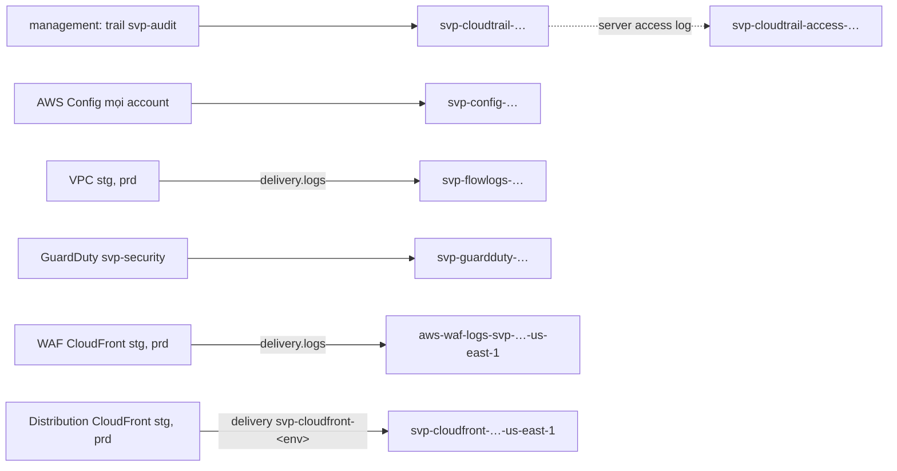

# `aws/log-archive`: bucket log của cả org (account `svp-log-archive`)

Root này dựng nơi giữ log của mọi account trong org ở account `svp-log-archive` (Log Archive của AWS SRA): trail org, AWS Config, flow log
VPC, finding GuardDuty, log WAF và access log CloudFront. Admin của account workload (`svp-stg`, `svp-prd`) và `svp-security` không đọc, sửa hay xoá được log ở
đây; admin của management thì được, qua `OrganizationAccountAccessRole` mà root này dùng để apply. Thiết kế và lý do ở
[ADR-0060](https://github.com/anhnvcoder/svp-backend/blob/main/docs/adr/0060-org-detection-logging.md) §7, retention và policy từng dịch vụ ở
[phụ lục §7](https://github.com/anhnvcoder/svp-backend/blob/main/docs/adr/appendix/0060-org-detection-logging.md#7-bucket-log-archive);
bucket log CloudFront và delivery destination ở [ADR-0061](https://github.com/anhnvcoder/svp-backend/blob/main/docs/adr/0061-edge-cloudfront-waf-acm.md)
§8, [phụ lục §8](https://github.com/anhnvcoder/svp-backend/blob/main/docs/adr/appendix/0061-edge-cloudfront-waf-acm.md#8-log-edge).

Root chạy từ management (`AWS_PROFILE=anhnv-sso`): provider duy nhất assume role `OrganizationAccountAccessRole` của `svp-log-archive`,
`allowed_account_ids` chỉ gồm account đó. State nằm ở bucket của `aws/bootstrap`, key `aws/log-archive/terraform.tfstate`. Account
`svp-log-archive` không có bucket state hay profile SSO ghi riêng.

## Tài nguyên

Tên bucket theo `<tiền tố>-<id account log>-<region>`; root khác suy cùng tên từ id account, không đọc state của root này.

| Bucket | Ai ghi | Mã hoá | Chặn xoá |
| --- | --- | --- | --- |
| `svp-cloudtrail-<log>-ap-southeast-1` | Trail org `svp-audit` của management | SSE-KMS, key region nhà | Object Lock governance |
| `svp-cloudtrail-access-<log>-ap-southeast-1` | S3 server access log của bucket trail | SSE-S3 | — |
| `svp-config-<log>-ap-southeast-1` | AWS Config của mọi account, hai region | SSE-KMS, key region nhà | — |
| `svp-flowlogs-<log>-ap-southeast-1` | Flow log VPC của stg, prd (`delivery.logs.amazonaws.com`) | SSE-KMS, key region nhà | — |
| `svp-guardduty-<log>-ap-southeast-1` | Finding GuardDuty xuất từ detector của `svp-security`, hai region | SSE-KMS, key region nhà | — |
| `aws-waf-logs-svp-<log>-us-east-1` | Log WAF của CloudFront ở stg, prd (`delivery.logs.amazonaws.com`) | SSE-KMS, key `us-east-1` | — |
| `svp-cloudfront-<log>-us-east-1` | Standard log (v2) của distribution CloudFront ở stg, prd (`delivery.logs.amazonaws.com`) | SSE-KMS, key `us-east-1` | — |

- **Hai KMS key cùng alias `alias/svp-log-archive`**: một ở `ap-southeast-1`, một ở `us-east-1` cho hai bucket log của CloudFront
  (SSE-KMS đòi key cùng region với bucket). Cả hai xoay khoá hằng năm, chờ xoá 30 ngày. Root khác lấy ARN `key/<id>` của key region nhà bằng data source `aws_kms_alias`.
- **Bucket access log dùng SSE-S3, không Object Lock**: S3 không giao server access log vào bucket SSE-KMS hay có Object Lock.
- **Mọi bucket**: chặn public, `BucketOwnerEnforced`, versioning, chỉ nhận request TLS, version cũ hết hạn sau 1 ngày.
- **Policy theo org, không theo danh sách account**: Config, flow log, log WAF, log CloudFront qua điều kiện `aws:SourceOrgID`, nên account
  mới của org ghi được mà không sửa policy. Log CloudFront thêm `aws:SourceArn` là delivery source ở `us-east-1`. Trail theo `aws:SourceArn` của `svp-audit`; GuardDuty theo `aws:SourceAccount` của `svp-security` và ARN
  detector của account đó ở hai region.
- **Retention**: số ngày ở `locals` của `main.tf`, lý do ở ADR. Log của account stg trong bucket flow log, WAF và CloudFront có rule riêng
  theo tiền tố account, ngắn hơn: S3 áp hạn ngắn hơn khi hai rule chồng nhau.
- **Delivery destination `svp-cloudfront-<env>`** (`us-east-1`, một mỗi env, Parquet): đích là bucket log CloudFront với tiền tố
  `AWSLogs/<account env>/CloudFront`; destination policy chỉ cho account env đó `logs:CreateDelivery`. Account env tạo delivery source và
  delivery (module `edge`, `media`), suy ARN `arn:aws:logs:us-east-1:<log>:delivery-destination:svp-cloudfront-<env>` từ tên. Mỗi env
  chỉ giao được vào tiền tố mang id account của nó.
- **Key policy**: account quản và đọc key qua IAM (permission set `SvpLogReader` có `kms:Decrypt` qua S3); dịch vụ giao log chỉ được dùng
  key với cùng điều kiện như policy bucket.

Mọi tài nguyên mang tag `Project=svp`, `ManagedBy=terraform`, `Stack=log-archive` và sống giữa các buổi. Bucket và key có `prevent_destroy`:
root này không bao giờ `terraform destroy` cả khối, gỡ theo mục [Gỡ có chủ đích](#gỡ-có-chủ-đích).



## Phí

Hai key KMS tính theo key mỗi tháng, tăng theo số lần xoay; bucket tính theo dung lượng và request. Giá và ước theo tháng ở
[phụ lục ADR-0060 §12](https://github.com/anhnvcoder/svp-backend/blob/main/docs/adr/appendix/0060-org-detection-logging.md#12-chi-phí-liên-tục).
Log CloudFront còn phí giao vended log và phí chuyển Parquet của CloudWatch theo GB, tính ở account env: [phụ lục ADR-0061
§13](https://github.com/anhnvcoder/svp-backend/blob/main/docs/adr/appendix/0061-edge-cloudfront-waf-acm.md#13-chi-phí-edge).

## Apply lần đầu

Bước (3) của thứ tự áp nền bảo mật org: sau khi `aws/bootstrap` đã apply và `aws/org` đã tạo account `svp-log-archive`, `svp-security`
(bước có `-target`), trước khi `aws/org` đổi đích trail sang đây. **Người học chạy mọi lệnh dưới đây** (AI không chạy lệnh nào chạm
account). Cần Terraform 1.15, AWS CLI v2, `aws sso login --profile anhnv-sso`.

### 1. Kiểm account và biến

```sh
cd infra/aws/log-archive
AWS_PROFILE=anhnv-sso aws sts get-caller-identity --region ap-southeast-1 --query '[Account,Arn]' --output text
printf '%s\n' "$SVP_AWS_MGMT_ACCOUNT_ID" "$SVP_AWS_LOG_ACCOUNT_ID" "$SVP_AWS_SECURITY_ACCOUNT_ID" "$SVP_AWS_STG_ACCOUNT_ID" \
  "$SVP_AWS_PRD_ACCOUNT_ID"
```

`Account` phải bằng `SVP_AWS_MGMT_ACCOUNT_ID` (management), `Arn` là role SSO của người học. Năm dòng sau đều là 12 số: log archive và
security từ output `log_archive_account_id`, `security_account_id` của `aws/org`. Khác hay thiếu thì dừng.

### 2. Init và plan

```sh
AWS_PROFILE=anhnv-sso terraform init -backend-config=../backend.hcl
AWS_PROFILE=anhnv-sso TF_VAR_account_id="$SVP_AWS_MGMT_ACCOUNT_ID" TF_VAR_log_archive_account_id="$SVP_AWS_LOG_ACCOUNT_ID" \
  TF_VAR_security_account_id="$SVP_AWS_SECURITY_ACCOUNT_ID" TF_VAR_stg_account_id="$SVP_AWS_STG_ACCOUNT_ID" \
  TF_VAR_prd_account_id="$SVP_AWS_PRD_ACCOUNT_ID" \
  terraform plan -out=log-archive.tfplan
```

Mong đợi `Plan: 59 to add, 0 to change, 0 to destroy` (root đã apply từ trước: chỉ phần chưa có, không `change` hay `destroy`). Đọc:
hai `aws_kms_key.log`, key `waf`, mọi tài nguyên `["waf"]`, `["cloudfront"]` và hai `aws_cloudwatch_log_delivery_destination.cloudfront` có
`region = "us-east-1"`, còn lại `ap-southeast-1`; `aws_s3_bucket_server_side_encryption_configuration.log["waf"]` và `["cloudfront"]` trỏ key
`waf`; `destination_resource_arn` của mỗi destination kết thúc bằng `/AWSLogs/<id account env đó>/CloudFront`. Lỗi `AccessDenied` khi
assume role là account chưa tạo xong hay profile sai; lỗi `account_id is not the management account` là `SVP_AWS_MGMT_ACCOUNT_ID` sai. Dừng
và dán output nếu có dòng `change` hay `destroy`.

### 3. Apply

```sh
AWS_PROFILE=anhnv-sso TF_VAR_account_id="$SVP_AWS_MGMT_ACCOUNT_ID" TF_VAR_log_archive_account_id="$SVP_AWS_LOG_ACCOUNT_ID" \
  TF_VAR_security_account_id="$SVP_AWS_SECURITY_ACCOUNT_ID" TF_VAR_stg_account_id="$SVP_AWS_STG_ACCOUNT_ID" \
  TF_VAR_prd_account_id="$SVP_AWS_PRD_ACCOUNT_ID" \
  terraform apply log-archive.tfplan
rm log-archive.tfplan
AWS_PROFILE=anhnv-sso terraform output bucket_names
AWS_PROFILE=anhnv-sso terraform output kms_key_arns
```

`bucket_names` có bảy bucket, tên chứa id account log; `kms_key_arns` có hai ARN dạng `arn:aws:kms:<region>:<log>:key/<id>`, một
`ap-southeast-1`, một `us-east-1`. Sau đó áp đủ `aws/org` (bước (4)): trail đổi đích sang bucket `svp-cloudtrail-…` ở đây, `SvpLogReader`
đọc được bucket log CloudFront.

## Gỡ có chủ đích

Chỉ khi lab kết thúc và không cần lịch sử audit của org nữa: mục này xoá mọi log, kể cả version còn trong hạn Object Lock. Bỏ qua mục này
thì log còn tới khi account `svp-log-archive` đóng hẳn (90 ngày sau bước 2 của `aws/org`). Thứ tự với root khác:

1. Mọi env, `aws/baseline`, `aws/security` đã gỡ theo README của chúng: không dịch vụ nào còn ghi vào đây.
2. Bước 1 của [Gỡ có chủ đích của `aws/org`](../org/README.md#gỡ-có-chủ-đích) đã chạy: trail đã tắt. Bước đó còn đọc alias
   `alias/svp-log-archive`, nên chạy trước mục này.
3. Mục này, trước bước 2 của `aws/org` (đóng account): sau khi đóng, management không assume role vào account này được nữa.

Các bước, chạy trong `infra/aws/log-archive` với năm biến như mục [Apply lần đầu](#apply-lần-đầu):

1. **Kiểm account của phiên gỡ** (trước lệnh ghi đầu tiên):

   ```sh
   AWS_PROFILE=anhnv-sso aws sts get-caller-identity --region ap-southeast-1 --query '[Account,Arn]' --output text
   ```

   `Account` phải bằng `$SVP_AWS_MGMT_ACCOUNT_ID`, `Arn` là role SSO của người học. Khác thì dừng.

2. **Sửa local, không commit**: ở `buckets.tf`, `aws_s3_bucket.log` đổi `prevent_destroy = true` thành `false` và thêm
   `force_destroy = true`; ở `kms.tf`, `aws_kms_key.log` đổi `prevent_destroy = true` thành `false`. `force_destroy` cho provider xoá mọi
   version và delete marker, kể cả version còn khoá governance (cần `s3:BypassGovernanceRetention`, `OrganizationAccountAccessRole` có).

3. **Ghi `force_destroy` vào state**, rồi gỡ:

   ```sh
   AWS_PROFILE=anhnv-sso TF_VAR_account_id="$SVP_AWS_MGMT_ACCOUNT_ID" TF_VAR_log_archive_account_id="$SVP_AWS_LOG_ACCOUNT_ID" \
     TF_VAR_security_account_id="$SVP_AWS_SECURITY_ACCOUNT_ID" TF_VAR_stg_account_id="$SVP_AWS_STG_ACCOUNT_ID" \
     TF_VAR_prd_account_id="$SVP_AWS_PRD_ACCOUNT_ID" \
     terraform apply
   AWS_PROFILE=anhnv-sso TF_VAR_account_id="$SVP_AWS_MGMT_ACCOUNT_ID" TF_VAR_log_archive_account_id="$SVP_AWS_LOG_ACCOUNT_ID" \
     TF_VAR_security_account_id="$SVP_AWS_SECURITY_ACCOUNT_ID" TF_VAR_stg_account_id="$SVP_AWS_STG_ACCOUNT_ID" \
     TF_VAR_prd_account_id="$SVP_AWS_PRD_ACCOUNT_ID" \
     terraform destroy
   ```

   Plan của `apply` phải là `0 to add, 7 to change, 0 to destroy`, chỉ `force_destroy` của bảy `aws_s3_bucket.log`; khác thì trả lời `no`
   và dán plan lại. `destroy` phải là `59 to destroy`. Bucket nhiều object xoá lâu. Hai key vào `PendingDeletion` 30 ngày: huỷ được trong thời
   gian đó, sau đó log nào còn mã hoá bằng chúng không đọc được nữa.

4. Hoàn tác sửa local (`git checkout -- buckets.tf kms.tf`), rồi chạy bước 2 của `aws/org`.
