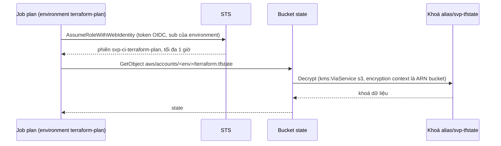

# Module `ci-plan-role`

Role IAM `svp-ci-terraform-plan` của một account env (`svp-stg`, `svp-prd`), gọi từ root `aws/accounts/<env>`
([README](../../accounts/README.md#role-plan-của-ci)) nên sống giữa các buổi. Workflow `plan.yml` của `svp-infra` assume role này qua OIDC
để chạy `terraform plan` trên PR: role đọc được cấu hình của account và state của hai root, không đọc được dữ liệu workload, không ghi gì
vào bucket state. Thiết kế, tập Deny và kiểm kê refresh:
[ADR-0076](https://github.com/anhnvcoder/svp-backend/blob/main/docs/adr/0076-terraform-plan-infracost-pr.md) §4–§6 và phụ lục của nó (số §
dưới đây là § của ADR).

## Luồng đọc state

Job nhận phiên chỉ khi người học duyệt lượt đó ở environment `terraform-plan`. S3 giải mã state thay cho role: lần `kms:Decrypt` đi qua S3 nên
mang `kms:ViaService` và encryption context của bucket (S3 Bucket Key dùng ARN bucket). Gọi KMS trực tiếp bằng role thì bị Deny.

## Trust

- Principal: IAM OIDC provider của GitHub Actions trong account (`oidc_provider_arn`, output `github_oidc_provider_arn` của module
  [`registry`](../registry/README.md#role-ci)); `StringEquals` trên `aud` = `sts.amazonaws.com` và trên `sub` đúng một chuỗi (`subject`).
- Validation chỉ nhận `sub` dạng bất biến của job có environment, `repo:<owner>@<owner-id>/<repo>@<repo-id>:environment:<tên>`: không ký tự
  đại diện, không dạng `ref:`, `pull_request`. Reviewer bắt buộc của environment là lượt duyệt của mỗi lần đọc account (§1).
- Phiên tối đa 3 600 giây, mức thấp nhất IAM nhận.

## Quyền

- `ReadOnlyAccess` (policy AWS quản lý), gắn bằng `aws_iam_role_policy_attachment`.
- Policy inline `svp-ci-terraform-plan-read`:
  - `StateKeyViaS3`: `kms:Decrypt` trên khoá state (`state_kms_key_arn`, ARN dạng `key/<id>`: IAM không khớp ARN alias) khi
    `kms:ViaService` là S3 của region và encryption context là ARN bucket state. Key policy của khoá ủy quyền dùng cho IAM qua statement
    `CiPlanReadsState` của module [`account-baseline`](../account-baseline/README.md), nên cần cả hai phía.
  - `RefreshReadsMissing`: `grafana:ListWorkspaceServiceAccounts`, `pricingplanmanager:GetSubscription`, hai lệnh đọc mà refresh gọi và
    `ReadOnlyAccess` không có (§6).
- Policy inline `svp-ci-terraform-plan-deny` (explicit Deny thắng mọi Allow, cả của resource policy):

  | Sid | Chặn |
  | --- | --- |
  | `DenyWorkloadData` | Đọc dữ liệu workload trên mọi resource: giá trị secret, item DynamoDB, log event, message SQS, record Kinesis, trace, truy vấn AMP, log RDS, console EC2 (danh sách ở `local.workload_data_actions`) |
  | `DenyObjectReads` | `s3:GetObject*` trên mọi object trừ hai khoá state của env và `media/uptime-probe.txt` của bucket media (`svp-<env>-media-<account>-<region>`) |
  | `DenyDecryptOtherKeys` | `kms:Decrypt` trên mọi khoá trừ khoá state; giá trị `SecureString` của SSM cũng cần giải mã nên bị chặn theo |
  | `DenyDecryptStateOutsideS3` | `kms:Decrypt` trên khoá state khi không qua S3 |
  | `DenyStateWrites` | Mọi hành động S3 trừ `s3:Get*`, `s3:List*` trên bucket state và object của nó, cả file khoá `.tflock` |

Thêm resource mà refresh đọc bằng hành động trong tập Deny hay ngoài `ReadOnlyAccess` thì đối chiếu lại §6 trước khi đổi tập ở đây.

## Test

`tests/ci-plan-role.tftest.hcl` (mock provider, chỉ `plan`) kiểm với stg và prd: tên role, phiên 1 giờ; trust đúng provider, `aud` và một `sub`;
`ReadOnlyAccess` gắn; policy read đúng hai statement và điều kiện; policy deny đúng năm statement, hành động, resource, ngoại lệ theo env; rồi một
run mỗi luật validation (env, ARN provider, `sub` có ký tự đại diện, dạng `pull_request`, dạng không bất biến, tên bucket, ARN alias của khoá).

<!-- markdownlint-disable MD033 -->
<!-- BEGIN_TF_DOCS -->
## Requirements

| Name | Version |
| ---- | ------- |
| terraform | ~> 1.15 |
| aws | ~> 6.0 |

## Providers

| Name | Version |
| ---- | ------- |
| aws | ~> 6.0 |

## Resources

| Name | Type |
| ---- | ---- |
| [aws_iam_role.this](https://registry.terraform.io/providers/hashicorp/aws/latest/docs/resources/iam_role) | resource |
| [aws_iam_role_policy.deny](https://registry.terraform.io/providers/hashicorp/aws/latest/docs/resources/iam_role_policy) | resource |
| [aws_iam_role_policy.read](https://registry.terraform.io/providers/hashicorp/aws/latest/docs/resources/iam_role_policy) | resource |
| [aws_iam_role_policy_attachment.read_only](https://registry.terraform.io/providers/hashicorp/aws/latest/docs/resources/iam_role_policy_attachment) | resource |
| [aws_caller_identity.current](https://registry.terraform.io/providers/hashicorp/aws/latest/docs/data-sources/caller_identity) | data source |
| [aws_iam_policy_document.deny](https://registry.terraform.io/providers/hashicorp/aws/latest/docs/data-sources/iam_policy_document) | data source |
| [aws_iam_policy_document.read](https://registry.terraform.io/providers/hashicorp/aws/latest/docs/data-sources/iam_policy_document) | data source |
| [aws_iam_policy_document.trust](https://registry.terraform.io/providers/hashicorp/aws/latest/docs/data-sources/iam_policy_document) | data source |
| [aws_partition.current](https://registry.terraform.io/providers/hashicorp/aws/latest/docs/data-sources/partition) | data source |
| [aws_region.current](https://registry.terraform.io/providers/hashicorp/aws/latest/docs/data-sources/region) | data source |

## Inputs

| Name | Description | Type | Default | Required |
| ---- | ----------- | ---- | ------- | :------: |
| env | Environment of the account (stg, prd): picks the two state keys the role may read and the media bucket svp-<env>-media-<account>-<region>. | `string` | n/a | yes |
| oidc\_provider\_arn | ARN of the IAM OIDC provider of GitHub Actions in this account (github\_oidc\_provider\_arn of the registry module): the only principal the trust accepts. | `string` | n/a | yes |
| state\_bucket | Bucket of the Terraform state of this account, svp-tfstate-<account>-<region> (state\_bucket of the account-baseline module): the role reads two of its keys and writes nothing in it. | `string` | n/a | yes |
| state\_kms\_key\_arn | ARN of the KMS key of the state, arn:aws:kms:<region>:<account>:key/<key-id> (state\_kms\_key\_arn of the account-baseline module). IAM matches a key by its key ARN only, never by an alias ARN. | `string` | n/a | yes |
| subject | The one sub claim the trust accepts, in the immutable form of a job that names an environment: repo:<owner>@<owner-id>/<repo>@<repo-id>:environment:<name>. | `string` | n/a | yes |

## Outputs

| Name | Description |
| ---- | ----------- |
| role\_arn | ARN of the role svp-ci-terraform-plan, which the plan workflow of svp-infra assumes through OIDC. |
<!-- END_TF_DOCS -->
