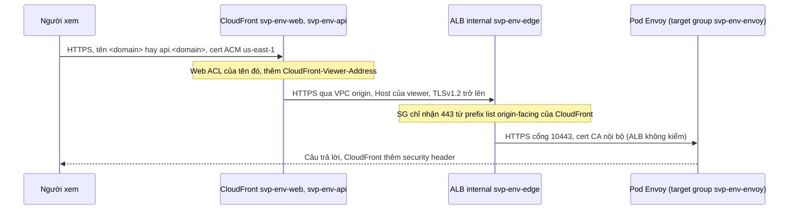

# Module `edge`

Đường vào công khai duy nhất của web và API ở stg, prd: hai distribution CloudFront `<name>-web` (tên `<domain>`) và `<name>-api` (tên
`api.<domain>`), cùng đi qua một CloudFront VPC origin tới ALB internal `<name>-edge` ở các subnet edge, rồi tới pod Envoy trong target group
`<name>-envoy`. Module giữ cert ACM, response headers policy, log chuẩn v2 và bản ghi DNS của hai tên. Thiết kế và nguồn:
[ADR-0061](https://github.com/anhnvcoder/svp-backend/blob/main/docs/adr/0061-edge-cloudfront-waf-acm.md) §2–§5, §8, §11 và phụ lục của nó.
Media (`media.<domain>`) ở module `media`; web ACL ở module `waf`, truyền vào qua `web_acl_arns`.

## Luồng request

Envoy định tuyến theo Host, nên mọi behavior chuyển nguyên Host của viewer: CloudFront gửi Host đó làm SNI tới ALB và kiểm cert ALB theo nó, vì
vậy cert ALB phủ cả `<domain>` lẫn `api.<domain>`. Pod Envoy vào target group nhờ `TargetGroupBinding` `svp-envoy` của chart `svp-cluster`
(khoá `edgeTargetGroupArn` của values cluster là output `target_group_arn`).

## Origin VPC

- **ALB** `<name>-edge`: `internal = true`, mọi subnet của `subnet_ids` (tầng edge của module `network`: không node, không pod, nên mọi kết nối
  tới Envoy từ dải này là của ALB), `drop_invalid_header_fields = true`, `desync_mitigation_mode = "defensive"`, deletion protection theo
  `alb_deletion_protection`. Một listener duy nhất: HTTPS 443, `ELBSecurityPolicy-TLS13-1-2-Res-PQ-2025-09`, forward tới target group.
- **Security group** `<name>-edge-*`: vào chỉ TCP 443 từ prefix list `com.amazonaws.global.cloudfront.origin-facing`; ra chỉ TCP 10443
  (listener Envoy) và 19003 (readiness) tới SG node của module `eks`. Module thêm hai rule vào SG node cho đúng hai cổng đó từ SG ALB; module
  `eks` không đổi. Prefix list, không group `CloudFront-VPCOrigins-Service-SG`: group đó do dịch vụ tạo sau VPC origin, nằm ngoài state và
  "should not be edited" theo tài liệu VPC origins. Prefix list tính theo số mục tối đa của nó vào hạn mức rule của SG
  ([tài liệu prefix list AWS-managed](https://docs.aws.amazon.com/vpc/latest/userguide/working-with-aws-managed-prefix-lists.html)): SG này
  chỉ có một rule vào nên còn trong hạn mức mặc định.
- **Target group** `<name>-envoy`: `target_type = "ip"`, HTTPS 443, health check HTTP cổng 19003 `/ready` (readiness của Envoy chỉ có HTTP).
- **VPC origin** `<name>-edge`: ARN của ALB, `https-only`, `TLSv1.2`.
- **Không tag `elbv2.k8s.aws/*`** trên ALB, listener, target group: policy IAM của Load Balancer Controller cho `RegisterTargets` trên mọi
  target group không cần tag, còn `pre-destroy.sh` chờ tới khi hết load balancer, target group mang tag `elbv2.k8s.aws/cluster` (của controller).

**Vì sao không NLB:** VPC origin không nhận NLB có listener TLS ("Network Load Balancers with TLS listeners cannot be added as origins"); NLB
TCP thì Envoy phải giữ cert công khai. **Vì sao không access log ALB** (FSBP ELB.5) **và không web ACL regional** (ELB.16): ALB chỉ nhận từ
CloudFront, mọi request đã có trong log CloudFront và log WAF. Xem lại khi cần thời gian xử lý của target theo request hay ALB nhận nguồn khác.

## Distribution

| | `<name>-web` | `<name>-api` |
| --- | --- | --- |
| Tên, cert viewer | `<domain>` | `api.<domain>` |
| Behavior mặc định | `Managed-CachingDisabled`, mọi method | như web |
| Behavior thêm | `/_next/static/*`: `Managed-CachingOptimized`, nén | — |
| Origin request policy (mọi behavior) | `Managed-AllViewerAndCloudFrontHeaders-2022-06` | như web |
| Response headers policy | `<name>-web` | `<name>-api` |
| Web ACL | `web_acl_arns["web"]` | `web_acl_arns["api"]` |

Chung: `redirect-to-https`, `http2and3`, IPv6, `PriceClass_All`, `sni-only`, `minimum_protocol_version = "TLSv1.2_2025"` (mới nhất còn nhận
TLS 1.2 bên cạnh 1.3). Origin request policy managed chuyển mọi header, cookie, query của viewer và thêm `CloudFront-Viewer-Address`, header
gateway đọc IP client; nó không vào cache key. `/_next/static/*` là file build có hash trong tên, cache được; trang và Server Action không cache.

**Response headers policy** (giá trị và lý do: ADR-0061 §6):

| Header | `<name>-web` | `<name>-api` |
| --- | --- | --- |
| `Strict-Transport-Security` | `max-age=63072000; includeSubDomains`, không `preload` | như web |
| `X-Content-Type-Options` | `nosniff` | `nosniff` |
| `X-Frame-Options` | `DENY` | `DENY` |
| `Referrer-Policy` | `strict-origin-when-cross-origin` | như web |
| `Content-Security-Policy` | — (web tự đặt CSP có nonce) | `default-src 'none'; frame-ancestors 'none'` |
| Override | `false`: chỉ điền header câu trả lời còn thiếu | `true`: gateway không đặt header nào trong bảng |

## Chứng chỉ

Mỗi distribution một cert ACM ở `us-east-1` (đối số `region`) cho đúng tên của nó; ALB một cert ở region của provider cho `<domain>` cộng SAN
`api.<domain>`. Cả ba ECDSA P-256 (`EC_prime256v1`), DNS validation. ACM cho một tên cùng một bản ghi CNAME validation ở mọi region của account,
nên mỗi tên một bản ghi (`aws_route53_record.validation`), ba cert cùng chờ nó. Envoy dùng cert của CA nội bộ cert-manager: ALB không kiểm
cert target.

## Log

Log chuẩn v2 (vended log của CloudWatch Logs): mỗi distribution một delivery source `ACCESS_LOGS` `<name>-<web|api>` ở `us-east-1` và một
delivery tới `log_delivery_destination_arn`, delivery destination `svp-cloudfront-<env>` của account Log Archive (destination, policy và bucket
do root `aws/log-archive` giữ). Đường object `{DistributionId}/{yyyy}/{MM}/{dd}/{HH}` kiểu Hive. `record_fields` là danh sách tường minh ở
`local.log_record_fields` của `main.tf`: mọi trường của ví dụ trong tài liệu standard logging v2 trừ `cs(Cookie)` (cookie phiên của web); module
`media` dùng cùng danh sách.

## DNS

Bản ghi A và AAAA alias của `<domain>` tới `<name>-web`, `api.<domain>` tới `<name>-api`, trong zone `hosted_zone_id`; cùng hai bản ghi validation
ACM. Chúng sống và gỡ theo buổi cùng root `aws/envs/<env>`.

## Thứ tự gỡ và tài nguyên AWS tự tạo

- Tham chiếu trong code quyết định thứ tự `terraform destroy`: bản ghi DNS và delivery log, rồi distribution (provider tắt distribution, chờ
  `Deployed`, rồi xoá), rồi VPC origin (AWS từ chối xoá VPC origin còn được dùng: `CannotDeleteEntityWhileInUse` của API `DeleteVpcOrigin`),
  rồi listener, ALB, target group, security group. Distribution tắt mất nhiều phút; ALB còn deletion protection thì destroy dừng ở ALB, phải
  `apply` với `alb_deletion_protection = false` trước (`teardown.tfvars`).
- **ENI và SG do CloudFront tạo:** sau khi có VPC origin, CloudFront tạo ENI do dịch vụ quản lý trong subnet edge và security group
  `CloudFront-VPCOrigins-Service-SG` trong VPC (tài liệu "Restrict access with VPC origins"). Tài liệu không nói khi nào chúng mất sau khi xoá
  VPC origin. ENI còn thì subnet edge, VPC không xoá được; SG còn thì VPC không xoá được. Script gỡ của buổi vì vậy chờ tới khi không còn ENI
  nào trong subnet edge và không còn SG tên bắt đầu `CloudFront-VPCOrigins-Service-SG` trong VPC của env trước khi xoá mạng, và `sweep.sh` liệt kê
  hai loại này nếu còn sót. Thời gian thật đo ở buổi đầu.

<!-- BEGIN_TF_DOCS -->
## Requirements

| Name | Version |
| ---- | ------- |
| terraform | ~> 1.15 |
| aws | ~> 6.69 |

## Providers

| Name | Version |
| ---- | ------- |
| aws | ~> 6.69 |

## Resources

| Name | Type |
| ---- | ---- |
| [aws_acm_certificate.alb](https://registry.terraform.io/providers/hashicorp/aws/latest/docs/resources/acm_certificate) | resource |
| [aws_acm_certificate.viewer](https://registry.terraform.io/providers/hashicorp/aws/latest/docs/resources/acm_certificate) | resource |
| [aws_acm_certificate_validation.alb](https://registry.terraform.io/providers/hashicorp/aws/latest/docs/resources/acm_certificate_validation) | resource |
| [aws_acm_certificate_validation.viewer](https://registry.terraform.io/providers/hashicorp/aws/latest/docs/resources/acm_certificate_validation) | resource |
| [aws_cloudfront_distribution.this](https://registry.terraform.io/providers/hashicorp/aws/latest/docs/resources/cloudfront_distribution) | resource |
| [aws_cloudfront_response_headers_policy.this](https://registry.terraform.io/providers/hashicorp/aws/latest/docs/resources/cloudfront_response_headers_policy) | resource |
| [aws_cloudfront_vpc_origin.this](https://registry.terraform.io/providers/hashicorp/aws/latest/docs/resources/cloudfront_vpc_origin) | resource |
| [aws_cloudwatch_log_delivery.this](https://registry.terraform.io/providers/hashicorp/aws/latest/docs/resources/cloudwatch_log_delivery) | resource |
| [aws_cloudwatch_log_delivery_source.this](https://registry.terraform.io/providers/hashicorp/aws/latest/docs/resources/cloudwatch_log_delivery_source) | resource |
| [aws_lb.this](https://registry.terraform.io/providers/hashicorp/aws/latest/docs/resources/lb) | resource |
| [aws_lb_listener.https](https://registry.terraform.io/providers/hashicorp/aws/latest/docs/resources/lb_listener) | resource |
| [aws_lb_target_group.envoy](https://registry.terraform.io/providers/hashicorp/aws/latest/docs/resources/lb_target_group) | resource |
| [aws_route53_record.site](https://registry.terraform.io/providers/hashicorp/aws/latest/docs/resources/route53_record) | resource |
| [aws_route53_record.validation](https://registry.terraform.io/providers/hashicorp/aws/latest/docs/resources/route53_record) | resource |
| [aws_security_group.alb](https://registry.terraform.io/providers/hashicorp/aws/latest/docs/resources/security_group) | resource |
| [aws_vpc_security_group_egress_rule.alb_to_envoy](https://registry.terraform.io/providers/hashicorp/aws/latest/docs/resources/vpc_security_group_egress_rule) | resource |
| [aws_vpc_security_group_ingress_rule.alb_https](https://registry.terraform.io/providers/hashicorp/aws/latest/docs/resources/vpc_security_group_ingress_rule) | resource |
| [aws_vpc_security_group_ingress_rule.envoy_from_alb](https://registry.terraform.io/providers/hashicorp/aws/latest/docs/resources/vpc_security_group_ingress_rule) | resource |
| [aws_cloudfront_cache_policy.caching_disabled](https://registry.terraform.io/providers/hashicorp/aws/latest/docs/data-sources/cloudfront_cache_policy) | data source |
| [aws_cloudfront_cache_policy.caching_optimized](https://registry.terraform.io/providers/hashicorp/aws/latest/docs/data-sources/cloudfront_cache_policy) | data source |
| [aws_cloudfront_origin_request_policy.all_viewer](https://registry.terraform.io/providers/hashicorp/aws/latest/docs/data-sources/cloudfront_origin_request_policy) | data source |
| [aws_ec2_managed_prefix_list.cloudfront](https://registry.terraform.io/providers/hashicorp/aws/latest/docs/data-sources/ec2_managed_prefix_list) | data source |

## Inputs

| Name | Description | Type | Default | Required |
| ---- | ----------- | ---- | ------- | :------: |
| alb\_deletion\_protection | Deletion protection of the ALB: while it is on, terraform destroy fails at the load balancer. | `bool` | n/a | yes |
| domain | Name of the env's hosted zone (svp.example): the web answers at `<domain>`, the API at `api.<domain>`. | `string` | n/a | yes |
| hosted\_zone\_id | ID of the Route 53 public hosted zone of domain: the module writes the ACM validation records and the alias records of both names there. | `string` | n/a | yes |
| log\_delivery\_destination\_arn | ARN of the CloudWatch Logs delivery destination (us-east-1, in the Log Archive account) that receives the standard logs of both distributions, `arn:aws:logs:us-east-1:<account>:delivery-destination:svp-cloudfront-<env>`. | `string` | n/a | yes |
| name | Fixed start of every name (svp-stg, svp-prd): ALB and VPC origin `<name>-edge`, target group `<name>-envoy`, distributions and response headers policies `<name>-web` and `<name>-api`. | `string` | n/a | yes |
| node\_security\_group\_id | Security group of the EKS nodes and, with the VPC CNI, of their pods (output node\_security\_group\_id of the eks module): the module lets the ALB reach Envoy on it. | `string` | n/a | yes |
| subnet\_ids | Edge subnets of the VPC, one per availability zone (output edge\_subnet\_ids of the network module): the internal ALB and the network interfaces of the CloudFront VPC origin live there. | `list(string)` | n/a | yes |
| vpc\_id | VPC of the load balancer, its security group and the target group. | `string` | n/a | yes |
| web\_acl\_arns | ARNs of the AWS WAF web ACLs of scope CLOUDFRONT (us-east-1, output web\_acl\_arn of the waf module), keyed web and api: each guards the distribution of the same name. | `map(string)` | n/a | yes |

## Outputs

| Name | Description |
| ---- | ----------- |
| alb\_security\_group\_id | Security group of the internal ALB: the only source the module lets in on the Envoy ports of the node security group. |
| distribution\_domains | Domain names (`<id>.cloudfront.net`) of the distributions, keyed web and api; `<domain>` and `api.<domain>` are alias records to them. |
| target\_group\_arn | ARN of the target group `<name>-envoy`: edgeTargetGroupArn of the cluster values, where the TargetGroupBinding of Envoy registers its pods. |
<!-- END_TF_DOCS -->
