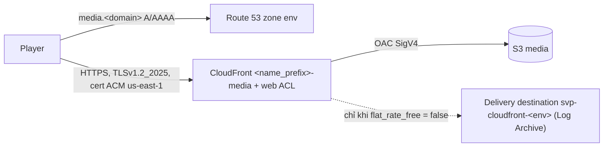

# Module `media`

Hai bucket S3 `uploads`, `media`, KMS key mã hoá `uploads` và CloudFront trước `media` ở tên `media.<domain>` (gói flat-rate Free hay
pay-as-you-go theo `flat_rate_free`), plan GuardDuty Malware Protection for S3 trên `uploads`, cộng hai policy IAM (JSON) cho video-service và
media-worker.
Thiết kế: [ADR-0034](https://github.com/anhnvcoder/svp-backend/blob/main/docs/adr/0034-aws-stage7.md) mục 9 và 11,
[ADR-0052](https://github.com/anhnvcoder/svp-backend/blob/main/docs/adr/0052-cloudfront-flat-rate-free.md) (gói Free, WAF, CORS của
CloudFront), [ADR-0061](https://github.com/anhnvcoder/svp-backend/blob/main/docs/adr/0061-edge-cloudfront-waf-acm.md) (§1 gói theo env,
§2 distribution, §5 cert và TLS, §6 header, §8 log edge),
[ADR-0067](https://github.com/anhnvcoder/svp-backend/blob/main/docs/adr/0067-backup-dr.md) (§8 mã hoá `uploads`, tag backup); ngưỡng an toàn
theo threat model UP-4…UP-6, WEB-10 của repo code.

## Bucket

- Tên `<name_prefix>-uploads-<account_id>-<region>`, `<name_prefix>-media-<account_id>-<region>` (quy ước của bucket do AWS tạo như CDK,
  Control Tower): duy nhất toàn cầu không cần phần ngẫu nhiên, biết lúc `plan`, nhìn tên là biết account và region. Account ID không phải bí
  mật theo AWS; tên bucket `uploads` nằm trong mọi URL form upload presigned trình duyệt thấy. Root truyền `account_id`, `region` của nó, nên
  file commit không chứa account thật. Bucket sót của một `destroy` dở trùng tên với lần `apply` sau: script quét sót (`aws/scripts/sweep.sh`) liệt kê
  nó theo tiền tố tên `svp-`, người học xoá trước khi `apply` theo runbook của buổi.
- Chặn public (cả bốn cờ), `BucketOwnerEnforced` (không ACL), mã hoá mặc định theo mục [Mã hoá](#mã-hoá). Tag `Backup = "daily"` trên
  cả hai bucket: Backup policy của Organizations chọn bucket theo tag này (ADR-0067). Versioning tắt mặc định (object `media` ghi một lần dưới đường
  version mới, `uploads` bị xoá khi hết cần; giữ version chỉ giữ byte đã xoá); `versioning_enabled = true` (mức prd) bật ở cả hai bucket
  và thêm rule lifecycle xoá bản cũ 30 ngày sau khi bị thay hay xoá, cùng delete marker không còn bản nào phía sau: xoá nhầm còn khôi phục
  được trong 30 ngày. Policy của cả hai bucket từ chối request không TLS bằng statement `Deny`
  `s3:*` như mẫu của AWS: action S3 thêm sau này cũng bị từ chối qua HTTP. Wildcard ở `Deny` chỉ mở rộng thứ bị cấm, không cấp quyền nào (các
  statement `Allow` của module không dùng wildcard dịch vụ).
- **Key giữ tiền tố:** bucket `uploads` chứa `uploads/<video_id>`, bucket `media` chứa `media/<video_id>/<version>/…` (như object store local,
  `internal/objstore` chọn bucket theo tiền tố), nên key, policy và URL giống nhau ở mọi nền tảng.
- **CORS theo bucket như local:** `uploads` chỉ `POST` (form presigned của web, expose `Retry-After`), `media` chỉ `GET`, `HEAD`; origin là
  `cors_allowed_origins` (origin trơn, không `*`, không path). Rule của bucket `media` chỉ trả lời request gửi thẳng tới bucket; viewer đi qua
  CloudFront nhận CORS của distribution (mục dưới).
- **Lifecycle:** `uploads/` 30 ngày ở lớp chuẩn → Glacier Deep Archive, xoá sau 365 ngày (sau 30 ngày không transcode lại được nếu chưa
  restore, restore tới 48 giờ); `transcode-jobs/` của `media` (bản ghi job của bridge) xoá sau 30 ngày, lâu hơn mọi job và hạn giữ message
  của SQS, Kafka; multipart dở bị huỷ sau 1 ngày ở cả hai bucket. Hôm nay không service nào ghi bằng multipart (mỗi file một
  `PutObject`, form của trình duyệt là một POST), nhưng `s3:PutObject` cho phép bắt đầu một lần multipart mà không service nào được abort,
  nên phần của một lần ghi dở (client sau này, credential bị lạm dụng) chỉ được dọn bằng rule này.
- **Access log:** `access_logging_enabled = true` (mức prd) ghi S3 server access log của hai bucket vào bucket thứ ba
  `<name_prefix>-logs-<account_id>-<region>` (tiền tố `uploads/`, `media/`) do module tạo: chặn public, `BucketOwnerEnforced`, SSE-S3 (đích
  của server access log chỉ nhận SSE-S3, ngoại lệ trivy AWS-0132), TLS-only, policy cho `logging.s3.amazonaws.com` `s3:PutObject` với điều
  kiện `aws:SourceArn` là hai bucket này và `aws:SourceAccount` là account này (mẫu của tài liệu S3), log xoá sau 90 ngày. Bucket log không
  ghi log của chính nó (vòng lặp vô hạn). `force_destroy` áp cho cả bucket log.
- **`force_destroy`:** `true` làm `terraform destroy` xoá **mọi object** của cả hai bucket rồi xoá bucket. `true` ở stg (dữ liệu
  buổi lab bỏ đi được); prd `false`, destroy dừng ở bucket còn object, trừ khi teardown của buổi đặt `true` qua `teardown.tfvars`. Biến
  không có mặc định để mỗi env phải ghi rõ.

## Mã hoá

- **`uploads`: SSE-KMS** bằng CMK của module, alias `alias/<name_prefix>-uploads` (đối xứng, rotation bật, deletion window 7 ngày như key
  RDS: sống cùng buổi), S3 Bucket Key bật (`bucket_key_enabled`): S3 xin KMS một key cấp bucket thay vì gọi KMS cho từng object, request
  KMS giảm tới 99 %. Key policy mặc định của KMS: account quyết ai dùng key qua IAM. Bản gốc người dùng tải lên là dữ liệu riêng mãi mãi,
  nên đọc một object cần thêm `kms:Decrypt` trên đúng key này, và mọi lần dùng key nằm trong CloudTrail. Output `uploads_kms_key_arn`.
- **`media`: SSE-S3** (ngoại lệ trivy AWS-0132 `[each.key=media]` trên resource mã hoá chung của hai bucket): nội dung công khai qua
  CloudFront sau transcode, CMK không thêm ranh giới nào, chỉ thêm phí key và quyền `kms:Decrypt` cho CloudFront và hai service. trivy kiểm
  từng bucket: khoá `for_each` của `aws_s3_bucket.this` viết thẳng (trivy không mở rộng `for_each` có giá trị chưa biết, mà tên bucket chứa
  `account_id` chỉ biết lúc chạy), và `kms_master_key_id` của `media` là `""` chứ không `null` (trivy coi `null` là chưa biết, bỏ qua kiểm).
  Nhờ vậy `uploads` mất CMK thì `make trivy` đỏ; test mock kiểm thêm `aws:kms`, Bucket Key ở `uploads`, `AES256` ở `media`.
- **Quyền KMS trên key `uploads`** (`Resource` là đúng ARN key, `Action` theo ADR-0067 §8, không wildcard):

  | Principal | Action | Nơi viết |
  | --- | --- | --- |
  | video-service | `kms:GenerateDataKey` (S3 tạo data key bằng quyền của người ký form upload; `HEAD`, `DELETE` không dùng key) | `iam.tf` |
  | media-worker | `kms:Decrypt` (đọc bản gốc, kể cả `Probe` của MediaConvert bằng quyền người gọi) | `iam.tf` |
  | Role Malware Protection | `kms:GenerateDataKey`, `kms:Decrypt` với `kms:ViaService` = `s3.<region>.amazonaws.com` | `malware-protection.tf` |
  | Role MediaConvert | `kms:Decrypt` | module `transcode` (biến `uploads_kms_key_arn`) |
  | Role `svp-<env>-backup` | managed policy của AWS Backup (ADR-0067 §7) | root `aws/accounts/<env>` |

  ARN key chỉ biết sau `apply`, nên test mock kiểm mỗi statement KMS có đúng action, điều kiện và đúng một resource; resource đó là key
  `uploads` thì đọc trong code.

## CloudFront

Distribution `<name_prefix>-media` (comment và tag `Name`) trả lời ở `media.<domain>`. Hai giá trị của `flat_rate_free` chỉ khác ở gói,
response headers policy và access log; mọi thứ khác giống nhau:

| | `flat_rate_free = true` (stg) | `flat_rate_free = false` (prd) |
| --- | --- | --- |
| Gói | flat-rate Free (`aws_pricingplanmanager_subscription.media`) | pay-as-you-go |
| Response headers policy | managed `Managed-SimpleCORS` (`Access-Control-Allow-Origin: *`) | `<name_prefix>-media`: CORS theo `cors_allowed_origins`, HSTS, `nosniff` |
| Access log | không (gói Free không có) | standard log v2 tới `log_delivery_destination_arn` |
| `log_delivery_destination_arn` | không dùng | bắt buộc (validation nêu tên biến) |

- **Tên và chứng chỉ:** alias duy nhất `media.<domain>`; cert ACM ở `us-east-1` (đối số `region`) chỉ cho tên đó, ECDSA P-256
  (`EC_prime256v1`), DNS validation bằng record CNAME trong zone `hosted_zone_id`, `create_before_destroy` để distribution không lúc nào
  thiếu cert. Viewer `sni-only`, `minimum_protocol_version = "TLSv1.2_2025"` (cùng policy với web, api của module `edge`). Record A và AAAA
  alias `media.<domain>` tới distribution nằm trong module; output `media_domain` lấy tên từ record A, nên thứ đọc nó (cluster values) chờ
  record có trước. Gói Free nhận tên riêng và cert ACM (ADR-0052 §1).
- Origin là bucket `media` qua **OAC** (ký SigV4 mọi request); policy bucket chỉ cho `cloudfront.amazonaws.com` `s3:GetObject` trên
  `media/*` với điều kiện `AWS:SourceArn` là ARN của distribution này; không `ListBucket`, nên key không có trả 403 thay vì 404.
- Viewer chỉ HTTPS (`https-only`), HTTP/2 và HTTP/3, IPv6, price class cố định `PriceClass_All` ở cả hai gói: khi đăng ký gói, AWS tự chuyển
  distribution sang mọi edge location (quan sát ở một dự án khác: Terraform phải đặt `PriceClass_All` thì `plan` sau apply mới
  `No changes`), và pay-as-you-go giữ cùng giá trị để hai env phục vụ từ cùng edge.
- **WAF:** `web_acl_arn` (ARN web ACL scope `CLOUDFRONT` `<name_prefix>-media` của module `waf`, ở `us-east-1`) bắt buộc ở mọi env.
- **Gói flat-rate Free** (`flat_rate_free = true`): `aws_pricingplanmanager_subscription.media` (`plan_family = "CloudFront"`,
  `plan_tier = "FREE"`, `resource_arns` là distribution và web ACL; không đặt `approval_mode`, mặc định của AWS cho `FREE` là kích hoạt ngay).
  $0 mỗi tháng thay pay-as-you-go: 1 triệu request và 100 GB mỗi tháng, không phải trần cứng, không tính phí vượt (vượt kéo dài thì AWS có thể
  điều chỉnh giao hàng). Gói đòi distribution chỉ dùng tính năng của nó: cache policy managed (`Managed-CachingOptimized`), response headers
  policy managed, OAC; không `ForwardedValues`, OAI, real-time log, field-level encryption, continuous deployment, dedicated IP; tối đa 5 cache
  behavior; không standard log. Mỗi account tối đa 3 gói Free, mỗi gói một distribution; account còn ở AWS Free Tier không đăng ký được. Web
  ACL, luật tự viết, AWS Managed Rules và phí request của web ACL gắn distribution có gói nằm trong gói (CAPTCHA qua JavaScript API và giao log
  WAF tính riêng); gói Free nhận tối đa 5 luật. Khi còn gói, AWS không cho gỡ hay thay web ACL của distribution: đổi `name` của module `waf`
  (thay web ACL) phải huỷ gói trước (destroy root, hay huỷ tay theo runbook buổi).
- **Thứ tự gỡ khi có gói:** subscription tham chiếu ARN của distribution và web ACL, nên `terraform destroy` huỷ gói trước (gói Free huỷ có
  hiệu lực ngay), rồi mới tắt, xoá distribution và web ACL; AWS không xoá distribution còn gói. Vài phút giữa lúc distribution, web ACL được tạo
  và lúc gói có hiệu lực (và ngược lại lúc destroy) tính pay-as-you-go.
- **Pay-as-you-go** (`flat_rate_free = false`): không subscription; response headers policy tự viết và standard log v2 (hai mục dưới).
- **Cache:** policy managed `Managed-CachingOptimized`: cache key không có query, cookie, header; TTL theo `Cache-Control` của object trong
  khoảng 1 s tới 1 năm (object không gửi header thì 24 giờ). Mọi object của một version HLS mang `max-age=31536000, immutable`, nên edge giữ
  một năm.
- **CORS ở CloudFront, không ở bucket:** header CORS của S3 phụ thuộc `Origin` của request, mà `Origin` không nằm trong cache key; bản cache
  của request không `Origin` (thẻ ``, curl) sẽ trả cho player cần nó mà không có `Access-Control-Allow-Origin`. Nên distribution không
  chuyển header nào của viewer tới bucket (không origin request policy: S3 không bao giờ thấy `Origin`, mọi viewer dùng chung một bản cache),
  còn response headers policy thêm header CORS vào câu trả lời. Request của player không mang header nào cần preflight, nên distribution chỉ
  nhận `GET`, `HEAD`.
  - Gói Free chỉ nhận policy managed (policy tự viết chỉ có ở gói Business, Premium): `Managed-SimpleCORS` trả
    `Access-Control-Allow-Origin: *`, nên trang nào cũng đọc được media cross-origin, kể cả nhúng lại video của nền tảng; chấp nhận vì object
    media công khai (ai có URL cũng tải được), bất biến, và player không gửi credential nên `*` không lộ gì thêm.
  - Pay-as-you-go: policy `<name_prefix>-media` trả `Access-Control-Allow-Origin` chỉ cho origin có trong `cors_allowed_origins` (cùng danh sách
    với rule CORS của hai bucket), method `GET`, `HEAD`, không credential, `origin_override = true`; `Access-Control-Allow-Headers: *` chỉ dùng
    cho preflight, mà distribution không nhận `OPTIONS`. Cùng policy thêm `Strict-Transport-Security: max-age=63072000; includeSubDomains` (không
    `preload`: gỡ tên khỏi danh sách preload của trình duyệt mất hàng tháng) và `X-Content-Type-Options: nosniff`, cả hai `override = true` (S3
    không đặt hai header này).
- **Access log** (chỉ `flat_rate_free = false`): CloudFront standard logging v2. Account env tạo `aws_cloudwatch_log_delivery_source`
  `<name_prefix>-media` (`ACCESS_LOGS`, `us-east-1`) và `aws_cloudwatch_log_delivery` tới `log_delivery_destination_arn`; delivery destination,
  policy của nó và bucket log CloudFront nằm ở root `aws/log-archive`. Đường object `{DistributionId}/{yyyy}/{MM}/{dd}/{HH}` kiểu Hive.
  `record_fields` là danh sách tường minh, giống module `edge`: các trường của ví dụ standard logging v2 trừ `cs(Cookie)` (ADR-0061 phụ lục §8).
  Log có IP (`c-ip`), User-Agent của người xem; retention và người đọc theo bucket log CloudFront của Log Archive. Gói Free không có access log,
  nên media của stg không có log (FSBP CloudFront.5 chấp nhận ở stg).
- **Đường của một object:** gateway ghép `MEDIA_PUBLIC_BASE_URL` = `https://<media_domain>` với key, key đã có `media/`. Ví dụ playlist
  rendition: `https://media.svp.example/media/<video_id>/<version>/<attempt>/index_720p.m3u8` là object
  `media/<video_id>/<version>/<attempt>/index_720p.m3u8` của bucket `media` (segment nằm phẳng cùng thư mục); master là `…/media/<video_id>/<version>/master.m3u8`.
  Không có đoạn `/media` thêm như đường path-style của k3d.

## Policy IAM của hai service

Policy của video-service dịch `deploy/s3/video-service-policy.json` của repo code sang ARN bucket thật, **thêm một quyền** mà store local
không cần: `ListBucket` trên bucket `uploads` (sid `ListUploads`). Policy của media-worker là phần S3 của quyền bridge MediaConvert: trên AWS,
release `media-worker` chạy lệnh con `mediaconvert`, không chạy ffmpeg
([ADR-0066](https://github.com/anhnvcoder/svp-backend/blob/main/docs/adr/0066-mediaconvert-transcode.md) §9, bảng "Quyền bridge" ở phụ lục,
mỗi dòng một nguồn); quyền MediaConvert, SQS, `iam:PassRole` của bridge ở module `transcode`. `s3:PutObject` đã gồm các bước multipart và
ghi có điều kiện `If-None-Match: *`; không service nào được abort multipart. ARN bucket trong hai policy media-worker và CloudFront dựng từ
tên bucket, nên biết lúc `plan`. Quyền KMS trên key `uploads` của hai service ở mục [Mã hoá](#mã-hoá).

| Service | Quyền |
| --- | --- |
| video-service | `PutObject`, `GetObject`, `DeleteObject` trên `<uploads>/uploads/*`; `ListBucket` trên `<uploads>` (không điều kiện, khác local); `ListBucket` trên `<media>` với `s3:prefix` `media/*`; `DeleteObject` trên `<media>/media/*` |
| media-worker (bridge) | `GetObject` trên `<uploads>/uploads/*`; `PutObject`, `GetObject` trên `<media>/media/*` và `<media>/transcode-jobs/*`; `ListBucket` trên `<media>` với `s3:prefix` `media/*`, `transcode-jobs/*` |

**Vì sao thêm `ListBucket` trên `uploads` cho video-service:** caller không có `s3:ListBucket` trên bucket thì S3 trả `HEAD`/`GET` của key
không có bằng **403**, không phải 404 (RustFS của local trả 404). video-service đổi 404 của `HEAD uploads/<id>` thành 400
`UPLOAD_NOT_FOUND` (`POST /videos/{id}/complete` khi chưa tải file lên), lỗi khác thành 503 `DEPENDENCY_UNAVAILABLE` mà web thử lại mãi.
Thiếu quyền này thì "file không có" thành "store hỏng". Không gắn điều kiện `s3:prefix`: bucket chỉ chứa `uploads/<id>` (chỉ form do
video-service ký ghi vào), nên điều kiện không thu hẹp gì, mà tài liệu S3 không nói phép quyết 403 hay 404 có xét điều kiện đó. Liệt kê chỉ
lộ id video, thứ service đã biết.

**Quyền của bridge:**

- `GetObject` trên `uploads/*`: bridge không tự mở file gốc, nhưng `Probe` của MediaConvert đọc S3 bằng quyền của người gọi. Bridge không
  có `ListBucket` trên `uploads` (bảng của ADR không có): Probe trên file gốc đã xoá trả gì thì thử ở account sandbox (phụ lục §3 của ADR).
- `GetObject`, `PutObject` trên `media/*`: đọc playlist, chép tại chỗ từng object của job để đặt `Cache-Control` (`CopyObject` cần đọc
  nguồn, ghi đích), tạo master.
- `GetObject`, `PutObject` trên `transcode-jobs/*`: bản ghi job `transcode-jobs/<video_id>/<version>.json`, chỉ tạo bằng
  `If-None-Match: *`, quyết kết quả mỗi version. Tiền tố nằm ngoài `media/`, nên CloudFront không đọc được nó và việc xoá
  `media/<video_id>/` của video-service không chạm nó.
- `ListBucket` theo hai tiền tố: liệt kê thư mục một lần thử, hỏi một key có chưa bằng `ListObjectsV2` theo tiền tố (`Exists`) thay vì
  dựa vào 404 của `HEAD`.
- Không `DeleteObject`, không `ListBucket` trên `uploads`.

Root của env gắn mỗi JSON vào role của Pod Identity association `svp/video-service`, `svp/media-worker`.

## Malware Protection for S3

`aws_guardduty_malware_protection_plan.uploads` quét mọi object mới của bucket `uploads` (cả bucket, không giới hạn tiền tố) và gắn tag
kết quả `GuardDutyMalwareScanStatus` (ví dụ `NO_THREATS_FOUND`) lên object
([ADR-0060](https://github.com/anhnvcoder/svp-backend/blob/main/docs/adr/0060-org-detection-logging.md) §6). Cấu hình tổ chức của GuardDuty
không tự bật plan này, nên module tạo nó ở mọi env, sống và gỡ cùng bucket. video-service, media-worker chưa đọc tag: file nhiễm vẫn được
transcode, finding đi theo đường cảnh báo của GuardDuty.

Role `<name_prefix>-uploads-malware-protection` theo đúng mẫu của
[tài liệu GuardDuty](https://docs.aws.amazon.com/guardduty/latest/ug/malware-protection-s3-iam-policy-prerequisite.html): trust
`malware-protection-plan.guardduty.amazonaws.com` (`sts:AssumeRole`, mẫu không có điều kiện), inline policy `malware-protection-s3`:

| Sid | Quyền | Tài nguyên |
| --- | --- | --- |
| `AllowManagedRuleToSendS3EventsToGuardDuty` | `events:PutRule`, `DeleteRule`, `PutTargets`, `RemoveTargets` (điều kiện `events:ManagedBy`) | rule `DO-NOT-DELETE-AmazonGuardDutyMalwareProtectionS3*` của account, region |
| `AllowGuardDutyToMonitorEventBridgeManagedRule` | `events:DescribeRule`, `ListTargetsByRule` | như trên |
| `AllowPostScanTag` | `s3:PutObjectTagging`, `GetObjectTagging`, `PutObjectVersionTagging`, `GetObjectVersionTagging` | `<uploads>/*` |
| `AllowEnableS3EventBridgeEvents` | `s3:PutBucketNotification`, `GetBucketNotification` | `<uploads>` |
| `AllowPutValidationObject` | `s3:PutObject` | `<uploads>/malware-protection-resource-validation-object` |
| `AllowCheckBucketOwnership` | `s3:ListBucket` | `<uploads>` |
| `AllowMalwareScan` | `s3:GetObject`, `GetObjectVersion` | `<uploads>/*` |
| `AllowDecryptForMalwareScan` | `kms:GenerateDataKey`, `Decrypt` (điều kiện `kms:ViaService` = `s3.<region>.amazonaws.com`, hẹp hơn `s3.*.amazonaws.com` của mẫu) | ARN key `uploads` |

- **Thứ tự:** plan tham chiếu bucket và role, và phụ thuộc inline policy: `apply` tạo bucket, role, policy rồi mới tạo plan (GuardDuty kiểm
  quyền của role lúc tạo); `destroy` xoá plan trước, rồi mới xoá policy, role, bucket, nên plan không lúc nào thiếu quyền nó được tạo
  cùng. Rule EventBridge `DO-NOT-DELETE-AmazonGuardDutyMalwareProtectionS3*` hay plan còn sót sau destroy do lệnh quét của buổi tìm.
- **Không đụng cấu hình có sẵn:** GuardDuty bật thông báo EventBridge của bucket; module không quản `aws_s3_bucket_notification` của
  `uploads` (tài nguyên đó ghi đè cả cấu hình thông báo, tắt đường quét). Tag kết quả không đổi lifecycle (rule lọc theo tiền tố, không theo
  tag; test kiểm) hay bucket policy (chỉ chặn request không TLS); gắn tag một version không tạo version mới. Object kiểm tra
  `malware-protection-resource-validation-object` GuardDuty ghi ở gốc bucket nằm ngoài `uploads/`, không bị rule lifecycle `uploads/` chạm;
  `force_destroy = true` (stg, và teardown của prd) xoá nó cùng bucket.

<!-- markdownlint-disable MD033 -->
<!-- BEGIN_TF_DOCS -->
## Requirements

| Name | Version |
| ---- | ------- |
| terraform | ~> 1.15 |
| aws | ~> 6.69 |

## Providers

| Name | Version |
| ---- | ------- |
| aws | ~> 6.69 |

## Resources

| Name | Type |
| ---- | ---- |
| [aws_acm_certificate.viewer](https://registry.terraform.io/providers/hashicorp/aws/latest/docs/resources/acm_certificate) | resource |
| [aws_acm_certificate_validation.viewer](https://registry.terraform.io/providers/hashicorp/aws/latest/docs/resources/acm_certificate_validation) | resource |
| [aws_cloudfront_distribution.media](https://registry.terraform.io/providers/hashicorp/aws/latest/docs/resources/cloudfront_distribution) | resource |
| [aws_cloudfront_origin_access_control.media](https://registry.terraform.io/providers/hashicorp/aws/latest/docs/resources/cloudfront_origin_access_control) | resource |
| [aws_cloudfront_response_headers_policy.media](https://registry.terraform.io/providers/hashicorp/aws/latest/docs/resources/cloudfront_response_headers_policy) | resource |
| [aws_cloudwatch_log_delivery.media](https://registry.terraform.io/providers/hashicorp/aws/latest/docs/resources/cloudwatch_log_delivery) | resource |
| [aws_cloudwatch_log_delivery_source.media](https://registry.terraform.io/providers/hashicorp/aws/latest/docs/resources/cloudwatch_log_delivery_source) | resource |
| [aws_guardduty_malware_protection_plan.uploads](https://registry.terraform.io/providers/hashicorp/aws/latest/docs/resources/guardduty_malware_protection_plan) | resource |
| [aws_iam_role.malware_protection](https://registry.terraform.io/providers/hashicorp/aws/latest/docs/resources/iam_role) | resource |
| [aws_iam_role_policy.malware_protection](https://registry.terraform.io/providers/hashicorp/aws/latest/docs/resources/iam_role_policy) | resource |
| [aws_kms_alias.uploads](https://registry.terraform.io/providers/hashicorp/aws/latest/docs/resources/kms_alias) | resource |
| [aws_kms_key.uploads](https://registry.terraform.io/providers/hashicorp/aws/latest/docs/resources/kms_key) | resource |
| [aws_pricingplanmanager_subscription.media](https://registry.terraform.io/providers/hashicorp/aws/latest/docs/resources/pricingplanmanager_subscription) | resource |
| [aws_route53_record.media](https://registry.terraform.io/providers/hashicorp/aws/latest/docs/resources/route53_record) | resource |
| [aws_route53_record.validation](https://registry.terraform.io/providers/hashicorp/aws/latest/docs/resources/route53_record) | resource |
| [aws_s3_bucket.logs](https://registry.terraform.io/providers/hashicorp/aws/latest/docs/resources/s3_bucket) | resource |
| [aws_s3_bucket.this](https://registry.terraform.io/providers/hashicorp/aws/latest/docs/resources/s3_bucket) | resource |
| [aws_s3_bucket_cors_configuration.media](https://registry.terraform.io/providers/hashicorp/aws/latest/docs/resources/s3_bucket_cors_configuration) | resource |
| [aws_s3_bucket_cors_configuration.uploads](https://registry.terraform.io/providers/hashicorp/aws/latest/docs/resources/s3_bucket_cors_configuration) | resource |
| [aws_s3_bucket_lifecycle_configuration.logs](https://registry.terraform.io/providers/hashicorp/aws/latest/docs/resources/s3_bucket_lifecycle_configuration) | resource |
| [aws_s3_bucket_lifecycle_configuration.media](https://registry.terraform.io/providers/hashicorp/aws/latest/docs/resources/s3_bucket_lifecycle_configuration) | resource |
| [aws_s3_bucket_lifecycle_configuration.uploads](https://registry.terraform.io/providers/hashicorp/aws/latest/docs/resources/s3_bucket_lifecycle_configuration) | resource |
| [aws_s3_bucket_logging.this](https://registry.terraform.io/providers/hashicorp/aws/latest/docs/resources/s3_bucket_logging) | resource |
| [aws_s3_bucket_ownership_controls.logs](https://registry.terraform.io/providers/hashicorp/aws/latest/docs/resources/s3_bucket_ownership_controls) | resource |
| [aws_s3_bucket_ownership_controls.this](https://registry.terraform.io/providers/hashicorp/aws/latest/docs/resources/s3_bucket_ownership_controls) | resource |
| [aws_s3_bucket_policy.logs](https://registry.terraform.io/providers/hashicorp/aws/latest/docs/resources/s3_bucket_policy) | resource |
| [aws_s3_bucket_policy.media](https://registry.terraform.io/providers/hashicorp/aws/latest/docs/resources/s3_bucket_policy) | resource |
| [aws_s3_bucket_policy.uploads](https://registry.terraform.io/providers/hashicorp/aws/latest/docs/resources/s3_bucket_policy) | resource |
| [aws_s3_bucket_public_access_block.logs](https://registry.terraform.io/providers/hashicorp/aws/latest/docs/resources/s3_bucket_public_access_block) | resource |
| [aws_s3_bucket_public_access_block.this](https://registry.terraform.io/providers/hashicorp/aws/latest/docs/resources/s3_bucket_public_access_block) | resource |
| [aws_s3_bucket_server_side_encryption_configuration.logs](https://registry.terraform.io/providers/hashicorp/aws/latest/docs/resources/s3_bucket_server_side_encryption_configuration) | resource |
| [aws_s3_bucket_server_side_encryption_configuration.this](https://registry.terraform.io/providers/hashicorp/aws/latest/docs/resources/s3_bucket_server_side_encryption_configuration) | resource |
| [aws_s3_bucket_versioning.this](https://registry.terraform.io/providers/hashicorp/aws/latest/docs/resources/s3_bucket_versioning) | resource |
| [aws_cloudfront_cache_policy.caching_optimized](https://registry.terraform.io/providers/hashicorp/aws/latest/docs/data-sources/cloudfront_cache_policy) | data source |
| [aws_cloudfront_response_headers_policy.simple_cors](https://registry.terraform.io/providers/hashicorp/aws/latest/docs/data-sources/cloudfront_response_headers_policy) | data source |
| [aws_iam_policy_document.logs](https://registry.terraform.io/providers/hashicorp/aws/latest/docs/data-sources/iam_policy_document) | data source |
| [aws_iam_policy_document.malware_protection](https://registry.terraform.io/providers/hashicorp/aws/latest/docs/data-sources/iam_policy_document) | data source |
| [aws_iam_policy_document.media](https://registry.terraform.io/providers/hashicorp/aws/latest/docs/data-sources/iam_policy_document) | data source |
| [aws_iam_policy_document.media_worker](https://registry.terraform.io/providers/hashicorp/aws/latest/docs/data-sources/iam_policy_document) | data source |
| [aws_iam_policy_document.tls_only](https://registry.terraform.io/providers/hashicorp/aws/latest/docs/data-sources/iam_policy_document) | data source |
| [aws_iam_policy_document.video_service](https://registry.terraform.io/providers/hashicorp/aws/latest/docs/data-sources/iam_policy_document) | data source |
| [aws_partition.current](https://registry.terraform.io/providers/hashicorp/aws/latest/docs/data-sources/partition) | data source |

## Inputs

| Name | Description | Type | Default | Required |
| ---- | ----------- | ---- | ------- | :------: |
| access\_logging\_enabled | Write S3 server access logs of both buckets to a third bucket, <name\_prefix>-logs-<account\_id>-<region>, which this module creates (private, TLS only, SSE-S3, logs deleted after 90 days). Off by default. | `bool` | `false` | no |
| account\_id | The AWS account of the buckets (12 digits), part of their names. The root passes its own account\_id, which never goes into a committed file. | `string` | n/a | yes |
| cors\_allowed\_origins | Origins of the web client (https://<domain>) that the CORS rules of the two buckets allow: POST of upload forms to the uploads bucket, GET and HEAD on the media bucket. Off the flat-rate Free plan the distribution allows the same origins for GET and HEAD; on it, every origin. | `list(string)` | n/a | yes |
| domain | Name of the env's hosted zone (svp.example): the distribution answers at `media.<domain>`, with its own certificate. | `string` | n/a | yes |
| flat\_rate\_free | Subscribe the distribution to the CloudFront flat-rate Free plan (managed Managed-SimpleCORS headers policy, no access log). false: pay-as-you-go, with the module's own CORS and security headers policy and standard logs to log\_delivery\_destination\_arn. | `bool` | n/a | yes |
| force\_destroy | Let terraform destroy delete both buckets with every object in them. Without it destroy fails on a bucket that is not empty. | `bool` | n/a | yes |
| hosted\_zone\_id | ID of the Route 53 public hosted zone of domain: the module writes the ACM validation record and the A and AAAA alias records of `media.<domain>` there. | `string` | n/a | yes |
| log\_delivery\_destination\_arn | ARN of the CloudWatch Logs delivery destination (us-east-1, in the Log Archive account) that receives the standard logs of the distribution, `arn:aws:logs:us-east-1:<account>:delivery-destination:svp-cloudfront-<env>`. Required when flat\_rate\_free is false; unused when it is true (the Free plan has no access log). | `string` | `null` | no |
| name\_prefix | Fixed start of every name (svp-stg, svp-prd): buckets are <name\_prefix>-uploads-<account\_id>-<region> and <name\_prefix>-media-<account\_id>-<region>. | `string` | n/a | yes |
| region | Region of the buckets, part of their names; the root passes the region of its provider. | `string` | n/a | yes |
| versioning\_enabled | Keep earlier versions of overwritten and deleted objects in both buckets, each for 30 days after it was replaced (a lifecycle rule then deletes it). Off by default: objects are written once, and kept versions keep deleted bytes billed. | `bool` | `false` | no |
| web\_acl\_arn | ARN of the AWS WAF web ACL of scope CLOUDFRONT (in us-east-1, output web\_acl\_arn of the waf module) in front of the distribution. With flat\_rate\_free the plan requires one and covers it, and AWS refuses to detach or replace it while the plan lasts. | `string` | n/a | yes |

## Outputs

| Name | Description |
| ---- | ----------- |
| media\_bucket | Name of the media bucket. |
| media\_distribution\_arn | ARN of the CloudFront distribution in front of the media bucket. |
| media\_domain | Public name of the media, `media.<domain>`: MEDIA\_PUBLIC\_BASE\_URL of the gateway and MEDIA\_ORIGIN of the web are https://<media\_domain>. |
| media\_worker\_policy\_json | S3 and uploads key part of the IAM policy of media-worker, the MediaConvert bridge on AWS (JSON), for the role of its Pod Identity association. |
| uploads\_bucket | Name of the uploads bucket (the web posts upload forms to https://<name>.s3.<region>.amazonaws.com). |
| uploads\_kms\_key\_arn | ARN of the KMS key alias/<name\_prefix>-uploads, the default encryption of the uploads bucket: every role that reads or writes uploads needs it (MediaConvert through the transcode module). |
| video\_service\_policy\_json | IAM policy of video-service (JSON) for the role of its Pod Identity association. |
<!-- END_TF_DOCS -->
<!-- markdownlint-enable MD033 -->

## Giá trị theo env

| Biến | stg | prd |
| --- | --- | --- |
| `name_prefix` | `svp-stg` | `svp-prd` |
| `account_id` | `var.account_id` của root | `var.account_id` của root |
| `region` | `var.region` của root | `var.region` của root |
| `cors_allowed_origins` | `["https://<domain của stg>"]` | `["https://<domain của prd>"]` |
| `force_destroy` | `true` | `false` |
| `web_acl_arn` | `module.waf.web_acl_arn` (`svp-stg-media`) | `module.waf.web_acl_arn` (`svp-prd-media`) |
| `domain` | tên zone của stg | tên zone của prd |
| `hosted_zone_id` | zone của stg | zone của prd |
| `flat_rate_free` | `true` (`media_flat_rate_free` của `stg.tfvars`) | `false` (`media_flat_rate_free` của `prd.tfvars`) |
| `log_delivery_destination_arn` | ARN `svp-cloudfront-stg` suy từ tên (không dùng khi `true`) | ARN `svp-cloudfront-prd` suy từ tên |

## Chi phí theo giờ (`ap-southeast-1`, giá đọc 2026-10-31, nguồn ở ADR-0034 [N9], [N10])

| Tài nguyên | Giá | Mỗi giờ của buổi stg |
| --- | --- | --- |
| S3 lớp chuẩn | $0,025/GB-tháng (50 TB đầu); PUT/POST $0,005/1 000, GET $0,004/10 000 | ~$0 (vài GB, vài chục nghìn request) |
| S3 Glacier Deep Archive | theo trang giá [N9] (chưa ghi số ở đây); chỉ object `uploads/` quá 30 ngày, buổi stg xoá bucket trước đó | $0 |
| CloudFront theo gói flat-rate Free | $0 mỗi tháng: 1 triệu request và 100 GB, không tính phí vượt ([trang giá CloudFront](https://aws.amazon.com/cloudfront/pricing/), đọc 2026-11-07) | $0 |
| WAF (web ACL, luật, request) | trong gói; web ACL sót sau khi gói huỷ thì pay-as-you-go (~$5 mỗi ACL + $1 mỗi luật mỗi tháng, theo giờ) | $0 |
| CloudFront pay-as-you-go, WAF ngoài gói, giao standard log (`flat_rate_free = false`, prd) | bảng chi phí edge ở phụ lục ADR-0061 §13 | (không áp ở stg) |
| Cert ACM công khai, record Route 53 alias | Không tính tiền (cert công khai không exportable; truy vấn alias tới CloudFront) | $0 |
| OAC, cache policy, response headers policy, CORS, lifecycle | Không tính tiền | $0 |
| KMS key `uploads` | $1/key-tháng tính theo giờ (key chờ xoá không tính); request $0,03/10 000, 20 000 đầu mỗi tháng miễn phí ([trang giá KMS](https://aws.amazon.com/kms/pricing/)); Bucket Key giữ số request gần như không đổi theo số object | ~$0,0014 |
| GuardDuty Malware Protection for S3 | free tier 1 000 request và 1 GB quét mỗi tháng mỗi region; vượt thì theo GB quét và request (bảng giá ở phụ lục ADR-0060) | ~$0 (vài file mỗi buổi) |

S3 tới từ cluster đi qua gateway endpoint của VPC (module `network`), không qua NAT. Tạo và xoá distribution mỗi lần mất vài phút
(Terraform chờ tới khi deploy xong); destroy phải tắt distribution trước, Terraform tự làm.

## Có thể sót sau destroy

- **Bucket còn object khi `force_destroy = false`** (prd ngoài teardown): destroy dừng ở bucket, cố ý. stg và teardown của prd đặt `true`
  nên không sót.
- **Bucket, distribution của một `apply` hay `destroy` dở:** bucket mang tag `Project=svp` của root (quét theo tag); distribution, OAC tìm
  theo tên, comment `<name_prefix>-media` hay origin là bucket `svp-*` (OAC không có tag). Cert ACM `us-east-1` mang tag `Project=svp`;
  record validation và record alias `media.<domain>` nằm trong zone sống lâu của env, destroy dở để lại thì xoá tay.
- **Subscription của gói:** destroy dừng giữa chừng có thể để lại gói còn hiệu lực (`sweep.sh` liệt kê ở loại `CloudFront pricing plan
  subscriptions`, `us-east-1`), mà AWS không cho xoá distribution hay gỡ web ACL còn trong gói: huỷ gói trước, rồi mới xoá distribution,
  OAC, web ACL (runbook buổi stg, mục xoá tay).
- **Plan Malware Protection của một `destroy` dở:** plan còn thì rule EventBridge `DO-NOT-DELETE-AmazonGuardDutyMalwareProtectionS3*` do
  GuardDuty quản còn theo; xoá plan (GuardDuty tự gỡ rule), rồi role `<name_prefix>-uploads-malware-protection`.
- **KMS key `uploads`:** destroy đặt lịch xoá key sau 7 ngày (deletion window), alias xoá ngay; key chờ xoá không tính phí. Object còn lại
  trong bucket `uploads` sót không đọc được nữa khi key đã xoá; muốn giữ chúng đọc được thì huỷ lịch xoá (`aws kms cancel-key-deletion`)
  trong 7 ngày đó. Recovery point S3 của AWS Backup (vault env và bản copy) mã hoá bằng key của vault chứa nó, không bằng key này
  ([AWS Backup encryption](https://docs.aws.amazon.com/aws-backup/latest/devguide/encryption.html)), nên vẫn restore được sau khi key
  `uploads` đã xoá, với key khác cho object khôi phục
  ([restore S3](https://docs.aws.amazon.com/aws-backup/latest/devguide/restoring-s3.html)).
- Distribution đã tắt mà chưa xoá không tính tiền request nhưng vẫn là tài nguyên sót; xoá sau khi trạng thái `Deployed`.
