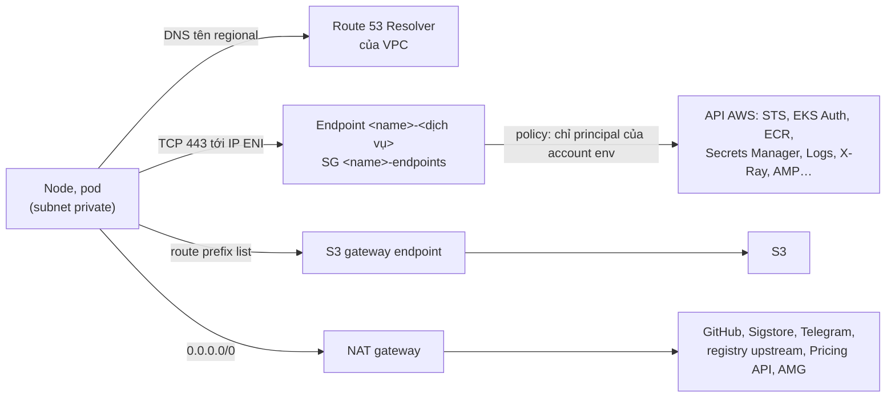

# `aws/modules/network`: VPC của một env

Module nội bộ mỏng bọc [`terraform-aws-modules/vpc/aws`](https://registry.terraform.io/modules/terraform-aws-modules/vpc/aws/6.7.3)
**6.7.3** (ghim chính xác): VPC bốn tầng trên `az_count` AZ (subnet public, private, edge và database), Internet Gateway, route table, NAT
gateway và Elastic IP theo `single_nat_gateway`, S3 gateway endpoint trên mọi route table private, interface endpoint `guardduty-data` cho
agent GuardDuty của node EKS, interface endpoint cho các API AWS chính mà cluster gọi (mục "Endpoint interface của API AWS"; vài API AWS vẫn qua NAT), mỗi tầng một NACL riêng không mở 22, 3389 ra Internet, security group và NACL mặc định không rule nào, flow log
ghi thẳng vào bucket của account Log Archive. Mức stg và prd chỉ khác ở biến (bảng dưới), một bộ code.

Policy của S3 gateway endpoint: mặc định không có (endpoint cho qua mọi bucket IAM cho phép, và NetworkPolicy của pod, vốn khớp S3 theo địa
chỉ, không phân biệt được bucket này với bucket khác). `s3_endpoint_restricted = true` (mức prd) đặt
policy chỉ cho qua các bucket trong `s3_endpoint_buckets` (bucket `uploads`, `media` của env, root truyền từ output của module `media`) và
`s3:GetObject` trên bucket layer image của Amazon ECR trong region (`prod-<region>-starport-layer-bucket`; xem mục "Minimum Amazon S3 bucket
permissions for Amazon ECR" của [tài liệu VPC endpoint của ECR](https://docs.aws.amazon.com/AmazonECR/latest/userguide/vpc-endpoints.html)). Route của endpoint nhận mọi địa
chỉ S3 của region, nên từ subnet private mọi bucket khác của region bị từ chối: credential bị lộ không chép dữ liệu ra bucket của account
khác được; image nào kéo blob từ bucket S3 khác trong cùng region cũng bị chặn.

Không có provider nào trong module: root gọi nó (`aws/envs/<env>`) đặt provider, `default_tags` (`Project=svp`, `ManagedBy=terraform`,
`Stack=<env>`) và ghim version provider trong lock file. Module không cấp quyền IAM nào cho pod.

```hcl
module "network" {
  source = "../../modules/network"

  name                        = "svp-stg"
  cluster_name                = "svp-stg"
  az_count                    = 2
  interface_endpoint_az_count = 1
  single_nat_gateway          = true
  flow_log_bucket_arn         = "arn:aws:s3:::svp-flowlogs-000000000000-ap-southeast-1"
}
```

<!-- markdownlint-disable MD033 -->
<!-- BEGIN_TF_DOCS -->
## Requirements

| Name | Version |
| ---- | ------- |
| terraform | ~> 1.15 |
| aws | ~> 6.0 |

## Providers

| Name | Version |
| ---- | ------- |
| aws | ~> 6.0 |

## Modules

| Name | Source | Version |
| ---- | ------ | ------- |
| vpc | terraform-aws-modules/vpc/aws | 6.7.3 |

## Resources

| Name | Type |
| ---- | ---- |
| [aws_security_group.endpoints](https://registry.terraform.io/providers/hashicorp/aws/latest/docs/resources/security_group) | resource |
| [aws_security_group.guardduty_data](https://registry.terraform.io/providers/hashicorp/aws/latest/docs/resources/security_group) | resource |
| [aws_vpc_endpoint.guardduty_data](https://registry.terraform.io/providers/hashicorp/aws/latest/docs/resources/vpc_endpoint) | resource |
| [aws_vpc_endpoint.interface](https://registry.terraform.io/providers/hashicorp/aws/latest/docs/resources/vpc_endpoint) | resource |
| [aws_vpc_endpoint.s3](https://registry.terraform.io/providers/hashicorp/aws/latest/docs/resources/vpc_endpoint) | resource |
| [aws_vpc_security_group_ingress_rule.endpoints_https](https://registry.terraform.io/providers/hashicorp/aws/latest/docs/resources/vpc_security_group_ingress_rule) | resource |
| [aws_vpc_security_group_ingress_rule.guardduty_data_https](https://registry.terraform.io/providers/hashicorp/aws/latest/docs/resources/vpc_security_group_ingress_rule) | resource |
| [aws_availability_zones.available](https://registry.terraform.io/providers/hashicorp/aws/latest/docs/data-sources/availability_zones) | data source |
| [aws_caller_identity.current](https://registry.terraform.io/providers/hashicorp/aws/latest/docs/data-sources/caller_identity) | data source |
| [aws_partition.current](https://registry.terraform.io/providers/hashicorp/aws/latest/docs/data-sources/partition) | data source |
| [aws_region.current](https://registry.terraform.io/providers/hashicorp/aws/latest/docs/data-sources/region) | data source |
| [aws_vpc_endpoint_service.interface](https://registry.terraform.io/providers/hashicorp/aws/latest/docs/data-sources/vpc_endpoint_service) | data source |

## Inputs

| Name | Description | Type | Default | Required |
| ---- | ----------- | ---- | ------- | :------: |
| az\_count | Number of availability zones, taken in order from the zones of the region that need no opt-in. Each zone gets one public, one private, one edge and one database subnet. EKS needs subnets in at least two zones. | `number` | `2` | no |
| cidr | IPv4 range of the VPC, a /16 to /20. Pods take their addresses from the private subnets (VPC CNI), so the range must not overlap any network the cluster talks to. | `string` | `"10.0.0.0/16"` | no |
| cluster\_name | Name of the EKS cluster that runs in this VPC. The public and private subnets get the tag kubernetes.io/cluster/<name> = shared, which the AWS Load Balancer Controller reads to pick subnets; the private subnets also get karpenter.sh/discovery = <name>, which the EC2NodeClass of Karpenter reads. | `string` | n/a | yes |
| flow\_log\_bucket\_arn | ARN of the S3 bucket of the log archive account that receives the VPC flow logs (accepted and rejected traffic), e.g. arn:aws:s3:::svp-flowlogs-000000000000-ap-southeast-1. The bucket ARN alone, no prefix: the logs land under AWSLogs/aws-account-id=<account>/, which the bucket's retention rules match. | `string` | n/a | yes |
| interface\_endpoint\_az\_count | Number of zones, from the first, whose private subnet holds a network interface of each interface endpoint of the AWS APIs. Fewer zones cost less; a caller in another zone then crosses zones, and losing those zones cuts every AWS API call of the VPC. | `number` | n/a | yes |
| name | Name of the VPC and prefix of the names of its subnets, route tables, NAT gateways and Elastic IPs, e.g. svp-stg. | `string` | n/a | yes |
| s3\_endpoint\_buckets | Names of the buckets of the env (uploads and media) reachable through the S3 gateway endpoint when s3\_endpoint\_restricted is true. | `list(string)` | `[]` | no |
| s3\_endpoint\_restricted | Put a policy on the S3 gateway endpoint that lets through only the buckets of s3\_endpoint\_buckets and the image layer bucket of Amazon ECR in the region; every other bucket of the region is then unreachable from the private subnets. Off by default: the endpoint lets through every bucket IAM allows. | `bool` | `false` | no |
| single\_nat\_gateway | true: one NAT gateway, in the first zone, for every private subnet (cheaper; losing that zone cuts the egress of the whole VPC). false: one NAT gateway per zone and one private route table per zone that sends its traffic to the NAT gateway of the same zone. | `bool` | `true` | no |

## Outputs

| Name | Description |
| ---- | ----------- |
| azs | Availability zones of the subnets, in the order of the subnet lists. |
| database\_subnet\_cidrs | IPv4 ranges of the database subnets, in the order of azs; network policies that allow traffic to a database use them. |
| database\_subnet\_ids | IDs of the database subnets, one per zone, in the order of azs: RDS, MSK and ElastiCache. Their route table holds only the local route. |
| edge\_subnet\_cidrs | IPv4 ranges of the edge subnets, in the order of azs: every connection from them to Envoy comes from the ALB, so the network policy of Envoy lets in these ranges. |
| edge\_subnet\_ids | IDs of the edge subnets, one per zone, in the order of azs: the internal ALB that CloudFront reaches through a VPC origin. No node or pod takes an address there; their route table holds only the local route. |
| endpoints\_security\_group\_id | ID of the security group of the interface endpoints of the AWS APIs: TCP 443 from the VPC range only. |
| guardduty\_data\_endpoint\_id | ID of the interface endpoint guardduty-data the GuardDuty agent of the EKS nodes reports to; the eks module installs the agent only once it exists. |
| interface\_endpoint\_ids | IDs of the interface endpoints of the AWS APIs, by service (sts, ecr.api, ...). |
| nat\_public\_ips | Public IPv4 addresses of the NAT gateways: every connection from the nodes and pods to the internet leaves from one of them. |
| private\_subnet\_cidrs | IPv4 ranges of the private subnets, in the order of azs. |
| private\_subnet\_ids | IDs of the private subnets, one per zone, in the order of azs: nodes and pods. |
| public\_subnet\_ids | IDs of the public subnets, one per zone, in the order of azs: the NAT gateways and nothing else. |
| vpc\_cidr | IPv4 range of the VPC. |
| vpc\_id | ID of the VPC. |
<!-- END_TF_DOCS -->
<!-- markdownlint-enable MD033 -->

## Giá trị theo env

| Biến | stg | prd |
| --- | --- | --- |
| `name` | `svp-stg` | `svp-prd` |
| `cidr` | mặc định | mặc định (hay dải khác nếu prd nối hai VPC) |
| `az_count` | `2` | `3` |
| `interface_endpoint_az_count` | `1` (ENI ở AZ đầu, cùng AZ với NAT đơn) | bằng `az_count` |
| `single_nat_gateway` | `true` (một NAT ở AZ đầu) | `false` (một NAT mỗi AZ, route table private mỗi AZ trỏ NAT cùng AZ) |
| `cluster_name` | tên cluster EKS stg | tên cluster EKS prd |
| `flow_log_bucket_arn` | ARN bucket `svp-flowlogs-<log>-ap-southeast-1` | cùng bucket |

**Chia dải** (`cidr` chia 8 khối bằng nhau): khối 0–5 là subnet private, mỗi AZ một khối (`/19` với `/16`: 8 192 địa chỉ, vì VPC CNI cấp
IP pod từ subnet private, prefix delegation lấy từng `/28` cho mỗi node); khối 6 chia tiếp 8 phần, mỗi AZ một subnet database (`/22` với
`/16`) cho RDS, MSK và ElastiCache; khối 7 chứa hai tầng nhỏ: subnet public là phần 0 đến `az_count - 1` khi chia khối 32 phần (`/24` với
`/16`: chỉ NAT gateway nằm đây), subnet edge là phần 8 đến `7 + az_count` khi chia khối 16 phần, tức nửa sau của khối (`/23` với `/16`,
`/27` với `/20`). Subnet public dùng tối đa 6 phần trên 32, tức chưa tới phần 3 trên 16, nên hai tầng không chồng nhau ở mọi `az_count`.
Với mặc định và 2 AZ: private `10.0.0.0/19`, `10.0.32.0/19`; database `10.0.192.0/22`, `10.0.196.0/22`; public `10.0.224.0/24`,
`10.0.225.0/24`; edge `10.0.240.0/23`, `10.0.242.0/23`.

**Tầng edge** ([ADR-0061](https://github.com/anhnvcoder/svp-backend/blob/main/docs/adr/0061-edge-cloudfront-waf-acm.md) §3): nơi đặt
ALB internal mà CloudFront tới qua VPC origin (module `edge` nhận `edge_subnet_ids`); CloudFront đặt ENI của VPC origin trong chính các
subnet này. Tầng là `intra_subnets` của module `vpc` (tên `<name>-edge-<az>`): một route table chỉ có route `local`, vì ALB chỉ trả lời
CloudFront và gọi tới pod trong VPC. Không tag `kubernetes.io/role/*` hay `karpenter.sh/discovery`, nên Load Balancer Controller không đặt
load balancer và Karpenter không dựng node ở đây; node group của module `eks` cũng chỉ dùng subnet private. VPC CNI cấp IP pod từ subnet của
node, nên không pod nào có địa chỉ trong dải edge. Vì vậy NetworkPolicy của Envoy chỉ cần mở cổng listener và health check cho
`edge_subnet_cidrs` để nhận đúng lưu lượng của ALB: ALB là proxy, Envoy thấy địa chỉ của ALB, không thấy địa chỉ của client hay CloudFront.
Tầng riêng thay vì đặt ALB ở subnet private vì dải private chứa IP của mọi pod, nên mở dải đó là mở cho mọi pod. Cỡ tối thiểu `/27` theo
[yêu cầu subnet của ALB](https://docs.aws.amazon.com/elasticloadbalancing/latest/application/application-load-balancers.html).

**Tầng database** ([ADR-0054](https://github.com/anhnvcoder/svp-backend/blob/main/docs/adr/0054-data-subnet-tier.md)): subnet
database có route table riêng chỉ với route `local` của VPC (`create_database_subnet_route_table = true`, không route NAT, không route
Internet Gateway), nên không đi ra Internet được dù qua NAT, và không gì từ Internet vào được. Mặc định của module `vpc` là gắn subnet
database vào route table private (có `0.0.0.0/0` tới NAT); module đặt rõ ba cờ trong local `database_routes`, vì id route table chỉ biết
sau apply nên test đọc local đó. Subnet database không có tag `kubernetes.io/*`: Load Balancer Controller không đặt load balancer ở đó.
Chỉ subnet private mang `karpenter.sh/discovery = <cluster_name>`: EC2NodeClass của Karpenter chọn subnet theo tag này, nên node do
Karpenter dựng chỉ nằm ở subnet private, không ở subnet public hay database.
Module không tạo DB subnet group (`create_database_subnet_group = false`): module `rds` đã tạo của nó. Root đặt RDS, MSK, ElastiCache vào
`database_subnet_ids` và dùng `database_subnet_cidrs` cho egress của NetworkPolicy tới database.

**NACL** ([ADR-0059](https://github.com/anhnvcoder/svp-backend/blob/main/docs/adr/0059-org-structure-guardrails.md) §10): CIS AWS
Foundations và Security Hub EC2.21 (rule Config `nacl-no-unrestricted-ssh-rdp`) đòi không NACL nào có entry inbound allow từ `0.0.0.0/0` hay
`::/0` với TCP, UDP hay mọi giao thức mà dải cổng chứa 22 hay 3389. Mỗi tầng một NACL riêng (`*_dedicated_network_acl` của module `vpc`),
entry inbound ở local `nacl_inbound`:

| Tầng | Từ `0.0.0.0/0` | Từ CIDR VPC |
| --- | --- | --- |
| public | TCP, UDP 1024–3388 và 3390–65535; ICMP mọi loại | TCP, UDP mọi cổng; ICMP mọi loại |
| private | TCP, UDP 1024–3388 và 3390–65535; ICMP mọi loại | TCP, UDP mọi cổng; ICMP mọi loại |
| edge | không | TCP, UDP mọi cổng; ICMP mọi loại |
| database | không | TCP, UDP mọi cổng; ICMP mọi loại |

Không tầng nào nhận TCP 443 từ Internet: tầng public chỉ có NAT gateway, còn NACL inbound không xét lưu lượng CloudFront tới VPC origin
([tài liệu VPC origins](https://docs.aws.amazon.com/AmazonCloudFront/latest/DeveloperGuide/private-content-vpc-origins.html)), nên NACL edge
chỉ nhận từ CIDR VPC mà CloudFront vẫn tới được ALB; security group của ALB (module `edge`) mới là chỗ giới hạn nguồn. Dải 1024–65535 trừ 3389
là lưu lượng trả về: NAT gateway nhận gói trả về trên cổng nó chọn (1024–65535), node nhận trên cổng tạm của
Linux (32768–60999). Outbound của bốn NACL (local `nacl_outbound`): TCP,
UDP mọi cổng và ICMP mọi loại tới mọi đích. Mọi entry ghi rõ TCP, UDP, ICMP thay vì giao thức `-1`: trong VPC không gì dùng giao thức IP
khác, và trivy (AWS-0102) chặn entry `-1`. NACL mặc định không còn entry nào (`default_network_acl_ingress`, `default_network_acl_egress` rỗng): không
subnet nào gắn nó, và subnet tạo sau mà quên NACL thì không nhận, không gửi được gì. Giá phải trả: kết nối qua NAT gateway được NAT gán cổng
nguồn 3389 mất gói trả về (khoảng 1/64 500 kết nối), client thử lại; subnet private không mất gì.

**Flow log** ([ADR-0060](https://github.com/anhnvcoder/svp-backend/blob/main/docs/adr/0060-org-detection-logging.md) §9): mọi lưu lượng
(`ALL`), ghi thẳng vào bucket của `flow_log_bucket_arn` (account Log Archive, root truyền theo tên bucket), không log group CloudWatch, không
role IAM: S3 nhận log qua dịch vụ giao log (`delivery.logs.amazonaws.com`), quyền nằm ở policy bucket và key của account đó. Parquet, tiền
tố tương thích Hive, phân vùng theo giờ, gom 60 giây; object nằm dưới `AWSLogs/aws-account-id=<account>/aws-service=vpcflowlogs/…`, tiền
tố mà rule retention của bucket khớp. Trường: các trường mặc định theo thứ tự cộng các trường ở local `flow_log_fields`.

**Endpoint `guardduty-data`** ([ADR-0060](https://github.com/anhnvcoder/svp-backend/blob/main/docs/adr/0060-org-detection-logging.md)
§5): interface endpoint ở mọi subnet private, private DNS bật (agent gọi tên dịch vụ, DNS của VPC trả IP của endpoint), security group
`<name>-guardduty-data` chỉ nhận TCP 443 từ CIDR VPC, policy theo
[tài liệu GuardDuty](https://docs.aws.amazon.com/guardduty/latest/ug/managing-gdu-agent-eks-manually.html): cho mọi hành động, từ chối khi
`aws:PrincipalAccount` khác account của env. Endpoint nằm trong state thay vì để GuardDuty tự tạo: endpoint và security group GuardDuty tự
quản nằm ngoài state, giữ ENI trong subnet nên `terraform destroy` không xoá được VPC. Output `guardduty_data_endpoint_id` đưa vào biến
cùng tên của module `eks`, add-on agent tạo sau endpoint.

**Endpoint interface của API AWS**
([ADR-0064](https://github.com/anhnvcoder/svp-backend/blob/main/docs/adr/0064-interface-endpoints.md)): node và pod gọi các API AWS của bảng dưới qua
endpoint trong VPC thay vì qua NAT. Danh sách dịch vụ là local `interface_endpoint_services`; ai gọi từng dịch vụ và vì sao cần nằm ở
[phụ lục §1 của ADR](https://github.com/anhnvcoder/svp-backend/blob/main/docs/adr/appendix/0064-interface-endpoints.md#1-dịch-vụ),
thứ còn đi qua NAT ở §6 của phụ lục đó; `mediaconvert` theo §10 của
[ADR-0066](https://github.com/anhnvcoder/svp-backend/blob/main/docs/adr/0066-mediaconvert-transcode.md).

| Endpoint (`com.amazonaws.<region>.…`) | Thành phần gọi |
| --- | --- |
| `sts` | ACK, SDK của pod |
| `eks-auth` | EKS Pod Identity Agent |
| `secretsmanager` | External Secrets |
| `logs` | OpenTelemetry Collector |
| `ssm`, `ssmmessages`, `ec2messages` | SSM Agent của bastion; Karpenter (`ssm`) |
| `ecr.api`, `ecr.dkr` | kubelet, containerd, Kyverno |
| `ec2` | Karpenter, VPC CNI, EBS CSI, AWS Load Balancer Controller |
| `elasticloadbalancing` | AWS Load Balancer Controller |
| `aps-workspaces` | Prometheus agent, Argo Rollouts, Collector |
| `aps` | ACK |
| `xray` | Collector |
| `sqs` | Karpenter; `media-worker mediaconvert` (hàng đợi sự kiện transcode) |
| `mediaconvert` | `media-worker mediaconvert` (`Probe`, `CreateJob`, `GetJob`) |

- Mỗi endpoint: tên `<name>-<dịch vụ>`, private DNS bật, ENI ở subnet private của `interface_endpoint_az_count` AZ đầu (local
  `interface_endpoint_azs`), security group chung `<name>-endpoints` chỉ nhận TCP 443 từ CIDR VPC, không rule egress.
- Data source `aws_vpc_endpoint_service` đọc từng dịch vụ lúc plan: dịch vụ không có ở region thì plan dừng; dịch vụ không có ở một AZ đã chọn
  thì precondition của endpoint dừng plan, module không tự chọn subnet khác.
- Policy: dịch vụ nhận policy (`vpc_endpoint_policy_supported`) nhận cùng policy với `guardduty-data` (local `account_only_endpoint_policy`):
  cho mọi hành động, từ chối khi `aws:PrincipalAccount` khác account của env. Dịch vụ không nhận policy thì AWS cho toàn quyền qua endpoint;
  IAM và RCP vẫn giữ nó.
- Private DNS đổi phân giải cho cả VPC: `sts.<region>.amazonaws.com`, `api.ecr.<region>.amazonaws.com`, `*.dkr.ecr.<region>.amazonaws.com` và các
  tên khác của bảng trả IP ENI trong dải private. NetworkPolicy chỉ mở 443 tới địa chỉ công khai (trừ dải private) thì chặn pod gọi các tên này;
  chart mở thêm TCP 443 tới value `awsEndpointCidrs` (CIDR VPC trên eks), theo §5 của ADR. Release `media-worker`
  (chart `svp-service`) mở bằng một mục `{cidr: <CIDR VPC>, ports: [443]}` trong `externalPeers.s3` của values eks;
  cái giá: pod tới được TCP 443 của mọi IP trong VPC.
- NACL không đổi: ENI nằm ở tầng private, NACL private đã nhận TCP mọi cổng từ CIDR VPC (local `nacl_from_vpc`) và cho mọi đích ra, nên caller ở
  subnet private khác AZ tới được ENI và nhận được trả lời; test `interface_endpoints` kiểm entry đó.



## Tài nguyên trong state

Đọc từ code module ở version ghim (không từ `plan`, chỉ người học chạy):

| Tài nguyên | Số lượng | Ghi chú |
| --- | --- | --- |
| `aws_vpc` | 1 | DNS support và DNS hostnames bật (EKS cần) |
| `aws_internet_gateway` | 1 | |
| `aws_subnet` public / private / edge / database | `az_count` mỗi loại | public: không tự cấp IP công khai (`map_public_ip_on_launch = false`) |
| `aws_route_table` public | 1 | route `0.0.0.0/0` tới Internet Gateway |
| `aws_route_table` private | 1 (stg) hay `az_count` (prd) | route `0.0.0.0/0` tới NAT (cùng AZ ở prd); mỗi subnet private một association |
| `aws_route_table` database | 1 (stg) hay `az_count` (prd) | chỉ route `local`, không `0.0.0.0/0`; mỗi subnet database một association |
| `aws_route_table` edge (`intra` của module `vpc`) | 1 | chỉ route `local`; mỗi subnet edge một association |
| `aws_eip`, `aws_nat_gateway` | 1 (stg) hay `az_count` (prd) | NAT nằm ở subnet public cùng AZ |
| `aws_vpc_endpoint` `s3` | 1 | loại Gateway, gắn mọi route table private: dữ liệu S3 không qua NAT (NAT tính tiền theo GB); miễn phí |
| `aws_vpc_endpoint` `guardduty_data` | 1 | loại Interface, một ENI mỗi subnet private; private DNS; policy chỉ account của env |
| `aws_security_group` `guardduty_data`, `aws_vpc_security_group_ingress_rule` | 1 mỗi loại | `<name>-guardduty-data`: TCP 443 từ CIDR VPC, không rule egress |
| `aws_vpc_endpoint` `interface` | một mỗi dịch vụ của local `interface_endpoint_services` | loại Interface, một ENI mỗi subnet của `interface_endpoint_azs`; private DNS; policy chỉ account của env khi dịch vụ nhận |
| `aws_security_group` `endpoints`, `aws_vpc_security_group_ingress_rule` `endpoints_https` | 1 mỗi loại | `<name>-endpoints`: TCP 443 từ CIDR VPC, không rule egress |
| `aws_default_security_group` | 1 | module nhận quản lý và xoá mọi rule: tài nguyên tạo mà quên gán security group không nhận, không gửi được gì |
| `aws_network_acl` public / private / edge / database, `aws_network_acl_rule` | 1 mỗi tầng; rule theo bảng NACL ở trên cộng ba outbound mỗi tầng (TCP, UDP, ICMP tới mọi đích) | gắn mọi subnet của tầng |
| `aws_default_network_acl`, `aws_default_route_table` | 1 mỗi loại | module quản lý mặc định của VPC; NACL mặc định không còn entry nào |
| `aws_flow_log` | 1 | đích S3 `flow_log_bucket_arn`, Parquet; không log group, không role IAM |

Chi phí theo giờ (Singapore, ADR-0034 mục chi phí): mỗi NAT $0,059/giờ + $0,059/GB xử lý, mỗi IPv4 công khai (EIP của NAT) $0,005/giờ;
stg một NAT, prd ba NAT. Endpoint `guardduty-data` và endpoint interface của API AWS tính theo giờ mỗi ENI (mỗi AZ) cộng theo GB xử lý (giá ở
[trang giá AWS PrivateLink](https://aws.amazon.com/privatelink/pricing/); chi phí mỗi buổi của endpoint API AWS ở §7 phụ lục ADR-0064); flow log tính theo GB giao vào S3 (ADR-0060, phụ lục chi phí).

## Tài nguyên ngoài state và tag nhận diện

Các thành phần chạy trong cluster tạo tài nguyên trong VPC này mà Terraform không biết. Chúng còn thì `terraform destroy` không xoá được
subnet, security group hay VPC (ENI còn gắn), nên script trước destroy và script quét của buổi phải tìm chúng theo tag. Tag đọc từ mã
nguồn của từng thành phần (nhánh chính, tính đến 2026-10-31); buổi đầu kiểm lại trên tài nguyên thật.

| Tài nguyên | Ai tạo | Tag hay dấu hiệu nhận diện |
| --- | --- | --- |
| ENI của ALB `<name>-edge` trong subnet edge | AWS (theo ALB của module `edge`) | mô tả `ELB app/<name>-edge/…`; tự mất khi ALB bị xoá |
| ENI của VPC origin trong subnet edge, security group `CloudFront-VPCOrigins-Service-SG` | CloudFront (theo `aws_cloudfront_vpc_origin` của module `edge`) | ENI do dịch vụ quản lý; tên security group |
| ENI phụ của node (IP pod) | VPC CNI | `cluster.k8s.amazonaws.com/name=<cluster_name>`, `node.k8s.amazonaws.com/instance_id`, `eks:eni:owner=amazon-vpc-cni`; mô tả `aws-K8S-<instance-id>`; ENI `available` còn sót sau khi node mất |
| ENI của control plane EKS trong subnet private | EKS | mô tả `Amazon EKS <cluster_name>`; EKS xoá khi xoá cluster |
| Volume EBS của PVC | EBS CSI driver | `ebs.csi.aws.com/cluster=true`, `CSIVolumeName`, `kubernetes.io/created-for/pvc/namespace`, `kubernetes.io/created-for/pvc/name`, `kubernetes.io/created-for/pv/name`; `Project=svp` khi addon đặt `extraVolumeTags` (module EKS) |
| Instance, ổ gốc, ENI chính của node do Karpenter dựng | Karpenter (NodePool, EC2NodeClass) | `karpenter.sh/nodepool`, `karpenter.sh/nodeclaim`, `kubernetes.io/cluster/<cluster_name>=owned`; `Project=svp` do EC2NodeClass đặt |
| Log group `/aws/eks/<cluster_name>/cluster` | EKS khi bật log control plane | tên log group (module EKS quản lý nếu tạo trước) |

Thứ tự xoá an toàn: xoá PVC và NodePool của Karpenter trong cluster khi controller còn chạy, chờ volume và node mất, rồi mới
`terraform destroy` (ALB và VPC origin nằm trong state của module `edge`, bị xoá trước subnet); sau đó quét các tag trên trong region.
