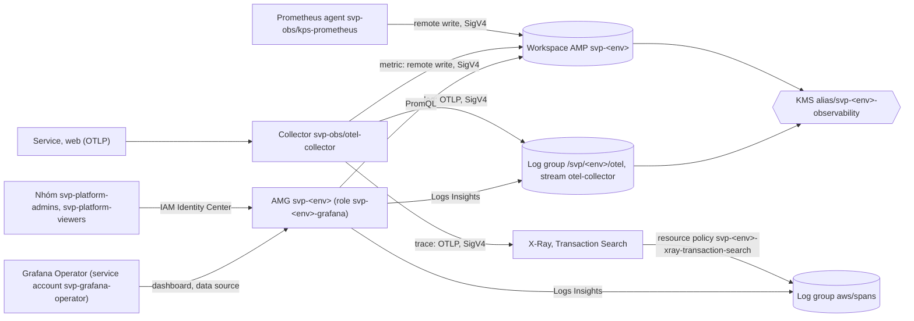

# Module `observability`

Nơi nhận telemetry của một account env (`svp-stg`, `svp-prd`), gọi từ root `aws/accounts/<env>` ([README](../../accounts/README.md)) nên dữ
liệu và cấu hình sống qua `destroy` của buổi: workspace Amazon Managed Service for Prometheus (AMP), log group ứng dụng, Transaction Search của
X-Ray, khoá KMS của chúng và, theo cờ `managed_grafana`, workspace Amazon Managed Grafana (AMG; mục [Biến `grafana_enabled`](#biến-grafana_enabled)). Thiết kế và lý do từng giá trị:
[ADR-0063](https://github.com/anhnvcoder/svp-backend/blob/main/docs/adr/0063-managed-observability.md) và phụ lục của nó (số § dưới đây là §
của ADR). Output `amp_workspace_id`, `amp_endpoint`, `log_group_name`, `grafana_url` là các khoá `ampWorkspaceId`, `ampEndpoint`, `logGroup`,
`grafanaUrl` của cluster values; root `aws/envs/<env>` đọc tài nguyên của module bằng data source theo tên, alias, và id workspace AMG
qua SSM parameter `/svp/<env>/grafana-workspace-id`.

## Luồng telemetry



Collector và Prometheus agent trong cluster ghi bằng role Pod Identity của module `eks`; cluster chỉ thu và gửi, dữ liệu nằm ở account env.
Người dùng đăng nhập AMG bằng IAM Identity Center của org; AMG đọc AMP, CloudWatch bằng role của workspace. Trace xem ở trang Traces của
CloudWatch (AMG không có data source `xray`: §3).

## Khoá KMS

Key `alias/svp-<env>-observability` mã hoá workspace AMP và log group ứng dụng: xoay hằng năm, chờ 30 ngày khi xoá, `prevent_destroy` vì AMP gắn
workspace với key mãi mãi, mất key là mất mọi metric (§1). Key policy không có principal ngoài account hay `*`:

| Statement | Principal | Hành động | Điều kiện |
| --- | --- | --- | --- |
| `AccountAdministersKey` | account | nhóm "key administrators" của policy mặc định KMS, không mã hoá, giải mã | — |
| `AccountUsesKeyThroughPrometheus` | account | `DescribeKey`, `CreateGrant`, `GenerateDataKey`, `Decrypt` | `kms:ViaService` AMP của region, `kms:CallerAccount` |
| `AccountUsesKeyThroughLogs` | account | `Encrypt`, `Decrypt`, `ReEncrypt*`, `GenerateDataKey*`, `DescribeKey` | `kms:ViaService` CloudWatch Logs của region, `kms:CallerAccount` |
| `LogsEncryptsApplicationLogGroup` | `logs.<region>.amazonaws.com` | như dòng trên | `kms:EncryptionContext:aws:logs:arn` là ARN của `/svp/<env>/otel` |

Không principal nào của account dùng được key ngoài AMP và CloudWatch Logs; quyền thật của từng role (Collector, AMG) nằm ở policy IAM của nó.
AMP tạo grant của mình lúc tạo workspace cho việc nội bộ của nó. Dịch vụ khác chỉ đọc được workspace đã mã hoá khi được dùng key
([AMP, mã hoá lúc lưu](https://docs.aws.amazon.com/prometheus/latest/userguide/encryption-at-rest-Amazon-Service-Prometheus.html), bước 3):
role của AMG có `kms:Decrypt`, `kms:DescribeKey` qua AMP, khớp statement `AccountUsesKeyThroughPrometheus`.

## Workspace AMP

Alias `svp-<env>`, mã hoá bằng key trên. Retention `amp_retention_days` (`aws_prometheus_workspace_configuration`); `rule_query_offset` giữ
mặc định 60 s của workspace mới (§5). AMP không có endpoint OTLP: Collector và agent ghi bằng remote write (§1).

Output `amp_endpoint` là `prometheus_endpoint` của workspace, URL gốc kết thúc bằng `/` (§12): hai trang tài liệu AWS tả dạng khác nhau, nên
output có `precondition` theo đúng dạng của cluster values, lệch thì apply dừng ở đây. Test mocked không kiểm được giá trị này: lúc plan id
workspace chưa có.

## Log group ứng dụng

`/svp/<env>/otel` lớp Standard (Live Tail dùng trong buổi; lớp không đổi được sau khi tạo), retention `log_retention_days`, mã hoá bằng key trên,
cùng stream `otel-collector`: endpoint OTLP của CloudWatch Logs chỉ ghi vào stream có sẵn (§2).

## Trace X-Ray

Endpoint OTLP của X-Ray cần Transaction Search (§3). Module bật nó bằng ba tài nguyên:

- Resource policy CloudWatch Logs `svp-<env>-xray-transaction-search`: `xray.amazonaws.com` được `logs:PutLogEvents` vào `aws/spans` và
  `/aws/application-signals/data`, điều kiện `aws:SourceArn` X-Ray của account, `aws:SourceAccount`.
- Đích segment `CloudWatchLogs` (`aws_xray_trace_segment_destination`). Gỡ tài nguyên này khỏi Terraform không đổi đích trên AWS.
- Rule index `Default` 1 % (`aws_xray_indexing_rule`): phần X-Ray index miễn phí.

### Bước tay: retention của `aws/spans`

X-Ray tự tạo log group `aws/spans`; Terraform không tạo hay nhận được nó (API cấm tên bắt đầu `aws/`), và provider chưa có tham số khoá KMS của
nó, nên group dùng mã hoá mặc định của CloudWatch Logs. Retention đặt bằng tay, một lần mỗi account, sau buổi đầu có span (lúc đó group mới có).
Output `spans_retention_command` của root `aws/accounts/<env>` in sẵn lệnh với `span_retention_days`; người học chạy:

```sh
aws/scripts/check-account.sh <env>
AWS_PROFILE=anhnv-<env> aws logs put-retention-policy --log-group-name aws/spans \
  --retention-in-days <span_retention_days> --region ap-southeast-1
```

Kiểm: `AWS_PROFILE=anhnv-<env>-ro aws logs describe-log-groups --log-group-name-prefix aws/spans --region ap-southeast-1`, dán lại output, tìm
`retentionInDays` bằng `span_retention_days`. Đổi `span_retention_days` thì chạy lại lệnh.

## Grafana managed

- Workspace `svp-<env>`: xác thực `AWS_SSO` (IAM Identity Center của org), quyền `CUSTOMER_MANAGED` (API chỉ tạo được loại này), data source
  `PROMETHEUS`, `CLOUDWATCH`, phiên bản mới nhất AMG có lúc tạo. Không cấu hình VPC hay network access control: AMG gọi AMP, CloudWatch qua
  endpoint AWS, không tới được dịch vụ chỉ có trong VPC (Pyroscope, GlitchTip) (§4).
- Role `svp-<env>-grafana` (trust `grafana.amazonaws.com`, `aws:SourceAccount` là account env) chỉ đọc (§11): `aps:QueryMetrics`, `GetSeries`,
  `GetLabels`, `GetMetricMetadata`, `ListRules`, `ListAlerts` trên workspace của env; `logs:StartQuery`, `GetQueryResults`, `GetLogGroupFields`
  trên `/svp/<env>/otel`, `aws/spans` và log group của RDS, MSK, ElastiCache của env; trên key: `kms:Decrypt` qua CloudWatch Logs,
  `kms:Decrypt`, `kms:DescribeKey` qua AMP (điều kiện `kms:ViaService`); `logs:StopQuery`, `logs:DescribeLogGroups`,
  `cloudwatch:GetMetricData`, `cloudwatch:ListMetrics` trên `*` vì Service Authorization Reference không ghi resource type nào cho chúng.
  Không hành động ghi nào.
- Vai trò: `ADMIN` cho nhóm `platform_admin_group_id`, `VIEWER` cho nhóm `platform_viewer_group_id` (nhóm `svp-platform-admins`,
  `svp-platform-viewers` của `aws/org`); id nhóm chỉ nằm ở `<env>.auto.tfvars` không commit.
- Service account `svp-grafana-operator` vai trò `ADMIN` cho Grafana Operator: Operator tạo data source uid `prometheus`, `cloudwatch`, việc
  chỉ `ADMIN` làm được (`EDITOR` không thêm, sửa được data source:
  [vai trò của AMG](https://docs.aws.amazon.com/grafana/latest/userguide/Grafana-user-roles.html)). Cái giá: token quản được cả workspace;
  module không tạo token, script buổi tạo token ngắn hạn mỗi buổi và ghi vào Secrets Manager, nên token không nằm trong state (§4).
- SSM parameter `/svp/<env>/grafana-workspace-id` (`String`, tier `Standard`) giữ id workspace (`g-<id>`): root `aws/envs/<env>` đọc id ở đây,
  nên workspace dựng lại mỗi buổi không cần sửa tfvars nào. Test mocked chỉ kiểm tên, kiểu, tier: lúc plan id workspace chưa có.

### Biến `grafana_enabled`

`grafana_enabled` (mặc định `true`) bật hay tắt cả phần AMG trên: workspace, role `svp-<env>-grafana` và policy của nó, hai gán nhóm, service
account `svp-grafana-operator`, SSM parameter (`count` theo cờ, địa chỉ `[0]`). `false` thì output `grafana_url` là `null`; workspace AMP, key,
log group, X-Ray và output khác giữ nguyên, không policy nào còn lại trỏ tới tài nguyên AMG. Root `aws/accounts/<env>` đặt giá trị theo cờ
`managed_grafana` của `aws/paid-features.json` và biến `session_open`
([ADR-0071](https://github.com/anhnvcoder/svp-backend/blob/main/docs/adr/0071-paid-features.md)): env có cờ `session` chỉ có AMG trong buổi.

## Vòng đời

Module sống ở root `aws/accounts/<env>`, không ở `aws/envs/<env>`: destroy của buổi, kể cả xoá hẳn env, không xoá workspace, log group, cài
đặt X-Ray hay key; metric, log, span còn đọc được giữa các buổi. AMG sống giữa các buổi khi `grafana_enabled` luôn `true`; env tắt nó giữa
các buổi thì dashboard dựng lại trong buổi, dữ liệu ở AMP và CloudWatch không đổi. Gỡ hẳn module là việc của root accounts, key giữ
`prevent_destroy`.

<!-- BEGIN_TF_DOCS -->
## Requirements

| Name | Version |
| ---- | ------- |
| terraform | ~> 1.15 |
| aws | ~> 6.46 |

## Providers

| Name | Version |
| ---- | ------- |
| aws | ~> 6.46 |

## Resources

| Name | Type |
| ---- | ---- |
| [aws_cloudwatch_log_group.otel](https://registry.terraform.io/providers/hashicorp/aws/latest/docs/resources/cloudwatch_log_group) | resource |
| [aws_cloudwatch_log_resource_policy.xray_spans](https://registry.terraform.io/providers/hashicorp/aws/latest/docs/resources/cloudwatch_log_resource_policy) | resource |
| [aws_cloudwatch_log_stream.otel_collector](https://registry.terraform.io/providers/hashicorp/aws/latest/docs/resources/cloudwatch_log_stream) | resource |
| [aws_grafana_role_association.admin](https://registry.terraform.io/providers/hashicorp/aws/latest/docs/resources/grafana_role_association) | resource |
| [aws_grafana_role_association.viewer](https://registry.terraform.io/providers/hashicorp/aws/latest/docs/resources/grafana_role_association) | resource |
| [aws_grafana_workspace.this](https://registry.terraform.io/providers/hashicorp/aws/latest/docs/resources/grafana_workspace) | resource |
| [aws_grafana_workspace_service_account.operator](https://registry.terraform.io/providers/hashicorp/aws/latest/docs/resources/grafana_workspace_service_account) | resource |
| [aws_iam_role.grafana](https://registry.terraform.io/providers/hashicorp/aws/latest/docs/resources/iam_role) | resource |
| [aws_iam_role_policy.grafana](https://registry.terraform.io/providers/hashicorp/aws/latest/docs/resources/iam_role_policy) | resource |
| [aws_kms_alias.observability](https://registry.terraform.io/providers/hashicorp/aws/latest/docs/resources/kms_alias) | resource |
| [aws_kms_key.observability](https://registry.terraform.io/providers/hashicorp/aws/latest/docs/resources/kms_key) | resource |
| [aws_prometheus_workspace.this](https://registry.terraform.io/providers/hashicorp/aws/latest/docs/resources/prometheus_workspace) | resource |
| [aws_prometheus_workspace_configuration.this](https://registry.terraform.io/providers/hashicorp/aws/latest/docs/resources/prometheus_workspace_configuration) | resource |
| [aws_ssm_parameter.grafana_workspace_id](https://registry.terraform.io/providers/hashicorp/aws/latest/docs/resources/ssm_parameter) | resource |
| [aws_xray_indexing_rule.default](https://registry.terraform.io/providers/hashicorp/aws/latest/docs/resources/xray_indexing_rule) | resource |
| [aws_xray_trace_segment_destination.this](https://registry.terraform.io/providers/hashicorp/aws/latest/docs/resources/xray_trace_segment_destination) | resource |
| [aws_caller_identity.current](https://registry.terraform.io/providers/hashicorp/aws/latest/docs/data-sources/caller_identity) | data source |
| [aws_iam_policy_document.grafana](https://registry.terraform.io/providers/hashicorp/aws/latest/docs/data-sources/iam_policy_document) | data source |
| [aws_iam_policy_document.grafana_trust](https://registry.terraform.io/providers/hashicorp/aws/latest/docs/data-sources/iam_policy_document) | data source |
| [aws_iam_policy_document.observability_key](https://registry.terraform.io/providers/hashicorp/aws/latest/docs/data-sources/iam_policy_document) | data source |
| [aws_iam_policy_document.xray_spans](https://registry.terraform.io/providers/hashicorp/aws/latest/docs/data-sources/iam_policy_document) | data source |
| [aws_partition.current](https://registry.terraform.io/providers/hashicorp/aws/latest/docs/data-sources/partition) | data source |
| [aws_region.current](https://registry.terraform.io/providers/hashicorp/aws/latest/docs/data-sources/region) | data source |

## Inputs

| Name | Description | Type | Default | Required |
| ---- | ----------- | ---- | ------- | :------: |
| amp\_retention\_days | Days the Prometheus workspace keeps metrics (1 to 1095, the range of Amazon Managed Service for Prometheus). | `number` | n/a | yes |
| env | Environment of the account (stg, prd): names the workspaces `svp-<env>`, the log group `/svp/<env>/otel`, the KMS key `alias/svp-<env>-observability` and the role `svp-<env>-grafana`. | `string` | n/a | yes |
| grafana\_enabled | Whether the Amazon Managed Grafana workspace `svp-<env>` exists, with its role `svp-<env>-grafana`, group role associations, service account svp-grafana-operator and SSM parameter `/svp/<env>/grafana-workspace-id`. The Prometheus workspace, the key, the log groups and X-Ray stay at either value. | `bool` | `true` | no |
| log\_retention\_days | Days the log group `/svp/<env>/otel` keeps the application logs; one of the retention values CloudWatch Logs accepts. | `number` | n/a | yes |
| platform\_admin\_group\_id | Id of the IAM Identity Center group svp-platform-admins, given the ADMIN role of the Grafana workspace. Kept out of committed files: the root reads it from its uncommitted `<env>.auto.tfvars`. | `string` | n/a | yes |
| platform\_viewer\_group\_id | Id of the IAM Identity Center group svp-platform-viewers, given the VIEWER role of the Grafana workspace. Kept out of committed files like platform\_admin\_group\_id. | `string` | n/a | yes |
| span\_retention\_days | Days the log group aws/spans, which X-Ray creates, keeps the spans; one of the retention values CloudWatch Logs accepts. Terraform cannot manage that group: the value goes into the command of the spans\_retention\_command output, run once per account. | `number` | n/a | yes |

## Outputs

| Name | Description |
| ---- | ----------- |
| amp\_endpoint | Base URL of the Prometheus workspace, ending in /: ampEndpoint of the cluster values; api/v1/remote\_write and api/v1/query are appended to it. |
| amp\_workspace\_arn | ARN of the Prometheus workspace, for the Pod Identity roles that write, query or manage rules on it. |
| amp\_workspace\_id | Id of the Prometheus workspace `svp-<env>` (`ws-<uuid>`): ampWorkspaceId of the cluster values. |
| grafana\_url | URL of the Grafana workspace, https:// and its endpoint, no trailing slash: grafanaUrl of the cluster values. Null when grafana\_enabled is false. |
| kms\_key\_arn | ARN of the key `alias/svp-<env>-observability`, for the Collector's permission to write the encrypted log group. |
| log\_group\_arn | ARN of the application log group, without the :* suffix; its stream otel-collector is `<arn>:log-stream:otel-collector`. |
| log\_group\_name | Name of the application log group `/svp/<env>/otel`: logGroup of the cluster values. |
| spans\_retention\_command | Command the learner runs once per account, after X-Ray has created the log group aws/spans, to set its retention to span\_retention\_days: Terraform cannot create or adopt a log group whose name starts with aws/. |
<!-- END_TF_DOCS -->
