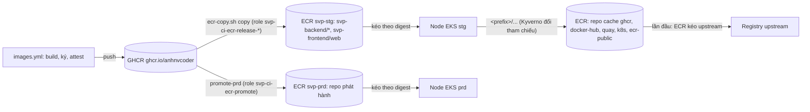

# Module `registry`

Registry ECR private của một account env (`svp-stg`, `svp-prd`), gọi từ root `aws/accounts/<env>` ([README](../../accounts/README.md)) nên sống
qua `destroy` của buổi: repo phát hành, pull-through cache cho image bên thứ ba, quét image cache (Inspector hay quét cơ bản theo cờ `inspector_ecr`, mục [Quét](#quét)), IAM OIDC provider của GitHub Actions và các role
CI chép bản phát hành vào registry. Thiết kế và lý do từng giá trị:
[ADR-0062](https://github.com/anhnvcoder/svp-backend/blob/main/docs/adr/0062-ecr-registry-ci-oidc.md) và phụ lục của nó (số § dưới đây là § của
ADR). Host registry (output `registry_host`) là khoá `ecrRegistry` của cluster values.

## Luồng image

CI build một lần, đẩy GHCR, rồi chép cùng digest kèm mọi referrer (chữ ký, SBOM, `vuln`, provenance) vào repo cùng tên ở ECR stg; vào prd chỉ
qua job `promote-prd` có người duyệt. Node kéo image phát hành theo digest từ ECR của account mình. Image bên thứ ba đi qua repo cache: policy
Kyverno của chart `svp-policy` đổi tham chiếu sang `<registry_host>/<prefix>/...`, node nhập image lần đầu bằng quyền của module `eks`.

## Repo phát hành

- Một repo mỗi service của `files/sources.json` (chart `svp-policy`), tên là đường GHCR bỏ `ghcr.io/anhnvcoder/` (`local.release_repositories`
  ở `main.tf`). Thêm service ở `sources.json` thì thêm repo ở đây, nếu không bước chép vào ECR bị từ chối.
- Tag `IMMUTABLE` (đạt ECR.2); mã hoá KMS bằng key `alias/svp-<env>-ecr` (§2).
- **Không lifecycle policy:** bản phát hành chép theo digest, không tag, nên rule `untagged` hay `any` nào cũng chọn được image đang chạy hay
  đích rollback. ECR.3 FAILED ở repo này là chấp nhận có lý do; GC theo tập digest đang dùng là việc sau (§2).
- Không vào filter quét của registry (Inspector hay quét cơ bản): CI quét trước khi đẩy, rescan hằng ngày, admission đòi `vuln` mới; ECR.1 FAILED ở repo này là chấp nhận (§10).
  trivy AWS-0030 được bỏ qua ngay trên resource với cùng lý do: cấu hình quét của registry, `ENHANCED` hay `BASIC`, chọn repo được quét thay
  cho thiết lập quét của từng repo (API cũ AWS đang bỏ).

## Key KMS

Key `alias/svp-<env>-ecr` mã hoá mọi repo, cả repo cache: xoay hằng năm, chờ 30 ngày khi xoá, `prevent_destroy` vì mất key thì không kéo lại
được image nào. Key policy là policy mặc định của KMS: account quản trị và dùng key qua IAM, không principal ngoài account, không `*`. ECR dùng
key qua grant nó tạo cho mỗi repo, nên role đẩy, kéo không cần quyền KMS (§5); chỉ role tạo repo của template cần quyền tạo grant.

## Pull-through cache

- Năm rule, tiền tố → upstream ở `local.cache_rules` (`main.tf`); output `cache_prefixes` là danh sách tiền tố cho quyền của role node.
- GHCR và Docker Hub đòi đăng nhập: module chỉ tạo vỏ secret `ecr-pullthroughcache/ghcr`, `ecr-pullthroughcache/docker-hub`, không
  `aws_secretsmanager_secret_version`. Người học ghi giá trị (khoá `username`, `accessToken`) và xoay theo runbook (§6). Secret mã hoá bằng key
  AWS quản lý của Secrets Manager: ECR không nhận key do khách hàng quản lý cho secret này.
- Repository creation template mỗi tiền tố, chỉ áp cho repo do cache tạo (`PULL_THROUGH_CACHE`): mã hoá KMS bằng cùng key; tag `MUTABLE` vì
  tag bất biến chặn ECR cập nhật tag đã cache (ECR.2 FAILED ở repo cache là chấp nhận); lifecycle xoá image không được kéo 30 ngày
  (`sinceImagePulled`): upstream còn bản gốc, buổi sau làm nóng lại (§6, §7).
- Template có KMS cần role ECR assume để tạo repo: `svp-<env>-ecr-template` (trust `ecr.amazonaws.com`), chỉ `ecr:CreateRepository`,
  `ecr:TagResource` dưới năm tiền tố cache và `kms:CreateGrant`, `kms:RetireGrant`, `kms:DescribeKey` trên đúng key.

## Quét

`aws_ecr_registry_scanning_configuration` có một rule với filter `<tiền tố>/*` cho năm tiền tố cache; biến `enhanced_scanning` chọn kiểu quét:

- `true` (mặc định, prd): `ENHANCED` (Amazon Inspector), `CONTINUOUS_SCAN`. Inspector bật cho account qua delegated admin ở
  `aws/security/inspector.tf`; finding vào Security Hub (§10).
- `false`: quét cơ bản của ECR, `BASIC` với `SCAN_ON_PUSH`, miễn phí, cho account tắt quét ECR của Inspector. Root `aws/accounts/<env>`
  truyền `false` khi cờ `inspector_ecr` của env là `off` trong `aws/paid-features.json`. Thứ tự áp khi đổi cờ và cái giá (finding Inspector
  của account mất khi tắt, image mới chỉ có quét cơ bản):
  [ADR-0071](https://github.com/anhnvcoder/svp-backend/blob/main/docs/adr/0071-paid-features.md) §4.

## Role CI

- IAM OIDC provider `token.actions.githubusercontent.com`, audience `sts.amazonaws.com`, không thumbprint: IAM xác minh GitHub bằng CA tin cậy.
- Mỗi mục của `ci_roles` thành một role cùng tên, phiên tối đa 1 giờ. Trust: chỉ provider trên, `StringEquals` trên `aud` và trên `sub` đúng
  một chuỗi (`subject`). Validation từ chối `sub` có ký tự đại diện hay dạng khác `ref:refs/heads/<nhánh>`, `environment:<tên>`. Root truyền
  `sub` dạng bất biến `repo:<owner>@<owner-id>/<repo>@<repo-id>:...` (hai repo đã đổi tên, §5).
- Quyền (policy inline `ecr-push`): `ecr:GetAuthorizationToken` trên `*` (API không nhận resource) và quyền đẩy, đọc lại trên đúng ARN repo của
  `repositories` (tên repo phát hành hay cả nhóm `svp-backend/*`); `delete = true` thêm `ecr:BatchDeleteImage` trên cùng ARN để role rescan gỡ
  `vuln` cũ. Không action có `*`, không quyền KMS. Bộ role của từng env (bảng **Role CI ECR** của §5) nằm trong `locals` của root.
- ARN repo và ARN provider dựng từ tên, không lấy từ resource, nên policy biết lúc `plan` và test đọc được; role `depends_on` provider vì IAM
  từ chối trust policy có principal chưa tồn tại.

## Test

`tests/registry.tftest.hcl` (mock provider, chỉ `plan`) với bộ `ci_roles` ví dụ của stg và prd kiểm: repo phát hành đúng danh sách, bất biến,
mã hoá KMS; key xoay, key policy chỉ account; module không khai báo lifecycle policy nào và template chỉ áp cho repo cache; năm rule cache,
secret, template, cấu hình quét; trust mỗi role đúng `aud` và một `sub`, prd không có role nhận `ref:refs/heads/main`; mỗi role đúng bộ quyền
đẩy, `BatchDeleteImage` chỉ khi `delete`, không action `*`, resource `*` chỉ với `ecr:GetAuthorizationToken`, role của một repo nguồn không chạm
repo của repo kia (trừ `svp-ci-ecr-promote`, được mọi repo phát hành); một run mỗi giá trị của `enhanced_scanning` (chỉ kiểu và tần suất quét
đổi; filter, repo, key, rule cache giữ); rồi một run mỗi luật validation. ARN của key và secret chưa biết lúc
`plan`, nên test kiểm loại mã hoá và tên secret thay vì ARN.

<!-- markdownlint-disable MD033 -->
<!-- BEGIN_TF_DOCS -->
## Requirements

| Name | Version |
| ---- | ------- |
| terraform | ~> 1.15 |
| aws | ~> 6.0 |

## Providers

| Name | Version |
| ---- | ------- |
| aws | ~> 6.0 |

## Resources

| Name | Type |
| ---- | ---- |
| [aws_ecr_pull_through_cache_rule.this](https://registry.terraform.io/providers/hashicorp/aws/latest/docs/resources/ecr_pull_through_cache_rule) | resource |
| [aws_ecr_registry_scanning_configuration.this](https://registry.terraform.io/providers/hashicorp/aws/latest/docs/resources/ecr_registry_scanning_configuration) | resource |
| [aws_ecr_repository.release](https://registry.terraform.io/providers/hashicorp/aws/latest/docs/resources/ecr_repository) | resource |
| [aws_ecr_repository_creation_template.cache](https://registry.terraform.io/providers/hashicorp/aws/latest/docs/resources/ecr_repository_creation_template) | resource |
| [aws_iam_openid_connect_provider.github](https://registry.terraform.io/providers/hashicorp/aws/latest/docs/resources/iam_openid_connect_provider) | resource |
| [aws_iam_role.ci](https://registry.terraform.io/providers/hashicorp/aws/latest/docs/resources/iam_role) | resource |
| [aws_iam_role.template](https://registry.terraform.io/providers/hashicorp/aws/latest/docs/resources/iam_role) | resource |
| [aws_iam_role_policy.ci](https://registry.terraform.io/providers/hashicorp/aws/latest/docs/resources/iam_role_policy) | resource |
| [aws_iam_role_policy.template](https://registry.terraform.io/providers/hashicorp/aws/latest/docs/resources/iam_role_policy) | resource |
| [aws_kms_alias.ecr](https://registry.terraform.io/providers/hashicorp/aws/latest/docs/resources/kms_alias) | resource |
| [aws_kms_key.ecr](https://registry.terraform.io/providers/hashicorp/aws/latest/docs/resources/kms_key) | resource |
| [aws_secretsmanager_secret.cache](https://registry.terraform.io/providers/hashicorp/aws/latest/docs/resources/secretsmanager_secret) | resource |
| [aws_caller_identity.current](https://registry.terraform.io/providers/hashicorp/aws/latest/docs/data-sources/caller_identity) | data source |
| [aws_iam_policy_document.ci](https://registry.terraform.io/providers/hashicorp/aws/latest/docs/data-sources/iam_policy_document) | data source |
| [aws_iam_policy_document.ci_trust](https://registry.terraform.io/providers/hashicorp/aws/latest/docs/data-sources/iam_policy_document) | data source |
| [aws_iam_policy_document.ecr_key](https://registry.terraform.io/providers/hashicorp/aws/latest/docs/data-sources/iam_policy_document) | data source |
| [aws_iam_policy_document.template](https://registry.terraform.io/providers/hashicorp/aws/latest/docs/data-sources/iam_policy_document) | data source |
| [aws_iam_policy_document.template_trust](https://registry.terraform.io/providers/hashicorp/aws/latest/docs/data-sources/iam_policy_document) | data source |
| [aws_partition.current](https://registry.terraform.io/providers/hashicorp/aws/latest/docs/data-sources/partition) | data source |
| [aws_region.current](https://registry.terraform.io/providers/hashicorp/aws/latest/docs/data-sources/region) | data source |

## Inputs

| Name | Description | Type | Default | Required |
| ---- | ----------- | ---- | ------- | :------: |
| ci\_roles | IAM roles GitHub Actions assumes through OIDC to copy releases into this registry, by role name. subject is the one sub claim the trust accepts (repo:<owner>@<owner-id>/<repo>@<repo-id>:ref:refs/heads/<branch> or :environment:<name>); repositories are release repositories (svp-backend/gateway) or a whole group of them (svp-backend/*); delete adds ecr:BatchDeleteImage on them. | <pre>map(object({     subject      = string     repositories = list(string)     delete       = bool   }))</pre> | n/a | yes |
| enhanced\_scanning | Whether Amazon Inspector scans the cached repositories (ENHANCED, CONTINUOUS\_SCAN). false scans them with free ECR basic scanning (BASIC, SCAN\_ON\_PUSH), for an account whose Inspector ECR scanning is off; the filter is the same. | `bool` | `true` | no |
| env | Environment of the account (stg, prd): names the KMS key alias/svp-<env>-ecr and the role svp-<env>-ecr-template. | `string` | n/a | yes |

## Outputs

| Name | Description |
| ---- | ----------- |
| cache\_prefixes | Repository prefixes of the pull through cache rules (ghcr, docker-hub, quay, k8s, ecr-public): nodes import and create repositories under <prefix>/*. |
| ci\_role\_arns | ARN of each role of ci\_roles, by role name. |
| kms\_key\_arn | ARN of the KMS key alias/svp-<env>-ecr that encrypts every repository of the registry. |
| registry\_host | Host of the private registry of the account, <account>.dkr.ecr.<region>.amazonaws.com: key ecrRegistry of the cluster values. |
| release\_repository\_arns | ARN of each release repository, by repository name (svp-backend/gateway, svp-frontend/web). |
<!-- END_TF_DOCS -->
