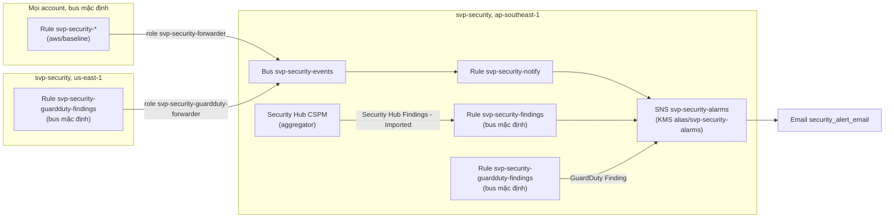

# `aws/security`: phát hiện và cảnh báo của tổ chức (account `svp-security`)

Account Security Tooling `svp-security` là delegated admin của GuardDuty, Security Hub CSPM, Amazon Inspector, AWS Config và IAM Access
Analyzer cho mọi account của tổ chức, và là nơi mọi sự kiện bảo mật thành email. Thiết kế:
[ADR-0060](https://github.com/anhnvcoder/svp-backend/blob/main/docs/adr/0060-org-detection-logging.md) §1–§4, §10 (danh sách sự kiện, event
pattern, lý do từng lựa chọn ở [phụ lục](https://github.com/anhnvcoder/svp-backend/blob/main/docs/adr/appendix/0060-org-detection-logging.md));
Inspector: [ADR-0062](https://github.com/anhnvcoder/svp-backend/blob/main/docs/adr/0062-ecr-registry-ci-oidc.md) §10; cờ chi phí (mục
[Cờ chi phí](#cờ-chi-phí)): [ADR-0071](https://github.com/anhnvcoder/svp-backend/blob/main/docs/adr/0071-paid-features.md) §4, §5.

Root chạy từ management account (`AWS_PROFILE=anhnv-sso`), state ở bucket của `aws/bootstrap`. Ba provider, mỗi account một cái:

| Provider | Account | Cách vào | Dùng cho |
| --- | --- | --- | --- |
| mặc định | `svp-security` | assume `OrganizationAccountAccessRole` | mọi tài nguyên của bảng dưới, trừ detector của management |
| `log_archive` | `svp-log-archive` | assume `OrganizationAccountAccessRole` | chỉ đọc: ARN dạng `key/<id>` của key `alias/svp-log-archive` region nhà |
| `management` | management | credential của profile, không assume | đọc tổ chức (id, root, email của management); detector GuardDuty của management |

Region nhà `ap-southeast-1`; tài nguyên ở `us-east-1` đặt đối số `region` trên chính tài nguyên (AWS provider 6.x), không provider alias theo
region. Region khác bị SCP `svp-deny-other-regions` chặn ở account thành viên nên không bật dịch vụ phát hiện.

## Tài nguyên

| Tài nguyên | Region | Vì sao |
| --- | --- | --- |
| Cấu hình tổ chức GuardDuty (`aws_guardduty_organization_configuration`) | hai region | `auto_enable_organization_members = "ALL"`: mọi account có sẵn, account mới, cả delegated admin |
| Sáu protection plan (`aws_guardduty_organization_configuration_feature`) | hai region | `S3_DATA_EVENTS`, `EKS_AUDIT_LOGS`, `EBS_MALWARE_PROTECTION`, `RDS_LOGIN_EVENTS`, `LAMBDA_NETWORK_LOGS`, `RUNTIME_MONITORING` đều `ALL`; ba additional configuration quản agent tự động của Runtime Monitoring (`EKS_ADDON_MANAGEMENT`, `ECS_FARGATE_AGENT_MANAGEMENT`, `EC2_AGENT_MANAGEMENT`) `NONE` |
| Publishing destination GuardDuty | hai region | finding của detector hai region vào `svp-guardduty-<log>-ap-southeast-1` của Log Archive, mã hoá bằng key Log Archive region nhà |
| Detector GuardDuty của management, member `management` | hai region | đưa management vào tổ chức GuardDuty (mục [Management account](#management-account)) |
| Finding aggregator Security Hub | nhà | `SPECIFIED_REGIONS` gom `us-east-1`; region nhà thành home region của cấu hình tập trung |
| Cấu hình tổ chức Security Hub | nhà | `CENTRAL`; `auto_enable = false`, `auto_enable_standards = "NONE"` vì configuration policy quyết định |
| Configuration policy `svp-security-standards`, gắn root của tổ chức | nhà | Security Hub bật; FSBP v1.0.0, CIS AWS Foundations Benchmark v5.0.0; control mới tự bật; tắt `GuardDuty.7`, `GuardDuty.12`, `GuardDuty.13` |
| Configuration policy `svp-security-off`, gắn từng account có `security_hub` `off` | nhà | Security Hub tắt (`service_enabled = false`); chỉ có khi ít nhất một account `off` (mục [Cờ chi phí](#cờ-chi-phí)) |
| Cấu hình tổ chức Inspector (`aws_inspector2_organization_configuration`) | nhà | account mới vào tổ chức tự bật quét ECR; EC2, Lambda, Lambda code, code repository tắt |
| Enabler Inspector `security` (khối `import`) | nhà | `svp-security` chỉ quét ECR: chỉ định delegated admin bật mọi loại quét ở account này, root nhận trạng thái đó rồi tắt các loại khác |
| Liên kết thành viên Inspector `members` (`aws_inspector2_member_association`) | nhà | mỗi account thành viên `ACTIVE` khác `svp-security` có `inspector_ecr` khác `off` (mục [Cờ chi phí](#cờ-chi-phí)), đọc từ tổ chức qua provider `management`, một liên kết với delegated admin |
| Enabler Inspector `members` | nhà | quét ECR ở các account có liên kết trên |
| Aggregator Config `svp-org`, role `svp-security-config-aggregator` | nhà | nguồn tổ chức, mọi region; role với managed policy `AWSConfigRoleForOrganizations` |
| Analyzer Access Analyzer `svp-org` | hai region | loại `ORGANIZATION`: truy cập từ ngoài tổ chức |
| Bus `svp-security-events` và policy của nó | nhà | đích của rule `svp-security-*` ở mọi account; chỉ principal có `aws:PrincipalOrgID` của tổ chức được `events:PutEvents` |
| Rule `svp-security-notify` (bus `svp-security-events`), `svp-security-findings` (bus mặc định) | nhà | gửi topic qua input transformer |
| Rule `svp-security-guardduty-findings` (bus mặc định), role `svp-security-guardduty-forwarder` | hai region | finding GuardDuty HIGH, CRITICAL của account có `security_hub` `off`: region nhà tới topic, `us-east-1` tới bus `svp-security-events` qua role; chỉ có khi ít nhất một account `off` |
| Topic `svp-security-alarms`, KMS key `alias/svp-security-alarms`, subscription email (module [`alarms`](../modules/alarms/README.md)) | nhà | publisher `events.amazonaws.com`, giới hạn rule của account này; email `security_alert_email` |

Detector GuardDuty của `svp-security` và Security Hub của account đó không có tài nguyên ở đây: `aws/org` chỉ định `svp-security` làm delegated
admin, và bước đó tự bật GuardDuty ở region của nó
([GuardDuty: Organizations](https://docs.aws.amazon.com/guardduty/latest/ug/guardduty_organizations.html)) và Security Hub CSPM ở region của nó
([Security Hub: Organizations](https://docs.aws.amazon.com/securityhub/latest/userguide/designate-orgs-admin-account.html)). Root đọc detector
bằng data source `aws_guardduty_detector` mỗi region; tạo lại thì API từ chối vì account đã có detector. Recorder Config của từng account do
root `aws/baseline` tạo (module `security-baseline`).

### Inspector

- Chỉ ECR, chỉ region nhà: registry ECR của stg, prd ở `ap-southeast-1`. Không quét EC2 (node thay mỗi buổi từ AMI EKS ghim version, GuardDuty
  Runtime Monitoring theo dõi node), không Lambda (lab không có function). Chế độ quét và filter repo đặt ở registry của từng account env (root
  `aws/accounts/<env>`), không ở đây.
- Chỉ định delegated admin bật mọi loại quét ở `svp-security`
  ([Inspector: delegated admin](https://docs.aws.amazon.com/inspector/latest/user/designating-admin.html)). Provider không nhận delegated admin
  và account thành viên trong cùng một enabler, nên có hai enabler.
- Enabler `security` vào state bằng khối `import` (id `<security>-ECR`), không tạo mới: plan đọc các loại quét đang bật, apply đổi tại chỗ về
  `["ECR"]`, tức gọi `Disable` các loại khác rồi chờ tới khi không loại nào còn `DISABLING`. Tạo mới thì provider gọi `Disable` rồi chờ cả account
  `DISABLED`, điều không xảy ra khi ECR còn bật: apply hết thời gian chờ, enabler bị taint
  ([provider: create của enabler](https://github.com/hashicorp/terraform-provider-aws/blob/v6.73.0/internal/service/inspector2/enabler.go#L165),
  [báo lỗi](https://github.com/hashicorp/terraform-provider-aws/issues/50430)). Khối `import` ở lại trong code: resource đã có trong state thì
  Terraform bỏ qua nó ([Terraform: import](https://developer.hashicorp.com/terraform/language/import)).
- Liên kết thành viên lấy account `ACTIVE` từ tổ chức, trừ account có `inspector_ecr` `off`: account đã đóng (`SUSPENDED`) không vào.
  Management không nằm trong danh sách (không phải thành viên của tổ chức Inspector), như ADR-0062 §10. Enabler `members` bật ECR sau khi có
  liên kết, theo trình tự mẫu của AWS: chỉ định, liên kết thành viên, bật quét ([AWS sample: kích hoạt và
  gỡ](https://github.com/aws-samples/inspector2-enablement-with-cli#-4-activation-phase)).
- Delegated admin chỉ tắt được Inspector khi không còn thành viên liên kết
  ([Inspector: tắt dịch vụ](https://docs.aws.amazon.com/inspector/latest/user/deactivating-best-practices.html)); xoá enabler chỉ gọi `Disable`,
  không gỡ liên kết. `depends_on` giữ thứ tự tạo: enabler `security`, rồi liên kết và cấu hình tổ chức, rồi enabler `members`; destroy đi ngược:
  tắt quét ở thành viên và đặt lại cấu hình tổ chức, gỡ liên kết, cuối cùng tắt `svp-security`.
- Finding Inspector vào Security Hub CSPM qua tích hợp sẵn của hai dịch vụ
  ([Inspector: Security Hub](https://docs.aws.amazon.com/inspector/latest/user/securityhub-integration.html)), cạnh finding GuardDuty.

Rule `svp-security-*`, role `svp-security-*` nằm dưới SCP `svp-protect-baseline`: chỉ `OrganizationAccountAccessRole` sửa được chúng, tức chỉ
root này.

## Luồng cảnh báo



- Rule `svp-security-*` ở mỗi account chọn sự kiện (đăng nhập root, đổi policy của Organizations, trail, dịch vụ phát hiện, lệnh bị guardrail
  từ chối, đổi quản trị) và chuyển sang bus `svp-security-events`. Rule `svp-security-notify` khớp mọi sự kiện trên bus (`source` có tiền tố
  rỗng), vì việc chọn đã làm ở rule nguồn.
- Rule `svp-security-findings` trên bus mặc định của region aggregator chỉ khớp finding `Severity.Label` `HIGH` hay `CRITICAL`, `RecordState`
  `ACTIVE`, `Workflow.Status` `NEW`, `ProductName` `GuardDuty` hay `IAM Access Analyzer`. Finding control FSBP, CIS và finding Inspector không
  gửi email: đọc trên bảng Security Hub theo runbook.
- Rule `svp-security-guardduty-findings` (chỉ có khi một account có `security_hub` `off`) giữ email cho finding GuardDuty của account đó:
  GuardDuty đưa finding vào Security Hub của cùng account, nên account tắt Security Hub không tới rule `svp-security-findings`. Rule ở hai
  region, trên bus mặc định của delegated admin GuardDuty (nhận sự kiện `GuardDuty Finding` của thành viên), khớp `detail.accountId` là id các
  account `off` và `detail.severity` ≥ 7 (HIGH, CRITICAL). Region nhà gửi thẳng topic qua input transformer; EventBridge không nhắm topic ở
  region khác, nên `us-east-1` chuyển sự kiện sang bus `svp-security-events` bằng role `svp-security-guardduty-forwarder` (tên
  `svp-security-forwarder` đã là role của `aws/baseline` trong account này), và rule `svp-security-notify` gửi nó với dòng chung
  `svp-security: GuardDuty Finding …`; finding đầy đủ đọc trên GuardDuty. Account `always` không khớp rule này nên không có email trùng.
- Input transformer viết một dòng: tên sự kiện hay tiêu đề finding, account, region, principal, `errorCode` và URL runbook
  [`security-alert.md`](https://github.com/anhnvcoder/svp-backend/blob/main/docs/runbooks/security-alert.md).
- Topic cho `events.amazonaws.com` `sns:Publish` với `aws:SourceAccount` là `svp-security` và `aws:SourceArn` khớp
  `arn:aws:events:ap-southeast-1:<sec>:rule/*` (rule trên bus mặc định và bus riêng). Key của topic cho nó `kms:Decrypt`, `kms:GenerateDataKey*`
  không điều kiện nguồn: SNS không hỗ trợ điều kiện đó trong key policy khi EventBridge gửi vào topic mã hoá (module
  [`alarms`](../modules/alarms/README.md)).

## Management account

- **GuardDuty:** `ALL` gồm mọi account thành viên và delegated admin, nhưng management account phải bật GuardDuty trước khi delegated admin
  thêm nó làm member ([GuardDuty: thêm member](https://docs.aws.amazon.com/guardduty/latest/ug/add-member-accounts-guardduty-organization.html):
  "Before the management account account gets added as a GuardDuty member, it must have GuardDuty enabled"). Root tạo detector ở management mỗi
  region (provider `management`), rồi `aws_guardduty_member` từ detector của `svp-security` thêm management (email đọc từ tổ chức, không lời
  mời: account của tổ chức không cần). Sau đó cấu hình tổ chức áp protection plan lên management như mọi member. Provider đọc trạng thái
  `Enabled` của member thành `invite = true`, nên `invite` nằm trong `ignore_changes`.
- **Security Hub:** policy gắn root áp cho mọi account và OU của tổ chức không có policy khác
  ([Security Hub: central configuration](https://docs.aws.amazon.com/securityhub/latest/userguide/central-configuration-intro.html)), gồm
  management. Management không làm delegated admin được khi dùng cấu hình tập trung.
- **Config, Access Analyzer:** aggregator nguồn tổ chức và analyzer loại `ORGANIZATION` phủ mọi account, kể cả management. Analyzer tổ
  chức chỉ tạo được khi management có service-linked role `AWSServiceRoleForAccessAnalyzer`, do `aws/org` tạo
  ([README `aws/org`, Access Analyzer](../org/README.md#access-analyzer)).

## Trạng thái chờ của Security Hub

- Finding aggregator có trước cấu hình tổ chức `CENTRAL`, cấu hình `CENTRAL` có trước configuration policy (`depends_on` theo đúng thứ tự đó).
- Bật `CENTRAL`: provider chờ `Status` từ `PENDING` tới `ENABLED` (thử lại khi dữ liệu của tổ chức còn đồng bộ); `Status` không phải thuộc tính
  trong state, nên plan sau không lặp.
- Gắn policy vào root: trạng thái association có thể ở `PENDING` tới 24 giờ
  ([Security Hub: gắn policy](https://docs.aws.amazon.com/securityhub/latest/userguide/create-associate-policy.html)); provider chờ `SUCCESS`, hết
  thời gian chờ mà còn `PENDING` thì chỉ cảnh báo, không lỗi, không ghi trạng thái vào state.
- GuardDuty áp `ALL` lên account có sẵn có thể mất tới 24 giờ
  ([GuardDuty: auto-enable](https://docs.aws.amazon.com/guardduty/latest/ug/set-guardduty-auto-enable-preferences.html)).

## Cờ chi phí

Root đọc [`aws/paid-features.json`](../paid-features.json) qua module [`paid-features`](../modules/paid-features/README.md), không tự đọc giá
trị trong file. Khoá account đổi thành id: account thành viên `ACTIVE` tên `svp-<khoá>` của tổ chức, `mgmt` là `account_id` (management không
nằm trong danh sách thành viên). Account đã đóng (`SUSPENDED`) không có id, nên cờ đặt cho nó không đổi gì. Luật giá trị (account nào đặt được
cờ nào, `security` không tắt được Security Hub vì là delegated admin) do `validation` của module kiểm.

| Cờ | `off` ở một account thì root này |
| --- | --- |
| `inspector_ecr` | bỏ account khỏi liên kết thành viên và enabler `members` của Inspector |
| `security_hub` | gắn account vào policy `svp-security-off`; association của account thắng association của root; thêm account vào `detail.accountId` của rule `svp-security-guardduty-findings` |

`config_recording` thuộc root [`aws/baseline`](../baseline/README.md). Mỗi cờ tắt gì, mất gì và chi phí lúc bật lại:
[ADR-0071](https://github.com/anhnvcoder/svp-backend/blob/main/docs/adr/0071-paid-features.md) §4, §5, §10 và phụ lục.

### Thứ tự apply cờ

- Tắt cờ của một account: root này trước (Security Hub, Inspector), rồi `aws/baseline` (Config), rồi `aws/accounts/<env>` (quét cơ bản của
  registry).
- Bật cờ: `aws/baseline` trước, rồi root này, rồi `aws/accounts/<env>`.
- Lý do: control của Security Hub là rule Config, cần recorder đang ghi; bật, tắt quét ECR của Inspector tự đổi kiểu quét của registry giữa
  Enhanced và Basic, root account đặt lại cấu hình quét sau đó.

## Phí

Bảng giá, ước lúc không buổi và phần thêm mỗi buổi: ADR-0060 §12 và phụ lục. Khoản lớn nhất là Security Hub CSPM; 30 ngày đầu GuardDuty và
Security Hub dùng thử. Inspector tính theo image quét ở registry của account env (chỉ repo cache):
[ADR-0062 §11](https://github.com/anhnvcoder/svp-backend/blob/main/docs/adr/0062-ecr-registry-ci-oidc.md#11-chi-phí-registry).

## Apply (bước 5 của thứ tự áp lần đầu)

**Người học chạy mọi lệnh dưới đây** (AI không chạy lệnh nào chạm account). Thứ tự áp lần đầu đủ ở runbook
`docs/runbooks/org-security-setup.md`. Cần trước:

- Bước (3): `aws/log-archive` đã apply (bucket `svp-guardduty-…`, key `alias/svp-log-archive` với key policy cho GuardDuty của `svp-security`).
- Bước (4): `aws/org` đã apply đủ: trusted access, `svp-security` là delegated admin của GuardDuty (hai region), Security Hub, Inspector,
  Config, Access Analyzer, và service-linked role `AWSServiceRoleForAccessAnalyzer` ở management. Thiếu bước này thì plan dừng ở data source
  `aws_guardduty_detector` (không có detector) hay apply lỗi quyền delegated admin.
- Biến terminal `SVP_AWS_MGMT_ACCOUNT_ID` (gõ tay) và `SVP_AWS_SECURITY_ACCOUNT_ID`, `SVP_AWS_LOG_ACCOUNT_ID`. Lần dựng đầu,
  chưa có `svp-backup`: hai biến sau là hai dòng `export` từ `terraform output` của
  [`aws/org`, Bước (2)](../org/README.md#bước-2-tổ-chức-ou-account), `SVP_AWS_STG_ACCOUNT_ID`, `SVP_AWS_PRD_ACCOUNT_ID` (bước 6
  cần) đọc trên trang SSO như mục [Mở terminal](../../docs/runbooks/org-security-setup.md#mở-terminal) của runbook;
  `aws/scripts/accounts.sh` lúc đó in `FAIL  no account svp-backup in the organization` và không đặt gì. Khi `svp-backup` đã có:
  `eval "$(aws/scripts/accounts.sh)"` từ `infra/` đặt mọi biến thành viên.

### 1. Kiểm account

```sh
cd infra/aws/security
../scripts/check-account.sh mgmt
```

Tìm `ok    account <12 số> of mgmt, arn:aws:sts::<12 số>:assumed-role/AWSReservedSSO_…`. `FAIL  profile anhnv-sso is account …` thì dừng.

### 2. Giá trị cá nhân và init

```sh
../scripts/tfvars.sh example aws/security
AWS_PROFILE=anhnv-sso terraform init -backend-config=../backend.hcl
```

Lệnh đầu chép `security.auto.tfvars.example` thành `security.auto.tfvars` (mode 600) khi file chưa có, không ghi đè, và
liệt kê mỗi giá trị còn `<…>` một dòng `note`. Sửa `security_alert_email` trong editor (file bị git bỏ qua; giá trị cá
nhân giữ tay): địa chỉ nhận mọi cảnh báo bảo mật. `init` chạy sẵn cho mọi root của management bằng
`aws/scripts/tfvars.sh init` (xem [`aws/bootstrap`](../bootstrap/README.md#5-áp-thay-đổi-khi-state-đã-ở-bucket)).

### 3. Plan

```sh
AWS_PROFILE=anhnv-sso TF_VAR_account_id="$SVP_AWS_MGMT_ACCOUNT_ID" TF_VAR_security_account_id="$SVP_AWS_SECURITY_ACCOUNT_ID" \
  TF_VAR_log_archive_account_id="$SVP_AWS_LOG_ACCOUNT_ID" terraform plan -out=security.tfplan
```

Mong đợi với `aws/paid-features.json` của repo (Security Hub tắt ở mọi account trừ `svp-security`, Inspector tắt ở stg
và prd) `Plan: 1 to import, 56 to add, 1 to change, 0 to destroy`:
mỗi region của hai region một cấu hình tổ chức, sáu protection plan, một publishing destination, một detector management, một member, một
analyzer, một rule `svp-security-guardduty-findings`; bốn tài nguyên Security Hub, policy `svp-security-off` và năm
association (management, `svp-log-archive`, `svp-backup`, `svp-stg`, `svp-prd`); cấu hình tổ chức Inspector, hai liên
kết thành viên (`svp-log-archive`, `svp-backup`), enabler `members`; role, policy attachment và aggregator Config; bus,
policy bus, hai rule, hai target; target topic và target bus của rule GuardDuty, role `svp-security-guardduty-forwarder`
và policy của nó; năm tài nguyên của module `alarms`. File khác thì tính lại: mỗi account `off` của `security_hub` một
association, mỗi account thành viên có `inspector_ecr` khác `off` một liên kết. Import và đổi là enabler `security` (mục
[Inspector](#inspector)). Dừng và dán plan lại nếu có dòng `destroy`,
`aws_guardduty_detector` nào khác `aws_guardduty_detector.management`, hay nếu enabler `security` không đúng như mục [Kiểm plan
Inspector](#kiểm-plan-inspector).

#### Kiểm plan Inspector

- `aws_inspector2_enabler.security` mang dòng `(imported from "<security>-ECR")`; `account_ids` giữ đúng id của `svp-security`, `resource_types`
  bỏ các loại khác `"ECR"` (`EC2`, `LAMBDA`, `LAMBDA_CODE`…) và giữ `"ECR"`. `account_ids` cũ rỗng là Inspector chưa bật ở `svp-security`:
  `aws/org` chưa chỉ định delegated admin, dừng.
- `aws_inspector2_member_association.members` và `account_ids` của `aws_inspector2_enabler.members` đúng id của các account thành viên khác
  `svp-security` có `inspector_ecr` khác `off` (`svp-log-archive`, `svp-backup` với file của repo; thêm `svp-prd` khi
  prd vắng khỏi file).

### 4. Apply

```sh
AWS_PROFILE=anhnv-sso TF_VAR_account_id="$SVP_AWS_MGMT_ACCOUNT_ID" TF_VAR_security_account_id="$SVP_AWS_SECURITY_ACCOUNT_ID" \
  TF_VAR_log_archive_account_id="$SVP_AWS_LOG_ACCOUNT_ID" terraform apply security.tfplan
rm security.tfplan
```

Bật cấu hình tập trung và gắn policy có thể mất vài phút. Lỗi `DataUnavailableException` (dữ liệu tổ chức còn đồng bộ sau bước 4): đợi vài phút
rồi chạy lại plan và apply. Lỗi `ConflictException: Access Analyzer Service Linked Role is not in the organizational management account` ở
`aws_accessanalyzer_analyzer.org`: management chưa có role; apply `aws/org` theo mục
[Thêm service-linked role Access Analyzer](../org/README.md#thêm-service-linked-role-access-analyzer-vào-tổ-chức-đã-áp),
rồi plan và apply lại root này (plan chỉ còn hai analyzer và phần chưa tạo).

### 5. Xác nhận email SNS

Apply tạo subscription ở `PendingConfirmation`; SNS gửi email "AWS Notification - Subscription Confirmation" tới `security_alert_email`. Bấm
xác nhận giữ tay vì token nằm trong thư, không có API: mở link **Confirm subscription** trong email (xem cả thư rác; token của link chỉ dùng
được trong hai ngày và SNS xoá subscription chưa xác nhận sau 48 giờ: quá hạn thì apply lại root để AWS gửi thư
mới). Trước đó topic không gửi gì. Kiểm:

```sh
../scripts/verify.sh subscriptions mgmt
```

Mong đợi `ok    topic svp-security-alarms: every subscription is confirmed`. `FAIL  topic svp-security-alarms: a subscription is still
PendingConfirmation` là chưa bấm link.

### 6. Kiểm nhanh

Chỉ đọc; profile `anhnv-sso` và các profile chỉ đọc (`anhnv-security-ro`, `anhnv-stg-ro`, `anhnv-prd-ro`, `anhnv-log-ro`; tạo bằng
[`sso-profiles.sh write`](../org/README.md#profile)) đã có, và năm biến `SVP_AWS_MGMT_ACCOUNT_ID`, `SVP_AWS_STG_ACCOUNT_ID`,
`SVP_AWS_PRD_ACCOUNT_ID`, `SVP_AWS_LOG_ACCOUNT_ID`, `SVP_AWS_SECURITY_ACCOUNT_ID` đã đặt (mục [Apply](#apply-bước-5-của-thứ-tự-áp-lần-đầu)).
Từ `infra/aws/security` của bước 1:

```sh
../scripts/verify.sh org
```

Mỗi kiểm một dòng `ok`, `FAIL` hay `note`; một `FAIL` không dừng kiểm sau, cuối cùng `FAIL  N check(s) failed, each named above` và exit 1.
Phần của root này:

- `7a: GuardDuty in <region>: auto-enable ALL, …, findings PUBLISHING`: mỗi trong hai region: cấu hình tổ chức `ALL` và
  sáu protection plan `ALL`, mọi account `ACTIVE` trừ `svp-security` là member, destination `PUBLISHING`.
- `7a: Access Analyzer svp-org ACTIVE in <region>`: analyzer tổ chức.
- `7a: Security Hub is CENTRAL ENABLED, …`: cấu hình tập trung; association của root và của account có `security_hub`
  `off`.
- `7a: every source of the Config aggregator svp-org is SUCCEEDED, …`: nguồn aggregator `SUCCEEDED` sau khi
  `aws/baseline` (bước 6) bật recorder; script bỏ qua nguồn của account có `config_recording` `off`: account đó không
  có recorder nên aggregator không nhận dữ liệu mới của nó, và nguồn ấy không `SUCCEEDED` thì không phải lỗi.
- `7a: Inspector scans only ECR in …`: chỉ ECR bật; thành viên là account có `inspector_ecr` khác `off`.

Lần dựng đầu, lệnh chạy ở đây trước bước (6): các kiểm cần `aws/baseline` báo `FAIL` và đó là mong đợi, không phải lỗi của root
này. Đó là dòng `FAIL  <profile> <region>: no Config recorder with CONTINUOUS recording` (hay `… is not recording …`) của
`anhnv-security-ro` (account có `config_recording` `off` in `note … config_recording is off`), `FAIL  7a: Config aggregator
sources not SUCCEEDED: …` và `FAIL  7a: rule svp-security-admin-sso not found …`. Đọc các dòng còn lại; bước (7) của runbook chạy
lại `verify.sh org` sau bước (6), khi các dòng đó phải `ok`.

Account mới có thể cần tới 24 giờ mới hiện đủ member (`PENDING` ở association cũng vậy): `FAIL` ở các dòng đó trong ngày
đầu thì chạy lại sau, không phải lỗi. Dán lại mọi dòng `FAIL` và `note`. Dòng `note  7a: Security score` chỉ bảng điều
khiển của Security Hub trên console của `svp-security` (profile `anhnv-security-ro`), không có API đọc điểm: đọc bằng
mắt. Cảnh báo thử và phép thử guardrail ở bước (7) của runbook.

## Thêm Inspector vào root đã áp

Khi root này đã apply trước khi có Inspector: apply [`aws/org`](../org/README.md) trước (mục "Thêm Inspector và nhóm nền tảng vào tổ chức
đã áp": trusted access `inspector2.amazonaws.com` và delegated admin `svp-security`), rồi root này bằng cùng lệnh của bước 1, 3, 4.

Phần Inspector của plan là `1 to import`, `1 to change`: import và đổi `aws_inspector2_enabler.security`; thêm
`aws_inspector2_organization_configuration.this`, một `aws_inspector2_member_association.members` mỗi thành viên có `inspector_ecr` khác `off`,
`aws_inspector2_enabler.members`. Plan còn các thay đổi của cờ chi phí (mục [Plan](#3-plan)) nếu root chưa áp chúng. Dừng (không apply, dán
plan lại) nếu có dòng `destroy`, thay đổi ngoài hai nhóm đó, hay nếu Inspector không đúng như mục
[Kiểm plan Inspector](#kiểm-plan-inspector). Sau apply: kiểm Inspector ở bước 6, rồi plan lần hai phải là `No changes.`.

## Gỡ

Chỉ khi lab kết thúc, sau `aws/baseline` (rule nguồn trỏ bus của root này) và trước khi `aws/org` bỏ delegated admin. `terraform destroy` gỡ cấu
hình tổ chức, publishing destination, member và detector của management, policy và aggregator Security Hub, Inspector theo thứ tự ở mục
[Inspector](#inspector) (tắt quét ở thành viên và đặt lại cấu hình tổ chức, gỡ liên kết thành viên, tắt `svp-security`), aggregator Config,
analyzer, bus, rule, role `svp-security-guardduty-forwarder`, topic; KMS key của topic vào `PendingDeletion` 7 ngày. GuardDuty và Security
Hub của `svp-security` còn bật tới khi `aws/org` bỏ delegated admin và tắt dịch vụ trong account đó.
