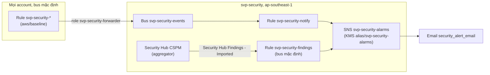

# `aws/security`: phát hiện và cảnh báo của tổ chức (account `svp-security`)

Account Security Tooling `svp-security` là delegated admin của GuardDuty, Security Hub CSPM, Amazon Inspector, AWS Config và IAM Access
Analyzer cho mọi account của tổ chức, và là nơi mọi sự kiện bảo mật thành email. Thiết kế:
[ADR-0060](https://github.com/anhnvcoder/svp-backend/blob/main/docs/adr/0060-org-detection-logging.md) §1–§4, §10 (danh sách sự kiện, event
pattern, lý do từng lựa chọn ở [phụ lục](https://github.com/anhnvcoder/svp-backend/blob/main/docs/adr/appendix/0060-org-detection-logging.md));
Inspector: [ADR-0062](https://github.com/anhnvcoder/svp-backend/blob/main/docs/adr/0062-ecr-registry-ci-oidc.md) §10.

Root chạy từ management account (`AWS_PROFILE=anhnv-sso`), state ở bucket của `aws/bootstrap`. Ba provider, mỗi account một cái:

| Provider | Account | Cách vào | Dùng cho |
| --- | --- | --- | --- |
| mặc định | `svp-security` | assume `OrganizationAccountAccessRole` | mọi tài nguyên của bảng dưới, trừ detector của management |
| `log_archive` | `svp-log-archive` | assume `OrganizationAccountAccessRole` | chỉ đọc: ARN dạng `key/<id>` của key `alias/svp-log-archive` region nhà |
| `management` | management | credential của profile, không assume | đọc tổ chức (id, root, email của management); detector GuardDuty của management |

Region nhà `ap-southeast-1`; tài nguyên ở `us-east-1` đặt đối số `region` trên chính tài nguyên (AWS provider 6.x), không provider alias theo
region. Region khác bị SCP `svp-deny-other-regions` chặn ở account thành viên nên không bật dịch vụ phát hiện.

## Tài nguyên

| Tài nguyên | Region | Vì sao |
| --- | --- | --- |
| Cấu hình tổ chức GuardDuty (`aws_guardduty_organization_configuration`) | hai region | `auto_enable_organization_members = "ALL"`: mọi account có sẵn, account mới, cả delegated admin |
| Sáu protection plan (`aws_guardduty_organization_configuration_feature`) | hai region | `S3_DATA_EVENTS`, `EKS_AUDIT_LOGS`, `EBS_MALWARE_PROTECTION`, `RDS_LOGIN_EVENTS`, `LAMBDA_NETWORK_LOGS`, `RUNTIME_MONITORING` đều `ALL`; ba additional configuration quản agent tự động của Runtime Monitoring (`EKS_ADDON_MANAGEMENT`, `ECS_FARGATE_AGENT_MANAGEMENT`, `EC2_AGENT_MANAGEMENT`) `NONE` |
| Publishing destination GuardDuty | hai region | finding của detector hai region vào `svp-guardduty-<log>-ap-southeast-1` của Log Archive, mã hoá bằng key Log Archive region nhà |
| Detector GuardDuty của management, member `management` | hai region | đưa management vào tổ chức GuardDuty (mục [Management account](#management-account)) |
| Finding aggregator Security Hub | nhà | `SPECIFIED_REGIONS` gom `us-east-1`; region nhà thành home region của cấu hình tập trung |
| Cấu hình tổ chức Security Hub | nhà | `CENTRAL`; `auto_enable = false`, `auto_enable_standards = "NONE"` vì configuration policy quyết định |
| Configuration policy `svp-security-standards`, gắn root của tổ chức | nhà | Security Hub bật; FSBP v1.0.0, CIS AWS Foundations Benchmark v5.0.0; control mới tự bật; tắt `GuardDuty.7`, `GuardDuty.12`, `GuardDuty.13` |
| Cấu hình tổ chức Inspector (`aws_inspector2_organization_configuration`) | nhà | account mới vào tổ chức tự bật quét ECR; EC2, Lambda, Lambda code, code repository tắt |
| Enabler Inspector `security` (khối `import`) | nhà | `svp-security` chỉ quét ECR: chỉ định delegated admin bật mọi loại quét ở account này, root nhận trạng thái đó rồi tắt các loại khác |
| Liên kết thành viên Inspector `members` (`aws_inspector2_member_association`) | nhà | mỗi account thành viên `ACTIVE` khác `svp-security` (`svp-stg`, `svp-prd`, `svp-log-archive`), đọc từ tổ chức qua provider `management`, một liên kết với delegated admin |
| Enabler Inspector `members` | nhà | quét ECR ở các account có liên kết trên |
| Aggregator Config `svp-org`, role `svp-security-config-aggregator` | nhà | nguồn tổ chức, mọi region; role với managed policy `AWSConfigRoleForOrganizations` |
| Analyzer Access Analyzer `svp-org` | hai region | loại `ORGANIZATION`: truy cập từ ngoài tổ chức |
| Bus `svp-security-events` và policy của nó | nhà | đích của rule `svp-security-*` ở mọi account; chỉ principal có `aws:PrincipalOrgID` của tổ chức được `events:PutEvents` |
| Rule `svp-security-notify` (bus `svp-security-events`), `svp-security-findings` (bus mặc định) | nhà | gửi topic qua input transformer |
| Topic `svp-security-alarms`, KMS key `alias/svp-security-alarms`, subscription email (module [`alarms`](../modules/alarms/README.md)) | nhà | publisher `events.amazonaws.com`, giới hạn rule của account này; email `security_alert_email` |

Detector GuardDuty của `svp-security` và Security Hub của account đó không có tài nguyên ở đây: `aws/org` chỉ định `svp-security` làm delegated
admin, và bước đó tự bật GuardDuty ở region của nó
([GuardDuty: Organizations](https://docs.aws.amazon.com/guardduty/latest/ug/guardduty_organizations.html)) và Security Hub CSPM ở region của nó
([Security Hub: Organizations](https://docs.aws.amazon.com/securityhub/latest/userguide/designate-orgs-admin-account.html)). Root đọc detector
bằng data source `aws_guardduty_detector` mỗi region; tạo lại thì API từ chối vì account đã có detector. Recorder Config của từng account do
root `aws/baseline` tạo (module `security-baseline`).

### Inspector

- Chỉ ECR, chỉ region nhà: registry ECR của stg, prd ở `ap-southeast-1`. Không quét EC2 (node thay mỗi buổi từ AMI EKS ghim version, GuardDuty
  Runtime Monitoring theo dõi node), không Lambda (lab không có function). Chế độ quét và filter repo đặt ở registry của từng account env (root
  `aws/accounts/<env>`), không ở đây.
- Chỉ định delegated admin bật mọi loại quét ở `svp-security`
  ([Inspector: delegated admin](https://docs.aws.amazon.com/inspector/latest/user/designating-admin.html)). Provider không nhận delegated admin
  và account thành viên trong cùng một enabler, nên có hai enabler.
- Enabler `security` vào state bằng khối `import` (id `<security>-ECR`), không tạo mới: plan đọc các loại quét đang bật, apply đổi tại chỗ về
  `["ECR"]`, tức gọi `Disable` các loại khác rồi chờ tới khi không loại nào còn `DISABLING`. Tạo mới thì provider gọi `Disable` rồi chờ cả account
  `DISABLED`, điều không xảy ra khi ECR còn bật: apply hết thời gian chờ, enabler bị taint
  ([provider: create của enabler](https://github.com/hashicorp/terraform-provider-aws/blob/v6.73.0/internal/service/inspector2/enabler.go#L165),
  [báo lỗi](https://github.com/hashicorp/terraform-provider-aws/issues/50430)). Khối `import` ở lại trong code: resource đã có trong state thì
  Terraform bỏ qua nó ([Terraform: import](https://developer.hashicorp.com/terraform/language/import)).
- Liên kết thành viên lấy account `ACTIVE` từ tổ chức: account đã đóng (`SUSPENDED`) không vào. Management không nằm trong danh sách (không phải
  thành viên của tổ chức Inspector), như ADR-0062 §10. Enabler `members` bật ECR sau khi có liên kết, theo trình tự mẫu của AWS: chỉ định, liên
  kết thành viên, bật quét ([AWS sample: kích hoạt và gỡ](https://github.com/aws-samples/inspector2-enablement-with-cli#-4-activation-phase)).
- Delegated admin chỉ tắt được Inspector khi không còn thành viên liên kết
  ([Inspector: tắt dịch vụ](https://docs.aws.amazon.com/inspector/latest/user/deactivating-best-practices.html)); xoá enabler chỉ gọi `Disable`,
  không gỡ liên kết. `depends_on` giữ thứ tự tạo: enabler `security`, rồi liên kết và cấu hình tổ chức, rồi enabler `members`; destroy đi ngược:
  tắt quét ở thành viên và đặt lại cấu hình tổ chức, gỡ liên kết, cuối cùng tắt `svp-security`.
- Finding Inspector vào Security Hub CSPM qua tích hợp sẵn của hai dịch vụ
  ([Inspector: Security Hub](https://docs.aws.amazon.com/inspector/latest/user/securityhub-integration.html)), cạnh finding GuardDuty.

Rule `svp-security-*`, role `svp-security-*` nằm dưới SCP `svp-protect-baseline`: chỉ `OrganizationAccountAccessRole` sửa được chúng, tức chỉ
root này.

## Luồng cảnh báo



- Rule `svp-security-*` ở mỗi account chọn sự kiện (đăng nhập root, đổi policy của Organizations, trail, dịch vụ phát hiện, lệnh bị guardrail
  từ chối, đổi quản trị) và chuyển sang bus `svp-security-events`. Rule `svp-security-notify` khớp mọi sự kiện trên bus (`source` có tiền tố
  rỗng), vì việc chọn đã làm ở rule nguồn.
- Rule `svp-security-findings` trên bus mặc định của region aggregator chỉ khớp finding `Severity.Label` `HIGH` hay `CRITICAL`, `RecordState`
  `ACTIVE`, `Workflow.Status` `NEW`, `ProductName` `GuardDuty` hay `IAM Access Analyzer`. Finding control FSBP, CIS và finding Inspector không
  gửi email: đọc trên bảng Security Hub theo runbook.
- Input transformer viết một dòng: tên sự kiện hay tiêu đề finding, account, region, principal, `errorCode` và URL runbook
  [`security-alert.md`](https://github.com/anhnvcoder/svp-backend/blob/main/docs/runbooks/security-alert.md).
- Topic cho `events.amazonaws.com` `sns:Publish` với `aws:SourceAccount` là `svp-security` và `aws:SourceArn` khớp
  `arn:aws:events:ap-southeast-1:<sec>:rule/*` (rule trên bus mặc định và bus riêng). Key của topic cho nó `kms:Decrypt`, `kms:GenerateDataKey*`
  không điều kiện nguồn: SNS không hỗ trợ điều kiện đó trong key policy khi EventBridge gửi vào topic mã hoá (module
  [`alarms`](../modules/alarms/README.md)).

## Management account

- **GuardDuty:** `ALL` gồm mọi account thành viên và delegated admin, nhưng management account phải bật GuardDuty trước khi delegated admin
  thêm nó làm member ([GuardDuty: thêm member](https://docs.aws.amazon.com/guardduty/latest/ug/add-member-accounts-guardduty-organization.html):
  "Before the management account account gets added as a GuardDuty member, it must have GuardDuty enabled"). Root tạo detector ở management mỗi
  region (provider `management`), rồi `aws_guardduty_member` từ detector của `svp-security` thêm management (email đọc từ tổ chức, không lời
  mời: account của tổ chức không cần). Sau đó cấu hình tổ chức áp protection plan lên management như mọi member. Provider đọc trạng thái
  `Enabled` của member thành `invite = true`, nên `invite` nằm trong `ignore_changes`.
- **Security Hub:** policy gắn root áp cho mọi account và OU của tổ chức không có policy khác
  ([Security Hub: central configuration](https://docs.aws.amazon.com/securityhub/latest/userguide/central-configuration-intro.html)), gồm
  management. Management không làm delegated admin được khi dùng cấu hình tập trung.
- **Config, Access Analyzer:** aggregator nguồn tổ chức và analyzer loại `ORGANIZATION` phủ mọi account, kể cả management.

## Trạng thái chờ của Security Hub

- Finding aggregator có trước cấu hình tổ chức `CENTRAL`, cấu hình `CENTRAL` có trước configuration policy (`depends_on` theo đúng thứ tự đó).
- Bật `CENTRAL`: provider chờ `Status` từ `PENDING` tới `ENABLED` (thử lại khi dữ liệu của tổ chức còn đồng bộ); `Status` không phải thuộc tính
  trong state, nên plan sau không lặp.
- Gắn policy vào root: trạng thái association có thể ở `PENDING` tới 24 giờ
  ([Security Hub: gắn policy](https://docs.aws.amazon.com/securityhub/latest/userguide/create-associate-policy.html)); provider chờ `SUCCESS`, hết
  thời gian chờ mà còn `PENDING` thì chỉ cảnh báo, không lỗi, không ghi trạng thái vào state.
- GuardDuty áp `ALL` lên account có sẵn có thể mất tới 24 giờ
  ([GuardDuty: auto-enable](https://docs.aws.amazon.com/guardduty/latest/ug/set-guardduty-auto-enable-preferences.html)).

## Phí

Bảng giá, ước lúc không buổi và phần thêm mỗi buổi: ADR-0060 §12 và phụ lục. Khoản lớn nhất là Security Hub CSPM; 30 ngày đầu GuardDuty và
Security Hub dùng thử. Inspector tính theo image quét ở registry của account env (chỉ repo cache):
[ADR-0062 §11](https://github.com/anhnvcoder/svp-backend/blob/main/docs/adr/0062-ecr-registry-ci-oidc.md#11-chi-phí-registry).

## Apply (bước 5 của thứ tự áp lần đầu)

**Người học chạy mọi lệnh dưới đây** (AI không chạy lệnh nào chạm account). Thứ tự áp lần đầu đủ ở runbook
`docs/runbooks/org-security-setup.md`. Cần trước:

- Bước (3): `aws/log-archive` đã apply (bucket `svp-guardduty-…`, key `alias/svp-log-archive` với key policy cho GuardDuty của `svp-security`).
- Bước (4): `aws/org` đã apply đủ: trusted access và `svp-security` là delegated admin của GuardDuty (hai region), Security Hub, Inspector,
  Config, Access Analyzer. Thiếu bước này thì plan dừng ở data source `aws_guardduty_detector` (không có detector) hay apply lỗi quyền delegated
  admin.
- Biến terminal `SVP_AWS_MGMT_ACCOUNT_ID`, `SVP_AWS_SECURITY_ACCOUNT_ID`, `SVP_AWS_LOG_ACCOUNT_ID` (output của `aws/org`).

### 1. Kiểm account

```sh
cd infra/aws/security
AWS_PROFILE=anhnv-sso aws sts get-caller-identity --region ap-southeast-1 --query '[Account,Arn]' --output text
```

`Account` phải bằng `$SVP_AWS_MGMT_ACCOUNT_ID`, `Arn` là role SSO của người học. Khác thì dừng.

### 2. Giá trị cá nhân và init

```sh
cp security.auto.tfvars.example security.auto.tfvars
AWS_PROFILE=anhnv-sso terraform init -backend-config=../backend.hcl
```

Sửa `security_alert_email` trong `security.auto.tfvars` (file bị git bỏ qua): địa chỉ nhận mọi cảnh báo bảo mật.

### 3. Plan

```sh
AWS_PROFILE=anhnv-sso TF_VAR_account_id="$SVP_AWS_MGMT_ACCOUNT_ID" TF_VAR_security_account_id="$SVP_AWS_SECURITY_ACCOUNT_ID" \
  TF_VAR_log_archive_account_id="$SVP_AWS_LOG_ACCOUNT_ID" terraform plan -out=security.tfplan
```

Mong đợi `Plan: 1 to import, 45 to add, 1 to change, 0 to destroy`: mỗi region của hai region một cấu hình tổ chức, sáu protection plan, một
publishing destination, một detector management, một member, một analyzer; bốn tài nguyên Security Hub; cấu hình tổ chức Inspector, ba liên kết
thành viên, enabler `members`; role, policy attachment và aggregator Config; bus, policy bus, hai rule, hai target; năm tài nguyên của module
`alarms`. Import và đổi là enabler `security` (mục [Inspector](#inspector)). Dừng và dán plan lại nếu có dòng `destroy`, `aws_guardduty_detector`
nào khác `aws_guardduty_detector.management`, hay nếu enabler `security` không đúng như mục [Kiểm plan Inspector](#kiểm-plan-inspector).

#### Kiểm plan Inspector

- `aws_inspector2_enabler.security` mang dòng `(imported from "<security>-ECR")`; `account_ids` giữ đúng id của `svp-security`, `resource_types`
  bỏ các loại khác `"ECR"` (`EC2`, `LAMBDA`, `LAMBDA_CODE`…) và giữ `"ECR"`. `account_ids` cũ rỗng là Inspector chưa bật ở `svp-security`:
  `aws/org` chưa chỉ định delegated admin, dừng.
- Ba `aws_inspector2_member_association.members` và `account_ids` của `aws_inspector2_enabler.members` đúng ba id của `svp-stg`, `svp-prd`,
  `svp-log-archive`.

### 4. Apply

```sh
AWS_PROFILE=anhnv-sso TF_VAR_account_id="$SVP_AWS_MGMT_ACCOUNT_ID" TF_VAR_security_account_id="$SVP_AWS_SECURITY_ACCOUNT_ID" \
  TF_VAR_log_archive_account_id="$SVP_AWS_LOG_ACCOUNT_ID" terraform apply security.tfplan
rm security.tfplan
```

Bật cấu hình tập trung và gắn policy có thể mất vài phút. Lỗi `DataUnavailableException` (dữ liệu tổ chức còn đồng bộ sau bước 4): đợi vài phút
rồi chạy lại plan và apply.

### 5. Xác nhận email SNS

Apply tạo subscription ở `PendingConfirmation`; SNS gửi email "AWS Notification - Subscription Confirmation" tới `security_alert_email`. Mở link
trong email; trước đó topic không gửi gì. Kiểm (profile chỉ đọc `anhnv-security-ro` của permission set `SvpReadOnly`):

```sh
TOPIC="$(AWS_PROFILE=anhnv-sso terraform output -raw security_alert_topic_arn)"
AWS_PROFILE=anhnv-security-ro aws sns list-subscriptions-by-topic --topic-arn "$TOPIC" --region ap-southeast-1 \
  --query 'Subscriptions[].SubscriptionArn' --output text
```

Mong đợi một ARN đầy đủ, không phải `PendingConfirmation`.

### 6. Kiểm nhanh

Mọi lệnh chỉ đọc, profile `anhnv-security-ro`, chạy với `R=ap-southeast-1` rồi `R=us-east-1` trừ dòng ghi khác:

```sh
R=ap-southeast-1
D="$(AWS_PROFILE=anhnv-security-ro aws guardduty list-detectors --region "$R" --query 'DetectorIds[0]' --output text)"
AWS_PROFILE=anhnv-security-ro aws guardduty describe-organization-configuration --detector-id "$D" --region "$R" \
  --query '[AutoEnableOrganizationMembers, Features[].[Name, AutoEnable]]' --output text
AWS_PROFILE=anhnv-security-ro aws guardduty list-members --detector-id "$D" --region "$R" \
  --query 'Members[].[AccountId, RelationshipStatus]' --output text
AWS_PROFILE=anhnv-security-ro aws guardduty list-publishing-destinations --detector-id "$D" --region "$R" \
  --query 'Destinations[].Status' --output text
AWS_PROFILE=anhnv-security-ro aws accessanalyzer list-analyzers --type ORGANIZATION --region "$R" \
  --query 'analyzers[].[name, status]' --output text
```

Mong đợi: `ALL` và sáu plan `ALL`; bốn member `Enabled` (management, `svp-log-archive`, `svp-stg`, `svp-prd`; account có sẵn có thể tới 24
giờ mới hiện); destination `PUBLISHING`; analyzer `svp-org ACTIVE`.

Chỉ region nhà:

```sh
AWS_PROFILE=anhnv-security-ro aws securityhub describe-organization-configuration --region ap-southeast-1 \
  --query 'OrganizationConfiguration.[ConfigurationType, Status]' --output text
AWS_PROFILE=anhnv-security-ro aws securityhub list-configuration-policy-associations --region ap-southeast-1 \
  --query 'ConfigurationPolicyAssociationSummaries[].[TargetId, AssociationStatus]' --output text
AWS_PROFILE=anhnv-security-ro aws configservice describe-configuration-aggregator-sources-status \
  --configuration-aggregator-name svp-org --region ap-southeast-1 --query 'AggregatedSourceStatusList[].[SourceId, AwsRegion, LastUpdateStatus]' --output text
```

Mong đợi: `CENTRAL ENABLED`; association của root (`r-…`) `SUCCESS` (`PENDING` tới 24 giờ là bình thường); nguồn của aggregator `SUCCEEDED`
sau khi `aws/baseline` (bước 6) bật recorder. Cảnh báo thử và phép thử guardrail ở bước (7) của runbook.

Inspector, chỉ region nhà (`<id>` là id của `svp-security`, `svp-stg`, `svp-prd`, `svp-log-archive`, cách nhau bằng dấu cách):

```sh
AWS_PROFILE=anhnv-security-ro aws inspector2 describe-organization-configuration --region ap-southeast-1 \
  --query 'autoEnable' --output json
AWS_PROFILE=anhnv-security-ro aws inspector2 batch-get-account-status --account-ids <id> --region ap-southeast-1 \
  --query 'accounts[].[accountId, resourceState.ecr.status, resourceState.ec2.status, resourceState.lambda.status]' --output text
AWS_PROFILE=anhnv-security-ro aws inspector2 list-members --only-associated --region ap-southeast-1 \
  --query 'members[].[accountId, relationshipStatus]' --output text
```

Mong đợi: `ecr` `true`, mọi khoá khác `false`; mỗi account một dòng `<id> ENABLED DISABLED DISABLED`; ba thành viên `svp-stg`, `svp-prd`,
`svp-log-archive` `ENABLED`.

## Thêm Inspector vào root đã áp

Khi root này đã apply trước khi có Inspector: apply [`aws/org`](../org/README.md) trước (mục "Thêm Inspector và nhóm nền tảng vào tổ chức
đã áp": trusted access `inspector2.amazonaws.com` và delegated admin `svp-security`), rồi root này bằng cùng lệnh của bước 1, 3, 4.

Mong đợi `Plan: 1 to import, 5 to add, 1 to change, 0 to destroy`: import và đổi `aws_inspector2_enabler.security`; thêm
`aws_inspector2_organization_configuration.this`, ba `aws_inspector2_member_association.members`, `aws_inspector2_enabler.members`. Dừng (không
apply, dán plan lại) nếu có thay đổi nào khác, hay nếu Inspector không đúng như mục [Kiểm plan Inspector](#kiểm-plan-inspector). Sau apply: kiểm
Inspector ở bước 6, rồi plan lần hai phải là `No changes.`.

## Gỡ

Chỉ khi lab kết thúc, sau `aws/baseline` (rule nguồn trỏ bus của root này) và trước khi `aws/org` bỏ delegated admin. `terraform destroy` gỡ cấu
hình tổ chức, publishing destination, member và detector của management, policy và aggregator Security Hub, Inspector theo thứ tự ở mục
[Inspector](#inspector) (tắt quét ở thành viên và đặt lại cấu hình tổ chức, gỡ liên kết thành viên, tắt `svp-security`), aggregator Config,
analyzer, bus, rule, topic; KMS key của topic vào `PendingDeletion` 7 ngày. GuardDuty và Security Hub của `svp-security` còn bật tới khi
`aws/org` bỏ delegated admin và tắt dịch vụ trong account đó.
