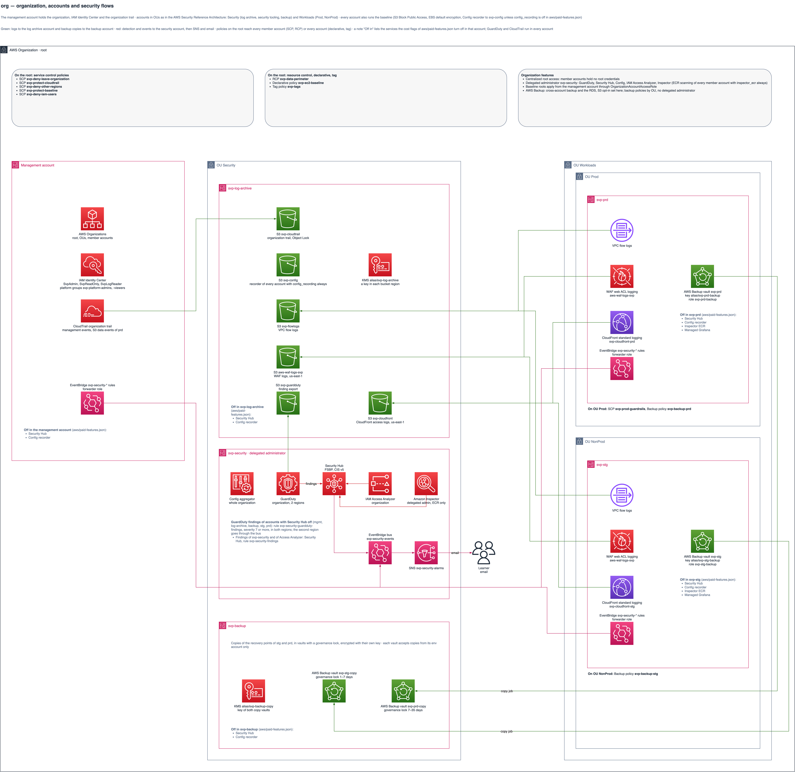
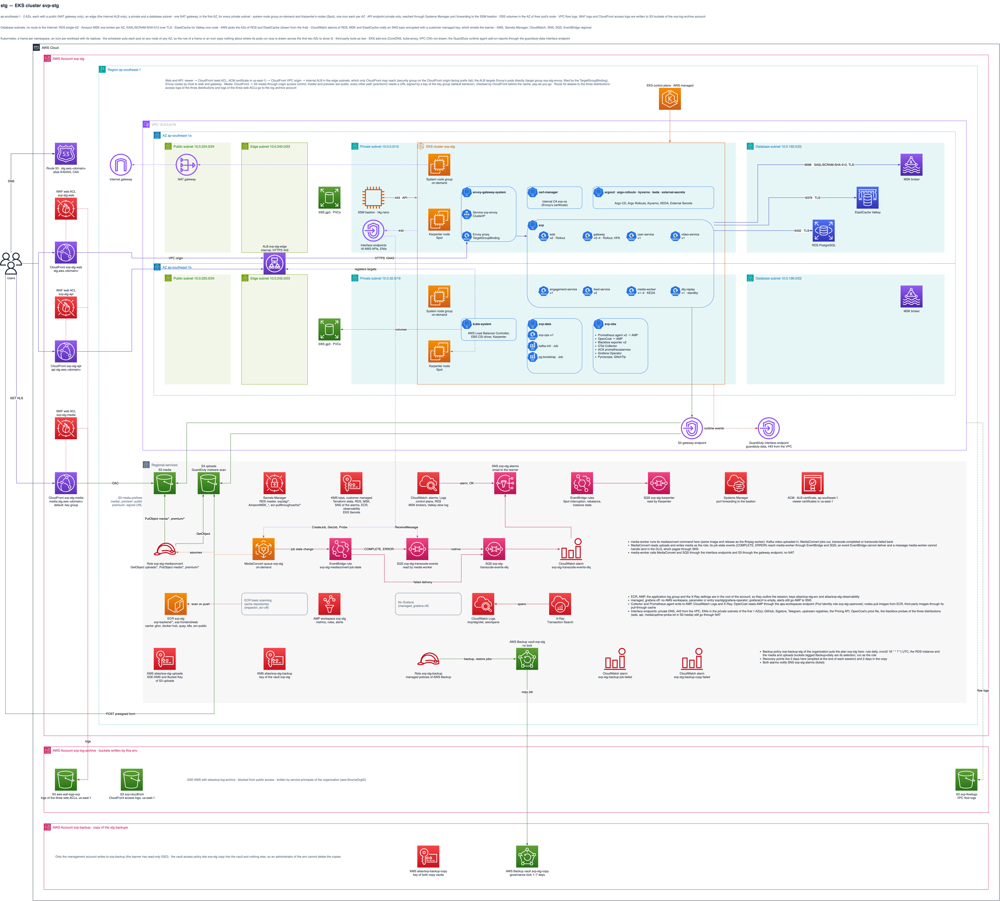
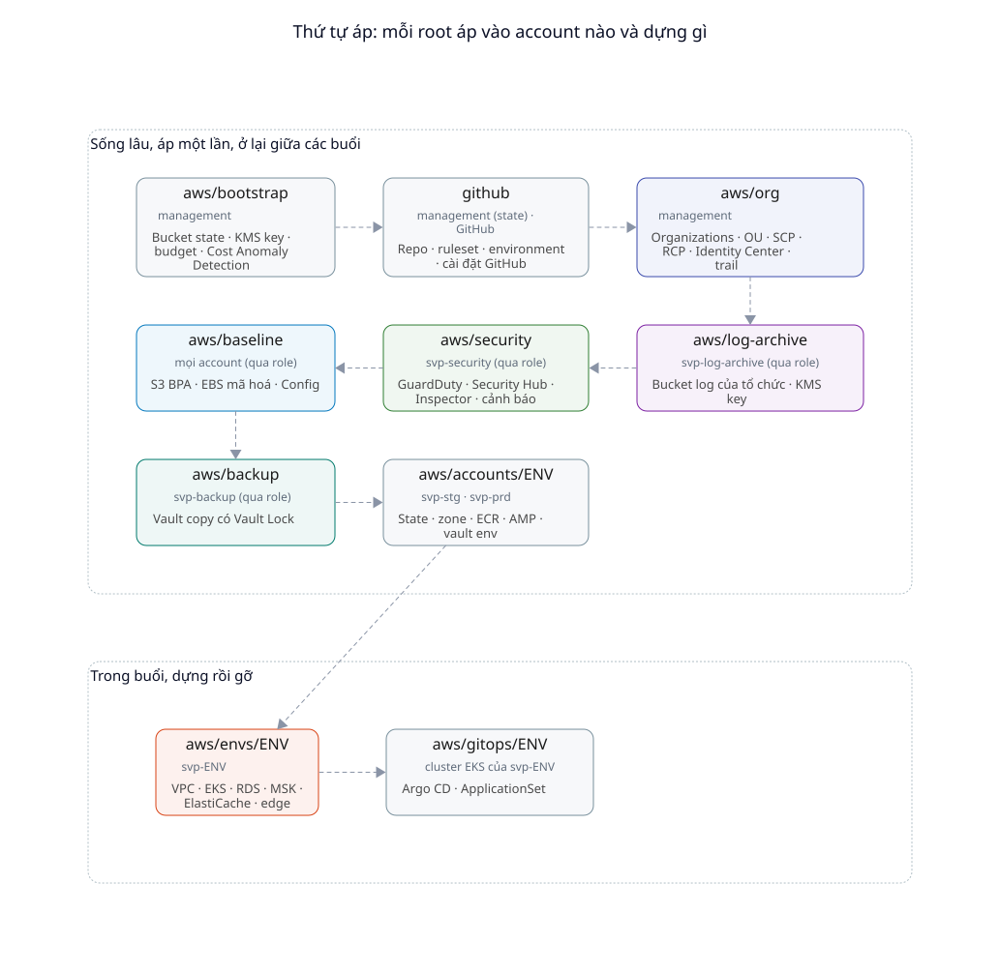
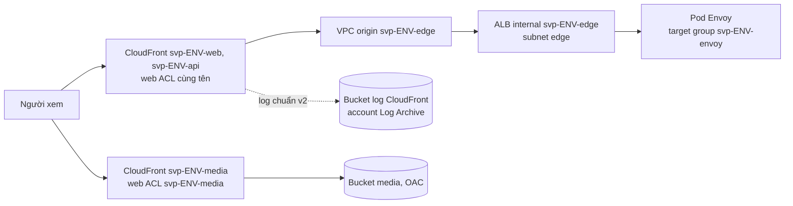
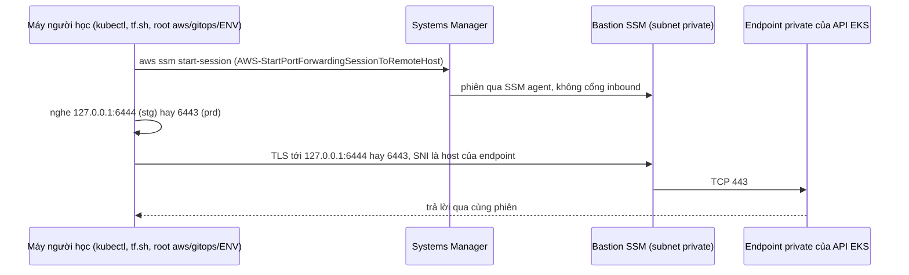
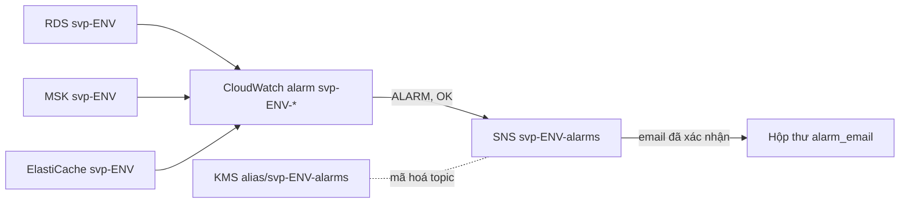
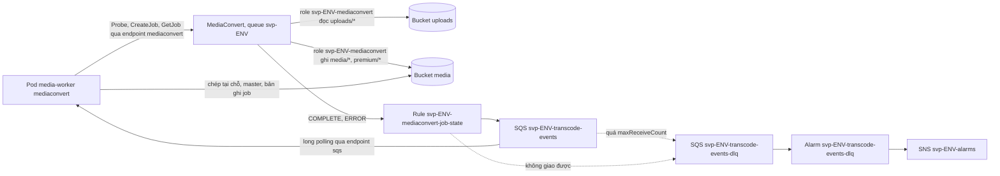
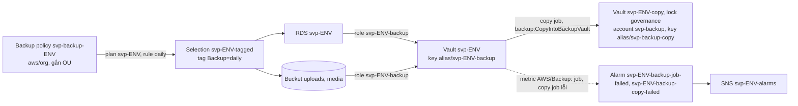
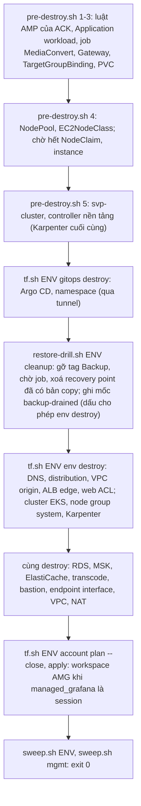

# 00. Tổng quan

[Mục lục](README.md) · [01. Bootstrap](01-bootstrap.md) →

## Tổng quan

> **Tóm tắt**
>
> - **Dựng gì:** một tổ chức AWS gồm management, ba account dùng chung của OU `Security` (log, bảo mật, backup) và mỗi env một account
>   (`svp-stg`, `svp-prd`); trong account env, nền sống lâu (state, zone, registry, observability, vault) và một buổi dựng rồi gỡ
>   (VPC, EKS, dữ liệu managed, edge, transcode, Argo CD).
> - **Vì sao:** admin của workload không chạm được log, finding và bản copy backup; phần tính tiền theo giờ chỉ sống trong buổi; mọi thứ là
>   Terraform nên `plan` đọc được trước mỗi thay đổi.
> - **Phí:** phí giữ theo tháng giữa các buổi, phí mỗi buổi theo giờ của phần dựng trong buổi; số ở [Chi phí](#chi-phí).

### Các account

Mỗi account một việc; account của OU `Security` không có profile ghi, mọi root của chúng chạy từ management qua
`OrganizationAccountAccessRole`.

| Account | OU | Việc | Root |
| --- | --- | --- | --- |
| management | root của tổ chức | Organizations, policy, IAM Identity Center, organization trail, bucket state của các root management, budget tổng | `aws/bootstrap`, `aws/org`, `github` |
| `svp-log-archive` | `Security` | Bucket log của tổ chức: CloudTrail, Config, flow log, log WAF, log CloudFront, finding GuardDuty xuất ra | `aws/log-archive` |
| `svp-security` | `Security` | Delegated administrator của GuardDuty, Security Hub, Config, IAM Access Analyzer, Inspector; bus `svp-security-events`, topic `svp-security-alarms` | `aws/security` |
| `svp-backup` | `Security` | Vault `svp-stg-copy`, `svp-prd-copy` có vault lock governance nhận bản copy của AWS Backup | `aws/backup` |
| `svp-stg` | `Workloads/NonProd` | Env stg: nền sống lâu và một buổi | `aws/accounts/stg`, `aws/envs/stg`, `aws/gitops/stg` |
| `svp-prd` | `Workloads/Prod` | Env prd: như stg, cỡ production, thêm SCP `svp-prod-guardrails` | `aws/accounts/prd`, `aws/envs/prd`, `aws/gitops/prd` |

`aws/baseline` áp baseline bảo mật (S3 Block Public Access, EBS mã hoá mặc định, Config recorder, rule `svp-security-*`) vào mọi account.
Profile, biến account và region của mỗi root: [`operations.md`](../reference/operations.md#account-và-profile).

## Kiến trúc

Trang tổ chức: management giữ Organizations, Identity Center và trail; OU `Security` giữ log, bảo mật, backup; OU `Workloads` giữ hai env.
Mũi tên xanh là log về Log Archive và bản copy về `svp-backup`, mũi tên đỏ là finding và sự kiện về `svp-security` rồi SNS và email.

Trang stg: VPC bốn tầng subnet, cluster EKS, dữ liệu managed, edge và media của một buổi.

Trang prd ([`svp-aws-prd.png`](../diagrams/svp-aws-prd.png)) cùng hình ở cỡ production; trang luồng
([`svp-aws-flows.png`](../diagrams/svp-aws-flows.png)) vẽ các đường ở mục [Các đường của một buổi](#các-đường-của-một-buổi). Bản đủ có
icon AWS ở [`svp-aws.pdf`](../diagrams/svp-aws.pdf).

Cách sinh và kiểm các trang draw.io: [`docs/diagrams/README.md`](../diagrams/README.md#lệnh).

### Cái sống lâu và cái dựng trong buổi

Thứ tự áp lần đầu, từ root đầu tiên tới root của buổi; `ENV` là `stg` hay `prd`. `aws/org` áp hai lượt, trước và sau
`aws/log-archive`.

<picture>
  <source media="(prefers-color-scheme: dark)" srcset="../diagrams/readme-apply-flow-dark.svg">
  
</picture>

| Phần | Root | Sống | Vì sao |
| --- | --- | --- | --- |
| Tổ chức, policy, trail, Identity Center, state của management | `aws/bootstrap`, `aws/org`, `github` | lâu, không bao giờ gỡ trong buổi | gốc của tin cậy và của state mọi root khác |
| Log, phát hiện, baseline, bản copy backup | `aws/log-archive`, `aws/security`, `aws/baseline`, `aws/backup` | lâu | lịch sử và finding phải còn khi env đã gỡ |
| State, zone, registry, observability, vault của env, role plan của CI | `aws/accounts/<env>` | lâu; phần của cờ `session` (workspace Grafana, mục [Cờ chi phí](#cờ-chi-phí)) chỉ trong buổi | image, metric, log và DNS giữ qua `destroy` |
| VPC, EKS, RDS, MSK, ElastiCache, edge, media, transcode, bastion | `aws/envs/<env>` | trong buổi | tính tiền theo giờ |
| Argo CD, ApplicationSet gốc | `aws/gitops/<env>` | trong buổi | sống trên cluster của buổi |

## Kịch bản thực tế

**Câu hỏi của chương:** Một lượt xem video của svp đi qua những account, dịch vụ nào; cái gì phải sống lâu, cái gì chỉ sống trong buổi?

Một người xem mở một video premium ở stg trong buổi.

1. Người học đã dựng buổi theo [`session-stg.md`](../runbooks/session-stg.md): root `aws/envs/stg`, rồi root `aws/gitops/stg` qua
   tunnel SSM; Argo CD đồng bộ chart của svp từ svp-gitops lên cluster `svp-stg`.
2. Trình duyệt mở `<domain>`: distribution `svp-stg-web` trả trang web, web ACL `svp-stg-web` lọc request trước, cert ACM nằm ở
   `us-east-1`.
3. Trang gọi `api.<domain>`: distribution `svp-stg-api` chuyển qua VPC origin `svp-stg-edge` tới ALB internal `svp-stg-edge` ở subnet
   edge, rồi tới pod Envoy trong target group `svp-stg-envoy`, rồi tới service của svp. Không load balancer nào nhận kết nối từ internet.
4. Video đã có từ trước nhờ [Đường transcode](#đường-transcode): bản upload ở bucket uploads, job MediaConvert trên queue `svp-stg`
   ghi bản HLS vào `premium/*` của bucket media.
5. video-service ký URL bằng khoá của key group `svp-stg-media`; player tải segment từ `media.<domain>` qua distribution
   `svp-stg-media`, CloudFront đọc bucket media qua OAC. URL không có chữ ký bị từ chối ở edge.
6. Mỗi request để lại log chuẩn v2 ở bucket log CloudFront của `svp-log-archive`; admin của `svp-stg` không xoá được log đó.
7. RDS chậm quá ngưỡng: alarm `svp-stg-<alarm>` gửi topic `svp-stg-alarms`, email tới người học dù cluster đang hỏng.
8. Rule `daily` (hay `restore-drill.sh stg backup` trong buổi) chụp RDS và bucket vào vault `svp-stg`, copy sang `svp-stg-copy` của
   `svp-backup`.
9. Hết buổi: gỡ theo [Thứ tự gỡ](#thứ-tự-gỡ). Log ở Log Archive, bản copy ở `svp-backup`, image ở ECR và zone DNS ở lại; buổi sau dựng
   lại cùng tên.

## Các dịch vụ và cách svp dùng

Từng dịch vụ có mục riêng ở chương của nó; chương này đi theo các đường mà một buổi dùng chúng.

### Các đường của một buổi

Tên tài nguyên khớp code; trong sơ đồ, `ENV` là `stg` hay `prd`. Bước và lệnh ở runbook buổi
([`session-stg.md`](../runbooks/session-stg.md), [`session-prd.md`](../runbooks/session-prd.md)).

#### Đường vào của người xem

Web, API và media chỉ vào từ internet qua CloudFront, mỗi tên một distribution có web ACL riêng và cert ACM ở `us-east-1`; không load
balancer nào internet-facing. Web và API đi qua VPC origin tới ALB internal ở tầng edge, rồi tới pod Envoy mà `TargetGroupBinding` của
chart đăng ký vào target group; media đọc bucket qua OAC. Segment của video premium (`premium/*`) chỉ trả cho URL video-service ký bằng
khoá của key group `svp-<env>-media`; `media/*`, `preview/*` công khai, mọi path khác cần chữ ký. Chi tiết từng chặng:
chương [12. Media và edge](12-media-edge.md).

#### Đường tới API EKS

Endpoint công khai của API tắt ở cả hai env. Máy của người học mở phiên port forwarding của Session Manager tới bastion `t4g.nano` trong
subnet private (module `ssm-bastion`, output `api_tunnel_command`); security group của API nhận 443 từ security group của bastion.
`kubectl`, script buổi và provider của root `aws/gitops/<env>` gọi `https://127.0.0.1:<cổng>` (stg 6444, prd 6443: cột `tunnel` của
`env_table`), TLS server name là host của endpoint private. Chi tiết:
chương [09. Env và mạng](09-envs-network.md).

#### Đường alarm

CloudWatch alarm của RDS, MSK, ElastiCache (trong module của mỗi dịch vụ, tên `svp-<env>-<alarm>`) gửi `ALARM` và `OK` tới topic
`svp-<env>-alarms` của module `alarms`; topic mã hoá bằng KMS key của module, key policy cho `cloudwatch.amazonaws.com` giải và sinh data
key; subscription email từ `alarm_email` của `<env>.auto.tfvars`, người học xác nhận sau mỗi apply. Alarm sống ngoài cluster: cluster chết
vẫn báo. Hai alarm DNSSEC của zone prd sống lâu như zone: ở `us-east-1` (nơi Route 53 gửi metric), gửi topic `svp-prd-dns-alarms` của root
`aws/accounts/prd` ([`edge-setup.md`](../runbooks/edge-setup.md#alarm-dnssec)). Chi tiết:
chương [11. Dữ liệu](11-data.md).

#### Đường transcode

Ở stg, prd release `media-worker` chạy lệnh con `mediaconvert` (bridge): mỗi `video.uploaded` thành một `Probe` rồi một job trên queue
`svp-<env>` của module `transcode`, gọi qua endpoint interface `mediaconvert`. Job chạy với role `svp-<env>-mediaconvert`: đọc `uploads/*`
của bucket uploads, ghi `media/*` (video premium: `premium/*`) của bucket media. Trạng thái cuối của job (`COMPLETE`, `ERROR`) đi qua rule
EventBridge vào SQS `svp-<env>-transcode-events`; bridge đọc hàng đợi qua endpoint `sqs`, đặt header của output, tạo master và phát
`transcode.*`. Message bridge không hành động được, hay event EventBridge không giao được, vào `svp-<env>-transcode-events-dlq`, nơi alarm
mức page gửi topic `svp-<env>-alarms`. Mọi tài nguyên này ở root `aws/envs/<env>`, gỡ cùng buổi. Luồng của bridge (Probe, bản ghi job,
quyết định kết quả): `docs/explanation/transcode.md` của repo code,
[ADR-0066](https://github.com/anhnvcoder/svp-backend/blob/main/docs/adr/0066-mediaconvert-transcode.md);
chương [12. Media và edge](12-media-edge.md).

#### Đường backup

Backup policy `svp-backup-<env>` của `aws/org` (gắn OU của env) sinh plan `svp-<env>` trong account env. Rule `daily` chọn instance RDS và
hai bucket mang tag `Backup = "daily"` (module `rds`, `media`), chụp vào vault `svp-<env>` (root `aws/accounts/<env>`, key
`alias/svp-<env>-backup`) bằng role `svp-<env>-backup`, rồi copy sang vault `svp-<env>-copy` của account `svp-backup` (root `aws/backup`,
vault lock governance, key `alias/svp-backup-copy` mã hoá lại bản copy). Admin của account env không chạm được bản copy. Env chỉ sống
trong buổi nên lịch hiếm khi gặp nó: trong buổi, `restore-drill.sh <env> backup` chạy job on-demand theo cùng đường, `rds` khôi phục
point-in-time từ backup tự động gốc của RDS ra `svp-<env>-pitr`, `s3` restore một object từ recovery point của buổi; `cleanup` gỡ tag và
xoá recovery point đã có bản copy trước destroy. Job hay copy job lỗi: alarm `svp-<env>-backup-job-failed`, `svp-<env>-backup-copy-failed`
(module `backup-alarms`, `Severity=ticket`) tới topic `svp-<env>-alarms`. Lịch, retention, lock, mục tiêu RTO/RPO:
[ADR-0067](https://github.com/anhnvcoder/svp-backend/blob/main/docs/adr/0067-backup-dr.md); thứ tự áp lần đầu:
[`backup-setup.md`](../runbooks/backup-setup.md); chương [07. Backup](07-backup.md).

#### Thứ tự gỡ

Thứ Kubernetes tạo trong account đi trước, khi controller tạo ra nó còn chạy; cluster đi trước mạng. `pre-destroy.sh` xoá luật và
Alertmanager của AMP (CR của ACK, khi ACK còn chạy), Application workload, job MediaConvert còn dở (huỷ, khi `media-worker` đã gỡ) và
Gateway (target của Envoy trong target group edge), PVC (volume EBS), rồi NodePool và EC2NodeClass (Karpenter drain và tắt node của nó,
trần `terminationGracePeriod`), rồi controller nền tảng, để lại tới bước cuối các Application nền tảng vì finalizer và webhook của chúng
cần cho việc xoá object của workload. Root gitops gỡ qua tunnel; `restore-drill.sh <env> cleanup` gỡ tag `Backup`, chờ job AWS Backup và
xoá recovery point của vault env đã có bản copy (`tf.sh` từ chối destroy root env tới khi nó xong sau apply cuối); root env gỡ edge (bản
ghi DNS, ba distribution, VPC origin, ALB, web ACL), cluster, node group hệ thống, dịch vụ dữ liệu, endpoint interface, rồi VPC;
`tf.sh <env> account` đóng phần của cờ `session` (workspace AMG và tham số SSM của nó); `sweep.sh` tìm phần còn sót (instance, launch
template, instance profile của Karpenter, ENI và security group mà CloudFront tạo cho VPC origin cả, rule groups namespace của AMP, queue
MediaConvert, role MediaConvert, recovery point, job và vault của AWS Backup). Bước gỡ: runbook buổi.

## Chi phí

| Khoản | Đơn vị tính | Giữa các buổi | Trong buổi | Nguồn |
| --- | --- | --- | --- | --- |
| Cả lab, mọi root | USD mỗi tháng, USD mỗi buổi | ~31 USD mỗi tháng (tháng đầu) tới ~39 USD (tháng thứ sáu) | buổi prd 4 giờ ~52,5–56,6 USD cộng phần chưa có số; buổi stg không có số đo tổng | ADR-0078 phụ lục, mục "Chi phí" |

Phí của từng root, mỗi số kèm nguồn: chương [15. Chi phí](15-cost.md).

## Kiểm tra và vận hành

Bảng console của từng phần nằm ở mục cùng tên của chương giữ phần đó; thứ tự dựng một lần và bước kiểm của mỗi root ở
[mục lục runbook](../runbooks/README.md).

Một buổi tối đa 4 giờ: dựng ba root của buổi, đo, diễn tập, rồi gỡ theo [Thứ tự gỡ](#thứ-tự-gỡ) và kết thúc bằng hai lượt quét sạch,
`sweep.sh <env>` rồi `sweep.sh mgmt`. Giới hạn, mốc bỏ đo và cách cộng chi phí: mục "Giới hạn" của
[`session-stg.md`](../runbooks/session-stg.md). Xem trước mọi lệnh của buổi mà không chạy gì: `aws/scripts/session.sh --print stg`.

## Thiết kế và đánh đổi

### Cờ chi phí

Khác biệt về dịch vụ tốn tiền giữa các account là dữ liệu của một file commit, [`aws/paid-features.json`](../../aws/paid-features.json):
mỗi account một object cờ, chỉ ghi giá trị khác `always`. Giữa các buổi mọi account giữ giá trị rẻ nhất mà validation của module cho
phép; chỉ `svp-security` (delegated administrator) giữ Security Hub và Config, và account vắng khỏi file là chuẩn production (mọi cờ
`always`). Module [`paid-features`](../../aws/modules/paid-features/README.md) kiểm giá trị; root `aws/security` (Security Hub CSPM,
Inspector ECR), `aws/baseline` (AWS Config recorder) và `aws/accounts/<env>` (Amazon Managed Grafana, kiểu quét ECR) đọc cờ qua nó, root
`aws/envs/<env>` đọc cờ `managed_grafana` để biết có workspace AMG để đọc không, script buổi đọc cùng file. Cờ `managed_grafana` là
`session` thì workspace AMG của env chỉ có trong buổi, mở và đóng bằng `aws/scripts/tf.sh <env> account`; là `off` thì không bao giờ có,
và cluster nhận `grafanaUrl` rỗng. Đổi cờ: [`paid-features.md`](../runbooks/paid-features.md); thiết kế, giá trị mỗi account và chi
phí: chương [15. Chi phí](15-cost.md),
[ADR-0071](https://github.com/anhnvcoder/svp-backend/blob/main/docs/adr/0071-paid-features.md),
[ADR-0078](https://github.com/anhnvcoder/svp-backend/blob/main/docs/adr/0078-paid-features-lean-defaults.md) (giá trị rẻ giữa các buổi).

### Lựa chọn của svp

| Lựa chọn của svp | Cái giá | Phương án khác | Khi nào chọn nó |
| --- | --- | --- | --- |
| Nhiều account theo AWS SRA (OU `Security` giữ log, bảo mật, backup) | Thêm account, baseline mỗi account (Config, Security Hub theo cờ); root chạy qua role | Một account, hay chỉ management và env: log, finding nằm chỗ admin workload chạm được | Lab ngắn, không có yêu cầu tách quyền hay kiểm toán |
| Terraform thuần, root của OU `Security` chạy từ management qua `OrganizationAccountAccessRole` | Management giữ quyền vào mọi account; tự viết phần Control Tower dựng sẵn | AWS Control Tower với Account Factory for Terraform; Landing Zone Accelerator (CDK) | Tổ chức nhiều đội, cần landing zone và cấp account tự động có hỗ trợ của AWS |
| Mỗi env một account (`svp-stg`, `svp-prd`) | Mỗi account một nền sống lâu (state, zone, registry, observability) | Một account, tách env bằng VPC, tag, state key | Một người, một env, không cần chặn nhầm sang prd |
| Env dựng rồi gỡ trong buổi tối đa 4 giờ | Mỗi buổi chờ apply và destroy, dữ liệu stg không giữ qua buổi | Env sống liên tục | Có người dùng thật hay cần đo dài hạn |
| Cờ chi phí trong một file JSON, mặc định giá trị rẻ | Phải đổi cờ (và áp lại) trước buổi cần dịch vụ chuẩn ngành | Mọi dịch vụ chuẩn bật ở mọi account | Ngân sách không phải ràng buộc |

Lý do và nguồn: [ADR-0059](https://github.com/anhnvcoder/svp-backend/blob/main/docs/adr/0059-org-structure-guardrails.md) (tổ chức theo SRA,
phương án Control Tower), [ADR-0048](https://github.com/anhnvcoder/svp-backend/blob/main/docs/adr/0048-prd-aws.md) (account riêng mỗi
env), [ADR-0078](https://github.com/anhnvcoder/svp-backend/blob/main/docs/adr/0078-paid-features-lean-defaults.md) (cờ rẻ mặc định).

## Liên hệ đề SAP

- "Task 2.3: Design multi-account governance and compliance solutions." Bảng [Các account](#các-account): mỗi account một việc, OU tách
  bảo mật khỏi workload.
- "Skill 2.3.1: Design organizational structures that include features such as guardrails, landing zones, and automated account
  provisioning (for example, by using AWS Organizations, OUs, AWS Control Tower, AWS Control Tower Account Factory)." Dòng đầu của
  [Lựa chọn của svp](#lựa-chọn-của-svp): SRA bằng Terraform thuần so với Control Tower.
- "Skill 2.1.3: Design least-privilege access controls such as cross-account access and temporary credentials (for example, by using
  IAM roles, IAM policies, permissions boundaries, external IDs, session policies, attribute-based access control [ABAC])." Root của OU
  `Security` chạy qua `OrganizationAccountAccessRole`; [Đường tới API EKS](#đường-tới-api-eks) dùng phiên SSM thay khoá SSH.
- "Skill 5.1.4: Design multi-account and multi-Region infrastructure deployments (for example, by using CloudFormation StackSets)."
  Luồng áp ở README gốc: phần lớn root áp vào một account; root của OU `Security` chạy từ management, provider của account đích assume
  `OrganizationAccountAccessRole`; `aws/baseline` áp cùng baseline vào mọi account (một provider mỗi account, thay StackSets); tài
  nguyên `us-east-1` (WAF, cert ACM, DNSSEC) trong cùng root.

## Đọc sâu

- [`README.md`](../../README.md) gốc: luồng áp, bảng root → account → chương → runbook.
- [Mục lục runbook](../runbooks/README.md): thứ tự dựng một lần, bước giữ tay.
- [`session-stg.md`](../runbooks/session-stg.md): một buổi từ dựng tới quét sót.
- [`docs/reference/operations.md`](../reference/operations.md): profile, biến account, region, script.
- [ADR-0078 phụ lục](https://github.com/anhnvcoder/svp-backend/blob/main/docs/adr/appendix/0078-paid-features-lean-defaults.md#chi-phí):
  nguồn số của [Chi phí](#chi-phí).
- [ADR-0034](https://github.com/anhnvcoder/svp-backend/blob/main/docs/adr/0034-aws-stage7.md): thiết kế hạ tầng AWS.
