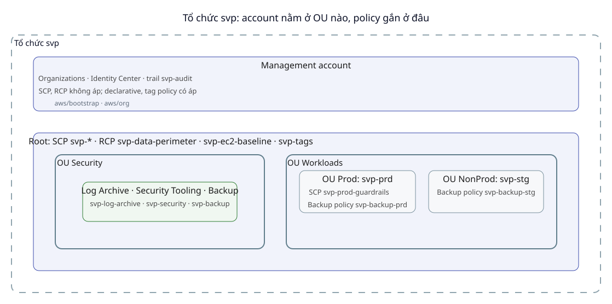
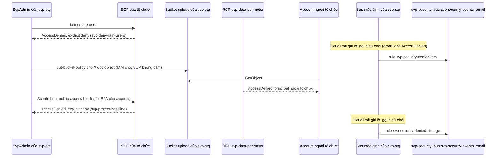

# 03. Tổ chức

← [02. GitHub](02-github.md) · [Mục lục](README.md) · [04. Log Archive](04-log-archive.md) →

## Tổng quan

Chương này dựng khung của cả lab: một tổ chức AWS Organizations với các account tách theo việc, và các luật mà mọi account phải theo dù
IAM của account đó nói gì. Management account chỉ quản trị: tạo account, giữ policy, đăng nhập người, ghi audit; nó không chạy workload.
Log, công cụ bảo mật và bản copy backup ở ba account riêng; stg và prd mỗi env một account.

svp cần khung này vì quyền admin trong một account là toàn quyền ở đó. Muốn có việc mà admin stg, prd không làm được (tắt audit, tạo IAM
user, cho người ngoài đọc dữ liệu, xoá backup), luật phải nằm ở tầng trên account. Người đăng nhập bằng một danh tính tập trung, phiên
ngắn, không ai giữ access key dài hạn.

Phần này sống suốt lab: áp một lần (hai lượt), sau đó chỉ đổi khi thêm account, policy hay dịch vụ. Gần như mọi thứ ở đây không tính phí.

| Câu hỏi | Dịch vụ |
| --- | --- |
| Có những account nào, account nào thuộc nhóm nào? | AWS Organizations (OU) |
| Admin của `svp-stg` có việc gì không làm được dù IAM cho phép? | Service control policy (SCP) |
| Dữ liệu trong S3, KMS, Secrets Manager có tới được ai ngoài tổ chức không? | Resource control policy (RCP) |
| Instance mới có buộc IMDSv2, snapshot có bị chia sẻ public được không? | Declarative policy cho EC2 |
| Tag `Env`, `Stack` có đúng hoa thường và giá trị không? | Tag policy |
| Ai đặt lịch backup của prd, và admin prd có sửa được không? | Backup policy |
| Người học vào account nào, bằng quyền gì, trong bao lâu? | AWS IAM Identity Center |
| Root của account thành viên có mật khẩu, access key không? | IAM, quản root tập trung |
| Ai gọi API gì, ở account nào, region nào? | AWS CloudTrail (trail tổ chức) |

| Account | Region | Vòng đời | Root Terraform |
| --- | --- | --- | --- |
| management | `us-east-1` (Organizations, IAM), `ap-southeast-1` (trail), `sso_region` (Identity Center) | sống suốt lab | `aws/org` |
| `svp-log-archive`, `svp-security`, `svp-backup` (OU `Security`) | — | sống suốt lab | `aws/org` tạo account; nội dung ở chương 04–07 |
| `svp-stg` (OU `NonProd`), `svp-prd` (OU `Prod`) | — | account sống suốt lab, env dựng trong buổi | `aws/org` tạo account; nội dung ở chương 08–13 |

## Kiến trúc

<picture>
  <source media="(prefers-color-scheme: dark)" srcset="../diagrams/03-org-dark.svg">
  
</picture>

*Sơ đồ khái niệm về cây tổ chức và nơi gắn policy, không phải luồng API.* Policy gắn ở root áp cho mọi account bên dưới; policy gắn ở
OU `Prod` chỉ thêm cho `svp-prd`. SCP và RCP không áp lên management account; declarative policy và tag policy có áp.

| Thành phần | Ở đâu | Làm gì |
| --- | --- | --- |
| Tổ chức (feature set `ALL`) | management | Bật loại policy, trusted access của dịch vụ, chỉ định delegated admin |
| OU `Security`, `Workloads/Prod`, `Workloads/NonProd` | cây tổ chức | Nhóm account theo việc; nơi gắn policy riêng của prd và Backup policy |
| Năm account thành viên | OU tương ứng | Log Archive, Security Tooling, Backup, stg, prd của AWS Security Reference Architecture |
| Policy `svp-*` (module `org-policies`) | root, OU `Prod`, OU `NonProd` | SCP, RCP, declarative EC2, tag policy, Backup policy |
| Delegated admin `svp-security` | tổ chức | Account giữ dịch vụ phát hiện cho cả tổ chức (chương [05. Bảo mật](05-security.md)) |
| Identity Center: permission set `Svp*`, nhóm `svp-platform-*` | management, `sso_region` | Đăng nhập người học vào account thành viên |
| Root tập trung | tổ chức | Account thành viên không giữ credential root |
| Trail `svp-audit` | management, ghi về `svp-log-archive` | Management event của mọi account, mọi region; data event S3 của prd |

## Kịch bản thực tế

**Câu hỏi của chương:** Admin của `svp-stg` có `AdministratorAccess`, vậy tổ chức chặn được gì của họ, và chặn bằng policy nào?

Người học đăng nhập `svp-stg` bằng profile `anhnv-stg` (permission set `SvpAdmin`, managed policy `AdministratorAccess`).

1. `aws iam create-user` ở `us-east-1`: IAM của account cho phép, nhưng SCP `svp-deny-iam-users` gắn root có `Deny` trên
   `iam:CreateUser` với `arn:aws:iam::*:user/*`. Explicit deny thắng mọi `Allow`: lỗi `AccessDenied` nói `explicit deny in a service
   control policy`. CloudTrail ghi lời gọi bị từ chối vào bus mặc định của account ở `us-east-1`; rule `svp-security-denied-iam` ở đó
   chuyển nó sang bus `svp-security-events` của `svp-security`, rule `svp-security-notify` gửi topic, topic gửi email.
2. Admin ghi bucket policy cho một account ngoài tổ chức đọc object của bucket upload. Lệnh thành công: không SCP nào cấm sửa bucket
   policy, và S3 Block Public Access chỉ chặn policy cho mọi người, không chặn policy cho một account cụ thể. IAM Access Analyzer
   `svp-org` thấy truy cập từ ngoài vùng tin cậy và tạo finding ở `svp-security` (chương 05).
3. Account ngoài gọi `GetObject`. Bucket policy cho phép, nhưng RCP `svp-data-perimeter` gắn root có statement `EnforceOrgIdentities`:
   `Deny` mọi `s3:*` khi `aws:PrincipalOrgID` khác id tổ chức và principal không phải dịch vụ AWS. Request bị từ chối; dữ liệu không ra
   khỏi tổ chức dù policy của tài nguyên sai.
4. Admin thử tắt S3 Block Public Access cấp account để mở bucket hẳn: SCP `svp-protect-baseline` chặn `s3:PutAccountPublicAccessBlock`
   với mọi principal của account, trừ `OrganizationAccountAccessRole`. Rule `svp-security-denied-storage` của account chuyển sự kiện
   theo cùng đường tới email.
5. Admin không gỡ được policy nào ở trên: chỉ management quản policy của tổ chức, và `svp-deny-leave-organization` chặn rời tổ chức. Đường
   hợp lệ để đổi baseline là PR rồi `aws/baseline` chạy từ management qua `OrganizationAccountAccessRole`.

Ba giới hạn cần nhớ: SCP và RCP không áp lên management account và service-linked role; ai có quyền admin ở management assume được
`OrganizationAccountAccessRole` của mọi account; SCP chỉ lấy bớt quyền, không cấp thêm gì. Runbook thử đúng các lệnh này ở mục 7d của
[`org-security-setup.md`](../runbooks/org-security-setup.md).

## Các dịch vụ và cách svp dùng

### AWS Organizations

- **Làm gì:** gom nhiều account dưới một management account, xếp chúng vào OU, bật loại policy, cho dịch vụ AWS làm việc trên cả tổ chức
  (trusted access) và giao việc quản dịch vụ cho một account thành viên (delegated admin). Ví dụ đời thực:
  - `CreateAccount` tạo `svp-backup` dưới OU `Security`; Organizations tạo sẵn `OrganizationAccountAccessRole` trong account mới.
  - `MoveAccount` chuyển `svp-stg` sang OU `NonProd` tại chỗ, account không bị tạo lại.
  - `EnableAWSServiceAccess` cho `cloudtrail.amazonaws.com` để trail của management ghi được cho mọi account.
  - `RegisterDelegatedAdministrator` giao Config, Access Analyzer cho `svp-security`.
- **Ở svp:** tổ chức có sẵn (nhận quản bằng import), feature set `ALL`; OU `Security`, `Workloads` với hai OU con `Prod`, `NonProd`; năm
  account `close_on_deletion = false`, `prevent_destroy`. Trusted access ở `aws_service_access_principals`, loại policy ở
  `enabled_policy_types` của `organization.tf`; delegated admin ở `delegated-admins.tf`. Liên hệ `SECURITY` của mọi account
  (`contacts.tf`, CIS 1.2).
- **Phí theo:** không tính phí.

### Service control policy (SCP)

- **Làm gì:** đặt mức trần quyền cho mọi principal của account thành viên, kể cả root của account đó; chỉ lấy bớt, không cấp. Ví dụ đời
  thực:
  - `iam:CreateUser` bị `svp-deny-iam-users` từ chối ở mọi account thành viên.
  - `cloudtrail:StopLogging` bị `svp-protect-cloudtrail` từ chối, kể cả với trail riêng của account.
  - `ec2:RunInstances` ở `eu-west-1` bị `svp-deny-other-regions` từ chối; IAM, Route 53, CloudFront vẫn chạy vì nằm trong `NotAction`.
  - `ec2:RunInstances` Spot ở `svp-prd` bị `svp-prod-guardrails` từ chối.
  - `guardduty:DeleteDetector` hay `macie2:EnableMacie` bị `svp-protect-baseline` từ chối.
- **Ở svp:** chỉ `Deny`; `FullAWSAccess` của AWS vẫn gắn mọi đích. Mọi SCP `svp-*` gắn root, trừ `svp-prod-guardrails` gắn OU `Prod`;
  danh sách SCP, nội dung và action ở `local.policies` của `aws/modules/org-policies/main.tf`. Chỉ `svp-protect-baseline` miễn một
  principal, `OrganizationAccountAccessRole`.
- **Phí theo:** không tính phí.
- **Cố ý tắt:** không chặn Spot qua `ec2:CreateFleet` (Karpenter): action đó không có khoá `ec2:InstanceMarketType` cho instance; chặn là
  NodePool prd on-demand. Không chặn tạo, xoá plan Malware Protection, flow log, logging WAF: mỗi buổi tạo và gỡ chúng. Không chặn nút
  bật của dịch vụ bảo mật lab đang dùng: `guardduty:CreateDetector` (delegated admin đã bật detector ở cả `ap-southeast-1`, `us-east-1`,
  mỗi region một detector, `DeleteDetector` đã chặn), `securityhub:EnableSecurityHub` (cấu hình tập trung của delegated admin giữ trạng
  thái), Config (`PutConfigurationRecorder` đã chặn), Firewall Manager (chỉ management chỉ định được admin, mà SCP không áp lên
  management). `us-east-1` được phép vì AWS chỉ phục vụ ở đó chứng chỉ ACM, web ACL WAF của CloudFront và Identity Center của tổ chức.
  Ở `us-east-2`, `us-west-2`, `svp-deny-other-regions` chỉ để ngỏ rule `svp-security-root-signin`: CloudTrail ghi đăng nhập root cả ở
  đó, nên rule phải có ở mọi account ([tra cứu đường cảnh báo](../reference/security-alerts.md#rule-chuyển-sự-kiện)).

### Resource control policy (RCP)

- **Làm gì:** đặt mức trần quyền trên tài nguyên của account thành viên, xét mọi principal gọi tới, kể cả principal ngoài tổ chức. Ví dụ
  đời thực:
  - `s3:GetObject` từ account ngoài tổ chức bị từ chối dù bucket policy cho phép.
  - Một dịch vụ AWS hành động thay tài nguyên ngoài tổ chức (`aws:SourceOrgID` khác) bị từ chối ở KMS, S3, SQS, Secrets Manager.
  - Request không TLS tới S3, SQS, KMS, Secrets Manager, STS bị từ chối.
- **Ở svp:** một RCP `svp-data-perimeter` gắn root, theo mẫu identity perimeter của AWS, không ngoại lệ riêng; `RCPFullAWSAccess` của AWS
  vẫn gắn. Đăng nhập liên kết (`AssumeRoleWithSAML`, `AssumeRoleWithWebIdentity`) và `sts:AssumeRoot` không nằm trong statement principal.
- **Phí theo:** không tính phí.

### Declarative policy cho EC2

- **Làm gì:** đặt cấu hình EC2 ở tầng dịch vụ cho mọi account; API không đổi được giá trị đó, kể cả khi launch template nói khác. Ví dụ
  đời thực:
  - Launch instance với IMDSv1 bị từ chối (`http_tokens_enforced`).
  - `get-instance-metadata-defaults` trả `HttpTokens` `required`, `ManagedBy` `declarative-policy`.
  - Chia sẻ public một snapshot EBS bị chặn (`block_all_sharing`); serial console tắt.
- **Ở svp:** `svp-ec2-baseline` gắn root: IMDSv2 bắt buộc, hop limit 1, không đọc tag qua metadata, chặn chia sẻ public AMI mới và mọi
  snapshot, serial console tắt. Áp cả management. Hop limit 1 thấp hơn mức 2 AWS khuyên cho container đọc IMDS: pod lấy credential qua
  EKS Pod Identity, không cần với tới IMDS.
- **Phí theo:** không tính phí.

### Tag policy

- **Làm gì:** cố định hoa thường của tag key và giá trị được phép; với loại tài nguyên ở `enforced_for`, gắn giá trị sai bị từ chối, loại
  khác chỉ báo tuân thủ. Tag policy không bắt buộc phải có tag. Ví dụ đời thực:
  - Gắn `Env=staging` lên volume EC2 bị từ chối: giá trị không có trong danh sách.
  - Gắn `Stack=demo` lên KMS key bị từ chối.
  - Bucket S3 mang `Env=test` chỉ hiện là không tuân thủ trong báo cáo, không bị chặn (S3 không ở `enforced_for`).
- **Ở svp:** `svp-tags` gắn root cho `Project`, `Env`, `ManagedBy`, `Stack`, `Backup`; `enforced_for` là `ec2`, `eks`, `kms`. Tag phân bổ
  chi phí và selection của Backup policy chỉ đúng khi tag đúng (chương [01. Bootstrap](01-bootstrap.md)).
- **Phí theo:** không tính phí.

### Backup policy

- **Làm gì:** tổ chức đặt backup plan vào account thành viên; admin của account đọc được plan, không sửa, không xoá. Ví dụ đời thực:
  - Plan `svp-prd` chạy rule `daily` mỗi đêm trên DB instance RDS và bucket S3 có tag `Backup=daily`.
  - Mỗi recovery point được copy sang vault `svp-prd-copy` ở `svp-backup`, ngoài tầm admin của prd.
- **Ở svp:** `svp-backup-prd` gắn OU `Prod`, `svp-backup-stg` gắn OU `NonProd`; retention ở `local.backup_retention_days` của module.
  Cấu hình cấp tổ chức (cross-account backup, opt-in của management) ở `backup.tf` của root. Vì sao và luồng copy: chương
  [07. Backup](07-backup.md).
- **Phí theo:** policy không tính phí; backup và bản copy tính ở chương 07.
- **Cố ý tắt:** delegated admin cho AWS Backup: management giữ Backup policy như SCP, RCP; `svp-backup` chỉ là đích copy.

### AWS IAM Identity Center

- **Làm gì:** một danh tính cho người, đăng nhập một lần ở access portal, nhận credential tạm của role theo permission set ở mỗi account
  được gán. Ví dụ đời thực:
  - `aws sso login --profile anhnv-sso` một lần, mọi profile cùng `sso_session` dùng chung token.
  - Role `AWSReservedSSO_SvpReadOnly_…` ở `svp-security` đọc finding mà không đổi được trạng thái finding.
  - Account mới chỉ hiện ở access portal sau khi có gán permission set cho người học.
- **Ở svp:** organization instance ở `sso_region`; permission set `SvpAdmin` (stg, prd, phiên 1 giờ), `SvpReadOnly` (stg, prd,
  `svp-security`, `svp-backup`), `SvpLogReader` (`svp-log-archive`, `ViewOnlyAccess` và đọc object log); nhóm `svp-platform-admins`,
  `svp-platform-viewers` cho Grafana của env (Argo CD không dùng SSO), không thành viên trong code. Quyền đủ ở
  `identity-center.tf`; profile ở `aws/scripts/profiles.sh`.
- **Phí theo:** không tính phí.
- **Cố ý tắt:** permission set của chính management không quản ở đây: đó là gốc tin cậy người học tạo tay.

### IAM: quản root tập trung

- **Làm gì:** account thành viên không giữ mật khẩu, access key, MFA của root; việc chỉ root làm đi qua `sts:AssumeRoot` từ management với
  một task policy, phiên tối đa 15 phút. Ví dụ đời thực:
  - `IAMAuditRootUserCredentials`: đọc root của `svp-stg` có credential nào không.
  - `S3UnlockBucketPolicy`: xoá bucket policy sai đã khoá mọi principal.
  - `IAMCreateRootUserPassword`: cho phép khôi phục mật khẩu root khi một việc cần đăng nhập root đầy đủ.
- **Ở svp:** `RootCredentialsManagement`, `RootSessions` (`root-access.tf`). Root của management (MFA phần cứng) là đường break-glass.
- **Phí theo:** không tính phí.

### AWS CloudTrail (trail tổ chức)

- **Làm gì:** một trail của management ghi sự kiện của mọi account thành viên; account thành viên thấy trail nhưng không sửa được. Ví dụ
  đời thực:
  - Lời gọi `iam:CreateUser` bị từ chối ở bước 1 của kịch bản, với `errorCode` `AccessDenied`.
  - `PutObject` vào bucket upload của prd (data event).
  - Digest file cho phép kiểm log file không bị sửa sau khi giao (`validate-logs`).
- **Ở svp:** trail `svp-audit`, đa region, log file validation; ba advanced event selector: `management` (đọc và ghi), `prd-uploads` (đọc
  và ghi object), `prd-media-writes` (chỉ ghi). Giao về bucket `svp-cloudtrail-<log>-ap-southeast-1` của `svp-log-archive`, mã hoá bằng key
  `alias/svp-log-archive` (chương [04. Log Archive](04-log-archive.md)).
- **Phí theo:** bản sao đầu tiên của management event không tính phí; data event tính theo số event.
- **Cố ý tắt:** data event của bucket stg (không có dữ liệu người dùng thật), lượt đọc media của prd (người xem qua CloudFront).

## Chi phí

| Khoản | Đơn vị tính | Giữa các buổi | Trong buổi | Nguồn |
| --- | --- | --- | --- | --- |
| SCP, RCP, tag policy, Backup policy | — | 0 | 0 | ADR-0078 phụ lục, dòng "SCP, RCP, tag policy, backup policy" |
| Trail `svp-audit`, data event prd | event | ~0 (bản đầu miễn phí) | ~0 mỗi buổi | ADR-0078 phụ lục, dòng "CloudTrail org trail" |
| KMS key `alias/svp-cloudtrail` cũ | key-tháng | 1 USD mỗi tháng tới khi gỡ | như giữa buổi | ADR-0078 phụ lục, dòng "Mọi KMS CMK" |
| Organizations, Identity Center, root tập trung, liên hệ | — | 0 | 0 | trang giá của dịch vụ |

Trail chỉ là bản sao miễn phí khi tổ chức không có trail management event nào khác. Phí của dịch vụ mà delegated admin bật ở chương 05;
bản copy backup ở chương 07; tổng ở chương [15. Chi phí](15-cost.md).

## Kiểm tra và vận hành

Đăng nhập console của management bằng profile `anhnv-sso`.

| Muốn xem | Account | Region | Vào đâu | Trạng thái mong đợi |
| --- | --- | --- | --- | --- |
| Cây account | management | `us-east-1` | Organizations → AWS accounts | Năm account `svp-*` ở OU như sơ đồ; account demo cũ `SUSPENDED` ở OU ngoài code |
| Policy gắn root | management | `us-east-1` | Organizations → Root → Policies | `FullAWSAccess`, `RCPFullAWSAccess` và các `svp-*` của root |
| Trusted access, delegated admin | management | `us-east-1` | Organizations → Services | Dịch vụ của `organization.tf` `Access enabled`; `svp-security` là admin |
| Permission set, gán | management | `sso_region` | IAM Identity Center → AWS accounts | `SvpAdmin`, `SvpReadOnly`, `SvpLogReader` ở đúng account |
| Root tập trung | management | toàn cục | IAM → Root access management | Hai tính năng bật |
| Trail | management | `ap-southeast-1` | CloudTrail → Trails → `svp-audit` | Organization trail, logging, không lỗi giao |

Bảng trên là trạng thái mà code khai báo. Phần đã kiểm thật là phần runbook có bước:
[`org-security-setup.md`, bước (2)](../runbooks/org-security-setup.md#bước-2-awsorg-chỉ-tổ-chức-ou-account) và
[bước (4)](../runbooks/org-security-setup.md#bước-4-awsorg-đủ) (áp, plan lần hai sạch, trạng thái trail, profile), mục 7a (policy theo
loại và đích, delegated admin), 7b (root tập trung), 7c (trail và bucket Log Archive), 7d (phép thử từng guardrail).

## Thiết kế và đánh đổi

### Management chỉ quản trị

Management account không chịu SCP, RCP: một workload chạy ở đó nằm ngoài mọi guardrail. Vì thế management chỉ giữ Organizations, Identity
Center, trail, budget và state của các root quản trị; dịch vụ phát hiện giao cho `svp-security`, log nằm ở `svp-log-archive`. Ba account
này không có profile ghi hay bucket state riêng: root của chúng chạy từ management qua `OrganizationAccountAccessRole`, như
`AWSControlTowerExecution` của Control Tower. Lý do:
[ADR-0059](https://github.com/anhnvcoder/svp-backend/blob/main/docs/adr/0059-org-structure-guardrails.md) §1, §2.

### Guardrail chỉ lấy bớt, miễn đúng một role

Mọi SCP, RCP chỉ `Deny`, nên quyền thật vẫn do IAM của account cấp. `svp-protect-baseline` miễn `OrganizationAccountAccessRole`, role chỉ
management assume được, để baseline chỉ đổi qua Terraform chạy từ management; SCP khác không miễn ai, việc cần làm ngoài guardrail làm từ
management, nơi SCP không áp. Cái giá: admin của management là admin của mọi account. Đường khẩn cấp ở
[`break-glass.md`](../runbooks/break-glass.md).

### Trusted access là danh sách đầy đủ

`aws_service_access_principals` ghi cả danh sách: principal nào thiếu bị apply kế tiếp tắt, kể cả principal mà dịch vụ tự bật (GuardDuty
bật `malware-protection.guardduty.amazonaws.com` cho quét malware EC2; console EC2 bật `ec2.amazonaws.com` khi mở trang EC2 policy). Mỗi
principal trong `organization.tf` có lý do ở comment cạnh nó; thêm dịch vụ cấp tổ chức là thêm principal ở đó trước.

| Lựa chọn của svp | Cái giá | Phương án khác | Khi nào chọn nó |
| --- | --- | --- | --- |
| Terraform thuần trên Organizations | Tự viết guardrail, account mới qua Terraform | AWS Control Tower, Account Factory | Nhiều account, cần landing zone và control có sẵn |
| SCP, RCP gắn root, riêng prd ở OU `Prod` | Một lỗi policy chạm mọi account cùng lúc | Gắn từng OU | OU có luật khác nhau rõ rệt |
| RCP không ngoại lệ riêng | Volume mã hoá bằng CMK (ví dụ CMK EBS cũ còn giữ) không được GuardDuty quét malware | Ngoại lệ theo `aws:PrincipalAccount` hay tag | Cần tích hợp dịch vụ ngoài tổ chức |
| Identity Center, không IAM user | Phụ thuộc instance của một region | IAM user và access key | Hầu như không: CIS đòi danh tính tập trung |
| Root tập trung | Việc root đầy đủ cần bước khôi phục mật khẩu | Mỗi account giữ root với MFA | Ít account, không có management |
| Trail tổ chức về account log riêng | Admin management vẫn vào được account log | Trail mỗi account | Không có tổ chức |

## Liên hệ đề SAP

- "Skill 2.3.1: Design organizational structures that include features such as guardrails, landing zones, and automated account
  provisioning (for example, by using AWS Organizations, OUs, AWS Control Tower, AWS Control Tower Account Factory)." OU `Security`,
  `Workloads/Prod`, `Workloads/NonProd`, account theo SRA; Control Tower là phương án khác ở bảng trên.
- "Skill 2.3.4: Design policy enforcement by using SCPs and RCPs." Bộ SCP `svp-*` và RCP `svp-data-perimeter` của kịch bản.
- "Skill 2.1.1: Implement identity federation by using standard protocols (for example, AWS IAM Identity Center, SAML 2.0, OpenID
  Connect, System for Cross-domain Identity Management [SCIM])." Permission set và profile `sso-session` của người học.
- "Skill 2.1.4: Design data perimeter controls and external access validation solutions (for example, by using AWS Identity and Access
  Management Access Analyzer, VPC endpoint policies, AWS Verified Access)." RCP identity perimeter chặn principal ngoài tổ chức.
- "Skill 3.3.3: Implement policy-based tagging enforcement for cost allocation (for example, by using SCPs, AWS Config rules, tag
  policies)." Tag policy `svp-tags` với `enforced_for`.

| Tình huống trong đề | Chọn | Vì sao không chọn cái gần giống |
| --- | --- | --- |
| Không account nào được dùng region ngoài danh sách, kể cả admin | SCP với `aws:RequestedRegion` | IAM policy do admin account tự sửa được; permissions boundary chỉ áp cho principal được gắn |
| Không ai ngoài tổ chức đọc được S3 dù bucket policy sai | RCP | SCP chỉ xét principal của tổ chức, không xét người gọi từ ngoài |
| Bắt buộc IMDSv2 cho mọi instance mới, kể cả launch template cũ | Declarative policy EC2 | SCP với `ec2:MetadataHttpTokens` chặn lệnh nhưng không đặt mặc định |
| Giá trị tag `Env` sai bị từ chối khi gắn | Tag policy có `enforced_for` | Rule Config chỉ báo sau khi đã gắn |
| Admin account env không xoá được kế hoạch backup | Backup policy | Backup plan trong account thì admin xoá được |
| Người dùng đăng nhập nhiều account bằng một danh tính | IAM Identity Center | IAM user mỗi account là credential dài hạn |
| Audit mọi lời gọi API của cả tổ chức ở một chỗ | Trail tổ chức | AWS Config ghi cấu hình đổi, không ghi người gọi |

## Đọc sâu

- Tổ chức có sẵn trước root này: lần dựng đầu `terraform import aws_organizations_organization.this`, không thì plan đòi tạo tổ chức mới.
  Tổ chức không bao giờ bị xoá (`prevent_destroy`); gỡ có chủ đích trả nó về như trước root.
- Account: `close_on_deletion = false`, nên destroy chỉ gỡ account khỏi state, không đóng. `role_name`, `iam_user_access_to_billing` trong
  `ignore_changes`: API không trả lại hai giá trị đó, so ra sẽ đòi tạo account mới.
- Analyzer tổ chức tạo từ `svp-security` cần service-linked role `AWSServiceRoleForAccessAnalyzer` ở management; Access Analyzer chỉ tự
  tạo role ở account bật nó, nên `aws/org` tạo role bằng `aws_iam_service_linked_role`
  ([service-linked role](https://docs.aws.amazon.com/IAM/latest/UserGuide/access-analyzer-using-service-linked-roles.html)).
- Trail đọc `alias/svp-log-archive` qua provider `log_archive` (assume `OrganizationAccountAccessRole`, account lấy từ state) và ghi ARN
  dạng `key/<id>`: CloudTrail trả dạng đó, ARN alias làm plan không bao giờ sạch. Tên `svp-audit` không đổi: policy bucket và key của
  `aws/log-archive` chỉ cho `aws:SourceArn` của nó.
- Backup policy chạy plan theo opt-in loại tài nguyên của management, không của account thành viên. `aws_backup_region_settings` ghi đè
  cả map, nên `backup.tf` liệt kê mọi loại AWS Backup hỗ trợ ở region nhà, tất cả `true` như AWS đặt cho account mới dùng AWS Backup;
  AWS thêm loại theo thời gian, nên runbook đối chiếu với `describe-region-settings` trước khi áp. Cross-account backup chỉ management
  bật được và có hiệu lực cho mọi account thành viên.
- `SvpAdmin` phiên 1 giờ không cắt `apply` dài khi profile có khối `[sso-session …]`: SDK lấy lại credential từ token SSO tới hết phiên
  access portal. `SvpReadOnly` thêm inline đọc log CloudWatch, ba action đọc Inspector và statement `ReadPrometheusWorkspaces`
  (`aps:ListWorkspaces`, `aps:DescribeWorkspace`) mà `ViewOnlyAccess`, `SecurityAudit` thiếu.
- Statement `ProtectInspector` chặn `inspector2:Enable`, `Disable` trừ request có `aws:ViaAWSService` `true`: nút "Get started" ở console
  của account thành viên bật Inspector tính tiền, ngoài Terraform. Hai đường Terraform vẫn qua. `aws/accounts/<env>` (module `registry`)
  đổi registry giữa Enhanced, Basic, và ECR gọi Inspector bằng quyền của người gọi qua forward access session, luôn có
  `aws:ViaAWSService` `true`; `aws/security` gọi từ `svp-security` bằng role được miễn, và SCP chỉ xét principal của account gắn nó,
  không xét account đích. Cái giá: theo principal không tách được đường ECR khỏi nút bật Enhanced ở console ECR, nên nút đó cũng qua; nó
  chỉ bật quét ECR, và plan của `aws/accounts/<env>` thấy cấu hình lệch. Account mới vào tổ chức do chính Inspector bật qua
  service-linked role, mà SCP không áp; thành viên đã liên kết chỉ delegated admin tắt được, nên `Disable` còn tác dụng với account
  chưa liên kết và chính `svp-security`.
- `DenyUnusedSecurityServices` chặn lệnh mà nút bật trên console gọi của Macie, Detective, Security Lake, Audit Manager, Shield Advanced:
  mỗi dịch vụ tính tiền cho cả account khi đã bật, Shield Advanced còn cam kết một năm phí tháng. `ProtectAccessAnalyzer` chặn cả
  `CreateAnalyzer`: analyzer truy cập không dùng tính tiền theo role, user mà API không có khoá điều kiện theo loại analyzer.
- `NotAction` của `svp-deny-other-regions` là danh sách Region deny của Control Tower
  ([nguồn](https://docs.aws.amazon.com/controltower/latest/controlreference/primary-region-deny-policy.html)) cộng chín action `events:`
  của `root_signin_rule_actions` (rule root sign-in ở `us-east-2`, `us-west-2`); AWS thêm dịch vụ toàn cục thì cập nhật phần Control Tower
  từ trang đó và giữ chín action `events:` này. Cỡ và số policy mỗi đích theo quota của Organizations; test của module kiểm.
- **Rủi ro chấp nhận:** rule root sign-in ở `us-east-2`, `us-west-2` không có rule báo khi bị sửa hay xoá, giống account management. Chỉ
  `OrganizationAccountAccessRole` sửa được chúng (SCP `protect-baseline`), và chính đăng nhập root vẫn được báo.
- OU `Production`, `Development` cũ chứa hai account demo đã đóng (`SUSPENDED`), nằm ngoài Terraform; AWS gỡ hẳn account đóng sau 90 ngày,
  rồi hai OU rỗng được xoá tay ([`org-security-setup.md`, Đồ ngoài Terraform](../runbooks/org-security-setup.md#đồ-ngoài-terraform)).

Làm và tra cứu:

- [`org-security-setup.md`, bước (2)](../runbooks/org-security-setup.md#bước-2-awsorg-chỉ-tổ-chức-ou-account),
  [bước (4)](../runbooks/org-security-setup.md#bước-4-awsorg-đủ): áp root này hai lượt, profile.
- [`aws/org`](../../aws/org/README.md) và [module `org-policies`](../../aws/modules/org-policies/README.md): tài nguyên, policy.
- [`lab-teardown.md`](../runbooks/lab-teardown.md#awsorg): đóng account, trả tổ chức về như trước.
- [ADR-0059](https://github.com/anhnvcoder/svp-backend/blob/main/docs/adr/0059-org-structure-guardrails.md) và
  [phụ lục](https://github.com/anhnvcoder/svp-backend/blob/main/docs/adr/appendix/0059-org-structure-guardrails.md): account, OU, statement
  đủ của mọi policy, bảng đối chiếu RCP.
- [`aws-security.md`](https://github.com/anhnvcoder/svp-backend/blob/main/docs/explanation/aws-security.md): bảo mật AWS cấp tổ chức của
  cả lab.
