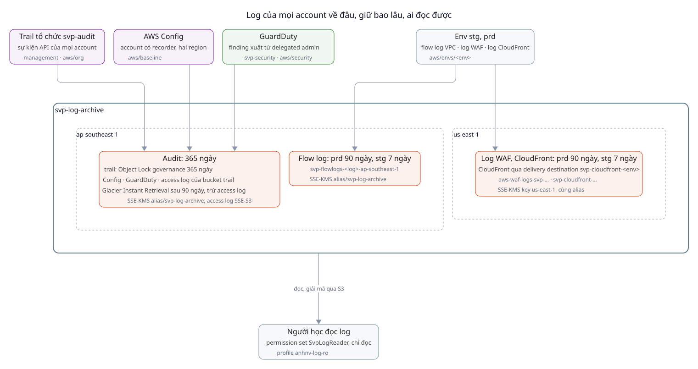

# 04. Log Archive

← [03. Tổ chức](03-org.md) · [Mục lục](README.md) · [05. Bảo mật](05-security.md) →

## Tổng quan

Chương này dựng nơi giữ log của cả tổ chức: một account riêng `svp-log-archive`, mỗi loại log một bucket. Log API của trail tổ chức,
lịch sử cấu hình của AWS Config, finding GuardDuty, flow log VPC, log WAF và log CloudFront của mọi account đổ về đây. Admin của account
sinh ra log không đọc, sửa hay xoá được log của chính account đó.

svp cần phần này vì log chỉ có giá trị điều tra khi kẻ chiếm được một account không xoá được dấu vết. Log nằm cùng account với workload
thì admin của account đó (hay ai lấy được quyền admin) dọn được nó. Mỗi loại log giữ một khoảng khác nhau: log audit một năm, log mạng
một quý, log của stg một tuần.

Phần này sống lâu: dựng một lần ngay sau khi tổ chức có account, không gỡ cuối buổi. Buổi stg, prd chỉ làm log nhiều thêm; gỡ chỉ khi
lab kết thúc, có chủ đích.

| Câu hỏi | Dịch vụ |
| --- | --- |
| Log API của cả tổ chức nằm ở đâu, ai xoá được nó trong năm đầu? | Amazon S3, S3 Object Lock |
| Ai đã đọc hay xoá file log của trail? | S3 server access logging |
| Log được mã hoá bằng key nào, ai giải mã được? | AWS KMS |
| Log cũ sang lớp lưu trữ rẻ và hết hạn khi nào? | S3 Lifecycle |
| CloudFront của account env giao log vào bucket của account khác bằng cách nào? | CloudWatch Logs delivery |

| Account | Region | Vòng đời | Root Terraform |
| --- | --- | --- | --- |
| `svp-log-archive` | `ap-southeast-1` (nhà): bucket audit, flow log | sống lâu | `aws/log-archive` |
| `svp-log-archive` | `us-east-1`: bucket log WAF, CloudFront, delivery destination | sống lâu | `aws/log-archive` |

## Kiến trúc

Mỗi nguồn ghi bằng principal dịch vụ của nó (`cloudtrail.amazonaws.com`, `config.amazonaws.com`, `guardduty.amazonaws.com`,
`delivery.logs.amazonaws.com`); bucket policy chỉ nhận đúng dịch vụ đó, từ tổ chức này, qua TLS. Không principal IAM nào của account
khác có quyền ghi. Người học đọc bằng permission set chỉ đọc. Hai region vì bucket SSE-KMS cần key cùng region, mà log WAF và log
CloudFront giao từ `us-east-1`.

| Thành phần | Ở đâu | Làm gì |
| --- | --- | --- |
| Bucket `svp-cloudtrail-<log>-ap-southeast-1` | `svp-log-archive`, nhà | Log của trail tổ chức `svp-audit`; Object Lock governance |
| Bucket `svp-cloudtrail-access-<log>-ap-southeast-1` | `svp-log-archive`, nhà | Server access log của bucket trail |
| Bucket `svp-config-…`, `svp-guardduty-…`, `svp-flowlogs-…` | `svp-log-archive`, nhà | Lịch sử Config, finding GuardDuty, flow log VPC |
| Bucket `aws-waf-logs-svp-<log>-us-east-1`, `svp-cloudfront-<log>-us-east-1` | `svp-log-archive`, `us-east-1` | Log WAF, log CloudFront của stg, prd |
| Hai KMS key `alias/svp-log-archive` | mỗi region một key, cùng alias | Mã hoá mọi bucket trừ bucket access log |
| Delivery destination `svp-cloudfront-<env>` | `svp-log-archive`, `us-east-1` | Đích của log CloudFront, mỗi env một cái |
| Permission set `SvpLogReader` | Identity Center, gán vào `svp-log-archive` | Người học đọc object và giải mã qua S3 |

## Kịch bản thực tế

**Câu hỏi của chương:** Một thao tác lạ ở account env: tìm ai làm, từ đâu, và chắc rằng log chưa bị sửa?

Kịch bản giả định: thư cảnh báo `svp-security-denied-iam` báo một lời gọi `CreateUser` bị từ chối ở `svp-stg`. Log được tìm bằng quyền chỉ
đọc ở `svp-log-archive`, không cần quyền nào ở `svp-stg`.

1. Thư (rule `svp-security-denied-iam`, [tra cứu đường cảnh báo](../reference/security-alerts.md#rule-chuyển-sự-kiện)) nêu tên sự
   kiện, account, region, giờ.
   Thư chỉ là con trỏ; bản đủ của sự kiện nằm trong log trail.
2. Người học vào access portal, chọn `svp-log-archive` với `SvpLogReader` (profile `anhnv-log-ro`). Về dữ liệu, policy
   inline của permission set chỉ cho `s3:ListBucket`, `s3:GetObject` trên các bucket log và `kms:Decrypt` khi lời gọi đi qua S3
   (`kms:ViaService`), với key mang alias `alias/svp-log-archive`; managed policy `ViewOnlyAccess` đi kèm chỉ để console hiện
   cấu hình, không đọc thêm object nào.
3. Trail tổ chức ghi theo đường `AWSLogs/<org-id>/<account>/CloudTrail/<region>/<năm>/<tháng>/<ngày>/`. IAM ghi sự kiện ở `us-east-1`,
   nên file cần đọc nằm dưới `<stg>/CloudTrail/us-east-1/` của ngày đó, dù người gọi làm việc ở region nào.
4. Trong file, sự kiện `CreateUser` có `userIdentity.arn` (role và tên phiên), `sourceIPAddress`, `userAgent`, `errorCode`
   `AccessDenied`. Role và IP cho biết ai làm, từ đâu; cùng phiên đó gọi gì khác thì tìm theo `userIdentity.arn` trong các file cùng giờ.
5. Log còn nguyên: version object của trail bị Object Lock governance khoá 365 ngày, nên không ai xoá hay ghi đè version đó trong hạn,
   trừ principal có `s3:BypassGovernanceRetention` gửi header bỏ qua có chủ đích. Admin của `svp-stg` không có quyền nào trên bucket.
   Trail bật log file validation: mỗi giờ CloudTrail giao một digest file ký số, `aws cloudtrail validate-logs` so log với digest
   ([tài liệu CloudTrail](https://docs.aws.amazon.com/awscloudtrail/latest/userguide/cloudtrail-log-file-validation-intro.html)).
6. Đối chiếu thêm theo điều kiện: flow log của stg (`svp-flowlogs-…`, tiền tố `AWSLogs/aws-account-id=<stg>/`) chỉ còn 7 ngày và chỉ có
   khi env đang chạy; lịch sử Config của stg chỉ có khi cờ `config_recording` của stg là `always` lúc đó (với file của repo: không);
   finding GuardDuty liên quan nằm ở `svp-guardduty-…`.

Ai còn xoá được log: admin của management, qua `OrganizationAccountAccessRole` (role mà root này dùng để apply), có cả quyền bỏ qua
governance. Đó là giới hạn của khuôn này, ở mục [Log ở account riêng](#log-ở-account-riêng).

## Các dịch vụ và cách svp dùng

### Amazon S3 (bucket log)

- **Làm gì:** giữ log dạng object; bucket policy quyết định dịch vụ nào ghi được, Lifecycle quyết định object sống bao lâu. Ví dụ đời
  thực:
  - Request không TLS bị từ chối bởi statement `DenyInsecureTransport` (`aws:SecureTransport` = `false`).
  - CloudTrail gọi `GetBucketAcl` rồi `PutObject` với `s3:x-amz-acl` = `bucket-owner-full-control`; Object Ownership
    `BucketOwnerEnforced` nhận header đó và bỏ ACL.
  - Rule Lifecycle `stg-retention` xoá object dưới tiền tố của stg sau 7 ngày, trước rule `retention` 90 ngày của cùng bucket.
  - Version cũ (noncurrent) hết hạn sau 1 ngày; multipart dở bị huỷ sau 1 ngày.
- **Ở svp:** bảy bucket của `local.buckets` trong `aws/log-archive/main.tf`, tên `<tiền tố>-<id account log>-<region>` (bảng dưới), mọi
  bucket chặn public, versioning, `BucketOwnerEnforced`. Policy theo `aws:SourceOrgID` của tổ chức (Config, flow log, WAF), theo
  `aws:SourceArn` của trail `svp-audit`, theo account và detector của `svp-security` (GuardDuty), theo từng account env (CloudFront).
- **Phí theo:** GB-tháng theo lớp lưu trữ (Standard, Glacier Instant Retrieval), số request PUT và GET.
- **Cố ý tắt:** Object Lock ở mọi bucket trừ trail: Config và server access log đều từ chối bucket đích có retention mặc định của
  Object Lock (comment của `buckets.tf`).

Retention đọc từ `local.buckets` của `main.tf`:

| Bucket | Ai ghi | Hết hạn | Glacier IR sau | Tiền tố của stg |
| --- | --- | --- | --- | --- |
| `svp-cloudtrail-…` | trail `svp-audit` của management | 365 ngày | 90 ngày | — |
| `svp-cloudtrail-access-…` | S3 server access logging | 365 ngày | — | — |
| `svp-config-…` | AWS Config của mọi account có recorder | 365 ngày | 90 ngày | — |
| `svp-guardduty-…` | GuardDuty của `svp-security`, hai region | 365 ngày | 90 ngày | — |
| `svp-flowlogs-…` | flow log VPC của stg, prd | 90 ngày | — | `AWSLogs/aws-account-id=<stg>/`, 7 ngày |
| `aws-waf-logs-svp-…-us-east-1` | WAF của CloudFront ở stg, prd | 90 ngày | — | `AWSLogs/<stg>/`, 7 ngày |
| `svp-cloudfront-…-us-east-1` | CloudFront của stg, prd | 90 ngày | — | `<stg>/`, 7 ngày |

### S3 Object Lock

- **Làm gì:** khoá từng version object theo mô hình WORM tới một ngày hết hạn. Chế độ governance cho principal có
  `s3:BypassGovernanceRetention` bỏ qua khoá khi gửi header bỏ qua; chế độ compliance không cho ai bỏ qua, kể cả root của account. Ví dụ
  đời thực:
  - `DeleteObject` có version id trên file log của trail còn trong hạn: `AccessDenied`.
  - `PutObject` cùng key: tạo version mới, version cũ vẫn khoá.
  - `get-object-retention` của một version: `Mode` `GOVERNANCE`, `RetainUntilDate` 365 ngày sau lúc ghi.
- **Ở svp:** chỉ bucket trail, retention mặc định governance 365 ngày (`aws_s3_bucket_object_lock_configuration.cloudtrail`). Object Lock đã
  bật thì không tắt được.
- **Phí theo:** không có phí riêng; trả lưu trữ của mọi version còn khoá.
- **Cố ý tắt:** chế độ compliance: lab cần gỡ được bucket trước hạn khi kết thúc
  ([`lab-teardown.md`, `aws/log-archive`](../runbooks/lab-teardown.md#awslog-archive)).

### S3 server access logging

- **Làm gì:** S3 ghi mỗi request vào bucket nguồn thành một dòng log ở bucket đích, theo best effort. Ví dụ đời thực:
  - Dòng `REST.GET.OBJECT` khi `SvpLogReader` tải một file log của trail.
  - Dòng `REST.DELETE.OBJECT` khi ai đó xoá file log, kể cả khi bị từ chối (mã lỗi trong dòng log).
  - Khuyến nghị 3.4 của CIS AWS Foundations Benchmark v5.0.0: bật access log cho bucket trail.
- **Ở svp:** chỉ bucket trail, ghi vào `svp-cloudtrail-access-…` với tiền tố là tên bucket trail. Bucket đích dùng SSE-S3: S3 server access
  logging không giao vào bucket SSE-KMS.
- **Phí theo:** không phí giao; trả lưu trữ và request của bucket đích.
- **Cố ý tắt:** access log của chính bucket đích: nó sẽ ghi log của lượt ghi của chính nó không dứt.

### AWS KMS (key của Log Archive)

- **Làm gì:** key mã hoá dữ liệu của S3 (SSE-KMS); key policy quyết định dịch vụ nào dùng được key, với điều kiện gì. Ví dụ đời thực:
  - `GenerateDataKey` của `cloudtrail.amazonaws.com`, encryption context `aws:cloudtrail:arn` là trail của management.
  - `Decrypt` của `SvpLogReader` khi tải object, chỉ khi đi qua S3 (`kms:ViaService`).
  - Lần xoay khoá tự động mỗi năm: log cũ vẫn giải mã được bằng version key cũ.
- **Ở svp:** hai key cùng alias `alias/svp-log-archive`, `ap-southeast-1` (trail, Config, flow log, GuardDuty) và `us-east-1` (WAF,
  CloudFront); xoay mỗi năm, chờ xoá 30 ngày, `prevent_destroy`. Key policy: IAM của `svp-log-archive` quản key; mỗi dịch vụ giao log một
  statement với cùng điều kiện như bucket policy. S3 Bucket Key bật ở mọi bucket SSE-KMS để giảm request KMS.
- **Phí theo:** key-tháng (tăng ở hai lần xoay đầu), số request.

### CloudWatch Logs delivery (log CloudFront chéo account)

- **Làm gì:** giao vended log của dịch vụ AWS: delivery source (tài nguyên sinh log) nối với delivery destination (S3, CloudWatch Logs,
  Firehose) bằng một delivery; destination ở account khác cần destination policy. Ví dụ đời thực:
  - `CreateDelivery` từ account stg tới `svp-cloudfront-stg`: được; tới `svp-cloudfront-prd`: bị từ chối.
  - Log CloudFront ở dạng Parquet, đường `<account env>/DistributionId=<id>/year=…/month=…/day=…/hour=…/` (kiểu Hive).
- **Ở svp:** `aws_cloudwatch_log_delivery_destination.cloudfront`, mỗi env một destination `svp-cloudfront-<env>` ở `us-east-1`, đích là
  bucket `svp-cloudfront-…` với tiền tố là id account env; policy chỉ cho đúng account đó `logs:CreateDelivery`. Delivery source và
  delivery ở account env (module `edge`, `media`). Flow log và log WAF cũng do `delivery.logs.amazonaws.com` giao, nhưng account env ghi
  thẳng vào bucket (module `network`, `waf`), không qua destination.
- **Phí theo:** GB giao tới S3 và GB chuyển sang Parquet, tính ở account env.

## Chi phí

| Khoản | Đơn vị tính | Giữa các buổi | Trong buổi | Nguồn |
| --- | --- | --- | --- | --- |
| S3 của Log Archive | GB-tháng, nghìn request | ~1,1 USD mỗi tháng | log tăng theo buổi; không có số đo | ADR-0060 phụ lục §12 "Ước lúc không buổi" |
| Hai key `alias/svp-log-archive` | key-tháng, request | 1 USD mỗi key mỗi tháng, thêm ở hai lần xoay đầu | như giữa buổi | ADR-0060 phụ lục §12 "Bảng giá" |
| Giao flow log (S3, Parquet) | GB, ở account env | 0 | 0,2–0,4 USD mỗi buổi một env | ADR-0060 phụ lục §12 "Thêm mỗi buổi" |
| Giao log WAF | GB, ở account env | 0 | ~0 | như trên |
| Giao log CloudFront (S3, Parquet) | GB, ở account env | 0 | không có số đo | ADR-0061 phụ lục §13 |
| Object Lock, server access logging | — | 0 | 0 | trang giá S3 |

Tổng phí giữ và phí buổi của cả lab ở chương [15. Chi phí](15-cost.md). Nguồn:
[ADR-0060 phụ lục](https://github.com/anhnvcoder/svp-backend/blob/main/docs/adr/appendix/0060-org-detection-logging.md) §12,
[ADR-0061 phụ lục](https://github.com/anhnvcoder/svp-backend/blob/main/docs/adr/appendix/0061-edge-cloudfront-waf-acm.md) §13.

## Kiểm tra và vận hành

Đăng nhập console của `svp-log-archive` qua access portal với `SvpLogReader` (cùng quyền với profile `anhnv-log-ro`).

| Muốn xem | Account | Region | Vào đâu | Trạng thái mong đợi |
| --- | --- | --- | --- | --- |
| Log của trail | `svp-log-archive` | `ap-southeast-1` | S3 → `svp-cloudtrail-…` → `AWSLogs/<org-id>/` | Một thư mục mỗi account `ACTIVE`, cả management |
| Object Lock | `svp-log-archive` | `ap-southeast-1` | S3 → `svp-cloudtrail-…` → Properties → Object Lock | Enabled, Governance, 365 days |
| Retention | `svp-log-archive` | mỗi region | S3 → bucket → Management → Lifecycle rules | `retention`, thêm `stg-retention` ở ba bucket log mạng, edge |
| Access log | `svp-log-archive` | `ap-southeast-1` | S3 → `svp-cloudtrail-access-…` | Object dưới tiền tố `svp-cloudtrail-…/` |
| Log CloudFront | `svp-log-archive` | `us-east-1` | S3 → `svp-cloudfront-…` | Thư mục `<account env>/` sau buổi có distribution |

`SvpLogReader` có managed policy `ViewOnlyAccess` cộng quyền đọc object; console báo thiếu quyền ở thuộc tính nào của bucket thì đọc
thuộc tính đó trong `aws/log-archive/buckets.tf`.

Bảng trên là trạng thái mà code khai báo. Runbook có bước kiểm cho nó:
[`org-security-setup.md`, bước (3)](../runbooks/org-security-setup.md#bước-3-awslog-archive) (plan, apply, output bucket và key) và
[7c](../runbooks/org-security-setup.md#7c-trail) (`verify.sh org` đọc trail `svp-audit` ghi không lỗi và bucket trail có log của mọi
account `ACTIVE`). Log WAF, CloudFront, flow log chỉ có sau một buổi env; runbook buổi kiểm chúng. Chưa có bước runbook chạy
`validate-logs`.

## Thiết kế và đánh đổi

### Log ở account riêng

Theo AWS Security Reference Architecture, log của tổ chức nằm ở account Log Archive, nơi admin của workload và của `svp-security` không có
quyền. Ranh giới thật là account: bucket policy không cho principal IAM nào của account khác, và không ai có profile ghi ở
`svp-log-archive`. Ngoại lệ còn lại là management: root này chạy từ đó qua `OrganizationAccountAccessRole`, nên admin của management
đọc, xoá được log, kể cả bỏ qua governance. Lý do và phương án:
[ADR-0060](https://github.com/anhnvcoder/svp-backend/blob/main/docs/adr/0060-org-detection-logging.md) §7.

### Retention theo loại log

Log audit (trail, Config, finding) giữ 365 ngày theo PCI DSS v4 10.5.1 (ít nhất 12 tháng), sang Glacier Instant Retrieval sau 90 ngày
vì vẫn đọc được tức thì. Log mạng của prd 90 ngày, đủ một quý điều tra; stg chỉ sống vài giờ mỗi buổi nên 7 ngày. Lý do số ngày:
[ADR-0060 phụ lục §7][adr0060-7].

### Policy theo tổ chức, không theo danh sách account

Config, flow log và log WAF được ghi khi principal dịch vụ đến từ tổ chức (`aws:SourceOrgID`), nên account mới ghi được mà không sửa
policy. Log CloudFront là ngoại lệ: mỗi account env có destination và tiền tố riêng, để không env nào ghi vào tiền tố của env kia và rule
7 ngày của stg khớp đúng log của stg.

| Lựa chọn của svp | Cái giá | Phương án khác | Khi nào chọn nó |
| --- | --- | --- | --- |
| Object Lock governance chỉ ở bucket trail | Admin của management bỏ qua được khoá; bucket khác chỉ có versioning | Compliance mode | Có nghĩa vụ pháp lý giữ log, chấp nhận không gỡ được trước hạn |
| Trail ở management, bucket ở `svp-log-archive` | Cấu hình trail đổi được từ management | Trail tổ chức tạo từ account delegated admin của CloudTrail | Muốn management chạy ít nhất có thể |
| SSE-KMS bằng CMK, Bucket Key | Phí key-tháng; xoá key là mất mọi log mã hoá bằng nó | SSE-S3 | Không cần kiểm soát ai giải mã |
| Mỗi loại log một bucket S3, đọc bằng tay | Không truy vấn chung nhiều nguồn | Amazon Security Lake (OCSF), Athena, SIEM | Nhiều nguồn log, có người trực điều tra |
| Retention 365 ngày audit, 90 ngày mạng | Mất bằng chứng cũ hơn | Giữ nhiều năm ở Glacier Deep Archive | Quy định giữ log dài hạn |

## Liên hệ đề SAP

- "Skill 2.3.2: Implement centralized logging and configuration management solutions, including solutions for AI model invocations and
  responses (for example, by using AWS CloudTrail organization trails, AWS Config aggregation, AWS GuardDuty, Amazon Security Lake, AWS
  Security Hub, Amazon CloudWatch Logs)." Trail tổ chức, recorder Config và GuardDuty của mọi account giao về một account log.
- "Skill 2.4.3: Implement audit trail management for regulated workloads, including for AI services." Retention 365 ngày theo PCI DSS,
  Object Lock và log file validation của trail.
- "Skill 2.4.1: Design architectures to meet data protection requirements (for example, by implementing encryption, access controls, audit
  logging)." SSE-KMS với key policy theo dịch vụ, permission set chỉ đọc, access log của bucket trail.
- "Skill 3.4.1: Implement intelligent storage tiering and lifecycle policies (for example, by using Amazon S3 Intelligent-Tiering, S3
  Lifecycle policies, S3 Glacier storage classes, Amazon EFS lifecycle policies)." Lifecycle `retention`, `stg-retention`, Glacier Instant
  Retrieval sau 90 ngày.

| Tình huống trong đề | Chọn | Vì sao không chọn cái gần giống |
| --- | --- | --- |
| Log audit không ai xoá được trước hạn, kể cả root | S3 Object Lock compliance mode | Governance cho principal có quyền bỏ qua; MFA Delete chỉ thêm bước, không có hạn |
| Admin của account workload không được động vào log của account đó | Account Log Archive riêng, trail tổ chức | Bucket cùng account: admin đó sửa được bucket policy |
| Chứng minh file log trail không bị sửa sau khi giao | Log file validation (digest) | Object Lock chặn xoá, không chứng minh nội dung; versioning giữ bản cũ nhưng không ký |
| Log ít khi đọc nhưng khi cần phải đọc ngay | S3 Glacier Instant Retrieval | Glacier Flexible Retrieval, Deep Archive phải chờ khôi phục hàng phút tới hàng giờ |
| Nhiều file log nhỏ, muốn chuyển lớp tự động | Lifecycle theo tuổi, chấp nhận object nhỏ ở Standard | S3 Lifecycle mặc định không chuyển object dưới 128 KB; Intelligent-Tiering không chuyển chúng xuống lớp rẻ |
| Gom log nhiều nguồn theo chuẩn mở để truy vấn | Amazon Security Lake | Bucket theo loại log chỉ giữ, không chuẩn hoá schema |
| Bucket đích của server access log | SSE-S3, không Object Lock | S3 không giao access log vào bucket SSE-KMS hay có retention mặc định của Object Lock |

## Đọc sâu

- Tên bucket tính từ id account log và region, nên root khác (`aws/org`, `aws/baseline`, `aws/envs/<env>`) suy cùng tên mà không đọc state
  của root này; output `bucket_names` chỉ để kiểm.
- Bucket policy, key policy của trail nêu ARN trail `svp-audit` trước khi trail đổi đích, nên root này áp trước `aws/org` đủ mà không phụ
  thuộc nó; đổi tên trail là trail không ghi được. Detector GuardDuty theo ARN `detector/*` của `svp-security` vì id detector chỉ có sau
  `aws/security`.
- Policy cho trail ghi ở hai tiền tố `AWSLogs/<mgmt>/` và `AWSLogs/<org-id>/`, theo mẫu policy của tài liệu CloudTrail cho trail tổ
  chức.
- S3 Lifecycle không chuyển object nhỏ hơn 128 KB sang lớp khác, nên phần lớn file log ở Standard tới khi hết hạn; dòng Glacier IR chỉ có
  tác dụng với file lớn.
- Tiền tố của delivery destination chỉ một đoạn (`PutDeliveryDestination` từ chối `/`); có tiền tố thì CloudFront không tự thêm
  `AWSLogs/<account>/CloudFront`.
- Bucket và key có `prevent_destroy`: gỡ chỉ theo [`lab-teardown.md`, `aws/log-archive`](../runbooks/lab-teardown.md#awslog-archive).

Làm và tra cứu:

- [`org-security-setup.md`, bước (3)](../runbooks/org-security-setup.md#bước-3-awslog-archive): áp root này lần đầu.
- [`aws/log-archive`](../../aws/log-archive/README.md): tài nguyên, output, khi nào chạy.
- [03. Tổ chức](03-org.md#aws-cloudtrail-trail-tổ-chức): trail `svp-audit` và permission set `SvpLogReader`.
- [ADR-0060](https://github.com/anhnvcoder/svp-backend/blob/main/docs/adr/0060-org-detection-logging.md) §7, §8: bucket Log Archive, trail
  tổ chức; bucket policy, key policy đủ ở phụ lục.
- [ADR-0061](https://github.com/anhnvcoder/svp-backend/blob/main/docs/adr/0061-edge-cloudfront-waf-acm.md) §8: log CloudFront chéo account.
- [`aws-security.md`](https://github.com/anhnvcoder/svp-backend/blob/main/docs/explanation/aws-security.md): bảo mật AWS cấp tổ chức của cả
  lab.

[adr0060-7]: https://github.com/anhnvcoder/svp-backend/blob/main/docs/adr/appendix/0060-org-detection-logging.md#7-bucket-log-archive
