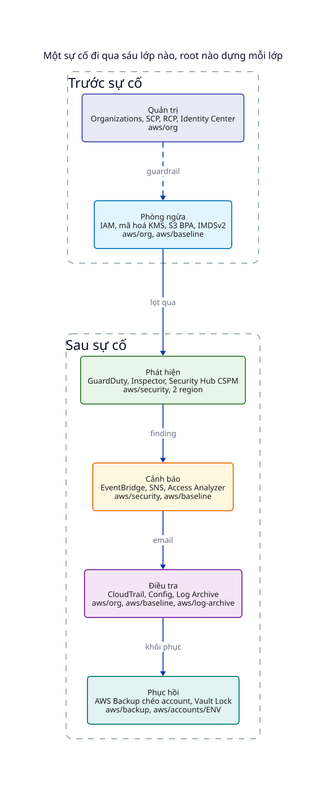
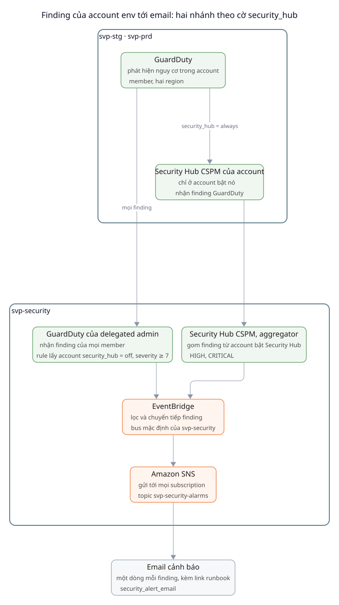
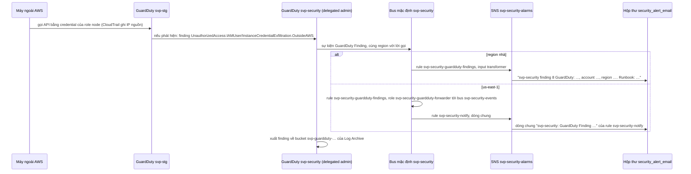
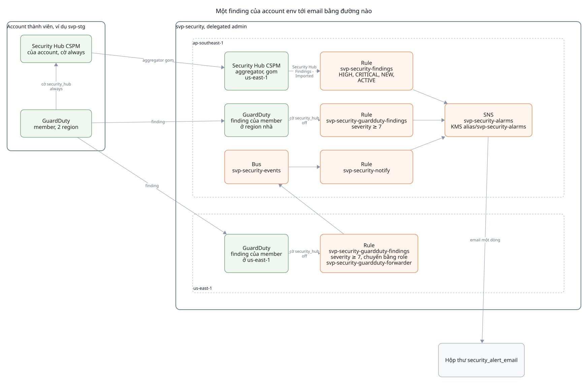

# 05. Bảo mật

← [04. Log Archive](04-log-archive.md) · [Mục lục](README.md) · [06. Baseline](06-baseline.md) →

## Tổng quan

Chương này dựng phần phát hiện và cảnh báo cho cả tổ chức, quản từ account bảo mật riêng `svp-security`. Các dịch vụ phát hiện không do
từng account tự quản: `svp-security` giữ chúng cho mọi account khác, gom kết quả về một chỗ và gửi email khi có chuyện nghiêm trọng.
Người quản trị một account workload có toàn quyền trong account đó, nhưng không phải là người nhận cảnh báo, và guardrail của tổ chức
chặn họ tắt phát hiện hay sửa đường cảnh báo bằng quyền thường.

svp cần phần này vì credential bị lộ hay cấu hình sai thường bị phát hiện muộn nhất đúng lúc không ai trực. Mọi thứ ở đây là dịch vụ
managed, nên vẫn chạy khi không cluster nào chạy.

Phần này sống lâu: dựng một lần, không gỡ cuối buổi. Giữa các buổi chỉ giữ phần rẻ; phần tính theo lượng tài nguyên (đánh giá cấu hình
của account env, quét image) bật lại trong buổi bằng cờ chi phí.

| Câu hỏi | Dịch vụ |
| --- | --- |
| Có ai đang dùng credential của svp từ ngoài AWS, hay đào coin trên một node? | Amazon GuardDuty |
| Image container có lỗ hổng phần mềm đã biết không? | Amazon Inspector |
| Cấu hình của các account có đạt chuẩn bảo mật không? | AWS Security Hub CSPM |
| Tài nguyên nào cho người ngoài tổ chức truy cập? | IAM Access Analyzer |
| Một tài nguyên đã đổi cấu hình thế nào theo thời gian? | AWS Config |
| Ai đã gọi API làm thay đổi đó? | AWS CloudTrail (trail tổ chức, chương [03. Tổ chức](03-org.md)) |
| Khi có chuyện nghiêm trọng, ai được báo và bằng cách nào? | Amazon EventBridge, Amazon SNS (email) |

| Account | Region | Vòng đời | Root Terraform |
| --- | --- | --- | --- |
| `svp-security` | `ap-southeast-1` (nhà), `us-east-1` | sống lâu | `aws/security` |
| mọi account, kể cả management | `ap-southeast-1`, `us-east-1` | sống lâu | `aws/baseline` (rule chuyển sự kiện) |
| `svp-log-archive` | `ap-southeast-1` | sống lâu | `aws/log-archive` (bucket giữ finding) |

## Kiến trúc

<picture>
  <source media="(prefers-color-scheme: dark)" srcset="../diagrams/security-layers-dark.svg">
  
</picture>

*Sơ đồ khái niệm về trách nhiệm bảo mật, không phải luồng API: quản trị và phòng ngừa áp lên mọi workload; phát hiện và điều tra chạy
song song trên cùng tài nguyên, mỗi nhánh dẫn tới việc của nó.*

Chương này dựng lớp **Phát hiện** và **Cảnh báo**. Các lớp còn lại: quản trị ở chương [03. Tổ chức](03-org.md), phòng ngừa ở
chương [06. Baseline](06-baseline.md), điều tra ở chương [04. Log Archive](04-log-archive.md), phục hồi ở chương
[07. Backup](07-backup.md).

<picture>
  <source media="(prefers-color-scheme: dark)" srcset="../diagrams/security-alert-overview-dark.svg">
  
</picture>

Cờ `security_hub` của `aws/paid-features.json` chọn nhánh: account bật Security Hub CSPM gửi finding qua aggregator, account tắt nó để
tiết kiệm vẫn có finding GuardDuty tới email qua delegated admin của GuardDuty. Với file của repo, stg và prd đi nhánh `off`.

| Thành phần | Ở đâu | Làm gì |
| --- | --- | --- |
| Delegated administrator | `svp-security`, do `aws/org` chỉ định | Giữ GuardDuty, Security Hub CSPM, Inspector, Config aggregator, Access Analyzer cho cả tổ chức |
| GuardDuty | mọi account, hai region | Phát hiện hành vi lạ; finding của member về `svp-security` |
| Security Hub CSPM | `svp-security` luôn bật; account khác theo cờ `security_hub` | Chấm cấu hình theo chuẩn, gom finding của dịch vụ khác; aggregator ở region nhà |
| Inspector | `svp-security` và account có `inspector_ecr` khác `off`, region nhà | Quét CVE của image ECR |
| Config aggregator `svp-org` | `svp-security`, region nhà | Xem tập trung cấu hình và compliance của account, region có recorder |
| Access Analyzer `svp-org` | `svp-security`, hai region | Báo tài nguyên cho principal ngoài tổ chức truy cập |
| Rule `svp-security-*` | bus mặc định của mọi account | Chuyển sự kiện CloudTrail bảo mật sang bus `svp-security-events` |
| Rule `svp-security-findings`, `-guardduty-findings`, `-notify` | `svp-security` | Lọc finding, sự kiện; viết một dòng; gửi topic |
| Topic `svp-security-alarms` | `svp-security`, region nhà | Gửi email tới `security_alert_email` |

Hai region: `ap-southeast-1` là region nhà, nơi gom finding; `us-east-1` vì IAM, Organizations ghi sự kiện CloudTrail ở đó. SCP
`svp-deny-other-regions` chặn region khác ở account thành viên, nên dịch vụ phát hiện chỉ bật ở hai region này. Region trong sơ đồ chỉ
vị trí; ranh giới tin cậy là account.

## Kịch bản thực tế

**Câu hỏi của chương:** Một credential của account env bị dùng từ ngoài AWS thì ai biết, qua đường nào?

Kịch bản giả định: một node của cluster `svp-stg` bị chiếm; kẻ tấn công lấy credential tạm của role node qua IMDS rồi gọi API từ máy
của họ. Cờ của file repo: `security_hub` của stg là `off`. Kịch bản đi theo trường hợp GuardDuty sinh finding; finding không phải điều
bảo đảm (bước 2).

1. Kẻ tấn công gọi API từ IP ngoài AWS bằng credential của role node. CloudTrail của `svp-stg` ghi lời gọi.
2. GuardDuty của `svp-stg` (nguồn CloudTrail, không cần protection plan) có thể sinh finding
   `UnauthorizedAccess:IAMUser/InstanceCredentialExfiltration.OutsideAWS`, mức mặc định High
   ([finding IAM](https://docs.aws.amazon.com/guardduty/latest/ug/guardduty_finding-types-iam.html)). Không phải lời gọi nào cũng thành
   finding: GuardDuty có thể học nguồn gọi là hành vi quen và thôi sinh finding cho nó; finding khớp suppression rule bị lưu trữ ngay,
   không tới EventBridge ([suppression rule](https://docs.aws.amazon.com/guardduty/latest/ug/findings_suppression-rule.html)).
3. Finding đi về delegated admin `svp-security` ở cùng region; bus mặc định của `svp-security` nhận sự kiện `GuardDuty Finding`.
4. Rule `svp-security-guardduty-findings` khớp vì `detail.accountId` là id của stg (cờ `off`) và `detail.severity` ≥ 7. Ở region nhà nó
   gửi topic qua input transformer; ở `us-east-1` nó chuyển sang bus `svp-security-events`, rule `svp-security-notify` gửi topic.
5. Nếu cờ `security_hub` của stg là `always`: finding vào Security Hub của stg, gom về `svp-security`, aggregator ở region nhà bắn
   `Security Hub Findings - Imported`, rule `svp-security-findings` khớp (`HIGH`, `ACTIVE`, `NEW`, `GuardDuty`) và gửi topic. Rule
   `svp-security-guardduty-findings` không khớp stg nữa, nên không có thư trùng.
6. Người nhận thư là chủ hộp thư `security_alert_email`, không phải admin của stg. Role thường của stg không tắt được detector hay sửa rule
   `svp-security-*`: SCP `svp-protect-baseline` chặn các lệnh đó với mọi principal của account thành viên, trừ
   `OrganizationAccountAccessRole` (mục [Phạm vi của SCP bảo vệ](#phạm-vi-của-scp-bảo-vệ)). Lần thử tắt bị từ chối khớp event pattern
   của `svp-security-denied-detection` nên được chuyển tới đường cảnh báo; sửa rule, dù thành công hay bị từ chối, khớp
   `svp-security-alert-rules`.
7. Người học mở [`security-alert.md`](https://github.com/anhnvcoder/svp-backend/blob/main/docs/runbooks/security-alert.md) từ URL trong
   thư; bản đủ của finding đọc trên GuardDuty của `svp-security` hay trong bucket GuardDuty của Log Archive.

Chưa có số đo thời gian từ lời gọi tới thư; runbook chờ tối đa 30 phút ở mục 7e. Finding còn mở thì GuardDuty gửi bản cập nhật theo tần
suất xuất finding, mặc định 6 giờ (ADR-0060 §10). Runbook tạo finding mẫu cùng đường bằng `create-sample-findings` ở mục 7e của
[`org-security-setup.md`](../runbooks/org-security-setup.md).

## Các dịch vụ và cách svp dùng

### Amazon GuardDuty

- **Làm gì:** đọc CloudTrail, log DNS, flow log và các nguồn của protection plan để phát hiện hành vi lạ, mỗi phát hiện một finding có
  type và severity. Ví dụ đời thực:
  - `UnauthorizedAccess:IAMUser/InstanceCredentialExfiltration.OutsideAWS`: credential tạm của role trên một node EC2 được gọi từ IP
    ngoài AWS.
  - `Policy:IAMUser/RootCredentialUsage`: có lời gọi API bằng credential root.
  - `Policy:Kubernetes/AnonymousAccessGranted`: một binding RBAC của cluster EKS cho `system:anonymous` quyền (EKS Audit Log).
  - `CredentialAccess:RDS/AnomalousBehavior.SuccessfulBruteForce`: đăng nhập RDS thành công sau chuỗi đoán mật khẩu (RDS Protection).
  - `CryptoCurrency:EC2/BitcoinTool.B!DNS`: instance hỏi DNS tên miền đào coin; runbook dùng đúng type này để tạo finding mẫu.
- **Ở svp:** mọi account, hai region, không cờ chi phí. Cấu hình tổ chức `auto_enable_organization_members = "ALL"` và sáu protection
  plan `ALL` (`S3_DATA_EVENTS`, `EKS_AUDIT_LOGS`, `EBS_MALWARE_PROTECTION`, `RDS_LOGIN_EVENTS`, `LAMBDA_NETWORK_LOGS`,
  `RUNTIME_MONITORING`) trong `local.guardduty_features` của `guardduty.tf`; publishing destination về bucket GuardDuty của Log Archive;
  detector `aws_guardduty_detector.management` và member `management`.
- **Phí theo:** triệu event CloudTrail (quản lý, và S3 data event của S3 Protection) được phân tích; GB VPC Flow Log và DNS query log
  được phân tích, nên lưu lượng của buổi stg làm phí tăng; triệu log audit EKS; vCPU-tháng của Runtime Monitoring và RDS Protection; GB
  flow log của Lambda (Lambda Protection); GB quét của Malware Protection; 30 ngày đầu dùng thử mỗi account mỗi region.
- **Cố ý tắt:** ba additional configuration quản agent tự động của Runtime Monitoring (`ECS_FARGATE_AGENT_MANAGEMENT`,
  `EC2_AGENT_MANAGEMENT`, `EKS_ADDON_MANAGEMENT`) là `NONE`: GuardDuty sẽ tự tạo endpoint và security group ngoài state, chặn destroy VPC
  cuối buổi; agent EKS là add-on do module `eks` cài.

### AWS Security Hub CSPM

- **Làm gì:** chạy security check của các chuẩn trên tài nguyên của các account đã bật Security Hub CSPM, mỗi check thành một finding
  của control ("control" là một phép kiểm có id như `EC2.7`), và gom finding của GuardDuty, Inspector, Access Analyzer về một bảng. Ví
  dụ đời thực:
  - `EC2.7`: EBS mã hoá mặc định chưa bật ở một region.
  - `S3.1`: account chưa bật S3 Block Public Access.
  - `CloudTrail.1`: không có trail đa region ghi cả sự kiện đọc và ghi.
  - `ECR.1`: repo ECR chưa cấu hình quét image (FAILED ở repo phát hành, chấp nhận vì trivy, grype quét trước push).
- **Ở svp:** cấu hình tập trung (`CENTRAL`) từ `svp-security`, aggregator ở region nhà gom `us-east-1`. Configuration policy
  `svp-security-standards` gắn root của tổ chức: FSBP v1.0.0, CIS AWS Foundations Benchmark v5.0.0, control mới tự bật. Cờ
  `security_hub`: account `off` gắn policy `svp-security-off` (`service_enabled = false`); association của account thắng association
  của root. Với file của repo, giữa các buổi chỉ `svp-security` bật.
- **Phí theo:** mỗi security check, mỗi account mỗi region; finding nhập từ dịch vụ khác tính sau một hạn mức miễn phí mỗi tháng; 30
  ngày đầu dùng thử mỗi account mỗi region.
- **Cố ý tắt:** control `GuardDuty.7`, `GuardDuty.12`, `GuardDuty.13` (đòi agent do GuardDuty tự quản; agent EKS ở Terraform, không ECS,
  EC2 chỉ có bastion); Security Hub ở mọi account trừ `svp-security` giữa các buổi
  ([ADR-0078](https://github.com/anhnvcoder/svp-backend/blob/main/docs/adr/0078-paid-features-lean-defaults.md) §1).

### Amazon Inspector

- **Làm gì:** quét image container tìm lỗ hổng phần mềm đã biết (CVE) khi push và quét lại khi có CVE mới. Finding chỉ vào Security Hub
  khi account nguồn bật Security Hub CSPM: tích hợp tự chạy từ lúc đó
  ([tích hợp dịch vụ AWS](https://docs.aws.amazon.com/securityhub/latest/userguide/securityhub-internal-providers.html)). Ví dụ đời thực:
  - Finding loại Package Vulnerability: một thư viện trong image bên thứ ba kéo qua pull-through cache có CVE mức High.
  - CVE mới công bố cho package trong image đã quét: Inspector quét lại digest đó, không cần push lại.
  - Ở account bật Security Hub CSPM, finding của image cache nằm cạnh finding GuardDuty trên bảng Security Hub của `svp-security`, lọc
    theo account và repo.
- **Ở svp:** chỉ ECR, chỉ region nhà, cờ `inspector_ecr`. Cấu hình tổ chức tự bật ECR cho account mới; enabler `security` và enabler
  `members` chỉ `["ECR"]`; liên kết thành viên `members` cho account `ACTIVE` khác `svp-security` có cờ khác `off` (với file của repo:
  `svp-log-archive`, `svp-backup`). Chế độ quét và filter repo đặt ở registry của account env (`aws/accounts/<env>`, quét nâng cao chỉ
  repo cache).
- **Phí theo:** mỗi image được quét lần đầu và mỗi lần quét lại, mỗi account; 15 ngày đầu dùng thử.
- **Cố ý tắt:** EC2, Lambda, Lambda code, code repository: node thay mỗi buổi từ AMI EKS ghim version và có GuardDuty Runtime
  Monitoring, lab không có Lambda; stg, prd có `inspector_ecr` `off` giữa các buổi
  ([ADR-0062](https://github.com/anhnvcoder/svp-backend/blob/main/docs/adr/0062-ecr-registry-ci-oidc.md) §10).

### AWS Config (aggregator)

- **Làm gì:** recorder của từng account ghi cấu hình của mỗi tài nguyên và mỗi lần nó đổi (configuration item), tức lịch sử cấu hình;
  aggregator cho xem chỉ đọc, tập trung, cấu hình và compliance của nhiều account, region
  ([aggregator](https://docs.aws.amazon.com/config/latest/developerguide/aggregate-data.html)). Config cho biết cấu hình đổi thế nào,
  không cho biết ai đổi: principal gọi API nằm ở sự kiện CloudTrail cùng thời điểm. Control của Security Hub chạy trên rule Config, nên
  account bật Security Hub cần recorder. Ví dụ đời thực:
  - Truy vấn nâng cao trên aggregator: mọi security group đang mở cổng 22 ra `0.0.0.0/0`, ở các account có recorder. Truy vấn này đọc
    trạng thái hiện tại, không đọc lịch sử hay tài nguyên đã xoá
    ([truy vấn nâng cao](https://docs.aws.amazon.com/config/latest/developerguide/querying-AWS-resources.html)).
  - Dòng thời gian cấu hình của một role, từ bản ghi của recorder: trust policy trước và sau mỗi lần đổi; người đổi đọc trên CloudTrail.
  - Rule service-linked tiền tố `securityhub-` do Security Hub tạo cho control của FSBP, CIS.
- **Ở svp:** aggregator `svp-org` ở `svp-security`, nguồn tổ chức, mọi region (`all_regions = true`), role
  `svp-security-config-aggregator` với managed policy `AWSConfigRoleForOrganizations`. Aggregator chỉ có dữ liệu của account, region có
  recorder. Recorder của từng account ở root `aws/baseline`, hai region, theo cờ `config_recording`
  (chương [06. Baseline](06-baseline.md)); với file của repo, giữa các buổi chỉ `svp-security` có recorder.
- **Phí theo:** aggregator không tính phí; recorder tính mỗi configuration item ghi và mỗi lần đánh giá rule.
- **Cố ý tắt:** không conformance pack: chuẩn CIS của Security Hub đã đánh giá cùng các rule.

### IAM Access Analyzer

- **Làm gì:** đọc policy dựa trên tài nguyên và trust policy, báo tài nguyên cho principal ngoài vùng tin cậy truy cập. Vùng tin cậy ở
  svp là cả tổ chức. Đây là dịch vụ phát hiện: nó đọc policy, không đọc hành vi. Ví dụ đời thực:
  - Bucket policy cho một account ngoài tổ chức đọc object.
  - Key policy KMS cho principal ngoài tổ chức dùng key.
  - Trust policy của role cho principal ngoài tổ chức assume.
  - Snapshot hay image chia sẻ ra ngoài tổ chức.
- **Ở svp:** analyzer `svp-org` loại `ORGANIZATION` ở hai region, trong `svp-security`. Finding vào Security Hub của `svp-security`,
  nên finding mức `HIGH`, `CRITICAL` tới email qua rule `svp-security-findings` kể cả khi tài nguyên ở account có cờ `security_hub`
  `off`; thư ghi account `svp-security`, account tài nguyên đọc trên Security Hub
  ([tra cứu đường cảnh báo](../reference/security-alerts.md#rule-của-svp-security)).
- **Phí theo:** phân tích truy cập ngoài không tính phí; analyzer truy cập không dùng tính theo role hay user mỗi tháng.
- **Cố ý tắt:** analyzer truy cập không dùng: mỗi buổi tạo và xoá role, nên trả theo role mà ít giá trị.

### Amazon EventBridge

- **Làm gì:** khớp sự kiện theo event pattern và chuyển nó tới đích (topic, bus khác), có input transformer để viết lại nội dung. Ví dụ
  đời thực:
  - Sự kiện `AWS API Call via CloudTrail` với `eventName` `StopLogging` của `cloudtrail.amazonaws.com` khớp `svp-security-trail`.
  - Sự kiện `AWS Console Sign In via CloudTrail` với `userIdentity.type` `Root` khớp `svp-security-root-signin`.
  - Sự kiện `Security Hub Findings - Imported` của finding GuardDuty mức `HIGH` khớp `svp-security-findings`.
  - Sự kiện `GuardDuty Finding` của account `off` với `severity` 8 khớp `svp-security-guardduty-findings`.
- **Ở svp:** bus `svp-security-events` và policy của nó, rule `svp-security-notify` (bus đó), `svp-security-findings` (bus mặc định),
  `svp-security-guardduty-findings` (bus mặc định, hai region, khi có account `off`) ở `svp-security`; rule `svp-security-*` của mọi
  account ở `aws/baseline`. Bảng rule và bộ lọc: [tra cứu đường cảnh báo](../reference/security-alerts.md).
- **Phí theo:** sự kiện quản lý của AWS vào bus mặc định miễn phí; sự kiện gửi sang bus của account khác tính theo mỗi triệu sự kiện.
- **Cố ý tắt:** finding control FSBP, CIS và finding Inspector không gửi email: Security Hub gửi lại sự kiện mỗi lần đánh giá lại, email
  sẽ lặp; người học đọc chúng trên bảng Security Hub theo runbook.

Sơ đồ chi tiết của hai nhánh, với rule, region và role:

<picture>
  <source media="(prefers-color-scheme: dark)" srcset="../diagrams/security-finding-to-email-dark.svg">
  
</picture>

### Amazon SNS

- **Làm gì:** topic nhận một thông báo và gửi nó tới mọi subscription; ở đây là email. Ví dụ đời thực:
  - Thư "AWS Notification - Subscription Confirmation" sau apply đầu: chưa bấm **Confirm subscription** thì topic không gửi gì.
  - Thư `svp-security finding HIGH GuardDuty: …` mỗi finding nghiêm trọng.
  - Thư `svp-security: AWS API Call via CloudTrail PutRule … svp-terraform error .` khi chính apply tạo rule (lời gọi thành công).
- **Ở svp:** topic `svp-security-alarms` ở region nhà, KMS key `alias/svp-security-alarms`, subscription email `security_alert_email`
  (module `alarms`, publisher `events.amazonaws.com`). Email chỉ ở `security.auto.tfvars` không commit.
- **Phí theo:** số thông báo email (một nghìn đầu mỗi tháng miễn phí); KMS key của topic theo key-tháng và số request.

## Chi phí

| Khoản | Đơn vị tính | Giữa các buổi | Trong buổi | Nguồn |
| --- | --- | --- | --- | --- |
| Security Hub CSPM | security check, finding nhập | ~1,8 USD mỗi tháng ở `svp-security` | 1–3 USD mỗi buổi một env bật `security_hub` | ADR-0078 phụ lục "Tháng không buổi"; ADR-0060 phụ lục §12 "Thêm mỗi buổi" |
| AWS Config (recorder) | configuration item, đánh giá rule | ~0,3 USD mỗi tháng ở `svp-security` | 2–4,5 USD mỗi buổi một env bật `config_recording` | như trên |
| GuardDuty | event, GB log được phân tích, vCPU-tháng | ~2,4 USD mỗi tháng cho năm account của ước tính (management, `svp-log-archive`, `svp-security`, `svp-stg`, `svp-prd`); `svp-backup` thêm ~0,05 USD; 30 ngày đầu dùng thử | ~0,5 USD mỗi buổi một env | ADR-0060 phụ lục §12 "Ước lúc không buổi", "Thêm mỗi buổi"; ADR-0078 phụ lục, dòng "Security Hub, Config của `svp-backup`" (GuardDuty) |
| Inspector | image được quét | ~0,18 USD mỗi digest image bên thứ ba mới mỗi account | theo số image mới khi env bật `inspector_ecr`; không có số đo | ADR-0062 §11 |
| Config aggregator, Access Analyzer truy cập ngoài | — | 0 | 0 | ADR-0060 phụ lục §12 "Ước lúc không buổi" |
| EventBridge chéo account, SNS email, KMS key của topic | triệu sự kiện, nghìn thư, key-tháng | không có số đo | không có số đo | trang giá của dịch vụ |

Tổng phí một buổi của cả lab, không đếm GuardDuty hai lần, ở chương [15. Chi phí](15-cost.md). Nguồn:
[ADR-0060 phụ lục](https://github.com/anhnvcoder/svp-backend/blob/main/docs/adr/appendix/0060-org-detection-logging.md) §12,
[ADR-0078 phụ lục](https://github.com/anhnvcoder/svp-backend/blob/main/docs/adr/appendix/0078-paid-features-lean-defaults.md#chi-phí),
[ADR-0062](https://github.com/anhnvcoder/svp-backend/blob/main/docs/adr/0062-ecr-registry-ci-oidc.md) §11.

## Kiểm tra và vận hành

Đăng nhập console của `svp-security` qua access portal với quyền chỉ đọc (cùng permission set với profile `anhnv-security-ro`).

| Muốn xem | Account | Region | Vào đâu | Trạng thái mong đợi |
| --- | --- | --- | --- | --- |
| Finding của cả tổ chức | `svp-security` | `ap-southeast-1`, `us-east-1` | GuardDuty → Findings | Finding của mọi member, cột account |
| Thành viên GuardDuty | `svp-security` | mỗi region | GuardDuty → Accounts | Mọi account `Enabled`; account có sẵn lúc bật `ALL` có thể chờ tới 24 giờ |
| Chuẩn và control | `svp-security` | `ap-southeast-1` | Security Hub CSPM → Summary, Controls | Cấu hình `CENTRAL`; FSBP, CIS v5.0.0 bật ở account có cờ `always` |
| Finding Inspector | `svp-security` | `ap-southeast-1` | Inspector → Findings | Chỉ finding ECR |
| Aggregator Config | `svp-security` | `ap-southeast-1` | Config → Aggregators → `svp-org` | Nguồn có recorder `SUCCEEDED`; account `config_recording` `off` không có dữ liệu mới |
| Access Analyzer | `svp-security` | mỗi region | IAM → Access Analyzer | Analyzer `svp-org` loại Organization, `Active` |
| Rule cảnh báo | `svp-security` | `ap-southeast-1` | EventBridge → Rules, bus `default` và `svp-security-events` | Rule `svp-security-*` `Enabled` |
| Subscription email | `svp-security` | `ap-southeast-1` | SNS → Topics → `svp-security-alarms` | Subscription `Confirmed` |

Bảng trên là trạng thái mà code khai báo. Runbook có bước kiểm cho nó:
[`org-security-setup.md`, bước (5)](../runbooks/org-security-setup.md#bước-5-awssecurity) (áp, kiểm plan Inspector, xác nhận email,
kiểm nhanh), mục 7a (`verify.sh` đọc dịch vụ bật, aggregator, analyzer) và 7e (cảnh báo thử tới hộp thư). Có bước kiểm chưa phải đã
kiểm: một phần chỉ coi là chạy khi bước đó ra đúng mong đợi và output được dán lại. Đường email nói riêng chỉ coi là chạy khi phép thử 7e
cho đủ thư, vì chỉ phép thử đó đi qua policy của topic với EventBridge
([tra cứu đường cảnh báo](../reference/security-alerts.md#rule-của-svp-security)).

## Thiết kế và đánh đổi

### Delegated admin ở account riêng

Theo AWS Security Reference Architecture, công cụ bảo mật nằm ở một account riêng: admin của `svp-stg` có toàn quyền trong account của
nó, nhưng finding của nó nằm ở `svp-security`, nơi admin đó không có quyền. Management không quản dịch vụ: nó chỉ định delegated admin
(`aws/org`), còn cấu hình, finding và cảnh báo ở `svp-security`, vì AWS khuyên management chạy ít nhất có thể. Management vẫn là một
account được giám sát: nó có detector GuardDuty làm member (mục [Đọc sâu](#đọc-sâu)) và Security Hub theo cờ như account khác. Lý do
và phương án: [ADR-0060](https://github.com/anhnvcoder/svp-backend/blob/main/docs/adr/0060-org-detection-logging.md) §1.

### Phạm vi của SCP bảo vệ

SCP `svp-protect-baseline` gắn root của tổ chức, chặn các lệnh tắt hay đổi GuardDuty, Security Hub, Config, Inspector, Access Analyzer,
rule và role `svp-security-*` (danh sách lệnh ở `aws/modules/org-policies/main.tf`) với mọi principal của account thành viên, trừ
`OrganizationAccountAccessRole`. Ba giới hạn: role được miễn assume được từ management, nên ai có quyền admin ở management vẫn đổi được;
SCP không áp lên management account và service-linked role
([SCP](https://docs.aws.amazon.com/organizations/latest/userguide/orgs_manage_policies_scps.html)); SCP không liệt kê lệnh trên chính
finding (lưu trữ finding GuardDuty, đổi workflow của finding Security Hub). Các sự kiện bị từ chối khớp event pattern của nhóm rule
`denied-*` được chuyển tới đường cảnh báo.

### Hai nhánh cảnh báo theo cờ `security_hub`

Security Hub ở account env tính phí theo số check, mà mỗi buổi tạo và xoá hàng trăm tài nguyên; tắt nó giữa các buổi làm mất đường gom
finding qua aggregator. Rule `svp-security-guardduty-findings` giữ email cho finding GuardDuty của account tắt Security Hub, đổi lại phải
duy trì danh sách account `off` trong event pattern (root tự tính từ `paid-features.json`). Cờ và lý do:
[ADR-0071](https://github.com/anhnvcoder/svp-backend/blob/main/docs/adr/0071-paid-features.md) §4, §5.

| Lựa chọn của svp | Cái giá | Phương án khác | Khi nào chọn nó |
| --- | --- | --- | --- |
| Delegated admin `svp-security`, root chạy từ management qua role | Thêm một account; root cần ba provider | Quản dịch vụ từ management | Hầu như không: AWS khuyên management chạy ít nhất có thể |
| Security Hub CSPM chỉ bật ở `svp-security` giữa các buổi | Account env mất đánh giá FSBP, CIS liên tục; bật lại có lượt check đầu | Bật ở mọi account (account vắng khỏi `paid-features.json`) | Production có người dùng thật |
| Cảnh báo qua EventBridge, SNS email | Một hộp thư, không trực, không phân loại | Amazon Q Developer in chat applications (tên hiện hành của AWS Chatbot) tới Slack; công cụ trực ngoài. Systems Manager Incident Manager không nhận khách mới | Có đội trực, cần escalation |
| Finding control FSBP, CIS, Inspector không tới email | Phải đọc bảng Security Hub theo runbook | Gửi mọi finding, hay automation rule của Security Hub lọc | Có người đọc hàng đợi finding mỗi ngày |
| Phát hiện ở hai region | Management ngoài hai region không có phát hiện (không chịu SCP) | Bật mọi region như CIS khuyên | Tổ chức dùng nhiều region |
| Finding xuất về bucket GuardDuty của Log Archive | Mỗi nguồn một định dạng, không truy vấn chung | Amazon Security Lake (OCSF) | Nhiều nguồn log, cần SIEM |

## Liên hệ đề SAP

- "Task 2.3: Design multi-account governance and compliance solutions." Delegated admin ở account riêng; SCP bảo vệ dịch vụ phát hiện và
  rule cảnh báo.
- "Skill 2.3.2: Implement centralized logging and configuration management solutions, including solutions for AI model invocations and
  responses (for example, by using AWS CloudTrail organization trails, AWS Config aggregation, AWS GuardDuty, Amazon Security Lake, AWS
  Security Hub, Amazon CloudWatch Logs)." Aggregator Config `svp-org`, GuardDuty và Security Hub cấp tổ chức; Security Lake là phương
  án khác ở bảng trên.
- "Skill 2.3.5: Implement automated compliance monitoring (for example, by using AWS Config rules, AWS Security Hub CSPM)." Configuration
  policy `svp-security-standards` với FSBP, CIS v5.0.0.
- "Skill 2.3.6: Configure automated vulnerability scanning and patch management (for example, by using Amazon Inspector, AWS Systems
  Manager Patch Manager)." Inspector chỉ ECR qua delegated admin, theo cờ `inspector_ecr`.
- "Skill 2.1.4: Design data perimeter controls and external access validation solutions (for example, by using AWS Identity and Access
  Management Access Analyzer, VPC endpoint policies, AWS Verified Access)." Analyzer `svp-org` loại `ORGANIZATION`.

| Tình huống trong đề | Chọn | Vì sao không chọn cái gần giống |
| --- | --- | --- |
| Credential tạm của role EC2 được dùng từ IP ngoài AWS | GuardDuty | CloudTrail chỉ ghi lời gọi, không tự nhận ra bất thường; Access Analyzer đọc policy, không đọc hành vi |
| Bucket policy cho account ngoài tổ chức đọc object | IAM Access Analyzer | GuardDuty bắt hành vi đã xảy ra, không đọc policy; rule Config chỉ kiểm điều rule đã viết |
| Security group đã đổi thế nào trong 30 ngày qua | AWS Config | CloudTrail cho biết ai gọi API, không giữ cấu hình trước và sau |
| Ai đã gọi `DeleteBucketPolicy` lúc 2 giờ sáng | CloudTrail | Config ghi tài nguyên đổi, không ghi principal |
| CVE trong image container ở ECR | Amazon Inspector | GuardDuty Runtime Monitoring bắt hành vi lúc chạy, không quét package |
| Đánh giá liên tục theo CIS cho mọi account, một bảng chung | Security Hub CSPM | Conformance pack của Config đánh giá được nhưng không gom finding của GuardDuty, Inspector |
| Gom log nhiều nguồn theo chuẩn mở để truy vấn, đưa vào SIEM | Amazon Security Lake (OCSF) | Security Hub CSPM gom finding, không gom log thô |
| Ngăn admin của account thành viên tắt GuardDuty, Config hay sửa rule cảnh báo | SCP | IAM policy do chính admin đó sửa được; Config rule chỉ báo sau khi đã tắt |
| Quản tập trung dịch vụ bảo mật cho cả tổ chức mà không vận hành từ management account | Delegated administrator ở account bảo mật | Chạy từ management: SCP không áp lên nó, quyền quá rộng; tự bật ở từng account thì không gom một chỗ |
| Chuyển finding nghiêm trọng thành email cho người trực | EventBridge rule + SNS topic | Security Hub, GuardDuty không tự gửi email; CloudWatch alarm đo metric, không đọc nội dung finding |

## Đọc sâu

- GuardDuty và Security Hub của `svp-security` tự bật khi `aws/org` chỉ định delegated admin
  ([GuardDuty](https://docs.aws.amazon.com/guardduty/latest/ug/guardduty_organizations.html),
  [Security Hub](https://docs.aws.amazon.com/securityhub/latest/userguide/designate-orgs-admin-account.html)): root đọc detector bằng data
  source `aws_guardduty_detector` mỗi region, không có `aws_securityhub_account`, vì tạo lại thì API từ chối.
- Chỉ định delegated admin của Inspector bật mọi loại quét ở `svp-security`
  ([Inspector](https://docs.aws.amazon.com/inspector/latest/user/designating-admin.html)). Enabler `security` vào state bằng khối
  `import` (id `<security>-ECR`), nên apply đầu đổi tại chỗ về `["ECR"]`; tạo mới thì provider chờ mọi account `DISABLED`, apply hết giờ
  ([provider][enabler-create], [báo lỗi](https://github.com/hashicorp/terraform-provider-aws/issues/50430)). Khối `import` ở lại: resource
  đã có trong state thì Terraform bỏ qua nó.
- Inspector theo trình tự chỉ định, liên kết thành viên, bật quét
  ([AWS sample](https://github.com/aws-samples/inspector2-enablement-with-cli#-4-activation-phase)). Delegated admin chỉ tắt được
  Inspector khi không còn thành viên liên kết, mà xoá enabler chỉ gọi `Disable`
  ([tắt dịch vụ](https://docs.aws.amazon.com/inspector/latest/user/deactivating-best-practices.html)): liên kết là resource riêng,
  `depends_on` giữ thứ tự, destroy đi ngược. Management không là thành viên Inspector.
- Management phải bật GuardDuty trước khi delegated admin thêm nó làm member
  ([thêm member](https://docs.aws.amazon.com/guardduty/latest/ug/add-member-accounts-guardduty-organization.html)): root tạo detector ở
  management mỗi region (provider `management`), rồi `aws_guardduty_member` thêm management không lời mời. API không trả email của member
  thuộc tổ chức, provider đọc `Enabled` thành `invite = true`: cả hai trong `ignore_changes`.
- Security Hub: configuration policy gắn root áp cho cả management
  ([central configuration](https://docs.aws.amazon.com/securityhub/latest/userguide/central-configuration-intro.html)); management không
  làm delegated admin được khi dùng cấu hình tập trung. Analyzer tổ chức cần service-linked role `AWSServiceRoleForAccessAnalyzer` ở
  management, do `aws/org` tạo.
- Thứ tự chờ của Security Hub: aggregator, rồi `CENTRAL` (provider chờ `PENDING` tới `ENABLED`, thử lại khi dữ liệu tổ chức còn đồng bộ;
  `Status` không vào state), rồi policy. Association có thể `PENDING` tới 24 giờ
  ([gắn policy](https://docs.aws.amazon.com/securityhub/latest/userguide/create-associate-policy.html)): hết giờ chờ thì provider chỉ cảnh
  báo. GuardDuty áp `ALL` lên account có sẵn có thể mất tới 24 giờ
  ([auto-enable](https://docs.aws.amazon.com/guardduty/latest/ug/set-guardduty-auto-enable-preferences.html)): `FAIL` về member trong ngày
  đầu ở bước kiểm của runbook có thể là chờ đồng bộ, không phải mặc định là chờ. Đọc trạng thái member trên GuardDuty → Accounts; quá 24
  giờ mà vẫn `FAIL` thì là lỗi thật.
- Root chạy từ management (`anhnv-sso`): provider mặc định assume `OrganizationAccountAccessRole` của `svp-security` với phiên
  `svp-terraform`; provider `log_archive` chỉ đọc ARN dạng `key/<id>` của key Log Archive; provider `management` đọc tổ chức và bật
  detector của management. `svp-security` không có profile ghi hay bucket state riêng.

Làm và tra cứu:

- [`org-security-setup.md`, bước (5)](../runbooks/org-security-setup.md#bước-5-awssecurity): áp root này lần đầu, kiểm plan, xác nhận
  email, kiểm nhanh.
- [`aws/security`](../../aws/security/README.md): tài nguyên của root, khi nào chạy.
- [Rule và đường cảnh báo bảo mật](../reference/security-alerts.md): rule `svp-security-*`, bộ lọc phiên, rule finding, policy topic.
- [Module `security-baseline`](../../aws/modules/security-baseline/README.md): rule `svp-security-*` của mỗi account.
- [ADR-0060](https://github.com/anhnvcoder/svp-backend/blob/main/docs/adr/0060-org-detection-logging.md): phát hiện, log, cảnh báo của
  tổ chức; event pattern đủ ở phụ lục.
- [`aws-security.md`](https://github.com/anhnvcoder/svp-backend/blob/main/docs/explanation/aws-security.md): bảo mật AWS cấp tổ chức
  của cả lab.

[enabler-create]: https://github.com/hashicorp/terraform-provider-aws/blob/v6.73.0/internal/service/inspector2/enabler.go#L165
