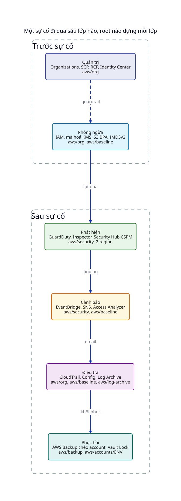
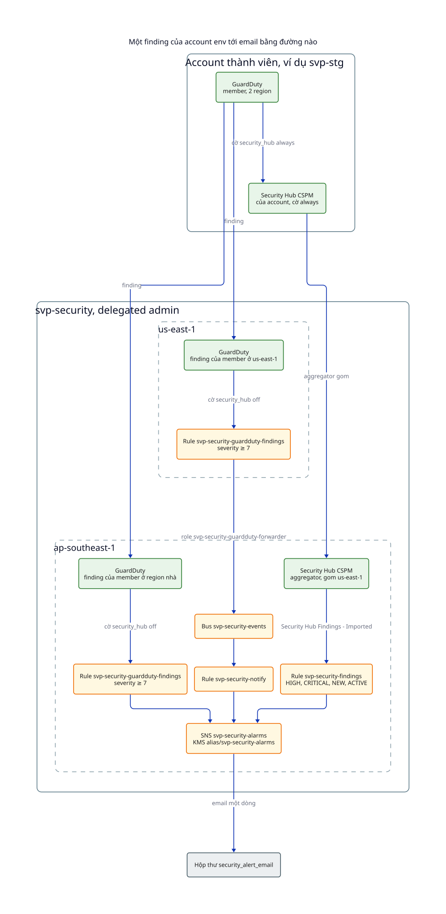
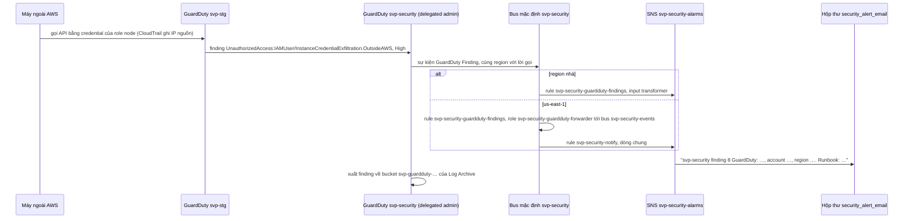

# 05. Bảo mật

← 04. Log Archive <!-- link-chờ: docs/handbook/04-log-archive.md --> · [Mục lục](README.md)
· 06. Baseline <!-- link-chờ: docs/handbook/06-baseline.md --> →

> **Tóm tắt**
>
> - **Dựng gì:** account `svp-security` làm delegated administrator của GuardDuty, Security Hub CSPM, Amazon Inspector, AWS Config
>   (aggregator) và IAM Access Analyzer cho cả tổ chức, ở `ap-southeast-1` và `us-east-1`; một đường EventBridge → SNS đưa sự kiện bảo
>   mật và finding nghiêm trọng của mọi account tới một hộp thư.
> - **Vì sao:** admin của account workload (hay credential bị lộ của người đó) không tắt được phát hiện, không xoá được finding của chính
>   mình; cảnh báo chạy trên dịch vụ managed nên vẫn tới khi không cluster nào chạy.
> - **Phí:** giữa các buổi phần lớn nhất là Security Hub CSPM ~1,8 USD và Config ~0,3 USD mỗi tháng ở `svp-security` (ADR-0078 phụ lục,
>   "Tháng không buổi"); GuardDuty ~2,4 USD mỗi tháng cho năm account (ADR-0060 phụ lục §12, "Ước lúc không buổi"), 30 ngày đầu dùng
>   thử; Inspector ~0,18 USD mỗi digest image bên thứ ba mới mỗi account (ADR-0062 §11); mỗi buổi một env thêm ~0,5 USD GuardDuty, và
>   khi env bật Security Hub, Config thêm 1–3 USD và 2–4,5 USD (ADR-0060 phụ lục §12, "Thêm mỗi buổi").

**Câu hỏi của chương:** Một credential của account env bị dùng từ ngoài AWS thì ai biết, sau bao lâu, qua đường nào?

## Kiến trúc

Chương này dựng hai lớp giữa: **Phát hiện** và **Cảnh báo**. Các lớp còn lại: quản trị ở chương 03. Tổ chức
<!-- link-chờ: docs/handbook/03-org.md -->, phòng ngừa ở chương 06. Baseline <!-- link-chờ: docs/handbook/06-baseline.md -->, điều tra
ở chương 04. Log Archive <!-- link-chờ: docs/handbook/04-log-archive.md -->, phục hồi ở chương 07. Backup
<!-- link-chờ: docs/handbook/07-backup.md -->.

### Account và vai trò

| Account | Vai trò trong chương này | Root |
| --- | --- | --- |
| `svp-security` | Delegated administrator của năm dịch vụ; aggregator Security Hub, Config; bus `svp-security-events`; topic `svp-security-alarms`; có rule `svp-security-*` và role `svp-security-forwarder` như thành viên | `aws/security` (qua `OrganizationAccountAccessRole`), `aws/baseline` |
| account thành viên (`svp-stg`, `svp-prd`, `svp-log-archive`, `svp-backup`) | GuardDuty member; rule `svp-security-*` trên bus mặc định chuyển sự kiện sang `svp-security` | `aws/baseline` (module `security-baseline`) |
| management | Bật detector GuardDuty của chính nó rồi vào tổ chức GuardDuty; có rule `svp-security-*` như thành viên | `aws/security` (provider `management`), `aws/baseline` |
| `svp-log-archive` | Bucket `svp-guardduty-<log>-ap-southeast-1` nhận finding GuardDuty xuất ra, mã hoá bằng key `alias/svp-log-archive` | `aws/log-archive` |

Hai region: `ap-southeast-1` (nhà, nơi gom finding) và `us-east-1` (IAM, Organizations ghi sự kiện CloudTrail ở đây). SCP
`svp-deny-other-regions` chặn mọi region khác ở account thành viên, nên dịch vụ phát hiện chỉ bật ở hai region này.

### Đường của sự kiện

Rule `svp-security-*` ở mỗi account chọn sự kiện CloudTrail trên bus mặc định, rồi chuyển sang bus `svp-security-events` bằng role
`svp-security-forwarder`: EventBridge cần role để đặt sự kiện vào bus của account khác. Bus chỉ nhận `events:PutEvents` từ principal có
`aws:PrincipalOrgID` của tổ chức. Rule `svp-security-notify` khớp mọi sự kiện trên bus, vì rule nguồn đã chọn.

| Rule (module `security-baseline`) | Bắt gì | Region | Có ở |
| --- | --- | --- | --- |
| `svp-security-root-signin` | Root đăng nhập console | `root_signin_regions` (management: `us-east-1`, `us-east-2`, `us-west-2`) | mọi account |
| `svp-security-trail` | Trail bị dừng, xoá, đổi, thành công hay bị từ chối | nhà, `us-east-1` | mọi account |
| `svp-security-detection` | GuardDuty, Security Hub, Config, Access Analyzer bị tắt hay đổi | nhà, `us-east-1` | mọi account |
| `svp-security-alert-rules` | Rule `svp-security-*` bị đổi, tắt, xoá | nhà, `us-east-1` | mọi account |
| `svp-security-denied-iam`, `-denied-detection`, `-denied-storage` | Lệnh bị SCP `svp-protect-baseline`, `svp-deny-iam-users` từ chối | `denied-iam`: `us-east-1`; còn lại: nhà, `us-east-1` | mọi account |
| `svp-security-root-session`, `svp-security-org` | Phiên `AssumeRoot`; đổi Organizations, policy, root tập trung | `root-session`: nhà, `us-east-1`; `org`: `us-east-1` | `organization_events` (management) |
| `svp-security-admin-iam`, `svp-security-admin-kms-s3` | Đổi IAM, KMS key, policy hay mã hoá của bucket thành công | `admin-iam`: `us-east-1`; `admin-kms-s3`: nhà, `us-east-1` | `admin_events` (account không chạy workload: `local.accounts` của `aws/baseline/main.tf`) |
| `svp-security-admin-sso` | Đổi permission set, gán account của Identity Center | region của Identity Center | account giữ Identity Center |

- Nhóm `denied-*` có ở mọi account, kể cả stg, prd: lệnh bị guardrail từ chối luôn là thứ cần biết. `errorCode` khớp tiền tố
  `AccessDenied` (phủ cả `AccessDeniedException` của API JSON); `denied-storage` khớp thêm `Client.UnauthorizedOperation` của EC2, kể cả
  `--dry-run`.
- `svp-security-root-signin`: CloudTrail ghi đăng nhập root ở `us-east-1`, `us-east-2` hay `us-west-2`
  ([sự kiện đăng nhập][signin-events]);
  account thành viên chỉ cần `us-east-1` vì SCP chặn region khác.
- `svp-security-root-session` nhận cả sự kiện chỉ đọc (`ENABLED_WITH_ALL_CLOUDTRAIL_MANAGEMENT_EVENTS`): `AssumeRoot` có thể là sự kiện
  chỉ đọc, mà rule `ENABLED` chỉ nhận sự kiện ghi
  ([sự kiện quản lý của CloudTrail](https://docs.aws.amazon.com/eventbridge/latest/userguide/eb-service-event-cloudtrail-management.html)).
- `admin_events` chỉ bật ở account ít đổi IAM, KMS, S3: mỗi buổi stg, prd tạo và xoá hàng chục role, key, bucket.
- Ba rule `svp-security-admin-*` bỏ phiên Terraform `OrganizationAccountAccessRole/svp-terraform` của account (`anything-but`); sự kiện
  không có `userIdentity.arn` (lời gọi của dịch vụ AWS) vẫn khớp qua nhánh `exists: false` của `$or`
  ([toán tử của event pattern](https://docs.aws.amazon.com/eventbridge/latest/userguide/eb-create-pattern-operators.html)). Thay đổi của
  pipeline IaC đã được đọc ở plan; cảnh báo nhắm thay đổi đi ngoài nó. Mọi root qua role đặt `session_name = "svp-terraform"`.
- Bộ lọc tên phiên không mở thêm quyền: ai assume được `OrganizationAccountAccessRole` cũng đặt được tên đó, nhưng role này đã là principal
  duy nhất mà `svp-protect-baseline` cho sửa baseline. Management không có role đó: `aws/bootstrap`, `aws/org`, `github` và provider `mgmt`
  của `aws/baseline` chạy bằng phiên SSO của `anhnv-sso`, mà event không tách được Terraform khỏi người (`userAgent` do client tự đặt),
  nên apply ở management vẫn gửi email `admin-*`.
- Các rule khác không lọc phiên: dừng trail, đổi rule cảnh báo, tắt dịch vụ phát hiện, root, Organizations, lệnh bị guardrail từ chối là
  việc không ai được làm ngoài lúc apply đã đọc plan.
- Tên rule và role bắt đầu `svp-security-` vì SCP `svp-protect-baseline` chặn mọi principal trừ `OrganizationAccountAccessRole` sửa
  rule, role có tiền tố đó. Đổi tên thì đổi cả SCP. Mỗi pattern tối đa 2 048 ký tự
  ([EventBridge quotas](https://docs.aws.amazon.com/eventbridge/latest/userguide/eb-quota.html)); test của module kiểm cỡ.

### Đường của finding

- GuardDuty gửi finding vào Security Hub CSPM của account sinh finding, rồi aggregator gom về `svp-security`. Analyzer tổ chức gửi
  finding vào Security Hub của account giữ nó, tức `svp-security` (module `paid-features` cấm cờ `security_hub` `off` ở đây), dù tài
  nguyên ở account nào: `AwsAccountId` là `svp-security`, account tài nguyên ở `ProductFields.ResourceOwnerAccount`
  ([Security Hub: tích hợp dịch vụ AWS](https://docs.aws.amazon.com/securityhub/latest/userguide/securityhub-internal-providers.html)).
  Thư của finding Access Analyzer vì vậy ghi account `svp-security`; account tài nguyên đọc trên Security Hub.
- Rule `svp-security-findings` trên bus mặc định của `svp-security` (region aggregator) chỉ khớp `Severity.Label` `HIGH`, `CRITICAL`,
  `RecordState` `ACTIVE`, `Workflow.Status` `NEW`, `ProductName` `GuardDuty` hay `IAM Access Analyzer`.
- Finding GuardDuty của account có cờ `security_hub` = `off` không có đường trên: GuardDuty đưa finding vào Security Hub của cùng
  account, mà account đó tắt Security Hub. Rule `svp-security-guardduty-findings` giữ email cho nó: ở hai region, trên bus mặc định
  của delegated admin GuardDuty (nơi nhận sự kiện `GuardDuty Finding` của mọi member), khớp `detail.accountId` là id các account `off`
  và `detail.severity` ≥ 7. Account `always` không khớp rule này nên không có email trùng. Rule chỉ có khi ít nhất một account `off`.
- EventBridge không nhắm topic ở region khác. Ở region nhà rule gửi thẳng topic; ở `us-east-1` nó chuyển sang bus `svp-security-events`
  bằng role `svp-security-guardduty-forwarder` (tên `svp-security-forwarder` đã là role của `aws/baseline` trong account này), và rule
  `svp-security-notify` gửi nó với dòng chung `svp-security: GuardDuty Finding …`; finding đầy đủ đọc trên GuardDuty.
- Finding của control FSBP, CIS và finding Inspector không tới email: Security Hub gửi lại sự kiện mỗi lần đánh giá lại, email sẽ lặp.
  Người học đọc chúng trên bảng Security Hub theo runbook.
- Input transformer viết một dòng: tên sự kiện hay tiêu đề finding, account, region, principal, `errorCode` và URL runbook
  [`security-alert.md`](https://github.com/anhnvcoder/svp-backend/blob/main/docs/runbooks/security-alert.md).
- Topic cho `events.amazonaws.com` `sns:Publish` khi `aws:SourceAccount` là `svp-security` và `aws:SourceArn` khớp
  `arn:aws:events:ap-southeast-1:<sec>:rule/*`. Key của topic cho nó `kms:Decrypt`, `kms:GenerateDataKey*` không điều kiện nguồn: SNS không
  hỗ trợ điều kiện đó trong key policy khi EventBridge gửi vào topic mã hoá (module [`alarms`](../../aws/modules/alarms/README.md)).

## Dịch vụ

### Amazon GuardDuty

- **Làm gì:** đọc CloudTrail, log DNS, flow log và các nguồn của protection plan để phát hiện hành vi lạ, mỗi phát hiện một finding có
  type và severity. Ví dụ đời thực:
  - `UnauthorizedAccess:IAMUser/InstanceCredentialExfiltration.OutsideAWS`: credential tạm của role trên một node EC2 được gọi từ IP
    ngoài AWS.
  - `Policy:IAMUser/RootCredentialUsage`: có lời gọi API bằng credential root.
  - `Policy:Kubernetes/AnonymousAccessGranted`: một binding RBAC của cluster EKS cho `system:anonymous` quyền (EKS Audit Log).
  - `CredentialAccess:RDS/AnomalousBehavior.SuccessfulBruteForce`: đăng nhập RDS thành công sau chuỗi đoán mật khẩu (RDS Protection).
  - `CryptoCurrency:EC2/BitcoinTool.B!DNS`: instance hỏi DNS tên miền đào coin; runbook dùng đúng type này để tạo finding mẫu.
- **Ở svp:** mọi account, hai region, không cờ chi phí. Cấu hình tổ chức `auto_enable_organization_members = "ALL"` và sáu protection
  plan `ALL` (`S3_DATA_EVENTS`, `EKS_AUDIT_LOGS`, `EBS_MALWARE_PROTECTION`, `RDS_LOGIN_EVENTS`, `LAMBDA_NETWORK_LOGS`,
  `RUNTIME_MONITORING`) trong `local.guardduty_features` của `guardduty.tf`; publishing destination về bucket GuardDuty của Log Archive;
  detector `aws_guardduty_detector.management` và member `management`.
- **Phí theo:** triệu event CloudTrail (quản lý, và S3 data event của S3 Protection) được phân tích; GB VPC Flow Log và DNS query log
  được phân tích, nên lưu lượng của buổi stg làm phí tăng; triệu log audit EKS; vCPU-tháng của Runtime Monitoring và RDS Protection; GB
  flow log của Lambda (Lambda Protection); GB quét của Malware Protection; 30 ngày đầu dùng thử mỗi account mỗi region.
- **Cố ý tắt:** ba additional configuration quản agent tự động của Runtime Monitoring (`ECS_FARGATE_AGENT_MANAGEMENT`,
  `EC2_AGENT_MANAGEMENT`, `EKS_ADDON_MANAGEMENT`) là `NONE`: GuardDuty sẽ tự tạo endpoint và security group ngoài state, chặn destroy VPC
  cuối buổi; agent EKS là add-on do module `eks` cài.

### AWS Security Hub CSPM

- **Làm gì:** chạy security check của các chuẩn trên tài nguyên của mọi account, mỗi check thành một finding của control ("control" là
  một phép kiểm có id như `EC2.7`), và gom finding của GuardDuty, Inspector, Access Analyzer về một bảng. Ví dụ đời thực:
  - `EC2.7`: EBS mã hoá mặc định chưa bật ở một region.
  - `S3.1`: account chưa bật S3 Block Public Access.
  - `CloudTrail.1`: không có trail đa region ghi cả sự kiện đọc và ghi.
  - `ECR.1`: repo ECR chưa cấu hình quét image (FAILED ở repo phát hành, chấp nhận vì trivy, grype quét trước push).
- **Ở svp:** cấu hình tập trung (`CENTRAL`) từ `svp-security`, aggregator ở region nhà gom `us-east-1`. Configuration policy
  `svp-security-standards` gắn root của tổ chức: FSBP v1.0.0, CIS AWS Foundations Benchmark v5.0.0, control mới tự bật. Cờ
  `security_hub`: account `off` gắn policy `svp-security-off` (`service_enabled = false`); association của account thắng association
  của root. Giữa các buổi chỉ `svp-security` bật.
- **Phí theo:** mỗi security check, mỗi account mỗi region; finding nhập từ dịch vụ khác tính sau một hạn mức miễn phí mỗi tháng; 30
  ngày đầu dùng thử mỗi account mỗi region.
- **Cố ý tắt:** control `GuardDuty.7`, `GuardDuty.12`, `GuardDuty.13` (đòi agent do GuardDuty tự quản; agent EKS ở Terraform, không ECS,
  EC2 chỉ có bastion); Security Hub ở mọi account trừ `svp-security` giữa các buổi
  ([ADR-0078](https://github.com/anhnvcoder/svp-backend/blob/main/docs/adr/0078-paid-features-lean-defaults.md) §1).

### Amazon Inspector

- **Làm gì:** quét image container tìm lỗ hổng phần mềm đã biết (CVE) khi push và quét lại khi có CVE mới, finding vào Security Hub qua
  tích hợp sẵn. Ví dụ đời thực:
  - Finding loại Package Vulnerability: một thư viện trong image bên thứ ba kéo qua pull-through cache có CVE mức High.
  - CVE mới công bố cho package trong image đã quét: Inspector quét lại digest đó, không cần push lại.
  - Finding của image cache nằm cạnh finding GuardDuty trên bảng Security Hub của `svp-security`, lọc theo account và repo.
- **Ở svp:** chỉ ECR, chỉ region nhà, cờ `inspector_ecr`. Cấu hình tổ chức tự bật ECR cho account mới; enabler `security` (vào state
  bằng khối `import`) và enabler `members` chỉ `["ECR"]`; liên kết thành viên `members` cho account `ACTIVE` khác `svp-security` có cờ
  khác `off` (với file của repo: `svp-log-archive`, `svp-backup`). Chế độ quét và filter repo đặt ở registry của account env
  (`aws/accounts/<env>`, quét nâng cao chỉ repo cache).
- **Phí theo:** mỗi image được quét lần đầu và mỗi lần quét lại, mỗi account; 15 ngày đầu dùng thử.
- **Cố ý tắt:** EC2, Lambda, Lambda code, code repository: node thay mỗi buổi từ AMI EKS ghim version và có GuardDuty Runtime
  Monitoring, lab không có Lambda; stg, prd có `inspector_ecr` `off` giữa các buổi
  ([ADR-0062](https://github.com/anhnvcoder/svp-backend/blob/main/docs/adr/0062-ecr-registry-ci-oidc.md) §10).

### AWS Config (aggregator)

- **Làm gì:** recorder ghi lịch sử cấu hình từng tài nguyên; aggregator gom lịch sử đó của mọi account, mọi region vào một chỗ để truy
  vấn. Control của Security Hub chạy trên rule Config, nên account bật Security Hub cần recorder. Ví dụ đời thực:
  - Truy vấn nâng cao trên aggregator: mọi security group của tổ chức đang mở cổng 22 ra `0.0.0.0/0`.
  - Dòng thời gian của một role: ai đổi trust policy, lúc nào, giá trị trước và sau.
  - Rule service-linked tiền tố `securityhub-` do Security Hub tạo cho control của FSBP, CIS.
- **Ở svp:** aggregator `svp-org` ở `svp-security`, nguồn tổ chức, mọi region (`all_regions = true`), role
  `svp-security-config-aggregator` với managed policy `AWSConfigRoleForOrganizations`. Recorder của từng account ở root `aws/baseline`
  theo cờ `config_recording` (chương 06. Baseline <!-- link-chờ: docs/handbook/06-baseline.md -->).
- **Phí theo:** aggregator không tính phí; recorder tính mỗi configuration item ghi và mỗi lần đánh giá rule.
- **Cố ý tắt:** không conformance pack: chuẩn CIS của Security Hub đã đánh giá cùng các rule.

### IAM Access Analyzer

- **Làm gì:** đọc policy dựa trên tài nguyên và trust policy, báo tài nguyên cho principal ngoài vùng tin cậy truy cập. Vùng tin cậy ở
  svp là cả tổ chức. Ví dụ đời thực:
  - Bucket policy cho một account ngoài tổ chức đọc object.
  - Key policy KMS cho principal ngoài tổ chức dùng key.
  - Trust policy của role cho principal ngoài tổ chức assume.
  - Snapshot hay image chia sẻ ra ngoài tổ chức.
- **Ở svp:** analyzer `svp-org` loại `ORGANIZATION` ở hai region, trong `svp-security`. Finding vào Security Hub của `svp-security`,
  nên finding mức `HIGH`, `CRITICAL` tới email qua rule `svp-security-findings` kể cả khi tài nguyên ở account có cờ `security_hub`
  `off`; thư ghi account `svp-security` (mục [Đường của finding](#đường-của-finding)).
- **Phí theo:** phân tích truy cập ngoài không tính phí; analyzer truy cập không dùng tính theo role hay user mỗi tháng.
- **Cố ý tắt:** analyzer truy cập không dùng: mỗi buổi tạo và xoá role, nên trả theo role mà ít giá trị.

### Amazon EventBridge

- **Làm gì:** khớp sự kiện theo event pattern và chuyển nó tới đích (topic, bus khác), có input transformer để viết lại nội dung. Ví dụ
  đời thực:
  - Sự kiện `AWS API Call via CloudTrail` với `eventName` `StopLogging` của `cloudtrail.amazonaws.com` khớp `svp-security-trail`.
  - Sự kiện `AWS Console Sign In via CloudTrail` với `userIdentity.type` `Root` khớp `svp-security-root-signin`.
  - Sự kiện `Security Hub Findings - Imported` của finding GuardDuty mức `HIGH` khớp `svp-security-findings`.
  - Sự kiện `GuardDuty Finding` của account `off` với `severity` 8 khớp `svp-security-guardduty-findings`.
- **Ở svp:** bus `svp-security-events` và policy của nó, rule `svp-security-notify` (bus đó), `svp-security-findings` (bus mặc định),
  `svp-security-guardduty-findings` (bus mặc định, hai region, khi có account `off`) ở `svp-security`; rule `svp-security-*` của mọi
  account ở `aws/baseline`.
- **Phí theo:** sự kiện quản lý của AWS vào bus mặc định miễn phí; sự kiện gửi sang bus của account khác tính theo mỗi triệu sự kiện.
- **Cố ý tắt:** finding control FSBP, CIS và finding Inspector không gửi email (mục [Đường của finding](#đường-của-finding)).

### Amazon SNS

- **Làm gì:** topic nhận một thông báo và gửi nó tới mọi subscription; ở đây là email. Ví dụ đời thực:
  - Thư "AWS Notification - Subscription Confirmation" sau apply đầu: chưa bấm **Confirm subscription** thì topic không gửi gì.
  - Thư `svp-security finding HIGH GuardDuty: …` mỗi finding nghiêm trọng.
  - Thư `svp-security: AWS API Call via CloudTrail PutRule … svp-terraform error .` khi chính apply tạo rule (lời gọi thành công).
- **Ở svp:** topic `svp-security-alarms` ở region nhà, KMS key `alias/svp-security-alarms`, subscription email `security_alert_email`
  (module `alarms`, publisher `events.amazonaws.com`). Email chỉ ở `security.auto.tfvars` không commit.
- **Phí theo:** số thông báo email (một nghìn đầu mỗi tháng miễn phí); KMS key của topic theo key-tháng và số request.

## Delegated admin

- Theo AWS Security Reference Architecture, công cụ bảo mật nằm ở một account riêng: admin của `svp-stg` có toàn quyền trong account của
  nó, nhưng finding của nó nằm ở `svp-security`, và SCP `svp-protect-baseline` chặn mọi principal trừ `OrganizationAccountAccessRole`
  tắt detector, đổi rule `svp-security-*`. Lý do và phương án:
  [ADR-0060](https://github.com/anhnvcoder/svp-backend/blob/main/docs/adr/0060-org-detection-logging.md) §1.
- `aws/org` bật trusted access và chỉ định `svp-security`; bước đó tự bật GuardDuty
  ([GuardDuty: Organizations](https://docs.aws.amazon.com/guardduty/latest/ug/guardduty_organizations.html)) và Security Hub CSPM
  ([Security Hub: Organizations](https://docs.aws.amazon.com/securityhub/latest/userguide/designate-orgs-admin-account.html)) ở account
  đó. Vì vậy root này đọc detector bằng data source `aws_guardduty_detector` mỗi region và không có `aws_securityhub_account`: tạo lại thì
  API từ chối.
- Chỉ định delegated admin của Inspector bật mọi loại quét ở `svp-security`
  ([Inspector: delegated admin](https://docs.aws.amazon.com/inspector/latest/user/designating-admin.html)). Enabler `security` vào state
  bằng khối `import` (id `<security>-ECR`), nên apply đầu đổi tại chỗ về `["ECR"]`. Tạo mới thì provider chờ cả account `DISABLED`, điều
  không xảy ra khi ECR còn bật, apply hết giờ chờ
  ([provider: create của enabler][enabler-create],
  [báo lỗi](https://github.com/hashicorp/terraform-provider-aws/issues/50430)). Khối `import` ở lại trong code: resource đã có trong state
  thì Terraform bỏ qua nó ([Terraform: import](https://developer.hashicorp.com/terraform/language/import)).
- Inspector theo trình tự của AWS: chỉ định, liên kết thành viên, bật quét
  ([AWS sample: kích hoạt và gỡ](https://github.com/aws-samples/inspector2-enablement-with-cli#-4-activation-phase)). Delegated admin
  chỉ tắt được Inspector khi không còn thành viên liên kết
  ([Inspector: tắt dịch vụ](https://docs.aws.amazon.com/inspector/latest/user/deactivating-best-practices.html)), mà xoá enabler chỉ gọi
  `Disable`, không gỡ liên kết; nên liên kết là resource riêng, `depends_on` giữ thứ tự đó và destroy đi ngược.
- Root chạy từ management (`anhnv-sso`), provider mặc định assume `OrganizationAccountAccessRole` của `svp-security` với phiên
  `svp-terraform`; provider `log_archive` chỉ đọc ARN dạng `key/<id>` của key Log Archive; provider `management` đọc tổ chức và bật
  detector của management. `svp-security` không có profile ghi hay bucket state riêng.

## Management account

- **GuardDuty:** `ALL` gồm mọi thành viên và delegated admin, nhưng management phải bật GuardDuty trước khi delegated admin thêm nó làm
  member ([GuardDuty: thêm member](https://docs.aws.amazon.com/guardduty/latest/ug/add-member-accounts-guardduty-organization.html)).
  Root tạo detector ở management mỗi region (provider `management`), rồi `aws_guardduty_member` từ detector của `svp-security` thêm
  management, không lời mời; sau đó cấu hình tổ chức áp protection plan lên nó như mọi member. API không trả email của member thuộc tổ
  chức và provider đọc trạng thái `Enabled` thành `invite = true`, nên cả hai nằm trong `ignore_changes`.
- **Security Hub:** policy gắn root áp cho mọi account và OU không có policy riêng, gồm management
  ([Security Hub: central configuration](https://docs.aws.amazon.com/securityhub/latest/userguide/central-configuration-intro.html)).
  Management không làm delegated admin được khi dùng cấu hình tập trung.
- **Config, Access Analyzer:** aggregator nguồn tổ chức và analyzer loại `ORGANIZATION` phủ mọi account, kể cả management. Analyzer tổ
  chức chỉ tạo được khi management có service-linked role `AWSServiceRoleForAccessAnalyzer`, do `aws/org` tạo.
- **Inspector:** management không phải thành viên của tổ chức Inspector, nên không có liên kết.

## Trạng thái chờ của Security Hub

- Finding aggregator có trước cấu hình tổ chức `CENTRAL`, cấu hình `CENTRAL` có trước configuration policy (`depends_on` theo đúng thứ tự).
- Bật `CENTRAL`: provider chờ `Status` từ `PENDING` tới `ENABLED`, thử lại khi dữ liệu của tổ chức còn đồng bộ; `Status` không nằm
  trong state, nên plan sau không lặp.
- Gắn policy: association có thể ở `PENDING` tới 24 giờ
  ([Security Hub: gắn policy](https://docs.aws.amazon.com/securityhub/latest/userguide/create-associate-policy.html)); provider chờ
  `SUCCESS`, hết giờ chờ mà còn `PENDING` thì chỉ cảnh báo, không lỗi.
- GuardDuty áp `ALL` lên account có sẵn có thể mất tới 24 giờ
  ([GuardDuty: auto-enable](https://docs.aws.amazon.com/guardduty/latest/ug/set-guardduty-auto-enable-preferences.html)). `FAIL` về
  member trong ngày đầu ở bước kiểm của runbook là chờ, không phải lỗi.

## Kịch bản

Một node của cluster `svp-stg` bị chiếm; kẻ tấn công lấy credential tạm của role node qua IMDS rồi gọi API từ máy của họ. Cờ của file
repo: `security_hub` của stg là `off`.

1. Kẻ tấn công gọi API từ IP ngoài AWS bằng credential của role node. CloudTrail của `svp-stg` ghi lời gọi.
2. GuardDuty của `svp-stg` (nguồn CloudTrail, không cần protection plan) sinh finding
   `UnauthorizedAccess:IAMUser/InstanceCredentialExfiltration.OutsideAWS`, mức High (severity 7–8,9).
3. Finding đi về delegated admin `svp-security` ở cùng region; bus mặc định của `svp-security` nhận sự kiện `GuardDuty Finding`.
4. Rule `svp-security-guardduty-findings` khớp vì `detail.accountId` là id của stg (cờ `off`) và `detail.severity` ≥ 7. Ở region nhà nó
   gửi topic qua input transformer; ở `us-east-1` nó chuyển sang bus `svp-security-events`, rule `svp-security-notify` gửi topic.
5. Nếu cờ `security_hub` của stg là `always`: finding vào Security Hub của stg, gom về `svp-security`, aggregator ở region nhà bắn
   `Security Hub Findings - Imported`, rule `svp-security-findings` khớp (`HIGH`, `ACTIVE`, `NEW`, `GuardDuty`) và gửi topic. Rule
   `svp-security-guardduty-findings` không khớp stg nữa, nên không có thư trùng.
6. Người nhận thư là chủ hộp thư `security_alert_email`, không phải admin của stg; admin của stg không tắt được detector hay rule vì SCP
   `svp-protect-baseline`, và lần thử tắt cũng thành thư (`svp-security-denied-detection`, `svp-security-alert-rules`). Thư tới trong
   vài phút; finding còn mở thì GuardDuty gửi lại theo tần suất xuất finding cập nhật, mặc định 6 giờ (ADR-0060 §10).
7. Người học mở [`security-alert.md`](https://github.com/anhnvcoder/svp-backend/blob/main/docs/runbooks/security-alert.md) từ URL trong
   thư; bản đủ của finding đọc trên GuardDuty của `svp-security` hay trong bucket GuardDuty của Log Archive.

Runbook tạo finding mẫu cùng đường bằng `create-sample-findings` ở mục 7e của
[`org-security-setup.md`](../runbooks/org-security-setup.md).

## Cái giá và phương án khác

| Lựa chọn của svp | Cái giá | Phương án khác | Khi nào chọn nó |
| --- | --- | --- | --- |
| Delegated admin `svp-security`, root chạy từ management qua role | Thêm một account; root cần ba provider | Quản dịch vụ từ management | Hầu như không: AWS khuyên management chạy ít nhất có thể |
| Security Hub CSPM chỉ bật ở `svp-security` giữa các buổi | Account env mất đánh giá FSBP, CIS liên tục; bật lại có lượt check đầu | Bật ở mọi account (account vắng khỏi `paid-features.json`) | Production có người dùng thật |
| Cảnh báo qua EventBridge, SNS email | Một hộp thư, không trực, không phân loại | AWS Chatbot tới Slack, Incident Manager, công cụ trực ngoài | Có đội trực, cần escalation |
| Finding control FSBP, CIS, Inspector không tới email | Phải đọc bảng Security Hub theo runbook | Gửi mọi finding, hay automation rule của Security Hub lọc | Có người đọc hàng đợi finding mỗi ngày |
| Phát hiện ở hai region | Management ngoài hai region không có phát hiện (không chịu SCP) | Bật mọi region như CIS khuyên | Tổ chức dùng nhiều region |
| Finding xuất về bucket GuardDuty của Log Archive | Mỗi nguồn một định dạng, không truy vấn chung | Amazon Security Lake (OCSF) | Nhiều nguồn log, cần SIEM |

Lý do và số liệu: [ADR-0060](https://github.com/anhnvcoder/svp-backend/blob/main/docs/adr/0060-org-detection-logging.md) (Hệ quả),
[ADR-0071](https://github.com/anhnvcoder/svp-backend/blob/main/docs/adr/0071-paid-features.md) §4, §5 (cờ `security_hub`,
`inspector_ecr`), ADR-0078 (giá trị rẻ giữa các buổi).

## Liên hệ đề SAP

- "Task 2.3: Design multi-account governance and compliance solutions." Delegated admin ở account riêng; SCP bảo vệ dịch vụ phát hiện và
  rule cảnh báo.
- "Skill 2.3.2: Implement centralized logging and configuration management solutions, including solutions for AI model invocations and
  responses (for example, by using AWS CloudTrail organization trails, AWS Config aggregation, AWS GuardDuty, Amazon Security Lake, AWS
  Security Hub, Amazon CloudWatch Logs)." Aggregator Config `svp-org`, GuardDuty và Security Hub cấp tổ chức; Security Lake là phương
  án khác ở bảng trên.
- "Skill 2.3.5: Implement automated compliance monitoring (for example, by using AWS Config rules, AWS Security Hub CSPM)." Configuration
  policy `svp-security-standards` với FSBP, CIS v5.0.0.
- "Skill 2.3.6: Configure automated vulnerability scanning and patch management (for example, by using Amazon Inspector, AWS Systems
  Manager Patch Manager)." Inspector chỉ ECR qua delegated admin, theo cờ `inspector_ecr`.
- "Skill 2.1.4: Design data perimeter controls and external access validation solutions (for example, by using AWS Identity and Access
  Management Access Analyzer, VPC endpoint policies, AWS Verified Access)." Analyzer `svp-org` loại `ORGANIZATION`.

## Làm và tra cứu

- [`org-security-setup.md`, bước (5)](../runbooks/org-security-setup.md#bước-5-awssecurity): áp root này lần đầu, kiểm plan, xác nhận
  email, kiểm nhanh.
- [`aws/security`](../../aws/security/README.md): tài nguyên của root, khi nào chạy.
- [Module `security-baseline`](../../aws/modules/security-baseline/README.md): rule `svp-security-*` của mỗi account.
- [ADR-0060 phụ lục](https://github.com/anhnvcoder/svp-backend/blob/main/docs/adr/appendix/0060-org-detection-logging.md): event pattern
  đủ, bảng giá, nguồn số GuardDuty và phần thêm mỗi buổi của **Phí**.
- [ADR-0078 phụ lục](https://github.com/anhnvcoder/svp-backend/blob/main/docs/adr/appendix/0078-paid-features-lean-defaults.md#chi-phí):
  nguồn số Security Hub, Config của **Phí**.
- [`aws-security.md`](https://github.com/anhnvcoder/svp-backend/blob/main/docs/explanation/aws-security.md): bảo mật AWS cấp tổ chức
  của cả lab.

[signin-events]: https://docs.aws.amazon.com/awscloudtrail/latest/userguide/cloudtrail-event-reference-aws-console-sign-in-events.html
[enabler-create]: https://github.com/hashicorp/terraform-provider-aws/blob/v6.73.0/internal/service/inspector2/enabler.go#L165
