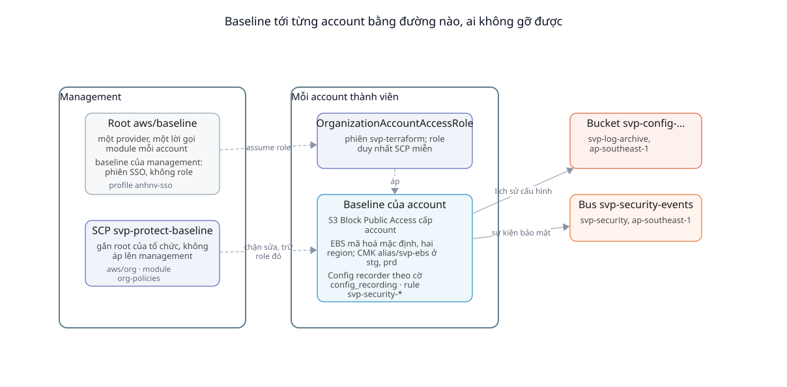

# 06. Baseline

← [05. Bảo mật](05-security.md) · [Mục lục](README.md) · [07. Backup](07-backup.md) →

## Tổng quan

Chương này đặt cùng một bộ cài đặt an toàn lên mọi account của tổ chức, kể cả management: chặn S3 public ở cấp account, mã hoá mọi volume
EBS mới, ghi lịch sử cấu hình bằng AWS Config, và chuyển sự kiện bảo mật của account về `svp-security`. Một root Terraform áp tất cả từ
management, mỗi account thành viên qua một role mà admin của account không đổi được những gì role đó đặt.

svp cần phần này vì SCP chỉ chặn hành động, không đặt giá trị mặc định: account vẫn có thể không mã hoá EBS hay không chặn public nếu
không ai bật. Baseline bật các mặc định đó một lần cho mọi account, còn SCP giữ cho chúng không bị tắt.

Phần này sống lâu, không gỡ cuối buổi. Gần như mọi thứ ở đây không tính phí; khoản tính theo lượng là recorder của Config, nên giữa các
buổi chỉ `svp-security` ghi, và account env bật lại trong buổi bằng cờ chi phí.

| Câu hỏi | Dịch vụ |
| --- | --- |
| Có ai lỡ tay cho một bucket trong account ra public không? | S3 Block Public Access cấp account |
| Volume EBS mới của node có được mã hoá không, bằng key nào? | Amazon EBS encryption by default, AWS KMS |
| Một tài nguyên đã đổi cấu hình thế nào theo thời gian? | AWS Config (recorder) |
| Sự kiện bảo mật của account này báo về đâu? | Amazon EventBridge (rule `svp-security-*`) |
| Admin của account có tắt được các cài đặt trên không? | SCP `svp-protect-baseline` (chương [03. Tổ chức](03-org.md)) |

| Account | Region | Vòng đời | Root Terraform |
| --- | --- | --- | --- |
| mọi account của `local.accounts` (`aws/baseline/main.tf`), kể cả management | `ap-southeast-1` (nhà), `us-east-1` | sống lâu | `aws/baseline` |
| mọi account, thêm | `us-east-2`, `us-west-2` (chỉ rule đăng nhập root) | sống lâu | `aws/baseline` |
| management, thêm | `sso_region` (rule Identity Center) | sống lâu | `aws/baseline` |
| `svp-stg`, `svp-prd` | `ap-southeast-1` (CMK EBS) | sống lâu | `aws/baseline` |

## Kiến trúc

<picture>
  <source media="(prefers-color-scheme: dark)" srcset="../diagrams/06-baseline-dark.svg">
  
</picture>

Root `aws/baseline` chạy bằng `anhnv-sso` ở management. Provider của management không assume role; provider của mỗi account thành viên
assume `OrganizationAccountAccessRole` của account đó. Mỗi account đúng một lời gọi module
[`security-baseline`](../../aws/modules/security-baseline/README.md); khác biệt giữa account là dữ liệu của `local.accounts` và cờ
`config_recording` của `aws/paid-features.json`.

| Thành phần | Ở đâu | Làm gì |
| --- | --- | --- |
| S3 Block Public Access cấp account | mọi account, toàn account | Bốn cờ `true`: chặn ACL và policy public ở mọi bucket |
| EBS mã hoá mặc định | mọi account, hai region | Volume mới luôn mã hoá; key mặc định `aws/ebs`, trừ stg, prd ở region nhà |
| CMK EBS `alias/svp-ebs` | `svp-stg`, `svp-prd`, `ap-southeast-1` | Key mặc định của EBS ở region nhà |
| Config recorder, delivery channel `default` | account có `config_recording` `always`, hai region | Ghi cấu hình liên tục, giao về bucket `svp-config-…` của Log Archive |
| Rule `svp-security-*`, role `svp-security-forwarder` | bus mặc định của mọi account | Chuyển sự kiện bảo mật sang bus `svp-security-events` |
| SCP `svp-protect-baseline` | gắn root của tổ chức (`aws/org`) | Chặn mọi principal của account thành viên đổi các thứ trên, trừ `OrganizationAccountAccessRole` |

## Kịch bản thực tế

**Câu hỏi của chương:** Admin của stg cho một bucket mới ra public thì chuyện gì xảy ra, ai biết?

Kịch bản giả định ở `svp-stg`, người làm đăng nhập bằng `SvpAdmin`. Cờ của file repo: `config_recording` và `security_hub` của stg là
`off`.

1. Admin tạo bucket mới: được, bucket mới của S3 mặc định đã chặn public ở cấp bucket.
2. Admin tắt Block Public Access của bucket đó rồi gắn bucket policy cho `Principal` `"*"` đọc object. Lệnh `PutBucketPolicy` bị từ chối
   `AccessDenied`: cờ `BlockPublicPolicy` cấp account chặn mọi policy public, bất kể cài đặt của bucket. ACL public bị bỏ qua tương tự
   (`IgnorePublicAcls`).
3. Admin thử gỡ chặn ở cấp account (`s3control put-public-access-block` với cờ `false`, sự kiện `PutAccountPublicAccessBlock`). SCP
   `svp-protect-baseline` từ chối bằng explicit deny: `SvpAdmin` không được miễn.
4. CloudTrail ghi lời gọi bị từ chối. Rule `svp-security-denied-storage` trên bus mặc định của stg khớp (`eventName`
   `PutAccountPublicAccessBlock`, `errorCode` bắt đầu bằng `AccessDenied`), chuyển sự kiện qua role `svp-security-forwarder` sang bus
   `svp-security-events`; rule `svp-security-notify` gửi topic, chủ hộp thư `security_alert_email` nhận thư
   ([đường cảnh báo](05-security.md#amazon-eventbridge)).
5. Bước 2 không tạo thư: lời gọi bị Block Public Access từ chối, không bị SCP, nên không khớp nhóm rule `denied-*`. Nó vẫn nằm trong log
   trail ở Log Archive ([04. Log Archive](04-log-archive.md#kịch-bản-thực-tế)).
6. Nếu cờ `config_recording` của stg là `always` (trong buổi): recorder ghi configuration item của bucket mới; với `security_hub` `always`,
   control `S3.1` của Security Hub kiểm Block Public Access cấp account và ra `PASSED`.

Block Public Access chỉ chặn quyền truy cập S3 coi là public. Policy cho một account cụ thể ngoài tổ chức không phải public: đường đó do
RCP `svp-data-perimeter` chặn ([03. Tổ chức](03-org.md#resource-control-policy-rcp)) và Access Analyzer báo
([05. Bảo mật](05-security.md#iam-access-analyzer)).

## Các dịch vụ và cách svp dùng

### S3 Block Public Access cấp account

- **Làm gì:** bốn cờ áp lên mọi bucket và access point của account, thắng cài đặt của từng bucket. Ví dụ đời thực:
  - `PutBucketPolicy` với `Principal` `"*"` bị từ chối (`BlockPublicPolicy`).
  - ACL `public-read` của object được ghi nhưng không có hiệu lực (`IgnorePublicAcls`).
  - Bucket đã có policy public trước khi bật: truy cập public bị chặn (`RestrictPublicBuckets`).
  - Control Security Hub `S3.1`: account chưa bật Block Public Access.
- **Ở svp:** `aws_s3_account_public_access_block.this` bốn cờ `true` ở mọi account; cài đặt của cả account, không theo region.
- **Phí theo:** không tính phí.

### Amazon EBS encryption by default

- **Làm gì:** mỗi region của account có cài đặt bắt mọi volume và snapshot copy mới mã hoá, kèm key mặc định. Ví dụ đời thực:
  - Node mới của node group stg nhận volume gốc mã hoá bằng `alias/svp-ebs` mà launch template không nêu key.
  - `ec2 disable-ebs-encryption-by-default` ở stg bị SCP từ chối (`UnauthorizedOperation`), khớp `svp-security-denied-storage`.
  - Control Security Hub `EC2.7`: EBS mã hoá mặc định chưa bật ở một region.
- **Ở svp:** bật ở region nhà và `us-east-1` mọi account. Key mặc định ở region nhà là CMK EBS ở stg, prd (`aws_ebs_default_kms_key`); mọi
  chỗ khác `aws/ebs`.
- **Phí theo:** không phí riêng; trả request KMS của key đã chọn.

### AWS KMS (CMK EBS)

- **Làm gì:** key do account quản, key policy và xoay khoá do svp đặt, khác key AWS managed `aws/ebs` có key policy cố định. Ví dụ đời
  thực:
  - Service-linked role AutoScaling của node group tạo grant trên key khi node khởi động, đi qua EC2 của region nhà.
  - `kms disable-key-rotation` trên key bị SCP từ chối, khớp `svp-security-denied-storage`.
  - Snapshot mã hoá bằng CMK chia sẻ được sang account khác khi key policy cho phép; snapshot mã hoá bằng `aws/ebs` thì không.
- **Ở svp:** `aws_kms_key.stg_ebs`, `aws_kms_key.prd_ebs` ở `ap-southeast-1`, alias `alias/svp-ebs`, xoay mỗi năm, chờ xoá 30 ngày. Key
  policy theo khuôn của `aws/ebs`: IAM của account quản key; mọi principal của account dùng key khi đi qua EC2 của region nhà
  (`kms:CallerAccount`, `kms:ViaService`), nên node group, Karpenter, bastion không cần thêm IAM. Tag `Stack=security-baseline` và alias
  là thứ SCP `svp-protect-baseline` dựa vào để chặn sửa key.
- **Phí theo:** key-tháng (tăng ở hai lần xoay đầu), số request.
- **Cố ý tắt:** CMK EBS ở account khác stg, prd và ở `us-east-1`: chỉ region nhà của hai env chạy EC2.

### AWS Config (recorder)

- **Làm gì:** recorder ghi cấu hình của mỗi tài nguyên và mỗi lần nó đổi (configuration item); delivery channel giao lịch sử và snapshot
  về S3. Ví dụ đời thực:
  - Dòng thời gian của một security group stg trong buổi: rule nào thêm lúc nào.
  - Snapshot cấu hình 24 giờ một lần trong bucket `svp-config-…` của Log Archive.
  - Rule Config do Security Hub tạo (tiền tố `securityhub-`) cần recorder đang ghi.
- **Ở svp:** recorder `default` ghi mọi loại tài nguyên, `CONTINUOUS`, loại toàn cục (IAM) chỉ ở region nhà; delivery channel `default`
  ở hai region về bucket `svp-config-<log>-ap-southeast-1`, key `alias/svp-log-archive` region nhà. Cờ `config_recording`: account `off`
  không có recorder, delivery channel, trạng thái recorder; service-linked role `AWSServiceRoleForConfig` và mọi rule giữ. Với file của
  repo, giữa các buổi chỉ `svp-security` ghi.
- **Phí theo:** configuration item ghi được (ghi liên tục rẻ hơn mỗi item so với ghi hằng ngày) và mỗi lần đánh giá rule.
- **Cố ý tắt:** ghi hằng ngày (daily recording): tài nguyên của buổi chỉ sống vài giờ, bản ghi hằng ngày bỏ sót chúng.

### Amazon EventBridge (rule chuyển sự kiện)

- **Làm gì:** rule trên bus mặc định của account khớp sự kiện CloudTrail bảo mật và gửi sang bus của account khác qua role. Ví dụ đời
  thực:
  - `PutAccountPublicAccessBlock` bị từ chối khớp `svp-security-denied-storage`.
  - `StopLogging` của trail khớp `svp-security-trail`.
  - Đăng nhập console bằng root khớp `svp-security-root-signin`.
- **Ở svp:** nhóm rule chung ở mọi account, nhóm `admin-*` theo `admin_events` (tắt ở stg, prd), rule phiên root, tổ chức và Identity
  Center chỉ ở management; đích là bus `svp-security-events`, role `svp-security-forwarder`. Bảng rule:
  [tra cứu đường cảnh báo](../reference/security-alerts.md#rule-chuyển-sự-kiện); vì sao ở chương [05. Bảo mật](05-security.md).
- **Phí theo:** sự kiện quản lý vào bus mặc định miễn phí; sự kiện gửi sang bus của account khác tính theo mỗi triệu.
- **Cố ý tắt:** rule `admin-*` ở stg, prd: mỗi buổi tạo và xoá hàng chục role, key, bucket.

## Chi phí

| Khoản | Đơn vị tính | Giữa các buổi | Trong buổi | Nguồn |
| --- | --- | --- | --- | --- |
| Hai CMK EBS | key-tháng, request | 1 USD mỗi key mỗi tháng | như giữa buổi | ADR-0078 phụ lục, dòng "Baseline account" |
| Config recorder (cùng khoản với bảng chương 05) | configuration item, đánh giá rule | ~0,3 USD mỗi tháng ở `svp-security` | 2–4,5 USD mỗi buổi một env bật `config_recording` | ADR-0078 phụ lục "Tháng không buổi"; ADR-0060 phụ lục §12 "Thêm mỗi buổi" |
| EventBridge chéo account | triệu sự kiện | không có số đo | không có số đo | ADR-0060 phụ lục §12 "Bảng giá" |
| S3 Block Public Access, EBS mã hoá mặc định | — | 0 | 0 | trang giá của dịch vụ |

Phần của `svp-backup`, một account không chạy workload, ước riêng ở
[ADR-0067 phụ lục](https://github.com/anhnvcoder/svp-backend/blob/main/docs/adr/appendix/0067-backup-dr.md#sống-giữa-buổi). Tổng phí
của cả lab ở chương [15. Chi phí](15-cost.md). Nguồn:
[ADR-0078 phụ lục](https://github.com/anhnvcoder/svp-backend/blob/main/docs/adr/appendix/0078-paid-features-lean-defaults.md#chi-phí),
[ADR-0060 phụ lục](https://github.com/anhnvcoder/svp-backend/blob/main/docs/adr/appendix/0060-org-detection-logging.md) §12.

## Kiểm tra và vận hành

Đăng nhập console của account cần xem qua access portal với `SvpReadOnly` (profile `anhnv-<env>-ro`, `anhnv-security-ro`).

| Muốn xem | Account | Region | Vào đâu | Trạng thái mong đợi |
| --- | --- | --- | --- | --- |
| Block Public Access | mọi account | toàn cục | S3 → Block Public Access settings for this account | Bốn mục On |
| EBS mã hoá mặc định | `svp-stg`, `svp-prd` | `ap-southeast-1` | EC2 → Account attributes → Data protection and security | Always encrypt new EBS volumes; key `alias/svp-ebs` |
| CMK EBS | `svp-stg`, `svp-prd` | `ap-southeast-1` | KMS → Customer managed keys → `alias/svp-ebs` | Enabled; xoay khoá tự động bật |
| Recorder | `svp-security` | mỗi region | Config → Settings | Recording on, Continuous; account `off`: không recorder |
| Rule chuyển sự kiện | mọi account | `ap-southeast-1`, `us-east-1` | EventBridge → Rules, bus `default` | Rule `svp-security-*` Enabled |

Ở account có cờ `config_recording` `off`, console Config hiện trang "Get started" hay "1-click setup": **không bấm**, nút đó tạo recorder
ngoài Terraform và tính tiền.

Bảng trên là trạng thái mà code khai báo. Runbook có bước kiểm cho nó:
[`org-security-setup.md`, bước (6)](../runbooks/org-security-setup.md#bước-6-awsbaseline) (kiểm cái đã có, plan, apply),
[7a](../runbooks/org-security-setup.md#7a-dịch-vụ-bật) (`verify.sh org`: recorder `CONTINUOUS` theo cờ, rule `svp-security-admin-sso` ở
đúng region), [7d](../runbooks/org-security-setup.md#7d-phép-thử-guardrail) (probe Block Public Access, EBS, CMK EBS, rule, mỗi probe
một thư) và [7e](../runbooks/org-security-setup.md#7e-cảnh-báo-thử) (thư tới hộp thư).

## Thiết kế và đánh đổi

### Áp từ management qua role

Đây là khuôn execution role của AWS Control Tower (`AWSControlTowerExecution`): baseline áp từ một chỗ, bằng một role mà chỉ management
assume được, và SCP `svp-protect-baseline` miễn đúng role đó. Account thành viên không có profile ghi hay bucket state riêng cho baseline.
Management không chịu SCP, nên baseline của management chỉ được giữ bằng quyền của Identity Center. Lý do:
[ADR-0059](https://github.com/anhnvcoder/svp-backend/blob/main/docs/adr/0059-org-structure-guardrails.md) §2, §9.

### Baseline đặt mặc định, SCP giữ mặc định

Baseline là lớp phòng ngừa: nó bật cài đặt an toàn. SCP là lớp quản trị: nó chặn tắt cài đặt đó. Một lớp không đủ: chỉ SCP thì account
mới vẫn chưa mã hoá EBS; chỉ baseline thì admin của account tắt được. Lệnh bị chặn còn thành sự kiện `denied-*` tới email, nên lần thử tắt
để lại dấu vết.

### Config theo cờ

Recorder tính theo configuration item, mà mỗi buổi tạo và xoá vài trăm tài nguyên; ghi liên tục ở mọi account làm phí giữ tăng mà ít
giá trị khi không buổi nào chạy. Cờ `config_recording` tắt recorder theo account, đổi lại mất lịch sử cấu hình của account đó và Security
Hub không chấm được control dựa trên rule Config. Cờ và cái giá:
[ADR-0071](https://github.com/anhnvcoder/svp-backend/blob/main/docs/adr/0071-paid-features.md) §6, §10.

| Lựa chọn của svp | Cái giá | Phương án khác | Khi nào chọn nó |
| --- | --- | --- | --- |
| Terraform, mỗi account một provider và một lời gọi module | Thêm account là thêm provider, lời gọi bằng tay | CloudFormation StackSets, AWS Control Tower và customization | Nhiều account, tự cấp account (Account Factory) |
| CMK EBS ở stg, prd | Phí key-tháng; GuardDuty Malware Protection for EC2 không quét được volume: grant cho account dịch vụ của GuardDuty (ngoài tổ chức) bị RCP `svp-data-perimeter` chặn (ADR-0059 §4); RCP không áp lên key AWS quản lý nên volume dùng `aws/ebs` quét được | `aws/ebs` | Không cần key policy riêng, không chia sẻ snapshot |
| Recorder `CONTINUOUS`, theo cờ | Account `off` không có lịch sử cấu hình | Ghi hằng ngày, hay `recordingModeOverrides` theo loại | Tài nguyên sống lâu, ít đổi |
| Phòng ngừa bằng baseline và SCP, không tự sửa | Cài đặt lệch ở management chỉ thấy qua Security Hub | Rule Config kèm remediation tự động (SSM Automation) | Nhiều account, cần tự sửa lệch |
| Rule `admin-*` tắt ở stg, prd | Đổi IAM, KMS, S3 ở env không có thư | Bật ở mọi account, lọc theo phiên | Env ít đổi, có người đọc thư |

## Liên hệ đề SAP

- "Skill 2.2.1: Implement encryption at rest by using customer managed keys and automatic key rotation (for example, by using AWS KMS)."
  CMK EBS `alias/svp-ebs` xoay mỗi năm, làm key mặc định của EBS.
- "Skill 2.3.4: Design policy enforcement by using SCPs and RCPs." SCP `svp-protect-baseline` giữ baseline, miễn đúng
  `OrganizationAccountAccessRole`.
- "Skill 2.3.2: Implement centralized logging and configuration management solutions, including solutions for AI model invocations and
  responses (for example, by using AWS CloudTrail organization trails, AWS Config aggregation, AWS GuardDuty, Amazon Security Lake, AWS
  Security Hub, Amazon CloudWatch Logs)." Recorder của mọi account giao về bucket Config của Log Archive, aggregator ở `svp-security`.
- "Skill 2.4.1: Design architectures to meet data protection requirements (for example, by implementing encryption, access controls, audit
  logging)." Block Public Access cấp account, EBS mã hoá mặc định.

| Tình huống trong đề | Chọn | Vì sao không chọn cái gần giống |
| --- | --- | --- |
| Không bucket nào của account được public, kể cả bucket tạo sau | S3 Block Public Access cấp account | Cài đặt của từng bucket: admin bucket tắt được; bucket policy phải viết cho từng bucket |
| Mọi volume EBS mới phải mã hoá, không sửa launch template | EBS encryption by default, mỗi region | SCP đòi `ec2:Encrypted` chỉ chặn lệnh, không mã hoá thay; cài đặt theo region, không toàn cục |
| Chia sẻ snapshot EBS mã hoá sang account khác | CMK với key policy cho account đích | Snapshot mã hoá bằng `aws/ebs` không chia sẻ được |
| Ngăn admin của account tắt mã hoá mặc định | SCP chặn `ec2:DisableEbsEncryptionByDefault` | Rule Config chỉ báo sau khi đã tắt; IAM policy do chính admin sửa |
| Biết cấu hình của tài nguyên tạo và xoá trong vài giờ | Config ghi liên tục | Ghi hằng ngày chỉ ghi trạng thái cuối mỗi 24 giờ, bỏ sót tài nguyên ngắn ngày |
| Áp cùng một baseline lên account mới tự động | Control Tower, StackSets với auto-deployment theo OU | Terraform mỗi account một provider phải sửa code khi thêm account |
| Tự sửa cài đặt lệch | Rule Config với remediation SSM Automation | SCP không sửa, chỉ chặn; EventBridge chỉ báo |

## Đọc sâu

- Module dùng một provider ở region nhà; tài nguyên `us-east-1` (và hai region thêm của management) đặt đối số `region`, vì Terraform không
  lặp được qua provider. `us-east-1` là region phụ cố định: IAM, Organizations ghi sự kiện CloudTrail ở đó.
- Key mặc định của EBS phải cùng region với cài đặt (precondition của module). Bỏ `ebs_kms_key_arn` thì Terraform xoá
  `aws_ebs_default_kms_key`, EC2 trở về `aws/ebs`. Đổi key mặc định không chạm volume đã có; stg, prd dựng mới mỗi buổi nên volume của buổi
  sau dùng CMK.
- Config: recorder chỉ chạy khi region đã có delivery channel (`depends_on`); Config giao object bằng principal `config.amazonaws.com`,
  bucket policy của Log Archive cho phép
  ([quyền bucket](https://docs.aws.amazon.com/config/latest/developerguide/s3-bucket-policy.html)). Loại toàn cục chỉ ghi ở region nhà
  ([điều kiện của Security Hub](https://docs.aws.amazon.com/securityhub/latest/userguide/securityhub-setup-prereqs.html)).
- Mỗi account mỗi region chỉ một recorder và một delivery channel; `PutConfigurationRecorder` với tên đã có thì cập nhật, không báo lỗi.
  Gọi module hai lần cho cùng account sẽ ghi đè lặng lẽ, nên root gọi đúng một lần mỗi account. Account đã có
  `AWSServiceRoleForConfig`, recorder hay delivery channel tạo tay thì nhập vào state bằng khối `import`
  ([bước 6b](../runbooks/org-security-setup.md#6b-kiểm-cái-đã-có)).
- Đổi cờ `config_recording` của account từ `always` sang `off` (module nhận `false`) xoá trạng thái recorder, delivery channel,
  recorder của hai region; lịch sử đã giao vào bucket còn. Lần apply đó `svp-security-detection` báo
  `StopConfigurationRecorder`, `DeleteDeliveryChannel`, `DeleteConfigurationRecorder`. Rule `svp-security-detection`,
  `svp-security-denied-detection` vẫn đúng khi không recorder: chúng khớp lời gọi API do CloudTrail ghi.
- Tài nguyên mang tag `Stack=security-baseline`; script quét sót của buổi bỏ qua stack này.

Làm và tra cứu:

- [`org-security-setup.md`, bước (6)](../runbooks/org-security-setup.md#bước-6-awsbaseline): áp root này lần đầu.
- [`aws/baseline`](../../aws/baseline/README.md): tài nguyên, giá trị ngoài repo, khi nào chạy.
- [Module `security-baseline`](../../aws/modules/security-baseline/README.md): lời gọi mẫu, biến.
- [`paid-features.md`](../runbooks/paid-features.md#awsbaseline): đổi cờ `config_recording` sau khi đã áp.
- [ADR-0059](https://github.com/anhnvcoder/svp-backend/blob/main/docs/adr/0059-org-structure-guardrails.md) §2, §9: root từ management,
  baseline, CMK EBS; key policy đủ ở phụ lục §9.
- [ADR-0060](https://github.com/anhnvcoder/svp-backend/blob/main/docs/adr/0060-org-detection-logging.md) §4, §10: Config, rule chuyển sự
  kiện.
