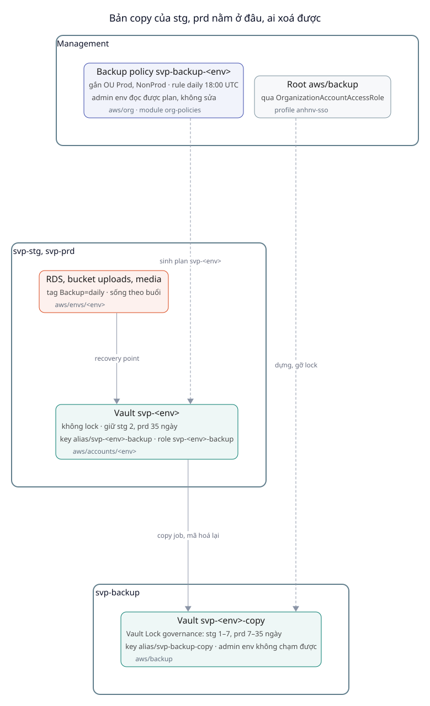

# 07. Backup

← [06. Baseline](06-baseline.md) · [Mục lục](README.md) · [08. Account env](08-accounts.md) →

## Tổng quan

Chương này giữ một bản sao dữ liệu của stg, prd (database RDS, bucket `uploads`, `media`) ở một account riêng tên `svp-backup`, nơi admin
của account env không xoá được. Lịch backup do tổ chức đặt vào account env, nên người trong account env đọc được lịch mà không sửa, không
xoá được. Bản sao nằm trong vault có khoá: trước hạn tối thiểu, lệnh xoá bản sao bị từ chối. Khoá ở chế độ gỡ được, để lab dọn được khi
kết thúc: người có quyền admin trong `svp-backup` (vào từ management) gỡ khoá rồi xoá được.

svp cần phần này vì backup tự động gốc của RDS nằm ngay trong account env: ai chiếm được `svp-prd` thì xoá được cả instance lẫn backup
của nó. Một bản ở account khác, mã hoá bằng key khác, là đường lui khi mất cả account env.

Nơi giữ bản sao sống suốt lab. Env chỉ sống trong buổi, nên lịch hằng đêm hiếm khi gặp tài nguyên nào; trong buổi, script diễn tập chạy
cùng đường bằng job theo yêu cầu, đo thời gian khôi phục, rồi dọn phần trong account env trước khi gỡ env.

| Câu hỏi | Dịch vụ |
| --- | --- |
| Ai đặt lịch backup của prd, và admin prd có tắt được không? | Backup policy của AWS Organizations (chương [03. Tổ chức](03-org.md#backup-policy)) |
| Bản chụp RDS, S3 của env nằm ở đâu, bao lâu? | AWS Backup (vault, job) |
| Kẻ chiếm account env có xoá được bản sao không? | AWS Backup, copy chéo account |
| Admin của `svp-backup` có xoá sớm bản sao được không? | AWS Backup Vault Lock |
| Mất key của database thì bản sao còn đọc được không? | AWS KMS (key của vault) |
| Job backup đêm qua có lỗi không? | Amazon CloudWatch (alarm trên metric `AWS/Backup`) |

| Account | Region | Vòng đời | Root Terraform |
| --- | --- | --- | --- |
| management (cross-account backup, opt-in, Backup policy) | `ap-southeast-1` | sống lâu | `aws/org` |
| `svp-backup` (vault copy, key) | `ap-southeast-1` | sống lâu | `aws/backup`, qua role từ management |
| `svp-stg`, `svp-prd` (vault env, key, role, opt-in) | `ap-southeast-1` | sống lâu | `aws/accounts/<env>` |
| `svp-stg`, `svp-prd` (tag `Backup`, alarm) | `ap-southeast-1` | theo buổi | `aws/envs/<env>` |

## Kiến trúc

<picture>
  <source media="(prefers-color-scheme: dark)" srcset="../diagrams/07-backup-dark.svg">
  
</picture>

Backup policy của tổ chức sinh plan trong account env; plan chụp tài nguyên có tag vào vault env, rồi copy sang vault khoá ở `svp-backup`.
Root `aws/backup` chạy bằng `anhnv-sso` ở management; provider duy nhất của nó assume `OrganizationAccountAccessRole` của `svp-backup`,
nên management vẫn là nơi duy nhất dựng, sửa và gỡ được vault copy. `svp-backup` không có profile ghi hay bucket state riêng.

| Thành phần | Ở đâu | Làm gì |
| --- | --- | --- |
| Backup policy `svp-backup-prd`, `svp-backup-stg` | management, gắn OU `Prod`, `NonProd` | Sinh plan `svp-<env>`: rule `daily`, selection `svp-<env>-tagged`, copy sang vault copy |
| Cross-account backup, opt-in loại tài nguyên | management (`aws/org/backup.tf`) | Cho account thành viên copy sang account khác; opt-in của management đè opt-in của account cho plan của policy, nhưng selection của svp ghi loại tài nguyên nên AWS bỏ qua opt-in (mục Đọc sâu) |
| Vault `svp-<env>`, key `alias/svp-<env>-backup` | account env (`aws/accounts/<env>`) | Nhận recovery point; không lock, dọn mỗi cuối buổi |
| Role `svp-<env>-backup` | account env | Role AWS Backup assume cho job backup, copy, restore của account |
| Vault `svp-stg-copy`, `svp-prd-copy` | `svp-backup` (`aws/backup`) | Giữ bản copy, Vault Lock governance, chỉ nhận copy từ đúng account env |
| Key `alias/svp-backup-copy` | `svp-backup` | Mã hoá lại mọi bản copy; `prevent_destroy` |
| Tag `Backup = "daily"` | RDS, bucket `uploads`, `media` (module `rds`, `media`) | Điều kiện của selection |
| Alarm `svp-<env>-backup-job-failed`, `-backup-copy-failed` | account env (`aws/envs/<env>`) | Báo job, copy job lỗi tới topic `svp-<env>-alarms` |

## Kịch bản thực tế

**Câu hỏi của chương:** Kẻ chiếm `svp-stg` xoá instance RDS và mọi backup trong account; dữ liệu còn ở đâu, khôi phục bằng gì?

Kịch bản đi theo buổi stg: bước diễn tập của buổi chạy cùng đường mà lịch hằng đêm dùng. Plan, vault, rule là tên trong code; lệnh là
`aws/scripts/restore-drill.sh`.

1. `restore-drill.sh stg backup` đọc plan `svp-stg` mà Backup policy `svp-backup-stg` sinh trong account stg: đúng một rule `daily`, lịch
   `cron(0 18 * * ? *)` UTC, start window 60 phút, completion window 180 phút, đích vault `svp-stg`, copy sang `svp-stg-copy` của
   `svp-backup`. Nó kiểm selection `svp-stg-tagged` (role `svp-stg-backup`, mọi DB instance và bucket có tag `Backup=daily`) và opt-in
   `RDS`, `S3` của account. Lệch là dừng, không chạy job.
2. Script chạy ba job theo yêu cầu (`StartBackupJob`) cho instance `svp-stg`, bucket `uploads` và `media` vào vault `svp-stg`, bằng role
   `svp-stg-backup`, retention bằng rule (`DeleteAfterDays` 2 ở stg). Recovery point S3 mã hoá bằng key của vault
   (`alias/svp-stg-backup`); snapshot RDS giữ key của instance, vì RDS không thuộc nhóm tài nguyên AWS Backup quản đầy đủ.
3. Mỗi recovery point xong, script chạy copy job (`StartCopyJob`) sang `svp-stg-copy`, retention bằng `copy_actions` của rule (2 ngày).
   Vault access policy của `svp-stg-copy` chỉ cho account stg `backup:CopyIntoBackupVault`; AWS Backup mã hoá lại bản copy bằng
   `alias/svp-backup-copy`. Lock của vault (min 1, max 7 ngày) chứa retention 2 ngày, nên copy job nhận; ngoài khoảng đó copy job lỗi.
4. Diễn tập khôi phục: `restore-drill.sh stg rds` khôi phục point-in-time từ backup tự động gốc của RDS ra `svp-stg-pitr` rồi so dữ liệu;
   `restore-drill.sh stg s3` xoá một object `.m3u8` của bucket `media` và restore đúng key đó từ recovery point của buổi
   (`StartRestoreJob`).
   Cả hai ghi RTO, RPO so với mục tiêu ở `restore-drill.tsv`.
5. Trước destroy env, `restore-drill.sh stg cleanup` xoá `svp-stg-pitr`, gỡ tag `Backup`, chờ mọi job của account kết thúc, xoá recovery
   point của `svp-stg` đã có copy `COMPLETED`, rồi ghi `backup-drained`; `tf.sh` từ chối destroy root env khi chưa có mốc đó. Destroy xoá
   instance, đưa key RDS và key `uploads` vào chờ xoá.
6. Giữa hai buổi chỉ còn bản copy ở `svp-stg-copy`. Kẻ chiếm `svp-stg` không với tới: vault ở account khác, mọi action chéo account ngoài
   `CopyIntoBackupVault` bị AWS Backup từ chối bất kể policy. Admin của `svp-backup` gọi `DeleteRecoveryPoint` trước hạn tối thiểu cũng bị
   lock từ chối; muốn xoá thì phải gỡ lock trước (`DeleteBackupVaultLockConfiguration`, chế độ governance cho phép). Bản copy hết hạn sau
   2 ngày ở stg (prd: 35 ngày).
7. Khôi phục khi mất account stg: AWS Backup không restore chéo account. Đường lui là copy ngược từ `svp-stg-copy` về một account đích rồi
   restore ở đó. Quyền cho việc này (statement trên key `alias/svp-backup-copy`, vault access policy của vault đích, role copy) không có
   sẵn, thêm lúc sự cố để account env không chạm được bản copy; đường này chưa diễn tập.

Lịch `daily` chỉ chụp được tài nguyên còn sống lúc 18:00 UTC; env gỡ trong buổi thì đêm đó plan không tạo job nào. Ở prd đường giống
hệt, khác retention (35 ngày ở cả hai vault), lock (min 7, max 35) và OU gắn policy.

## Các dịch vụ và cách svp dùng

### AWS Backup (vault, job, copy chéo account)

- **Làm gì:** dịch vụ chụp, giữ và khôi phục dữ liệu của nhiều dịch vụ AWS theo plan, giữ recovery point trong vault và copy chúng sang
  account hay region khác. Ví dụ đời thực:
  - Backup job trạng thái `FAILED` khi job RDS rơi vào giờ trước hay trong maintenance window của instance.
  - Copy job sang vault của account khác bị từ chối khi vault đích thiếu vault access policy cho `backup:CopyIntoBackupVault`.
  - Restore item-level một object S3 bằng `StartRestoreJob` với metadata `ItemsToRestore`.
  - `DeleteBackupVault` lỗi khi vault còn recovery point.
- **Ở svp:** vault `svp-<env>` ở account env, `svp-stg-copy`, `svp-prd-copy` ở `svp-backup` (module
  [`backup-vault`](../../aws/modules/backup-vault/README.md)); role `svp-<env>-backup` (trust `backup.amazonaws.com` với
  `aws:SourceAccount` là account env, bốn managed policy của AWS Backup); cross-account backup bật ở management; opt-in loại tài nguyên
  ở management và account env ghi cả map, mọi loại `true`.
- **Phí theo:** GB-tháng lưu trữ ở vault (snapshot RDS theo giá snapshot RDS; S3 theo giá warm storage của AWS Backup), GB restore, request
  GET, LIST khi backup S3; copy chéo account cùng region tính lưu trữ ở account đích.
- **Cố ý tắt:** continuous backup (PITR của AWS Backup): RDS đã có PITR gốc; copy sang region thứ hai: mất region nằm ngoài phạm vi;
  delegated administrator cho AWS Backup: management giữ Backup policy như SCP, RCP.

### AWS Backup Vault Lock

- **Làm gì:** khoá vault theo khoảng retention [min, max]: recovery point trong vault không xoá được trước min, retention mới phải nằm
  trong khoảng. Chế độ governance gỡ được bằng quyền IAM; chế độ compliance không gỡ được sau grace time khi vault còn recovery point. Ví
  dụ đời thực:
  - `DeleteRecoveryPoint` trên bản copy còn trong hạn min bị từ chối.
  - Copy job với `DeleteAfterDays` ngoài [min, max] của vault đích lỗi.
  - `DeleteBackupVaultLockConfiguration` gỡ lock governance khi người gọi có quyền IAM đó.
- **Ở svp:** chỉ hai vault copy: `svp-stg-copy` min 1, max 7 ngày; `svp-prd-copy` min 7, max 35 ngày (`local.copy_vaults` của
  `aws/backup/main.tf`). Không `changeable_for_days`, nên lock không bao giờ chuyển sang compliance.
- **Phí theo:** không phí riêng.
- **Cố ý tắt:** lock ở vault env (vault dọn mỗi cuối buổi); chế độ compliance (lab phải gỡ được khi kết thúc).

### AWS KMS (key của vault)

- **Làm gì:** CMK mã hoá recovery point lưu hay copy vào vault; key policy quyết định account nào giải mã được khi copy. Ví dụ đời thực:
  - Account `svp-backup` gọi `kms:Decrypt` trên key nguồn của account env để copy recovery point.
  - `kms:CreateGrant` của AWS Backup trên key vault env, chỉ khi `kms:GrantIsForAWSResource` là `true` và encryption context có
    `aws:backup:backup-vault`.
  - Bản copy vẫn đọc được khi key RDS của buổi đã vào chờ xoá, vì vault đích mã hoá lại bằng key của nó.
- **Ở svp:** `alias/svp-backup-copy` ở `svp-backup`, chỉ statement quản trị mặc định; `alias/svp-<env>-backup` ở account env, thêm hai
  statement cho `svp-backup` (giải mã để copy, `CreateGrant` cho vault); key RDS của root env cũng chia sẻ cho `svp-backup`
  ([11. Dữ liệu](11-data.md)). Ba key vault xoay hằng năm, chờ xoá 30 ngày; chỉ key copy có `prevent_destroy`.
- **Phí theo:** key-tháng (key chờ xoá không tính), số request.

### Amazon CloudWatch (alarm job lỗi)

- **Làm gì:** alarm trên query Metrics Insights của namespace `AWS/Backup`, AWS Backup đẩy metric mỗi 5 phút. Ví dụ đời thực:
  - `NumberOfBackupJobsFailed` > 0: một backup job của account `FAILED`.
  - `NumberOfCopyJobsFailed` > 0: một copy job chéo account hay chéo region không hoàn tất.
- **Ở svp:** `svp-<env>-backup-job-failed`, `svp-<env>-backup-copy-failed` (module
  [`backup-alarms`](../../aws/modules/backup-alarms/README.md), gọi ở `aws/envs/<env>/backup.tf`), chu kỳ 300 giây, ngưỡng `> 0`, không
  dữ liệu tính là không lỗi; tag `Severity=ticket`, gửi topic `svp-<env>-alarms` khi báo và khi hết.
- **Phí theo:** alarm-tháng (theo giờ khi env sống), số metric mà query đọc.
- **Cố ý tắt:** lọc theo dimension: tài liệu AWS Backup chỉ nêu dimension làm ví dụ, nên query cộng mọi tập dimension của namespace.

## Chi phí

| Khoản | Đơn vị tính | Giữa các buổi | Trong buổi | Nguồn |
| --- | --- | --- | --- | --- |
| Ba CMK (`svp-backup-copy`, `svp-stg-backup`, `svp-prd-backup`) | key-tháng | 3 USD mỗi tháng | như giữa buổi | ADR-0067 §13, phụ lục "Sống giữa buổi" |
| Bản copy prd (35 ngày), stg (2 ngày) | GB-tháng | prd ~1,25 USD, stg ~0,07 USD mỗi tháng | như giữa buổi | ADR-0067 phụ lục "Sống giữa buổi" |
| Item Config của recovery point, job | configuration item | 0 với cờ `config_recording` `off`; ~0,09 USD mỗi tháng khi `always` | gồm trong dòng "Một buổi" | ADR-0067 phụ lục "Sống giữa buổi", ADR-0078 phụ lục |
| Một buổi (instance PITR ~1 giờ, restore, request S3, key `uploads`, alarm, item Config, check Security Hub) | giờ instance, GB, request, item, check | 0 | ~0,15 USD mỗi buổi stg, ~0,34 USD prd | ADR-0067 §13, phụ lục "Mỗi buổi" (dòng Cộng) |
| Baseline của `svp-backup` | như chương 05, 06 | GuardDuty ~0,05 USD mỗi tháng; thêm ~2,1 khi cờ `security_hub`, `config_recording` của `backup` là `always` | như giữa buổi | ADR-0078 phụ lục (dòng Security Hub, Config của `svp-backup`) |

Khoản lớn nhất giữa các buổi là ba CMK; trong buổi là giờ instance PITR. Tổng phí của cả lab ở chương
[15. Chi phí](15-cost.md). Nguồn:
[ADR-0067 §13](https://github.com/anhnvcoder/svp-backend/blob/main/docs/adr/0067-backup-dr.md#13-chi-phí),
[phụ lục ADR-0067](https://github.com/anhnvcoder/svp-backend/blob/main/docs/adr/appendix/0067-backup-dr.md#chi-phí),
[phụ lục ADR-0078](https://github.com/anhnvcoder/svp-backend/blob/main/docs/adr/appendix/0078-paid-features-lean-defaults.md).

## Kiểm tra và vận hành

Đăng nhập console qua access portal với `SvpReadOnly` (`anhnv-backup-ro`, `anhnv-<env>-ro`); management bằng `anhnv-sso`.

| Muốn xem | Account | Region | Vào đâu | Trạng thái mong đợi |
| --- | --- | --- | --- | --- |
| Cross-account backup | management | `ap-southeast-1` | AWS Backup → Settings → Cross-account management | Cross-account backup bật; delegated administrator tắt |
| Backup policy | management | toàn cục | Organizations → Policies → Backup policies | `svp-backup-prd` gắn OU `Prod`, `svp-backup-stg` gắn OU `NonProd` |
| Plan của tổ chức | `svp-stg`, `svp-prd` | `ap-southeast-1` | AWS Backup → Backup plans → `svp-<env>` | Rule `daily`, copy sang `svp-<env>-copy`; không sửa được |
| Vault env | `svp-stg`, `svp-prd` | `ap-southeast-1` | AWS Backup → Backup vaults → `svp-<env>` | Không lock; giữa các buổi không recovery point |
| Vault copy | `svp-backup` | `ap-southeast-1` | AWS Backup → Backup vaults → `svp-<env>-copy` | Vault lock governance, min, max như mục Vault Lock; access policy một account |
| Job của buổi | `svp-stg`, `svp-prd` | `ap-southeast-1` | AWS Backup → Jobs (Backup, Copy, Restore) | `Completed`; job lỗi có lý do ở chi tiết job |
| Alarm | `svp-stg`, `svp-prd` | `ap-southeast-1` | CloudWatch → Alarms → `svp-<env>-backup-*` | `OK` hay `Insufficient data` (chỉ khi env sống) |

Bảng trên là trạng thái mà code khai báo. Runbook có bước kiểm cho nó: [`backup-setup.md`](../runbooks/backup-setup.md) bước (5) (vault copy
và lock, dòng `7d` của `verify.sh backup`) và [7a–7d](../runbooks/backup-setup.md#7a7d-kiểm-bằng-script) (account, opt-in, Backup policy,
plan, vault env, vault copy). Copy chéo account và khôi phục chỉ kiểm thật trong buổi: bước diễn tập khôi phục của buổi stg
([`session-stg-drills.md`](../runbooks/session-stg-drills.md#1719-diễn-tập-khôi-phục)).

## Thiết kế và đánh đổi

### Account backup riêng

Đây là Central Backup account của AWS Security Reference Architecture: bản copy ra khỏi account mà người vận hành workload có quyền admin.
`svp-backup` không gộp vào `svp-log-archive` hay `svp-security`: người đọc log hay người điều tra không cần chạm bản copy. Control Tower
tách thêm account quản Backup policy khỏi account đích; ở svp management giữ policy như SCP, RCP. Management vẫn gỡ được lock qua
`OrganizationAccountAccessRole`, nên bảo vệ dừng ở ranh giới management. Lý do:
[ADR-0067](https://github.com/anhnvcoder/svp-backend/blob/main/docs/adr/0067-backup-dr.md) §3, §5.

### Plan từ Backup policy, không từ account env

Plan sinh từ Backup policy là bất biến trong account thành viên, nên admin env không tắt được lịch hay đổi đích copy. Đổi lại, plan dùng
opt-in của management và tên vault, role cố định trong account env: thiếu vault `svp-<env>` hay role `svp-<env>-backup` thì job `FAILED`,
nên thứ tự áp có ý nghĩa ([`backup-setup.md`](../runbooks/backup-setup.md#thứ-tự-áp-lần-đầu)).

### Lịch hằng đêm, diễn tập theo yêu cầu

Env sống vài giờ mỗi buổi, nên lịch `daily` gần như không gặp tài nguyên nào; buổi kiểm cấu hình mà lịch dựa vào và chạy job theo yêu cầu
cùng vault, role, retention. RPO 28 giờ của lịch (chu kỳ 24 giờ cộng hai cửa sổ) tính từ cấu hình, chưa đo được. Mục tiêu RTO, RPO:
[ADR-0067 §2](https://github.com/anhnvcoder/svp-backend/blob/main/docs/adr/0067-backup-dr.md#2-mục-tiêu-rtorpo).

| Lựa chọn của svp | Cái giá | Phương án khác | Khi nào chọn nó |
| --- | --- | --- | --- |
| Copy sang account `svp-backup` cùng region | Mất region là mất dữ liệu từ lần backup cuối | Copy sang region thứ hai, hay S3 CRR cùng RDS cross-Region automated backups | Cần sống sót mất region |
| Vault Lock governance | Management (hay ai có quyền IAM gỡ lock) xoá được bản copy | Compliance mode | Quy định bắt bản copy bất biến, kể cả với admin |
| Backup policy của tổ chức | Thêm account, policy type, cross-account backup ở management | Plan Terraform trong từng account env | Một account, không cần chặn admin env |
| Management giữ policy, không delegated admin | Management làm thêm việc vận hành backup | Delegated administrator cho AWS Backup | Nhiều account, đội backup riêng |
| Lịch hằng ngày, PITR gốc của RDS | RPO S3 tới 28 giờ | Lịch hằng giờ, continuous backup của AWS Backup | Dữ liệu thật cần RPO S3 dưới một ngày |
| Quyền restore chéo account thêm lúc sự cố | Mất account env cần sửa Terraform lúc sự cố | Cấp sẵn key, vault, role ở account khôi phục | RTO khi mất account phải ngắn |

## Liên hệ đề SAP

- "Skill 4.3.1: Configure centralized backup governance and cross-account backup policies (for example, by using AWS Backup)." Backup
  policy của management sinh plan ở account env, copy sang `svp-backup`.
- "Skill 4.3.4: Protect data against ransomware and accidental deletion (for example, by using Amazon S3 Object Lock, Amazon EBS snapshot
  lock, AWS Backup Vault Lock)." Vault Lock governance ở hai vault copy, account đích khác account env.
- "Skill 4.3.2: Design failover tests and measure recovery times (for example, by using AWS Fault Injection Service, Amazon Route 53 health
  checks)." Diễn tập `rds`, `s3` của buổi đo RTO, RPO so với mục tiêu.
- "Skill 3.4.4: Implement backup and disaster recovery mechanisms that use cost-optimized retention policies (for example, by using AWS
  Backup, Amazon Data Lifecycle Manager)." Retention 2 ngày ở stg, 35 ngày ở prd; vault env dọn mỗi buổi.
- "Skill 2.2.1: Implement encryption at rest by using customer managed keys and automatic key rotation (for example, by using AWS KMS)."
  Ba CMK của vault xoay hằng năm; bản copy mã hoá lại bằng key của account đích.

| Tình huống trong đề | Chọn | Vì sao không chọn cái gần giống |
| --- | --- | --- |
| Admin account workload không được xoá hay đổi lịch backup | Backup policy của Organizations | Backup plan trong account: admin account xoá được |
| Bản backup phải còn khi account nguồn bị chiếm | Copy chéo account sang account backup riêng | Copy chéo region cùng account: kẻ chiếm account xoá được cả hai |
| Không ai, kể cả root, xoá backup trước hạn | Vault Lock compliance mode | Governance gỡ được bằng quyền IAM |
| Chặn xoá nhầm nhưng vẫn gỡ được khi dự án kết thúc | Vault Lock governance mode | Compliance không gỡ được sau grace time khi vault còn recovery point |
| Khôi phục RDS về một thời điểm trong vài phút gần nhất | PITR từ backup tự động của RDS | Snapshot hằng ngày của AWS Backup chỉ có điểm theo lịch |
| Khôi phục backup của account A vào account B | Copy recovery point sang vault của B rồi restore ở B | AWS Backup không restore chéo account trực tiếp |
| Bản copy phải đọc được khi key nguồn bị xoá | Vault đích với CMK của account đích | Chia sẻ key nguồn: xoá key nguồn là mất bản copy |
| Giảm phí lưu backup lâu dài | Lifecycle sang cold storage, retention theo env | Giữ mọi recovery point ở warm storage |

## Đọc sâu

- Module `backup-vault` nhận ARN key qua `kms_key_arn`, không tạo key: Terraform không cho root đặt `lifecycle` lên resource nằm trong
  module, nên root `aws/backup` giữ key copy bằng `prevent_destroy`, root env thì không. Key policy cũng do root viết.
- AWS Backup chỉ xoá vault rỗng. Vault env được rút hết recovery point ở cuối buổi trước destroy; vault copy sống giữa các buổi, giữ bản
  copy theo retention. Gỡ vault copy có chủ đích cần `force_destroy` sửa local:
  [`lab-teardown.md`, `aws/backup`](../runbooks/lab-teardown.md#awsbackup).
- Lock retention của API là 1 tới 36 500 ngày; khoảng [min, max] của mỗi vault copy phải chứa retention copy mà Backup policy đặt
  (`local.backup_retention_days` của module `org-policies`). Đổi một bên mà không đổi bên kia thì copy job lỗi.
- Vault đích của copy không được là vault mặc định; RDS không thuộc nhóm quản đầy đủ nên vault đích phải dùng CMK.
- Copy chéo account cần `backup:CopyIntoBackupVault` ở cả hai phía: vault access policy của vault đích (`copy_from_account_ids` của module
  `backup-vault`) và identity policy của role nguồn. Role `svp-<env>-backup` có sẵn action đó qua managed policy
  `AWSBackupServiceRolePolicyForBackup`, nên không cần inline policy.
- Selection của policy ghi mẫu ARN DB instance và bucket kèm điều kiện tag: snapshot thừa hưởng tag `Backup` nhưng không khớp mẫu. Copy
  action ghi id thật của `svp-backup`: biến `$account` của policy chỉ thay cho chính account chạy plan.
- Opt-in loại tài nguyên có hai tầng: plan của Backup policy theo opt-in của management (đè opt-in của account, chỉ cho plan đó), plan cục
  bộ của account theo opt-in của chính account. Selection `svp-<env>-tagged` ghi cả loại tài nguyên lẫn tag, và khi đó AWS bỏ qua opt-in:
  plan của svp chọn RDS, bucket dù opt-in nói gì. Hai map vẫn bật mọi loại, đúng giá trị AWS đặt cho account bắt đầu dùng AWS Backup, và
  `restore-drill.sh` kiểm opt-in `RDS`, `S3` của account env trước khi chạy job theo yêu cầu.
- AWS Backup bỏ object đã sang Glacier Flexible Retrieval, Deep Archive: bản gốc `uploads` cũ hơn 30 ngày không có trong backup.
- AWS Backup chỉ backup bucket có versioning, nên stg bật versioning cả hai bucket như prd (`media_versioning_enabled` của `stg.tfvars`).
  `media_force_destroy = true` của stg vẫn xoá mọi version và delete marker trước khi xoá bucket, nên stg không cần `teardown.tfvars`.
- Role `svp-<env>-backup` không mang tiền tố `svp-security-`: statement `ProtectBaselineRoles` của SCP `svp-protect-baseline` khoá các
  role đó. Role chỉ gắn managed policy, không inline: AWS sửa chúng theo dịch vụ; cái giá là role dùng được mọi key của account qua các
  dịch vụ đó, và chỉ AWS Backup của đúng account assume được.
- Mọi tài nguyên của `aws/backup` mang tag `Stack=backup`; script quét sót của buổi bỏ qua stack này.

Làm và tra cứu:

- [`backup-setup.md`](../runbooks/backup-setup.md): áp phần backup lần đầu và kiểm sau áp.
- [`aws/backup`](../../aws/backup/README.md): tài nguyên, giá trị ngoài repo, khi nào chạy.
- Module [`backup-vault`](../../aws/modules/backup-vault/README.md), [`backup-alarms`](../../aws/modules/backup-alarms/README.md): lời gọi
  mẫu, biến.
- [ADR-0067](https://github.com/anhnvcoder/svp-backend/blob/main/docs/adr/0067-backup-dr.md): phạm vi, RTO, RPO, lịch, lock, key, role;
  JSON policy và nguồn ở [phụ lục](https://github.com/anhnvcoder/svp-backend/blob/main/docs/adr/appendix/0067-backup-dr.md).
- [Backup và DR trên AWS](https://github.com/anhnvcoder/svp-backend/blob/main/docs/explanation/backup-dr.md): diễn tập PITR, object S3,
  xoá cuối buổi.
