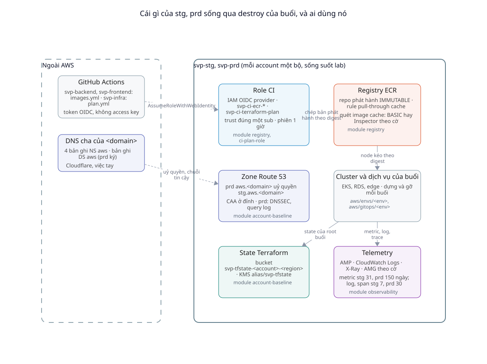
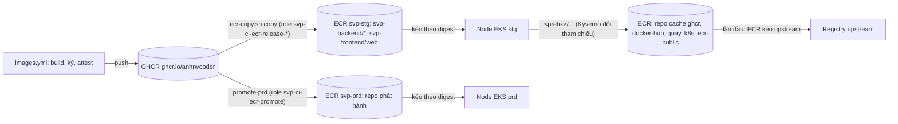
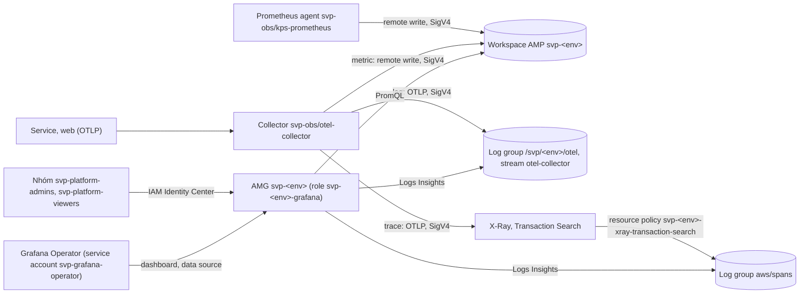

# 08. Account env

← [07. Backup](07-backup.md) · [Mục lục](README.md) · [09. Env và mạng](09-envs-network.md) →

## Tổng quan

Chương này là phần sống giữa các buổi của hai account workload `svp-stg`, `svp-prd`. Mỗi buổi dựng cluster, database, edge rồi gỡ
sạch; nhưng vài thứ không được mất theo: state Terraform của mọi root trong account, tên miền của env, image đã phát hành, metric và
log của các buổi trước, role mà CI dùng để đẩy image. Chúng nằm ở root `aws/accounts/<env>`, dựng một lần mỗi account, không bao giờ
gỡ theo buổi.

svp cần tách như vậy vì root của buổi (`aws/envs/<env>`) bị `destroy` cuối mỗi buổi. Nếu registry hay workspace metric nằm ở đó, mỗi
buổi mất bản phát hành và lịch sử đo; nếu zone DNS nằm ở đó, tên miền đổi name server mỗi lần dựng và DNS cha phải sửa tay mỗi buổi.
Root của buổi tìm các phần sống lâu bằng data source theo tên và alias, nên hai bên không phải chép id cho nhau.

Giữa các buổi, phần này chỉ tốn phí giữ nhỏ (key KMS, zone, lưu trữ). Phần tốn tiền theo mức dùng (user hoạt động của workspace Amazon
Managed Grafana, image Inspector quét) đi theo cờ của `aws/paid-features.json`: với file của repo, cả stg lẫn prd đều tắt.

| Câu hỏi | Dịch vụ |
| --- | --- |
| State Terraform của account stg nằm đâu, ai đọc được? | Amazon S3 và AWS KMS (state) |
| Ai trả lời DNS cho `stg.aws.<domain>`, ai uỷ quyền cho nó? | Amazon Route 53 (hosted zone) |
| Resolver có phát hiện câu trả lời DNS bị giả cho `aws.<domain>` không? | Route 53 DNSSEC |
| CA nào được cấp cert cho tên trong zone? | Bản ghi `CAA` của Route 53 |
| Image node kéo có đúng bản CI đã build, ký và quét không? | Amazon ECR |
| Image bên thứ ba lấy từ đâu khi upstream giới hạn lượt kéo? | ECR pull-through cache |
| Workflow GitHub đẩy image vào ECR bằng credential nào? | IAM OIDC provider và role CI |
| Metric của buổi tuần trước còn xem được không? | Amazon Managed Service for Prometheus |
| Log, trace của buổi đã gỡ còn đọc được không? | Amazon CloudWatch Logs và AWS X-Ray |
| Ai xem dashboard, với vai trò gì? | Amazon Managed Grafana |
| Karpenter có tạo được node Spot ở stg không? | IAM service-linked role của EC2 Spot |

| Account | Region | Vòng đời | Root Terraform |
| --- | --- | --- | --- |
| `svp-stg`, `svp-prd` (state, zone, registry, role CI, AMP, log group, X-Ray, budget) | `ap-southeast-1`; zone và IAM toàn cục | sống lâu | `aws/accounts/<env>` |
| `svp-prd` (key KMS DNSSEC, alarm DNSSEC, query log, topic `svp-prd-dns-alarms`) | `us-east-1` | sống lâu | `aws/accounts/prd` |
| `svp-stg`, `svp-prd` (workspace AMG, tham số SSM của nó) | `ap-southeast-1` | theo cờ `managed_grafana` | `aws/accounts/<env>` |
| `svp-stg`, `svp-prd` (vault backup, key, role) | `ap-southeast-1` | sống lâu | `aws/accounts/<env>`, chương [07. Backup](07-backup.md) |

## Kiến trúc

<picture>
  <source media="(prefers-color-scheme: dark)" srcset="../diagrams/08-accounts-dark.svg">
  
</picture>

Mỗi account env có đúng một bộ các khối trên. CI ở GitHub vào account bằng token OIDC, không access key. DNS cha (Cloudflare) uỷ quyền
zone prd; zone prd uỷ quyền zone stg. Cluster của buổi kéo image từ registry, gửi telemetry vào AMP, CloudWatch Logs, X-Ray, và state
của root buổi nằm trong bucket state của chính account.

| Thành phần | Ở đâu | Làm gì |
| --- | --- | --- |
| Bucket `svp-tfstate-<account>-<region>`, key `alias/svp-tfstate` | account env, `ap-southeast-1` | Giữ state của `aws/accounts/<env>`, `aws/envs/<env>`, `aws/gitops/<env>` |
| Hosted zone `aws.<domain>` (prd), `stg.aws.<domain>` (stg) | account env, toàn cục | Bản ghi của env; `CAA` ở đỉnh; prd giữ bản ghi uỷ quyền stg |
| DNSSEC, query log, alarm DNSSEC | `svp-prd`, `us-east-1` | Ký zone prd, ghi truy vấn DNS, báo khi KSK hỏng |
| Registry ECR: repo phát hành, rule cache, mã hoá AES256 | account env, `ap-southeast-1` | Bản phát hành theo digest, image bên thứ ba qua cache |
| IAM OIDC provider, role `svp-ci-ecr-*`, `svp-ci-terraform-plan` | account env, IAM | Cho workflow đúng repo, đúng nhánh hay environment vào account |
| Workspace AMP `svp-<env>`, log group `/svp/<env>/otel`, X-Ray | account env, `ap-southeast-1` | Giữ metric, log, span qua các buổi |
| Workspace AMG `svp-<env>` | account env, `ap-southeast-1` | Dashboard, đăng nhập bằng IAM Identity Center; chỉ khi cờ cho phép |
| Budget `svp-<env>-monthly` | account env | Email ở 50, 80, 100 % thực tế và 100 % dự báo ([01. Bootstrap](01-bootstrap.md#aws-budgets)) |
| Role `AWSServiceRoleForEC2Spot` | `svp-stg`, IAM | Cho Karpenter tạo node Spot bằng `CreateFleet` |

## Kịch bản thực tế

**Câu hỏi của chương:** Một bản phát hành mới của `video-service` đi từ CI tới node của stg thế nào, qua role nào, được quét ở đâu?

1. Workflow `images.yml` của `svp-backend` build image một lần, ký, gắn attestation (SBOM, `vuln`, provenance) và đẩy lên GHCR
   `ghcr.io/anhnvcoder/svp-backend/video-service`.
2. Job `ecr-copy` chạy trên nhánh `main` xin token OIDC của GitHub. STS nhận `AssumeRoleWithWebIdentity` cho role
   `svp-ci-ecr-release-backend` của account stg chỉ khi `aud` là `sts.amazonaws.com` và `sub` khớp đúng chuỗi
   `repo:anhnvcoder@<owner-id>/svp-backend@<repo-id>:ref:refs/heads/main` (`ci_roles` của `aws/accounts/stg/main.tf`). Phiên tối đa 1 giờ.
3. `ecr-copy.sh` chép đúng digest cùng mọi referrer (chữ ký, SBOM, `vuln`, provenance) vào repo `svp-backend/video-service` của ECR stg:
   tag `IMMUTABLE`, mã hoá `AES256` (SSE-S3 của ECR, không CMK). Policy `ecr-push` của role chỉ cho đẩy vào `svp-backend/*`;
   role của frontend không chạm được repo này.
4. Repo phát hành không nằm trong filter quét của registry: CI đã quét bằng trivy, grype trước khi đẩy, và job `rescan` (environment
   `ecr-rescan`, role `svp-ci-ecr-rescan-backend`) quét lại hằng ngày, gắn `vuln` mới, gỡ `vuln` cũ. Image bên thứ ba thì quét trong ECR:
   `BASIC` khi đẩy với cờ `inspector_ecr` là `off`, Amazon Inspector liên tục khi cờ là `always`.
5. Trong buổi stg, root `aws/envs/stg` đọc host registry (`registry_host`) cho cluster values. Kyverno của chart `svp-policy` chỉ nhận
   pod có chữ ký và `vuln` còn mới; node kéo `video-service` theo digest từ ECR của chính account. Image bên thứ ba được Kyverno đổi
   tham chiếu sang `<registry_host>/<tiền tố>/...`: lần kéo đầu, ECR lấy từ upstream qua rule pull-through cache rồi giữ lại.
6. Lên prd không đi đường này: chỉ job `promote-prd` của `svp-backend` (environment `promote-prd`, có người duyệt) nhận role
   `svp-ci-ecr-promote` của account prd. Không role nào của prd nhận `ref:refs/heads/main`.

Khi buổi gỡ, cluster mất nhưng repo phát hành, cache, metric, log và span vẫn còn trong account; buổi sau kéo đúng digest cũ để
rollback được.

## Các dịch vụ và cách svp dùng

### Amazon S3 và AWS KMS (state Terraform)

- **Làm gì:** bucket giữ state của mọi root trong account, mã hoá bằng một CMK chỉ role SSO quản trị dùng được. Ví dụ đời thực:
  - Request tới bucket không qua TLS bị bucket policy từ chối (điều kiện `aws:SecureTransport` là `false`).
  - Role chỉ có quyền đọc S3 vẫn nhận `AccessDenied` khi `GetObject` state, vì S3 phải gọi `kms:Decrypt` thay nó.
  - Role plan của CI giải mã được chỉ khi lời gọi KMS đi qua S3, với encryption context `aws:s3:arn` là ARN bucket (S3 Bucket Key).
- **Ở svp:** bucket `svp-tfstate-<account>-<region>`, versioning, `BucketOwnerEnforced`, chặn public, `prevent_destroy`; key
  `alias/svp-tfstate` xoay hằng năm. Mã hoá, giải mã chỉ cho role `AWSReservedSSO_SvpAdmin_*` và statement `CiPlanReadsState` của role
  `svp-ci-terraform-plan`. File `aws/backend-<env>.hcl` (không commit) là cấu hình backend mà mọi root của account đọc.
- **Phí theo:** key-tháng, request KMS, GB-tháng S3.

### Amazon Route 53 (hosted zone, uỷ quyền, `CAA`)

- **Làm gì:** zone public của env, được zone ở trên uỷ quyền bằng bốn bản ghi `NS`; bản ghi `CAA` nói CA nào được cấp cert. Ví dụ đời
  thực:
  - Hỏi `NS stg.aws.<domain>` tới name server của zone prd trả về bốn name server của zone stg (referral).
  - CA ngoài Amazon từ chối cấp cert cho `api.aws.svp.example` vì `CAA` của đỉnh zone chỉ nêu CA của ACM.
  - Bản ghi `NS` ở zone cha còn trỏ tới zone đã xoá: người khác tạo zone cùng tên trên các name server đó chiếm được tên (subdomain
    takeover).
- **Ở svp:** zone `aws.<domain>` ở `svp-prd` (DNS cha uỷ quyền bằng bản ghi `NS` `aws`), zone `stg.aws.<domain>` ở `svp-stg` (zone prd
  uỷ quyền qua biến `delegated_subdomains` của `aws/accounts/prd`); `CAA` `issue`, `issuewild` cho bốn tên CA của ACM ở cả hai zone.
  Bản ghi của buổi (alias, validation ACM) do `aws/envs/<env>` ghi
  ([12. Media và edge](12-media-edge.md#aws-certificate-manager-và-route-53)).
- **Phí theo:** zone-tháng, triệu truy vấn (alias tới tài nguyên AWS không tính).

### Route 53 DNSSEC và query log

- **Làm gì:** Route 53 ký mọi câu trả lời của zone bằng KSK dựa trên key KMS; resolver kiểm chữ ký khi DNS cha có bản ghi `DS` trỏ KSK.
  Query log ghi từng truy vấn mà name server của Route 53 nhận. Ví dụ đời thực:
  - Resolver kiểm DNSSEC trả câu trả lời có cờ `ad` cho `aws.<domain>` khi chuỗi tin cậy đủ từ gốc.
  - KSK sang trạng thái `ACTION_NEEDED` khi key KMS bị tắt hay chờ xoá; metric `DNSSECKeySigningKeysNeedingAction` lên 1.
  - `DS` ở DNS cha không khớp KSK: resolver kiểm DNSSEC trả `SERVFAIL` cho cả zone prd lẫn zone stg dưới nó.
- **Ở svp:** chỉ zone prd; key `alias/svp-dnssec` (`ECC_NIST_P256`, `us-east-1`, `prevent_destroy`), KSK `svp_prd_ksk`, alarm
  `svp-prd-dnssec-internal-failure`, `svp-prd-dnssec-ksk-action-needed` (`page`, topic `svp-prd-dns-alarms` ở `us-east-1`); log group
  `/aws/route53/aws.<domain>` giữ 90 ngày. Zone stg không ký: uỷ quyền stg không có `DS`, resolver trả lời không cờ `ad`.
- **Phí theo:** key-tháng, request `Sign` của KMS, alarm-tháng, GB log nạp và lưu.
- **Cố ý tắt:** DNSSEC và query log ở zone stg (ADR-0061 §11: stg không phục vụ người dùng thật).

### Amazon ECR (repo phát hành, quét)

- **Làm gì:** registry private của account; repo phát hành giữ image theo digest, cấu hình quét của registry chọn repo được quét. Ví dụ
  đời thực:
  - Đẩy lại một tag đã có vào repo `IMMUTABLE` bị từ chối với `ImageTagAlreadyExistsException`.
  - Quét cơ bản khi đẩy (`SCAN_ON_PUSH`) trả finding theo CVE của image cache.
  - Amazon Inspector sinh finding loại `PACKAGE_VULNERABILITY` cho image cache và đưa nó vào Security Hub khi quét `ENHANCED`.
- **Ở svp:** một repo mỗi service (`local.release_repositories` của module `registry`), `IMMUTABLE`, mã hoá AES256, không
  lifecycle policy; filter quét `<tiền tố>/*` chỉ cho repo cache; cờ `inspector_ecr` chọn `BASIC`, `SCAN_ON_PUSH` (`off`) hay
  `ENHANCED`, `CONTINUOUS_SCAN` (`always`).
- **Phí theo:** GB-tháng lưu trữ; Inspector theo image được quét; kéo trong cùng region không tính truyền dữ liệu.
- **Cố ý tắt:** lifecycle policy ở repo phát hành (bản phát hành không tag, rule nào cũng có thể xoá image đang chạy hay đích rollback);
  repo phát hành ngoài filter quét (CI quét trước, rescan hằng ngày).

Luồng image đủ, từ CI tới node và cache:

### ECR pull-through cache

- **Làm gì:** rule cache ánh xạ một tiền tố trong ECR tới một registry upstream; lần kéo đầu ECR tạo repo, lấy image và giữ bản sao. Ví
  dụ đời thực:
  - Kéo `<registry_host>/ghcr/<đường>` lần đầu tạo repo `ghcr/<đường>` theo repository creation template của tiền tố.
  - `validate-pull-through-cache-rule` trả `isValid` `False` kèm `failure` khi credential GHCR hay Docker Hub hết hạn.
  - Lifecycle `sinceImagePulled` 30 ngày xoá image cache không ai kéo.
- **Ở svp:** năm rule (`local.cache_rules`: `ghcr`, `docker-hub`, `quay`, `k8s`, `ecr-public`); secret `ecr-pullthroughcache/ghcr`,
  `ecr-pullthroughcache/docker-hub` (module tạo vỏ, người học ghi giá trị); template mã hoá AES256, tag `MUTABLE`; role
  `svp-<env>-ecr-template` cho ECR tạo repo.
- **Phí theo:** GB-tháng lưu trữ của repo cache, secret-tháng; cache không phí riêng.

### IAM OIDC provider và role CI

- **Làm gì:** IAM tin token OIDC của GitHub Actions; role trust đúng một `sub`, nên chỉ đúng repo, đúng nhánh hay environment lấy được
  credential tạm. Ví dụ đời thực:
  - Job của nhánh PR gọi `AssumeRoleWithWebIdentity` vào role release nhận `AccessDenied`: `sub` của nó là `ref:refs/heads/<nhánh PR>`.
  - Repo đổi tên vẫn giữ trust vì `sub` dạng bất biến dùng id số của owner và repo.
  - Role rescan gọi `ecr:BatchDeleteImage` để gỡ `vuln` cũ; role release gọi thế bị từ chối.
- **Ở svp:** provider `token.actions.githubusercontent.com`, audience `sts.amazonaws.com`, không thumbprint. stg: role release của
  `svp-backend`, `svp-frontend` và hai role rescan; prd: `svp-ci-ecr-promote` và hai role rescan (`ci_roles` của mỗi root). Role plan
  `svp-ci-terraform-plan` dùng chung provider ([14. CI](14-ci.md#role-plan-svp-ci-terraform-plan)).
- **Phí theo:** không phí.

### Amazon Managed Service for Prometheus

- **Làm gì:** workspace Prometheus managed nhận remote write có ký SigV4 và trả lời PromQL. Ví dụ đời thực:
  - Prometheus agent của cluster ghi bằng `aps:RemoteWrite` qua role Pod Identity.
  - Luật cảnh báo trên workspace chạy với chu kỳ tối thiểu theo quota "Rule evaluation interval".
  - Grafana truy vấn bằng `aps:QueryMetrics` qua role của workspace AMG.
- **Ở svp:** workspace alias `svp-<env>`, mã hoá bằng key do AWS sở hữu (mặc định của AMP), retention `amp_retention_days` (stg 31, prd
  150 ngày, `locals` của root).
- **Phí theo:** mẫu nạp, GB-tháng lưu trữ, mẫu truy vấn.

### Amazon CloudWatch Logs và AWS X-Ray

- **Làm gì:** log group nhận log OTLP của Collector; X-Ray nhận span OTLP và, với Transaction Search, ghi mọi span vào log group
  `aws/spans`. Ví dụ đời thực:
  - Endpoint OTLP của CloudWatch Logs chỉ ghi vào stream đã có sẵn (`otel-collector`).
  - Live Tail của log group `/svp/stg/otel` trong buổi; Logs Insights đọc cả log của buổi đã gỡ.
  - Rule index `Default` của X-Ray index 1 % span; trang Traces của CloudWatch tìm trên mọi span.
- **Ở svp:** log group `/svp/<env>/otel` lớp Standard, mã hoá bằng key của CloudWatch Logs, retention `log_retention_days`; đích segment
  `CloudWatchLogs`, resource policy `svp-<env>-xray-transaction-search`; retention của `aws/spans` đặt tay một lần mỗi account.
- **Phí theo:** GB log nạp, GB-tháng lưu; GB span nạp qua Transaction Search.

Luồng telemetry đủ:

### Amazon Managed Grafana

- **Làm gì:** Grafana managed, người dùng đăng nhập bằng IAM Identity Center, đọc AMP, CloudWatch bằng role của workspace. Ví dụ đời
  thực:
  - User thuộc `svp-platform-viewers` đăng nhập với vai trò `VIEWER`, không thấy mục **Administration**.
  - Grafana Operator tạo data source bằng token của service account `svp-grafana-operator` (vai trò `ADMIN`).
  - Trace X-Ray không có data source trong AMG: xem ở trang Traces của CloudWatch.
- **Ở svp:** workspace `svp-<env>`, `AWS_SSO`, `CUSTOMER_MANAGED`, data source `PROMETHEUS`, `CLOUDWATCH`; role `svp-<env>-grafana` chỉ
  đọc; id workspace ở tham số SSM `/svp/<env>/grafana-workspace-id`. Chỉ có khi cờ `managed_grafana` là `always`, hay `session` trong
  buổi.
- **Phí theo:** user hoạt động mỗi tháng theo vai trò (Editor, Viewer); workspace có mức tối thiểu một Editor.
- **Cố ý tắt:** workspace ở stg, prd với file của repo (cờ `off`): Grafana của chart trong cluster thay trong buổi.

### IAM service-linked role của EC2 Spot

- **Làm gì:** role mà EC2 cần để chạy instance Spot cho account. Ví dụ đời thực:
  - NodeClaim Spot của Karpenter hỏng với `AuthFailure.ServiceLinkedRoleCreationNotPermitted` khi role chưa có.
  - `CreateServiceLinkedRole` báo `InvalidInput: Service role name AWSServiceRoleForEC2Spot has been taken in this account` khi role đã
    có từ console.
- **Ở svp:** `aws_iam_service_linked_role.spot` (`spot.amazonaws.com`) chỉ ở `aws/accounts/stg`: NodePool của stg chạy Spot; policy
  controller Karpenter không có `iam:CreateServiceLinkedRole`. prd chạy on-demand nên không có.
- **Phí theo:** không phí.

## Chi phí

| Khoản | Đơn vị tính | Giữa các buổi | Trong buổi | Nguồn |
| --- | --- | --- | --- | --- |
| Key `alias/svp-tfstate`, hai env | key-tháng | 2 USD (năm thứ hai ~2 USD thêm khi xoay) | như giữa buổi | ADR-0048 phụ lục, bảng R |
| Hosted zone, hai env | zone-tháng | 1 USD | như giữa buổi | ADR-0048 phụ lục, bảng R |
| Bucket state, budget env | GB-tháng; budget không action | < 0,01 USD; 0 | như giữa buổi | ADR-0048 phụ lục, bảng R |
| Registry hai env (key, secret cache, lưu trữ) | key-tháng, secret-tháng, GB-tháng | ~5,7 USD tháng 1; ~9 tháng 3; ~14 tháng 6 | Inspector `off`: 0; `always`: ≤ 6,8 USD buổi đầu mỗi account | ADR-0062 phụ lục §11 |
| Observability hai env (key, lưu trữ) | key-tháng, GB-tháng | key 2 USD tới khi gỡ key cũ (0 sau đó), lưu trữ < 0,3 USD | AMP 2,52 USD buổi đầu tháng, 4,32 buổi sau; log 0,35; span 0,35 mỗi env | ADR-0063 phụ lục §12 |
| AMG | user-tháng | 0 với `off`; 9 USD mỗi env khi `always` | 0 với `off`; tháng có buổi 18 USD mỗi env | ADR-0063 phụ lục §12 |
| DNSSEC, alarm, query log của prd | key-tháng, alarm-tháng, request, GB | ~2,4 USD (gồm bucket log CloudFront) | như giữa buổi | ADR-0061 phụ lục §13 "Lúc không buổi" |
| OIDC provider, role CI, role Spot | — | 0 | 0 | không có số đo; IAM không có mục giá |

Khoản lớn nhất về lâu dài là lưu trữ bản phát hành ở stg, tăng theo số bản; khi bật AMG, workspace thành khoản lớn nhất. Key vault backup:
chương [07. Backup](07-backup.md#chi-phí). Tổng phí của lab: chương [15. Chi phí](15-cost.md). Nguồn (phụ lục của mỗi ADR):
[ADR-0048](https://github.com/anhnvcoder/svp-backend/blob/main/docs/adr/appendix/0048-prd-aws.md#r-phí-giữ-giữa-các-buổi-theo-tháng),
[ADR-0062](https://github.com/anhnvcoder/svp-backend/blob/main/docs/adr/appendix/0062-ecr-registry-ci-oidc.md#11-chi-phí-registry),
[ADR-0063](https://github.com/anhnvcoder/svp-backend/blob/main/docs/adr/appendix/0063-managed-observability.md),
[ADR-0061](https://github.com/anhnvcoder/svp-backend/blob/main/docs/adr/appendix/0061-edge-cloudfront-waf-acm.md#13-chi-phí-edge).

## Kiểm tra và vận hành

Đăng nhập console qua access portal với `SvpReadOnly` của account env (`anhnv-<env>-ro`).

| Muốn xem | Account | Region | Vào đâu | Trạng thái mong đợi |
| --- | --- | --- | --- | --- |
| Bucket state | `svp-<env>` | `ap-southeast-1` | S3 → `svp-tfstate-<account>-ap-southeast-1` | Versioning bật, SSE-KMS với `alias/svp-tfstate`, Block Public Access bật |
| Zone và uỷ quyền | `svp-<env>` | toàn cục | Route 53 → Hosted zones | Một zone của env; zone prd có bản ghi `NS` `stg.aws.<domain>` và `CAA` ở đỉnh |
| DNSSEC | `svp-prd` | toàn cục | Route 53 → zone prd → DNSSEC signing | Signing `SIGNING`, KSK `svp_prd_ksk` `ACTIVE` |
| Alarm DNSSEC | `svp-prd` | `us-east-1` | CloudWatch → Alarms → `svp-prd-dnssec-*` | `OK` hay `Insufficient data` |
| Repo phát hành | `svp-<env>` | `ap-southeast-1` | ECR → Private repositories | `svp-backend/*`, `svp-frontend/web`, tag immutable, mã hoá `AES256` |
| Kiểu quét | `svp-<env>` | `ap-southeast-1` | ECR → Private registry → Scanning | `BASIC` với cờ `off`; `ENHANCED` với `always` |
| Rule cache | `svp-<env>` | `ap-southeast-1` | ECR → Pull through cache | Năm rule, GHCR và Docker Hub có credential |
| Role CI | `svp-<env>` | toàn cục | IAM → Roles → `svp-ci-ecr-*` | Trust một provider, một `sub`; max session 1 giờ |
| Metric | `svp-<env>` | `ap-southeast-1` | Amazon Managed Service for Prometheus → `svp-<env>` | `ACTIVE`, retention của env |
| Log, span | `svp-<env>` | `ap-southeast-1` | CloudWatch → Log groups | `/svp/<env>/otel` có retention; `aws/spans` có retention sau buổi đầu |

Bảng trên là trạng thái mà code khai báo. Runbook có bước kiểm: [`accounts-setup.md`](../runbooks/accounts-setup.md) (state ở bucket,
uỷ quyền bằng `dig` ở hai resolver, `verify.sh subscriptions prd`, `verify.sh dnssec`), [`edge-setup.md`](../runbooks/edge-setup.md)
bước (3) (chuỗi tin cậy, cờ `ad`), [`platform-setup.md`](../runbooks/platform-setup.md) bước (5), (6) (tên role CI, vòng `validate` của
rule cache, role plan), bước (10) (retention của `aws/spans`). Mỗi buổi mở bằng `aws/scripts/check-dns.sh <env>`: uỷ quyền chưa lan
truyền thì không `apply`.

## Thiết kế và đánh đổi

### Phần sống lâu ở root riêng

Root `aws/accounts/<env>` chạy một lần mỗi account; `aws/envs/<env>` dựng và gỡ mỗi buổi rồi tìm phần sống lâu bằng data source theo
tên, alias (riêng id workspace AMG qua tham số SSM). Destroy của buổi, kể cả xoá hẳn env, không chạm registry, metric hay zone. Cái giá:
hai root phải khớp tên, và root env đỏ khi `aws/accounts/<env>` chưa áp. Mọi tài nguyên mang tag `Stack=baseline`, nên `sweep.sh` của
buổi bỏ qua chúng.

### Zone prd ở đỉnh, stg là zone con

Zone gốc của lab là `aws.<domain>` ở account prd, DNS cha uỷ quyền một lần bằng bốn bản ghi `NS`. Zone stg là con của nó, uỷ quyền bằng
`delegated_subdomains` của root prd; management không giữ zone nào. Cái giá: zone stg dựng lại (bốn name server mới) cần một lượt apply ở
account prd. Chỉ zone prd ký DNSSEC. Lý do: [ADR-0051](https://github.com/anhnvcoder/svp-backend/blob/main/docs/adr/0051-dns-prd-apex.md),
[ADR-0061 §11](https://github.com/anhnvcoder/svp-backend/blob/main/docs/adr/0061-edge-cloudfront-waf-acm.md).

### Registry trong từng account env

Mỗi account có registry riêng; CI build một lần ở GHCR rồi chép cùng digest vào ECR stg, và chỉ job có người duyệt chép vào prd. Node
kéo trong region, không qua internet, và prd không phụ thuộc account khác lúc chạy. Cái giá: lưu trữ trùng ở hai account, và mỗi service
mới cần thêm repo ở module `registry`. Lý do:
[ADR-0062](https://github.com/anhnvcoder/svp-backend/blob/main/docs/adr/0062-ecr-registry-ci-oidc.md) §1–§3.

| Lựa chọn của svp | Cái giá | Phương án khác | Khi nào chọn nó |
| --- | --- | --- | --- |
| Registry trong từng account env, CI chép theo digest | Lưu trữ trùng; thêm repo mỗi service | Registry trung tâm ở account shared, repository policy cho account env kéo | Nhiều account workload, một đội nền tảng |
| Role CI qua OIDC, trust một `sub` | Phải ghi id số của repo; thêm job cần thêm role | Access key trong secret GitHub | Không bao giờ ở hạ tầng thật |
| Quét image cache theo cờ (`BASIC` khi `off`) | Quét cơ bản chỉ khi đẩy, finding không vào Security Hub | Inspector `ENHANCED` thường trực | Có ngân sách, cần quét liên tục |
| Zone stg là con của zone prd | Đổi name server stg cần apply ở prd | Mỗi env một domain riêng, hay zone ở management | Env do đội khác giữ, không muốn phụ thuộc prd |
| DNSSEC chỉ ở prd | Zone stg không chống giả mạo câu trả lời | Ký cả stg | stg cũng phục vụ người dùng thật |
| AMG theo cờ, tắt mặc định | Không dashboard managed giữa các buổi | Workspace thường trực | Nhiều người xem dashboard hằng ngày |
| Telemetry managed ở account env | Phí theo mẫu, theo GB | Prometheus, Loki tự chạy trong cluster | Cluster sống lâu, chấp nhận tự vận hành |

## Liên hệ đề SAP

- "Skill 1.1.8: Manage container images by configuring security scans and lifecycle policies (for example, by using Amazon ECR)."
  Cấu hình quét của registry theo cờ, lifecycle `sinceImagePulled` ở repo cache, không lifecycle ở repo phát hành.
- "Skill 5.2.2: Implement security scanning in pipelines to assess vulnerabilities and sign artifacts (for example, by using Amazon
  Inspector, Amazon ECR image scanning)." Quét trước khi đẩy, rescan hằng ngày, Inspector hay quét cơ bản cho image cache.
- "Skill 5.2.3: Configure multi-account and multi-Region deployment pipelines that include features such as role delegation and artifact
  promotion (for example, by using CodePipeline cross-account deployments)." Role OIDC mỗi account, promote prd qua environment có người
  duyệt.
- "Skill 5.3.1: Implement observability by collecting metrics, logs, and distributed tracing by using standardized instrumentation (for
  example, by using Amazon CloudWatch, AWS X-Ray, AWS Distro for OpenTelemetry)." Collector OTLP ghi AMP, CloudWatch Logs, X-Ray.
- "Skill 3.4.5: Design cost-effective observability solutions that include features such as log filtering, metric aggregation, and
  retention optimization." Retention ngắn ở stg, dài ở prd; index 1 % span; AMG theo cờ.

| Tình huống trong đề | Chọn | Vì sao không chọn cái gần giống |
| --- | --- | --- |
| Quét liên tục image trong ECR, finding vào Security Hub | ECR enhanced scanning (Amazon Inspector) | Basic scanning chỉ quét khi đẩy hay thủ công, không quét lại khi có CVE mới |
| Pipeline ngoài AWS vào account không giữ khoá lâu dài | IAM OIDC provider, `AssumeRoleWithWebIdentity` | Access key của IAM user: khoá sống lâu, phải xoay tay |
| Chỉ một nhánh hay environment của một repo được deploy | Trust `StringEquals` trên `sub` | `StringLike` với `repo:<org>/*`: mọi repo của org nhận role |
| Giảm phụ thuộc Docker Hub, kéo image bên thứ ba trong region | ECR pull-through cache | Replication của ECR chỉ chép giữa registry ECR |
| Chống giả mạo câu trả lời DNS | DNSSEC signing của Route 53 | `CAA` chỉ giới hạn CA nào được cấp cert |
| Giao một subdomain cho account khác, giữ domain ở nhà cung cấp cũ | Bản ghi `NS` uỷ quyền tới hosted zone của account đó | Chuyển cả domain sang Route 53: không cần chỉ để giao subdomain |
| Ghi truy vấn DNS public của zone | Route 53 public DNS query logging (log group ở `us-east-1`) | Route 53 Resolver query logging ghi truy vấn từ VPC |
| Metric Prometheus managed cho EKS, giữ lâu hơn cluster | Amazon Managed Service for Prometheus | CloudWatch Container Insights: metric theo namespace CloudWatch, không PromQL |
| Tìm trên mọi span, không chỉ trace được lấy mẫu | X-Ray Transaction Search (span vào CloudWatch Logs) | Lấy mẫu X-Ray mặc định chỉ giữ một phần trace |

## Đọc sâu

- Key policy state: account quản trị key qua IAM (nhóm "key administrators", không mã hoá, giải mã), nên admin nào của account cũng sửa
  lại được policy. Mẫu `AWSReservedSSO_SvpAdmin_*` liệt kê cả đường dẫn role có và không có đoạn region, vì đoạn đó chỉ có khi instance
  Identity Center ở ngoài `us-east-1`. `CiPlanReadsState` khớp `ArnEquals` ARN dựng từ tên, nên key policy không chờ role tồn tại.
- Lần apply đầu chạy trên state local (`local_override.tf`) vì bucket chưa có, rồi `init -migrate-state`. `backend-<env>.hcl` không có
  `key`: mỗi root tự đặt key state của mình.
- Bản ghi `NS` uỷ quyền TTL 172 800 (giá trị hướng dẫn Route 53 cho `NS`); `CAA` TTL 3 600 chỉ ở đỉnh vì CA tìm `CAA` ngược lên tên cha
  ([RFC 8659 §3](https://www.rfc-editor.org/rfc/rfc8659#section-3)); zone stg là zone riêng nên có `CAA` riêng.
- Key DNSSEC phải ở `us-east-1`, `ECC_NIST_P256` `SIGN_VERIFY`; key bất đối xứng không xoay tự động. Tên KSK dùng `_` vì Route 53 chỉ
  nhận chữ, số và `_`. Terraform không bao giờ xoá key (`prevent_destroy`); tắt ký chỉ qua `dnssec_signing`, theo thứ tự gỡ `DS`, chờ TTL,
  rồi tắt ([module `account-baseline`](../../aws/modules/account-baseline/README.md#tắt-ký-dnssec)). Alarm DNSSEC, log group query log
  ở `us-east-1` vì metric Route 53 và query log chỉ có ở đó; CloudWatch chỉ gửi tới topic cùng region.
- ECR: ARN repo và ARN provider dựng từ tên nên policy biết lúc `plan`; role `depends_on` provider vì IAM từ chối trust có principal chưa
  tồn tại. Repo mã hoá AES256: mọi bên đẩy, kéo đều ở trong account và GHCR giữ bản gốc có chữ ký, nên CMK không vạch thêm ranh giới
  ([ADR-0087](https://github.com/anhnvcoder/svp-backend/blob/main/docs/adr/0087-kms-key-consolidation.md)). Secret của cache dùng key
  AWS quản lý: ECR không nhận CMK cho secret đó. Repo cache tag `MUTABLE` vì tag bất biến chặn ECR cập nhật tag đã cache.
- Observability: workspace AMP và log group dùng key của dịch vụ, nên role ghi, đọc không cần quyền KMS; workspace tạo với CMK không đổi
  được key về sau. Key `alias/svp-<env>-observability` chỉ còn giải mã log ghi trước khi log group rời key, tới hết retention. Output
  `amp_endpoint` có `precondition` theo dạng URL cluster values cần (tài liệu AWS tả hai dạng). Log group lớp Standard (không đổi được sau
  khi tạo). `aws/spans` do X-Ray tạo, tên `aws/` bị API cấm tạo, nên retention đặt tay qua output `spans_retention_command`; gỡ đích
  segment khỏi Terraform không đổi đích trên AWS. AMG gọi AMP, CloudWatch qua endpoint công khai, không tới được dịch vụ chỉ có trong VPC.
- Biến `session_open` chỉ do hai nơi đặt: `aws/scripts/tf.sh <env> account plan --open|--close` (người học) và `ci/terraform-plan.sh`
  trên PR (`true` khi state của `aws/envs/<env>` còn tài nguyên, như buổi đang mở). `terraform plan` trần luôn tính trạng thái giữa
  buổi, nên trong buổi có cờ `session` không chạy plan trần ở root này.

Làm và tra cứu:

- [`accounts-setup.md`](../runbooks/accounts-setup.md), [`edge-setup.md`](../runbooks/edge-setup.md),
  [`platform-setup.md`](../runbooks/platform-setup.md): dựng baseline, DNSSEC và chuỗi tin cậy, registry và observability.
- [`aws/accounts`](../../aws/accounts/README.md): tài nguyên, giá trị ngoài repo, output, khi nào chạy.
- Module [`account-baseline`](../../aws/modules/account-baseline/README.md), [`registry`](../../aws/modules/registry/README.md),
  [`observability`](../../aws/modules/observability/README.md): lời gọi mẫu, biến.
- [ADR-0062](https://github.com/anhnvcoder/svp-backend/blob/main/docs/adr/0062-ecr-registry-ci-oidc.md) (registry, role CI, quét),
  [ADR-0063](https://github.com/anhnvcoder/svp-backend/blob/main/docs/adr/0063-managed-observability.md) (AMP, log, X-Ray, AMG).
- [Edge](https://github.com/anhnvcoder/svp-backend/blob/main/docs/explanation/edge.md),
  [quan sát](https://github.com/anhnvcoder/svp-backend/blob/main/docs/explanation/observability.md#eks) ở svp-backend.
