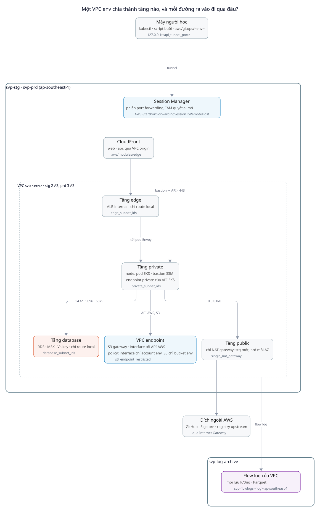

# 09. Env và mạng

← [08. Account env](08-accounts.md) · [Mục lục](README.md) · [10. EKS](10-eks.md) →

## Tổng quan

Chương này dựng phần chạy của một env: root `aws/envs/<env>` ghép VPC, cluster EKS, ba kho dữ liệu, đường vào CloudFront và
transcode thành một env hoàn chỉnh. Chương này giải thích phần khung của root và phần mạng: VPC chia bốn tầng subnet, đường ra Internet
qua NAT gateway, đường tới API AWS qua VPC endpoint, flow log về account Log Archive, và đường duy nhất từ máy người học tới API của
cluster: tunnel Session Manager qua một bastion không cổng vào. EKS ở chương sau; dữ liệu, media và edge ở chương 11, 12.

svp cần phần này vì mọi thứ của env chạy trong VPC này: một subnet đặt sai tầng là database có đường ra Internet, hay một pod bị chiếm
chép được dữ liệu sang bucket của account khác. Mạng là nơi đặt ranh giới đó một lần cho mọi service.

Root này sống theo buổi: dựng đầu buổi, gỡ cuối buổi bằng `destroy`, cả stg lẫn prd. Thứ sống lâu (registry, telemetry, hosted zone,
vault backup) ở root `aws/accounts/<env>` và root này chỉ đọc chúng. stg và prd chạy cùng code; khác nhau chỉ ở dữ liệu của
`<env>.tfvars`.

| Câu hỏi | Dịch vụ |
| --- | --- |
| Database có đường ra Internet không, pod nào được nói chuyện với nó? | Amazon VPC: subnet, route table, NACL, security group |
| Node kéo image từ GitHub, Docker Hub bằng đường nào? | NAT gateway |
| Pod gọi STS, ECR, Secrets Manager có rời VPC không, ai ngoài account dùng được đường đó? | VPC endpoint (AWS PrivateLink), endpoint policy |
| Upload, HLS đi S3 có tốn phí NAT không, có chép được ra bucket lạ không? | S3 gateway endpoint, endpoint policy |
| Kết nối nào đã vào, ra VPC, bị từ chối ở đâu? | VPC Flow Logs |
| API của cluster không có endpoint công khai thì người học vào bằng đường nào? | AWS Systems Manager Session Manager, bastion EC2 |

| Account | Region | Vòng đời | Root Terraform |
| --- | --- | --- | --- |
| `svp-stg`, `svp-prd` | `ap-southeast-1` | theo buổi | `aws/envs/<env>` (module `network`, `ssm-bastion`) |
| `svp-log-archive` | `ap-southeast-1` | sống lâu | `aws/log-archive` (bucket nhận flow log) |

## Kiến trúc

<picture>
  <source media="(prefers-color-scheme: dark)" srcset="../diagrams/09-envs-network-dark.svg">
  
</picture>

Mỗi tầng có route table và NACL riêng. Chỉ tầng public có route tới Internet Gateway, và trong đó chỉ có NAT gateway; tầng edge và tầng
database chỉ có route `local`. Không load balancer nào internet-facing: người xem vào qua CloudFront tới ALB internal ở tầng edge
(chương [12. Media và edge](12-media-edge.md)). Ranh giới tin cậy là account env; VPC trong sơ đồ chỉ vị trí.

| Thành phần | Ở đâu | Làm gì |
| --- | --- | --- |
| Root `aws/envs/<env>` | account env, `ap-southeast-1` | Ghép mọi module của env; xuất `cluster_values` cho root `aws/gitops/<env>` |
| VPC `svp-<env>` | dải `10.0.0.0/16` mặc định, stg 2 AZ, prd 3 AZ (`az_count`) | Bốn tầng subnet: public, private, edge, database |
| NAT gateway | tầng public; stg một ở AZ đầu, prd mỗi AZ một | Đường ra Internet của tầng private |
| S3 gateway endpoint `svp-<env>-s3` | mọi route table private | Lưu lượng S3 không qua NAT; policy chỉ cho bucket của env |
| Interface endpoint `svp-<env>-<dịch vụ>` | tầng private; stg ENI ở AZ đầu, prd mỗi AZ | Gọi API AWS trong VPC, private DNS, policy chỉ account env |
| Endpoint `svp-<env>-guardduty-data` | mọi subnet private | Đường của agent GuardDuty trên node |
| Flow log | VPC, giao vào bucket `svp-flowlogs-<log>-ap-southeast-1` | Mọi lưu lượng, Parquet, ở account Log Archive |
| Bastion `svp-<env>-ssm-bastion` | subnet private đầu | Đầu xa của tunnel tới endpoint private của API EKS |

## Kịch bản thực tế

**Câu hỏi của chương:** Endpoint công khai của API tắt, vậy `kubectl` trên máy người học tới cluster `svp-stg` bằng đường nào, và
chặng nào kiểm quyền?

Điều kiện: root `aws/envs/stg` đã apply, máy có AWS CLI và Session Manager plugin, phiên SSO của profile `anhnv-stg` còn hạn. Cổng local
là `api_tunnel_port` của `<env>.tfvars`, cùng số với cột `tunnel` của bảng env trong `aws/scripts/lib.sh`; ví dụ dưới là stg, chạy từ
gốc repo (`-chdir` đưa `terraform output` vào đúng root, như `need_tunnel` của `lib.sh`).

```sh
# terminal 1: tunnel 127.0.0.1:6444 → endpoint private:443, chạy tới khi Ctrl-C
eval "$(AWS_PROFILE=anhnv-stg terraform -chdir=aws/envs/stg output -raw api_tunnel_command)"
# terminal 2: context svp-stg, server https://127.0.0.1:6444, tls-server-name là host của endpoint
eval "$(AWS_PROFILE=anhnv-stg terraform -chdir=aws/envs/stg output -raw kubeconfig_command)"
AWS_PROFILE=anhnv-stg kubectl --context svp-stg get nodes
```

1. Output `api_tunnel_command` gọi `aws ssm start-session` với document `AWS-StartPortForwardingSessionToRemoteHost`, target là instance
   `svp-stg-ssm-bastion`, host là tên của endpoint private, cổng 443. IAM của role SSO quyết người học có được mở phiên không; CloudTrail
   của `svp-stg` ghi sự kiện `StartSession`.
2. Session Manager nối phiên qua SSM agent trên bastion. Agent tự mở kết nối ra Systems Manager (qua interface endpoint `ssm`,
   `ssmmessages`, `ec2messages` của VPC), nên bastion không có cổng vào, khoá SSH hay IP công khai. Máy người học nghe ở `127.0.0.1:6444`.
3. Output `kubeconfig_command` chạy `aws eks update-kubeconfig --alias svp-stg`, rồi đổi server của cluster thành
   `https://127.0.0.1:6444` và `tls-server-name` thành host thật của endpoint: `kubectl` vẫn kiểm chứng chỉ của API server theo tên thật.
4. `kubectl get nodes` lấy token bằng `aws eks get-token` với danh tính của người học, không phải role của bastion. Byte đi qua tunnel
   tới bastion, bastion mở TCP 443 tới ENI của endpoint private. Security group của API chỉ nhận 443 từ security group
   `svp-stg-ssm-bastion` (cùng với rule của node).
5. API server xác thực token qua access entry: danh tính đã chạy `apply` có quyền cluster admin (chương [10. EKS](10-eks.md)). Token của
   người khác không có access entry thì bị từ chối dù tunnel mở.
6. Script buổi (`tf.sh`, `bootstrap.sh`) kiểm tunnel đang mở trên cổng của env trước mọi lệnh tới API (`need_tunnel` của `lib.sh`); root
   `aws/gitops/stg` dùng cùng tunnel qua `api_server_url`. Tunnel đóng thì mọi lệnh dừng ở bước kiểm, không lệnh nào tới cluster kia.

Ở prd, cùng lệnh với `anhnv-prd`, `--context svp-prd` và cổng của `prd.tfvars`. Hai env khác cổng nên một lệnh nhầm context không tới
được cluster kia.

## Các dịch vụ và cách svp dùng

### Amazon VPC (subnet, NACL, security group)

- **Làm gì:** chia mạng của env thành subnet theo AZ, quyết route của từng tầng và lọc gói ở hai lớp: NACL theo subnet, security group
  theo ENI. Ví dụ đời thực:
  - Subnet database chỉ có route `local`: RDS, MSK, Valkey không ra Internet được kể cả qua NAT.
  - Security Hub control `EC2.21`: NACL không cho TCP 22, 3389 từ `0.0.0.0/0`; NACL của svp mở dải trả về trừ đúng hai cổng đó.
  - Control `EC2.2`: security group mặc định không rule nào; tài nguyên quên gán security group không nhận, không gửi được gì.
  - Pod lấy IP của subnet private (VPC CNI), nên security group node lọc cả lưu lượng tới pod.
- **Ở svp:** module `network` bọc `terraform-aws-modules/vpc/aws`: tầng private (node, pod; tag `karpenter.sh/discovery`), edge (ALB
  internal, tầng `intra` của module registry), database (route table riêng), public (NAT); mỗi tầng một NACL; security group và NACL
  mặc định rỗng. Chia dải ở mục [Đọc sâu](#đọc-sâu).
- **Phí theo:** VPC, subnet, route table, NACL, security group không tính phí; phí nằm ở NAT, endpoint, IPv4 công khai, flow log.

### NAT gateway

- **Làm gì:** cho tài nguyên ở subnet private ra Internet mà không nhận kết nối vào. Ví dụ đời thực:
  - Argo CD kéo repo `svp-gitops` từ `github.com`.
  - Kyverno tải dữ liệu Sigstore để kiểm chữ ký image.
  - Lần kéo đầu một image qua pull-through cache: ECR lấy từ registry upstream.
  - Karpenter gọi API Pricing, region không có endpoint cho dịch vụ đó.
- **Ở svp:** `single_nat_gateway` của `<env>.tfvars`: stg một NAT ở AZ đầu, prd một NAT mỗi AZ và route table private của mỗi AZ trỏ NAT
  cùng AZ. Mỗi NAT một Elastic IP.
- **Phí theo:** giờ mỗi NAT, GB dữ liệu đi qua; giờ mỗi IPv4 công khai.
- **Cố ý tắt:** NAT mỗi AZ ở stg: mất AZ đầu là stg mất đường ra, chấp nhận vì stg không hứa sống qua mất AZ.

### VPC endpoint (S3 gateway, interface)

- **Làm gì:** gateway endpoint đưa lưu lượng S3 vào route table, interface endpoint đặt ENI của API AWS trong VPC; cả hai nhận endpoint
  policy. Ví dụ đời thực:
  - EKS Pod Identity Agent gọi `AssumeRoleForPodIdentity` qua endpoint `eks-auth`; node private không có nó thì pod không lấy được role.
  - External Secrets gọi `GetSecretValue` qua endpoint `secretsmanager`.
  - kubelet kéo manifest qua `ecr.dkr`, layer qua gateway S3 từ bucket `prod-<region>-starport-layer-bucket` của ECR.
  - Credential của account khác gọi qua endpoint bị từ chối: policy `Deny` khi `aws:PrincipalAccount` khác account env.
  - Security Hub control `EC2.10`, `EC2.55`, `EC2.56`, `EC2.57`: endpoint cho `ec2`, `ecr.api`, `ecr.dkr`, `ssm` có mặt.
- **Ở svp:** danh sách dịch vụ là `local.interface_endpoint_services` của module `network`; ENI ở `interface_endpoint_az_count` AZ đầu
  (stg một, prd mọi AZ); security group chung `svp-<env>-endpoints` chỉ nhận TCP 443 từ dải VPC. `s3_endpoint_restricted = true` ở cả
  hai env: policy chỉ cho bucket `uploads`, `media` của env, bucket layer ECR và bucket của `registry.k8s.io` trong region
  (`s3_endpoint_extra_buckets`).
- **Phí theo:** interface endpoint tính giờ mỗi AZ đặt ENI và GB đi qua; gateway endpoint S3 không tính phí.
- **Cố ý tắt:** endpoint cho `eks`, `kms`, `grafana` và đích ngoài AWS: vẫn qua NAT, lý do từng mục ở phụ lục ADR-0064 §1, §6.

### VPC Flow Logs

- **Làm gì:** ghi mỗi luồng IP qua ENI của VPC: địa chỉ, cổng, byte, chấp nhận hay từ chối. Ví dụ đời thực:
  - Kết nối bị NACL hay security group chặn hiện với `action` là `REJECT`.
  - Trường `pkt-srcaddr`, `pkt-dstaddr` cho địa chỉ gốc sau NAT hay ALB.
  - Trường `pkt-dst-aws-service`, `traffic-path` cho biết gói đi tới dịch vụ AWS nào, qua đường nào.
  - Security Hub control `EC2.6`: VPC có flow log.
- **Ở svp:** module `network`, lưu lượng `ALL`, Parquet, phân vùng Hive theo giờ, gom 60 giây; giao thẳng vào bucket
  `svp-flowlogs-<log>-ap-southeast-1` của account Log Archive, không log group, không role IAM. Retention do lifecycle của bucket đó giữ
  (chương [04. Log Archive](04-log-archive.md)).
- **Phí theo:** GB log giao vào S3 (vended log), cộng lưu trữ S3 ở account Log Archive.

### AWS Systems Manager Session Manager (bastion)

- **Làm gì:** mở phiên tới instance có SSM agent mà không cần cổng vào hay khoá SSH; phiên port forwarding chuyển một cổng local tới host
  khác trong VPC. Ví dụ đời thực:
  - Document `AWS-StartPortForwardingSessionToRemoteHost` chuyển `127.0.0.1:6444` tới endpoint private của API, cổng 443.
  - Sự kiện `StartSession` trong CloudTrail cho biết ai mở tunnel, lúc nào.
  - Không role IAM nào có `ssm:StartSession` thì không ai mở được tunnel dù biết id instance.
- **Ở svp:** module `ssm-bastion`, file `ssm-bastion.tf` của root: instance `t4g.nano` Graviton, AMI Amazon Linux 2023 arm64 mới nhất
  (tham số SSM công khai), chỉ IMDSv2 hop limit 1, đĩa gp3 mã hoá, role `svp-<env>-ssm-bastion` chỉ có `AmazonSSMManagedInstanceCore`,
  security group không rule vào, ra chỉ TCP 443.
- **Phí theo:** Session Manager không tính phí; instance theo giờ, đĩa gp3 theo GB-tháng.
- **Cố ý tắt:** endpoint công khai của API EKS (cả hai env), khoá SSH, IP công khai của bastion.

## Chi phí

| Khoản | Đơn vị tính | Giữa các buổi | Trong buổi | Nguồn |
| --- | --- | --- | --- | --- |
| NAT gateway | giờ mỗi NAT, GB xử lý | 0 | 0,059 USD/giờ mỗi NAT (stg 1, prd 3); 0,059 USD/GB; prd ~15 GB mỗi buổi | ADR-0064 phụ lục §7; ADR-0048 phụ lục H₀, O₀ |
| IPv4 công khai (EIP của NAT) | IP-giờ | 0 | 0,005 USD/IP-giờ | ADR-0048 phụ lục H₀ |
| Interface endpoint | giờ mỗi AZ, GB | 0 | ~0,75 USD mỗi buổi stg, ~2,3 USD mỗi buổi prd | ADR-0064 phụ lục §7 "Thêm mỗi buổi" |
| S3 gateway endpoint | — | 0 | 0 | ADR-0064 phụ lục §7 |
| Flow log | GB giao S3 | lưu trữ ở Log Archive, không có số đo riêng | 0,2–0,4 USD mỗi buổi | ADR-0060 phụ lục §12 |
| Bastion `t4g.nano` | giờ | 0 | 0,0053 USD/giờ | ADR-0048 phụ lục H₀ |

Tổng một buổi của cả env (EKS, dữ liệu, edge cộng lại) ở chương [15. Chi phí](15-cost.md). Nguồn:
[ADR-0064 phụ lục](https://github.com/anhnvcoder/svp-backend/blob/main/docs/adr/appendix/0064-interface-endpoints.md) §7,
[ADR-0048 phụ lục](https://github.com/anhnvcoder/svp-backend/blob/main/docs/adr/appendix/0048-prd-aws.md),
[ADR-0060 phụ lục](https://github.com/anhnvcoder/svp-backend/blob/main/docs/adr/appendix/0060-org-detection-logging.md) §12.

## Kiểm tra và vận hành

Đăng nhập console của account env qua access portal (profile `anhnv-<env>-ro` cho chỉ đọc).

| Muốn xem | Account | Region | Vào đâu | Trạng thái mong đợi |
| --- | --- | --- | --- | --- |
| Subnet và tầng | env | `ap-southeast-1` | VPC → Subnets, lọc VPC `svp-<env>` | Bốn tầng × số AZ, tên `svp-<env>-<tầng>-<az>` (database: `db`) |
| Route của tầng database, edge | env | `ap-southeast-1` | VPC → Route tables | Chỉ route `local` |
| NAT | env | `ap-southeast-1` | VPC → NAT gateways | stg một `Available`, prd một mỗi AZ |
| Endpoint | env | `ap-southeast-1` | VPC → Endpoints | Mọi endpoint `Available`; private DNS bật ở endpoint interface |
| Flow log | env | `ap-southeast-1` | VPC → `svp-<env>` → Flow logs | Đích S3 bucket của Log Archive, `Active` |
| Bastion | env | `ap-southeast-1` | Systems Manager → Fleet Manager | `svp-<env>-ssm-bastion` `Online` |
| Ai đã mở tunnel | env | `ap-southeast-1` | Systems Manager → Session Manager → Session history | Mỗi phiên một dòng, owner là role SSO |

Bảng trên là trạng thái mà code khai báo. Runbook buổi dựng root này, mở tunnel và chạy lệnh đầu tiên qua nó: trang dựng của buổi stg
([`session-stg-deploy.md`](../runbooks/session-stg-deploy.md)), buổi prd
([`session-prd-deploy.md`](../runbooks/session-prd-deploy.md)). Tunnel chạy
khi `kubectl get nodes` của bước đó trả về node; các phần khác (policy endpoint, flow log) chưa có bước kiểm riêng trong runbook.

## Thiết kế và đánh đổi

### Hai env, một bộ code

Root prd là bản chép của root stg: mọi `*.tf` giống hệt trừ dòng `env` của `locals` (`main.tf`); mọi lời gọi module chỉ tham
chiếu biến hay output. Khác biệt nằm trong `<env>.tfvars`, mỗi nhóm biến một comment nói vì sao, hai file cùng thứ tự dòng để
đọc cạnh nhau. Luật và lệnh `diff` kiểm nó:
[ADR-0055](https://github.com/anhnvcoder/svp-backend/blob/main/docs/adr/0055-environment-matrix.md) §6; bảng thành phần nào giữ
như prd, giảm hay giảm có điều kiện:
[`environments.md`](https://github.com/anhnvcoder/svp-backend/blob/main/docs/explanation/environments.md).

| Khía cạnh | stg | prd |
| --- | --- | --- |
| Số AZ, NAT, ENI của endpoint | 2 AZ, một NAT, ENI ở một AZ | 3 AZ, NAT mỗi AZ, ENI mỗi AZ |
| Cổng tunnel tới API | `api_tunnel_port` của `stg.tfvars` | `api_tunnel_port` của `prd.tfvars` |
| Lớp và dự phòng của dữ liệu | nhỏ: RDS, Valkey một AZ; MSK hai broker ở hai AZ (chương [11. Dữ liệu](11-data.md)) | lớp production, Multi-AZ |
| Retention log CloudWatch | ngắn | dài (giá trị ở `<env>.tfvars`) |
| Bảo vệ xoá (RDS, ALB edge, bucket media) | tắt | bật; `teardown.tfvars` nhấc khi gỡ |
| Gói CloudFront của media | flat-rate Free, không log chuẩn | pay-as-you-go, log chuẩn về Log Archive |

### Bốn tầng subnet

Tầng database tách để không có đường ra Internet ở mức route, không phụ thuộc security group. Tầng edge tách vì dải private chứa IP của
mọi pod: mở dải private cho ALB là mở cho mọi pod. Không node, pod nào có IP trong dải edge, nên NetworkPolicy của Envoy chỉ cần mở
`edgeCidrs` để nhận đúng lưu lượng của ALB. Lý do:
[ADR-0054](https://github.com/anhnvcoder/svp-backend/blob/main/docs/adr/0054-data-subnet-tier.md),
[ADR-0061](https://github.com/anhnvcoder/svp-backend/blob/main/docs/adr/0061-edge-cloudfront-waf-acm.md) §3.

### API chỉ qua tunnel

Endpoint công khai giới hạn CIDR vẫn là một cổng mở ra Internet và cần IP của người học trong file; tunnel SSM không cần cả hai, đổi
lại phải giữ một instance và mở tunnel trước mọi lệnh. Endpoint private luôn bật: tắt nó thì node trong subnet private phải gọi API qua
IP của NAT (comment ở `aws/modules/eks/cluster.tf`). Quyết định:
[ADR-0048](https://github.com/anhnvcoder/svp-backend/blob/main/docs/adr/0048-prd-aws.md)
cho prd, [ADR-0055](https://github.com/anhnvcoder/svp-backend/blob/main/docs/adr/0055-environment-matrix.md) đưa cùng đường sang stg.

| Lựa chọn của svp | Cái giá | Phương án khác | Khi nào chọn nó |
| --- | --- | --- | --- |
| stg một NAT, prd NAT mỗi AZ | stg mất AZ đầu là mất đường ra | NAT mỗi AZ ở mọi env | stg phải diễn tập mất AZ |
| Interface endpoint cho API AWS chính | Phí giờ mỗi AZ và GB (bảng Chi phí), phải giữ danh sách | Mọi lời gọi qua NAT | VPC nhỏ, không cần policy ở đường mạng |
| Policy S3 gateway chỉ cho bucket của env | Image kéo blob từ bucket S3 khác trong region bị chặn | Không policy | Workload cần đọc bucket công khai của bên thứ ba |
| Tunnel SSM tới endpoint private | Thêm instance, tunnel phải mở trước lệnh | Endpoint công khai giới hạn CIDR; Client VPN | Nhiều người vận hành, cần mạng riêng sẵn (VPN, Direct Connect) |
| Flow log thẳng vào S3 của Log Archive | Không truy vấn tức thì như CloudWatch Logs Insights | Flow log vào CloudWatch Logs | Cần alarm trên flow log |
| NACL mỗi tầng chặn 22, 3389 | Kết nối qua NAT bị gán cổng nguồn 3389 mất gói trả về | NACL mở hết, chỉ dựa security group | Không cần đạt CIS, EC2.21 |

## Liên hệ đề SAP

- "Skill 1.4.2: Design VPC architectures by using subnet strategies, IP address management, and network segmentation (for example, by
  using Amazon VPC IP Address Manager [IPAM], public and private subnets)." Bốn tầng subnet, chia dải cho VPC CNI.
- "Skill 1.4.3: Design network security architectures that include traffic inspection, traffic filtering, and application layer
  protection (for example, by using AWS Network Firewall, AWS WAF, Gateway Load Balancers, security groups, network ACLs, VPC Flow
  Logs)." NACL mỗi tầng, security group, flow log về Log Archive.
- "Skill 2.1.4: Design data perimeter controls and external access validation solutions (for example, by using AWS Identity and Access
  Management Access Analyzer, VPC endpoint policies, AWS Verified Access)." Policy endpoint chặn principal ngoài account, policy S3
  gateway chỉ cho bucket của env.
- "Skill 3.2.2: Optimize data transfer costs by using strategies such as private connectivity, Regional traffic patterns, and
  inter-Availability Zone/inter-Region strategies (for example, by using VPC endpoints, NAT gateways, Availability Zone-aware
  architectures)." S3 qua gateway endpoint thay NAT; stg một NAT, prd NAT cùng AZ.

| Tình huống trong đề | Chọn | Vì sao không chọn cái gần giống |
| --- | --- | --- |
| Pod ở subnet private đọc ghi S3 nhiều, phí NAT cao | S3 gateway endpoint | Interface endpoint S3 tính giờ và GB; NAT tính mọi GB |
| Instance private gọi Secrets Manager mà không có đường ra Internet | Interface endpoint (PrivateLink) | Gateway endpoint chỉ có cho S3 và DynamoDB |
| Chặn chép dữ liệu ra bucket của account lạ từ trong VPC | Endpoint policy trên S3 gateway endpoint | Security group không lọc theo tên bucket; SCP không áp lên account ngoài tổ chức |
| Quản trị viên vào instance private mà không mở cổng 22 | Session Manager | Bastion SSH cần cổng vào và khoá; EC2 Instance Connect Endpoint vẫn cần security group cho 22 |
| Biết kết nối nào bị chặn ở mức mạng | VPC Flow Logs | CloudTrail ghi lời gọi API, không ghi gói tin |
| Chặn một dải IP cụ thể ở mức subnet | Network ACL | Security group chỉ có rule allow, không có deny |
| Database không bao giờ có đường ra Internet, kể cả khi ai đó sửa security group | Subnet với route table chỉ `local` | Security group sửa được bằng một API; route mới là ranh giới đường đi |
| Nối nhiều VPC của nhiều account, có định tuyến chung | Transit Gateway | VPC peering không bắc cầu; PrivateLink chỉ mở một dịch vụ |

## Đọc sâu

- Chia dải (`cidr` chia 8 khối): khối 0–5 là subnet private mỗi AZ (`/19` với `/16`, vì pod lấy IP từ đây và prefix delegation lấy
  từng `/28`); khối 6 chia 8 cho database mỗi AZ (`/22`); khối 7 chứa public ở đầu (`/24`) và edge ở nửa sau (`/23`). Với mặc định và
  2 AZ: private `10.0.0.0/19`, `10.0.32.0/19`; database `10.0.192.0/22`, `10.0.196.0/22`; public `10.0.224.0/24`, `10.0.225.0/24`; edge
  `10.0.240.0/23`, `10.0.242.0/23`. Edge tối thiểu `/27` theo yêu cầu subnet của ALB.
- NACL: tầng public, private nhận từ `0.0.0.0/0` dải trả về TCP, UDP 1024–3388 và 3390–65535 cùng ICMP; mọi tầng nhận mọi cổng từ dải
  VPC; outbound mở hết. NACL không xét lưu lượng CloudFront tới VPC origin, nên tầng edge chỉ nhận từ dải VPC mà ALB vẫn nhận được;
  security group của ALB mới là nơi giới hạn nguồn. Cái giá: khoảng 1/64 500 kết nối qua NAT được gán cổng nguồn 3389 mất gói trả về.
- Private DNS của interface endpoint đổi phân giải cho cả VPC (`sts.<region>.amazonaws.com` trả IP trong dải private), nên NetworkPolicy
  chỉ mở 443 tới địa chỉ công khai sẽ chặn pod: chart mở thêm TCP 443 tới value `awsEndpointCidrs` (dải VPC trên eks). Dịch vụ không có
  ở một AZ đã chọn thì precondition của endpoint dừng plan; dịch vụ không nhận policy thì AWS cho toàn quyền qua endpoint.
- Log của env nằm ở bucket của Log Archive, tên suy trong `local.log_archive_buckets` của `main.tf`, retention do bucket đó giữ: flow log
  (module `network`), log của ba web ACL vào `aws-waf-logs-svp-<log>-us-east-1` (module `waf`, che header `authorization`, `cookie`), log
  chuẩn của CloudFront qua delivery destination `svp-cloudfront-<env>` (module `edge`, `media`; media chỉ khi `media_flat_rate_free` là
  `false`). Phần GuardDuty của env: add-on agent (chương [10. EKS](10-eks.md)), endpoint `guardduty-data`, Malware Protection for S3 trên
  bucket `uploads` (module `media`).
- Endpoint `guardduty-data` và security group của nó nằm trong state thay vì để GuardDuty tự tạo: bản GuardDuty tự quản nằm ngoài state
  và giữ ENI, chặn `destroy` VPC.
- Tài nguyên ngoài state giữ ENI trong subnet (ENI của VPC CNI, node Karpenter, ENI và security group `CloudFront-VPCOrigins-Service-SG`
  của VPC origin): `pre-destroy.sh` gỡ phần trong cluster khi controller còn chạy, `sweep.sh <env>` tìm phần sót theo tag (chương
  [10. EKS](10-eks.md#đọc-sâu)).
- Root chạy được khi `aws/accounts/<env>` đã apply, uỷ quyền DNS đã xong và `aws/log-archive` đã có bucket nhận log; `baseline.tf` tìm
  tài nguyên sống lâu theo tên suy từ `svp-<env>` và dừng plan ở đúng data source thiếu
  ([README `aws/envs/stg`](../../aws/envs/stg/README.md#tài-nguyên-sống-lâu-của-account)).

Làm và tra cứu:

- [`aws/envs/stg`](../../aws/envs/stg/README.md), [`aws/envs/prd`](../../aws/envs/prd/README.md): tài nguyên, output, biến của root.
- Module [`network`](../../aws/modules/network/README.md), [`ssm-bastion`](../../aws/modules/ssm-bastion/README.md).
- [ADR-0064](https://github.com/anhnvcoder/svp-backend/blob/main/docs/adr/0064-interface-endpoints.md): endpoint interface, danh sách
  dịch vụ và thứ còn qua NAT ở phụ lục.
- [ADR-0059](https://github.com/anhnvcoder/svp-backend/blob/main/docs/adr/0059-org-structure-guardrails.md) §10: NACL theo CIS.
