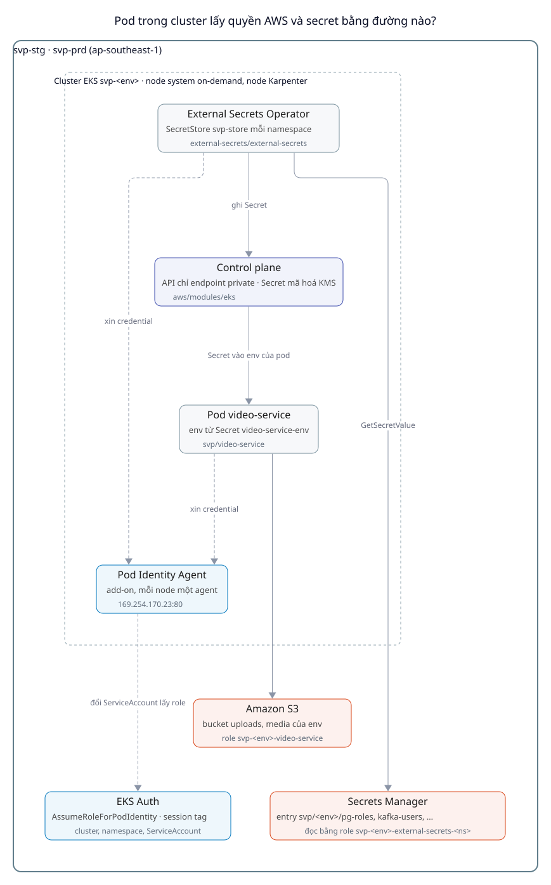
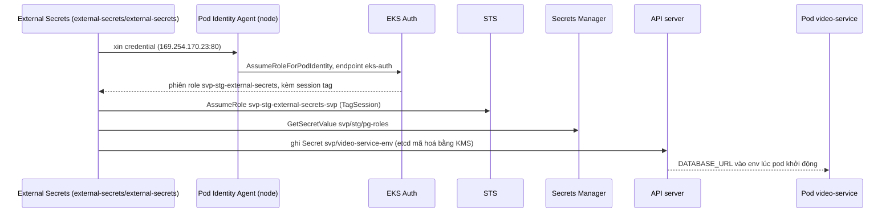

# 10. EKS

← [09. Env và mạng](09-envs-network.md) · [Mục lục](README.md) · [11. Dữ liệu](11-data.md) →

## Tổng quan

Chương này dựng cluster Kubernetes của một env trên Amazon EKS: control plane do AWS chạy, một nhóm node hệ thống luôn có, node cho
workload do Karpenter tạo theo pod đang chờ, các add-on của EKS, và đường để pod lấy quyền AWS cùng secret mà không có access key hay
mật khẩu nào trong git. Ứng dụng trong cluster không ở đây: Argo CD triển khai chúng từ `svp-gitops` (chương [13. GitOps](13-gitops.md)).

svp cần phần này vì cluster là nơi mọi service chạy, và cũng là nơi dễ để lọt quyền nhất: một pod đọc được credential của node hay
secret của namespace khác là đủ để đi tiếp. Thiết kế ở đây cho mỗi pod đúng một role và mỗi namespace đúng các secret nó dùng.

Cluster sống theo buổi, cùng root `aws/envs/<env>`: dựng đầu buổi, gỡ cuối buổi. Entry của Secrets Manager cũng gỡ cùng, giá trị được
ghi lại ở buổi sau. Registry, telemetry và khoá mà các role trong cluster dùng sống lâu ở `aws/accounts/<env>`.

| Câu hỏi | Dịch vụ |
| --- | --- |
| Ai chạy API server, etcd, ai nâng version? | Amazon EKS (control plane) |
| Add-on, Argo CD, Karpenter chạy trên node nào trước khi có node tự scale? | EKS managed node group |
| Pod đang chờ thì node mới từ đâu ra, Spot bị thu hồi thì sao? | Karpenter trên Amazon EC2 (Spot ở stg), Amazon SQS, Amazon EventBridge |
| Pod gọi S3, AMP bằng quyền gì mà không có access key? | EKS Pod Identity |
| Mật khẩu database tới pod bằng đường nào, ai đọc được? | AWS Secrets Manager, External Secrets Operator |
| Secret trong etcd mã hoá bằng khoá của ai? | AWS KMS (envelope encryption) |

| Account | Region | Vòng đời | Root Terraform |
| --- | --- | --- | --- |
| `svp-stg`, `svp-prd` | `ap-southeast-1` | theo buổi | `aws/envs/<env>` (module `eks`, `external-secrets`, `pod-identity.tf`) |
| `svp-stg`, `svp-prd` | `ap-southeast-1` | sống lâu | `aws/accounts/<env>` (registry ECR, AMP, log group, khoá mà role trong cluster dùng) |

## Kiến trúc

<picture>
  <source media="(prefers-color-scheme: dark)" srcset="../diagrams/10-eks-dark.svg">
  
</picture>

Mũi tên nét đứt là lời xin quyền, nét liền là dữ liệu. Pod không gọi STS hay Secrets Manager bằng credential của node: agent Pod
Identity đổi ServiceAccount của pod lấy phiên tạm của đúng một role. External Secrets đọc entry bằng role của namespace rồi ghi
Secret; pod của service chỉ thấy Secret của namespace mình.

| Thành phần | Ở đâu | Làm gì |
| --- | --- | --- |
| Cluster `svp-<env>` | module `eks`, `cluster.tf` | Control plane; API chỉ endpoint private; access entry thay ConfigMap `aws-auth` |
| Nhóm node `system` | module `eks`, `nodes.tf` | On-demand Graviton, mỗi AZ một node; chạy add-on, Argo CD, Karpenter |
| IAM và hàng đợi của Karpenter | module `eks`, `karpenter.tf` | Role `svp-<env>-karpenter`, `svp-<env>-karpenter-node`; hàng đợi `svp-<env>-karpenter` |
| NodePool, EC2NodeClass | chart `svp-cluster` (`svp-backend`), values ở `svp-gitops` | Node workload theo pod: Spot ở stg, on-demand ở prd |
| Add-on EKS | module `eks`, `addons.tf` | Mạng pod, DNS, Pod Identity Agent, EBS CSI, metrics, agent GuardDuty |
| Role Pod Identity của controller | module `eks`, `iam.tf`, `pod-identity.tf` | LBC, EBS CSI, Collector, Prometheus agent, ACK, Kyverno, Argo Rollouts, OpenCost |
| Role của service | root, `pod-identity.tf` | `svp-<env>-video-service`, `svp-<env>-media-worker` |
| Entry và role đọc secret | module `external-secrets` | Vỏ `svp/<env>/<entry>`; role controller và role mỗi namespace |
| KMS key `alias/svp-<env>-eks-secrets` | module `eks` | Mã hoá phong bì Secret của Kubernetes |

## Kịch bản thực tế

**Câu hỏi của chương:** Pod `video-service` của stg cần mật khẩu PostgreSQL của role `svp_video_app`: mật khẩu đi từ đâu tới env của
pod, qua những role nào, và ai khác đọc được nó?

Điều kiện: root `aws/envs/stg` đã apply; script buổi đã ghi giá trị các entry (`bootstrap.sh stg secrets` gọi `make eks-secrets` của
svp-backend); Argo CD đã cài External Secrets và chart `svp-cluster` với `externalSecrets.store: aws`.

1. Root tạo vỏ entry `svp/stg/pg-roles` (module `external-secrets`), không giá trị; `make eks-secrets` ghi giá trị từ `.env` của
   svp-backend sau apply. Không giá trị nào nằm trong plan hay state.
2. Chart `svp-cluster` render SecretStore `svp-store` ở namespace `svp` với provider `aws` và role từ khoá `externalSecretsRoles` của
   `cluster_values` (ARN `svp-stg-external-secrets-svp`), cùng ExternalSecret `video-service-env` lấy khoá
   `pg-roles/SVP_VIDEO_APP_DB_PASSWORD`, `refreshPolicy: OnChange`.
3. Controller External Secrets chạy với ServiceAccount `external-secrets/external-secrets`. Nó xin credential từ Pod Identity Agent
   trên node; agent gọi `AssumeRoleForPodIdentity` của EKS Auth qua interface endpoint `eks-auth`. EKS Auth tìm association của cặp
   namespace, ServiceAccount đó, trả phiên tạm của role `svp-stg-external-secrets` với session tag `eks-cluster-name`,
   `kubernetes-namespace`, `kubernetes-service-account`; trust policy của role đòi đúng ba giá trị đó.
4. Role controller không đọc entry nào. Nó chỉ được `sts:AssumeRole` và `sts:TagSession` lên các role namespace; session tag của Pod
   Identity là transitive, nên lần assume sang `svp-stg-external-secrets-svp` mang chúng theo.
5. Role `svp-stg-external-secrets-svp` chỉ có `secretsmanager:GetSecretValue` trên các entry namespace `svp` dùng, ARN viết
   `svp/stg/pg-roles-??????`. Nó không đọc được `pg-superuser` (chỉ role của `svp-data`) hay entry của env khác.
6. External Secrets ghi Secret `video-service-env` vào namespace `svp`; API server lưu nó trong etcd, mã hoá phong bì bằng KMS key
   `alias/svp-stg-eks-secrets`. Pod `video-service` đọc `DATABASE_URL` từ Secret lúc khởi động.
7. Pod `video-service` có role riêng `svp-stg-video-service` (Pod Identity, ServiceAccount `svp/video-service`) cho S3 và ký form
   upload; role đó không có quyền Secrets Manager nào.

Đổi mật khẩu giữa buổi: ghi entry mới chưa đủ, vì `OnChange` chỉ đọc lại entry khi ExternalSecret bị dựng lại; `bootstrap.sh <env>
secrets` dựng lại chúng và Reloader restart pod khi Secret đổi. Thứ tự và thời gian chờ ở mục đổi secret của [runbook
buổi](../runbooks/session-stg.md#đổi-một-secret-của-env-đang-chạy).

## Các dịch vụ và cách svp dùng

### Amazon EKS (control plane)

- **Làm gì:** chạy API server và etcd của Kubernetes trên nhiều AZ, nâng version, xác thực danh tính IAM vào cluster. Ví dụ đời thực:
  - Access entry gắn `AmazonEKSClusterAdminPolicy` cho danh tính đã chạy `apply`; không ConfigMap `aws-auth`.
  - Upgrade insight loại `UPGRADE_READINESS` báo API bị bỏ ở minor kế tiếp.
  - Minor hết standard support: với `upgrade_policy` `STANDARD`, EKS tự nâng thay vì tính phí extended support.
  - Log control plane `audit` ghi ai đã `get secret` trong namespace nào.
- **Ở svp:** module `eks` bọc `terraform-aws-modules/eks/aws`, cluster `svp-<env>`, minor là `kubernetes_version` của
  `<env>.tfvars`; `authentication_mode = "API"`; endpoint công khai tắt, private bật; các loại log control plane
  (`control_plane_log_types`) với retention theo env (`control_plane_log_retention_days`); không OIDC provider (`enable_irsa =
  false`).
- **Phí theo:** cluster-giờ, cao hơn khi minor ở extended support; GB log control plane nạp vào CloudWatch Logs.
- **Cố ý tắt:** extended support; endpoint công khai của API (chương [09. Env và mạng](09-envs-network.md)).

### EKS managed node group (nhóm `system`)

- **Làm gì:** EKS quản Auto Scaling group của node, xoay node theo version mới và drain theo PodDisruptionBudget. Ví dụ đời thực:
  - Nâng `release_version` của AMI: node group thay từng node, pod dời theo PDB.
  - Node group kẹt ở `UPDATING` khi một PDB không cho drain.
  - Không ai scale nó tự động: min, desired bằng số subnet private, max gấp đôi.
- **Ở svp:** nhóm `system`, `AL2023_ARM_64_STANDARD` bản ghim `local.ami_release_version`, `ON_DEMAND`, loại `system_node_instance_type`;
  IMDSv2 bắt buộc, hop limit 1; ổ gốc gp3 30 GiB mã hoá. Role node có thêm quyền pull-through cache trên đúng các tiền tố cache.
- **Phí theo:** giờ instance EC2 và GB-tháng EBS; node group không tính phí riêng.
- **Cố ý tắt:** taint và autoscaling trên nhóm này: nó phải sẵn trước khi Karpenter có node.

### Karpenter (EC2, Spot)

- **Làm gì:** đọc pod đang chờ, chọn loại instance và gọi `CreateFleet` để tạo node; gom pod để bớt node; thay node khi cấu hình lệch.
  Ví dụ đời thực:
  - Cảnh báo thu hồi Spot hai phút đi qua EventBridge vào hàng đợi `svp-stg-karpenter`; Karpenter drain node trước khi EC2 lấy lại.
  - Đổi alias AMI của EC2NodeClass: NodeClaim cũ thành `Drifted` và được thay theo ngân sách disruption của NodePool.
  - Pod của k6 chờ: một NodeClaim mới lên `Ready` trong subnet private có tag `karpenter.sh/discovery`.
- **Ở svp:** submodule `karpenter` của module registry: role controller `svp-<env>-karpenter` (trust thay bằng điều kiện đúng
  cluster, `kube-system/karpenter`), role node `svp-<env>-karpenter-node` và access entry `EC2_LINUX`, hàng đợi
  `svp-<env>-karpenter`, các rule EventBridge đổ vào hàng đợi đó. NodePool, EC2NodeClass, `limits` do chart `svp-cluster` của
  `svp-backend` render, theo values của `svp-gitops`: stg Spot, prd on-demand. Spot của stg cần service-linked role
  `spot.amazonaws.com` mà `aws/accounts/stg` tạo.
- **Phí theo:** giờ instance EC2 (Spot theo giá thị trường), EBS; request SQS, sự kiện EventBridge; Karpenter không tính phí.

### EKS add-on

- **Làm gì:** EKS cài và nâng các thành phần hệ thống theo version tương thích minor. Ví dụ đời thực:
  - `vpc-cni` với `enableNetworkPolicy`: NetworkPolicy của chart có hiệu lực như trên cluster k3d chạy local của lab.
  - `metrics-server`: `kubectl top` và HPA theo CPU của gateway, feed-service chạy.
  - `aws-ebs-csi-driver`: PVC `gp3` tạo volume EBS mang tag `Project=svp`.
  - `aws-guardduty-agent`: GuardDuty Runtime Monitoring đọc hành vi process trên mọi node.
- **Ở svp:** các add-on trong `addons.tf`, mỗi cái ghim `addon_version`; `vpc-cni`, `eks-pod-identity-agent`, `kube-proxy` tạo trước
  node group. `ENABLE_PREFIX_DELEGATION` của `vpc-cni` cho node cỡ large giữ 110 pod thay vì 29. Agent GuardDuty là resource riêng, tạo
  sau endpoint `guardduty-data`.
- **Priority của agent GuardDuty:** add-on mặc định dùng PriorityClass `aws-guardduty-agent.priorityclass`
  (`preemptionPolicy: Never`). Node Karpenter đã đầy pod ứng dụng thì pod agent nằm `Pending` (`Insufficient cpu`), add-on
  `DEGRADED`, coverage `UNHEALTHY`, node đó chạy không có Runtime Monitoring. `configuration_values` của add-on đặt
  `priorityClassName: aws-guardduty-agent.priorityclass-high` (giá trị 100000000, `PreemptLowerPriority`), một trong bốn giá trị
  [tài liệu GuardDuty](https://docs.aws.amazon.com/guardduty/latest/ug/guardduty-configure-security-agent-eks-addon.html) cho phép
  từ add-on 1.5.0. Lớp này cao hơn mọi pod không khai PriorityClass (độ ưu tiên 0): pod ứng dụng và cả pod nền tảng như Kyverno,
  cert-manager, istiod, Argo CD, observability đều có thể bị đẩy ra. Nó thấp hơn `system-cluster-critical` (CoreDNS, Karpenter) và
  `system-node-critical` (`vpc-cni`, `kube-proxy`, Istio CNI, ztunnel), nên hai nhóm đó không bị đụng.
  `resolve_conflicts_on_update = "OVERWRITE"`: Terraform là chủ duy nhất của cấu hình (GuardDuty không tự quản add-on,
  `EKS_ADDON_MANAGEMENT` tắt ở `aws/security`), nên đổi cấu hình hay sửa tay DaemonSet không làm update thất bại.
  - **Cái giá:** node đầy thì agent đẩy một pod không có PriorityClass ra (ứng dụng hay nền tảng); pod đó về `Pending` và
    Karpenter dựng node mới cho nó, tức vài chục giây tới vài phút pod đó không chạy và thêm giờ EC2 của node mới. Replica khác của
    cùng Deployment và PodDisruptionBudget không che được: preemption chỉ cố tôn trọng PDB, không bảo đảm.
- **Phí theo:** add-on không tính phí; phần chạy là pod trên node.
- **Cố ý tắt:** tự nâng version: AMI và add-on nâng tay theo [`eks-upgrade.md`](../runbooks/eks-upgrade.md), Renovate không đọc được
  datasource của chúng vì cần credential AWS.

### EKS Pod Identity

- **Làm gì:** gắn một ServiceAccount với một role IAM; agent trên node đổi token của pod lấy phiên tạm của role. Ví dụ đời thực:
  - API `AssumeRoleForPodIdentity` của EKS Auth, gọi qua endpoint `eks-auth`.
  - Session tag `eks-cluster-name`, `kubernetes-namespace`, `kubernetes-service-account` trong trust policy chặn association lạ.
  - Pod không có association thì không có credential AWS nào: IMDS hop limit 1 chặn credential của node.
- **Ở svp:** role của các controller nền tảng (`local.pod_identity` của module `eks`; Karpenter do submodule gắn), các role service ở
  `pod-identity.tf` của root, role controller External Secrets. Chart cài controller phải dùng đúng namespace và ServiceAccount trong code;
  NetworkPolicy của pod cần credential mở `169.254.170.23/32` TCP 80.
- **Phí theo:** không tính phí; lời gọi STS, EKS Auth không tính.

### AWS Secrets Manager và External Secrets Operator

- **Làm gì:** Secrets Manager giữ giá trị bí mật có version; External Secrets Operator đọc chúng và ghi Secret của Kubernetes. Ví dụ đời
  thực:
  - `GetSecretValue` của role `svp-<env>-external-secrets-svp` trên `svp/<env>/pg-roles` khi ExternalSecret được dựng.
  - ExternalSecret đòi entry ngoài quyền của namespace: AWS trả `AccessDeniedException`, Secret không được ghi.
  - `destroy` xoá entry ngay (`recovery_window_in_days = 0`), buổi sau tạo lại cùng tên.
- **Ở svp:** module `external-secrets`: vỏ entry theo `local.namespace_entries` (namespace `argocd`, `keda`, `svp`, `svp-data`, `svp-obs`),
  khoá AWS quản lý của Secrets Manager; role controller `svp-<env>-external-secrets` và role `svp-<env>-external-secrets-<namespace>`.
  Giá trị `kafka-admin`, `kafka-users`, `valkey-users` do module `msk`, `elasticache` ghi trong cùng apply (chương
  [11. Dữ liệu](11-data.md#mật-khẩu-không-qua-plan-và-state)); `media-signing` do `media-signing-key.sh` ghi; `grafana-operator` (chỉ khi
  cờ `managed_grafana` khác `off`) do script buổi ghi mỗi buổi; entry khác do `make eks-secrets`.
- **Phí theo:** secret-tháng, chia theo giờ tồn tại; mỗi 10 000 lời gọi API.
- **Cố ý tắt:** KMS key do khách quản cho entry: mọi người đọc là role của module, key riêng không vạch thêm ranh giới.

### AWS KMS (Secret của Kubernetes)

- **Làm gì:** mã hoá phong bì: API server mã hoá Secret bằng data key, data key mã hoá bằng KMS key. Ví dụ đời thực:
  - Đọc thẳng etcd không ra giá trị Secret khi thiếu `kms:Decrypt` trên key.
  - Key xoay hằng năm; key chờ xoá 7 ngày sau `destroy`, alias bắt đầu bằng tên cluster để quét buổi nhận ra.
- **Ở svp:** `secrets_kms_encryption` (biến `eks_secrets_kms_encryption` của `<env>.tfvars`) bật ở cả hai env; module registry tạo key với
  key policy mặc định của nó, alias `svp-<env>-eks-secrets`.
- **Phí theo:** key-tháng (key chờ xoá không tính), request API.

## Chi phí

| Khoản | Đơn vị tính | Giữa các buổi | Trong buổi | Nguồn |
| --- | --- | --- | --- | --- |
| Control plane EKS | cluster-giờ | 0 | 0,10 USD/giờ; 0,60 USD/giờ ở extended support | ADR-0034 phụ lục (bảng phí một buổi, Câu 7) |
| Node `m7g.large` | instance-giờ | 0 | on-demand 0,102 USD/giờ; Spot 0,0398 USD/giờ lúc đọc giá | ADR-0034 phụ lục; ADR-0048 phụ lục H₀ |
| Node thêm khi đo tải | instance-giờ | 0 | prd ~0,20 USD mỗi buổi (2 node × 1 giờ) | ADR-0048 phụ lục O₀ |
| KMS key của Secret | key-tháng | 0 khi key chờ xoá | ~0,001 USD/giờ | ADR-0048 phụ lục H₀ |
| Secrets Manager | secret-tháng, 10 000 lời gọi | 0 (entry xoá cùng env) | 0,40 USD/secret-tháng chia theo giờ; prd ~0,006 USD/giờ | ADR-0048 phụ lục H₀ |
| Log control plane | GB nạp CloudWatch Logs | 0 | 0,70 USD/GB; prd ~2 GB mỗi buổi gộp với log khác | ADR-0048 phụ lục O₀ |

Tổng một buổi của cả env ở chương [15. Chi phí](15-cost.md). Nguồn:
[ADR-0034 phụ lục](https://github.com/anhnvcoder/svp-backend/blob/main/docs/adr/appendix/0034-aws-stage7.md),
[ADR-0048 phụ lục](https://github.com/anhnvcoder/svp-backend/blob/main/docs/adr/appendix/0048-prd-aws.md).

## Kiểm tra và vận hành

Console của account env, region `ap-southeast-1`, quyền chỉ đọc (`anhnv-<env>-ro`); lệnh `kubectl` cần tunnel mở (chương
[09. Env và mạng](09-envs-network.md#kịch-bản-thực-tế)).

| Muốn xem | Account | Region | Vào đâu | Trạng thái mong đợi |
| --- | --- | --- | --- | --- |
| Cluster | env | `ap-southeast-1` | EKS → Clusters → `svp-<env>` | `Active`, version là `kubernetes_version`; endpoint chỉ private |
| Add-on | env | `ap-southeast-1` | EKS → `svp-<env>` → Add-ons | Mọi add-on của `addons.tf` `Active`, đúng version |
| Node group | env | `ap-southeast-1` | EKS → `svp-<env>` → Compute | `system` `Active`, mỗi AZ một node |
| Pod Identity | env | `ap-southeast-1` | EKS → `svp-<env>` → Access → Pod Identity associations | Association của controller, service, External Secrets |
| Access entry | env | `ap-southeast-1` | EKS → `svp-<env>` → Access → IAM access entries | Role SSO đã apply (cluster admin); role node của nhóm `system` (EKS tự tạo) và role node Karpenter, cả hai loại `EC2_LINUX` |
| Entry secret | env | `ap-southeast-1` | Secrets Manager → Secrets, lọc `svp/<env>/` | Mọi entry có giá trị sau `bootstrap.sh <env> secrets` |
| Hàng đợi Karpenter | env | `ap-southeast-1` | SQS → `svp-<env>-karpenter` | Không message tồn lâu |

Dấu hiệu chạy đúng trong buổi: `kubectl get node -o jsonpath='{.items[*].status.allocatable.pods}'` in `110` mỗi node; `kubectl top
node` chạy; log của Karpenter, LBC, EBS CSI không có `AccessDenied`; PVC `gp3` `Bound`; NodeClaim của pod đang chờ lên `Ready`; agent
GuardDuty `ACTIVE`, DaemonSet ở namespace `amazon-guardduty` chạy trên mọi node. Runbook có bước kiểm cho nền tảng EKS: trang phép kiểm
nền tảng của buổi stg ([`session-stg-check-platform.md`](../runbooks/session-stg-check-platform.md)). Nâng minor:
[`eks-upgrade.md`](../runbooks/eks-upgrade.md).

## Thiết kế và đánh đổi

### Pod Identity thay IRSA

IRSA cần OIDC provider mỗi cluster và annotation trên ServiceAccount; trust policy ghi URL của issuer, nên dựng lại cluster mỗi buổi là
đổi trust của mọi role. Pod Identity tin `pods.eks.amazonaws.com` và đọc session tag, nên tên role và trust giữ nguyên qua các buổi. Cái
giá: thêm add-on agent, endpoint `eks-auth` cho node private, và pod phải tới được `169.254.170.23`.

### Luồng secret

Root tạo vỏ entry `svp/<env>/*`; giá trị đi một chiều tới Secrets Manager: module `msk`, `elasticache` ghi mật khẩu Kafka, Valkey bằng
đối số write-only, `bootstrap.sh <env> secrets` ghi phần còn lại từ `.env` của svp-backend (`make eks-secrets`) và token Grafana mỗi
buổi. External Secrets dựng Secret từ entry, Reloader restart pod khi Secret đổi. `pre-destroy.sh` để Application nền tảng tới bước
cuối vì finalizer và webhook của chúng cần cho việc xoá object của workload. Lý do chọn External Secrets:
[ADR-0026](https://github.com/anhnvcoder/svp-backend/blob/main/docs/adr/0026-secrets-gitops.md).

### Node hệ thống và Karpenter

Nhóm `system` on-demand giữ những gì phải có trước khi Karpenter chạy (add-on, Argo CD, chính Karpenter) và không bị Spot thu hồi.
Node workload do Karpenter tạo theo pod, nằm ngoài state: cuối buổi `pre-destroy.sh` xoá NodePool, EC2NodeClass và chờ hết node trước
`destroy`, nếu không ENI và instance profile của chúng chặn xoá subnet và role. Lý do:
[ADR-0056](https://github.com/anhnvcoder/svp-backend/blob/main/docs/adr/0056-eks-platform-ha.md) §1–§3, §9.

| Lựa chọn của svp | Cái giá | Phương án khác | Khi nào chọn nó |
| --- | --- | --- | --- |
| Karpenter tự quản trên nhóm `system` | Phải vận hành controller, IAM, SQS, EventBridge | EKS Auto Mode (phí quản lý ~12 % giá EC2); Cluster Autoscaler | Không muốn giữ controller; nhóm node cố định đủ |
| Pod Identity | Thêm agent, endpoint `eks-auth` | IRSA | Cần role cho cluster ngoài EKS hay trust chéo account bằng OIDC |
| External Secrets, role mỗi namespace | Hai lần assume, map entry phải theo chart | Secrets Store CSI Driver; secret mã hoá trong git | Pod cần file secret mount trực tiếp, không cần Secret của Kubernetes |
| KMS key riêng cho Secret ở cả hai env | Phí key-tháng khi env chạy (bảng Chi phí); key sống 7 ngày sau `destroy` | Key do AWS sở hữu (mặc định) | Không cần kiểm soát hay audit việc giải mã |
| Add-on và AMI ghim, nâng tay | Mỗi minor một runbook | `use_latest_ami_release_version`, version mới nhất | Một env, chấp nhận stg và prd khác bản |
| Entry xoá ngay khi `destroy` | Xoá nhầm không cứu được | Cửa sổ khôi phục mặc định | Entry sống lâu, giá trị không ghi lại được |

## Liên hệ đề SAP

- "Skill 1.1.6: Design container orchestration for microservices by using managed services (for example, Amazon EKS, Amazon ECS, AWS
  Fargate)." Cluster EKS với node group hệ thống và Karpenter.
- "Skill 1.1.9: Design auto scaling patterns for serverless and containerized workloads (for example, by using Lambda concurrency,
  Horizontal Pod Autoscaler, Cluster Autoscaler, Amazon ECS service auto scaling, AWS Application Auto Scaling)." HPA qua
  `metrics-server`, node theo pod bằng Karpenter.
- "Skill 2.1.2: Design application authentication and authorization solutions (for example, by using Amazon Cognito user pools,
  identity pools, OAuth 2.0, Amazon EKS Pod Identity)." Mỗi ServiceAccount một role, trust theo session tag.
- "Skill 2.1.3: Design least-privilege access controls such as cross-account access and temporary credentials (for example, by using
  IAM roles, IAM policies, permissions boundaries, external IDs, session policies, attribute-based access control [ABAC])." Role
  namespace chỉ `GetSecretValue` trên đúng entry; session tag là ABAC trong trust policy.
- "Skill 2.2.1: Implement encryption at rest by using customer managed keys and automatic key rotation (for example, by using AWS
  KMS)." Key `svp-<env>-eks-secrets` mã hoá phong bì Secret, xoay hằng năm.

| Tình huống trong đề | Chọn | Vì sao không chọn cái gần giống |
| --- | --- | --- |
| Pod trên EKS cần quyền S3 mà không lưu access key, cluster dựng lại thường xuyên | EKS Pod Identity | IRSA cần OIDC provider và trust theo issuer của từng cluster; role của node cho mọi pod cùng quyền |
| Node theo pod đang chờ, chọn loại instance linh hoạt, xử lý thu hồi Spot | Karpenter | Cluster Autoscaler chỉ scale node group có sẵn loại instance |
| Không muốn vận hành node, autoscaler, add-on | EKS Auto Mode hay Fargate | Managed node group vẫn để người dùng lo autoscale và add-on |
| Mật khẩu database xoay vòng, đọc từ nhiều service | Secrets Manager | Parameter Store không có xoay vòng tích hợp cho RDS |
| Secret trong etcd phải mã hoá bằng khoá do mình kiểm soát | Envelope encryption của EKS bằng KMS key do khách quản | Mã hoá EBS của node không phủ etcd do AWS quản |
| Cluster chỉ cho truy cập API từ trong VPC | Endpoint private, tắt endpoint công khai | Giới hạn CIDR vẫn để API trên Internet |
| Chặn pod đọc credential của node qua IMDS | IMDSv2 với hop limit 1 | Security group không lọc địa chỉ link-local |

## Đọc sâu

- Module registry tạo cluster không kèm vpc-cni, CoreDNS, kube-proxy tự quản; cả ba là add-on ở `addons.tf`. Danh tính chạy `apply`
  nhận cluster admin qua access entry, nên không ARN nào nằm trong git.
- `kubernetes_version` chỉ nhận đúng minor của `local.ami_release_version` (validation). Nâng minor đổi cả hai cùng `addon_version` và
  alias AMI của EC2NodeClass trong một thay đổi, theo [`eks-upgrade.md`](../runbooks/eks-upgrade.md).
- Security group node lọc cả lưu lượng tới pod (VPC CNI). Rule từ control plane tới node: rule khuyến nghị của module registry cộng TCP
  15017 cho webhook của istiod, control plane của Istio, service mesh của cluster (`security-groups.tf`); webhook ở cổng khác sẽ
  quá hạn tới khi thêm rule. RDS, MSK, ElastiCache nhận từ security group node và security group cluster do EKS tạo; node của svp không mang
  security group cluster.
- Module registry bỏ qua thay đổi `desired_size` sau khi tạo node group: scale tay nhóm `system` bằng lệnh người học chạy,
  `AWS_PROFILE=anhnv-stg aws --no-cli-pager eks update-nodegroup-config --cluster-name svp-stg --nodegroup-name <tên> --scaling-config
  minSize=2,maxSize=4,desiredSize=3 --region ap-southeast-1` (tên node group có tiền tố `system-`, đọc bằng `aws eks list-nodegroups`).
- IMDS hop limit 1: chỉ process mạng host (`aws-node`) đọc được role node (gồm `AmazonEKS_CNI_Policy`); phần node của EBS CSI lấy
  metadata từ Kubernetes thay IMDS. Role node có `ecr:BatchImportUpstreamImage`, `ecr:CreateRepository` chỉ trên tiền tố cache, không
  quyền KMS: repo ECR mã hoá AES256.
- Role `media-worker` gộp policy S3 của module `media` với policy bridge MediaConvert của module `transcode` bằng
  `source_policy_documents`; `sid` của hai module phải khác nhau. ServiceAccount mang tên release, nên release giữ tên `video-service`,
  `media-worker`; chỉ hai service này gọi API AWS.
- Ngoài state, `pre-destroy.sh` gỡ trong buổi và `sweep.sh <env>` tìm phần sót: volume, snapshot EBS của PVC (`ebs.csi.aws.com/cluster`),
  ENI của VPC CNI (`cluster.k8s.amazonaws.com/name`), instance, launch template, instance profile của Karpenter
  (`karpenter.sh/nodepool`, `kubernetes.io/cluster/<name>`), log group `/aws/eks/<name>/cluster`.
- Map entry của module `external-secrets` chép từ render của chart `svp-cluster` (`files/external-secrets.yaml` của svp-backend); thêm
  Secret vào chart mà không thêm entry thì ExternalSecret bị AWS từ chối. Test `policies.tftest.hcl` giữ bản chép thứ hai có chủ đích.

Làm và tra cứu:

- [Module `eks`](../../aws/modules/eks/README.md), [module `external-secrets`](../../aws/modules/external-secrets/README.md),
  [`aws/envs/stg`](../../aws/envs/stg/README.md): biến, output, role của service.
- [`eks-upgrade.md`](../runbooks/eks-upgrade.md): nâng một minor EKS.
- [ADR-0056](https://github.com/anhnvcoder/svp-backend/blob/main/docs/adr/0056-eks-platform-ha.md): node, Karpenter, add-on, version ghim.
- [`eks.md`](https://github.com/anhnvcoder/svp-backend/blob/main/docs/reference/eks.md) của svp-backend: target `eks-*`, đổi secret.
