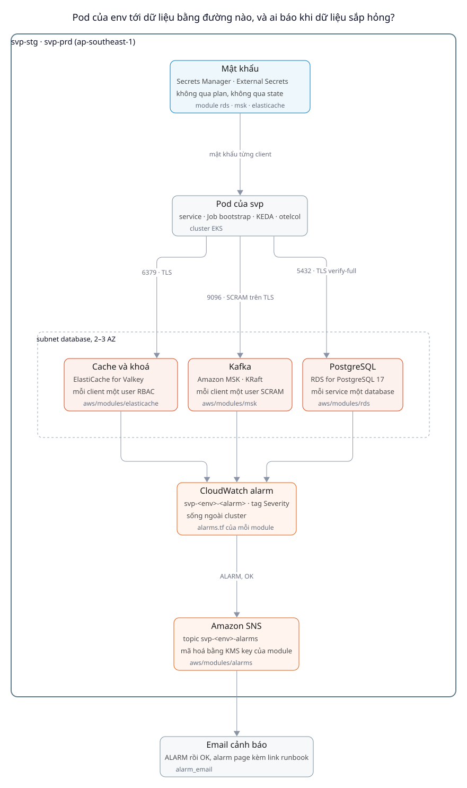
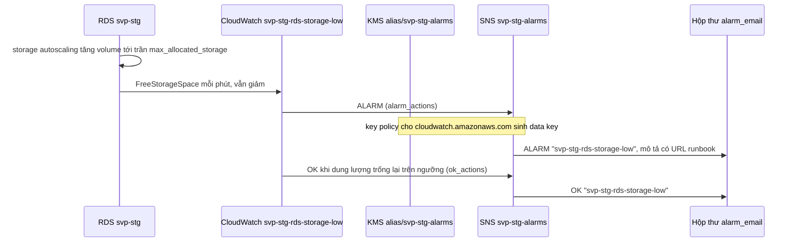

# 11. Dữ liệu

← [10. EKS](10-eks.md) · [Mục lục](README.md) · [12. Media và edge](12-media-edge.md) →

## Tổng quan

Chương này dựng ba kho dữ liệu của một env: PostgreSQL cho dữ liệu của các service, Kafka cho sự kiện giữa chúng, Valkey cho cache,
session và bộ đếm rate limit. Cả ba là dịch vụ managed của AWS: AWS lo máy, bản vá, failover; svp giữ cấu hình, quyền và mật khẩu.
Mỗi client vào bằng một cổng TLS với tài khoản riêng, nên một service bị chiếm không đọc được dữ liệu của service khác.

svp cần phần này vì stg, prd phải chạy đúng phần mềm và đúng đường kết nối như local (cùng TLS, cùng user, cùng quyền), chỉ đổi chỗ
chạy. Kèm theo là đường báo động: alarm CloudWatch đọc metric của ba kho và gửi email khi đĩa sắp đầy hay dữ liệu sắp hỏng. Alarm sống
ngoài cluster, nên cluster chết vẫn báo.

Phần này sống theo buổi: dựng cùng env đầu buổi, gỡ cùng env cuối buổi. Dữ liệu của stg dùng một lần; bản backup sống tiếp ở account
backup (chương [07. Backup](07-backup.md)).

| Câu hỏi | Dịch vụ |
| --- | --- |
| Dữ liệu user, video, like, feed nằm đâu, ai được đọc? | Amazon RDS for PostgreSQL |
| Video vừa upload xong thì ai báo cho feed và media-worker? | Amazon MSK (Kafka) |
| Session, rate limit, cache feed giữ ở đâu cho nhanh? | Amazon ElastiCache for Valkey |
| Mật khẩu của từng client sinh ở đâu, ai thấy được? | AWS Secrets Manager |
| Đĩa, bộ nhớ, partition sắp có chuyện thì ai biết? | Amazon CloudWatch (alarm) |
| Ai nhận báo động, bằng cách nào? | Amazon SNS (email) |

| Account | Region | Vòng đời | Root Terraform |
| --- | --- | --- | --- |
| `svp-stg`, `svp-prd` | `ap-southeast-1` | theo buổi | `aws/envs/<env>` (module `rds`, `msk`, `elasticache`, `alarms`) |
| `svp-security` | `ap-southeast-1` | sống lâu | `aws/security` (module `alarms`, topic cảnh báo bảo mật, chương 05) |
| `svp-prd` | `us-east-1` | sống lâu, cùng hosted zone | `aws/accounts/prd` (module `alarms`, alarm DNSSEC) |

## Kiến trúc

Ba kho nằm ở subnet database của VPC (không route ra Internet): stg 2 AZ, prd 3 AZ. Security group của mỗi kho chỉ nhận đúng một
cổng từ node SG và cluster primary SG của EKS, không rule egress. Mật khẩu Kafka và Valkey đi một chiều: Terraform ghi vào
Secrets Manager, External Secrets đọc vào cluster; mật khẩu master RDS do RDS giữ, script buổi nạp nó vào cluster. Không mật
khẩu nào nằm trong plan hay state.

| Thành phần | Ở đâu | Làm gì |
| --- | --- | --- |
| Instance RDS `svp-<env>` | subnet database | PostgreSQL 17 cho mọi service; mỗi service một database và role, do Job bootstrap của cluster tạo |
| Cluster MSK `svp-<env>` | subnet database, một broker mỗi AZ | Kafka KRaft, chỉ SASL/SCRAM-SHA-512 trên TLS cổng 9096 |
| Replication group `svp-<env>` | subnet database | Valkey cluster mode tắt, chỉ TLS, mỗi client một user RBAC |
| Secret `rds!db-…`, `AmazonMSK_svp-<env>-*` | Secrets Manager của env | Mật khẩu master RDS (RDS quản), user SCRAM của MSK |
| Entry `svp/<env>/kafka-admin`, `kafka-users`, `valkey-users` | Secrets Manager của env | Mật khẩu client mà External Secrets đọc vào cluster |
| KMS key `alias/svp-<env>-rds`, `-msk-scram`, `-alarms` | KMS của env | Mã hoá storage, secret, topic; mỗi module `rds`, `msk`, `alarms` một key, ElastiCache dùng key AWS quản lý |
| Alarm `svp-<env>-<alarm>` | CloudWatch của env | Đọc metric của RDS, MSK, ElastiCache; tag `Severity` `page` hay `ticket` |
| Topic `svp-<env>-alarms` | SNS của env | Gửi `ALARM`, `OK` tới `alarm_email`; cũng nhận cảnh báo của Alertmanager trên AMP |

## Kịch bản thực tế

**Câu hỏi của chương:** Đĩa của PostgreSQL stg sắp đầy giữa buổi thì ai biết, qua đường nào, rồi làm gì?

Buổi stg đang chạy thang k6, service ghi liên tục vào RDS `svp-stg`. Điều kiện: alarm có ở cả stg và prd (cùng bộ); email chỉ tới khi
subscription đã xác nhận ở bước 6–10 của buổi.

1. Dung lượng trống giảm. Storage autoscaling của RDS tự tăng volume, nhưng chỉ tới trần `max_allocated_storage` của env và có thời gian
   chờ giữa hai lần tăng.
2. Alarm `svp-stg-rds-storage-low` đọc `FreeStorageSpace` (dimension `DBInstanceIdentifier`) mỗi 60 giây. Cửa sổ của nó dài hơn cửa sổ
   kích của autoscaling, nên nó chỉ kêu khi autoscaling không cứu được. Ngưỡng và số chu kỳ: `local.alarms` của
   `aws/modules/rds/alarms.tf`.
3. Alarm chuyển `ALARM` và gửi `alarm_actions` tới topic `svp-stg-alarms`. Topic mã hoá bằng KMS key của module `alarms`; key policy
   cho `cloudwatch.amazonaws.com` sinh data key, topic policy cho alarm của chính account và region gửi vào.
4. SNS gửi thư tới `alarm_email`. Alarm mức `page` có URL runbook cùng tên trong `alarm_description`:
   [`rds-storage-low.md`](https://github.com/anhnvcoder/svp-backend/blob/main/docs/runbooks/rds-storage-low.md) của svp-backend.
5. Người học mở runbook: so `AllocatedStorage` với `MaxAllocatedStorage`, đọc sự kiện RDS, dung lượng WAL, câu lệnh nặng. Mọi lệnh AWS
   trong runbook do người học chạy với profile của env.
6. Dung lượng trống lên lại trên ngưỡng thì alarm về `OK`, `ok_actions` gửi thư thứ hai.

Không có số đo thời gian từ lúc vượt ngưỡng tới lúc thư tới. Buổi stg diễn tập đúng đường này bằng `set-alarm-state` ở mục [Alarm tới
email](../runbooks/session-stg-check-security.md#alarm-tới-email) của bước 16.

## Các dịch vụ và cách svp dùng

### Amazon RDS for PostgreSQL

- **Làm gì:** chạy PostgreSQL managed: bản vá minor, backup tự động, khôi phục theo thời điểm, standby Multi-AZ. Ví dụ đời thực:
  - Client nối không TLS bị từ chối ngay lúc kết nối (`rds.force_ssl = 1`): thiếu `sslmode` trong URL của một service là lỗi rõ.
  - Storage autoscaling tăng volume gp3 khi dung lượng trống thấp, không bao giờ giảm.
  - prd: instance chính hỏng thì RDS chuyển sang standby ở AZ khác, cùng endpoint.
  - Mật khẩu master do RDS sinh, giữ trong secret `rds!db-…` và tự xoay vòng; nó không đi qua Terraform.
- **Ở svp:** instance `svp-<env>`, lớp, Multi-AZ, backup và bảo vệ xoá theo env (`aws/envs/<env>/<env>.tfvars`); parameter group
  `svp-<env>-pg17-…` bật `rds.force_ssl` và tham số ghi log câu lệnh chậm, chờ khoá; CA server `rds-ca-rsa2048-g1`, client nối
  `sslmode=verify-full`; tag `Backup = "daily"` đưa instance vào Backup policy của tổ chức; Database Insights chế độ Standard với
  Performance Insights 7 ngày, enhanced monitoring 60 giây, log `postgresql`, `upgrade` gửi CloudWatch Logs.
- **Phí theo:** instance-giờ theo lớp (Multi-AZ gấp đôi); GB-tháng gp3; backup vượt dung lượng database; log gửi CloudWatch Logs theo
  GB; Performance Insights quá 7 ngày; secret master theo secret-tháng; KMS key theo key-tháng.
- **Cố ý tắt:** RDS Proxy và PgBouncer: service giữ pool dài hạn từ ít pod, Job migrate cần khoá advisory mức phiên
  ([ADR-0057](https://github.com/anhnvcoder/svp-backend/blob/main/docs/adr/0057-postgres17-verify-full.md) §7); Database Insights
  chế độ Advanced (tính theo vCPU); major version tự nâng.

### Amazon MSK

- **Làm gì:** chạy Apache Kafka managed: broker, controller KRaft, bản vá, thay broker hỏng. Ví dụ đời thực:
  - Client đăng nhập SASL/SCRAM-SHA-512 bằng user đọc từ secret `AmazonMSK_*` gắn vào cluster.
  - Đổi cấu hình broker tạo revision mới; MSK áp lên từng broker một (rolling restart).
  - Đĩa broker dùng quá mức đích thì storage autoscaling tăng volume, mỗi lần max(10 GiB, 10 %), cách nhau ít nhất 6 giờ.
  - Metric `UnderMinIsrPartitionCount`, `OfflinePartitionsCount`: partition không đủ replica đồng bộ để ghi `acks=all`.
- **Ở svp:** cluster `svp-<env>`, Kafka `4.1.x.kraft`, số broker bằng số AZ, loại broker, replication factor và min ISR theo env;
  configuration `svp-<env>-4-1-x-kraft` tắt tự tạo topic và `unclean.leader.election.enable`; chỉ cổng 9096; mỗi client một user
  (`local.users` của `aws/modules/msk/main.tf`); log broker tới `/aws/msk/svp-<env>`.
- **Phí theo:** broker-giờ theo loại; GB-tháng EBS của broker; dữ liệu client đi qua AZ khác (sao chép giữa broker không tính); log
  broker gửi CloudWatch Logs theo GB; secret theo secret-tháng; KMS key theo key-tháng.
- **Cố ý tắt:** xác thực IAM (ACL Kafka không áp lên danh tính IAM), mTLS và truy cập không xác thực (cổng 9092, 9094, 9098 đóng);
  MSK Serverless (chỉ xác thực IAM, không ACL Kafka, local không có tương đương;
  [ADR-0053 phụ lục](https://github.com/anhnvcoder/svp-backend/blob/main/docs/adr/appendix/0053-msk-elasticache-valkey.md) "Kafka
  cloud").

### Amazon ElastiCache for Valkey

- **Làm gì:** chạy Valkey managed, giao thức Redis: node, replica, failover, bản vá. Ví dụ đời thực:
  - User `svp-gateway` gõ lệnh hay khoá ngoài quyền của nó nhận lỗi `NOPERM`.
  - Bộ nhớ đầy với `maxmemory-policy noeviction`: lệnh ghi lỗi `OOM command not allowed`, không âm thầm mất session hay bộ đếm.
  - prd: primary hỏng thì replica ở AZ khác lên thay (Multi-AZ, automatic failover).
  - stg: thay đổi áp ngay; prd: thay đổi chờ cửa sổ bảo trì, `plan` hiện nó là đang chờ.
- **Ở svp:** replication group `svp-<env>`, Valkey 9.1, cluster mode tắt, số node và loại node theo env; `transit_encryption_mode =
  "required"`; user group `svp-<env>` với một user mỗi client, access string mỗi user giới hạn db và tiền tố khoá (`local.users` của
  `aws/modules/elasticache/main.tf`, cùng chữ với aclfile local của svp-backend); slow-log JSON tới `/aws/elasticache/svp-<env>/slow-log`.
- **Phí theo:** node-giờ theo loại node; dữ liệu client đi qua AZ khác; log gửi CloudWatch Logs theo GB.
- **Cố ý tắt:** snapshot (dữ liệu dựng lại được từ service); cluster mode và ElastiCache Serverless (Serverless luôn chạy cluster
  mode, client phải khác client của local); AUTH token, xác thực IAM (thay bằng user RBAC); user `default` (ElastiCache tắt nó khi
  gắn user group engine Valkey, [RBAC](https://docs.aws.amazon.com/AmazonElastiCache/latest/dg/Clusters.RBAC.html)).

### AWS Secrets Manager

- **Làm gì:** giữ secret mã hoá bằng KMS, có version và xoay vòng. Ví dụ đời thực:
  - Secret `rds!db-…` của mật khẩu master RDS, RDS xoay theo chu kỳ mặc định 7 ngày.
  - Secret `AmazonMSK_svp-stg-svp-feed-service` mà MSK đọc để biết user SCRAM.
  - Entry `svp/stg/valkey-users` mà External Secrets đọc thành Secret của pod.
- **Ở svp:** module `msk` và `elasticache` sinh mật khẩu bằng ephemeral `random_password` và ghi qua đối số write-only, cùng một giá trị
  vào secret của dịch vụ và entry của cluster; vỏ của entry do module `external-secrets` tạo (chương [10. EKS](10-eks.md)).
- **Phí theo:** secret-tháng; mỗi 10 000 lệnh API.

### Amazon CloudWatch (alarm)

- **Làm gì:** so một metric hay biểu thức metric với ngưỡng mỗi chu kỳ, đổi trạng thái `OK`, `ALARM`, `INSUFFICIENT_DATA` và gửi hành
  động. Ví dụ đời thực:
  - `svp-stg-rds-txid-wraparound`: transaction ID đã dùng quá ngưỡng, vacuum phải freeze trước khi PostgreSQL ngừng ghi.
  - `svp-stg-msk-disk-high`: broker đầy nhất (metric math `MAX` qua mọi broker) vượt ngưỡng đĩa.
  - `svp-stg-valkey-memory-high`: node đầy nhất sắp chạm `maxmemory`.
  - `aws cloudwatch set-alarm-state` ép một alarm sang `ALARM` để thử đường tới email.
- **Ở svp:** mỗi module dịch vụ có `alarms.tf` riêng: tên `svp-<env>-<alarm>`, chu kỳ 60 giây, tag `Severity`, `alarm_actions` và
  `ok_actions` tới `alarm_topic_arn`. Bảng alarm, ngưỡng và nguồn:
  [ADR-0058](https://github.com/anhnvcoder/svp-backend/blob/main/docs/adr/0058-managed-data-operations.md) §2, §3; code giữ số.
- **Phí theo:** metric của alarm mỗi tháng (alarm metric math tính từng metric nó đọc).
- **Cố ý tắt:** alarm `CurrConnections`, `ReplicationLag` của ElastiCache (chưa có baseline), `ActiveControllerCount` của MSK
  (controller do MSK quản).

### Amazon SNS

- **Làm gì:** topic nhận thông báo và gửi tới mọi subscription; ở đây là email. Ví dụ đời thực:
  - Thư "AWS Notification - Subscription Confirmation" sau apply: chưa mở link xác nhận thì topic không gửi gì tới địa chỉ đó.
  - Thư `ALARM: "svp-stg-rds-storage-low"` rồi thư `OK` cùng tên.
  - Cảnh báo `ArgoCDApplicationDegraded` của Alertmanager trên AMP tới cùng topic.
- **Ở svp:** topic `svp-<env>-alarms` mã hoá bằng key `alias/svp-<env>-alarms`, publisher `cloudwatch.amazonaws.com` và
  `aps.amazonaws.com`, subscription email `alarm_email` của `<env>.auto.tfvars` (không commit). Cùng module dựng topic
  `svp-security-alarms` (chương 05) và `svp-prd-dns-alarms` ở `us-east-1`.
- **Phí theo:** số thông báo email; KMS key của topic theo key-tháng và số request.

## Chi phí

| Khoản | Đơn vị tính | Giữa các buổi | Trong buổi | Nguồn |
| --- | --- | --- | --- | --- |
| RDS instance | instance-giờ | 0 (gỡ cùng env) | stg `db.t4g.small` single-AZ ~0,051 USD/giờ; prd `db.m7g.large` Multi-AZ ~0,468 USD/giờ | ADR-0057 phụ lục "Giá instance" |
| RDS storage gp3 | GB-tháng | 0; prd giữ snapshot cuối và backup tự động, tính như lưu trữ backup, không có số đo | ~0,138 USD mỗi GB-tháng | ADR-0034 phụ lục [N7] |
| MSK broker và EBS | broker-giờ, GB-tháng | 0 | stg ~0,116 USD/giờ (2 broker); prd ~0,765 USD/giờ (3 broker); EBS ~0,12 USD mỗi GB-tháng | ADR-0053 phụ lục "Chi phí" |
| ElastiCache | node-giờ | 0 | stg ~0,019 USD/giờ (1 node); prd ~0,315 USD/giờ (2 node) | ADR-0053 phụ lục "Chi phí" |
| MSK, ElastiCache, secret, KMS cộng lại | giờ env chạy | 0; KMS key chờ xoá 7 ngày không tính phí | stg ~0,144 USD/giờ; prd ~1,09 USD/giờ | ADR-0053 phụ lục "Chi phí" (H_k) |
| Alarm CloudWatch | metric của alarm-tháng | 0 | ~0,10 USD mỗi metric của alarm-tháng | ADR-0058 §Hệ quả, [N4] |
| SNS email, KMS key của topic | thư, key-tháng | không có số đo | không có số đo | trang giá của dịch vụ |

Tổng phí một buổi của cả env ở chương [15. Chi phí](15-cost.md). Nguồn:
[ADR-0057 phụ lục](https://github.com/anhnvcoder/svp-backend/blob/main/docs/adr/appendix/0057-postgres17-verify-full.md),
[ADR-0053 phụ lục](https://github.com/anhnvcoder/svp-backend/blob/main/docs/adr/appendix/0053-msk-elasticache-valkey.md#chi-phí),
[ADR-0034 phụ lục](https://github.com/anhnvcoder/svp-backend/blob/main/docs/adr/appendix/0034-aws-stage7.md).

## Kiểm tra và vận hành

Đăng nhập console của account env qua access portal với quyền chỉ đọc (profile `anhnv-<env>-ro`).

| Muốn xem | Account | Region | Vào đâu | Trạng thái mong đợi |
| --- | --- | --- | --- | --- |
| Instance PostgreSQL | `svp-<env>` | `ap-southeast-1` | RDS → Databases → `svp-<env>` | `Available`; Multi-AZ `No` ở stg, `Yes` ở prd; không public |
| Cluster Kafka | `svp-<env>` | `ap-southeast-1` | MSK → Clusters → `svp-<env>` | `Active`; xác thực chỉ SASL/SCRAM; mỗi AZ một broker |
| Valkey | `svp-<env>` | `ap-southeast-1` | ElastiCache → Valkey caches → `svp-<env>` | `Available`; mã hoá in-transit `required`; user group `svp-<env>` |
| Mật khẩu | `svp-<env>` | `ap-southeast-1` | Secrets Manager | `rds!db-…`, `AmazonMSK_svp-<env>-*`, các entry `svp/<env>/kafka-admin`, `kafka-users`, `valkey-users` có giá trị |
| Alarm | `svp-<env>` | `ap-southeast-1` | CloudWatch → Alarms, lọc `svp-<env>-` | Mọi alarm `OK` hay `Insufficient data` |
| Subscription email | `svp-<env>` | `ap-southeast-1` | SNS → Topics → `svp-<env>-alarms` | Subscription `Confirmed` |

Bảng trên là trạng thái mà code khai báo. Phần đã kiểm thật là phần runbook buổi
[`session-stg.md`](../runbooks/session-stg.md) có bước: xác nhận email của alarm sau apply (bước 6–10), mục Alarm tới email, Kafka
và Valkey managed, Nền tảng EKS và TLS Postgres của bước 16, đổi mật khẩu Kafka hay Valkey ở mục [Đổi một secret của env
đang chạy](../runbooks/session-stg.md#đổi-một-secret-của-env-đang-chạy). Mỗi alarm `page` có runbook cùng tên ở
[`docs/runbooks/`](https://github.com/anhnvcoder/svp-backend/tree/main/docs/runbooks) của svp-backend.

## Thiết kế và đánh đổi

### stg và prd khác nhau ở đâu

Hai env cùng module, cùng dịch vụ, cùng mã hoá và cùng bộ alarm; khác ở độ dư, cỡ và mức bảo vệ dữ liệu. Giá trị đọc ở
`aws/envs/stg/stg.tfvars` và `aws/envs/prd/prd.tfvars`, kèm comment lý do mỗi nhóm:

| Khía cạnh | stg | prd |
| --- | --- | --- |
| RDS | lớp T Graviton, một AZ, backup 1 ngày, xoá cùng env không để lại backup hay snapshot | lớp M Graviton, Multi-AZ, backup 7 ngày còn sau khi xoá, chặn xoá, snapshot cuối |
| MSK | broker T3, RF 2, min ISR 1: mất một AZ vẫn ghi, có thể mất event đã xác nhận | broker M7g, RF 3, min ISR 2: mất một AZ vẫn ghi, không mất event đã xác nhận |
| ElastiCache | một node micro, không replica, thay đổi áp ngay | primary và replica khác AZ, failover tự động, thay đổi chờ cửa sổ bảo trì |
| Log | giữ 1 ngày | giữ 30 ngày |

Hai biến bảo vệ dữ liệu của RDS (`deletion_protection`, `skip_final_snapshot`) và ba biến độ bền của MSK (số broker, RF, min ISR) không
có mặc định: mỗi env phải ghi rõ, quên thì Terraform báo thiếu biến thay vì chọn giúp. Validation của module MSK từ chối RF lớn hơn số
broker, min ISR không nhỏ hơn RF (khi RF > 1) và số broker không chia hết cho số subnet.

### Mật khẩu không qua plan và state

RDS tự giữ mật khẩu master (`manage_master_user_password`). Mật khẩu Kafka và Valkey do Terraform sinh bằng ephemeral `random_password`
(chỉ chữ và số, vì nó chèn thẳng vào JAAS, `REDIS_URL`, aclfile) và ghi qua đối số write-only, nên plan, state, output không chứa nó.
Mỗi lần plan sinh giá trị mới, nhưng chỉ ghi khi `password_version` đổi; mọi lần ghi của một nhóm (secret dịch vụ và entry của
cluster) dùng cùng version và cùng giá trị.

Cái giá: apply dừng giữa chừng (một `PutSecretValue` lỗi, Ctrl-C, ElastiCache từ chối một access string) làm phần đã ghi và phần chưa
ghi lệch nhau, mà `plan` sau đó vẫn `No changes`; client bị từ chối (`WRONGPASS`, SCRAM thất bại). Thêm user vào `local.users` trên env
đang sống cũng lệch như vậy. Gỡ: tăng `password_version` rồi apply. Đổi mật khẩu một nhóm cũng bằng cách đó, mọi user của nhóm đổi cùng
lúc vì entry là một. `make eks-secrets` của svp-backend không ghi các entry này: module là nơi duy nhất ghi. Lý do và phương án:
[ADR-0053](https://github.com/anhnvcoder/svp-backend/blob/main/docs/adr/0053-msk-elasticache-valkey.md) §12.

### Topic alarm mã hoá bằng KMS key riêng

CloudWatch, EventBridge không gửi được vào topic mã hoá bằng key AWS quản lý của SNS (`alias/aws/sns`): key policy của key đó không
sửa được để cho principal dịch vụ dùng. Module `alarms` tạo key riêng, cho mỗi publisher chỉ `kms:Decrypt`, `kms:GenerateDataKey*`,
và thay topic policy mặc định bằng điều kiện confused deputy theo từng dịch vụ:

| Publisher | Root dùng | `aws:SourceArn` trong topic policy | Điều kiện nguồn trong key policy | Nguồn |
| --- | --- | --- | --- | --- |
| `cloudwatch.amazonaws.com` | `aws/envs/<env>`, `aws/accounts/prd` | alarm của account và region | có | [CloudWatch](https://docs.aws.amazon.com/AmazonCloudWatch/latest/monitoring/Notify_Users_Alarm_Changes.html#SNS_Confused_Deputy) |
| `aps.amazonaws.com` | `aws/envs/<env>` | đúng workspace AMP của env | không, theo hướng dẫn của AMP | [AMP](https://docs.aws.amazon.com/prometheus/latest/userguide/AMP-alertmanager-receiver-AMPpermission.html) |
| `events.amazonaws.com` | `aws/security` | rule EventBridge của account và region | không: SNS không hỗ trợ khi EventBridge gửi vào topic mã hoá | [EventBridge](https://docs.aws.amazon.com/eventbridge/latest/userguide/eb-use-resource-based.html#eb-sns-permissions), [SNS](https://docs.aws.amazon.com/sns/latest/dg/sns-key-management.html#compatibility-with-aws-services) |

Mọi principal bị từ chối `sns:Publish` khi không qua TLS. Alarm chỉ gửi được tới topic cùng region, nên alarm DNSSEC ở
`us-east-1` có topic riêng `svp-prd-dns-alarms`. Lý do:
[ADR-0058](https://github.com/anhnvcoder/svp-backend/blob/main/docs/adr/0058-managed-data-operations.md) §1.

| Lựa chọn của svp | Cái giá | Phương án khác | Khi nào chọn nó |
| --- | --- | --- | --- |
| Một instance RDS cho mọi service, mỗi service một database và role | Một service nặng ảnh hưởng service khác; một điểm hỏng chung | Mỗi service một instance, hay Aurora | Tải tách biệt rõ, đội riêng mỗi service, ngân sách cho nhiều instance |
| RDS for PostgreSQL, không Aurora | Standby Multi-AZ không phục vụ đọc; read replica phải thêm riêng | Amazon Aurora PostgreSQL | Cần nhiều replica đọc, Global Database |
| MSK provisioned, broker theo AZ | Trả theo broker-giờ cả khi rảnh | MSK Serverless (chỉ IAM), Amazon Kinesis Data Streams | Tải thất thường, client dùng được IAM hay API Kinesis |
| ElastiCache node-based, không snapshot | Mất cache khi gỡ; cỡ node chọn tay | ElastiCache Serverless (luôn cluster mode) | Tải khó đoán, client nói giao thức cluster |
| Alarm CloudWatch tới email | Một hộp thư, không trực, alarm ở CloudWatch tách khỏi Alertmanager | Gom về Alertmanager, kênh trực ngoài | Có đội trực, cần escalation |
| Mật khẩu bằng ephemeral, write-only | Lệch khi apply dừng giữa chừng, phải tăng version | Secrets Manager rotation Lambda, xác thực IAM | Cần xoay từng user riêng, client hỗ trợ IAM |

## Liên hệ đề SAP

- "Skill 1.5.3: Select appropriate database services based on workload requirements such as access patterns, consistency needs, and
  scalability (for example, Amazon RDS, Amazon Aurora, Amazon DynamoDB, Amazon Redshift)." Ba kho cho ba kiểu truy cập: quan hệ
  (RDS), sự kiện có thứ tự (MSK), khoá–giá trị trong bộ nhớ (Valkey).
- "Skill 1.5.4: Design database scaling solutions to provide high availability (for example, by using read replicas, Amazon Aurora
  Global Database, Amazon DynamoDB global tables, Amazon RDS Multi-AZ deployments)." RDS Multi-AZ, MSK RF 3 min ISR 2, Valkey failover
  ở prd.
- "Skill 1.5.6: Design data caching strategies to optimize performance (for example, by using ElastiCache, DynamoDB Accelerator
  [DAX])." Valkey giữ cache feed, session, rate limit với `noeviction`.
- "Skill 1.5.2: Design real-time and batch analytics pipelines (for example, by using Amazon EMR, Amazon Redshift, Amazon Managed
  Streaming for Apache Kafka [Amazon MSK], Amazon AppFlow)." svp dùng MSK làm bus sự kiện giữa service, phần MSK của skill này.
- "Skill 5.3.4: Configure alerting solutions (for example, by using CloudWatch alarms, Amazon SNS, AWS Systems Manager)." Alarm trong
  module dịch vụ, topic mã hoá CMK, email kèm runbook.

| Tình huống trong đề | Chọn | Vì sao không chọn cái gần giống |
| --- | --- | --- |
| PostgreSQL phải tự chuyển sang AZ khác khi hỏng, cùng endpoint | RDS Multi-AZ | Read replica phục vụ đọc, có endpoint riêng, phải promote mới thành primary |
| Snapshot mã hoá phải copy sang account backup | KMS key customer managed, key policy cho account đích | Snapshot mã hoá bằng key AWS quản lý (`aws/rds`) không chia sẻ chéo account được |
| Nhiều consumer group đọc lại cùng luồng sự kiện, giữ thứ tự theo khoá, client Kafka có sẵn | Amazon MSK | SQS xoá message sau khi xử lý, không đọc lại; Kinesis Data Streams đọc lại được nhưng không nói giao thức Kafka |
| Cache session và bộ đếm với lệnh Redis | ElastiCache for Valkey | DAX chỉ cache cho DynamoDB |
| Hàng nghìn kết nối ngắn (Lambda) tới RDS | RDS Proxy | Tăng lớp instance chỉ nâng trần kết nối, không gom kết nối |
| Báo động khi cụm Kubernetes chết | CloudWatch alarm tới SNS | Alertmanager chạy trong cluster chết cùng cluster |
| Không để mật khẩu DB trong state Terraform | `manage_master_user_password`, đối số write-only | Biến `sensitive` chỉ che output, giá trị vẫn nằm trong state |

## Đọc sâu

- Đổi KMS key hay major version của RDS buộc tạo instance mới: mất dữ liệu nếu không restore từ snapshot. stg chấp nhận vì dựng lại mỗi
  buổi; prd đổi một trong hai cần kế hoạch restore riêng.
- Key của RDS cho account backup `kms:Decrypt`, `kms:DescribeKey`, `kms:GenerateDataKey` và `kms:CreateGrant` có điều kiện
  `kms:GrantIsForAWSResource`, không điều kiện `kms:ViaService` `backup.*`: snapshot RDS do RDS sao chép, grant không đi qua AWS Backup
  (ADR-0067 phụ lục §6). Backup policy chọn instance theo tag `Backup`, chỉ mẫu ARN instance, không snapshot.
- Ngưỡng `rds-storage-low` tính theo `allocated_storage` lúc apply, không theo dung lượng autoscaling đã tăng. Các ngưỡng theo lớp
  instance nằm ở `local.class_alarm_thresholds`; lớp khác bị validation từ chối tới khi thêm ngưỡng của nó.
- Script buổi (`aws/scripts/bootstrap.sh`) đọc mật khẩu master từ output `rds_master_user_secret_arn` của root env ngay trước khi
  nạp secret nguồn `pg-superuser` của cluster (chỉ `password`, username luôn `postgres`). Một lần RDS xoay mật khẩu giữa buổi làm secret
  trong cluster cũ đi: Job bootstrap chạy lại không đăng nhập được tới khi nạp lại; script không tính tới buổi dài hơn chu kỳ xoay.
- Database Insights Standard và Performance Insights 7 ngày miễn phí; với PostgreSQL không giới hạn lớp instance
  ([Database Insights](https://docs.aws.amazon.com/AmazonRDS/latest/UserGuide/USER_DatabaseInsights.html),
  [bật Standard](https://docs.aws.amazon.com/AmazonRDS/latest/UserGuide/USER_DatabaseInsights.TurningOnStandard.html),
  [lưu ý](https://docs.aws.amazon.com/AmazonRDS/latest/UserGuide/USER_DatabaseInsights.Considerations.html),
  [engine](https://docs.aws.amazon.com/AmazonRDS/latest/UserGuide/USER_DatabaseInsights.Engines.html),
  [phí Performance Insights](https://docs.aws.amazon.com/AmazonRDS/latest/UserGuide/USER_PerfInsights.Overview.cost.html)).
- MSK đồng bộ secret SCRAM tới broker trong tối đa 10 phút: kết nối mới bằng mật khẩu mới có thể bị từ chối trong lúc đó; Job
  `kafka-init` thử lại ít nhất 10 phút. MSK gắn resource policy của nó vào mỗi secret `AmazonMSK_*`; module không quản policy đó.
- MSK storage autoscaling: volume đã tăng giữ tới khi xoá cluster, một env sống một buổi tăng được tối đa một lần
  ([MSK automatic scaling](https://docs.aws.amazon.com/msk/latest/developerguide/msk-autoexpand.html)); đổi `broker_volume_size` sau
  khi cluster đã có chỉ đổi mức sàn của autoscaling.
- Thay đổi nào của ElastiCache chờ cửa sổ bảo trì, áp ngay hay restart node: bảng của
  [Modifying a cluster](https://docs.aws.amazon.com/AmazonElastiCache/latest/dg/Clusters.Modify.html). Tên replication group vào log
  Certificate Transparency công khai qua cert TLS của node: chỉ đặt `svp-<env>`. Đổi một access string thì đổi cùng aclfile local
  (`deploy/valkey/` của svp-backend) và ADR-0053 §9.
- Sót sau destroy: KMS key của ba module vào `PendingDeletion` 7 ngày, alias xoá ngay; snapshot cuối, backup tự động và recovery
  point AWS Backup trong vault của account env (prd) mã hoá bằng key RDS, muốn còn restore được thì `aws kms
  cancel-key-deletion` trong 7 ngày đó (bản copy ở account backup không phụ thuộc key này). Backup tự động của prd còn tới hết
  `backup_retention_period`, snapshot cuối `svp-prd-final-<hex>` còn tới khi xoá tay, cả hai tính phí lưu trữ backup và mang tag
  `Project=svp` của root. `deletion_protection` của prd chặn destroy ở instance tới khi apply với `teardown.tfvars`. Destroy dở
  để lại secret `rds!db-…`, `AmazonMSK_svp-`, configuration MSK; xoá cluster MSK ngoài Terraform để lại alarm target tracking
  `TargetTracking-arn:aws:kafka:…`. Subscription email chưa xác nhận không huỷ được: destroy chỉ bỏ nó khỏi state, AWS tự xoá
  sau. `sweep.sh` liệt kê configuration MSK, secret `AmazonMSK_svp-`, alarm `TargetTracking-…`; secret `rds!db-…` thì tìm trong
  Secrets Manager, kể cả secret đang chờ xoá.

Làm và tra cứu:

- [`session-stg.md`](../runbooks/session-stg.md): dựng env (bước 6–10), xác nhận email, phép kiểm của bước 16, đổi mật khẩu.
- Module [`rds`](../../aws/modules/rds/README.md), [`msk`](../../aws/modules/msk/README.md),
  [`elasticache`](../../aws/modules/elasticache/README.md), [`alarms`](../../aws/modules/alarms/README.md): đối số, output.
- [ADR-0053](https://github.com/anhnvcoder/svp-backend/blob/main/docs/adr/0053-msk-elasticache-valkey.md): MSK và ElastiCache, user,
  mật khẩu.
- [ADR-0057](https://github.com/anhnvcoder/svp-backend/blob/main/docs/adr/0057-postgres17-verify-full.md): PostgreSQL 17, TLS
  `verify-full`, RDS chuẩn.
- [ADR-0058](https://github.com/anhnvcoder/svp-backend/blob/main/docs/adr/0058-managed-data-operations.md): bảng alarm, MSK autoscaling,
  bảo trì ElastiCache.
- [Runbook alarm](https://github.com/anhnvcoder/svp-backend/tree/main/docs/runbooks) của svp-backend: một trang mỗi alarm `page`.
