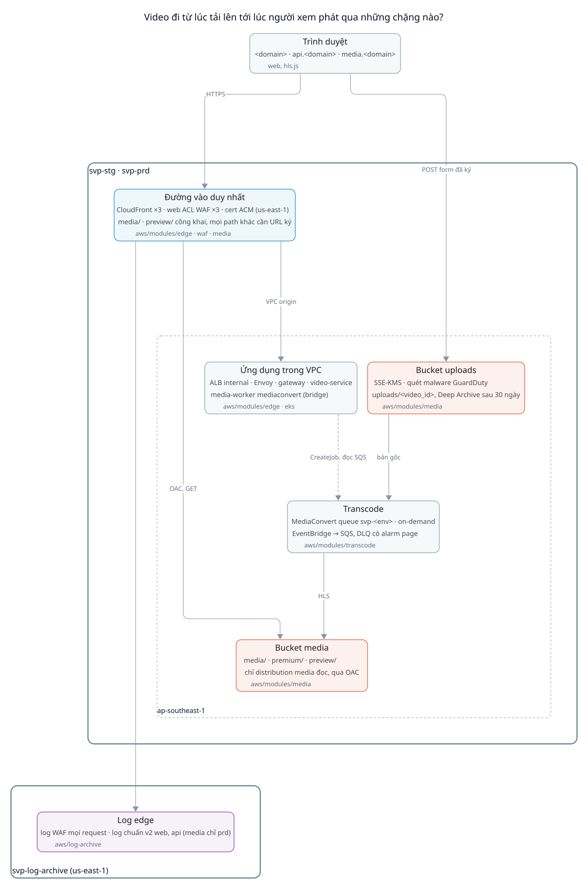
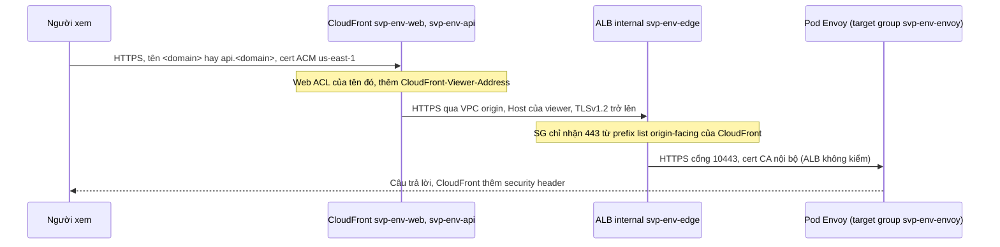

# 12. Media và edge

← [11. Dữ liệu](11-data.md) · [Mục lục](README.md) · [13. GitOps](13-gitops.md) →

## Tổng quan

Chương này dựng đường vào của người xem và đường đi của video. Người xem chỉ tới svp qua CloudFront, với ba tên: `<domain>` (web),
`api.<domain>` (API), `media.<domain>` (video), trong đó `<domain>` là biến `domain` của env, thường là tên zone của env (`aws.<domain>` ở
prd, `stg.aws.<domain>` ở stg, theo domain gốc của các runbook); mỗi tên một distribution có tường lửa WAF riêng. Web và API đi tiếp vào VPC
tới một load balancer không có địa chỉ công khai; video đọc từ S3. Không load balancer nào mở ra Internet.

svp cần phần này vì đây là chỗ duy nhất người lạ chạm vào hệ thống: request xấu bị chặn ở edge trước khi tới VPC, cert HTTPS do AWS
cấp và gia hạn, video được cache gần người xem. Video premium chỉ phát cho người có vé: API ký URL từng rendition, CloudFront kiểm chữ
ký trước khi trả segment. Phía sau, file người dùng tải lên được MediaConvert chuyển thành HLS; trạng thái job quay về qua hàng đợi, nên
worker tắt giữa chừng không làm mất kết quả.

Phần này sống theo buổi: dựng cùng env đầu buổi, gỡ cùng env cuối buổi, kể cả khoá ký URL. Hosted zone, CAA,
DNSSEC sống lâu ở account env (chương [08. Accounts](08-accounts.md)); log của edge sống tiếp ở account
Log Archive (chương [04. Log Archive](04-log-archive.md)).

| Câu hỏi | Dịch vụ |
| --- | --- |
| Ai trả lời khi trình duyệt gõ `<domain>`, `api.<domain>`, `media.<domain>`? | Amazon CloudFront, Amazon Route 53 |
| Một IP gửi hàng nghìn request, hay request mang mẫu khai thác đã biết, bị chặn ở đâu? | AWS WAF |
| Người không có vé có tải được segment của video premium không? | CloudFront signed URL, key group |
| Không có load balancer công khai thì request web, API vào VPC bằng cửa nào? | CloudFront VPC origin, Application Load Balancer |
| Cert HTTPS của ba tên do ai cấp và gia hạn? | AWS Certificate Manager |
| File gốc và HLS nằm đâu, ai được đọc? | Amazon S3, AWS KMS |
| Ai biến file upload thành HLS, và báo xong qua đâu? | AWS Elemental MediaConvert, Amazon EventBridge, Amazon SQS |
| File upload có mã độc thì ai biết? | Amazon GuardDuty Malware Protection for S3 |

| Account | Region | Vòng đời | Root Terraform |
| --- | --- | --- | --- |
| `svp-stg`, `svp-prd` | `ap-southeast-1`: bucket, ALB, MediaConvert, SQS, EventBridge | theo buổi | `aws/envs/<env>` (module `media`, `edge`, `transcode`) |
| `svp-stg`, `svp-prd` | `us-east-1`: web ACL, cert viewer, nguồn log CloudFront; CloudFront toàn cầu | theo buổi | `aws/envs/<env>` (module `waf` ở `waf.tf`; `edge`, `media`) |
| `svp-log-archive` | `us-east-1` | sống lâu | `aws/log-archive` (bucket log WAF, bucket log CloudFront, delivery destination `svp-cloudfront-<env>`) |

## Kiến trúc

<picture>
  <source media="(prefers-color-scheme: dark)" srcset="../diagrams/12-media-edge-dark.svg">
  
</picture>

Ba distribution và ba web ACL cùng tên `svp-<env>-web`, `-api`, `-media`. Web và API dùng chung VPC origin `svp-<env>-edge` tới ALB
internal ở tầng subnet edge ([09. Env và mạng](09-envs-network.md)), rồi tới pod Envoy mà `TargetGroupBinding` của chart `svp-cluster`
đăng ký; Envoy chọn route theo Host. Media đọc bucket qua origin access control (OAC). Form upload đi thẳng từ trình duyệt tới bucket
uploads, không qua CloudFront. Ranh giới tin cậy là account; region trong sơ đồ chỉ vị trí.

| Thành phần | Ở đâu | Làm gì |
| --- | --- | --- |
| Distribution `svp-<env>-web`, `-api` | CloudFront, cert ở `us-east-1` | Tên `<domain>`, `api.<domain>`; không cache trừ `/_next/static/*`; chuyển mọi header, cookie, query tới origin |
| Distribution `svp-<env>-media` | CloudFront, cert ở `us-east-1` | Tên `media.<domain>`; behavior mặc định đòi chữ ký, `media/*`, `preview/*` công khai |
| Web ACL `svp-<env>-web`, `-api`, `-media` | AWS WAF scope `CLOUDFRONT`, `us-east-1` | Rate limit theo IP, ba nhóm luật managed; web thêm Bot Control, api thêm ATP |
| VPC origin, ALB `svp-<env>-edge`, target group `svp-<env>-envoy` | VPC env, subnet edge | ALB internal chỉ nhận 443 từ prefix list origin-facing của CloudFront |
| Key group `svp-<env>-media`, entry `svp/<env>/media-signing` | CloudFront; Secrets Manager của env | Khoá công khai kiểm URL ký; khoá riêng mà video-service ký |
| Bucket `svp-<env>-uploads-<account>-<region>` | S3, key `alias/svp-<env>-uploads` | Bản gốc người dùng tải lên: SSE-KMS, quét malware |
| Bucket `svp-<env>-media-<account>-<region>` | S3 | HLS, thumbnail dưới `media/`, `premium/`, `preview/`; bản ghi job dưới `transcode-jobs/` |
| Queue `svp-<env>`, role `svp-<env>-mediaconvert` | MediaConvert, IAM | Job on-demand; role chỉ đọc `uploads/*`, ghi `media/*`, `premium/*` |
| Rule `svp-<env>-mediaconvert-job-state`, SQS `svp-<env>-transcode-events` và `-dlq` | EventBridge bus mặc định, SQS | Trạng thái cuối của job về bridge; DLQ có alarm `page` |
| Log WAF, log chuẩn v2 của CloudFront | Account Log Archive, `us-east-1` | Bucket `aws-waf-logs-svp-<log>-us-east-1`; delivery destination `svp-cloudfront-<env>` |

## Kịch bản thực tế

**Câu hỏi của chương:** Một video tải lên ở stg đi qua những chặng nào tới khi người xem phát HLS ở `media.<domain>`?

Điều kiện: env stg, region `ap-southeast-1` trừ chỗ ghi khác, media pay-as-you-go như prd (`media_flat_rate_free = false` của
`stg.tfvars`). prd đi cùng đường.

1. Trình duyệt mở `https://<domain>`. Route 53 trả bản ghi alias tới distribution `svp-stg-web`; web ACL `svp-stg-web` xét request;
   CloudFront đi qua VPC origin `svp-stg-edge` tới ALB internal, rồi Envoy, rồi `web`. Lệnh API tới `api.<domain>` đi qua `svp-stg-api`,
   cùng VPC origin, Envoy chọn route theo Host tới `gateway`.
2. video-service ký form POST presigned cho key `uploads/<video_id>`. Trình duyệt POST thẳng tới
   `https://svp-stg-uploads-<account>-ap-southeast-1.s3.ap-southeast-1.amazonaws.com`; CORS của bucket chỉ nhận `POST` từ
   `https://<domain>`. S3 mã hoá object bằng key `alias/svp-stg-uploads`, data key sinh bằng quyền của người ký form (video-service
   có `kms:GenerateDataKey`).
3. GuardDuty Malware Protection quét object mới và gắn tag `GuardDutyMalwareScanStatus`. Chưa service nào đọc tag: file nhiễm vẫn được
   transcode; finding đi theo đường cảnh báo của GuardDuty ([05. Bảo mật](05-security.md)).
4. Web gọi `POST /videos/{id}/complete`. video-service `HEAD` key đó (quyền `s3:ListBucket` làm key thiếu trả 404 chứ không 403), rồi
   phát `video.uploaded` lên Kafka.
5. Bridge `media-worker mediaconvert` nhận event, gọi `Probe` trên file gốc, rồi `CreateJob` trên queue `svp-stg` với role
   `svp-stg-mediaconvert` (`iam:PassRole` chỉ cho `mediaconvert.amazonaws.com`), qua endpoint interface `mediaconvert` của VPC.
   MediaConvert đọc `uploads/<video_id>` bằng role đó (cần `kms:Decrypt` trên key `uploads`) và ghi HLS vào
   `media/<video_id>/<version>/<attempt>/` (video premium: dưới `premium/`).
6. Job `COMPLETE`: event `MediaConvert Job State Change` trên bus mặc định khớp rule `svp-stg-mediaconvert-job-state` và vào SQS
   `svp-stg-transcode-events`. Bridge đọc message, chép tại chỗ từng object để đặt `Cache-Control: max-age=31536000, immutable`, tạo
   `master.m3u8`, phát `transcode.completed`. Message bridge không xử lý được, hay event EventBridge không giao được, vào
   `svp-stg-transcode-events-dlq`; alarm cùng tên gửi topic `svp-stg-alarms` ([11. Dữ liệu](11-data.md)).
7. Người xem phát `https://media.<domain>/media/<video_id>/<version>/master.m3u8`. Web ACL `svp-stg-media` xét request; path khớp
   behavior công khai `media/*`; cache trượt thì CloudFront đọc bucket media qua OAC, lần sau edge trả từ cache. Video premium: API trả
   playlist rendition có URL ký cho từng segment; `premium/…` rơi vào behavior mặc định, CloudFront kiểm chữ ký bằng key group
   `svp-stg-media` trước khi tìm trong cache; thiếu chữ ký hay quá hạn thì 403.
8. Ba web ACL ghi mọi request vào bucket log WAF của `svp-log-archive`; ba distribution `svp-stg-web`, `svp-stg-api`, `svp-stg-media`
   giao log chuẩn v2 qua delivery destination `svp-cloudfront-stg`.

Không có số đo thời gian từ lúc tải lên tới lúc video `READY` (ADR-0066 "Xác nhận"). Buổi stg kiểm đường này ở trang phép kiểm
edge và media ([`session-stg-check-edge-media.md`](../runbooks/session-stg-check-edge-media.md)). Luồng bên trong bridge (Probe,
bản ghi job, quyết định kết quả):
[`transcode.md`](https://github.com/anhnvcoder/svp-backend/blob/main/docs/explanation/transcode.md) của svp-backend.

## Các dịch vụ và cách svp dùng

### Amazon CloudFront

- **Làm gì:** CDN và điểm kết thúc TLS ở edge location; mỗi distribution một tên, một cert, một web ACL. Ví dụ đời thực:
  - `http://media.<domain>/…` nhận 403 (`https-only`); `http://<domain>` được chuyển sang HTTPS (`redirect-to-https`).
  - Lần tải thứ hai của cùng segment có header `X-Cache: Hit from cloudfront`.
  - Trình duyệt tự gửi `CloudFront-Viewer-Address`: CloudFront đè bằng địa chỉ thật trước khi tới origin, gateway đọc IP từ đó.
  - Key không có trong bucket media trả 403, không 404: policy bucket không cho liệt kê.
- **Ở svp:** web, api: cache policy `Managed-CachingDisabled` (riêng `/_next/static/*` của web là `Managed-CachingOptimized`), origin
  request policy `Managed-AllViewerAndCloudFrontHeaders-2022-06`, response headers policy `svp-<env>-web`, `-api` (HSTS không `preload`,
  `nosniff`, `X-Frame-Options`; api thêm CSP). Media: `Managed-CachingOptimized`, OAC ký SigV4 mọi request. Chung: HTTP/2 và HTTP/3,
  IPv6, `PriceClass_All`, viewer `sni-only` với `TLSv1.2_2025`. Media ở cả hai env pay-as-you-go (`media_flat_rate_free = false`) với
  response headers policy `svp-<env>-media` (CORS chỉ origin của web, HSTS, `nosniff`) và log chuẩn; nhánh gói flat-rate Free của module
  `media` (policy managed `Managed-SimpleCORS`, không log chuẩn) còn trong code, không env nào bật.
- **Phí theo:** pay-as-you-go: GB ra Internet và request HTTPS, có hạn mức miễn phí mỗi tháng; gói flat-rate: theo tháng mỗi
  distribution; VPC origin không phí riêng; log chuẩn v2: GB giao.
- **Cố ý tắt:** origin request policy ở media: S3 không thấy `Origin`, nên mọi viewer dùng chung một bản cache và CloudFront trả CORS.

### CloudFront signed URL và key group

- **Làm gì:** behavior có key group tin cậy chỉ trả object cho URL mang chữ ký hợp lệ của một khoá trong group. Ví dụ đời thực:
  - Segment `premium/…` với query `Policy`, `Signature`, `Key-Pair-Id`, `Hash-Algorithm=SHA256` trả 200 tới hạn của policy.
  - Cùng URL bỏ query chữ ký, hay sau hạn `DateLessThan`: 403.
  - Chữ ký cho rendition `360p` không mở `720p`: custom policy phủ đúng tiền tố `index_360p_*` của một lần thử.
  - Khoá công khai rời key group: mọi URL ký bằng khoá riêng của nó trả 403.
- **Ở svp:** key group `svp-<env>-media` ở behavior mặc định của distribution media; public key `svp-<env>-media-<ô>-<8 hex của
  sha256(PEM)>`, ô `a`, `b`, `create_before_destroy`. Khoá RSA 2048 sinh trên máy bằng `aws/scripts/media-signing-key.sh`; khoá công
  khai vào biến `media_signing_public_keys` (file `media-signing.auto.tfvars.json`, git bỏ qua); output `media_signing_key_ids` (ô → ID,
  là `Key-Pair-Id`); khoá riêng chỉ ở entry `svp/<env>/media-signing`, External Secrets đưa vào Secret `video-service-env`.
- **Phí theo:** không dòng giá riêng; request đã ký tính như request khác.
- **Cố ý tắt:** behavior `premium/*` riêng: path mã hoá như `premium%2F…` không khớp nó (mục Thiết kế và đánh đổi).

### AWS WAF

- **Làm gì:** tường lửa lớp 7 gắn distribution, xét request theo thứ tự ưu tiên trước khi tới origin. Ví dụ đời thực:
  - Một IP gửi quá `rate_limit` request trong cửa sổ 5 phút bị chặn tới khi tốc độ xuống dưới ngưỡng (luật `rate-limit-per-ip`).
  - Query chứa mẫu lookup Log4j bị nhóm `AWSManagedRulesKnownBadInputsRuleSet` chặn.
  - Báo lỗi trình duyệt gửi `/monitoring` của web với body quá 8 KB chỉ được đếm (`SizeRestrictions_BODY` override `count`).
  - Bot Control gắn nhãn bot vào log WAF của `svp-<env>-web`, không chặn gì.
  - ATP của `svp-<env>-api` đọc `POST /auth/login` (JSON, status 200 hay 401) để nhận ra dò mật khẩu.
- **Ở svp:** module `waf` gọi ba lần ở `aws/envs/<env>/waf.tf`, provider `aws.us_east_1`. Mỗi ACL: luật rate-based theo IP, rồi
  `AWSManagedRulesAmazonIpReputationList`, `AWSManagedRulesCommonRuleSet`, `AWSManagedRulesKnownBadInputsRuleSet`; `svp-<env>-web` thêm
  `AWSManagedRulesBotControlRuleSet` mức `COMMON` chỉ đếm, `svp-<env>-api` thêm `AWSManagedRulesATPRuleSet` với scope-down đúng path
  đăng nhập. Ba ACL giống hệt ở stg và prd; thứ tự và giá trị ở `aws/modules/waf/main.tf`. Log mọi request (không filter) tới bucket log
  WAF của Log Archive, che header `authorization` và `cookie`.
- **Phí theo:** web ACL-tháng, luật-tháng (tính theo giờ), triệu request; Bot Control, ATP thêm phí tháng và phí theo request phân
  tích; giao log tới S3 theo GB. Web ACL gắn distribution có gói flat-rate nằm trong gói, trừ giao log.
- **Cố ý tắt:** chặn của Bot Control (đo nhãn trong log trước khi chặn); ATP ở web (đăng nhập của web là Server Action body multipart, ATP
  chỉ đọc JSON và form-urlencoded); web ACL regional trên ALB (ALB chỉ nhận từ CloudFront).

### Elastic Load Balancing và CloudFront VPC origin

- **Làm gì:** VPC origin cho CloudFront tới thẳng một ALB internal qua network interface do CloudFront quản trong subnet; ALB kết thúc
  TLS lần hai và chuyển tới pod. Ví dụ đời thực:
  - Tên DNS của ALB chỉ phân giải ra IP private; pod trong VPC gọi ALB bị security group chặn.
  - Pod Envoy mới vào target group nhờ `TargetGroupBinding`; health check `/ready` cổng 19003 báo `healthy`.
  - Header có tên ngoài chữ, số, dấu gạch bị ALB bỏ trước khi tới Envoy (`drop_invalid_header_fields`).
  - `terraform destroy` ở prd dừng ở ALB còn deletion protection.
- **Ở svp:** ALB `svp-<env>-edge` ở subnet edge, listener HTTPS 443 `ELBSecurityPolicy-TLS13-1-2-Res-PQ-2025-09`; security group chỉ
  nhận 443 từ prefix list `com.amazonaws.global.cloudfront.origin-facing`, chỉ ra 10443 (Envoy) và 19003 (readiness) tới SG node; target
  group `svp-<env>-envoy` kiểu `ip`; VPC origin `svp-<env>-edge` `https-only`, `TLSv1.2`. `edge_alb_deletion_protection`: stg `false`,
  prd `true` (`teardown.tfvars` tắt trước khi gỡ).
- **Phí theo:** ALB-giờ và LCU-giờ; VPC origin không phí riêng.
- **Cố ý tắt:** access log ALB (FSBP ELB.5): mọi request đã có trong log CloudFront và WAF; NLB: VPC origin không nhận NLB có listener
  TLS, listener TCP thì Envoy phải giữ cert công khai.

### AWS Certificate Manager và Route 53

- **Làm gì:** ACM cấp cert công khai cho dịch vụ tích hợp và tự gia hạn khi bản ghi DNS validation còn trong zone; Route 53 trả bản ghi
  alias tới distribution. Ví dụ đời thực:
  - Cert `media.<domain>` ở `us-east-1` chỉ gắn vào distribution sau khi bản ghi CNAME validation trong zone env có mặt.
  - Cert viewer `<domain>` ở `us-east-1` và cert ALB ở `ap-southeast-1` cùng chờ một bản ghi validation: ACM cho một tên cùng một bản
    ghi ở mọi region của account.
  - Truy vấn A, AAAA của `media.<domain>` trả địa chỉ của CloudFront qua bản ghi alias.
- **Ở svp:** mỗi distribution một cert `us-east-1` cho đúng tên của nó; ALB một cert ở region nhà cho `<domain>` cộng SAN
  `api.<domain>`; cả ba ECDSA P-256 (`EC_prime256v1`). Bản ghi alias và validation nằm trong zone `hosted_zone_id`, sống và gỡ theo buổi.
  Envoy dùng cert của CA nội bộ cert-manager, vì ALB không kiểm cert target.
- **Phí theo:** cert công khai cho dịch vụ tích hợp không tính tiền; truy vấn alias tới CloudFront không tính tiền.

### Amazon S3

- **Làm gì:** giữ bản gốc và HLS; policy bucket, IAM và KMS quyết ai đọc, ghi. Ví dụ đời thực:
  - Request HTTP thường tới hai bucket bị từ chối (statement `Deny` khi `aws:SecureTransport` là `false`).
  - `uploads/<video_id>` sau 30 ngày sang Glacier Deep Archive: transcode lại cần restore trước (tới 48 giờ).
  - Multipart upload dở bị lifecycle huỷ sau 1 ngày.
  - Object xoá nhầm còn khôi phục được 30 ngày nhờ versioning.
- **Ở svp:** bucket `svp-<env>-uploads-…`, `svp-<env>-media-…` chặn public cả bốn cờ, `BucketOwnerEnforced`, tag `Backup = "daily"`
  (Backup policy của tổ chức, chương [07. Backup](07-backup.md)). uploads mã hoá SSE-KMS bằng key
  `alias/svp-<env>-uploads` với S3 Bucket Key; media SSE-S3. Versioning và access log (bucket `svp-<env>-logs-…`) theo `<env>.tfvars`;
  `force_destroy`: stg `true`, prd `false`. CORS: uploads chỉ `POST`, media chỉ `GET`, `HEAD`, origin là web của env. Object
  `media/uptime-probe.txt` cho blackbox exporter tải qua `media.<domain>`. Pod tới S3 qua gateway endpoint của VPC.
- **Phí theo:** GB-tháng theo lớp lưu trữ; request PUT, GET; Deep Archive thêm phí restore; KMS key-tháng và request (Bucket Key giảm số
  request tới KMS).
- **Cố ý tắt:** CMK cho bucket media: mọi bên đọc (CloudFront, video-service, media-worker) đều sẽ nhận `kms:Decrypt`, nên key không vẽ
  thêm ranh giới; `premium/` được giữ bằng chữ ký.

### AWS Elemental MediaConvert

- **Làm gì:** chạy job transcode file video trên queue; `Probe` đọc metadata của file. Ví dụ đời thực:
  - `Probe` trả thời lượng, track, kích thước của `uploads/<video_id>` trước khi bridge tạo job.
  - Job chạy với role mà bridge truyền bằng `iam:PassRole`; role thiếu quyền S3 thì job `ERROR`.
  - Event `MediaConvert Job State Change` với `status` `COMPLETE` hay `ERROR` khi job xong.
- **Ở svp:** queue on-demand `svp-<env>`; role `svp-<env>-mediaconvert` với trust `mediaconvert.amazonaws.com`, điều kiện
  `aws:SourceAccount` và `aws:SourceArn` là queue env (chống confused deputy). Tier Basic là thuộc tính của job do bridge đặt. Quyền của
  bridge: output `bridge_policy_json` của `transcode` cộng `media_worker_policy_json` của `media`, gắn role Pod Identity của
  `media-worker`. compose, k3d vẫn dùng ffmpeg.
- **Phí theo:** phút output chuẩn hoá theo tier và độ phân giải, tối thiểu 10 giây mỗi output; `Probe` miễn phí tới hạn mức tháng; queue
  on-demand không phí cố định.
- **Cố ý tắt:** `ListJobs`, `CancelJob` và `s3:DeleteObject` cho bridge.

### Amazon EventBridge và Amazon SQS

- **Làm gì:** EventBridge so event với pattern của rule và giao tới đích; SQS giữ message tới khi consumer xoá. Ví dụ đời thực:
  - Pod bridge chết lúc job xong: event chờ trong `svp-<env>-transcode-events` tới khi pod mới đọc.
  - Message bridge không hành động được (job không thuộc queue env) được nhận lại tới `maxReceiveCount`, rồi redrive vào DLQ.
  - EventBridge hết lượt thử giao: event vào dead-letter queue của đích thay vì mất.
  - Alarm `svp-<env>-transcode-events-dlq` (`ApproximateNumberOfMessagesVisible` lớn hơn 0) gửi email mức `page`.
- **Ở svp:** rule trên bus mặc định chỉ khớp `COMPLETE`, `ERROR` của queue env (`SUBMITTED`, `PROGRESSING` không quyết gì); SQS
  standard mã hoá SSE-SQS; policy hai hàng đợi chỉ cho `events.amazonaws.com` với `aws:SourceArn` của rule, từ chối mọi request không
  TLS; DLQ giữ message lâu nhất SQS cho phép; `maxReceiveCount` ở `events.tf`. Runbook của alarm:
  [`transcode-events-dlq.md`](https://github.com/anhnvcoder/svp-backend/blob/main/docs/runbooks/transcode-events-dlq.md) của svp-backend.
- **Phí theo:** SQS theo triệu request; event của dịch vụ AWS trên bus mặc định không tính phí; alarm CloudWatch theo alarm-tháng.
- **Cố ý tắt:** mã hoá hàng đợi bằng KMS key (SSE-SQS không phí KMS).

### Amazon GuardDuty Malware Protection for S3

- **Làm gì:** quét object mới của một bucket và gắn tag kết quả. Ví dụ đời thực:
  - Tag `GuardDutyMalwareScanStatus` = `NO_THREATS_FOUND` trên file sạch; file nhiễm sinh finding GuardDuty.
  - Lúc tạo plan, GuardDuty ghi object `malware-protection-resource-validation-object` ở gốc bucket.
  - GuardDuty tự quản rule EventBridge `DO-NOT-DELETE-AmazonGuardDutyMalwareProtectionS3*` để nhận event của bucket.
- **Ở svp:** plan trên cả bucket uploads ở mọi env; role `svp-<env>-uploads-malware-protection` theo đúng mẫu của tài liệu GuardDuty,
  quyền KMS hẹp bằng `kms:ViaService` của S3 region env. Cấu hình tổ chức của GuardDuty không bật plan này, nên module `media` tạo nó.
- **Phí theo:** GB quét và số object quét, có free tier mỗi tháng mỗi region.
- **Cố ý tắt:** chặn transcode file nhiễm: chưa service nào đọc tag.

## Chi phí

| Khoản | Đơn vị tính | Giữa các buổi | Trong buổi | Nguồn |
| --- | --- | --- | --- | --- |
| WAF phí cố định (ba ACL, luật, Bot Control, ATP) | ACL-tháng, luật-tháng, tính theo giờ | 0 | ~0,27 USD mỗi buổi 4 giờ mỗi env (49 USD mỗi tháng × 4/730) | ADR-0061 phụ lục §13; ADR-0084 §5 (web ACL media của stg) |
| WAF theo request | triệu request | 0 | ~0,03 USD mỗi buổi | ADR-0061 phụ lục §13 |
| ALB | giờ, LCU-giờ | 0 | ~0,13 USD mỗi buổi | ADR-0061 phụ lục §13 |
| Log chuẩn v2 (prd thêm query log) | GB giao | 0 | stg ~0,02 USD, prd ~0,03 USD mỗi buổi | ADR-0061 phụ lục §13 |
| Edge cộng lại (kể cả item Config) | buổi 4 giờ | 0 | ~0,55 USD mỗi env | ADR-0061 phụ lục §13 "Thêm mỗi buổi"; ADR-0084 §5 |
| CloudFront pay-as-you-go (web, api, media) | GB ra Internet, request | 0 | trong hạn mức miễn phí 1 TB, 10 triệu request mỗi tháng | ADR-0061 phụ lục §13 |
| MediaConvert Basic | phút output chuẩn hoá | 0 | ~0,0085 USD mỗi phút chuẩn hoá; phần transcode của buổi stg ~0,72 USD, prd ~0,84 USD | ADR-0066 §12 |
| S3 Standard | GB-tháng, request | 0 (bucket gỡ cùng env) | ~0,025 USD mỗi GB-tháng | ADR-0061 phụ lục §13 |
| KMS key `uploads` | key-tháng, tính theo giờ | 0; key chờ xoá 7 ngày không tính phí | ~1 USD mỗi key-tháng | ADR-0061 phụ lục §13 |
| GuardDuty Malware Protection for S3 | GB quét, object | 0 | không có số đo; vài file mỗi buổi nằm trong free tier | ADR-0060 phụ lục |
| Cert ACM, alias Route 53, VPC origin, key group, URL ký | — | 0 | 0 | ADR-0061 phụ lục §13, ADR-0073 |

Tổng phí một buổi của cả env ở chương [15. Chi phí](15-cost.md). Nguồn:
[ADR-0061 phụ lục](https://github.com/anhnvcoder/svp-backend/blob/main/docs/adr/appendix/0061-edge-cloudfront-waf-acm.md),
[ADR-0084](https://github.com/anhnvcoder/svp-backend/blob/main/docs/adr/0084-stg-msk-media-sizing.md),
[ADR-0066](https://github.com/anhnvcoder/svp-backend/blob/main/docs/adr/0066-mediaconvert-transcode.md),
[ADR-0060 phụ lục](https://github.com/anhnvcoder/svp-backend/blob/main/docs/adr/appendix/0060-org-detection-logging.md).

## Kiểm tra và vận hành

Đăng nhập console của account env qua access portal với quyền chỉ đọc (profile `anhnv-<env>-ro`); log ở account Log Archive (profile
`anhnv-log-ro`).

| Muốn xem | Account | Region | Vào đâu | Trạng thái mong đợi |
| --- | --- | --- | --- | --- |
| Distribution | `svp-<env>` | toàn cầu | CloudFront → Distributions | `svp-<env>-web`, `-api`, `-media` `Enabled`, `Deployed`; mỗi cái một web ACL |
| Web ACL | `svp-<env>` | `us-east-1` | WAF & Shield → Web ACLs (Global (CloudFront)) | Ba ACL; Sampled requests có request bị chặn sau phép thử |
| ALB và target | `svp-<env>` | `ap-southeast-1` | EC2 → Load Balancers → `svp-<env>-edge` | Scheme `Internal`; target group `svp-<env>-envoy` có target `healthy` |
| Cert | `svp-<env>` | `us-east-1`, `ap-southeast-1` | Certificate Manager | `Issued`, `In use` |
| Khoá ký | `svp-<env>` | toàn cầu | CloudFront → Key management → Key groups | `svp-<env>-media` có một hay hai khoá |
| Bucket | `svp-<env>` | `ap-southeast-1` | S3 → `svp-<env>-uploads-…`, `svp-<env>-media-…` | Block all public access bật; uploads mã hoá SSE-KMS |
| Job transcode | `svp-<env>` | `ap-southeast-1` | MediaConvert → Jobs, queue `svp-<env>` | Job của video vừa tải `COMPLETE` |
| DLQ | `svp-<env>` | `ap-southeast-1` | SQS → `svp-<env>-transcode-events-dlq` | Messages available 0 |
| Log edge | `svp-log-archive` | `us-east-1` | S3 → `aws-waf-logs-svp-…`, `svp-cloudfront-…` | Object mới dưới tiền tố account env |

Bảng trên là trạng thái mà code khai báo. Phần đã kiểm thật là phần runbook có bước: các phép kiểm Phát video và CORS của media,
Phép kiểm edge, Phép kiểm edge premium, Phép kiểm transcode, Bucket media không liệt kê được và log WAF, quét malware của buổi stg
(trang phép kiểm [edge và media](../runbooks/session-stg-check-edge-media.md)); dựng, xoay và thay khoá ký mỗi buổi ở
[`media-signing-keys.md`](../runbooks/media-signing-keys.md); Probe và job mẫu ở account sandbox ở
[`mediaconvert-sandbox-probe.md`](../runbooks/mediaconvert-sandbox-probe.md). Zone, DNSSEC và xác minh CloudFront của account làm một
lần ở [`edge-setup.md`](../runbooks/edge-setup.md), [`platform-setup.md`](../runbooks/platform-setup.md).

## Thiết kế và đánh đổi

### Một đường vào: CloudFront tới ALB internal

Mọi request qua CloudFront và WAF trước khi chạm VPC, và có log ở cả hai. ALB public phải mở cho prefix list origin-facing của
CloudFront, mà prefix list đó gồm distribution của mọi khách AWS, nên phải thêm header bí mật và xoay nó; VPC origin không cần cả hai.
Cái giá: thêm một ALB, một tầng subnet, một chặng TLS mỗi env, và ENI, security group do CloudFront tạo nằm ngoài state làm gỡ chậm.
Lý do đủ: [ADR-0061](https://github.com/anhnvcoder/svp-backend/blob/main/docs/adr/0061-edge-cloudfront-waf-acm.md) §2–§4,
[`edge.md`](https://github.com/anhnvcoder/svp-backend/blob/main/docs/explanation/edge.md) của svp-backend.

### Chặn mặc định cho video premium

Key group nằm ở behavior mặc định, không ở một behavior `premium/*` riêng. CloudFront chọn behavior trên path đã chuẩn hoá nhưng gửi
path thô tới S3, nên `premium%2F…` không khớp `premium/*` mà S3 có thể đọc thành key `premium/…`. Chặn mặc định làm mọi path ngoài
`media/*`, `preview/*` cần chữ ký. Hai ô khoá cho phép xoay mà URL còn hạn không hỏng: khoá mới vào key group trước, bộ ký chuyển sang,
khoá cũ ở lại tới hạn. Lý do: [ADR-0073](https://github.com/anhnvcoder/svp-backend/blob/main/docs/adr/0073-premium-playback.md) §7, §8,
[`premium-playback.md`](https://github.com/anhnvcoder/svp-backend/blob/main/docs/explanation/premium-playback.md) của svp-backend.

### Media pay-as-you-go ở cả hai env

Gói flat-rate Free cho 0 USD có trần và phủ web ACL, nhưng chỉ nhận policy managed (CORS `*` qua `Managed-SimpleCORS`), không có
access log, tối đa 5 luật WAF và 5 cache behavior, 3 gói Free mỗi account, và AWS không cho gỡ hay thay web ACL khi còn gói. API của
gói từ chối web ACL media của stg ("not eligible for this subscription tier"); nguyên nhân chưa chứng minh (log WAF hay cách đếm nhóm
luật managed). Media của stg vì thế trả theo dùng như prd, có log chuẩn và CORS theo origin; cái giá là phí cố định của web ACL media
và lưu lượng vượt hạn mức miễn phí tính tiền. Lý do:
[ADR-0084](https://github.com/anhnvcoder/svp-backend/blob/main/docs/adr/0084-stg-msk-media-sizing.md) §3, §4,
[ADR-0052](https://github.com/anhnvcoder/svp-backend/blob/main/docs/adr/0052-cloudfront-flat-rate-free.md), ADR-0061 §1.

| Lựa chọn của svp | Cái giá | Phương án khác | Khi nào chọn nó |
| --- | --- | --- | --- |
| VPC origin tới ALB internal | Thêm ALB, subnet, chặng TLS; ENI ngoài state | ALB public mở prefix list kèm header bí mật | Origin cần nhận cả traffic không qua CloudFront |
| Ba distribution, ba web ACL | Phí cố định WAF mỗi ACL | Một distribution, behavior theo path | Một tên miền, mọi đường cùng luật WAF |
| Signed URL custom policy mỗi rendition | Mỗi lần đổi chất lượng là một lệnh tới API | Signed cookie | Mọi object của một phiên cùng quyền, cùng domain với web |
| Media pay-as-you-go ở cả hai env | Phí cố định web ACL media; không trần 0 USD | Gói flat-rate Free | Web ACL được gói nhận, chấp nhận CORS `*`, không log media |
| MediaConvert on-demand | Phí theo phút output, giới hạn của dịch vụ | ffmpeg trên node (đường local) | Tải lớn và đều, cần codec hay tham số tự chọn |
| Trạng thái job qua EventBridge tới SQS | Thêm hàng đợi, DLQ, alarm | Poll `GetJob` | Ít job, chấp nhận độ trễ và phí của poll |

## Liên hệ đề SAP

- "Skill 3.2.1: Design content delivery architectures, origin selection strategies, caching strategies, and failover patterns (for
  example, by using Amazon CloudFront, Amazon CloudFront Origin Shield)." Ba distribution, origin S3 qua OAC và ALB qua VPC origin,
  segment cache một năm, chữ ký nằm ngoài cache key.
- "Skill 1.4.3: Design network security architectures that include traffic inspection, traffic filtering, and application layer
  protection (for example, by using AWS Network Firewall, AWS WAF, Gateway Load Balancers, security groups, network ACLs, VPC Flow
  Logs)." Web ACL mỗi tên, ALB chỉ nhận prefix list origin-facing.
- "Skill 1.1.10: Design ingress patterns and optimize resources for specific usage patterns (for example, Application Load Balancer,
  Network Load Balancer, AWS Load Balancer Controller, Amazon API Gateway)." ALB internal do Terraform giữ, Load Balancer Controller
  chỉ đăng ký pod qua `TargetGroupBinding`.
- "Skill 1.1.1: Design event-driven architectures that use appropriate messaging patterns such as idempotency, ordering, and delivery
  guarantees (for example, by using Amazon EventBridge, Amazon SQS FIFO queues and standard queues, Amazon SNS, Amazon Kinesis with
  partition keys)." Rule EventBridge vào SQS standard có DLQ; bản ghi job giữ một kết quả mỗi version dù message tới hai lần.
- "Skill 2.2.2: Implement encryption in transit by using certificate management (for example, TLS 1.3, AWS Certificate Manager [ACM],
  AWS Private CA)." Cert ACM viewer ở `us-east-1`, cert ALB ở region nhà, TLS policy nhận 1.2 và 1.3.

| Tình huống trong đề | Chọn | Vì sao không chọn cái gần giống |
| --- | --- | --- |
| Video riêng tải từ CDN, quyền khác nhau theo người và rendition | CloudFront signed URL custom policy | Signed cookie phủ mọi object khớp policy của phiên; OAC chỉ giữ bucket private, không phân quyền người xem |
| Bucket S3 private, chỉ một distribution đọc | OAC, policy bucket với `AWS:SourceArn` | OAI là cách cũ, không đọc được object SSE-KMS |
| Origin là ALB trong subnet private | CloudFront VPC origin | ALB public theo prefix list origin-facing vẫn nhận distribution của account khác |
| Chặn một IP gửi quá nhiều request HTTP | Luật rate-based của AWS WAF | Security group, NACL không đếm request lớp 7 |
| Cert cho tên gắn vào CloudFront | ACM ở `us-east-1` | Cert ACM ở region khác không gắn được vào distribution |
| Worker có thể tắt khi job xong mà không được mất trạng thái | EventBridge rule tới SQS | Đích gọi thẳng worker mất event khi worker chết quá lượt thử |
| Message lỗi lặp không được chặn cả hàng đợi | Redrive tới DLQ sau `maxReceiveCount`, alarm trên DLQ | Tăng visibility timeout chỉ làm chậm lần nhận lại |
| Bucket SSE-KMS nhiều object, phí request KMS cao | S3 Bucket Key | Đổi sang SSE-S3 mất quyền quyết giải mã bằng KMS và dấu vết dùng key |

## Đọc sâu

- Tên bucket `<tên>-<account>-<region>` biết lúc `plan`, không phần ngẫu nhiên; bucket sót của một destroy dở trùng tên lần apply sau,
  `sweep.sh` liệt kê nó theo tiền tố `svp-`.
- video-service có `s3:ListBucket` trên uploads (local không cần): thiếu nó S3 trả 403 cho key không có, service hiểu thành store hỏng
  (503) thay vì `UPLOAD_NOT_FOUND`. Bridge có `GetObject` trên `uploads/*` vì `Probe` đọc S3 bằng quyền người gọi. Bảng quyền đủ: phụ lục
  ADR-0066 §9, `aws/modules/media/iam.tf`.
- CORS của media trả ở CloudFront, không ở bucket: `Origin` không vào cache key, nên bản cache của request không `Origin` sẽ tới player
  thiếu header CORS nếu bucket trả nó.
- `PriceClass_All` ở cả hai gói: đăng ký gói tự chuyển distribution sang mọi edge location, giá trị khác làm `plan` sau apply lệch
  (quan sát ở dự án khác, ADR-0052 §1). Mỗi managed rule group tính là một luật của gói là giả định của ADR-0052 §3, chưa chứng minh
  (ADR-0084 §4); test module `waf` kiểm số luật mặc định. AWS lặng lẽ bỏ override có tên luật sai, nên
  `common_rule_set_count_overrides` chỉ nhận tên có trong nhóm.
- Khi nhánh gói Free bật, gói tham chiếu distribution và web ACL, nên destroy huỷ gói trước (có hiệu lực ngay); AWS không xoá
  distribution còn gói. Đổi `name` của module `waf` (thay web ACL) phải huỷ gói trước. Vài phút giữa lúc tạo distribution và lúc gói có
  hiệu lực tính pay-as-you-go.
- Log chuẩn v2 đi chéo account: account env tạo delivery source `ACCESS_LOGS` ở `us-east-1` và delivery, Log Archive giữ destination,
  policy và bucket; `record_fields` tường minh, bỏ `cs(Cookie)`; đường object `{DistributionId}/{yyyy}/{MM}/{dd}/{HH}` kiểu Hive. WAF chỉ
  giao log (mỗi 5 phút) tới bucket tên bắt đầu `aws-waf-logs-`; bucket policy của Log Archive cho `delivery.logs.amazonaws.com` với
  `aws:SourceOrgID`, nên account env không cần quyền nào trên bucket.
- Thứ tự gỡ theo tham chiếu: bản ghi DNS, delivery log, distribution (tắt, chờ `Deployed`, xoá), VPC origin (`CannotDeleteEntityWhileInUse`
  khi còn dùng), ALB, target group, security group. ENI và SG `CloudFront-VPCOrigins-Service-SG` do CloudFront tạo không có thời điểm
  mất trong tài liệu: script gỡ chờ hết chúng trước khi xoá mạng, `sweep.sh` liệt kê nếu còn. SG của ALB dựa vào prefix list chứ không
  vào group đó: group nằm ngoài state và tài liệu VPC origins dặn không sửa. ALB, target group không mang tag
  `elbv2.k8s.aws/*`, vì `pre-destroy.sh` chờ hết load balancer mang tag đó.
- Sót sau destroy dở: key group, public key và OAC không có tag (tìm theo tên; xoá distribution, rồi key group, rồi public key); gói
  còn hiệu lực (`sweep.sh`, loại `CloudFront pricing plan subscriptions`, `us-east-1`); plan Malware Protection còn thì rule
  `DO-NOT-DELETE-…` còn theo. Key `uploads` chờ xoá 7 ngày: object sót không đọc được nữa sau đó, trừ khi `aws kms cancel-key-deletion`;
  recovery point của AWS Backup mã hoá bằng key của vault nên vẫn restore được.
- Module `media` không quản `aws_s3_bucket_notification` của uploads: tài nguyên đó ghi đè cả cấu hình thông báo mà GuardDuty đã bật,
  tắt đường quét.

Làm và tra cứu:

- [`media-signing-keys.md`](../runbooks/media-signing-keys.md): khoá ký mỗi buổi, xoay, khoá lộ;
  [`mediaconvert-sandbox-probe.md`](../runbooks/mediaconvert-sandbox-probe.md): Probe và job mẫu ở account sandbox.
- Module [`media`](../../aws/modules/media/README.md), [`edge`](../../aws/modules/edge/README.md),
  [`waf`](../../aws/modules/waf/README.md), [`transcode`](../../aws/modules/transcode/README.md): đối số, output.
- [ADR-0061](https://github.com/anhnvcoder/svp-backend/blob/main/docs/adr/0061-edge-cloudfront-waf-acm.md) và
  [`edge.md`](https://github.com/anhnvcoder/svp-backend/blob/main/docs/explanation/edge.md): edge, WAF, TLS, IP client, log edge.
- [ADR-0073](https://github.com/anhnvcoder/svp-backend/blob/main/docs/adr/0073-premium-playback.md) và
  [`premium-playback.md`](https://github.com/anhnvcoder/svp-backend/blob/main/docs/explanation/premium-playback.md): vé, URL ký, khoá.
- [ADR-0066](https://github.com/anhnvcoder/svp-backend/blob/main/docs/adr/0066-mediaconvert-transcode.md) và
  [`transcode.md`](https://github.com/anhnvcoder/svp-backend/blob/main/docs/explanation/transcode.md): bridge, bảng quyền, control FSBP.
- [ADR-0052](https://github.com/anhnvcoder/svp-backend/blob/main/docs/adr/0052-cloudfront-flat-rate-free.md): sự thật của gói Free;
  [ADR-0084](https://github.com/anhnvcoder/svp-backend/blob/main/docs/adr/0084-stg-msk-media-sizing.md): vì sao media của stg trả theo
  dùng.
