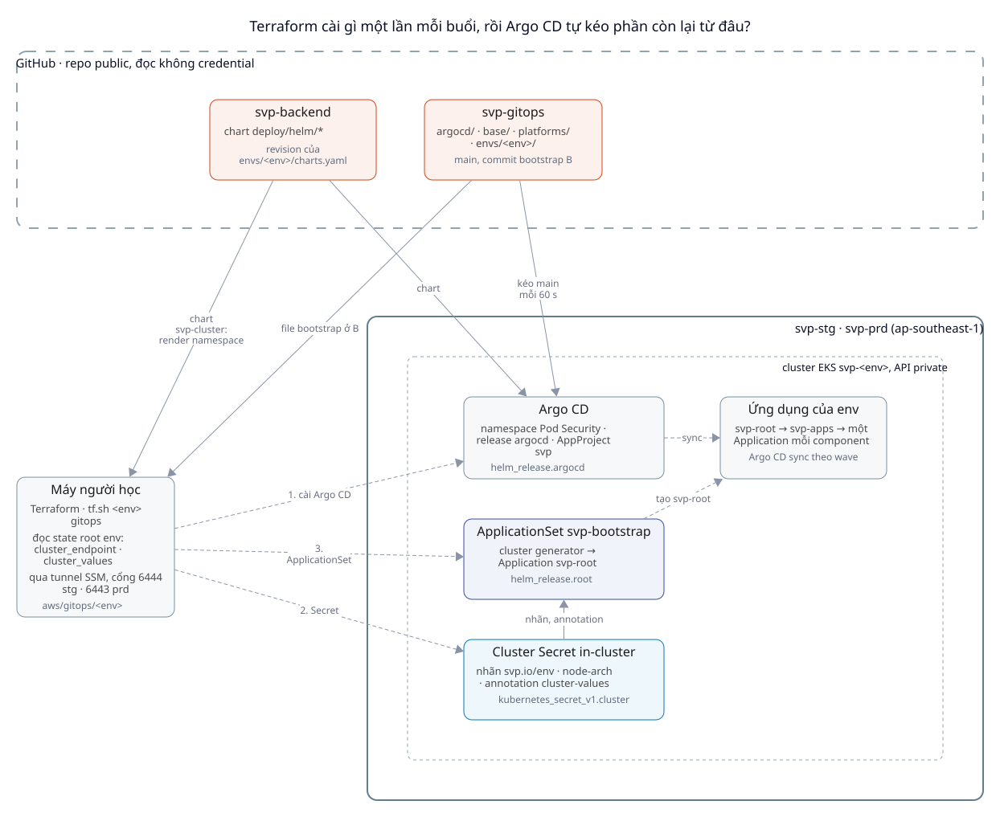

# 13. GitOps

← [12. Media và edge](12-media-edge.md) · [Mục lục](README.md) · [14. CI](14-ci.md) →

## Tổng quan

Chương này nối hạ tầng với ứng dụng. Terraform chỉ làm phần mà cluster mới chưa tự làm được: cài Argo CD, đưa cho nó "thẻ căn cước"
của cluster (env, kiến trúc node, các giá trị của account như VPC, địa chỉ RDS, ARN topic), và tạo một ApplicationSet. Từ lúc đó Argo
CD tự kéo mọi thứ còn lại từ repo `svp-gitops`: controller nền tảng, dữ liệu, observability, các service của svp. Cách chia này là mẫu
GitOps Bridge.

svp cần ranh giới này vì hai loại thay đổi đi hai đường khác nhau. Hạ tầng của account đi qua Terraform, người học apply. Bản phát hành
đi qua một commit ở `svp-gitops` do CI promote, không ai chạy Terraform. Giá trị phụ thuộc account không bao giờ vào git: nó đi từ state
của root env vào cluster Secret, rồi vào values của Argo CD.

Phần này sống theo buổi: apply ngay sau root env, gỡ ngay trước root env. Nó không tạo tài nguyên AWS nào tính tiền; mọi thứ nó tạo là
đối tượng Kubernetes trong cluster của buổi.

| Câu hỏi | Dịch vụ |
| --- | --- |
| Ai cài Argo CD lên cluster vừa dựng, bản nào? | Argo CD, release Helm do root `aws/gitops/<env>` cài |
| Argo CD biết cluster này là stg hay prd, RDS nằm ở đâu bằng cách nào? | Cluster Secret của Argo CD |
| Ai tạo Application gốc từ thẻ căn cước đó? | ApplicationSet của Argo CD (cluster generator) |
| Terraform trên máy người học tới API private của cluster bằng đường nào? | Amazon EKS (endpoint private, access entry), qua tunnel SSM |
| Bản phát hành mới tới cluster bằng đường nào, ai báo nó đã chạy? | Argo CD kéo `main` của `svp-gitops`; Argo CD Notifications ghi commit status |
| Khoá để ghi commit status nằm ở đâu? | AWS Secrets Manager, qua External Secrets |

| Account | Region | Vòng đời | Root Terraform |
| --- | --- | --- | --- |
| `svp-stg`, `svp-prd` | `ap-southeast-1` | theo buổi | `aws/gitops/<env>` (module `gitops-bridge`) |

## Kiến trúc

<picture>
  <source media="(prefers-color-scheme: dark)" srcset="../diagrams/13-gitops-dark.svg">
  
</picture>

Mũi tên nét đứt là điều khiển (Terraform áp, Argo CD sync), nét liền là dữ liệu. Terraform chạy trên máy người học và chỉ tới được API
qua tunnel SSM; Argo CD chạy trong cluster và tự đọc GitHub qua NAT. Sau ba bước áp, Terraform không tham gia đường phát hành nào nữa.

| Thành phần | Ở đâu | Làm gì |
| --- | --- | --- |
| Root `aws/gitops/<env>` | máy người học; state ở bucket của account env | Đọc state root env và file của `svp-gitops`, áp các thứ theo thứ tự bên dưới |
| Module `gitops-bridge` | gọi từ root | Tính mọi giá trị (tên, nhãn, values, commit bootstrap); không có resource nào |
| Namespace có Pod Security | cluster | `argocd`, namespace dự án mang nhãn `restricted` (`istio-system`: `privileged`) trước pod đầu tiên |
| Release `argocd` | namespace `argocd` | Argo CD, ApplicationSet controller, Argo CD Notifications |
| AppProject `svp`, `default` | namespace `argocd` | `svp` giới hạn repo nguồn, namespace và loại tài nguyên; `default` bị làm rỗng |
| Cluster Secret `in-cluster` | namespace `argocd` | Nhãn `svp.io/env`, `svp.io/platform`, `svp.io/node-arch`; annotation `svp.io/cluster-values` |
| ApplicationSet `svp-bootstrap` | namespace `argocd` | Từ Secret trên, tạo Application gốc `svp-root` |
| `svp-root` → `svp-apps` → một Application mỗi component | namespace `argocd`, chart ở `svp-gitops` | Root hai tầng: tầng 1 đọc `envs/<env>/`, tầng 2 cài từng chart theo wave |

`depends_on` giữ thứ tự áp: namespace → Argo CD → AppProject → cluster Secret → ApplicationSet. Hai thư mục `stg/`, `prd/` giống hệt nhau
trừ dòng `env` trong `locals`; khác biệt nằm ở `<env>.tfvars` (mục [Commit bootstrap: stg theo `main`, prd
ghim](#commit-bootstrap-stg-theo-main-prd-ghim)).

## Kịch bản thực tế

**Câu hỏi của chương:** Một commit promote ở `svp-gitops` đi tới pod chạy bản mới trên cluster stg bằng đường nào, và ai báo nó xong?

Điều kiện: buổi stg đang chạy, root `aws/gitops/stg` đã áp, `svp-root` đang Healthy. Ví dụ là release `gateway`; mọi service đi cùng
đường.

```mermaid
sequenceDiagram
    participant CI as CI svp-backend (images.yml)
    participant G as svp-gitops, nhánh main
    participant R as svp-root (Argo CD của svp-stg)
    participant A as svp-apps
    participant S as Application gateway
    participant N as Argo CD Notifications
    CI->>G: PR bot/promote-stg: envs/stg/images/gateway.yaml, envs/stg/charts.yaml; auto-merge khi gitops-ok xanh
    R->>G: đọc refs/heads/main mỗi 60 s, thấy commit mới
    R->>A: render chart argocd/root: valuesObject có image và charts mới
    N->>G: commit status argocd/stg pending
    A->>S: render chart argocd/apps: Application gateway, chart ở revision mới
    S->>S: sync wave 7: pod mới với digest mới, Kyverno đổi ref sang ECR và kiểm chữ ký
    S-->>R: Healthy theo wave, svp-root Healthy khi mọi Application Healthy
    N->>G: commit status argocd/stg success
```

1. CI của `svp-backend` (`images.yml`) build, ký image `gateway`, job `ecr-copy` chép nó sang ECR, rồi job `promote` ghi khối `image`
   của `envs/stg/images/gateway.yaml` và `revision` của `envs/stg/charts.yaml` trên nhánh `bot/promote-stg`. PR chỉ đổi `envs/stg/`,
   thư mục không có Code Owner, nên tự merge khi check `gitops-ok` xanh.
2. `svp-root` theo dõi `refs/heads/main`. Argo CD đọc lại repo mỗi 60 giây (`timeout.reconciliation` của `base/argo-cd.yaml`), nên
   commit mới được thấy sau khoảng 60 giây, tệ nhất khoảng 120 giây theo comment ở đó. Không có webhook từ GitHub.
3. `svp-root` render chart `argocd/root` (tầng 1): đọc `envs/stg/` ở commit mới và ra Application `svp-apps` với `valuesObject` mang
   image, chart và giá trị `cluster` (lấy nguyên khối từ annotation `svp.io/cluster-values` của cluster Secret). Argo CD Notifications
   thấy sync bắt đầu và ghi commit status `argocd/stg` trạng thái `pending` lên commit đó.
4. `svp-apps` render chart `argocd/apps` (tầng 2): một Application mỗi component; Application `gateway` đọc chart `svp-service` của
   `svp-backend` ở `revision` mới và values `base/`, `platforms/eks/` của `svp-gitops`.
5. Application `gateway` (wave 7) sync: Deployment, hay Rollout với release có `canary`, đổi digest. Pod mới qua policy Kyverno
   `svp-registry-mirror` (đổi image sang ECR của account) và `svp-images` (kiểm chữ ký); thiếu chỗ thì Karpenter cấp node.
6. Health Lua của `base/argo-cd.yaml` chỉ cho một Application `Healthy` khi nó đã so với đúng spec mới, `Synced` và sync gần nhất
   `Succeeded`. `svp-root` vì thế chỉ Healthy khi mọi wave đã chạy bản mới.
7. Trigger `on-deployed` của Notifications ghi commit status `argocd/stg` `success` lên commit của `svp-gitops`, bằng GitHub App
   `svp-argocd-notifier`. Khoá của App nằm ở entry `svp/stg/argocd-notifications` của Secrets Manager. Sync lỗi hay Degraded ghi
   `failure`, và gửi Telegram khi cluster Secret mang chat.

Ở prd, bước 1 là promote prd: job từ chối commit stg chưa có `argocd/stg` `success`, PR ghi cả bộ image, chart và `gitopsRevision`, người
học duyệt environment `promote-prd` rồi duyệt PR với vai Code Owner. `svp-root` của prd vẫn đọc `envs/prd/` ở `main`, còn `svp-apps` render
ở commit ghim (mục [Commit bootstrap: stg theo `main`, prd ghim](#commit-bootstrap-stg-theo-main-prd-ghim)). Chưa có số đo thời gian từ
merge tới `success`; commit status là bằng chứng mà promote prd đọc.

## Các dịch vụ và cách svp dùng

### Argo CD

- **Làm gì:** dự án CNCF, không phải dịch vụ AWS. Controller trong cluster so trạng thái mong muốn ở git với trạng thái thật và sync
  phần lệch; mỗi Application là một nguồn (chart, revision, values) và một đích. Ví dụ đời thực:
  - Application `OutOfSync` khi commit mới ở `main` đổi digest; sync tự động (`automated`, `prune`, `selfHeal`) đưa nó về `Synced`.
  - Người sửa tay một Deployment trên cluster: `selfHeal` áp lại bản của git.
  - Lỗi render chart `argocd/root` (thiếu `envs/<env>/charts.yaml`) hiện thành `ComparisonError` trên `svp-root`, không cài nửa vời.
  - Application `Degraded` khi pod không lên; health Lua của svp giữ `svp-root` ở `Progressing` tới khi wave đó xong.
- **Ở svp:** release `argocd` ở namespace `argocd`, chart `argo-cd` với repo, version, namespace của `argocd/bootstrap.json` ở commit
  bootstrap; values `base/argo-cd.yaml` rồi `platforms/eks/argo-cd.yaml` (bật ApplicationSet controller và Notifications). AppProject
  `svp` của `argocd/project.yaml`.
- **Phí theo:** không có phí dịch vụ; pod của Argo CD chạy trên node của cluster, tính trong phí node (chương [10. EKS](10-eks.md)).
- **Cố ý tắt:** Dex và SSO (đăng nhập chỉ bằng `admin`, UI chỉ qua port-forward loopback); Argo CD không tự quản: đổi version hay
  values ở `svp-gitops` chỉ tới cluster ở lần apply sau của root này.

### Cluster Secret và ApplicationSet

- **Làm gì:** Secret mang nhãn `argocd.argoproj.io/secret-type: cluster` khai một cluster cho Argo CD. Cluster generator của
  ApplicationSet sinh một bộ tham số từ nhãn, annotation của mỗi Secret khớp selector, rồi tạo một Application từ template. Ví dụ đời
  thực:
  - Nhãn `svp.io/env: stg`, `svp.io/node-arch: arm64` thành giá trị `env`, `nodeArch` của `svp-root`.
  - Annotation `svp.io/cluster-values` mang `rdsAddress`, `ecrRegistry`, `externalSecretsRoles`: thành giá trị `cluster` mà mẫu
    `platforms/eks/*.values.tpl` đọc.
  - Thêm một cluster thứ hai thì thêm một Secret, ApplicationSet tự tạo thêm một Application gốc: đó là lý do mẫu GitOps Bridge dùng
    ApplicationSet dù svp mỗi env chỉ có một cluster.
- **Ở svp:** Secret `in-cluster` (server `https://kubernetes.default.svc`), ApplicationSet `svp-bootstrap` với selector `svp.io/env`
  `Exists`, `goTemplate` và `missingkey=error`; template tạo `svp-root` (project `svp`, nhãn `svp.io/notify: root`, chart `argocd/root`
  ở `refs/heads/main`); `templatePatch` thêm đăng ký Telegram khi annotation `svp.io/telegram-chat-id` có giá trị.
- **Phí theo:** không có phí.
- **Cố ý tắt:** finalizer trên `svp-root` (`preserveResourcesOnDeletion: true`): xoá ApplicationSet cuối buổi không xoá dây chuyền
  mọi thứ bên dưới, để script gỡ theo thứ tự của nó.

### Amazon EKS (API và quyền)

- **Làm gì:** API Kubernetes managed; access entry gắn danh tính IAM với quyền Kubernetes, không cần ConfigMap `aws-auth`. Ví dụ đời
  thực:
  - Provider `kubernetes`, `helm` lấy token bằng `aws eks get-token` với profile của env, lấy lại khi token hết hạn.
  - Danh tính chạy apply của root env nhận cluster admin qua access entry (`enable_cluster_creator_admin_permissions`), nên root gitops
    chạy cùng profile `anhnv-<env>` có quyền mà không ARN nào được ghi vào code.
  - Endpoint công khai tắt: một lệnh `kubectl` không qua tunnel thì không tới được API.
- **Ở svp:** cluster `svp-<env>` của root `aws/envs/<env>`, `authentication_mode = "API"`; root gitops đọc `cluster_name`,
  `cluster_endpoint`, CA từ state của root env; host của provider là `api_server_url` (đầu local của tunnel), TLS server name là host
  của `cluster_endpoint`.
- **Phí theo:** giờ cluster, tính ở chương [10. EKS](10-eks.md); root này không thêm gì.
- **Cố ý tắt:** endpoint công khai của API ở cả hai env; mọi lệnh tới cluster đi qua tunnel SSM tới bastion.

### AWS Secrets Manager

- **Làm gì:** giữ secret có version, mã hoá bằng KMS, quyền đọc theo IAM. Ví dụ đời thực:
  - Entry `svp/stg/argocd-notifications` giữ app ID, installation ID và khoá riêng của GitHub App `svp-argocd-notifier`.
  - External Secrets dựng Secret `argocd-notifications-secret` trong namespace `argocd` từ entry đó; Notifications đọc `$github-appID`.
  - Role SecretStore `svp-stg-external-secrets-argocd` chỉ đọc được entry của namespace `argocd`.
- **Ở svp:** entry do module `external-secrets` của root env tạo, giá trị do `make eks-secrets` của repo code ghi (người học chạy);
  ExternalSecret do chart `svp-cluster` render khi `externalSecrets.argocdNotifications` bật. Root gitops không đọc Secrets Manager.
- **Phí theo:** secret-tháng và mỗi 10 000 lời gọi API.

## Chi phí

| Khoản | Đơn vị tính | Giữa các buổi | Trong buổi | Nguồn |
| --- | --- | --- | --- | --- |
| Root `aws/gitops/<env>` | — | 0 | 0: chỉ tạo đối tượng Kubernetes | code của root (`main.tf`) |
| Pod Argo CD | phần của node | 0 (không có cluster) | không có số đo riêng; nằm trong phí node của chương 10 | không có số đo |
| Entry `svp/<env>/argocd-notifications` | secret-tháng, lời gọi API | theo vòng đời entry của root env | không có số đo | không có số đo |
| EKS Capability cho Argo CD (phương án, chưa dùng) | giờ capability, Application-giờ | 0 | ~0,34 USD mỗi buổi 4 giờ một env, ~27 Application | ADR-0065 §8 |

Nguồn: [ADR-0065](https://github.com/anhnvcoder/svp-backend/blob/main/docs/adr/0065-argocd-eks-capability.md) §8 (Price List
`AmazonEKS` `ap-southeast-1`).

## Kiểm tra và vận hành

| Muốn xem | Account | Region | Vào đâu | Trạng thái mong đợi |
| --- | --- | --- | --- | --- |
| API của cluster | `svp-<env>` | `ap-southeast-1` | EKS → Clusters → `svp-<env>` → Networking | API server endpoint access `Private` |
| Quyền của danh tính chạy apply | `svp-<env>` | `ap-southeast-1` | EKS → `svp-<env>` → Access → IAM access entries | Role của profile `anhnv-<env>` có `AmazonEKSClusterAdminPolicy` |
| Khoá của Notifications | `svp-<env>` | `ap-southeast-1` | Secrets Manager → `svp/<env>/argocd-notifications` | Có giá trị sau `make eks-secrets` |
| Application trong cluster | `svp-<env>` | `ap-southeast-1` | `kubectl --context svp-<env> -n argocd get applications.argoproj.io` qua tunnel | Mọi Application `Synced`, `Healthy` |
| Bằng chứng một commit đã chạy | — | — | GitHub, commit của `svp-gitops` → check `argocd/<env>` | `success` |

Bảng trên là trạng thái mà code khai báo. Runbook có bước dựng và kiểm: init, plan, apply ở bước 12–14 của
[`session-stg-deploy.md`](../runbooks/session-stg-deploy.md); bước 15 (`bootstrap.sh stg wait`) chờ
`svp-observability`, chạy `make eks-glitchtip-init`, rồi chờ `svp-root` Synced và Healthy; phép kiểm "Commit status argocd/stg" đọc
check trên GitHub. Một phần chỉ coi là đã kiểm khi bước đó ra đúng mong đợi và output được dán lại. Gỡ: bước 21–22 của
[`session-stg-teardown.md`](../runbooks/session-stg-teardown.md), sau `pre-destroy.sh`.

## Thiết kế và đánh đổi

### Ranh giới Terraform và Argo CD

Terraform giữ đúng những thứ phải có trước khi Argo CD chạy, hay mà cluster không tự biết: namespace có Pod Security, release Argo
CD, AppProject, cluster Secret và ApplicationSet. Argo CD giữ mọi thứ còn lại, kể cả controller nền tảng (Karpenter, Load Balancer
Controller, External Secrets) và mọi service. Giá trị của account đi một chiều: output `cluster_values` của root env → annotation của
cluster Secret → giá trị `cluster` của `svp-root` → mẫu `platforms/eks/*.values.tpl`. Không file git nào giữ ID, ARN hay địa chỉ thật.
Một thứ không bao giờ do hai bên cùng giữ: namespace dự án được tạo bằng server-side apply với field manager `svp-pod-security`, chart
`svp-cluster` về sau ghi cùng nhãn và nhận lại không xung đột. Lý do chọn GitOps Bridge thay script tự viết:
[ADR-0050](https://github.com/anhnvcoder/svp-backend/blob/main/docs/adr/0050-bash-to-standard-tools.md) §1.

### Commit bootstrap: stg theo `main`, prd ghim

Argo CD, values của nó và AppProject đọc ở commit bootstrap B: `gitopsRevision` của `envs/<env>/charts.yaml` khi có, không thì commit
của `main` lúc plan. `svp-root` luôn theo `refs/heads/main`; tầng 2 render ở `gitopsRevision` khi env ghim.

| Biến | stg | prd | Vì sao |
| --- | --- | --- | --- |
| `require_pinned_revision` | `false` | `true` | prd chỉ bootstrap ở commit stg đã chạy; khoá vắng thì plan dừng |
| `api_server_url` | `https://127.0.0.1:6444` | `https://127.0.0.1:6443` | mỗi env một cổng tunnel, hai env chạy được cùng lúc |
| `node_arch` | `arm64` | `arm64` | node Graviton ở cả hai env |

Chart `svp-cluster` mà root dùng để render namespace lấy ở `revision` của `envs/<env>/charts.yaml`, đúng chart mà Application
`svp-cluster` sẽ cài, nên nhãn Pod Security trước Argo CD khớp nhãn sau Argo CD. Module chỉ nhận `privileged` cho namespace của
biến `privileged_namespaces` (`istio-system`: ztunnel, istio-cni đổi mạng của node), mọi namespace khác phải `restricted`
([module `gitops-bridge`](../../aws/modules/gitops-bridge/README.md#pod-security-của-namespace)). Ghim của prd và promote:
[ADR-0048](https://github.com/anhnvcoder/svp-backend/blob/main/docs/adr/0048-prd-aws.md) §7 (ghim), §8 (promote).

### Root riêng, qua tunnel

Provider `kubernetes` khuyên dựng cluster và tài nguyên Kubernetes trong hai lần apply riêng; `kubernetes_manifest` cần API ngay lúc
plan, và API của cả hai env chỉ tới được qua tunnel. Tách root giữ plan của root env không bao giờ cần tunnel, đổi lại buổi có thêm một
root để init, plan, apply và gỡ theo thứ tự.

| Lựa chọn của svp | Cái giá | Phương án khác | Khi nào chọn nó |
| --- | --- | --- | --- |
| Argo CD tự cài bằng Helm từ Terraform | Một replica, đăng nhập `admin`, UI qua port-forward; đổi version cần apply lại | EKS Capability cho Argo CD: AWS chạy Argo CD ngoài node, đăng nhập IAM Identity Center ([ADR-0065](https://github.com/anhnvcoder/svp-backend/blob/main/docs/adr/0065-argocd-eks-capability.md) đã chọn, chưa hiện thực) | Cần HA, SSO theo nhóm mà không tự giữ |
| Pull: Argo CD kéo git | Trễ tới khoảng 120 giây; Argo CD có quyền rộng trong cluster | Push từ CI (`helm upgrade` trong pipeline, AWS CodePipeline với CodeDeploy) | Không có controller dài hạn trong cluster, chấp nhận CI giữ credential của cluster |
| Poll 60 giây, không webhook | Mỗi Argo CD đọc GitHub đều đặn | Webhook GitHub tới API của Argo CD | Argo CD có địa chỉ nhận được từ internet |
| Giá trị account qua annotation của cluster Secret | Một khối JSON; luật kiểm từng khoá phải ở module | Ghi giá trị vào git sau mỗi apply; đọc Parameter Store trong cluster | Giá trị không nhạy cảm và đổi hiếm |
| ApplicationSet tạo `svp-root` | Thêm một lớp giữa Secret và root | Tạo `svp-root` trực tiếp (như cluster k3d của repo code) | Chỉ một cluster, không có metadata từ IaC |
| Root riêng khỏi root env | Thêm một root, một state, thứ tự gỡ chặt | Gộp vào root env | API công khai và chấp nhận plan cần cluster sẵn |

## Liên hệ đề SAP

- "Task 5.1: Design infrastructure as code." Hai lớp khai báo: Terraform dựng account và cluster, Argo CD dựng mọi thứ trong cluster
  từ git.
- "Skill 5.1.1: Implement infrastructure as code by using declarative and imperative approaches (for example, AWS CloudFormation, AWS
  CDK)." Root `aws/gitops/<env>` khai báo; module `gitops-bridge` tính giá trị và được kiểm bằng `terraform test` không cluster.
- "Skill 5.1.3: Manage secrets in infrastructure code (for example, by using AWS Secrets Manager, AWS Systems Manager Parameter Store)."
  Khoá GitHub App ở Secrets Manager qua External Secrets; chat Telegram lấy từ `.env` của repo code qua `tf.sh`, không vào
  git; ID và ARN của account không vào git.
- "Skill 5.2.3: Configure multi-account and multi-Region deployment pipelines that include features such as role delegation and artifact
  promotion (for example, by using CodePipeline cross-account deployments)." Promote stg → prd giữa hai account, prd ghim commit stg đã
  chạy, commit status `argocd/stg` là bằng chứng.
- "Skill 5.2.5: Implement deployment strategies that provide rollback capabilities (for example, blue/green, canary, rolling
  deployments)." Rollback prd bằng promote một commit stg cũ; canary của Argo Rollouts cho release có `canary`.

| Tình huống trong đề | Chọn | Vì sao không chọn cái gần giống |
| --- | --- | --- |
| Pipeline phát hành build một lần, promote qua account test rồi production, có bước duyệt | CodePipeline cross-account (action dùng role ở account đích) và manual approval | CodeDeploy triển khai lên một deployment group, không điều phối các giai đoạn và bước duyệt |
| Đổi lưu lượng dần sang bản mới của ECS hay Lambda, tự rollback khi alarm | CodeDeploy canary hay linear với alarm CloudWatch | Cập nhật stack CloudFormation thay tài nguyên, không chuyển lưu lượng dần |
| Cùng một bộ tài nguyên ra nhiều account, region của tổ chức | CloudFormation StackSets | CodePipeline triển khai ứng dụng, không lan stack ra account mới tự động |
| Mật khẩu database xoay tự động, ứng dụng đọc lúc chạy | Secrets Manager | Parameter Store SecureString không có xoay tự động sẵn |
| Nhiều tham số cấu hình không bí mật, cần rẻ | Parameter Store (tham số standard) | Secrets Manager tính phí mỗi secret mỗi tháng |
| Argo CD trên EKS do AWS vận hành, đăng nhập IAM Identity Center | EKS Capability cho Argo CD | Argo CD tự cài phải tự giữ HA, bản vá và SSO |

## Đọc sâu

- CRD của Argo CD chỉ có sau release Argo CD trong cùng lần apply, nên AppProject và ApplicationSet đi qua `helm_release` của chart
  `resources` của module (in nguyên văn manifest, như chart cùng tên của GitOps Bridge): Helm chỉ cần CRD lúc áp, `kubernetes_manifest`
  cần ngay lúc plan. AppProject dùng `take_ownership` vì argocd-server đã tạo `default` lúc khởi động.
- Namespace render bằng `data "helm_template"` trên chart `svp-cluster` (`show_only` `templates/namespaces.yaml`) với values theo đúng
  thứ tự Argo CD đọc: `platforms/eks/svp-cluster.yaml` ở B, `envs/<env>/svp-cluster.yaml` ở `main` khi có, rồi `valuesObject` do chart
  `platform-values` của module render từ `platforms/eks/svp-cluster.values.tpl` trên `cluster_values`. Helm render cả chart rồi mới lọc,
  nên thiếu một value bắt buộc của template khác (CIDR edge, ARN target group) thì plan dừng ở đó.
- `tf.sh <env> gitops plan` fetch hai bản clone, giải nén chart `svp-cluster` của `svp-backend` ở `revision` của
  `envs/<env>/charts.yaml` trên `origin/main` bằng `git archive`, đặt `TF_VAR_svp_cluster_chart` và `TF_VAR_telegram_chat_id`
  (`SVP_ALERT_TELEGRAM_CHAT_ID` của `.env` repo code), rồi plan. Plan cần mạng tới GitHub: commit của `main` qua REST API, file qua
  `raw.githubusercontent.com`, không credential.
- `cluster_values` phải có đúng các khoá của hợp đồng `cluster.*`, mỗi khoá đúng loại và dạng; giá trị sai dừng plan thay vì thành lỗi
  kéo image hay ghi metric trong cluster. Luật và lý do không khai kiểu object nằm ở `variables.tf` của module; bảng khoá ở README của
  `svp-gitops`.
- Module không có resource hay data source; `tests/bridge.tftest.hcl` kiểm mỗi giá trị bằng mock provider, mỗi luật một run với giá trị
  chỉ luật đó từ chối (`make test DIRS=aws/modules/gitops-bridge`).
- Gỡ: `pre-destroy.sh` xoá ApplicationSet `svp-bootstrap` trước (`svp-root`, `svp-apps` không có finalizer nên không xoá dây chuyền),
  rồi Application workload, chờ TargetGroupBinding và PVC gỡ khi controller còn chạy, rồi NodePool, chờ hết node của Karpenter. Sau đó
  mới destroy root này (tunnel còn mở), rồi root env.

Làm và tra cứu:

- [`session-stg-deploy.md`](../runbooks/session-stg-deploy.md), bước 12–15: init, plan, apply root này và chờ Argo CD.
- [`aws/gitops`](../../aws/gitops/README.md): tài nguyên của root, khi nào chạy, chart và tunnel.
- [Module `gitops-bridge`](../../aws/modules/gitops-bridge/README.md): đầu vào, đầu ra của module.
- [README của `svp-gitops`](https://github.com/anhnvcoder/svp-gitops#root-hai-tầng-và-bootstrap): root hai tầng, hợp đồng `cluster`,
  promote.
- [ADR-0048](https://github.com/anhnvcoder/svp-backend/blob/main/docs/adr/0048-prd-aws.md) §6, §7: bootstrap EKS, ghim revision của prd.
- [ADR-0025](https://github.com/anhnvcoder/svp-backend/blob/main/docs/adr/0025-gitops-config-repo.md): repo cấu hình `svp-gitops`, promote
  và ruleset.
