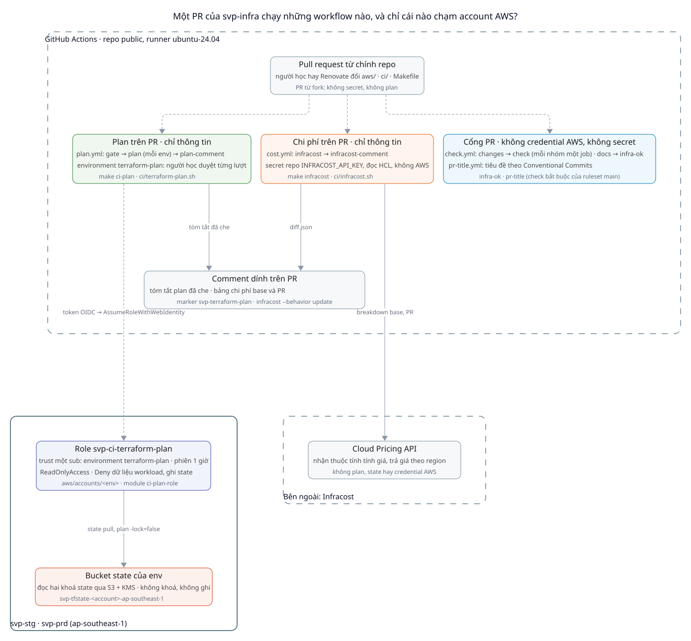
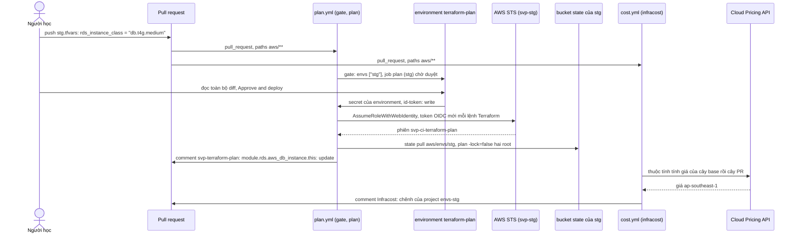
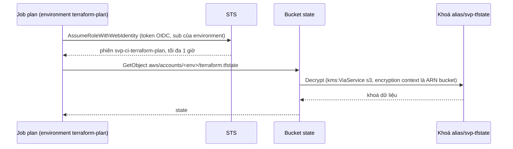

# 14. CI

← [13. GitOps](13-gitops.md) · [Mục lục](README.md) · [15. Chi phí](15-cost.md) →

## Tổng quan

Chương này tả GitHub Actions của `svp-infra`: mọi thứ chạy khi có PR hay push vào `main`. Hai check bắt buộc (`infra-ok` của
`check.yml`, `pr-title`) giữ cổng merge và không bao giờ có credential AWS hay secret: chúng kiểm tĩnh Terraform, script,
workflow, tài liệu và tiêu đề PR. Hai workflow khác chỉ cho thông tin: `plan.yml` chạy `terraform plan` thật trên account env để
người duyệt thấy Terraform sẽ tạo, sửa, xoá gì; `cost.yml` ước chi phí tháng của PR bằng Infracost. Workflow thứ năm,
`scorecard.yml`, chấm điểm chuỗi cung ứng của cả repo sau mỗi lần merge.

svp cần CI riêng cho repo hạ tầng vì repo public: PR từ fork chạy workflow bằng code của fork, log và artifact ai cũng đọc. Mỗi workflow
vì thế giữ quyền tối thiểu, và chỉ đúng một job, `plan`, được chạm AWS, bằng role chỉ đọc, sau khi người học đọc diff và duyệt lượt đó.
CI không bao giờ `apply`: apply vẫn là việc của người học bằng SSO.

Phần CI sống giữa các buổi: workflow nằm trong repo, role plan nằm trong baseline của mỗi account env. Không thứ gì ở đây được dựng hay
gỡ theo buổi; buổi chỉ đổi những gì plan thấy.

| Câu hỏi | Dịch vụ |
| --- | --- |
| PR này có làm hỏng `fmt`, `validate`, tflint, trivy, test module hay tài liệu không? | `check.yml` (job `check`, `docs`, check `infra-ok`) |
| Tiêu đề PR có thành được tiêu đề commit squash đúng chuẩn không? | `pr-title.yml` (check `pr-title`) |
| Merge PR này thì Terraform sẽ tạo, sửa, xoá gì ở account stg, prd? | `plan.yml` qua role OIDC chỉ đọc `svp-ci-terraform-plan` |
| PR này làm hoá đơn tháng tăng hay giảm bao nhiêu? | `cost.yml` (Infracost CLI) |
| Repo có giữ được ghim SHA, quyền token tối thiểu, ruleset theo chuẩn OpenSSF không? | `scorecard.yml` (OpenSSF Scorecard) |
| Ai cho một job CI quyền đọc account, và quyền đó dừng ở đâu? | IAM OIDC provider, AWS STS, role `svp-ci-terraform-plan` |

| Account | Region | Vòng đời | Root Terraform |
| --- | --- | --- | --- |
| GitHub, repo `svp-infra` | runner `ubuntu-24.04` của GitHub | giữa các buổi | workflow ở `.github/workflows/`; cài đặt, environment ở `github/` |
| `svp-stg`, `svp-prd` | IAM toàn cục; state ở `ap-southeast-1` | giữa các buổi | `aws/accounts/<env>` (module `ci-plan-role`) |

## Kiến trúc

Mũi tên nét đứt là điều khiển (trigger, assume role), nét liền là dữ liệu. Ba nhánh của PR chạy song song và độc lập: nhánh cổng PR quyết
định merge; nhánh plan và nhánh chi phí đỏ hay bỏ qua cũng không chặn merge. `scorecard.yml` không chạy trên PR nên không có trong hình.

Một PR từ chính repo, đổi `aws/envs/stg/stg.tfvars`, đi qua các job theo thứ tự này:

1. `check.yml`: job `changes` đọc danh sách file của PR qua API; PR có file ngoài tài liệu thì job `check` chạy mỗi nhóm `check-*`
   của `Makefile` thành một job song song; job `docs` chạy `make docs-check diagrams-check` với mọi PR; job `infra-ok` xanh khi mọi job
   trên xanh.
2. `pr-title.yml`: job `pr-title` kiểm tiêu đề, chạy lại mỗi lần sửa tiêu đề mà không chạy lại `make check`.
3. `plan.yml`: job `gate` chọn env từ biến `SVP_TF_PLAN_ENVS`; job `plan` mỗi env một lượt, chờ người học duyệt environment
   `terraform-plan`, rồi assume role chỉ đọc qua OIDC và plan; job `plan-comment` đăng tóm tắt đã che.
4. `cost.yml`: job `infracost` tính chi phí cây base và cây PR, job `infracost-comment` đăng phần chênh.

Nhánh bị bỏ qua (job xanh, có `::notice::`), không đỏ giả:

- PR chỉ đổi tài liệu (`.md`, `docs/`, `LICENSE`, trừ `README.md` dưới `aws/`, `github/` mà terraform-docs viết một phần): job `check`
  skip, `infra-ok` chỉ nhận đúng skip này; `plan.yml`, `cost.yml` không chạy vì `paths` của trigger.
- `SVP_TF_PLAN_ENVS` rỗng hay chưa đặt: `gate` ra `[]`, job `plan` không chạy nên environment không bị nêu, không ai phải duyệt.
- PR từ fork: `gate` ra `[]`, job `plan` kiểm lại điều đó từ event; `infracost` thoát sớm có notice. Secret không tới code của fork.
- PR chỉ đổi root CI không plan (`aws/org`, `aws/security`…): `gate` nêu tên từng root và lý do, không plan.
- Secret `INFRACOST_API_KEY` chưa đặt: `infracost` thoát sớm có notice, `infracost-comment` không chạy.

| Thành phần | Ở đâu | Làm gì |
| --- | --- | --- |
| `.github/workflows/*.yml` | repo `svp-infra` | Trigger, quyền mỗi job, thứ tự job; bước dài gọi `make` |
| `Makefile` | gốc repo | Nhóm `check-*` (mỗi nhóm một job CI), `ci-plan`, `infracost`, image công cụ ghim digest |
| `ci/terraform-plan.sh`, `ci/infracost.sh` | `ci/` | Logic của job `gate`, `plan`, `infracost`, `infracost-comment`; test với lệnh giả cạnh mỗi script |
| `infracost.yml`, `infracost-usage.yml` | gốc repo | Project của Infracost và giả định mức dùng |
| Ruleset `main`, environment `terraform-plan`, biến `SVP_TF_PLAN_ENVS` | GitHub, Terraform ở `github/` | Check bắt buộc, người duyệt từng lượt plan, env được plan |
| Role `svp-ci-terraform-plan` | `svp-stg`, `svp-prd`, root `aws/accounts/<env>` | Quyền đọc account và state cho job `plan` |

## Kịch bản thực tế

**Câu hỏi của chương:** PR nâng `rds_instance_class` của stg từ `db.t4g.small` lên `db.t4g.medium` cho người duyệt thấy gì trước merge,
và ai chạm account stg trên đường đó?

Điều kiện: `SVP_TF_PLAN_ENVS` là `["stg"]`, role plan của stg đã apply, secret của environment `terraform-plan` và `INFRACOST_API_KEY` đã
đặt. Buổi stg đang mở (state của `aws/envs/stg` có resource); không có buổi thì root env ghi "Not planned" và chỉ comment Infracost thấy
chênh.

1. Push mở hai workflow có `paths` khớp, cùng `check.yml` và `pr-title.yml`. Push tiếp theo vào PR huỷ mọi lượt cũ, cả lượt đang chờ duyệt
   (`concurrency` theo số PR).
2. `gate` thấy file dưới `aws/` không thuộc root bị loại, ra `["stg"]`. Job `plan (stg)` dừng ở environment `terraform-plan`.
3. Người học đọc tab Files của PR (cả workflow, `ci/`, `Makefile`, lock), rồi duyệt lượt chờ. Đây là kiểm soát duy nhất giữa code của PR và
   role: trust của role chỉ buộc tên environment, nên `plan.yml` do chính PR sửa cũng nhận role khi được duyệt.
4. `make ci-plan ENV=stg` lấy token OIDC (audience `sts.amazonaws.com`) trước mỗi lệnh Terraform. Terraform trong container tự assume role
   bằng `AWS_ROLE_ARN` và `AWS_WEB_IDENTITY_TOKEN_FILE`, đọc state qua S3, plan `aws/accounts/stg` với `session_open=true` rồi
   `aws/envs/stg` với `stg.tfvars`, không khoá state.
5. Comment dính (marker `<!-- svp-terraform-plan -->`) hiện mục `aws/accounts/stg` "No changes." (khi không drift) và mục
   `aws/envs/stg` "0 to create, 1 to update, 0 to delete, 0 to replace", danh sách có `module.rds.aws_db_instance.this`: update. Không
   giá trị thuộc tính nào hiện ra.
6. Song song, `infracost` breakdown cây base và cây PR với `stg.tfvars` đã commit, không credential AWS; comment Infracost hiện chi phí
   tháng trước, sau và chênh của `envs-stg`. Infracost tính tháng 730 giờ, nên chia cho 730 để so với bảng giờ của buổi.
7. Merge cần `infra-ok` và `pr-title` xanh. Sau merge, người học apply bằng SSO theo runbook buổi; CI không apply.

## Các dịch vụ và cách svp dùng

Mỗi mục là một file của `.github/workflows/`. Mọi action là của GitHub (trừ action Scorecard), ghim SHA đầy đủ của commit; công cụ
(Terraform, tflint, trivy, zizmor, Infracost) chạy từ image ghim digest trong `Makefile`.

### `check.yml`

- **Làm gì:** chạy `make check` trên mỗi PR và push `main`, chia nhóm `check-*` thành job song song, gộp kết quả thành check bắt buộc
  `infra-ok`. Ví dụ đời thực:
  - `terraform fmt -check` đỏ vì một file `.tf` chưa `make fmt`.
  - trivy báo finding HIGH trên một bucket mới thiếu mã hoá; tflint báo loại instance không tồn tại.
  - Một `run` của `tests/*.tftest.hcl` thiếu `command = plan`: `test-guard` từ chối file đó.
  - zizmor báo `template-injection` khi một bước `run:` dùng `${{ github.event.pull_request.title }}` trực tiếp.
  - Khối terraform-docs của README module lệch `variables.tf`: `tfdocs-check` đỏ; SVG lệch `.d2`: `diagrams-check` đỏ.
- **Ở svp:** trigger `pull_request` và `push` `main`, không lọc `paths` (check bắt buộc mà workflow không chạy thì PR chờ mãi). Job
  `changes` (`pull-requests: read`), `check` và `docs` (`contents: read`), `infra-ok` (không quyền). Token của lượt chỉ vào nhóm `lint`
  (tflint tải ruleset dưới giới hạn của token) và `scripts` (zizmor audit online); không secret, OIDC hay environment. Thêm target vào một
  nhóm thì CI chạy nó mà không sửa workflow; ruleset chỉ đòi `infra-ok`, nên thêm hay đổi tên job không đụng ruleset. Job `changes` xét cả
  tên cũ của file đổi tên. Ngoại lệ có chủ đích của zizmor vào `.github/zizmor.yml`, mỗi mục một lý do; file chỉ có khi có ngoại lệ đầu
  tiên.
- **Phí theo:** phút runner mỗi job, làm tròn lên phút; runner chuẩn của repo public miễn phí.
- **Cố ý tắt:** `paths` ở trigger; `actions/cache` (cache plugin tflint nằm trong job); `fail-fast` của matrix (một lượt cho thấy mọi
  nhóm đỏ).
- **Đọc kết quả:** check `infra-ok` trên PR; job đỏ nêu target `FAIL: <target>`; finding zizmor là annotation trên dòng workflow. `infra-ok`
  đỏ dù mọi nhóm xanh nghĩa là có job bị huỷ hay skip ngoài trường hợp PR chỉ tài liệu.

### `plan.yml`

- **Làm gì:** `terraform plan` thật của các root CI plan được, bằng role chỉ đọc, đăng tóm tắt đã che thành một comment dính. Ví dụ đời
  thực:
  - PR Renovate nâng provider AWS: plan lộ thay đổi ngầm do provider mới, giá trị chính của plan trên PR.
  - PR đổi cỡ trong `<env>.tfvars`: dòng `update` hay `replace` cho thấy resource có bị thay không.
  - Drift do sửa tay trên console hiện thành thay đổi trong plan dù PR không đổi resource đó.
  - Plan đỏ `AccessDenied` khi refresh gọi một API nằm trong tập Deny hay ngoài `ReadOnlyAccess`.
- **Ở svp:** trigger `pull_request` có `paths` `aws/**`, `ci/**`, `Makefile`, chính file đó. Job `gate` (`contents: read`,
  `pull-requests: read`) chạy `ci/terraform-plan.sh gate`; job `plan` (`contents: read`, `id-token: write`, environment `terraform-plan`)
  chạy `make ci-plan`; job `plan-comment` (`pull-requests: write`, không checkout, không credential) đăng comment. Secret account ID và
  tfvars chỉ ở environment.
- **Phí theo:** phút runner (miễn phí, repo public); phía AWS: request S3 và KMS khi đọc state, lời gọi API đọc của refresh.
- **Cố ý tắt:** `apply`, ghi hay khoá state; `pull_request_target`, `workflow_run`; action bên thứ ba lấy credential
  (`aws-actions/configure-aws-credentials`); text plan trong log hay artifact.
- **Đọc kết quả:** comment "Terraform plan" trên PR; job summary của lượt giữ danh sách đủ khi comment quá dài. FAIL thường gặp:
  `secret … is not 12 digits` (secret account ID của environment sai), `holds a heredoc, a block comment or an unterminated string`
  (secret tfvars phải mỗi giá trị một dòng), `terraform init of …` (role chưa apply hay trust sai), `holds no public key of
  module.media` (state root env dở), `terraform plan of …` (stderr đã che in ngay trên).

### `cost.yml`

- **Làm gì:** ước chi phí tháng của các project trong `infracost.yml` ở commit base và ở PR, đăng phần chênh theo resource. Ví dụ đời
  thực:
  - PR đổi `rds_instance_class` hay số node: chênh ở project `envs-<env>`.
  - PR đổi một cờ của `aws/paid-features.json`: chênh hiện ở project của root đọc cờ đó, qua HCL của module `paid-features`.
  - PR đổi giả định mức dùng của `infracost-usage.yml`: tổng mới ở bảng, chênh bằng 0 (hai cây dùng cùng file của PR).
- **Ở svp:** cùng trigger như `plan.yml`, thêm `infracost.yml`, `infracost-usage.yml`, chính file đó. Job `infracost` (`contents: read`,
  secret repo `INFRACOST_API_KEY`) chạy `make infracost BASE=../base`; job `infracost-comment` (`contents: read`, `pull-requests: write`)
  chạy `make infracost-comment`. `INFRACOST_ENABLE_CLOUD=false`: chỉ thuộc tính tính giá rời runner.
- **Phí theo:** phút runner; mỗi lượt là run của khoá API Infracost miễn phí (gói Free tính theo run mỗi tháng).
- **Cố ý tắt:** plan, state, credential AWS (chế độ HCL); Infracost Cloud và CLI v2.
- **Đọc kết quả:** comment Infracost trên PR; bảng tổng mỗi project ở job summary. FAIL thường gặp: `infracost breakdown of the base tree`
  (PR thêm project cho root chưa có ở base), `infracost comment github` (khoá hết hạn hay bị thu hồi).

### `pr-title.yml`

- **Làm gì:** kiểm tiêu đề PR theo Conventional Commits, vì `main` chỉ nhận squash merge và tiêu đề PR thành tiêu đề commit. Ví dụ
  đời thực:
  - `Update README.md` đỏ; `docs(ci): tả workflow plan` xanh.
  - Tiêu đề bot qua nguyên dạng: `chore(deps): …`, `fix(deps): …` của Renovate, `chore(stg): …` của app promote.
  - Nút Revert của GitHub tạo `Revert "<tiêu đề>"`: xanh.
- **Ở svp:** trigger `pull_request` loại `opened`, `edited`, `reopened`, `synchronize`; `permissions: {}`, không checkout; tiêu đề vào
  script qua `env`, không qua `${{ }}` trong `run:`. Bộ thử chạy trước tiêu đề thật; regex và bộ thử giống ở bốn repo có CI.
- **Phí theo:** phút runner (miễn phí, repo public).
- **Đọc kết quả:** check `pr-title`. `pattern rejects a valid title` hay `accepts an invalid title` là regex hỏng, không phải tiêu đề sai.

### `scorecard.yml`

- **Làm gì:** chạy OpenSSF Scorecard trên cả repo, công khai kết quả. Ví dụ đời thực:
  - Check Pinned-Dependencies hạ điểm khi một action ghim tag thay vì SHA.
  - Check Token-Permissions hạ điểm khi workflow có quyền ghi ở mức workflow.
  - Check Dangerous-Workflow tìm mẫu nguy hiểm như `pull_request_target` checkout code của PR.
  - Check Code-Review thấp có chủ đích: lab một người, PR tự merge.
- **Ở svp:** trigger push `main`, lịch tuần, `branch_protection_rule`; không chạy trên PR. Job `analysis` (`contents: read`,
  `security-events: write`, `id-token: write` để API Scorecard biết kết quả đến từ workflow nào). `ossf/scorecard-action` là action duy
  nhất không của GitHub, được cho phép theo tên ở cài đặt Actions (`github/repositories.tf`).
- **Phí theo:** phút runner (miễn phí, repo public).
- **Cố ý tắt:** `repo_token` (check Branch-Protection đọc ruleset bằng `GITHUB_TOKEN`); trigger PR.
- **Đọc kết quả:** tab Security → Code scanning (category `scorecard`), trang Scorecard công khai của repo. API từ chối kết quả khi file
  vi phạm luật workflow của nó: lý do ở log của bước Scorecard.

## Chi phí

| Khoản | Đơn vị tính | Giữa các buổi | Trong buổi | Nguồn |
| --- | --- | --- | --- | --- |
| Runner `ubuntu-24.04` của mọi workflow | phút mỗi job, làm tròn lên | 0: runner chuẩn miễn phí cho repo public | 0 | tài liệu billing của GitHub Actions |
| Role `svp-ci-terraform-plan` | — | 0: IAM không tính tiền role | 0 | README `aws/accounts` |
| Request S3, KMS khi job `plan` đọc state | request | không có số đo; vài lượt mỗi PR, trong 20 000 request KMS miễn phí mỗi tháng | như giữa các buổi | ước lượng của bảng phí giữ `aws/accounts` |
| Khoá API Infracost | run mỗi tháng | 0 trong gói Free (1 000 run mỗi tháng) | 0 | ADR-0076 phụ lục [N15] |

Nguồn: [ADR-0076 phụ lục](https://github.com/anhnvcoder/svp-backend/blob/main/docs/adr/appendix/0076-terraform-plan-infracost-pr.md#chi-phí)
(gói Infracost). Cái giá thật của chạy song song là số runner cùng lúc, không phải tiền: tổng phút tính là tổng các job, cộng phần
checkout và kéo image mỗi job lặp lại, nên không ít hơn một job tuần tự.

## Kiểm tra và vận hành

| Muốn xem | Account | Region | Vào đâu | Trạng thái mong đợi |
| --- | --- | --- | --- | --- |
| Check của PR | GitHub | — | PR → Checks | `infra-ok`, `pr-title` xanh |
| Lượt plan chờ duyệt | GitHub | — | Actions → `plan` → lượt → **Review deployments** | `terraform-plan` chờ người học |
| Env được plan | GitHub | — | Settings → Secrets and variables → Actions → Variables | `SVP_TF_PLAN_ENVS` là mảng JSON của `stg`, `prd` |
| Người duyệt của environment | GitHub | — | Settings → Environments → `terraform-plan` | Required reviewers là người học, admin không bỏ qua |
| Role plan | `svp-<env>` | IAM toàn cục | IAM → Roles → `svp-ci-terraform-plan` | Max session 1 giờ, trust một `sub`, `ReadOnlyAccess` cùng hai policy inline |
| Lượt assume của CI | `svp-<env>` | `ap-southeast-1` | CloudTrail → Event history, `AssumeRoleWithWebIdentity` | Session name `github-<run id>-<attempt>` |
| Điểm Scorecard | GitHub | — | Security → Code scanning, category `scorecard` | Có kết quả sau lượt push `main` gần nhất |

Bảng trên là trạng thái code khai báo. Runbook dựng và kiểm: role plan ở [`platform-setup.md`](../runbooks/platform-setup.md),
mục "Role plan của CI" (lệnh `aws iam get-role`, key policy có `CiPlanReadsState`); secret của environment và biến bật plan ở
[`github-setup.md`](../runbooks/github-setup.md#environment-terraform-plan); khoá Infracost ở mục ["Khoá
Infracost"](../runbooks/github-setup.md#khoá-infracost) của cùng runbook. Phép kiểm cuối của role là lượt plan thật đầu tiên
trên PR: refresh qua mà không `AccessDenied`. Cách duyệt, đọc comment và chạy lại trên máy:
[`docs/reference/ci.md`](../reference/ci.md).

## Thiết kế và đánh đổi

### Bảo mật của CI trên repo public

Mỗi luật dưới đây chặn một đường cụ thể:

- **Quyền tối thiểu mỗi job, `permissions: {}` ở mức workflow:** một bước bị chiếm chỉ dùng được quyền job đó có. Job chạy code của
  repo có `contents: read`; quyền ghi PR chỉ ở hai job đăng comment: `plan-comment` không checkout, `infracost-comment` chỉ chạy với PR
  từ chính repo.
- **Action ghim SHA đầy đủ, chỉ action của GitHub (và Scorecard):** tag di chuyển được, SHA thì không; cài đặt
  `sha_pinning_required` của repo từ chối action ghim tag. Công cụ chạy từ image ghim digest nên không tin action bên thứ ba
  nào, trừ `ossf/scorecard-action` của `scorecard.yml` (ghim SHA).
- **`persist-credentials: false` ở mọi checkout:** token không nằm lại trong `.git/config` cho bước sau đọc.
- **Không chạy code fork với secret:** chỉ trigger `pull_request` (không `pull_request_target`, `workflow_run`), nên PR fork không nhận
  secret hay token ghi; job `plan`, `infracost-comment` kiểm lại tên repo của head từ event, vì job trước đã chạy code của PR.
- **zizmor trong `make check`:** lint bảo mật workflow chặn injection qua `${{ }}`, quyền thừa, action có lỗ hổng trước merge.
- **Không credential AWS ngoài job `plan`:** `check.yml` không bao giờ chạm account (`init -backend=false`, `terraform test` trên
  provider giả trong container không mạng).

Quyết định: [ADR-0076](https://github.com/anhnvcoder/svp-backend/blob/main/docs/adr/0076-terraform-plan-infracost-pr.md) §1,
[ADR-0041](https://github.com/anhnvcoder/svp-backend/blob/main/docs/adr/0041-github-hardening.md) (g), (h).

### Role plan `svp-ci-terraform-plan`

Trust nhận `AssumeRoleWithWebIdentity` từ IAM OIDC provider của GitHub trong account, với `aud` là `sts.amazonaws.com` và `sub` khớp
`StringEquals` đúng một chuỗi dạng bất biến: `repo:<owner>@<owner-id>/svp-infra@<repo-id>:environment:terraform-plan`. Dạng bất biến
dùng ID số, nên đổi tên repo hay owner không mở trust cho repo khác; buộc tên environment, nên chỉ job dừng chờ người học duyệt nhận role.
Phiên tối đa 1 giờ, mức thấp nhất IAM nhận.

Quyền là `ReadOnlyAccess` cộng hai policy inline: Allow giải mã khoá state chỉ khi đi qua S3 và hai lệnh đọc mà refresh cần;
Deny dữ liệu workload (giá trị secret, item, log event, message, trace), object S3 ngoài hai khoá state (trừ
`media/uptime-probe.txt`), giải mã khoá khác, và mọi ghi lên bucket state. Explicit Deny thắng mọi Allow, cả của resource
policy. Role không ghi được file khoá `.tflock`, nên plan chạy `-lock=false`: plan của CI không bao giờ chặn apply của người
học. Bảng Deny: [`docs/reference/ci.md`](../reference/ci.md#quyền-của-role-plan).

S3 giải mã state thay cho role: lần `kms:Decrypt` đi qua S3 nên mang `kms:ViaService` và encryption context là ARN bucket (S3 Bucket Key).
Gọi KMS trực tiếp bằng role thì bị Deny. Key policy của khoá state có statement `CiPlanReadsState` cho đúng role này (module
`account-baseline`), vì key policy ủy cho IAM: thiếu một trong hai phía thì không giải mã được.

### Plan và chi phí là thông tin, không là cổng

Plan và Infracost không nằm trong ruleset: lượt bỏ qua, đỏ hay đang chờ duyệt không chặn merge. Một lượt chờ duyệt có thể nằm tới 30 ngày;
nếu plan là cổng, mỗi PR tài liệu hay mỗi PR Renovate phải chờ người duyệt, và một env tắt plan sẽ chặn mọi PR. Cái giá: PR có thể merge mà
không ai đọc plan; người học đọc comment trước khi bấm merge.

| Lựa chọn của svp | Cái giá | Phương án khác | Khi nào chọn nó |
| --- | --- | --- | --- |
| GitHub Actions + OIDC, Terraform tự assume qua SDK | Viết và test script lấy token (`ci/terraform-plan.sh`) | `aws-actions/configure-aws-credentials` | Chấp nhận thêm action bên thứ ba có credential trong biến môi trường của mọi bước sau |
| Duyệt environment từng lượt, cả PR Renovate | Mỗi PR hạ tầng chờ một người; lượt chờ của PR đóng phải Reject tay | Trust theo `ref:refs/heads/main` (plan sau merge) | Muốn plan tự chạy và chấp nhận chỉ thấy thay đổi sau khi đã merge |
| Plan trong Actions, state ở bucket của account | Không UI riêng, không lock khi plan | Atlantis, HCP Terraform, Spacelift | Nhóm nhiều người cần lock, policy, UI duyệt; chấp nhận server hay vendor giữ credential |
| `ReadOnlyAccess` + tập Deny | Tập Deny phải đối chiếu lại khi nâng provider | Policy chỉ liệt kê hành động refresh cần | Ít resource, provider ổn định, chấp nhận sửa policy mỗi lần thêm loại resource |
| Infracost CLI v0.10, chế độ HCL | Không thấy giá trị trong `*.auto.tfvars`; dòng CLI cũ | Infracost v2 hay plan JSON | Chấp nhận token Infracost Cloud, hay có plan JSON không lộ giá trị |
| Mỗi nhóm `check-*` một job song song | Tổng phút không giảm; checkout, kéo image lặp mỗi job | Một job `make check` tuần tự | Repo private trả tiền theo phút |

## Liên hệ đề SAP

- "Task 5.2: Design CI/CD and DevSecOps pipelines." Cổng PR kiểm tĩnh và quét bảo mật, plan và chi phí trên PR, không triển khai từ CI.
- "Skill 5.2.1: Design CI/CD solutions to orchestrate automated build and deployment pipelines (for example, by using AWS CodePipeline,
  AWS CodeBuild, AWS CodeDeploy, AWS CodeCommit)." Workflow GitHub Actions đóng vai CodePipeline (thứ tự job, environment duyệt) và
  CodeBuild (job chạy `make` trong container ghim).
- "Skill 5.2.2: Implement security scanning in pipelines to assess vulnerabilities and sign artifacts (for example, by using Amazon
  Inspector, Amazon ECR image scanning)." trivy quét cấu hình Terraform, zizmor quét workflow, Scorecard chấm chuỗi cung ứng.
- "Skill 5.2.3: Configure multi-account and multi-Region deployment pipelines that include features such as role delegation and artifact
  promotion (for example, by using CodePipeline cross-account deployments)." Mỗi account env một role plan, CI nhận phiên qua OIDC thay vì
  giữ access key.
- "Skill 2.1.3: Design least-privilege access controls such as cross-account access and temporary credentials (for example, by using IAM
  roles, IAM policies, permissions boundaries, external IDs, session policies, attribute-based access control [ABAC])." Trust một `sub`,
  phiên 1 giờ, `ReadOnlyAccess` cắt bằng explicit Deny.

| Tình huống trong đề | Chọn | Vì sao không chọn cái gần giống |
| --- | --- | --- |
| Pipeline nhiều giai đoạn, có bước người duyệt trước khi triển khai production | CodePipeline với manual approval action | CodeBuild chỉ chạy một bước build hay test, không điều phối giai đoạn |
| Chạy build, test, `terraform plan` trong container managed, trả theo phút | CodeBuild | CodeDeploy triển khai lên EC2, ECS, Lambda, không chạy lệnh build |
| Pipeline ở account tooling triển khai vào account workload | Role ở account đích, trust account tooling, CodePipeline cross-account | Access key dài hạn của IAM user ở account đích phải xoay và dễ lộ |
| CI ngoài AWS (GitHub Actions) cần credential AWS ngắn hạn | IAM OIDC provider + `AssumeRoleWithWebIdentity` với điều kiện `sub` | IAM Roles Anywhere cần chứng chỉ X.509 từ PKI riêng, hợp cho máy chủ on-premises |
| Chặn chắc một hành động dù policy khác cho phép | Explicit Deny trong policy của role, hay SCP cho cả account | Bỏ hành động khỏi Allow không thắng Allow của resource policy |
| Quét lỗ hổng image container trong pipeline trước khi triển khai | Amazon ECR image scanning, Inspector | trivy cấu hình IaC tìm sai cấu hình, không tìm CVE của package |
| Phát hiện sai cấu hình IaC trước khi tạo tài nguyên | Kiểm tĩnh trong pipeline (CloudFormation Guard, CloudFormation Hooks, trivy) | AWS Config rule chỉ thấy sai cấu hình sau khi tài nguyên đã có |

## Đọc sâu

- Token OIDC sống 5 phút, mà một lượt có buổi mở chạy hai root lâu hơn: script lấy token mới trước mỗi lệnh Terraform, ghi đè file mode
  600 dưới `RUNNER_TEMP` (mount chỉ đọc vào container); SDK đọc lại file mỗi lần assume.
- Plan biết buổi mở bằng `state pull` của `aws/envs/<env>`: state có resource thì `aws/accounts/<env>` plan với `session_open=true` như
  người học đã apply, và root env plan với khoá công khai media lấy từ state (file khoá trên máy người học không lên CI).
- Che hai lớp: `::add-mask::` che log, nhưng không che comment; tóm tắt nên thay giá trị che bằng `***` trước khi ghi. Address có `***` là
  key `for_each` bị che (domain, account).
- Comment plan đăng bằng bước viết thẳng trong `plan.yml` vì job không checkout; `make ci-plan-test` chạy chính bước đó từ file workflow.
- Job `changes` dùng số `changed_files` của event để biết API liệt kê đủ: thiếu (PR trên 3 000 file) thì chạy hết, khi nghi thì chạy.
- Luật workflow mà API Scorecard kiểm trước khi nhận kết quả (không `env` mức workflow, `id-token: write` chỉ ở job Scorecard, chỉ action
  được phép làm step): comment đầu `scorecard.yml`.

Làm và tra cứu:

- [`docs/reference/ci.md`](../reference/ci.md): root được plan, giá trị che, đọc comment, duyệt lượt chờ, Infracost.
- [`github-setup.md`](../runbooks/github-setup.md#environment-terraform-plan): environment `terraform-plan`, secret, bật plan cho env.
- [Module `ci-plan-role`](../../aws/modules/ci-plan-role/README.md): đầu vào, đầu ra của role.
- [`docs/reference/checks.md`](../reference/checks.md): bảng lệnh `make`, hook pre-commit.
- [ADR-0076](https://github.com/anhnvcoder/svp-backend/blob/main/docs/adr/0076-terraform-plan-infracost-pr.md): plan và Infracost trên PR,
  tập Deny, kiểm kê refresh.
- [ADR-0041](https://github.com/anhnvcoder/svp-backend/blob/main/docs/adr/0041-github-hardening.md): Scorecard, zizmor, tiêu đề PR.
