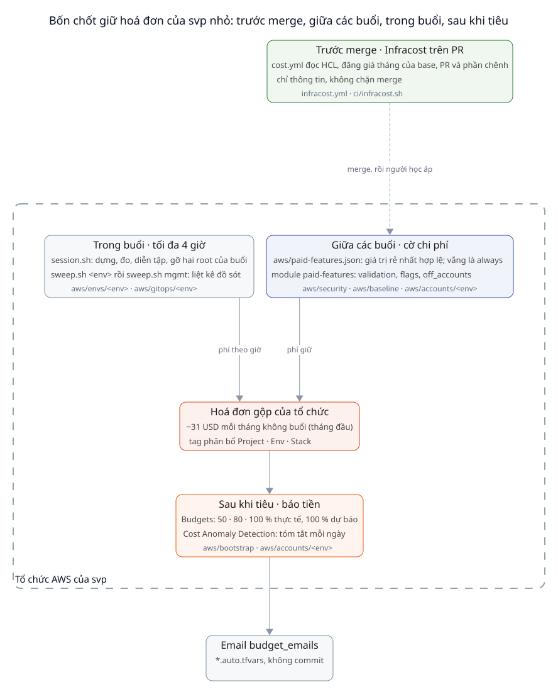

# 15. Chi phí

← [14. CI](14-ci.md) · [Mục lục](README.md)

## Tổng quan

Chương này gom các cách svp giữ hoá đơn AWS nhỏ. Lab không chạy liên tục: env stg, prd chỉ có trong một buổi vài giờ, còn phần sống lâu
(tổ chức, log, phát hiện, state, registry, backup) tính tiền cả tháng không ai dùng. Vì thế chi phí có hai phần, phí giữ giữa các buổi và
phí của mỗi buổi, và mỗi phần có chốt riêng.

Bốn chốt chạy ở bốn thời điểm. Trước khi merge, Infracost đăng giá tháng của thay đổi lên PR. Giữa các buổi, một file cờ chọn giá trị rẻ
nhất cho các dịch vụ tốn tiền mà hệ thống không cần để chạy. Trong buổi, env dựng rồi gỡ trong tối đa 4 giờ và kết thúc bằng hai lượt
quét đồ sót. Sau khi tiền đã tiêu, budget và Cost Anomaly Detection gửi email khi chi tiêu vượt hạn mức hay khác thường lệ.

Không chốt nào chặn: cả bốn chỉ báo hay chọn giá trị, người học vẫn là người áp và người gỡ. Đổi lại, một env quên gỡ được báo trong
khoảng một ngày, không phải cuối tháng.

| Câu hỏi | Cách giữ |
| --- | --- |
| PR này làm giá tháng của root tăng bao nhiêu? | Infracost trên PR (`cost.yml`) |
| Giữa các buổi account nào trả cho Security Hub, Config, Inspector, Amazon Managed Grafana? | Cờ chi phí `aws/paid-features.json` |
| Buổi hôm qua đã gỡ hết chưa, còn gì đang tính tiền? | Mô hình buổi, `sweep.sh` |
| Tháng này có vượt hạn mức không, có dịch vụ nào tăng bất thường không? | AWS Budgets, AWS Cost Anomaly Detection |
| Tiền đi vào dịch vụ nào, env nào? | Cost Explorer với tag phân bổ `Project`, `Env`, `Stack` |

| Account | Region | Vòng đời | Root Terraform |
| --- | --- | --- | --- |
| mọi account | theo root đọc cờ | sống lâu | `aws/paid-features.json` qua module `paid-features`: `aws/security`, `aws/baseline`, `aws/accounts/<env>`, `aws/envs/<env>` |
| management | toàn cục (API Cost Explorer ở `us-east-1`) | sống lâu | `aws/bootstrap` (budget tổ chức, Cost Anomaly Detection, tag phân bổ) |
| `svp-stg`, `svp-prd` | toàn cục | sống lâu | `aws/accounts/<env>` (budget của env) |
| `svp-stg`, `svp-prd` | `ap-southeast-1`, `us-east-1` | trong buổi | `aws/envs/<env>`, `aws/gitops/<env>` |
| GitHub, không account AWS | — | mỗi PR | `.github/workflows/cost.yml`, `infracost.yml` |

## Kiến trúc

<picture>
  <source media="(prefers-color-scheme: dark)" srcset="../diagrams/15-cost-dark.svg">
  
</picture>

*Sơ đồ khái niệm về bốn chốt, không phải luồng API: mỗi khối là một chốt ở một thời điểm, mũi tên nét liền là đường của tiền (phí đổ
vào hoá đơn gộp, hoá đơn tới chốt báo tiền rồi tới email), nét đứt là thay đổi mà người học áp. Số tiền: bảng [Chi phí](#chi-phí).*

| Thành phần | Ở đâu | Làm gì |
| --- | --- | --- |
| `aws/paid-features.json` | file commit ở `aws/` | Mỗi account một object cờ, chỉ ghi giá trị khác `always` |
| Module `paid-features` | `aws/modules/paid-features`, gọi từ bốn root | Kiểm giá trị bằng `validation`, trả đủ mọi cờ ở mọi account |
| `paid_feature`, `session_features` | `aws/scripts/lib.sh` | Script buổi đọc cùng file bằng `jq` |
| `tf.sh <env> account plan --open`, `--close` | `aws/scripts/tf.sh` | Mở, đóng phần của cờ `session` quanh root env |
| `session.sh`, `sweep.sh` | `aws/scripts/` | Thứ tự một buổi; liệt kê đồ còn lại sau destroy |
| Budget `svp-monthly`, `svp-<env>-monthly` | management (`aws/bootstrap`), mỗi account env (`aws/accounts/<env>`) | Email ở 50, 80, 100 % thực tế và 100 % dự báo |
| Monitor `svp-services`, subscription `svp-daily` | management (`aws/bootstrap`) | Email tóm tắt bất thường mỗi ngày |
| `cost.yml`, `infracost.yml` | GitHub Actions | Giá tháng của base và PR theo mỗi project, đăng comment |

## Kịch bản thực tế

**Câu hỏi của chương:** Muốn chấm posture của `svp-stg` bằng Security Hub CSPM trong đúng một buổi thì làm gì, trả bao nhiêu, và trả cờ
về thế nào?

Điều kiện: file của repo đặt `security_hub` và `config_recording` của `stg` là `off`; giữa các buổi chỉ `svp-security` được chấm.

1. **PR bật cờ.** Xoá hai khoá `security_hub`, `config_recording` khỏi object `stg` của `aws/paid-features.json`: khoá vắng là `always`.
   Phải bỏ cả hai: `validation` của module từ chối `security_hub` `always` khi `config_recording` của cùng account là `off`, vì control
   của Security Hub là rule Config. Comment Infracost của PR không có chênh: `aws/security`, `aws/baseline` không phải project của
   `infracost.yml`. `infra-ok` xanh thì merge.
2. **Áp theo hướng bật** ([`paid-features.md`](../runbooks/paid-features.md#thứ-tự-apply-cờ)): `aws/baseline` trước, plan `6 to add` ở
   `module.stg` (recorder, delivery channel, recorder status ở hai region); rồi `aws/security`, plan xoá association
   `svp-security-off` của stg và sửa `detail.accountId` của rule `svp-security-guardduty-findings` (account còn `off` vẫn giữ rule).
   `aws/accounts/stg` không đọc hai cờ này nên bỏ qua.
3. **Security Hub bắt đầu chấm.** stg về configuration policy `svp-security-standards` của root tổ chức. Check bắt đầu trong vòng hai
   giờ, phần lớn trong 25 phút sau khi chuẩn bật (ADR-0071 phụ lục [N7]).
4. **Buổi chạy.** Mỗi tài nguyên buổi tạo, đổi, xoá thành configuration item và check theo thay đổi. Phép kiểm "Finding bảo mật của
   buổi" đọc control FAILED của stg trên Security Hub của `svp-security`. Finding GuardDuty của stg giờ đi qua Security Hub và rule
   `svp-security-findings` (chương [05. Bảo mật](05-security.md#kịch-bản-thực-tế)). Phí thêm theo configuration item và security check:
   dòng `aws/baseline`, `aws/security` của bảng phí một buổi ở [Chi phí](#chi-phí).
5. **Trả cờ.** Sau hai lượt `sweep.sh` sạch, PR ghi lại `"security_hub": "off"`, `"config_recording": "off"` cho `stg`, áp theo hướng
   tắt: `aws/security` trước (association `svp-security-off` của stg trở lại, rule GuardDuty có lại stg), rồi `aws/baseline`
   (`6 to destroy`).
6. **Cái mất khi trả cờ.** Security Hub xoá finding archived của stg sau 30 ngày, finding active sau 90 ngày; bật lại trong 90 ngày lấy
   lại finding active (ADR-0071 phụ lục [N6]). Lịch sử Config đã ghi vẫn đọc được bằng `GetResourceConfigHistory`, bản đã giao vào bucket
   Config của Log Archive giữ ([N8]).

Thứ tự ở bước 2 và bước 5 ngược nhau vì một lý do: recorder phải ghi trước khi Security Hub bật lại, và còn ghi tới khi Security Hub đã
tắt.

## Các dịch vụ và cách svp dùng

### Cờ chi phí (`aws/paid-features.json`)

- **Làm gì:** chọn, theo account, giá trị của các dịch vụ tốn tiền mà hệ thống không cần để chạy; mọi root và script đọc cùng một file
  qua một module chỉ trả dữ liệu. Ví dụ đời thực:
  - `managed_grafana` `off` ở stg, prd: không workspace AMG, cluster nhận `grafanaUrl` rỗng, cảnh báo vẫn đi AMP → SNS.
  - `inspector_ecr` `off`: registry của env về quét cơ bản (`BASIC`, `SCAN_ON_PUSH`, cùng filter repo cache).
  - `security_hub` `off`: account gắn configuration policy `svp-security-off`; finding GuardDuty mức High, Critical vẫn tới email qua
    rule `svp-security-guardduty-findings`.
  - `config_recording` `off`: module `security-baseline` của account không có recorder ở hai region; service-linked role giữ.
  - Xoá khoá `prd` trước buổi prd: mọi cờ của prd về `always`, giá trị production.
- **Ở svp:** mọi account; giá trị đang dùng là nội dung file: mỗi account giá trị rẻ nhất mà `validation` cho phép, `svp-security` vắng
  (delegated admin giữ Security Hub, nên giữ cả Config). Tên cờ, tập giá trị và luật ở `variables.tf` của module
  [`paid-features`](../../aws/modules/paid-features/README.md). Root `aws/security` đổi khoá account thành id và dùng output
  `off_accounts`; `aws/baseline` truyền `config_recording` vào từng lời gọi `security-baseline`; `aws/accounts/<env>` truyền
  `inspector_ecr` vào `enhanced_scanning` của module `registry` và bật AMG của module `observability` khi `managed_grafana` là `always`,
  hay `session` và biến `session_open` là `true`; `aws/envs/<env>` không đọc workspace khi cờ là `off`.
- **Phí theo:** file và module không tính phí; mỗi cờ đổi đơn vị tính của dịch vụ của nó (user AMG mỗi workspace mỗi tháng, image quét,
  security check, configuration item).
- **Cố ý tắt:** cờ cho guardrail lõi: CloudTrail, GuardDuty, Access Analyzer truy cập ngoài, policy của tổ chức, budget, Cost Anomaly
  Detection, KMS CMK, Log Archive, AWS Backup không bao giờ có cờ
  ([ADR-0071](https://github.com/anhnvcoder/svp-backend/blob/main/docs/adr/0071-paid-features.md) §8).

### AWS Budgets và AWS Cost Anomaly Detection

- **Làm gì:** budget so chi tiêu thực tế và dự báo với hạn mức tháng; Cost Anomaly Detection học mức chi thường ngày của từng dịch vụ và
  báo ngày khác hẳn. Ví dụ đời thực:
  - Dự báo của `svp-stg-monthly` qua 100 % sáng hôm sau một buổi: env stg có thể chưa gỡ.
  - Thực tế của `svp-monthly` qua 50 % giữa tháng: tháng này nhiều buổi hơn dự tính.
  - Email `svp-daily` có một bất thường của Amazon EC2: node hay NAT sống qua đêm.
  - Một dịch vụ chưa từng dùng bắt đầu tính tiền sau khi ai đó bật nó trên console.
- **Ở svp:** budget `svp-monthly` ở management (không filter, nên tính hoá đơn gộp của tổ chức) và `svp-<env>-monthly` ở mỗi account env;
  ngưỡng ở `local.budget_alerts`; monitor `svp-services` và subscription `svp-daily` ở management, ngưỡng ở `cost.tf`; hạn mức và email
  ở `*.auto.tfvars`, không commit. Chi tiết: chương [01. Bootstrap](01-bootstrap.md#aws-budgets); budget env ở chương [08.
  Account](08-accounts.md).
- **Phí theo:** budget không có action không tính phí; Cost Anomaly Detection không tính phí.
- **Cố ý tắt:** budget action (gắn policy chặn, dừng instance): email đủ cho một người tự gỡ; action dừng tài nguyên giữa buổi khó đoán
  hơn cái nó cứu.

### Infracost trên PR

- **Làm gì:** đọc HCL và tfvars đã commit của hai cây base và PR, gọi Cloud Pricing API, đăng giá tháng và phần chênh theo resource. Ví dụ
  đời thực:
  - PR đổi `rds_instance_class` hay số node của `prd.tfvars`: chênh ở project `envs-prd`.
  - PR đổi `managed_grafana` hay `inspector_ecr` của một env: chênh ở project của root account đó.
  - PR đổi giả định mức dùng của `infracost-usage.yml`: tổng mới, chênh bằng 0.
- **Ở svp:** workflow `cost.yml`, mỗi root mà CI plan một project trong `infracost.yml`, chế độ HCL không credential AWS. Chi tiết:
  chương [14. CI](14-ci.md#costyml), tra cứu ở [Chi phí trên PR](../reference/ci.md#chi-phí-trên-pr).
- **Phí theo:** phút runner (miễn phí với repo public) và run của khoá API Infracost (gói Free tính theo run mỗi tháng).
- **Cố ý tắt:** cổng chi phí: comment chỉ là thông tin, không nằm trong ruleset. Root tổ chức (`aws/security`, `aws/baseline`) không
  là project, nên PR đổi `security_hub`, `config_recording` không có chênh.

### Mô hình buổi và `sweep.sh`

- **Làm gì:** phần tính theo giờ (VPC, NAT, EKS, RDS, MSK, ElastiCache, edge) chỉ có trong một buổi tối đa 4 giờ; cuối buổi destroy hai
  root của buổi rồi quét đồ còn lại bằng API AWS. Ví dụ đời thực:
  - Quá 3 giờ mà chưa đo xong: bỏ phần đo còn lại, sang gỡ.
  - Web ACL `svp-stg-web` còn sau destroy kẹt: `sweep.sh stg` in nó kèm lệnh xoá, exit 1.
  - KMS key của root env ở `PendingDeletion`: in là "pending deletion", không đếm, không tính phí.
  - Workspace AMG của cờ `session` còn sau buổi: `sweep.sh` bắt, vì bước đóng account chưa chạy.
- **Ở svp:** `aws/scripts/session.sh --print <env>` in mọi lệnh của buổi; `sweep.sh <env>` rồi `sweep.sh mgmt`, mỗi lệnh với profile
  của account đó, đọc region nhà và `us-east-1`, tìm theo tag `Project=svp`, tag của thành phần Kubernetes hay tên `svp-*`; stack giữ
  giữa các buổi (`kept` của bảng env trong `lib.sh`) in là "kept". Lệnh xoá tay theo loại:
  [`session-stg.md`](../runbooks/session-stg.md#lệnh-xoá-tay-theo-loại).
- **Phí theo:** không tính phí riêng; `sweep.sh` chỉ đọc.
- **Cố ý tắt:** env sống lâu thu về 0 (scale node, dừng RDS): NAT, control plane EKS, MSK, ElastiCache vẫn tính theo giờ khi không
  chạy tải.

## Chi phí

Số tiền là USD, làm tròn như nguồn; giá trị cờ của file. Ô "không có số đo" là khoản mà nguồn không tách riêng. Mỗi chương giữ bảng chi
tiết của root của nó.

**Phí giữ giữa các buổi** (tháng, không buổi nào chạy):

| Root | Khoản chính | Đơn vị tính | Giữa các buổi | Nguồn |
| --- | --- | --- | --- | --- |
| `aws/bootstrap` | key `alias/svp-tfstate`, bucket state, budget `svp-monthly`, Cost Anomaly Detection | key-tháng, GB-tháng | key 1; budget, Cost Anomaly Detection 0; bucket < 0,01 | ADR-0078 phụ lục "Xét lại", dòng "Mọi KMS CMK", "Budget, Cost Anomaly Detection"; ADR-0048 phụ lục bảng R |
| `github` | cài đặt GitHub, không tài nguyên AWS | — | 0 | code của root `github/` (provider `integrations/github`) |
| `aws/org` | trail `svp-audit`; SCP, RCP, tag policy, Backup policy; key `alias/svp-cloudtrail` cũ tới khi gỡ | event, key-tháng | trail ~0; policy 0; key cũ 1 | ADR-0078 phụ lục "Xét lại"; ADR-0048 phụ lục bảng R |
| `aws/log-archive` | bucket log của tổ chức; key `alias/svp-log-archive` ở hai region | GB-tháng, request, key-tháng | bucket ~1,1 cả tổ chức; 1 mỗi key | ADR-0060 phụ lục §12 "Ước lúc không buổi" (dòng S3 Log Archive, KMS) |
| `aws/security` | Security Hub CSPM của `svp-security`; GuardDuty mọi account; key của topic cảnh báo | check, event, key-tháng | Security Hub ~1,8; GuardDuty ~2,4 cho năm account, `svp-backup` thêm ~0,05; key 1 | ADR-0078 §2; ADR-0060 phụ lục §12 "Ước lúc không buổi"; ADR-0078 phụ lục "Tháng không buổi" |
| `aws/baseline` | recorder Config của `svp-security`; CMK EBS của stg, prd | configuration item, key-tháng | Config ~0,3; 1 mỗi key | ADR-0078 §2; ADR-0078 phụ lục "Xét lại", dòng "Baseline account" |
| `aws/backup` | key `svp-backup-copy`, bản copy của stg, prd, item Config của recovery point | key-tháng, GB-tháng | key 1; bản copy prd 1,25, stg 0,07; item 0,09 khi cờ `config_recording` `always`, 0 khi `off` | ADR-0067 phụ lục "Chi phí", "Sống giữa buổi" |
| `aws/accounts/<env>` | key state, hosted zone, budget env; registry; observability; key vault backup; prd thêm DNSSEC, alarm DNSSEC | key-tháng, zone-tháng, GB-tháng, user AMG | mỗi env: key state 1, zone 0,50, key vault 1; registry hai env ~5,7 (tháng 1) tới ~14 (tháng 6); observability hai env: key 2, lưu trữ < 0,3; AMG 0 với `off` (9 mỗi env khi `always`); edge prd ~2,4 | ADR-0048 phụ lục bảng R; ADR-0062 phụ lục §11 "Lúc không buổi"; ADR-0063 phụ lục §12 "Phần này, tháng không buổi"; ADR-0067 phụ lục; ADR-0061 phụ lục §13 "Lúc không buổi" |
| `aws/envs/<env>` | không: gỡ cùng buổi; KMS key chờ xoá | — | 0 | ADR-0048 phụ lục bảng R; ADR-0071 phụ lục "Không cờ" |
| `aws/gitops/<env>` | không: chỉ đối tượng Kubernetes trên cluster của buổi | — | 0 | chương 13. GitOps |
| **Cả tổ chức** | | | **~31,1 tháng 1; ~39,4 tháng 6** (dùng thử tháng đầu không trừ) | ADR-0078 phụ lục "Chi phí", "Tháng không buổi" |

**Phí một buổi** (4 giờ, một env):

| Root | Khoản chính | stg | prd (giá trị production) | Nguồn |
| --- | --- | --- | --- | --- |
| `aws/envs/<env>` | EKS, node, NAT, RDS, MSK, ElastiCache; endpoint interface; edge; transcode; flow log | lõi ~3,0 node Spot, ~3,7 on-demand; endpoint ~0,75; edge ~0,5 (media trong gói flat-rate Free: 0); transcode ~0,72; flow log 0,2–0,4; nhóm node hệ thống on-demand: không có số đo trong tổng | lõi ~11,0; RDS Multi-AZ `db.m7g.large` thêm ~1,06; edge ~0,55; transcode ~0,84; endpoint ba AZ, flow log: gộp theo nguồn ở dòng `aws/accounts/<env>`, `aws/security`; node Karpenter thêm, alarm dữ liệu: không có số đo | ADR-0053 §16; ADR-0064 phụ lục §7; ADR-0061 phụ lục §13 "Thêm mỗi buổi"; ADR-0066 phụ lục "Mỗi buổi"; ADR-0060 phụ lục §12; ADR-0052; ADR-0078 phụ lục "Buổi prd" |
| `aws/accounts/<env>` | AMP ingest, log, span; AMG theo cờ; Inspector theo cờ; backup và diễn tập khôi phục | AMP 2,52 buổi đầu tháng (0,72 khi một env), 4,32 buổi sau; log 0,35; span 0,35; AMG `off` 0, `session` 18; Inspector `off` 0, `always` ≤ 6,8 buổi đầu, ≤ 9 buổi cách buổi trước một tháng; backup ~0,15 | observability, registry ~23,5 (gộp theo nguồn với endpoint ba AZ của `aws/envs/prd`; gồm AMG 9 của tháng); backup ~0,34 | ADR-0063 phụ lục §12 "Phần này, mỗi buổi 4 giờ"; ADR-0071 phụ lục "Theo cờ (stg)"; ADR-0062 phụ lục §11; ADR-0067 phụ lục "Mỗi buổi"; ADR-0078 phụ lục "Buổi prd" |
| `aws/security` | GuardDuty theo lưu lượng buổi; Security Hub theo cờ | GuardDuty ~0,5; Security Hub `off` 0, `always` 1–3 | Security Hub, Config của tháng ~2,1; Config, Security Hub, GuardDuty theo thay đổi ~4–8 (gộp theo nguồn với flow log của `aws/envs/prd`); lượt check đầu: không có số đo | ADR-0060 phụ lục §12 "Thêm mỗi buổi"; ADR-0078 phụ lục "Buổi prd" |
| `aws/baseline` | Config theo cờ | `off` 0, `always` 2–4,5 | trong dòng `aws/security` | ADR-0060 phụ lục §12 "Thêm mỗi buổi" |
| `aws/gitops/<env>` | Argo CD trên node của buổi; service mesh | 0 | 0; service mesh: không có số đo | chương 13. GitOps; ADR-0065 §8; ADR-0078 phụ lục "Buổi prd" |
| `aws/bootstrap`, `github`, `aws/org`, `aws/log-archive`, `aws/backup` | data event prd, log WAF, bản copy (tính ở phí giữ) | ~0 | ~0 | ADR-0078 phụ lục "Xét lại" |
| **Cả buổi** | | không có tổng ở một nguồn: đo bằng Cost Explorer sau buổi | **~52,5–56,6** cộng phần không có số đo | ADR-0078 phụ lục "Buổi prd" |

Nguồn: [ADR-0078 phụ
lục](https://github.com/anhnvcoder/svp-backend/blob/main/docs/adr/appendix/0078-paid-features-lean-defaults.md#chi-phí),
[ADR-0071 phụ
lục](https://github.com/anhnvcoder/svp-backend/blob/main/docs/adr/appendix/0071-paid-features.md#bảng-tháng-không-buổi), các phụ
lục chi phí mà hai bảng đó trích (ADR-0048, 0053, 0060, 0061, 0062, 0063, 0064, 0066, 0067).

## Kiểm tra và vận hành

| Muốn xem | Account | Region | Vào đâu | Trạng thái mong đợi |
| --- | --- | --- | --- | --- |
| Chi phí theo dịch vụ, theo env | management | toàn cục | Billing and Cost Management → Cost Explorer, nhóm theo Service hay tag `Env` | Ngày có buổi cao hơn hẳn; ngày không buổi chỉ còn các khoản của bảng phí giữ |
| Budget của tổ chức | management | toàn cục | Billing and Cost Management → Budgets → `svp-monthly` | Bốn cảnh báo; thực tế dưới hạn mức |
| Budget của env | `svp-stg`, `svp-prd` | toàn cục | Budgets → `svp-<env>-monthly` | Dự báo dưới 100 % khi không buổi nào mở |
| Bất thường | management | toàn cục | Cost Anomaly Detection → Monitors `svp-services` | Subscription `svp-daily`, không bất thường mở sau ngày không buổi |
| Cờ `security_hub` đang áp | `svp-security` | `ap-southeast-1` | Security Hub CSPM → Configuration, thẻ Policies | Account `off` gắn `svp-security-off`, còn lại theo `svp-security-standards` |
| Cờ `inspector_ecr` đang áp | `svp-stg`, `svp-prd` | `ap-southeast-1` | ECR → Private registry → Settings → Scanning | Basic, scan on push khi cờ `off`; Enhanced khi `always` |
| Workspace AMG | `svp-stg`, `svp-prd` | `ap-southeast-1` | Amazon Managed Grafana → Workspaces | Không workspace `svp-<env>` khi cờ `off`, hay `session` ngoài buổi |

Bảng trên là trạng thái mà code khai báo. Runbook có bước kiểm cho nó: [`paid-features.md`](../runbooks/paid-features.md) (plan lần hai
`No changes.`, kiểu quét registry, workspace, recorder sau mỗi lần đổi cờ), mục 7f của
[`org-security-setup.md`](../runbooks/org-security-setup.md#7f-chi-phí-sau-1-và-7-ngày) (chi phí theo dịch vụ sau 1 và 7 ngày), và hai lượt
`sweep.sh` cuối mỗi buổi (mục [Kết thúc buổi](../runbooks/session-stg.md#kết-thúc-buổi) của `session-stg.md`). Số
của bảng phí là ước tính của ADR, chưa phải số đã đo: một số chỉ coi là đúng khi Cost Explorer sau buổi cho số gần nó.

## Thiết kế và đánh đổi

### Một file cờ đọc qua module chỉ trả dữ liệu

Một cờ chạm nhiều root: Inspector ở `aws/security` và `aws/accounts/<env>`, Security Hub và Config ở `aws/security` và `aws/baseline`.
Biến trong `<env>.tfvars` của từng root sẽ thành hai bản chép có thể lệch, và root tổ chức không có `<env>.tfvars`. Một file JSON đọc qua
module không provider, không resource (HashiCorp gọi là data-only module) cho một nguồn và một chỗ `validation`; khác biệt giữa account là
dữ liệu, không nhánh `if` theo tên env. Lý do và phương án:
[ADR-0071](https://github.com/anhnvcoder/svp-backend/blob/main/docs/adr/0071-paid-features.md) §1.

### Giá trị rẻ giữa các buổi, giá trị production trong buổi prd

Lộ trình chỉ có một buổi prd, nên giữa các buổi prd và account dùng chung lấy giá trị rẻ như stg; trước buổi prd, một PR xoá
khoá `prd` và áp theo hướng bật. Cái giá: giữa các buổi posture chỉ được chấm ở `svp-security`, lỗi chỉ lộ khi chấm posture chờ
tới buổi prd, quên PR trước buổi thì buổi prd chạy với giá trị rẻ.
[ADR-0078](https://github.com/anhnvcoder/svp-backend/blob/main/docs/adr/0078-paid-features-lean-defaults.md) §1, §3, §7.

### Chỉ AMG đi theo buổi

Bật lại không miễn phí: Inspector quét lại mọi image đủ điều kiện, Security Hub chạy lại mọi check, Config ghi lại mọi tài nguyên, và tắt
xoá finding cũ. Vì thế chỉ AMG có giá trị `session` (workspace mới mỗi buổi, không dữ liệu cần giữ); Security Hub, Config, Inspector chỉ
có `always` và `off`. AMG tính mỗi user mỗi workspace mỗi tháng, nên `session` lợi ở tháng không buổi, bằng ở tháng một buổi, đắt hơn
`always` từ buổi thứ hai ([ADR-0071](https://github.com/anhnvcoder/svp-backend/blob/main/docs/adr/0071-paid-features.md) §3).

| Lựa chọn của svp | Cái giá | Phương án khác | Khi nào chọn nó |
| --- | --- | --- | --- |
| Một file cờ, module data-only | Root đọc file ngoài thư mục của nó; `make test` chỉ thấy module, file thật kiểm ở plan và `session-test` | Biến `paid_features` trong `<env>.tfvars` từng root | Mỗi cờ chỉ chạm một root |
| Giá trị rẻ nhất hợp lệ giữa các buổi | Không chấm FSBP, CIS và lịch sử Config ở account `off` | Không cờ, stg giống prd (dev/prod parity) | prd chạy đều hay có người dùng thật |
| Env dựng và gỡ mỗi buổi, quét bằng `sweep.sh` | Mỗi buổi chờ MSK, ElastiCache, EKS dựng và gỡ; thêm bước quét | Env sống lâu, thu về 0 ngoài giờ (AWS Instance Scheduler) | Cần env sẵn sàng bất cứ lúc nào |
| Node Spot ở stg, on-demand ở prd, không cam kết | stg có thể mất node khi Spot thu hồi; prd trả giá niêm yết | Savings Plans, Reserved Instances | Tải chạy đều nhiều tháng |
| Budget, Cost Anomaly Detection chỉ gửi email | Người học phải tự gỡ; dữ liệu billing trễ khoảng một ngày | Budget action gắn SCP chặn hay dừng instance | Nhiều người, cần chặn cứng khi vượt |
| Cost Explorer và tag phân bổ | Không phân tích dòng billing chi tiết, không chia theo đội | Cost and Usage Reports qua Athena, Cost Categories | Nhiều đội cần chargeback, showback |

## Liên hệ đề SAP

- "Task 3.3: Design cost allocation and visibility solutions." Chương này là bản đồ chi phí của cả lab: phí giữ, phí buổi theo root, chốt
  ở bốn thời điểm.
- "Skill 3.3.5: Configure cost monitoring and alerting solutions that include budget thresholds and anomaly detection (for example, by
  using AWS Budgets, AWS Cost Anomaly Detection)." Budget `svp-monthly`, `svp-<env>-monthly` với ngưỡng thực tế và dự báo; monitor
  `svp-services`.
- "Skill 3.3.1: Design tagging strategies for cost allocation (for example, by using tags for business units, projects, and
  environments)." Tag `Project`, `Env`, `Stack` từ `default_tags` của mọi root, bật làm tag phân bổ.
- "Skill 3.1.1: Select appropriate purchase options based on usage patterns, including commitment-based and capacity-based options (for
  example, provisioned capacity, Reserved Instances, AWS Savings Plans, Spot Instances, On-Demand Instances)." Buổi vài giờ mỗi tháng nên
  không cam kết; Spot ở stg, on-demand ở prd.
- "Skill 3.4.5: Design cost-effective observability solutions that include features such as log filtering, metric aggregation, and
  retention optimization." Cờ `managed_grafana`: AMP, CloudWatch Logs, X-Ray luôn có, dashboard managed chỉ khi cần.

| Tình huống trong đề | Chọn | Vì sao không chọn cái gần giống |
| --- | --- | --- |
| Email khi chi tiêu tháng dự báo vượt hạn mức | AWS Budgets, ngưỡng `FORECASTED` | Cost Anomaly Detection so với mức thường ngày, không so với hạn mức |
| Báo khi một dịch vụ bất ngờ tăng chi phí dù tháng chưa vượt hạn mức | AWS Cost Anomaly Detection | Budget chỉ báo khi chạm ngưỡng phần trăm của hạn mức |
| Tự dừng chi tiêu khi vượt hạn mức | Budget action (áp SCP, IAM policy hay dừng EC2, RDS) | Budget không action chỉ gửi email; CloudWatch billing alarm cũng chỉ báo |
| Xem chi phí theo env, theo dự án | Tag phân bổ chi phí đã kích hoạt, Cost Explorer | Tag chưa kích hoạt không hiện trong Cost Explorer; Cost Categories là lớp gom trên tag |
| Phân tích chi tiết từng dòng billing bằng SQL, chia cho nhiều đội | Cost and Usage Reports (CUR 2.0) qua Athena | Cost Explorer chỉ có chiều tổng hợp sẵn |
| Buộc mọi tài nguyên mang tag `Env` | SCP chặn lệnh tạo thiếu tag (`aws:RequestTag`), tag policy chuẩn hoá khoá và giá trị | Config rule chỉ báo sau khi đã tạo; tag policy một mình không buộc tài nguyên phải có tag |
| Tải dev, test chạy vài giờ mỗi tuần, chịu bị ngắt | Spot Instances | Savings Plans, Reserved Instances cần cam kết một hay ba năm |
| Tải production chạy đều cả năm | Savings Plans hay Reserved Instances | Spot có thể bị thu hồi; on-demand đắt nhất cho tải đều |

## Đọc sâu

- `features` có kiểu `map(map(string))`, không `object`: Terraform bỏ thuộc tính mà kiểu `object` không khai báo, nên cờ gõ sai sẽ âm
  thầm thành `always` thay vì làm plan đỏ (comment ở `variables.tf`).
- `managed_grafana` và `inspector_ecr` chỉ đặt được cho `stg`, `prd`, kể cả giá trị `always`: account khác không có gì để chúng điều
  khiển. Inspector vẫn bật ở `svp-security` và thành viên `svp-log-archive`, `svp-backup`, nơi không có image.
- Biến `session_open` không nằm trong file nào: `tf.sh <env> account plan --open` đặt `true`, `--close` đặt `false`; trên PR,
  `ci/terraform-plan.sh` đặt `true` khi state của `aws/envs/<env>` còn tài nguyên. `terraform plan` trần luôn tính trạng thái
  giữa buổi. `tf.sh` từ chối `env plan` khi env có cờ `session` mà bước mở chưa áp, và từ chối `--close` khi root env còn đứng.
- Workspace AMG không tra được theo tên, nên module `observability` ghi id vào SSM parameter `/svp/<env>/grafana-workspace-id`; root env
  đọc nó khi cờ khác `off` và dừng plan khi không có.
- Account đã đóng (`SUSPENDED`) không có id trong tổ chức, nên cờ đặt cho nó không đổi gì ở `aws/security`.
- Test `make test DIRS=aws/modules/paid-features` chạy mỗi giá trị của mỗi cờ, giá trị của file và mỗi luật `validation`; `make test`
  chỉ mount thư mục module nên test chép lại giá trị của file.

Làm và tra cứu:

- [`paid-features.md`](../runbooks/paid-features.md): đổi một cờ, thứ tự áp các root, kiểm sau áp.
- [Module `paid-features`](../../aws/modules/paid-features/README.md): đầu vào, đầu ra, lời gọi mẫu.
- [Chi phí trên PR](../reference/ci.md#chi-phí-trên-pr): project Infracost, đọc comment, giới hạn của chế độ HCL.
- [ADR-0071](https://github.com/anhnvcoder/svp-backend/blob/main/docs/adr/0071-paid-features.md) và
  [ADR-0078](https://github.com/anhnvcoder/svp-backend/blob/main/docs/adr/0078-paid-features-lean-defaults.md): quyết định, kho mục, số
  tiền.
- [`paid-features.md`](https://github.com/anhnvcoder/svp-backend/blob/main/docs/explanation/paid-features.md) của svp-backend: cờ đi tới
  đâu, một buổi với AMG theo buổi.
- [`cost-and-uptime.md`](https://github.com/anhnvcoder/svp-backend/blob/main/docs/explanation/cost-and-uptime.md) của svp-backend: chi
  phí compute theo namespace bằng OpenCost trong buổi.
