# Tài nguyên mỗi root tạo trên account trống

Trang này đếm, cho mỗi root Terraform (mỗi env của root có env), các tài nguyên mà lần `apply` đầu tiên tạo trên account chưa có gì
của root đó, chia theo phần và theo loại, kèm một sơ đồ. Đọc trước khi chạy một root để biết plan đúng ra bao nhiêu `to add` và chúng
thuộc dịch vụ nào. Trang và sơ đồ sinh bằng `make inventory` từ plan của `terraform test` trên provider giả: offline, không credential,
không phí. Không sửa tay: `make inventory-check` ở CI đỏ khi trang hay sơ đồ lệch code. Lý do chọn cách này, và các phương án đã bỏ:
[ADR-0081](https://github.com/anhnvcoder/svp-backend/blob/main/docs/adr/0081-terraform-inventory.md).

## Cách đọc

- Dòng `Plan: …` là dòng tóm tắt `terraform plan` in ra trên account trống; `to import` là tài nguyên root nhận quản qua khối `import`
  thay vì tạo.
- **Phần**: lời gọi module cấp root (`module.<tên>`); tài nguyên khai báo thẳng trong root thì là file `.tf` khai báo nó.
- Bảng theo loại đếm mọi bản của `count`, `for_each`; cột dịch vụ là dịch vụ AWS của icon trên sơ đồ.
- Sơ đồ: mỗi khối một phần, tiêu đề ghi số tài nguyên của phần; mỗi icon một dịch vụ AWS kèm số tài nguyên của dịch vụ đó trong phần.
  Icon lấy từ bộ AWS Architecture Icons ([nguồn và bản](../diagrams/README.md#icon)).

## Giới hạn

- Số là của **account trống chạy lần đầu**. Nâng cấp account đã chạy root: lấy bảng của root trừ phần đã có; plan thật chỉ hiện phần
  còn thiếu cùng các thay đổi.
- Giá trị: biến từ `<env>.tfvars` đã commit, không có thì từ `*.auto.tfvars.example`; cờ chi phí từ `aws/paid-features.json` của
  repo; `session_open` theo mặc định (`false`); account id giả dạng `000000000000`, tên miền `svp.example`. Đổi cờ hay `<env>.tfvars`
  thì số đổi theo: chạy lại `make inventory` trong cùng PR.
- Data source trả giá trị giả của `ci/inventory/<root>.tftest.hcl` (provider giả, không đọc account). Mỗi root dưới đây nêu giả định
  nào của giá trị giả quyết định số.

## `aws/bootstrap`

- Account management chưa có state bucket hay budget. Số không phụ thuộc giá trị giả: mỗi email của `budget_emails`
  chỉ thêm một người nhận trong budget và anomaly subscription.

`Plan: 14 to add, 0 to change, 0 to destroy.`

<picture>
  <source media="(prefers-color-scheme: dark)" srcset="../diagrams/inventory/bootstrap-dark.svg">
  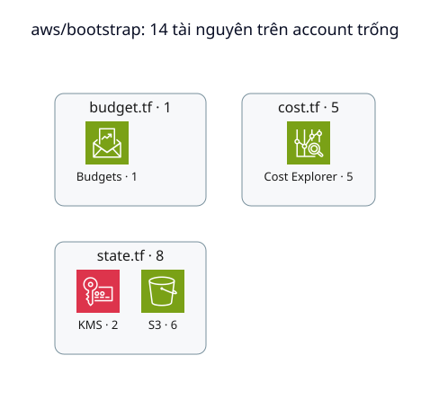
</picture>

| Phần | Tài nguyên |
| --- | ---: |
| `budget.tf` | 1 |
| `cost.tf` | 5 |
| `state.tf` | 8 |

| Loại | Dịch vụ | Số |
| --- | --- | ---: |
| `aws_budgets_budget` | Budgets | 1 |
| `aws_ce_anomaly_monitor` | Cost Explorer | 1 |
| `aws_ce_anomaly_subscription` | Cost Explorer | 1 |
| `aws_ce_cost_allocation_tag` | Cost Explorer | 3 |
| `aws_kms_alias` | KMS | 1 |
| `aws_kms_key` | KMS | 1 |
| `aws_s3_bucket` | S3 | 1 |
| `aws_s3_bucket_ownership_controls` | S3 | 1 |
| `aws_s3_bucket_policy` | S3 | 1 |
| `aws_s3_bucket_public_access_block` | S3 | 1 |
| `aws_s3_bucket_server_side_encryption_configuration` | S3 | 1 |
| `aws_s3_bucket_versioning` | S3 | 1 |

## `aws/org`

- Tổ chức chưa có; IAM Identity Center đã bật (một instance, việc tay trước root này) và có user `sso_user_name`.
- `account_emails` theo file ví dụ: năm account thành viên.

`Plan: 85 to add, 0 to change, 0 to destroy.`

<picture>
  <source media="(prefers-color-scheme: dark)" srcset="../diagrams/inventory/org-dark.svg">
  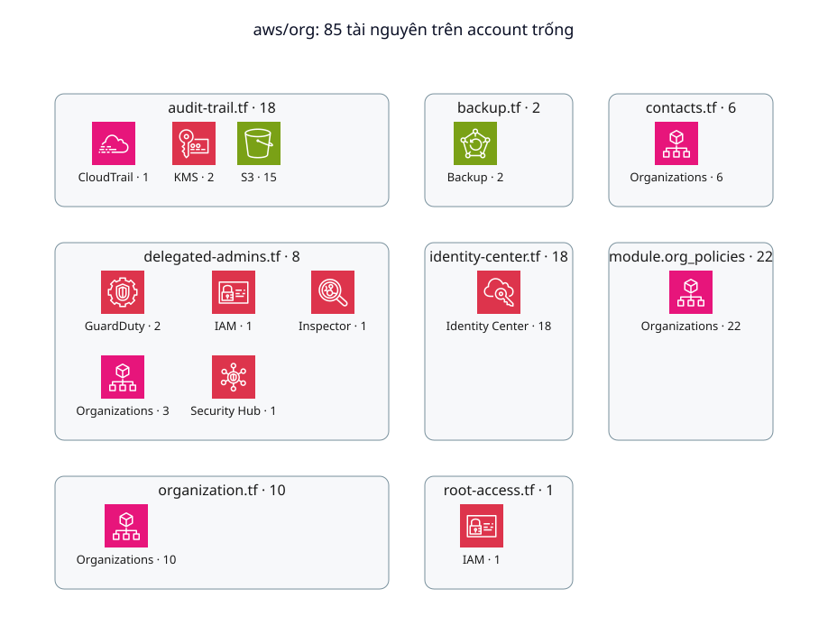
</picture>

| Phần | Tài nguyên |
| --- | ---: |
| `audit-trail.tf` | 18 |
| `backup.tf` | 2 |
| `contacts.tf` | 6 |
| `delegated-admins.tf` | 8 |
| `identity-center.tf` | 18 |
| `module.org_policies` | 22 |
| `organization.tf` | 10 |
| `root-access.tf` | 1 |

| Loại | Dịch vụ | Số |
| --- | --- | ---: |
| `aws_account_alternate_contact` | Organizations | 6 |
| `aws_backup_global_settings` | Backup | 1 |
| `aws_backup_region_settings` | Backup | 1 |
| `aws_cloudtrail` | CloudTrail | 1 |
| `aws_guardduty_organization_admin_account` | GuardDuty | 2 |
| `aws_iam_organizations_features` | IAM | 1 |
| `aws_iam_service_linked_role` | IAM | 1 |
| `aws_identitystore_group` | Identity Center | 2 |
| `aws_inspector2_delegated_admin_account` | Inspector | 1 |
| `aws_kms_alias` | KMS | 1 |
| `aws_kms_key` | KMS | 1 |
| `aws_organizations_account` | Organizations | 5 |
| `aws_organizations_delegated_administrator` | Organizations | 3 |
| `aws_organizations_organization` | Organizations | 1 |
| `aws_organizations_organizational_unit` | Organizations | 4 |
| `aws_organizations_policy` | Organizations | 11 |
| `aws_organizations_policy_attachment` | Organizations | 11 |
| `aws_s3_bucket` | S3 | 2 |
| `aws_s3_bucket_lifecycle_configuration` | S3 | 2 |
| `aws_s3_bucket_logging` | S3 | 1 |
| `aws_s3_bucket_object_lock_configuration` | S3 | 1 |
| `aws_s3_bucket_ownership_controls` | S3 | 2 |
| `aws_s3_bucket_policy` | S3 | 2 |
| `aws_s3_bucket_public_access_block` | S3 | 2 |
| `aws_s3_bucket_server_side_encryption_configuration` | S3 | 2 |
| `aws_s3_bucket_versioning` | S3 | 1 |
| `aws_securityhub_organization_admin_account` | Security Hub | 1 |
| `aws_ssoadmin_account_assignment` | Identity Center | 7 |
| `aws_ssoadmin_managed_policy_attachment` | Identity Center | 4 |
| `aws_ssoadmin_permission_set` | Identity Center | 3 |
| `aws_ssoadmin_permission_set_inline_policy` | Identity Center | 2 |

## `aws/log-archive`

- Account log archive trống, trong tổ chức của `aws/org`. Số không phụ thuộc giá trị giả.

`Plan: 59 to add, 0 to change, 0 to destroy.`

<picture>
  <source media="(prefers-color-scheme: dark)" srcset="../diagrams/inventory/log-archive-dark.svg">
  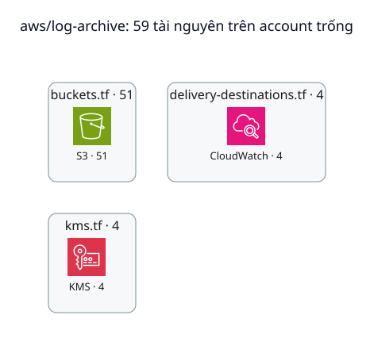
</picture>

| Phần | Tài nguyên |
| --- | ---: |
| `buckets.tf` | 51 |
| `delivery-destinations.tf` | 4 |
| `kms.tf` | 4 |

| Loại | Dịch vụ | Số |
| --- | --- | ---: |
| `aws_cloudwatch_log_delivery_destination` | CloudWatch | 2 |
| `aws_cloudwatch_log_delivery_destination_policy` | CloudWatch | 2 |
| `aws_kms_alias` | KMS | 2 |
| `aws_kms_key` | KMS | 2 |
| `aws_s3_bucket` | S3 | 7 |
| `aws_s3_bucket_lifecycle_configuration` | S3 | 7 |
| `aws_s3_bucket_logging` | S3 | 1 |
| `aws_s3_bucket_object_lock_configuration` | S3 | 1 |
| `aws_s3_bucket_ownership_controls` | S3 | 7 |
| `aws_s3_bucket_policy` | S3 | 7 |
| `aws_s3_bucket_public_access_block` | S3 | 7 |
| `aws_s3_bucket_server_side_encryption_configuration` | S3 | 7 |
| `aws_s3_bucket_versioning` | S3 | 7 |

## `aws/security`

- Tổ chức có đủ năm account thành viên `ACTIVE`; detector GuardDuty của hai region đã có (`aws/org` giao delegated
  admin), Inspector tự bật quét ECR cho account security nên `aws_inspector2_enabler.security` là import.
- Số member của Inspector và số association của Security Hub theo số account và cờ `inspector_ecr`, `security_hub` của
  `aws/paid-features.json`.

`Plan: 1 to import, 56 to add, 0 to change, 0 to destroy.`

<picture>
  <source media="(prefers-color-scheme: dark)" srcset="../diagrams/inventory/security-dark.svg">
  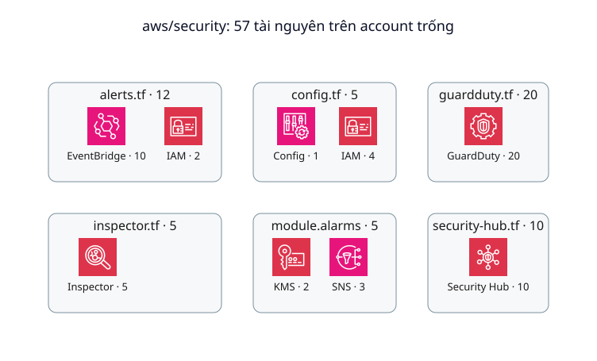
</picture>

| Phần | Tài nguyên |
| --- | ---: |
| `alerts.tf` | 12 |
| `config.tf` | 5 |
| `guardduty.tf` | 20 |
| `inspector.tf` | 5 (1 import) |
| `module.alarms` | 5 |
| `security-hub.tf` | 10 |

| Loại | Dịch vụ | Số |
| --- | --- | ---: |
| `aws_accessanalyzer_analyzer` | IAM | 2 |
| `aws_cloudwatch_event_bus` | EventBridge | 1 |
| `aws_cloudwatch_event_bus_policy` | EventBridge | 1 |
| `aws_cloudwatch_event_rule` | EventBridge | 4 |
| `aws_cloudwatch_event_target` | EventBridge | 4 |
| `aws_config_configuration_aggregator` | Config | 1 |
| `aws_guardduty_detector` | GuardDuty | 2 |
| `aws_guardduty_member` | GuardDuty | 2 |
| `aws_guardduty_organization_configuration` | GuardDuty | 2 |
| `aws_guardduty_organization_configuration_feature` | GuardDuty | 12 |
| `aws_guardduty_publishing_destination` | GuardDuty | 2 |
| `aws_iam_role` | IAM | 2 |
| `aws_iam_role_policy` | IAM | 1 |
| `aws_iam_role_policy_attachment` | IAM | 1 |
| `aws_inspector2_enabler` | Inspector | 2 (1 import) |
| `aws_inspector2_member_association` | Inspector | 2 |
| `aws_inspector2_organization_configuration` | Inspector | 1 |
| `aws_kms_alias` | KMS | 1 |
| `aws_kms_key` | KMS | 1 |
| `aws_securityhub_configuration_policy` | Security Hub | 2 |
| `aws_securityhub_configuration_policy_association` | Security Hub | 6 |
| `aws_securityhub_finding_aggregator` | Security Hub | 1 |
| `aws_securityhub_organization_configuration` | Security Hub | 1 |
| `aws_sns_topic` | SNS | 1 |
| `aws_sns_topic_policy` | SNS | 1 |
| `aws_sns_topic_subscription` | SNS | 1 |

## `aws/baseline`

- Sáu account (management, log archive, security, backup, stg, prd), chưa account nào có baseline; region nhà
  `ap-southeast-1`. Cờ `config_recording` theo `aws/paid-features.json`: chỉ account vắng khỏi file (security) ghi AWS Config.

`Plan: 248 to add, 0 to change, 0 to destroy.`

<picture>
  <source media="(prefers-color-scheme: dark)" srcset="../diagrams/inventory/baseline-dark.svg">
  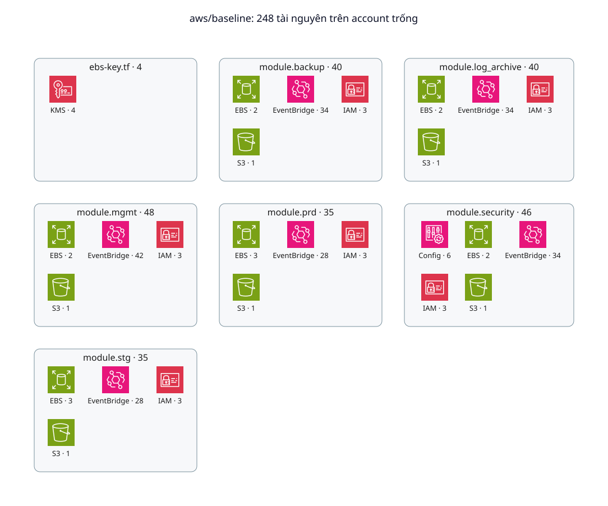
</picture>

| Phần | Tài nguyên |
| --- | ---: |
| `ebs-key.tf` | 4 |
| `module.backup` | 40 |
| `module.log_archive` | 40 |
| `module.mgmt` | 48 |
| `module.prd` | 35 |
| `module.security` | 46 |
| `module.stg` | 35 |

| Loại | Dịch vụ | Số |
| --- | --- | ---: |
| `aws_cloudwatch_event_rule` | EventBridge | 100 |
| `aws_cloudwatch_event_target` | EventBridge | 100 |
| `aws_config_configuration_recorder` | Config | 2 |
| `aws_config_configuration_recorder_status` | Config | 2 |
| `aws_config_delivery_channel` | Config | 2 |
| `aws_ebs_default_kms_key` | EBS | 2 |
| `aws_ebs_encryption_by_default` | EBS | 12 |
| `aws_iam_role` | IAM | 6 |
| `aws_iam_role_policy` | IAM | 6 |
| `aws_iam_service_linked_role` | IAM | 6 |
| `aws_kms_alias` | KMS | 2 |
| `aws_kms_key` | KMS | 2 |
| `aws_s3_account_public_access_block` | S3 | 6 |

## `aws/backup`

- Account backup trống, trong tổ chức của `aws/org`. Số không phụ thuộc giá trị giả.

`Plan: 8 to add, 0 to change, 0 to destroy.`

<picture>
  <source media="(prefers-color-scheme: dark)" srcset="../diagrams/inventory/backup-dark.svg">
  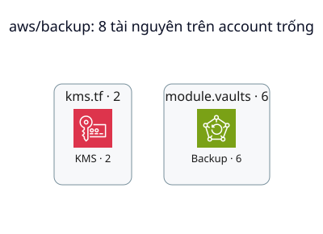
</picture>

| Phần | Tài nguyên |
| --- | ---: |
| `kms.tf` | 2 |
| `module.vaults` | 6 |

| Loại | Dịch vụ | Số |
| --- | --- | ---: |
| `aws_backup_vault` | Backup | 2 |
| `aws_backup_vault_lock_configuration` | Backup | 2 |
| `aws_backup_vault_policy` | Backup | 2 |
| `aws_kms_alias` | KMS | 1 |
| `aws_kms_key` | KMS | 1 |

## `aws/accounts`

- Account env trống. Cờ theo `aws/paid-features.json`: `managed_grafana` là `off` nên không có phần AMG.
- stg và prd khác nhau ở DNSSEC, query log và alarm của zone prd, số role CI, role Spot của stg. `delegated_subdomains` của
  `prd.auto.tfvars.example` uỷ quyền zone stg, nên prd có thêm một `aws_route53_record` (bản ghi NS `delegation`).

### `aws/accounts/stg`

`Plan: 68 to add, 0 to change, 0 to destroy.`

<picture>
  <source media="(prefers-color-scheme: dark)" srcset="../diagrams/inventory/accounts-stg-dark.svg">
  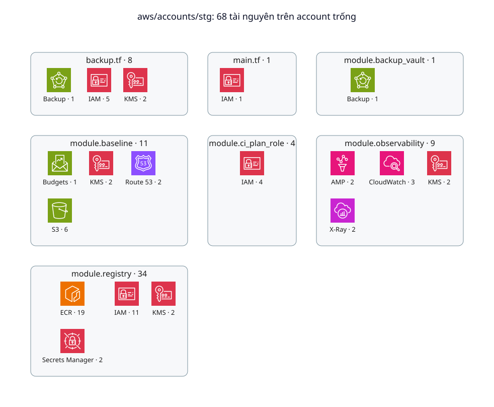
</picture>

| Phần | Tài nguyên |
| --- | ---: |
| `backup.tf` | 8 |
| `main.tf` | 1 |
| `module.backup_vault` | 1 |
| `module.baseline` | 11 |
| `module.ci_plan_role` | 4 |
| `module.observability` | 9 |
| `module.registry` | 34 |

| Loại | Dịch vụ | Số |
| --- | --- | ---: |
| `aws_backup_region_settings` | Backup | 1 |
| `aws_backup_vault` | Backup | 1 |
| `aws_budgets_budget` | Budgets | 1 |
| `aws_cloudwatch_log_group` | CloudWatch | 1 |
| `aws_cloudwatch_log_resource_policy` | CloudWatch | 1 |
| `aws_cloudwatch_log_stream` | CloudWatch | 1 |
| `aws_ecr_pull_through_cache_rule` | ECR | 5 |
| `aws_ecr_registry_scanning_configuration` | ECR | 1 |
| `aws_ecr_repository` | ECR | 8 |
| `aws_ecr_repository_creation_template` | ECR | 5 |
| `aws_iam_openid_connect_provider` | IAM | 1 |
| `aws_iam_role` | IAM | 7 |
| `aws_iam_role_policy` | IAM | 7 |
| `aws_iam_role_policy_attachment` | IAM | 5 |
| `aws_iam_service_linked_role` | IAM | 1 |
| `aws_kms_alias` | KMS | 4 |
| `aws_kms_key` | KMS | 4 |
| `aws_prometheus_workspace` | AMP | 1 |
| `aws_prometheus_workspace_configuration` | AMP | 1 |
| `aws_route53_record` | Route 53 | 1 |
| `aws_route53_zone` | Route 53 | 1 |
| `aws_s3_bucket` | S3 | 1 |
| `aws_s3_bucket_ownership_controls` | S3 | 1 |
| `aws_s3_bucket_policy` | S3 | 1 |
| `aws_s3_bucket_public_access_block` | S3 | 1 |
| `aws_s3_bucket_server_side_encryption_configuration` | S3 | 1 |
| `aws_s3_bucket_versioning` | S3 | 1 |
| `aws_secretsmanager_secret` | Secrets Manager | 2 |
| `aws_xray_indexing_rule` | X-Ray | 1 |
| `aws_xray_trace_segment_destination` | X-Ray | 1 |

### `aws/accounts/prd`

`Plan: 80 to add, 0 to change, 0 to destroy.`

<picture>
  <source media="(prefers-color-scheme: dark)" srcset="../diagrams/inventory/accounts-prd-dark.svg">
  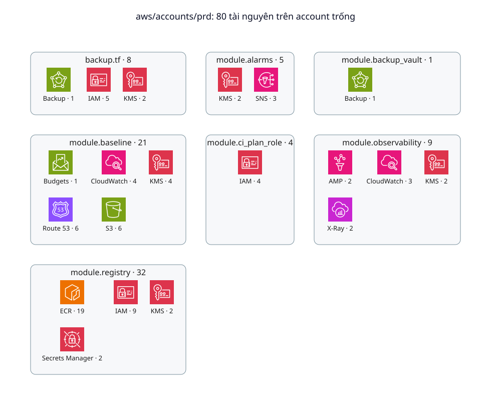
</picture>

| Phần | Tài nguyên |
| --- | ---: |
| `backup.tf` | 8 |
| `module.alarms` | 5 |
| `module.backup_vault` | 1 |
| `module.baseline` | 21 |
| `module.ci_plan_role` | 4 |
| `module.observability` | 9 |
| `module.registry` | 32 |

| Loại | Dịch vụ | Số |
| --- | --- | ---: |
| `aws_backup_region_settings` | Backup | 1 |
| `aws_backup_vault` | Backup | 1 |
| `aws_budgets_budget` | Budgets | 1 |
| `aws_cloudwatch_log_group` | CloudWatch | 2 |
| `aws_cloudwatch_log_resource_policy` | CloudWatch | 2 |
| `aws_cloudwatch_log_stream` | CloudWatch | 1 |
| `aws_cloudwatch_metric_alarm` | CloudWatch | 2 |
| `aws_ecr_pull_through_cache_rule` | ECR | 5 |
| `aws_ecr_registry_scanning_configuration` | ECR | 1 |
| `aws_ecr_repository` | ECR | 8 |
| `aws_ecr_repository_creation_template` | ECR | 5 |
| `aws_iam_openid_connect_provider` | IAM | 1 |
| `aws_iam_role` | IAM | 6 |
| `aws_iam_role_policy` | IAM | 6 |
| `aws_iam_role_policy_attachment` | IAM | 5 |
| `aws_kms_alias` | KMS | 6 |
| `aws_kms_key` | KMS | 6 |
| `aws_prometheus_workspace` | AMP | 1 |
| `aws_prometheus_workspace_configuration` | AMP | 1 |
| `aws_route53_hosted_zone_dnssec` | Route 53 | 1 |
| `aws_route53_key_signing_key` | Route 53 | 1 |
| `aws_route53_query_log` | Route 53 | 1 |
| `aws_route53_record` | Route 53 | 2 |
| `aws_route53_zone` | Route 53 | 1 |
| `aws_s3_bucket` | S3 | 1 |
| `aws_s3_bucket_ownership_controls` | S3 | 1 |
| `aws_s3_bucket_policy` | S3 | 1 |
| `aws_s3_bucket_public_access_block` | S3 | 1 |
| `aws_s3_bucket_server_side_encryption_configuration` | S3 | 1 |
| `aws_s3_bucket_versioning` | S3 | 1 |
| `aws_secretsmanager_secret` | Secrets Manager | 2 |
| `aws_sns_topic` | SNS | 1 |
| `aws_sns_topic_policy` | SNS | 1 |
| `aws_sns_topic_subscription` | SNS | 1 |
| `aws_xray_indexing_rule` | X-Ray | 1 |
| `aws_xray_trace_segment_destination` | X-Ray | 1 |

## `aws/envs`

- Account env đã chạy `aws/accounts/<env>`: workspace AMP, log group, key, 8 repo ECR phát hành, 5 rule pull-through cache.
- Region có ba zone, mọi endpoint interface có ở cả ba; một khoá ký URL media (slot `a`). Cỡ env (zone, NAT, endpoint, node, Multi-AZ)
  từ `<env>.tfvars`.

### `aws/envs/stg`

`Plan: 384 to add, 0 to change, 0 to destroy.`

<picture>
  <source media="(prefers-color-scheme: dark)" srcset="../diagrams/inventory/envs-stg-dark.svg">
  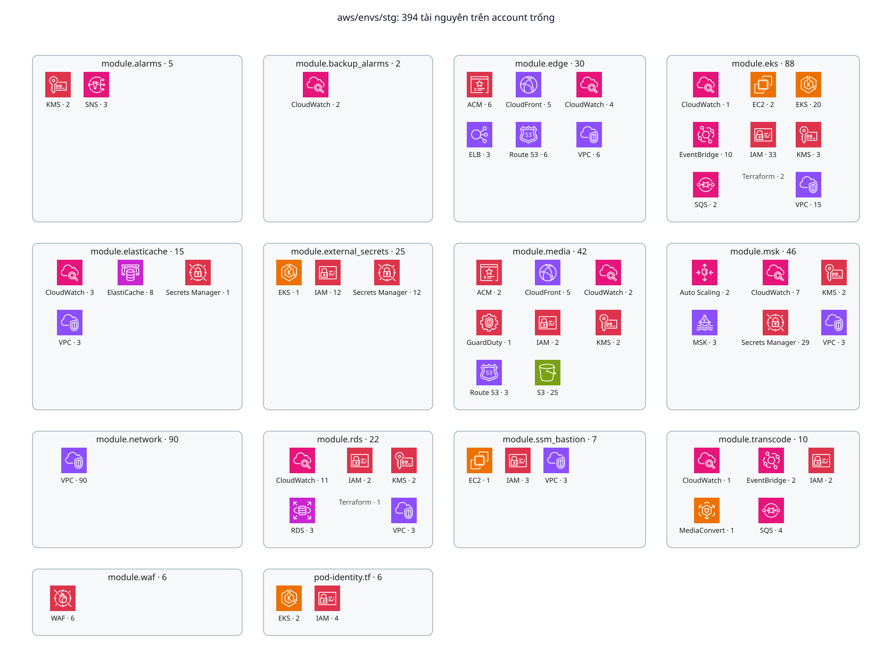
</picture>

| Phần | Tài nguyên |
| --- | ---: |
| `module.alarms` | 5 |
| `module.backup_alarms` | 2 |
| `module.edge` | 30 |
| `module.eks` | 89 |
| `module.elasticache` | 15 |
| `module.external_secrets` | 25 |
| `module.media` | 40 |
| `module.msk` | 37 |
| `module.network` | 90 |
| `module.rds` | 22 |
| `module.ssm_bastion` | 7 |
| `module.transcode` | 10 |
| `module.waf` | 6 |
| `pod-identity.tf` | 6 |

| Loại | Dịch vụ | Số |
| --- | --- | ---: |
| `aws_acm_certificate` | ACM | 4 |
| `aws_acm_certificate_validation` | ACM | 4 |
| `aws_appautoscaling_policy` | Auto Scaling | 1 |
| `aws_appautoscaling_target` | Auto Scaling | 1 |
| `aws_cloudfront_distribution` | CloudFront | 3 |
| `aws_cloudfront_key_group` | CloudFront | 1 |
| `aws_cloudfront_origin_access_control` | CloudFront | 1 |
| `aws_cloudfront_public_key` | CloudFront | 1 |
| `aws_cloudfront_response_headers_policy` | CloudFront | 2 |
| `aws_cloudfront_vpc_origin` | CloudFront | 1 |
| `aws_cloudwatch_event_rule` | EventBridge | 6 |
| `aws_cloudwatch_event_target` | EventBridge | 6 |
| `aws_cloudwatch_log_delivery` | CloudWatch | 2 |
| `aws_cloudwatch_log_delivery_source` | CloudWatch | 2 |
| `aws_cloudwatch_log_group` | CloudWatch | 6 |
| `aws_cloudwatch_metric_alarm` | CloudWatch | 19 |
| `aws_db_instance` | RDS | 1 |
| `aws_db_parameter_group` | RDS | 1 |
| `aws_db_subnet_group` | RDS | 1 |
| `aws_default_network_acl` | VPC | 1 |
| `aws_default_route_table` | VPC | 1 |
| `aws_default_security_group` | VPC | 1 |
| `aws_ec2_tag` | EC2 | 1 |
| `aws_eip` | VPC | 1 |
| `aws_eks_access_entry` | EKS | 2 |
| `aws_eks_access_policy_association` | EKS | 1 |
| `aws_eks_addon` | EKS | 7 |
| `aws_eks_cluster` | EKS | 1 |
| `aws_eks_node_group` | EKS | 1 |
| `aws_eks_pod_identity_association` | EKS | 11 |
| `aws_elasticache_parameter_group` | ElastiCache | 1 |
| `aws_elasticache_replication_group` | ElastiCache | 1 |
| `aws_elasticache_subnet_group` | ElastiCache | 1 |
| `aws_elasticache_user` | ElastiCache | 4 |
| `aws_elasticache_user_group` | ElastiCache | 1 |
| `aws_flow_log` | VPC | 1 |
| `aws_guardduty_malware_protection_plan` | GuardDuty | 1 |
| `aws_iam_instance_profile` | IAM | 1 |
| `aws_iam_policy` | IAM | 3 |
| `aws_iam_role` | IAM | 24 |
| `aws_iam_role_policy` | IAM | 18 |
| `aws_iam_role_policy_attachment` | IAM | 13 |
| `aws_instance` | EC2 | 1 |
| `aws_internet_gateway` | VPC | 1 |
| `aws_kms_alias` | KMS | 6 |
| `aws_kms_key` | KMS | 5 |
| `aws_launch_template` | EC2 | 1 |
| `aws_lb` | ELB | 1 |
| `aws_lb_listener` | ELB | 1 |
| `aws_lb_target_group` | ELB | 1 |
| `aws_media_convert_queue` | MediaConvert | 1 |
| `aws_msk_cluster` | MSK | 1 |
| `aws_msk_configuration` | MSK | 1 |
| `aws_msk_scram_secret_association` | MSK | 1 |
| `aws_nat_gateway` | VPC | 1 |
| `aws_network_acl` | VPC | 4 |
| `aws_network_acl_rule` | VPC | 34 |
| `aws_pricingplanmanager_subscription` | CloudFront | 1 |
| `aws_route` | VPC | 2 |
| `aws_route53_record` | Route 53 | 9 |
| `aws_route_table` | VPC | 4 |
| `aws_route_table_association` | VPC | 8 |
| `aws_s3_bucket` | S3 | 3 |
| `aws_s3_bucket_cors_configuration` | S3 | 2 |
| `aws_s3_bucket_lifecycle_configuration` | S3 | 3 |
| `aws_s3_bucket_logging` | S3 | 2 |
| `aws_s3_bucket_ownership_controls` | S3 | 3 |
| `aws_s3_bucket_policy` | S3 | 3 |
| `aws_s3_bucket_public_access_block` | S3 | 3 |
| `aws_s3_bucket_server_side_encryption_configuration` | S3 | 3 |
| `aws_s3_bucket_versioning` | S3 | 2 |
| `aws_s3_object` | S3 | 1 |
| `aws_secretsmanager_secret` | Secrets Manager | 21 |
| `aws_secretsmanager_secret_version` | Secrets Manager | 12 |
| `aws_security_group` | VPC | 9 |
| `aws_security_group_rule` | VPC | 13 |
| `aws_sns_topic` | SNS | 1 |
| `aws_sns_topic_policy` | SNS | 1 |
| `aws_sns_topic_subscription` | SNS | 1 |
| `aws_sqs_queue` | SQS | 3 |
| `aws_sqs_queue_policy` | SQS | 3 |
| `aws_subnet` | VPC | 8 |
| `aws_vpc` | VPC | 1 |
| `aws_vpc_endpoint` | VPC | 18 |
| `aws_vpc_security_group_egress_rule` | VPC | 3 |
| `aws_vpc_security_group_ingress_rule` | VPC | 12 |
| `aws_wafv2_web_acl` | WAF | 3 |
| `aws_wafv2_web_acl_logging_configuration` | WAF | 3 |
| `null_resource` | Terraform | 1 |
| `random_id` | Terraform | 1 |
| `time_sleep` | Terraform | 1 |

### `aws/envs/prd`

`Plan: 404 to add, 0 to change, 0 to destroy.`

<picture>
  <source media="(prefers-color-scheme: dark)" srcset="../diagrams/inventory/envs-prd-dark.svg">
  
</picture>

| Phần | Tài nguyên |
| --- | ---: |
| `module.alarms` | 5 |
| `module.backup_alarms` | 2 |
| `module.edge` | 30 |
| `module.eks` | 89 |
| `module.elasticache` | 15 |
| `module.external_secrets` | 25 |
| `module.media` | 42 |
| `module.msk` | 37 |
| `module.network` | 108 |
| `module.rds` | 22 |
| `module.ssm_bastion` | 7 |
| `module.transcode` | 10 |
| `module.waf` | 6 |
| `pod-identity.tf` | 6 |

| Loại | Dịch vụ | Số |
| --- | --- | ---: |
| `aws_acm_certificate` | ACM | 4 |
| `aws_acm_certificate_validation` | ACM | 4 |
| `aws_appautoscaling_policy` | Auto Scaling | 1 |
| `aws_appautoscaling_target` | Auto Scaling | 1 |
| `aws_cloudfront_distribution` | CloudFront | 3 |
| `aws_cloudfront_key_group` | CloudFront | 1 |
| `aws_cloudfront_origin_access_control` | CloudFront | 1 |
| `aws_cloudfront_public_key` | CloudFront | 1 |
| `aws_cloudfront_response_headers_policy` | CloudFront | 3 |
| `aws_cloudfront_vpc_origin` | CloudFront | 1 |
| `aws_cloudwatch_event_rule` | EventBridge | 6 |
| `aws_cloudwatch_event_target` | EventBridge | 6 |
| `aws_cloudwatch_log_delivery` | CloudWatch | 3 |
| `aws_cloudwatch_log_delivery_source` | CloudWatch | 3 |
| `aws_cloudwatch_log_group` | CloudWatch | 6 |
| `aws_cloudwatch_metric_alarm` | CloudWatch | 19 |
| `aws_db_instance` | RDS | 1 |
| `aws_db_parameter_group` | RDS | 1 |
| `aws_db_subnet_group` | RDS | 1 |
| `aws_default_network_acl` | VPC | 1 |
| `aws_default_route_table` | VPC | 1 |
| `aws_default_security_group` | VPC | 1 |
| `aws_ec2_tag` | EC2 | 1 |
| `aws_eip` | VPC | 3 |
| `aws_eks_access_entry` | EKS | 2 |
| `aws_eks_access_policy_association` | EKS | 1 |
| `aws_eks_addon` | EKS | 7 |
| `aws_eks_cluster` | EKS | 1 |
| `aws_eks_node_group` | EKS | 1 |
| `aws_eks_pod_identity_association` | EKS | 11 |
| `aws_elasticache_parameter_group` | ElastiCache | 1 |
| `aws_elasticache_replication_group` | ElastiCache | 1 |
| `aws_elasticache_subnet_group` | ElastiCache | 1 |
| `aws_elasticache_user` | ElastiCache | 4 |
| `aws_elasticache_user_group` | ElastiCache | 1 |
| `aws_flow_log` | VPC | 1 |
| `aws_guardduty_malware_protection_plan` | GuardDuty | 1 |
| `aws_iam_instance_profile` | IAM | 1 |
| `aws_iam_policy` | IAM | 3 |
| `aws_iam_role` | IAM | 24 |
| `aws_iam_role_policy` | IAM | 18 |
| `aws_iam_role_policy_attachment` | IAM | 13 |
| `aws_instance` | EC2 | 1 |
| `aws_internet_gateway` | VPC | 1 |
| `aws_kms_alias` | KMS | 6 |
| `aws_kms_key` | KMS | 5 |
| `aws_launch_template` | EC2 | 1 |
| `aws_lb` | ELB | 1 |
| `aws_lb_listener` | ELB | 1 |
| `aws_lb_target_group` | ELB | 1 |
| `aws_media_convert_queue` | MediaConvert | 1 |
| `aws_msk_cluster` | MSK | 1 |
| `aws_msk_configuration` | MSK | 1 |
| `aws_msk_scram_secret_association` | MSK | 1 |
| `aws_nat_gateway` | VPC | 3 |
| `aws_network_acl` | VPC | 4 |
| `aws_network_acl_rule` | VPC | 34 |
| `aws_route` | VPC | 4 |
| `aws_route53_record` | Route 53 | 9 |
| `aws_route_table` | VPC | 8 |
| `aws_route_table_association` | VPC | 12 |
| `aws_s3_bucket` | S3 | 3 |
| `aws_s3_bucket_cors_configuration` | S3 | 2 |
| `aws_s3_bucket_lifecycle_configuration` | S3 | 3 |
| `aws_s3_bucket_logging` | S3 | 2 |
| `aws_s3_bucket_ownership_controls` | S3 | 3 |
| `aws_s3_bucket_policy` | S3 | 3 |
| `aws_s3_bucket_public_access_block` | S3 | 3 |
| `aws_s3_bucket_server_side_encryption_configuration` | S3 | 3 |
| `aws_s3_bucket_versioning` | S3 | 2 |
| `aws_s3_object` | S3 | 1 |
| `aws_secretsmanager_secret` | Secrets Manager | 21 |
| `aws_secretsmanager_secret_version` | Secrets Manager | 12 |
| `aws_security_group` | VPC | 9 |
| `aws_security_group_rule` | VPC | 13 |
| `aws_sns_topic` | SNS | 1 |
| `aws_sns_topic_policy` | SNS | 1 |
| `aws_sns_topic_subscription` | SNS | 1 |
| `aws_sqs_queue` | SQS | 3 |
| `aws_sqs_queue_policy` | SQS | 3 |
| `aws_subnet` | VPC | 12 |
| `aws_vpc` | VPC | 1 |
| `aws_vpc_endpoint` | VPC | 18 |
| `aws_vpc_security_group_egress_rule` | VPC | 3 |
| `aws_vpc_security_group_ingress_rule` | VPC | 12 |
| `aws_wafv2_web_acl` | WAF | 3 |
| `aws_wafv2_web_acl_logging_configuration` | WAF | 3 |
| `null_resource` | Terraform | 1 |
| `random_id` | Terraform | 1 |
| `time_sleep` | Terraform | 1 |

## `aws/gitops`

- Cluster của `aws/envs/<env>` đã chạy, chưa có gì của bootstrap. 11 namespace: `argocd` cùng mười namespace mà chart
  `svp-cluster` với `platforms/eks/svp-cluster.yaml` của svp-gitops sinh ra, chép vào giá trị giả: đổi danh sách đó thì sửa
  `ci/inventory/gitops.tftest.hcl`.
- Tài nguyên Kubernetes, Helm không có icon AWS: sơ đồ ghi chúng bằng chữ.

### `aws/gitops/stg`

`Plan: 15 to add, 0 to change, 0 to destroy.`

<picture>
  <source media="(prefers-color-scheme: dark)" srcset="../diagrams/inventory/gitops-stg-dark.svg">
  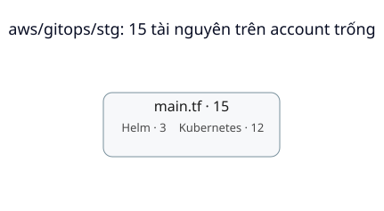
</picture>

| Phần | Tài nguyên |
| --- | ---: |
| `main.tf` | 15 |

| Loại | Dịch vụ | Số |
| --- | --- | ---: |
| `helm_release` | Helm | 3 |
| `kubernetes_manifest` | Kubernetes | 11 |
| `kubernetes_secret_v1` | Kubernetes | 1 |

### `aws/gitops/prd`

`Plan: 15 to add, 0 to change, 0 to destroy.`

<picture>
  <source media="(prefers-color-scheme: dark)" srcset="../diagrams/inventory/gitops-prd-dark.svg">
  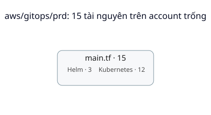
</picture>

| Phần | Tài nguyên |
| --- | ---: |
| `main.tf` | 15 |

| Loại | Dịch vụ | Số |
| --- | --- | ---: |
| `helm_release` | Helm | 3 |
| `kubernetes_manifest` | Kubernetes | 11 |
| `kubernetes_secret_v1` | Kubernetes | 1 |

## `github`

- State trống nên mỗi repo hiện là `create`. Repo đã có trên GitHub thì nhận quản bằng khối `import` tạm
  ([`github-setup.md`](../runbooks/github-setup.md)), không tạo lại.

`Plan: 54 to add, 0 to change, 0 to destroy.`

<picture>
  <source media="(prefers-color-scheme: dark)" srcset="../diagrams/inventory/github-dark.svg">
  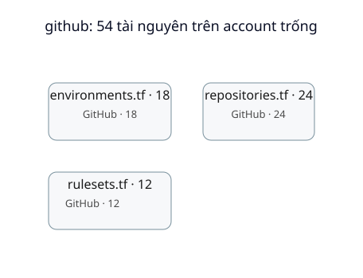
</picture>

| Phần | Tài nguyên |
| --- | ---: |
| `environments.tf` | 18 |
| `repositories.tf` | 24 |
| `rulesets.tf` | 12 |

| Loại | Dịch vụ | Số |
| --- | --- | ---: |
| `github_actions_environment_variable` | GitHub | 4 |
| `github_actions_repository_permissions` | GitHub | 6 |
| `github_actions_variable` | GitHub | 1 |
| `github_repository` | GitHub | 6 |
| `github_repository_environment` | GitHub | 7 |
| `github_repository_environment_deployment_policy` | GitHub | 6 |
| `github_repository_ruleset` | GitHub | 12 |
| `github_repository_vulnerability_alerts` | GitHub | 6 |
| `github_workflow_repository_permissions` | GitHub | 6 |
