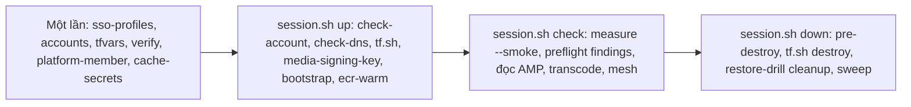

# Bản đồ script của `aws/scripts/`

> **Tóm tắt**
>
> - **Làm gì:** tra từng script của `aws/scripts/`: làm gì, khi nào chạy, đầu vào, nó đổi gì trong AWS, output đúng trông thế nào,
>   đỏ thì làm gì, chạy lại có an toàn không, test của nó. Một buổi thường ngày chỉ cần ba lệnh `session.sh up|check|down`.
> - **Vì sao:** một buổi gọi khoảng ba mươi lệnh của mười mấy script. Mỗi script nhỏ và làm một việc để đọc, thử và chạy lại từng bước;
>   `session.sh` gói chúng theo thứ tự của runbook để người học không phải nhớ thứ tự đó.
> - **Phí:** trang tra cứu không tốn gì. Script đổi gì trong AWS ghi ở dòng **Trong AWS** của nó; phí của buổi ở
>   [`session-stg.md`](../runbooks/session-stg.md) và [`session-prd.md`](../runbooks/session-prd.md).

Người học chạy mọi script chạm AWS; AI chỉ chạy test của chúng với lệnh giả (luật ở [`AGENTS.md`](../../AGENTS.md)). Cách chạy Terraform,
account, profile và biến: [`operations.md`](operations.md). Thứ tự dựng một lần: [mục lục runbook](../runbooks/README.md).

## Ba lệnh của một buổi

| Lệnh | Chạy gì | Dừng hỏi | Ghi gì |
| --- | --- | --- | --- |
| `aws/scripts/session.sh up stg` | Bước 1–15 của bảng [Thứ tự](../runbooks/session-stg.md#thứ-tự), thêm `preflight.sh plugin` đầu tiên và làm nóng cache sau `bootstrap.sh stg secrets` | Sau mỗi plan có file: in đường dẫn file text và dòng `Plan:`, chờ gõ `yes` trước apply; trước bước cần tunnel khi tunnel chưa mở | Mốc `up <n>: <bước>` vào `timeline.tsv` của buổi, từ `check-account.sh` (mốc `session-start` của nó) trở đi |
| `aws/scripts/session.sh check stg` | Phép kiểm `lõi` đọc được bằng script (bảng ở mục [`session.sh`](#sessionsh)) | Không hỏi; chỉ đọc | Bảng `PASS`/`FAIL`, rồi dòng `HAND` cho phép `lõi` cần người của đúng env |
| `aws/scripts/session.sh down stg` | Bước 20–31: pre-destroy, gỡ root gitops, root env, đóng root account, quét sót | Sau plan destroy của root gitops và root env (và plan teardown của prd) | Mốc `down <n>: <bước>` |

`prd` dùng cùng ba lệnh; `up prd`, `down prd` thêm các bước tay của [`session-prd.md`](../runbooks/session-prd.md) (mục
[`session.sh`](#sessionsh)). Phép `chuẩn ngành` (thang k6, diễn tập khôi phục bước 17–19) vẫn chạy tay theo runbook.



## Bốn nhóm

| Nhóm | Script | Khi nào |
| --- | --- | --- |
| Dựng tổ chức một lần | [`sso-profiles.sh`](#sso-profilessh), [`accounts.sh`](#accountssh), [`tfvars.sh`](#tfvarssh), [`platform-member.sh`](#platform-membersh), [`cache-secrets.sh`](#cache-secretssh), [`grafana-tokens.sh`](#grafana-tokenssh) | Các runbook dựng một lần; `accounts.sh` mỗi terminal mới |
| Dựng một env (buổi) | [`session.sh`](#sessionsh) `up`, [`check-account.sh`](#check-accountsh), [`check-dns.sh`](#check-dnssh), [`tf.sh`](#tfsh), [`media-signing-key.sh`](#media-signing-keysh), [`bootstrap.sh`](#bootstrapsh), [`ecr-warm.sh`](#ecr-warmsh) | Bước 1–15 của mỗi buổi |
| Kiểm | [`session.sh`](#sessionsh) `check`, [`measure.sh`](#measuresh), [`preflight.sh`](#preflightsh), [`verify.sh`](#verifysh), [`restore-drill.sh`](#restore-drillsh) `backup\|rds\|s3` | Trước buổi, bước 16–19, sau mỗi runbook dựng |
| Gỡ | [`session.sh`](#sessionsh) `down`, [`pre-destroy.sh`](#pre-destroysh), [`tf.sh`](#tfsh) `destroy`, [`restore-drill.sh`](#restore-drillsh) `cleanup`, [`sweep.sh`](#sweepsh) | Bước 20–31 của mỗi buổi |

Ba file không chạy riêng: [`lib.sh`](#libsh-profilessh-teststestlibsh) (hàm chung, bảng env), `profiles.sh` (bảng profile),
`tests/testlib.sh` (bộ chung của test).

## Khuôn chung

- **`--print` làm đối số đầu:** in, theo thứ tự, mọi lệnh script sẽ chạy rồi không chạy lệnh nào, không cần credential.
  `session.sh --print stg` in cả buổi.
- **Dòng output:** `ok` (bước xong), `FAIL` (script dừng, exit khác 0), `note` (đọc bằng mắt), `skip` (bước không áp dụng), `mark` (một
  mốc vào timeline), `== …` (tên bước).
- **Thư mục buổi:** script ghi plan text, giá trị cluster, kết quả đo vào `$SVP_SESSION_DIR`, phải nằm dưới `.session/` của repo (git bỏ
  qua: file trong đó có domain thật). `timeline.tsv` ở đó giữ mốc của buổi: giờ UTC, giây epoch, tên mốc.
- **Kiểm account trước:** script chạm account gọi `check_account` của `lib.sh` trước mọi lệnh khác: account của profile phải là số trong
  `SVP_AWS_<ENV>_ACCOUNT_ID`.
- **Tunnel:** script tới API của cluster kiểm `127.0.0.1:6444` (prd `6443`) trước lệnh đầu tới API, dừng với `FAIL no tunnel …` khi
  tunnel chưa mở ([Tunnel tới API](../runbooks/session-stg-deploy.md#tunnel-tới-api-sau-bước-9-trước-bước-11)).
- **Test:** script buổi thử trong `session-test.sh`; script dựng có `<tên>-test.sh`, cả hai trong `aws/scripts/tests/`.
  `make session-test` chạy tất cả với `aws`, `terraform`, `kubectl`, `gh` giả.

## Script của buổi

### `session.sh`

- **Làm gì, vì sao:** chạy buổi theo thứ tự của runbook. Mỗi bước gọi đúng script của bước đó (không lặp lại logic của nó), nên một
  bước chạy tay hay qua `session.sh` cho cùng kết quả.
- **Khi nào:** `up` đầu buổi, `check` sau `up` (bước 16), `down` cuối buổi; `--print` bất cứ lúc nào để xem trước.
- **Lệnh:** `aws/scripts/session.sh --print|up|check|down stg|prd`.
- **Đầu vào:** `SVP_SESSION_DIR`, biến account của env (direnv), terminal tương tác cho `up`, `down` (stdin từ pipe hay file thì từ chối,
  không bước nào chạy); bản clone `backend/` và `gitops/` cạnh `infra/` cho làm nóng cache và `check`.
- **Trong AWS:** `up`, `down` đổi đúng những gì các script của bước đổi. `check` chỉ đọc: `aws` các lệnh `list`, `describe`, `get`,
  `s3 sync` từ bucket về thư mục buổi; `kubectl get`, `logs`; hai script nó chạy là `measure.sh <env> --smoke` và
  `preflight.sh findings <env>`.
- **Các bước của `up`:** `preflight.sh plugin`, `check-account.sh`, `check-dns.sh`, `tf.sh account init`, `plan --open`, `apply`,
  `tf.sh env init`, `media-signing-key.sh new a`, `tf.sh env plan`, `apply`, `media-signing-key.sh activate a`, `bootstrap.sh secrets`,
  làm nóng cache (`deploy/ci/image-list.sh` của repo code rồi `ecr-warm.sh`), `tf.sh gitops init`, `plan`, `apply`, `bootstrap.sh wait`.
  `up prd` mở bằng hai bước tay ([Đổi cờ prd](../runbooks/session-prd.md#đổi-cờ-prd-trước-buổi),
  [Cổng promote prd](../runbooks/session-prd.md#cổng-promote-prd-trước-mọi-lệnh-tốn-tiền) bước 1–3) và `preflight.sh promote`.
- **Các bước của `down`:** `pre-destroy.sh`, `tf.sh gitops plan --destroy`, `destroy`, `tf.sh env plan --teardown`, `apply --teardown`,
  `restore-drill.sh cleanup`, `tf.sh env plan --destroy`, `destroy`, `tf.sh account plan --close`, `apply`, `sweep.sh <env>`,
  `sweep.sh mgmt`. `down prd` thêm bước tay xoá snapshot cuối trước `sweep.sh prd`, bước tay trả cờ sau `sweep.sh mgmt`, rồi
  `sweep.sh prd` lần nữa ([Gỡ, quét sót, trả cờ](../runbooks/session-prd.md#gỡ-quét-sót-trả-cờ)).
- **Phép của `check`:** smoke (`measure.sh --smoke`), commit status `argocd/<env>` của commit mà `svp-root` đã sync (ghi commit vào
  `<env>-ref.txt` của buổi, dùng cho cổng promote), luật AMP (`svp-alerts`, `slo-generated`, alert manager `ACTIVE`), transcode (a)
  (media-worker chạy `mediaconvert`, mọi bản ghi job có job `COMPLETE`), mesh (không node nào giữ taint `cni.istio.io/not-ready`,
  istiod, istio-cni, ztunnel, waypoint sẵn sàng, pod trong mesh, PeerAuthentication `STRICT`), transcode (f) (hai hàng đợi rỗng, alarm DLQ
  không `ALARM`), finding bảo mật. Dòng `HAND` là phép `lõi` cần người hay chưa có script, theo trang kiểm của chính env đó, mỗi dòng mở
  bằng đầu tên mục: phát video trên trình duyệt, email alarm, deploy qua GitOps, chu kỳ của nhóm luật AMP, và các phép chưa có script
  (`prd` có thêm Data event S3 trong trail; image của release `dlq-replay` ở ECR chỉ là phép `lõi` của `stg`).
- **Output đúng:**

  ```text
  == session.sh up stg, step 9 of 17: tf.sh stg env plan
  Read <buổi>/stg-env-plan.txt (Plan: N to add, 0 to change, 0 to destroy.) before the next step applies <plan>. Apply it?
  Type yes to go on, anything else stops: yes
  ok    every step of up stg (17) is done
  ```

  `check` kết thúc bằng bảng `PASS    smoke (measure.sh --smoke)` … và `ok every scripted core check of stg passed`.
- **Đỏ thì:** bước đỏ dừng cả lệnh và in `FAIL step <n> is red: …` kèm lệnh `session.sh` chạy lại chính bước đó. Sửa theo dòng `FAIL`
  của script bước đó (trang pha của bước, nhãn **Bẫy**), rồi chạy lại `session.sh up stg`, không chạy riêng script của bước: bước chạy
  riêng không có mốc, nên `session.sh` chạy nó lần nữa (`media-signing-key.sh new a` lần hai từ chối vì file khoá đã có). `check` chạy hết
  các phép, phép đỏ in `FAIL` của nó và bảng có dòng `FAIL`.
- **Chạy lại:** an toàn. Lệnh đọc mốc `up <n>` (hay `down <n>`) cuối cùng trong `timeline.tsv`, bỏ các bước đã xong, in bước bắt đầu
  (`up stg starts at step 9 of 17: …`). Bước plan không ghi mốc, bước apply của nó mới ghi: sau một apply đỏ hay một câu trả lời khác
  `yes`, lần chạy sau plan lại. Plan không ghi file (env không có cờ `session` ở bước `account`) thì không hỏi. Lệnh không bao giờ tự
  trả lời `yes`. Mốc chỉ ghi khi timeline đã mở: `check-account.sh` mở nó bằng `session-start` như khi chạy tay (`measure.sh` tính mốc 3
  giờ từ đó), nên các bước trước nó (`preflight.sh plugin`, hai bước tay và `preflight.sh promote` của `prd`) chỉ đọc hay hỏi, không ghi
  mốc, và chạy lại khi lệnh dừng trước `check-account.sh`.
- **Test:** `session-test.sh`, mục `session.sh up, check, down`: các script của bước là lệnh giả trong một cây riêng, terminal giả bằng
  `pty` của `python3`; thử thứ tự khớp bảng Thứ tự của runbook, hai lần hỏi, từ chối khi stdin không phải terminal, chạy tiếp từ mốc, dừng ở
  bước đỏ, nhắc tunnel, các bước riêng của prd, `check` chỉ đọc và đỏ đúng phép, dòng `HAND` theo env; `check-account.sh` thật (với `aws`
  giả) mở timeline bằng một mốc `session-start`; mục `--print` giữ đầu ra cũ.

### `check-account.sh`

- **Làm gì, vì sao:** so account của profile env (`anhnv-sso` cho mgmt, `anhnv-stg`, `anhnv-prd`) với số người học đã export. Lệnh ghi
  với nhầm profile là lỗi khó gỡ nhất; bước này chặn trước mọi lệnh khác.
- **Khi nào:** bước 1 của mọi buổi, và trước mọi lệnh ghi tay của người học.
- **Lệnh:** `aws/scripts/check-account.sh [--print] mgmt|stg|prd`.
- **Đầu vào:** profile SSO đã đăng nhập, `SVP_AWS_<ENV>_ACCOUNT_ID`, `SVP_SESSION_DIR` (mở timeline).
- **Trong AWS:** chỉ đọc (`sts get-caller-identity`). Ghi mốc `session-start` khi timeline của buổi còn trống (lần chạy đầu của buổi).
- **Output đúng:** `ok    account <12 số> of stg, arn:aws:sts::<12 số>:assumed-role/…`.
- **Đỏ thì:** `FAIL set SVP_AWS_STG_ACCOUNT_ID …` (biến chưa có: kiểm `.envrc`), `FAIL aws sts get-caller-identity …` (phiên SSO hết
  hạn: `aws sso login`), `FAIL profile … is account …, not …`: dừng, kiểm profile trong `~/.aws/config`.
- **Chạy lại:** an toàn, chỉ đọc.
- **Test:** `session-test.sh`.

### `check-dns.sh`

- **Làm gì, vì sao:** resolver công khai phải trả uỷ quyền của hosted zone env (do baseline `aws/accounts/<env>` tạo). ACM xác thực cert
  bằng DNS và người xem tới tên của buổi qua resolver công khai; uỷ quyền chưa lan (hay bị gỡ) làm buổi đỏ muộn, khi cluster đã tính tiền.
- **Khi nào:** bước 2, trước mọi plan, apply.
- **Lệnh:** `aws/scripts/check-dns.sh [--print] stg|prd`.
- **Đầu vào:** output `name_servers` của `aws/accounts/<env>` (root đã `init`), `zone_name` của `aws/accounts/<env>/<env>.auto.tfvars`.
- **Trong AWS:** chỉ đọc một output của state; truy vấn DNS công khai. Không kiểm account (không đổi gì).
- **Output đúng:** `ok hosted zone <zone> has name servers …`, rồi mỗi resolver một dòng `ok resolver <ip>: NS of <zone> are the hosted
  zone's`.
- **Đỏ thì:** `FAIL resolver … returns no NS …`: uỷ quyền thiếu hay chưa lan; sửa bản ghi `NS` ở DNS cha
  ([`accounts-setup.md`, bước (5)](../runbooks/accounts-setup.md#bước-5-uỷ-quyền-zone-của-env)), không bắt đầu buổi.
- **Chạy lại:** an toàn, chỉ đọc.
- **Test:** `session-test.sh`.

### `tf.sh`

- **Làm gì, vì sao:** Terraform của ba root buổi: `env` (`aws/envs/<env>`), `gitops` (`aws/gitops/<env>`: Argo CD và root GitOps),
  `account` (`aws/accounts/<env>`: mở, đóng tính năng trả phí của buổi). Kiểm account trước mỗi lệnh, đặt `TF_VAR_*` của root, ghi giờ
  apply, destroy vào timeline. `apply`, `destroy` chỉ nhận file plan đã lưu, không bao giờ plan tại chỗ.
- **Khi nào:** bước 3–6, 8–9, 12–14 (dựng) và 21–29 (gỡ).
- **Lệnh:**
  - `tf.sh [--print] stg|prd env|gitops init|plan|show|apply|destroy`;
  - `plan --teardown` (chỉ env), `plan --destroy [--leftovers|--no-cluster]`, `apply --teardown`;
  - `tf.sh stg|prd env state-rm <địa chỉ>`, `env import <địa chỉ> <id>` (sau khôi phục RDS thay chỗ);
  - `tf.sh stg|prd account init|plan --open|plan --close|apply`.
- **Đầu vào:** biến account của env, `SVP_AWS_LOG_ACCOUNT_ID`, `SVP_AWS_BACKUP_ACCOUNT_ID` (root env), `SVP_SESSION_DIR`,
  `backend-<env>.hcl`, `<env>.auto.tfvars`; tunnel cho mọi lệnh của root gitops trừ `init`.
- **Trong AWS:** `init`, `plan`, `show` không đổi tài nguyên; `apply`, `destroy` ghi đúng plan đã lưu, ở account của env.
  Plan text nằm trong thư mục buổi, không trong repo (có domain, IP thật).
- **Luật thứ tự:** `env plan` từ chối tới khi root account đã mở (`account-open-applied`); `gitops plan --destroy` tới khi `pre-destroy.sh`
  xong (`pre-destroy-done`); `env plan --destroy`, `env destroy` tới khi root gitops đã gỡ và `restore-drill.sh cleanup` đã ghi
  `backup-drained`; `account plan --close` tới khi root env đã gỡ. Env không có cờ `session` thì mọi lệnh `account` in
  `ok no session feature …` và không chạy gì.
- **Output đúng:** `ok terraform init of aws/envs/stg, state …`; `ok plan written to aws/envs/stg/stg.tfplan: read <thư mục
  buổi>/stg-env-plan.txt, then …`; `ok plan text in …: Plan: N to add, …`; sau apply là dòng `Apply complete! …` và các mốc
  `env-apply-start`, `env-apply-end`.
- **Đỏ thì:** apply đỏ giữa chừng: đọc lỗi, sửa, rồi plan lại và apply plan mới
  ([Khi apply lỗi giữa chừng](operations.md#khi-apply-lỗi-giữa-chừng)); khoá state kẹt: [Khoá state kẹt](operations.md#khoá-state-kẹt);
  `FAIL no tunnel …`: mở tunnel.
- **Chạy lại:** `init`, `plan` an toàn. `apply` chạy lại cần plan mới, vì Terraform không áp lại plan đã cũ. Chi tiết:
  [`tf.sh` ở operations.md](operations.md#tfsh).
- **Test:** `session-test.sh`.

### `media-signing-key.sh`

- **Làm gì, vì sao:** cặp khoá ký URL `premium/*` của distribution media, trong hai slot (`a`, `b`) để khoá mới vào key group trước khi khoá
  cũ ra. `new` sinh khoá riêng ngoài repo và ghi khoá công khai vào `media-signing.auto.tfvars.json` của root env; `activate`, sau apply,
  ghi ID khoá và khoá riêng vào entry `svp/<env>/media-signing` (video-service đọc), rồi xoá file khoá riêng.
- **Khi nào:** `new a` ở bước 7 (trước `env plan`), `activate a` ở bước 10 (sau `env apply`). Xoay, lộ khoá:
  [`media-signing-keys.md`](../runbooks/media-signing-keys.md).
- **Lệnh:** `aws/scripts/media-signing-key.sh [--print] stg|prd new|activate a|b`.
- **Đầu vào:** thư mục khoá dưới `XDG_STATE_HOME` (không trong repo, không symlink); `activate` cần output `media_signing_key_ids` của root
  env.
- **Trong AWS:** `new` không gọi AWS. `activate` ghi một version mới của entry Secrets Manager `svp/<env>/media-signing`. Không giá trị nào
  của khoá riêng lên dòng lệnh, stdout hay stderr.
- **Output đúng:** `ok slot a: private key in … (owner only, not shown), public key in …`; `ok entry svp/stg/media-signing: key <id> of
  slot a (not shown), version …; … deleted`.
- **Đỏ thì:** `FAIL … exists: the private key of slot a from an earlier new, not activated yet`: chạy `activate a` sau apply, hay xoá file
  bằng tay; `FAIL no …: activate deletes it …`: slot đã kích hoạt hay chưa tạo.
- **Chạy lại:** `new` từ chối khi khoá của slot chưa kích hoạt còn đó; `activate` từ chối khi file khoá riêng đã xoá. Không lần chạy lại
  nào đè khoá.
- **Test:** `session-test.sh`.

### `bootstrap.sh`

- **Làm gì, vì sao:** dựng quanh lần apply root gitops. Mỏng có chủ đích: secret và GlitchTip là target `make` của repo code, Argo CD là
  của Terraform; script chạy chúng theo thứ tự, kiểm account, giới hạn mỗi lần chờ.
- **Khi nào:** `secrets` ở bước 11 (sau `env apply`, trước root gitops); `wait` ở bước 15 (sau `gitops apply`).
- **Lệnh:** `aws/scripts/bootstrap.sh [--print] stg|prd secrets|wait`.
- **Đầu vào:** bản clone repo code trên `main`, output của root env; `wait` cần tunnel.
- **Trong AWS:** `secrets` ghi các entry `svp/<env>/*` của Secrets Manager, giá trị cluster vào thư mục buổi, context `svp-<env>` vào
  kubeconfig; token Grafana khi workspace AMG có. `wait` đọc Application của Argo CD, chạy `make eks-glitchtip-init`, chờ target group
  của edge có target healthy.
- **Output đúng:** `ok code repository on main at …`, `ok cluster values in …`, `ok entries svp/stg/* written …`; mốc `secrets-written`,
  rồi ở `wait` các mốc `observability-healthy`, `glitchtip-init`, `svp-root-healthy`, `edge-healthy`.
- **Đỏ thì:** `FAIL Application svp-root not Synced and Healthy after …`: đọc `kubectl --context svp-stg -n argocd get
  applications.argoproj.io` theo [15. Chờ Argo CD](../runbooks/session-stg-deploy.md#15-chờ-argo-cd), sửa rồi chạy lại.
- **Chạy lại:** an toàn: `secrets` ghi version mới của entry (xoá token Grafana cũ), `make eks-glitchtip-init` idempotent.
- **Test:** `session-test.sh`.

### `ecr-warm.sh`

- **Làm gì, vì sao:** làm nóng pull-through cache của ECR env. Mọi image của cluster ghim digest, và pull theo digest một image cache chưa
  thấy bao giờ thì lỗi; script pull theo tag qua cache rồi kiểm digest ghim đã có trong ECR.
- **Khi nào:** sau `bootstrap.sh secrets`, trước root gitops ([Làm nóng
  cache](../runbooks/session-stg-deploy.md#làm-nóng-cache-sau-bước-11-trước-bước-12)); lại khi một digest bên thứ ba đổi giữa buổi.
  `session.sh up` chạy bước này cùng `deploy/ci/image-list.sh`.
- **Lệnh:** `aws/scripts/ecr-warm.sh [--print] stg|prd <file>`; file là output của `deploy/ci/image-list.sh <gitops> <env>` trong repo
  code, mỗi dòng `<ref>:<tag>@sha256:<digest>`.
- **Đầu vào:** danh sách image (`deploy/ci/image-list.sh` cần Docker và mạng).
- **Trong AWS:** `ecr batch-get-image` theo tag qua cache, nên cache tạo repo và image trong ECR của env; `ecr describe-images`
  kiểm digest ghim. Mốc `ecr-warm-start`, `ecr-warmed`.
- **Output đúng:** mỗi image `ok <image> in <repo> at its pinned digest`, cuối cùng `ok every image of … in the cache of stg at its pinned
  digest`.
- **Đỏ thì:** `FAIL N image(s) not in ECR at their pinned digest`: cache làm mới tag tối đa một lần mỗi ngày, chạy lại sau; tag đã dời ở
  upstream thì cập nhật digest ghim (PR của Renovate).
- **Chạy lại:** an toàn.
- **Test:** `session-test.sh`.

### `measure.sh`

- **Làm gì, vì sao:** số đo của buổi, sau `bootstrap.sh wait`: smoke đầu-cuối qua `https://api.<domain>` (`make eks-smoke`); với env có
  `ladder` ở `env_table` (stg) thêm seed (ít nhất 30 video READY) và thang k6 1, 2, 4, 8 pod. `--smoke` chỉ chạy smoke, đường `lõi`.
- **Khi nào:** bước 16. `session.sh check` gọi `measure.sh <env> --smoke`.
- **Lệnh:** `aws/scripts/measure.sh [--print] stg|prd [--from 1|2|4|8 | --smoke]`.
- **Đầu vào:** tunnel, `SVP_SESSION_DIR`, repo code.
- **Trong AWS:** smoke đi luồng đầu-cuối qua API như một người dùng; seed thêm video; thang k6 chạy Job trong cluster. Kết quả vào
  `k6-levels.tsv` và timeline (`smoke-ok`, `seed-ok`, `k6-<n>-start`, `k6-<n>-end`).
- **Output đúng:** `ok smoke passed through https://api.<domain>`; với `--smoke` thêm `ok --smoke: no seed, no k6 ladder`.
- **Đỏ thì:** exit 1 khi smoke, seed hay công cụ của một mức đỏ; exit 3 khi một mức bị gián đoạn (node Spot rời đi): `measure.sh stg --from
  <n>` chạy lại từ mức đó. Mức đỏ (ngưỡng không đạt) là kết quả đo, exit 0.
- **Chạy lại:** an toàn; `--from` bỏ smoke và seed. Đo dừng ở mốc 3 giờ sau `session-start`.
- **Test:** `session-test.sh`.

### `restore-drill.sh`

- **Làm gì, vì sao:** diễn tập khôi phục và dọn backup trước khi gỡ root env. `backup` kiểm plan backup của tổ chức trong account, backup
  theo yêu cầu DB instance và hai bucket, copy sang account `svp-backup`; `rds` khôi phục `svp-<env>` sang `svp-<env>-pitr` và so dữ liệu;
  `s3` xoá một object media rồi khôi phục; cả hai đo RTO, RPO. `cleanup` xoá bản khôi phục, gỡ tag `Backup`, chờ job, xoá recovery point
  đã có copy.
- **Khi nào:** `backup`, `rds`, `s3` ở bước 17–19 (`chuẩn ngành`, chạy tay); `cleanup` ở bước 25, ngay trước `env plan --destroy`.
- **Lệnh:** `aws/scripts/restore-drill.sh [--print] stg|prd backup|rds|s3|cleanup`.
- **Đầu vào:** `SVP_SESSION_DIR`; `rds` cần tunnel (so dữ liệu qua `svp-pg`).
- **Trong AWS:** ghi: job backup, copy, restore; instance `svp-<env>-pitr`; xoá tag, recovery point. Kết quả ở `restore-drill.tsv`,
  `restore-drill-points.tsv`. `backup`, `rds`, `s3` ghi mốc `backup-undrained`, `cleanup` ghi `backup-drained` (`tf.sh` cần mốc này trước
  destroy root env).
- **Output đúng:** `ok backup job … completed …`, `ok copy job … completed`, dòng `PASS backup …`; `cleanup` kết thúc bằng mốc
  `backup-drained`.
- **Đỏ thì:** đọc dòng `FAIL`; dòng `FAIL rds …`, `FAIL s3 …` của phép đo là số đo, sang bước kế. Chi tiết:
  [17–19. Diễn tập khôi phục](../runbooks/session-stg-drills.md#1719-diễn-tập-khôi-phục),
  [Bước 25](../runbooks/session-stg-teardown.md#bước-25-xoá-backup-của-buổi).
- **Chạy lại:** `cleanup` an toàn (mỗi bước tìm cái còn lại).
- **Test:** `session-test.sh`.

### `pre-destroy.sh`

- **Làm gì, vì sao:** gỡ những gì Kubernetes tạo trong account khi controller tạo ra chúng còn chạy, trước `tf.sh gitops destroy`: target
  của Envoy trong target group edge, volume EBS của PVC, node của Karpenter, luật AMP của ACK, job MediaConvert còn chạy. Terraform không
  biết chúng; để sót thì chặn destroy (ENI, security group) hay vẫn tính tiền (volume, instance).
- **Khi nào:** bước 20.
- **Lệnh:** `aws/scripts/pre-destroy.sh [--print] stg|prd`.
- **Đầu vào:** tunnel, `SVP_SESSION_DIR`.
- **Trong AWS và cluster:** xoá ApplicationSet và Application của Argo CD theo wave, PVC, NodePool, EC2NodeClass; huỷ job MediaConvert
  `SUBMITTED`, `PROGRESSING`. Mốc `pre-destroy-start` … `pre-destroy-done` (`tf.sh gitops plan --destroy` cần mốc cuối).
- **Output đúng:** `ok svp-bootstrap, svp-root and svp-apps deleted alone; their children stay`, `ok wave … deleted: …`, `ok rules and
  alerting of AMP deleted by ACK`, mốc `pre-destroy-done`.
- **Đỏ thì:** mọi lần chờ có giới hạn và in cái còn lại; chạy lại script. Hết giờ của buổi mà bước 2, 3 hay 4 còn đỏ: `tf.sh stg gitops
  plan --destroy --leftovers` ([20. Gỡ trong cluster](../runbooks/session-stg-teardown.md#20-gỡ-trong-cluster-trước-destroy)).
- **Chạy lại:** an toàn; mỗi bước tìm cái còn lại.
- **Test:** `session-test.sh`.

### `sweep.sh`

- **Làm gì, vì sao:** liệt kê những gì còn trong một account, chỉ từ API của AWS, nên vẫn chạy khi destroy dừng giữa chừng hay state mất.
  Tìm tài nguyên tag `Project=svp`, tag mà thành phần Kubernetes gắn, hay tên `svp-*`, ở region nhà và `us-east-1`.
- **Khi nào:** bước 30 (`sweep.sh <env>`), 31 (`sweep.sh mgmt`); mỗi buổi kết thúc bằng cả hai.
- **Lệnh:** `aws/scripts/sweep.sh [--print] mgmt|stg|prd`.
- **Đầu vào:** profile của account cần quét.
- **Trong AWS:** chỉ đọc. Mỗi thứ sót in kèm lệnh xoá cho người học chạy. Thứ ở lại giữa các buổi (tag `Stack` trong cột `kept` của
  `env_table`) in là `kept`, KMS key chờ xoá in là `pending deletion`, không đếm.
- **Output đúng:** mỗi loại `ok <loại>: none`, cuối cùng `ok nothing left in account stg but what it keeps (Stack=…) and keys pending
  deletion`.
- **Đỏ thì:** `FAIL N leftover(s) …`: chạy lệnh xoá in dưới mỗi thứ, rồi chạy lại; `FAIL could not read: …`: quét chưa sạch tới khi đọc
  được mọi loại ([Lệnh xoá tay theo loại](../runbooks/session-stg.md#lệnh-xoá-tay-theo-loại)).
- **Chạy lại:** an toàn, chỉ đọc.
- **Test:** `session-test.sh`.

## Script đọc trước và sau buổi

### `preflight.sh`

- **Làm gì, vì sao:** các phép đọc trước và trong buổi thay cho lệnh gõ tay: `quotas` (quota EC2 và AMP), `freetier` (gói Free, gói của
  CloudFront), `eks-upgrade` (minor EKS kế), `findings` (finding bảo mật, bản copy backup của buổi), `promote` (kiểm git của cổng promote
  prd), `plugin` (bản `session-manager-plugin`, mang tunnel tới API).
- **Khi nào:** `plugin` đầu buổi (bước đầu của `session.sh up`), `promote` trước buổi prd, `findings` trước bước 20 (và trong
  `session.sh check`), `quotas`, `freetier` trước buổi, `eks-upgrade` giữa các buổi.
- **Lệnh:** `preflight.sh [--print] quotas stg|prd [request]`; `freetier|eks-upgrade|findings stg|prd`; `promote|plugin`.
- **Đầu vào:** profile env; `findings` cần `SVP_SESSION_DIR` và chạy thêm dưới profile khác (`profiles.sh`); `promote`, `plugin` không gọi
  `aws`.
- **Trong AWS:** chỉ đọc, trừ `quotas <env> request` (gửi yêu cầu tăng quota).
- **Output đúng:** mỗi phép một dòng `ok`, `FAIL` hay `note`; một `FAIL` không dừng các phép còn lại của `quotas`, `freetier`, `findings`,
  `promote`. Bản tối thiểu của plugin: [`preflight.sh plugin`](operations.md#preflightsh-plugin).
- **Chạy lại:** an toàn.
- **Test:** `preflight-test.sh`.

### `verify.sh`

- **Làm gì, vì sao:** kiểm chỉ đọc những gì runbook dựng một lần đã tạo, thay lệnh gõ tay sau mỗi apply: `org`, `backup`, `subscriptions`
  (xác nhận email SNS), `dnssec` (zone prd), `cost` (Cost Explorer theo dịch vụ).
- **Khi nào:** sau apply của [`org-security-setup.md`](../runbooks/org-security-setup.md),
  [`backup-setup.md`](../runbooks/backup-setup.md), [`edge-setup.md`](../runbooks/edge-setup.md); `cost` sau 1 và 7 ngày.
- **Lệnh:** `verify.sh [--print] org|backup`; `subscriptions mgmt|stg|prd`; `dnssec`; `cost mgmt|stg|prd|backup [START yyyy-mm-dd]`.
- **Trong AWS:** chỉ đọc; mỗi phép dưới profile mà runbook của nó nêu.
- **Output đúng:** mỗi phép một dòng `ok`, `FAIL` hay `note`; `note` là thứ script không thấy được (một trang console) hay giá trị so bằng
  mắt.
- **Chạy lại:** an toàn.
- **Test:** `verify-test.sh`.

## Script dựng một lần

### `sso-profiles.sh`

- **Làm gì, vì sao:** ghi profile SSO của các account lab vào file config của AWS CLI từ bảng của `profiles.sh`. Mọi profile dùng
  `sso_session` của `anhnv-sso`, nên một `aws sso login` đăng nhập tất cả.
- **Khi nào:** một lần sau khi tạo profile gốc `anhnv-sso` bằng tay; `check` khi nghi profile sai.
- **Lệnh:** `aws/scripts/sso-profiles.sh [--print] write|check`.
- **Đầu vào:** `$AWS_CONFIG_FILE` (mặc định `~/.aws/config`) có khối `anhnv-sso` và `[sso-session …]`; `check` cần biến account
  (`eval "$(aws/scripts/accounts.sh)"`).
- **Trong AWS:** `write` không chạm account, chỉ thêm hay thay khối của từng profile, không đổi gì khác của file. `check` đăng nhập thử
  từng profile và so account; profile chưa có biến account thì bỏ qua.
- **Chạy lại:** an toàn.
- **Test:** `sso-profiles-test.sh`.

### `accounts.sh`

- **Làm gì, vì sao:** đọc biến account của các account thành viên từ tổ chức (profile `anhnv-sso`), sau khi `SVP_AWS_MGMT_ACCOUNT_ID` khớp
  account của profile đó.
- **Khi nào:** mỗi terminal mới của buổi cần account thành viên.
- **Lệnh:** `eval "$(aws/scripts/accounts.sh)"`; `aws/scripts/accounts.sh --print`.
- **Trong AWS:** chỉ đọc. stdout chỉ có dòng `export`; mọi thông báo ra stderr.
- **Đỏ thì:** gặp `FAIL` thì stdout rỗng, nên `eval` không đặt biến nào. `SVP_AWS_MGMT_ACCOUNT_ID` không bao giờ được in: nó là mốc để
  `check_account` so.
- **Chạy lại:** an toàn.
- **Test:** `accounts-test.sh`.

### `tfvars.sh`

- **Làm gì, vì sao:** ghi file không commit của các root (`*.auto.tfvars`, `aws/backend*.hcl`) từ output của root giữ giá trị. Chỉ dòng
  của một biến đổi; dòng khác, comment và thứ tự giữ nguyên; không có gì đổi thì file không bị chạm.
- **Khi nào:** các runbook dựng một lần (`example`, `init`, `delegation`, `backend`, `groups`, `env`); `bump` khi tăng version mật khẩu
  MSK hay Valkey.
- **Lệnh:** `tfvars.sh [--print] example ROOT | init | delegation`; `backend mgmt|stg|prd`; `groups|env stg|prd`; `bump stg|prd
  msk|valkey`.
- **Trong AWS:** đọc output của root; không ghi gì ở AWS. Không in giá trị đọc được (ID, email, domain), chỉ tên biến và số dòng.
- **Chạy lại:** an toàn; file ghi trọn qua file tạm (mode 600) rồi đổi tên.
- **Test:** `tfvars-test.sh`.

### `platform-member.sh`

- **Làm gì, vì sao:** thêm, bớt thành viên của nhóm Identity Center `svp-platform-admins`, `svp-platform-viewers`, hay đếm thành viên. Ai
  thuộc nhóm là việc chọn lúc chạy, không phải cấu hình.
- **Khi nào:** [`platform-setup.md`](../runbooks/platform-setup.md).
- **Lệnh:** `platform-member.sh [--print] add|remove admins|viewers <user-name>`; `count admins|viewers`.
- **Trong AWS:** `add`, `remove` ghi membership ở Identity Center (management); `count` chỉ đọc, in số, không ID.
- **Chạy lại:** an toàn.
- **Test:** `platform-member-test.sh`.

### `cache-secrets.sh`

- **Làm gì, vì sao:** credential của một rule pull-through cache ECR (GHCR hay Docker Hub) vào entry `ecr-pullthroughcache/<upstream>`, mà
  apply của `aws/accounts/<env>` tạo rỗng.
- **Khi nào:** [`platform-setup.md`, Bước (6)](../runbooks/platform-setup.md#bước-6-credential-của-pull-through-cache); khi xoay token.
- **Lệnh:** `aws/scripts/cache-secrets.sh [--print] stg|prd ghcr|dockerhub`.
- **Đầu vào:** user và token từ terminal (token không echo), hay JSON trên stdin khi stdin không phải terminal; token phải đúng dạng của
  upstream (`ghp_…`, `dckr_pat_…`).
- **Trong AWS:** ghi một version mới của entry Secrets Manager. Token không bao giờ lên dòng lệnh, file, stdout hay stderr.
- **Chạy lại:** an toàn: mỗi lần là một version mới.
- **Test:** `cache-secrets-test.sh`.

### `grafana-tokens.sh`

- **Làm gì, vì sao:** liệt kê (`list`) hay thu hồi hết (`revoke`) token của service account `svp-grafana-operator` trong workspace AMG
  của env, cho token bị lộ hay token còn lại sau buổi. `bootstrap.sh secrets` thay chúng mỗi buổi.
- **Khi nào:** khi cần; [`platform-setup.md`](../runbooks/platform-setup.md).
- **Lệnh:** `aws/scripts/grafana-tokens.sh [--print] stg|prd list|revoke`.
- **Trong AWS:** `list` chỉ đọc (ID, hạn); `revoke` xoá token, kiểm lại account ngay trước mỗi lần xoá. Output `grafana_url` null (cờ
  `managed_grafana` là `off`, hay `session` ngoài buổi) nghĩa là không có workspace, cũng không có token.
- **Chạy lại:** an toàn.
- **Test:** `grafana-tokens-test.sh`.

## `lib.sh`, `profiles.sh`, `tests/testlib.sh`

- **`lib.sh`:** mọi script buổi nạp nó. Giữ `env_table` (nơi duy nhất các env khác nhau, [Bảng env](operations.md#bảng-env-của-libsh)),
  `--print`, các hàm `ok`, `FAIL`, `mark`, `check_account`, `need_tunnel`, `session_dir`, và đặt `AWS_PAGER=""` để AWS CLI không mở `less`.
- **`profiles.sh`:** bảng profile của các account ngoài env của buổi (profile chỉ đọc, account log), cho script chạy lệnh dưới profile
  khác.
- **`tests/testlib.sh`:** bộ chung của các `*-test.sh`: cây tạm, lệnh giả trên PATH, `HOME` và `AWS_CONFIG_FILE` trỏ vào cây đó,
  nên test không tới account và không đọc `~/.aws` của người học. Test thử nó: `testlib-test.sh`.
