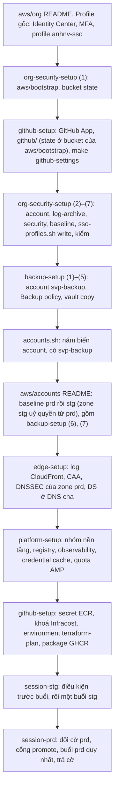

# Runbook của svp-infra

Mục lục các runbook của repo, các bước còn giữ tay (kèm lý do và nơi có hướng dẫn), các script và target `make` dựng thay
lệnh gõ tay, và thứ tự dựng một lần từ GitHub tới buổi đầu. Đây là trang tra cứu: mỗi runbook giữ hướng dẫn từng bước của nó.

Người học chạy mọi lệnh chạm AWS hay cài đặt GitHub. AI chỉ viết script và kiểm chúng với lệnh giả; luật ở
[`AGENTS.md`](../../AGENTS.md).

## Mục lục

| Runbook | Việc |
| --- | --- |
| [`github-setup.md`](github-setup.md) | Cài đặt GitHub của các repo: GitHub App từ manifest, Terraform `github/`, secret, khoá Infracost, environment `terraform-plan`, package GHCR |
| [`org-security-setup.md`](org-security-setup.md) | Nền bảo mật cấp org lần đầu: `aws/bootstrap`, account `svp-log-archive`, `svp-security`, policy, dịch vụ phát hiện, baseline, kiểm sau áp |
| [`backup-setup.md`](backup-setup.md) | Backup lần đầu: account `svp-backup`, Backup policy, vault copy và vault env |
| [`edge-setup.md`](edge-setup.md) | Edge lần đầu: log CloudFront, `CAA`, DNSSEC của zone prd, chuỗi tin cậy ở DNS cha |
| [`platform-setup.md`](platform-setup.md) | Nền tảng managed lần đầu: registry ECR, observability, Inspector, nhóm nền tảng, credential của cache; xoay PAT và token |
| [`session-stg.md`](session-stg.md) | Một buổi AWS stg: dựng, phép kiểm `lõi` (mặc định) và `chuẩn ngành` (chọn bật), gỡ, quét sót |
| [`session-prd.md`](session-prd.md) | Buổi prd duy nhất (capstone): đổi cờ prd về giá trị production, cổng promote, dựng, đo, gỡ, trả cờ; khác stg ở chỗ nào |
| [`media-signing-keys.md`](media-signing-keys.md) | Khoá ký URL media premium: dựng, xoay, thay khi lộ, dọn |
| [`paid-features.md`](paid-features.md) | Đổi cờ chi phí của một account, cả cờ mà phép kiểm `chuẩn ngành` của buổi cần |
| [`eks-upgrade.md`](eks-upgrade.md) | Nâng một minor EKS, stg trước prd |
| [`break-glass.md`](break-glass.md) | Đường vào khẩn cấp: Identity Center hỏng, việc chỉ root làm được |
| [`backup-sandbox-probe.md`](backup-sandbox-probe.md) | Thử AWS Backup ở account sandbox: bằng chứng cho thiết kế backup |
| [`mediaconvert-sandbox-probe.md`](mediaconvert-sandbox-probe.md) | Thử `Probe` và một job MediaConvert ở account sandbox |

## Bước giữ tay

Bước không có script vì AWS hay GitHub không cung cấp API, vì bước là cổng người có chủ đích, hay vì làm sai không hoàn tác
được. Mỗi bước có
hướng dẫn đủ ở runbook ghi bên phải: mọi cách làm được, bẫy đã gặp, cách kiểm kết quả.

| Bước | Vì sao giữ tay | Hướng dẫn |
| --- | --- | --- |
| Bấm **Create GitHub App** ở trang manifest và cài App lên repo chọn | GitHub không có API tạo hay cài App; script mở trang và kiểm kết quả | [`github-setup.md`, Tạo một App](github-setup.md#tạo-một-app) |
| Sinh khoá mới của App, xoá khoá cũ trên trang App | Không có API; `make github-app-key` đặt khoá đã có vào nơi dùng | [`github-setup.md`, Khoá thứ hai, xoay khoá](github-setup.md#khoá-thứ-hai-xoay-khoá) |
| Chọn repo cho App Renovate (Mend) | API đổi repo của bản cài cần PAT classic, token của `gh` bị 403; thêm PAT cho việc một lần không đáng | [`github-setup.md`, Renovate](github-setup.md#renovate) |
| Đăng ký tài khoản Infracost và lấy khoá | Đăng ký chỉ qua trình duyệt; `make infracost-key` đặt khoá vào secret | [`github-setup.md`, Khoá Infracost](github-setup.md#khoá-infracost) |
| Duyệt lượt plan của PR (Review deployments), Reject lượt của PR đã đóng | Cổng người đọc diff trước khi code của PR chạy với role; script tự duyệt sẽ bỏ cổng | [`README.md`, Plan trên PR](../../README.md#plan-trên-pr) |
| Đặt package GHCR public, Connect Repository, Manage Actions access | REST API của package không có lệnh đổi visibility hay gắn repo; `make github-check` kiểm | [`github-setup.md`, Thứ tự trên một account mới](github-setup.md#thứ-tự-trên-một-account-mới) (bước Package GHCR) |
| Tạo bot Telegram nhận cảnh báo (BotFather) | Chỉ làm được trong Telegram | [`telegram-bot-setup.md` của svp-backend](https://github.com/anhnvcoder/svp-backend/blob/main/docs/runbooks/telegram-bot-setup.md) |
| Bật IAM Identity Center, tạo user của người học, bật MFA, ghi profile gốc `anhnv-sso` cùng khối `[sso-session]` | Gốc của tin cậy; MFA không có API; mọi profile còn lại dựa vào `sso_session` này | [`aws/org`, Profile gốc `anhnv-sso`](../../aws/org/README.md#profile-gốc-anhnv-sso) |
| `aws sso login` khi mở terminal và khi phiên hết hạn | Duyệt thiết bị trên trình duyệt; một `sso_session` là một lần login cho mọi profile | [`session-stg.md`, Mở terminal của buổi](session-stg.md#mở-terminal-của-buổi) |
| Gõ `SVP_AWS_MGMT_ACCOUNT_ID` | Là giá trị mà `check_account` đối chiếu với account thật; lấy từ chính tổ chức thì phép đối chiếu mất nghĩa | [`session-stg.md`, Mở terminal của buổi](session-stg.md#mở-terminal-của-buổi) |
| Điền giá trị cá nhân (email, domain) vào `*.auto.tfvars` | Dữ liệu cá nhân, repo public; `tfvars.sh example` chép file mẫu và liệt kê chỗ còn `<…>` | [`aws/bootstrap`, Giá trị cá nhân](../../aws/bootstrap/README.md#2-giá-trị-cá-nhân) |
| Bản ghi `NS`, `DS` ở DNS cha (Cloudflare) và `DS` ở nhà đăng ký | Lab không giữ token của DNS cha hay nhà đăng ký; `verify.sh dnssec` in giá trị cần điền | [`edge-setup.md`, Bước (3)](edge-setup.md#bước-3-chuỗi-tin-cậy) |
| Hạ TTL của zone prd | Một lần mỗi zone, đọc từng bản ghi trước khi đổi | [`edge-setup.md`, Bước (2a)](edge-setup.md#bước-2a-hạ-ttl-của-zone-prd) |
| Bấm **Confirm subscription** trong email SNS | Token xác nhận chỉ nằm trong email; `verify.sh subscriptions` kiểm | [`org-security-setup.md`, 7e](org-security-setup.md#7e-cảnh-báo-thử), [`edge-setup.md`, Alarm DNSSEC](edge-setup.md#alarm-dnssec) |
| `sts assume-root`, probe guardrail có bước hoàn tác, cảnh báo thử `create-sample-findings` của org | Ghi hay đổi account, dùng quyền root; người chạy quyết định bước hoàn tác | [`org-security-setup.md`, 7b](org-security-setup.md#7b-root-tập-trung), [7d](org-security-setup.md#7d-phép-thử-guardrail), [7e](org-security-setup.md#7e-cảnh-báo-thử) |
| Đường vào khẩn cấp (break-glass) | Chỉ dùng khi đường thường hỏng; mỗi lần dùng sinh email cảnh báo | [`break-glass.md`](break-glass.md) |
| Bật Cost Explorer lần đầu của một account | Chỉ bật được trên console | [`org-security-setup.md`, Bật Cost Explorer lần đầu](org-security-setup.md#bật-cost-explorer-lần-đầu) |
| Tạo PAT GHCR và token Docker Hub của pull-through cache | Bên thứ ba cấp; `cache-secrets.sh` nhận chúng qua prompt không echo | [`platform-setup.md`, Bước (6)](platform-setup.md#bước-6-credential-của-pull-through-cache) |
| Đăng nhập Grafana, đọc dashboard, xem video trong trình duyệt | Kiểm bằng mắt | [`platform-setup.md`, Bước (9)](platform-setup.md#bước-9-grafana-managed), [`session-stg.md`](session-stg.md#thứ-tự) |
| Xác minh CloudFront qua AWS Support; xoá snapshot cuối của prd; đóng account | Gói Support là việc của người; xoá dữ liệu và đóng account không hoàn tác | [`aws/org`, Quota và xác minh CloudFront](../../aws/org/README.md#quota-và-xác-minh-cloudfront-của-account-workload), [`session-prd.md`, Kết thúc buổi](session-prd.md#kết-thúc-buổi), [`aws/org`, Gỡ có chủ đích](../../aws/org/README.md#gỡ-có-chủ-đích) |
| Duyệt environment `promote-prd` | Cổng người có chủ đích trước khi prd chạy commit stg | [`session-prd.md`, Cổng promote prd](session-prd.md#cổng-promote-prd-trước-mọi-lệnh-tốn-tiền) |
| Chờ 15 phút 30 giây trước khi `drop` khoá JWT cũ | Thời gian sống của token đã cấp, không rút ngắn được | [`jwt-key-rotation.md` của svp-backend](https://github.com/anhnvcoder/svp-backend/blob/main/docs/runbooks/jwt-key-rotation.md) |
| Bằng chứng một lần ở account sandbox (backup, MediaConvert); `sweep.sh mgmt` dọn | Chạy một lần để lấy fixture, không lặp lại | [`backup-sandbox-probe.md`](backup-sandbox-probe.md), [`mediaconvert-sandbox-probe.md`](mediaconvert-sandbox-probe.md) |

## Script và target dựng

Script `aws/scripts/*.sh` mở bằng khối `Usage:`; `--print` là đối số đầu, in mọi lệnh sẽ chạy mà không gọi công cụ nào. Test của mỗi script
là `<tên>-test.sh` cạnh nó (`make session-test`). Target `make` của GitHub nằm ở `Makefile`; `make help` liệt kê chúng.

| Script hay target | Việc | Runbook dùng |
| --- | --- | --- |
| `aws/scripts/sso-profiles.sh` | Ghi bảy profile SSO vào `~/.aws/config` (`write`), đăng nhập thử cả tám (`check`) | [`org-security-setup.md`](org-security-setup.md), [`backup-setup.md`](backup-setup.md), [`session-stg.md`](session-stg.md) |
| `aws/scripts/accounts.sh` | In dòng `export` của năm biến account thành viên, cho `eval` | [`platform-setup.md`](platform-setup.md), [`edge-setup.md`](edge-setup.md), [`session-stg.md`](session-stg.md) |
| `aws/scripts/platform-member.sh` | Thêm, bớt, đếm thành viên của hai nhóm nền tảng ở Identity Center | [`platform-setup.md`](platform-setup.md) |
| `aws/scripts/tfvars.sh` | Ghi `*.auto.tfvars`, `backend*.hcl` từ output của root; `init` các root management; tăng version mật khẩu | [`org-security-setup.md`](org-security-setup.md), [`platform-setup.md`](platform-setup.md), [`session-stg.md`](session-stg.md) |
| `aws/scripts/verify.sh` | Kiểm chỉ đọc sau apply: `org`, `backup`, `subscriptions`, `dnssec`, `cost` | [`org-security-setup.md`](org-security-setup.md), [`backup-setup.md`](backup-setup.md), [`edge-setup.md`](edge-setup.md) |
| `aws/scripts/preflight.sh` | Đọc trước và trong buổi: `quotas`, `freetier`, `eks-upgrade`, `findings`, `promote` | [`session-stg.md`](session-stg.md), [`session-prd.md`](session-prd.md), [`eks-upgrade.md`](eks-upgrade.md), [`platform-setup.md`](platform-setup.md) |
| `aws/scripts/cache-secrets.sh` | Ghi credential của pull-through cache (GHCR, Docker Hub) vào Secrets Manager | [`platform-setup.md`](platform-setup.md) |
| `aws/scripts/grafana-tokens.sh` | Liệt kê, thu hồi token của service account Grafana | [`platform-setup.md`](platform-setup.md) |
| `make github-app`, `make github-app-key` | Tạo GitHub App từ manifest; đặt khoá App vào nơi dùng | [`github-setup.md`](github-setup.md) |
| `make github-check` | Đọc lại mọi cài đặt GitHub ngoài Terraform | [`github-setup.md`](github-setup.md), [`platform-setup.md`](platform-setup.md) |
| `make github-settings` | Ghi ba cài đặt không có resource Terraform: duyệt PR từ fork, báo lỗ hổng riêng, CodeQL | [`github-setup.md`](github-setup.md) |
| `make github-secrets` | Secret account ID của ECR; `ENV=<stg\|prd>` thêm secret của environment `terraform-plan` | [`github-setup.md`](github-setup.md), [`platform-setup.md`](platform-setup.md) |
| `make infracost-key` | Secret `INFRACOST_API_KEY` của `svp-infra` | [`github-setup.md`](github-setup.md) |
| `make github-tfvars` | Ghi `github/github.auto.tfvars` từ biến Actions trên GitHub | [`github-setup.md`](github-setup.md) |
| `make github-plan`, `make github-apply` | `init` và plan lưu file của `github/`; apply đúng file đó | [`github-setup.md`](github-setup.md) |

## Thứ tự dựng một lần

Từ account trống tới buổi stg đầu. Mỗi nút là một runbook (hay một phần của nó); mũi tên là thứ tự mà các runbook ghi ở mục "Điều kiện
trước buổi" hay "Trước khi bắt đầu". Bước giữ tay của mỗi nút ở bảng trên.

Runbook ngoài đường này dùng khi cần: [`paid-features.md`](paid-features.md) đổi cờ chi phí,
[`media-signing-keys.md`](media-signing-keys.md)
trong buổi, [`eks-upgrade.md`](eks-upgrade.md) giữa các buổi, [`break-glass.md`](break-glass.md) khi đường thường hỏng.
