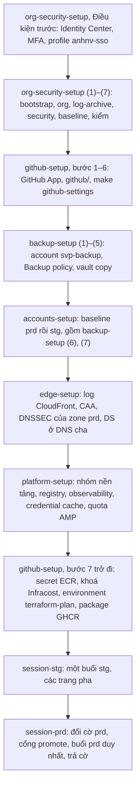

# Runbook của svp-infra

> **Tóm tắt**
>
> - **Làm gì:** mục lục các runbook theo thứ tự làm lần đầu, từ tổ chức AWS có sẵn (management, hai account stg, prd) tới buổi stg rồi
>   buổi prd; kèm các bước giữ tay, các script và target `make` dựng thay lệnh gõ tay.
> - **Khi nào dùng:** khi dựng một lần, chạy một buổi, đổi cờ chi phí hay gỡ. Muốn hiểu vì sao bước tồn tại thì đọc
>   [handbook](../handbook/README.md); trang này chỉ chỉ đường.
> - **Phí:** mục lục không tốn gì; mỗi runbook ghi phí trong lúc chạy ở Tóm tắt của nó.

Người học chạy mọi lệnh chạm AWS hay cài đặt GitHub. AI chỉ viết script và kiểm chúng với lệnh giả; luật ở
[`AGENTS.md`](../../AGENTS.md).

## Mục lục

Làm lần đầu theo thứ tự số. Mỗi runbook mở bằng dòng điều hướng `← trước · Mục lục · sau →` đúng thứ tự này. `github-setup.md` ghé hai
lần: bước 1–6 ở số 2, bước 7 trở đi ở số 7, khi role của env đã có.

| # | Runbook | Việc | Khi nào |
| --- | --- | --- | --- |
| 1 | [`org-security-setup.md`](org-security-setup.md) | `aws/bootstrap`, account `svp-log-archive`, `svp-security`, policy, dịch vụ phát hiện, baseline, kiểm sau áp | Một lần, đầu tiên |
| 2 | [`github-setup.md`](github-setup.md) (bước 1–6) | GitHub App từ manifest, Terraform `github/`, cài đặt repo | Một lần, sau 1 |
| 3 | [`backup-setup.md`](backup-setup.md) | Account `svp-backup`, Backup policy, vault copy và vault env | Một lần, sau 2 |
| 4 | [`accounts-setup.md`](accounts-setup.md) | Baseline của account `svp-prd` rồi `svp-stg`: state, zone, ECR, vault env | Một lần mỗi account, sau 3 |
| 5 | [`edge-setup.md`](edge-setup.md) | Log CloudFront, `CAA`, DNSSEC của zone prd, chuỗi tin cậy ở DNS cha | Một lần, sau 4 |
| 6 | [`platform-setup.md`](platform-setup.md) | Registry ECR, observability, Inspector, nhóm nền tảng, credential của cache | Một lần, sau 5 |
| 7 | [`github-setup.md`](github-setup.md) (bước 7 trở đi) | Secret ECR, khoá Infracost, environment `terraform-plan`, package GHCR | Một lần, sau 6 |
| 8 | [`session-stg.md`](session-stg.md) | Một buổi AWS stg: điều kiện, cờ, bảng bước; các trang pha dưới bảng | Mỗi buổi stg, sau 7 |
| 9 | [`session-prd.md`](session-prd.md) | Buổi prd duy nhất (capstone): đổi cờ, cổng promote, dựng, đo, gỡ, trả cờ | Một lần, sau một buổi stg xanh |

Trang pha của mỗi buổi, theo thứ tự làm:

| Buổi | Các trang |
| --- | --- |
| stg | [dựng](session-stg-deploy.md) → [release](session-stg-check-release.md) → [nền tảng](session-stg-check-platform.md) → [bảo mật](session-stg-check-security.md) → [edge và media](session-stg-check-edge-media.md) → [managed](session-stg-check-managed.md) → [diễn tập](session-stg-drills.md) → [gỡ](session-stg-teardown.md) |
| prd | [dựng](session-prd-deploy.md) → [kiểm và đo](session-prd-checks.md) → [diễn tập](session-prd-drills.md) → [kết thúc buổi](session-prd.md#kết-thúc-buổi) |

Runbook khi cần, ngoài chuỗi; mỗi trang chỉ có `[Mục lục](README.md)` ở dòng điều hướng:

| Runbook | Việc | Khi nào |
| --- | --- | --- |
| [`paid-features.md`](paid-features.md) | Đổi cờ chi phí của một account, cả cờ mà phép kiểm `chuẩn ngành` cần | Trước buổi muốn bật tính năng trả phí |
| [`media-signing-keys.md`](media-signing-keys.md) | Khoá ký URL media premium: dựng, xoay, thay khi lộ, dọn | Trong buổi; khi xoay hay lộ khoá |
| [`eks-upgrade.md`](eks-upgrade.md) | Nâng một minor EKS, stg trước prd | Giữa các buổi, khi có minor mới |
| [`break-glass.md`](break-glass.md) | Đường vào khẩn cấp: Identity Center hỏng, việc chỉ root làm được | Khi đường thường hỏng |
| [`lab-teardown.md`](lab-teardown.md) | Gỡ có chủ đích nền sống lâu, đóng account | Khi lab kết thúc |
| [`backup-sandbox-probe.md`](backup-sandbox-probe.md) | Thử AWS Backup ở account sandbox: bằng chứng cho thiết kế backup | Bằng chứng một lần |
| [`mediaconvert-sandbox-probe.md`](mediaconvert-sandbox-probe.md) | Thử `Probe` và một job MediaConvert ở account sandbox | Bằng chứng một lần |

## Thứ tự dựng một lần

Từ account trống tới buổi prd. Mỗi nút là một runbook (hay một phần của nó); mũi tên là thứ tự mà các runbook ghi ở `## Điều kiện
trước`. Nút A là phần Điều kiện trước của `org-security-setup.md`: Identity Center, MFA, profile gốc `anhnv-sso`.

## Bước giữ tay

Bước không có script vì AWS hay GitHub không cung cấp API, vì bước là cổng người có chủ đích, hay vì làm sai không hoàn tác được. Mỗi
bước có hướng dẫn đủ ở runbook ghi bên phải: mọi cách làm được, bẫy đã gặp, cách kiểm kết quả.

| Bước | Vì sao giữ tay | Hướng dẫn |
| --- | --- | --- |
| Bấm **Create GitHub App** ở trang manifest và cài App lên repo chọn | GitHub không có API tạo hay cài App; script mở trang và kiểm kết quả | [`github-setup.md`, Tạo một App](github-setup.md#tạo-một-app) |
| Sinh khoá mới của App, xoá khoá cũ trên trang App | Không có API; `make github-app-key` đặt khoá đã có vào nơi dùng | [`github-setup.md`, Khoá thứ hai, xoay khoá](github-setup.md#khoá-thứ-hai-xoay-khoá) |
| Chọn repo cho App Renovate (Mend) | API đổi repo của bản cài cần PAT classic, token của `gh` bị 403; thêm PAT cho việc một lần không đáng | [`github-setup.md`, Renovate](github-setup.md#renovate) |
| Đăng ký tài khoản Infracost và lấy khoá | Đăng ký chỉ qua trình duyệt; `make infracost-key` đặt khoá vào secret | [`github-setup.md`, Khoá Infracost](github-setup.md#khoá-infracost) |
| Duyệt lượt plan của PR (Review deployments), Reject lượt của PR đã đóng | Cổng người đọc diff trước khi code của PR chạy với role; script tự duyệt sẽ bỏ cổng | [`ci.md`, Duyệt environment `terraform-plan`](../reference/ci.md#duyệt-environment-terraform-plan) |
| Đặt package GHCR public, Connect Repository, Manage Actions access | REST API của package không có lệnh đổi visibility hay gắn repo; `make github-check` kiểm | [`github-setup.md`, Thứ tự trên một account mới](github-setup.md#thứ-tự-trên-một-account-mới) (bước Package GHCR) |
| Tạo bot Telegram nhận cảnh báo (BotFather) | Chỉ làm được trong Telegram | [`telegram-bot-setup.md` của svp-backend](https://github.com/anhnvcoder/svp-backend/blob/main/docs/runbooks/telegram-bot-setup.md) |
| Bật IAM Identity Center, tạo user của người học, bật MFA, ghi profile gốc `anhnv-sso` cùng khối `[sso-session]` | Gốc của tin cậy; MFA không có API; mọi profile còn lại dựa vào `sso_session` này | [`org-security-setup.md`, Profile gốc `anhnv-sso`](org-security-setup.md#profile-gốc-anhnv-sso) |
| `aws sso login` khi mở terminal và khi phiên hết hạn | Duyệt thiết bị trên trình duyệt; một `sso_session` là một lần login cho mọi profile | [`session-stg.md`, Mở terminal](session-stg.md#mở-terminal) |
| Gõ `SVP_AWS_MGMT_ACCOUNT_ID` | Là giá trị mà `check_account` đối chiếu với account thật; lấy từ chính tổ chức thì phép đối chiếu mất nghĩa | [`session-stg.md`, Mở terminal](session-stg.md#mở-terminal) |
| Điền giá trị cá nhân (email, domain) vào `*.auto.tfvars` | Dữ liệu cá nhân, repo public; `tfvars.sh example` chép file mẫu và liệt kê chỗ còn `<…>` | [`org-security-setup.md`, Điền giá trị lần đầu](org-security-setup.md#điền-giá-trị-lần-đầu) |
| Bản ghi `NS`, `DS` ở DNS cha (Cloudflare) và `DS` ở nhà đăng ký | Lab không giữ token của DNS cha hay nhà đăng ký; `verify.sh dnssec` in giá trị cần điền | `NS`: [`accounts-setup.md`, bước (5)](accounts-setup.md#bước-5-uỷ-quyền-zone-của-env); `DS`: [`edge-setup.md`, Bước (3)](edge-setup.md#bước-3-chuỗi-tin-cậy) |
| Hạ TTL của zone prd | Một lần mỗi zone, đọc từng bản ghi trước khi đổi | [`edge-setup.md`, Bước (2a)](edge-setup.md#bước-2a-hạ-ttl-của-zone-prd) |
| Bấm **Confirm subscription** trong email SNS | Token xác nhận chỉ nằm trong email; `verify.sh subscriptions` kiểm | [`org-security-setup.md`, 7e](org-security-setup.md#7e-cảnh-báo-thử), [`edge-setup.md`, Alarm DNSSEC](edge-setup.md#alarm-dnssec) |
| `sts assume-root`, probe guardrail có bước hoàn tác, cảnh báo thử `create-sample-findings` của org | Ghi hay đổi account, dùng quyền root; người chạy quyết định bước hoàn tác | [`org-security-setup.md`, 7b](org-security-setup.md#7b-root-tập-trung), [7d](org-security-setup.md#7d-phép-thử-guardrail), [7e](org-security-setup.md#7e-cảnh-báo-thử) |
| Đường vào khẩn cấp (break-glass) | Chỉ dùng khi đường thường hỏng; mỗi lần dùng sinh email cảnh báo | [`break-glass.md`](break-glass.md) |
| Bật Cost Explorer lần đầu của một account | Chỉ bật được trên console | [`org-security-setup.md`, 7f](org-security-setup.md#7f-chi-phí-sau-1-và-7-ngày) |
| Tạo PAT GHCR và token Docker Hub của pull-through cache | Bên thứ ba cấp; `cache-secrets.sh` nhận chúng qua prompt không echo | [`platform-setup.md`, Bước (6)](platform-setup.md#bước-6-credential-của-pull-through-cache) |
| Đăng nhập Grafana, đọc dashboard, xem video trong trình duyệt | Kiểm bằng mắt | [`platform-setup.md`, Bước (9)](platform-setup.md#bước-9-grafana-managed), [`session-stg.md`](session-stg.md#thứ-tự) |
| Xác minh CloudFront qua AWS Support; xoá snapshot cuối của prd; đóng account | Gói Support là việc của người; xoá dữ liệu và đóng account không hoàn tác | [`platform-setup.md`, Xác minh CloudFront](platform-setup.md#xác-minh-cloudfront-của-account-workload), [`session-prd.md`, Kết thúc buổi](session-prd.md#kết-thúc-buổi), [`lab-teardown.md`](lab-teardown.md) |
| Duyệt environment `promote-prd` | Cổng người có chủ đích trước khi prd chạy commit stg | [`session-prd.md`, Cổng promote prd](session-prd.md#cổng-promote-prd-trước-mọi-lệnh-tốn-tiền) |
| Chờ 15 phút 30 giây trước khi `drop` khoá JWT cũ | Thời gian sống của token đã cấp, không rút ngắn được | [`jwt-key-rotation.md` của svp-backend](https://github.com/anhnvcoder/svp-backend/blob/main/docs/runbooks/jwt-key-rotation.md) |
| Bằng chứng một lần ở account sandbox (backup, MediaConvert); `sweep.sh mgmt` dọn | Chạy một lần để lấy fixture, không lặp lại | [`backup-sandbox-probe.md`](backup-sandbox-probe.md), [`mediaconvert-sandbox-probe.md`](mediaconvert-sandbox-probe.md) |

## Script và target dựng

Script `aws/scripts/*.sh` mở bằng khối `Usage:`; `--print` là đối số đầu, in mọi lệnh sẽ chạy mà không gọi công cụ nào. Test của mỗi script
là `<tên>-test.sh` cạnh nó (`make session-test`). Target `make` của GitHub nằm ở `Makefile`; `make help` liệt kê chúng.

| Script hay target | Việc | Runbook dùng |
| --- | --- | --- |
| `aws/scripts/sso-profiles.sh` | Ghi bảy profile SSO vào `~/.aws/config` (`write`), đăng nhập thử cả tám (`check`) | [`org-security-setup.md`](org-security-setup.md), [`backup-setup.md`](backup-setup.md), [`session-stg.md`](session-stg.md) |
| `aws/scripts/accounts.sh` | In dòng `export` của năm biến account thành viên, cho `eval` | [`platform-setup.md`](platform-setup.md), [`edge-setup.md`](edge-setup.md), [`session-stg.md`](session-stg.md) |
| `aws/scripts/platform-member.sh` | Thêm, bớt, đếm thành viên của hai nhóm nền tảng ở Identity Center | [`platform-setup.md`](platform-setup.md) |
| `aws/scripts/tfvars.sh` | Ghi `*.auto.tfvars`, `backend*.hcl` từ output của root; `init` các root management; tăng version mật khẩu | [`org-security-setup.md`](org-security-setup.md), [`platform-setup.md`](platform-setup.md), [`session-stg.md`](session-stg.md) |
| `aws/scripts/verify.sh` | Kiểm chỉ đọc sau apply: `org`, `backup`, `subscriptions`, `dnssec`, `cost` | [`org-security-setup.md`](org-security-setup.md), [`backup-setup.md`](backup-setup.md), [`edge-setup.md`](edge-setup.md) |
| `aws/scripts/preflight.sh` | Đọc trước và trong buổi: `quotas`, `freetier`, `eks-upgrade`, `findings`, `promote` | [`session-stg.md`](session-stg.md), [`session-prd.md`](session-prd.md), [`eks-upgrade.md`](eks-upgrade.md), [`platform-setup.md`](platform-setup.md) |
| `aws/scripts/cache-secrets.sh` | Ghi credential của pull-through cache (GHCR, Docker Hub) vào Secrets Manager | [`platform-setup.md`](platform-setup.md) |
| `aws/scripts/grafana-tokens.sh` | Liệt kê, thu hồi token của service account Grafana | [`platform-setup.md`](platform-setup.md) |
| `make github-app`, `make github-app-key` | Tạo GitHub App từ manifest; đặt khoá App vào nơi dùng | [`github-setup.md`](github-setup.md) |
| `make github-check` | Đọc lại mọi cài đặt GitHub ngoài Terraform | [`github-setup.md`](github-setup.md), [`platform-setup.md`](platform-setup.md) |
| `make github-settings` | Ghi ba cài đặt không có resource Terraform: duyệt PR từ fork, báo lỗ hổng riêng, CodeQL | [`github-setup.md`](github-setup.md) |
| `make github-secrets` | Secret account ID của ECR; `ENV=<stg\|prd>` thêm secret của environment `terraform-plan` | [`github-setup.md`](github-setup.md), [`platform-setup.md`](platform-setup.md) |
| `make infracost-key` | Secret `INFRACOST_API_KEY` của `svp-infra` | [`github-setup.md`](github-setup.md) |
| `make github-tfvars` | Ghi `github/github.auto.tfvars` từ biến Actions trên GitHub | [`github-setup.md`](github-setup.md) |
| `make github-plan`, `make github-apply` | `init` và plan lưu file của `github/`; apply đúng file đó | [`github-setup.md`](github-setup.md) |
