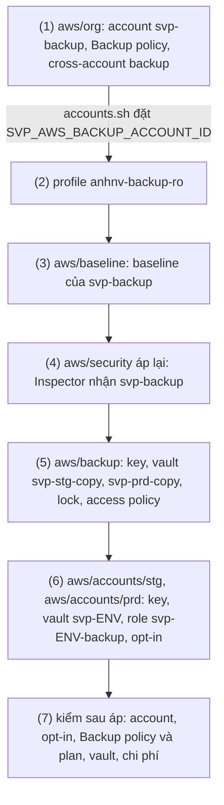

# Runbook: áp backup lần đầu (account `svp-backup`, Backup policy, vault)

← [github-setup, bước 1–6](github-setup.md) · [Mục lục](README.md) · [accounts-setup](accounts-setup.md) →

> **Tóm tắt**
>
> - **Làm gì:** áp phần sống lâu của backup stg, prd: vault copy có Vault Lock và key ở `svp-backup`, vault env, key, role, opt-in ở
>   account stg, prd; với tổ chức dựng trước khi có backup, thêm cả account `svp-backup`, Backup policy và cross-account backup. Rồi kiểm
>   từng phần sau áp.
> - **Khi nào và bao lâu:** một lần, ngoài buổi, sau [`org-security-setup.md`](org-security-setup.md) và trước buổi stg đầu tiên có diễn
>   tập khôi phục. Kiểm 7a–7d đọc lại hôm sau khi AWS chưa nhận xong account mới (tới 24 giờ); 7e sau 1 và 7 ngày.
> - **Phí trong lúc chạy:** tính cả khi không buổi. Từ bước (3) (tổ chức dựng mới: bước (6) của `org-security-setup.md`; dựng trước:
>   N3), baseline của `svp-backup` (GuardDuty; check Security Hub, item Config chỉ khi cờ `security_hub`, `config_recording` của `backup`
>   trong `aws/paid-features.json` là `always`); từ bước (5), (6), ba CMK theo key-tháng; từ buổi đầu, bản copy theo retention. Số tiền ở
>   [07. Backup, Chi phí](../handbook/07-backup.md#chi-phí); 7e đo phí của `svp-backup` từ bước (3).

**Người học chạy mọi lệnh ở đây.** AI không chạy lệnh nào chạm account, kể cả lệnh chỉ đọc; AI đọc output dán lại. Mọi lệnh chạy từ gốc
repo này (`infra/`) trừ chỗ ghi `cd`. Bước nào đỏ thì dừng ở đó, dán output, không đi tiếp. Diễn tập khôi phục và xoá recovery point cuối
buổi nằm ở runbook buổi ([`session-stg.md`](session-stg.md), [`session-prd.md`](session-prd.md)), không ở đây. Vì sao từng phần:
[07. Backup](../handbook/07-backup.md).

## Điều kiện trước

- [ ] **Nền tổ chức đã áp** theo [`org-security-setup.md`](org-security-setup.md); bước (4) của trang đó đã tạo `svp-backup` và Backup
  policy. Tổ chức áp trước khi code có backup: làm thêm [Nâng cấp tổ chức dựng trước](#nâng-cấp-tổ-chức-dựng-trước) theo bảng
  [Thứ tự áp lần đầu](#thứ-tự-áp-lần-đầu).
- [ ] **Code trên `main`**: `git switch main && git pull --ff-only` trong bản clone này; thay đổi backup của `aws/org`, `aws/baseline`,
  `aws/backup`, `aws/accounts/<env>`, module `org-policies` đã merge.
- [ ] **Budget đủ**: budget tổng của org đủ cho phí giữ của backup cộng các buổi; lệnh đọc ở
  [Mở terminal của `org-security-setup.md`](org-security-setup.md#mở-terminal). Phí bắt đầu kể cả khi không có buổi.
- [ ] **Không buổi nào đang chạy** từ bước (1) tới hết bước (6): Backup policy có hiệu lực ngay khi gắn, `tf.sh <env> env …` cần
  `SVP_AWS_BACKUP_ACCOUNT_ID` (key RDS của root env chia sẻ cho `svp-backup`), và bước diễn tập của buổi cần plan, vault, role của
  runbook này. Giữa các buổi account env không có tài nguyên mang tag `Backup`, nên lịch không tạo job nào tới khi env dựng lại.

## Mở terminal

```sh
cd infra
AWS_PROFILE=anhnv-sso aws sso login --region us-east-1
printf 'mgmt …%s\n' "${SVP_AWS_MGMT_ACCOUNT_ID: -4}"                   # ids from .envrc (direnv), last 4 digits
export SVP_SESSION_DIR="$PWD/.session/$(date -u +%Y%m%dT%H%M%SZ)"   # check-account.sh marks its timeline here
aws/scripts/check-account.sh mgmt
```

- **Mong đợi:** dòng `printf` in 4 số cuối; `ok    account <12 số> of mgmt, arn:aws:sts::<12 số>:assumed-role/AWSReservedSSO_…`.
- **Việc tay:** biến account nạp qua direnv từ `.envrc` ở thư mục chứa các clone
  ([`operations.md`](../reference/operations.md#biến-account-và-direnv)); `printf` in rỗng thì `direnv allow` hay tạo file theo trang đó
  rồi chạy lại. Khi `svp-backup` đã có, `eval "$(aws/scripts/accounts.sh)"` đặt `SVP_AWS_BACKUP_ACCOUNT_ID` và bốn biến thành viên kia;
  thêm chúng vào `.envrc` để lần sau khỏi `eval`. Mở lại terminal giữa chừng: direnv nạp lại biến, chỉ cần `check-account.sh mgmt`.
- **Bẫy:** tổ chức chưa có `svp-backup` (dựng trước khi có backup): `accounts.sh` đòi đủ năm account thành viên, nên chỉ chạy nó sau
  [N1c](#n1c-tạo-account). Lệnh ghi của bước (1), (3), (4), (5) chạy bằng `anhnv-sso` (root `aws/baseline`, `aws/backup` vào account
  đích qua `OrganizationAccountAccessRole`); bước (6) bằng `anhnv-stg`, `anhnv-prd`. Trước mỗi bước, chạy lại `check-account.sh` của
  account mà bước đó ghi.

## Thứ tự áp lần đầu

Account phải có trước baseline, profile, vault và key policy chia sẻ cho nó; vault `svp-<env>-copy` phải có trước copy job đầu tiên, vault
và role của account env trước job đầu tiên. Tổ chức dựng mới đã làm bước (1), (3), (4) trong `org-security-setup.md`.



| Bước | Root | Tổ chức dựng mới | Tổ chức dựng trước khi có backup | Dán lại |
| --- | --- | --- | --- | --- |
| [(1)](#bước-1-awsorg) | `aws/org` | xong ở `org-security-setup.md` bước (4) | [N1](#n1-awsorg-thêm-account-và-backup-policy) | Output đối chiếu opt-in, plan đủ của hai lượt, `Apply complete!`, `No changes.`, `describe-global-settings` |
| [(2)](#bước-2-profile-anhnv-backup-ro) | — | kiểm lại | làm | Dòng `ok` của `sso-profiles.sh write` và `check` cho `anhnv-backup-ro` |
| [(3)](#bước-3-awsbaseline) | `aws/baseline` | xong ở `org-security-setup.md` bước (6) | [N3](#n3-awsbaseline-baseline-của-svp-backup) | `Plan:`, `Apply complete!` |
| [(4)](#bước-4-awssecurity-áp-lại) | `aws/security` | xong ở `org-security-setup.md` bước (5) | [N4](#n4-awssecurity-áp-lại) | Plan đủ, `Apply complete!` |
| [(5)](#bước-5-awsbackup) | `aws/backup` | làm | làm | `Plan:`, `Apply complete!`, hai dòng `7d` của `verify.sh backup` |
| [(6)](#bước-6-awsaccountsstg-awsaccountsprd) | `aws/accounts/<env>` | dựng baseline env | thêm phần backup | Mỗi env: `Plan:`, `Apply complete!`, `No changes.` |
| [(7)](#bước-7-kiểm-sau-áp) | — | làm | làm | Output từng mục |

## Bước (1): `aws/org`

Tạo account `svp-backup` ở OU `Security`, trusted access và policy type `BACKUP_POLICY`, Backup policy gắn OU `Prod`, `NonProd`,
cross-account backup và opt-in của management.

- **Tổ chức dựng mới:** bước (4) của [`org-security-setup.md`](org-security-setup.md#bước-4-awsorg-đủ) đã làm hết; sang bước (2).
- **Tổ chức dựng trước khi có backup:** làm [N1](#n1-awsorg-thêm-account-và-backup-policy) rồi quay lại bước (2).
- **Plan đủ của `aws/org` về sau** (áp lại root): `aws_backup_global_settings.this` có thể đổi `isDelegatedAdministratorEnabled "true" ->
  "false"` khi cờ đó đã bật ngoài Terraform (trang Cross-account management của AWS Backup trên console). Apply là đúng thiết kế:
  `aws/org/backup.tf` giữ cờ đó tắt ([4a của `org-security-setup.md`](org-security-setup.md#4a-plan), **Thay đổi được phép**).

## Bước (2): profile `anhnv-backup-ro`

Profile chỉ đọc của `svp-backup` (permission set `SvpReadOnly`, gán ở bước (1) hay ở bước (4) của `org-security-setup.md`); `verify.sh
backup` và `preflight.sh` đọc vault copy bằng nó. Profile, biến, permission set: `profile_table` của `aws/scripts/profiles.sh`.

```sh
aws/scripts/sso-profiles.sh write
aws/scripts/sso-profiles.sh check
```

- **Mong đợi:** `ok    profile anhnv-backup-ro: added, account of SVP_AWS_BACKUP_ACCOUNT_ID, role SvpReadOnly` (hay `up to date`), rồi ở
  `check` `ok    account <12 số> of backup, arn:aws:sts::<12 số>:assumed-role/AWSReservedSSO_SvpReadOnly_…`.
- **Bẫy:** `FAIL  profile anhnv-backup-ro is account …` là profile trỏ account khác: chạy lại `write`. `skip  profile anhnv-backup-ro:
  SVP_AWS_BACKUP_ACCOUNT_ID is not exported` là chưa `eval "$(aws/scripts/accounts.sh)"`. Cách ghi đủ mọi profile:
  [4c của `org-security-setup.md`](org-security-setup.md#4c-profile-của-account-thành-viên).

## Bước (3): `aws/baseline`

Baseline của `svp-backup` (S3 Block Public Access, EBS mã hoá mặc định, rule `svp-security-*`, recorder Config theo cờ).

- **Tổ chức dựng mới:** bước (6) của [`org-security-setup.md`](org-security-setup.md#bước-6-awsbaseline) đã gồm `svp-backup`; sang bước
  (4).
- **Tổ chức dựng trước khi có backup:** làm [N3](#n3-awsbaseline-baseline-của-svp-backup).

## Bước (4): `aws/security`, áp lại

GuardDuty và Security Hub tự nhận account mới; liên kết thành viên Inspector và phần theo cờ `security_hub` đọc danh sách account
`ACTIVE` của tổ chức lúc plan, nên root áp lại một lần khi thêm account.

- **Tổ chức dựng mới:** bước (5) của [`org-security-setup.md`](org-security-setup.md#bước-5-awssecurity) chạy sau khi `svp-backup` có; sang
  bước (5).
- **Tổ chức dựng trước khi có backup:** làm [N4](#n4-awssecurity-áp-lại).

## Bước (5): `aws/backup`

Key `alias/svp-backup-copy`, hai vault copy có lock và vault access policy ([`aws/backup`](../../aws/backup/README.md)). Sau bước (1)
(account có, cross-account backup bật), trước bước (6) và trước lần chạy đầu của plan `svp-<env>`: copy job tới vault chưa có thì lỗi.

### 5a. Kiểm account và biến

```sh
eval "$(aws/scripts/accounts.sh)"
aws/scripts/check-account.sh mgmt
cd aws/backup
```

- **Mong đợi:** mỗi biến thành viên một dòng `ok    SVP_AWS_<…>_ACCOUNT_ID: account svp-<tên>, ACTIVE` (không in id); `ok    account …
  of mgmt, …`.
- **Bẫy:** `FAIL  no account svp-backup in the organization` là bước (1) chưa xong. `check-account.sh` dừng khi account của `anhnv-sso`
  khác `SVP_AWS_MGMT_ACCOUNT_ID`.

### 5b. Init và plan

```sh
../scripts/tfvars.sh init
AWS_PROFILE=anhnv-sso \
TF_VAR_account_id="$SVP_AWS_MGMT_ACCOUNT_ID" \
TF_VAR_backup_account_id="$SVP_AWS_BACKUP_ACCOUNT_ID" \
TF_VAR_stg_account_id="$SVP_AWS_STG_ACCOUNT_ID" \
TF_VAR_prd_account_id="$SVP_AWS_PRD_ACCOUNT_ID" \
  terraform plan -input=false -out=backup.tfplan
AWS_PROFILE=anhnv-sso terraform show -no-color backup.tfplan > "$SVP_SESSION_DIR/backup-plan.txt"
```

- **Mong đợi:** `Plan: <n> to add, 0 to change, 0 to destroy` với `<n>` bằng tổng `to add` của mục
  [`aws/backup`](../reference/inventory.md#awsbackup) ở inventory (account trống chạy lần đầu): key và alias, hai vault, hai lock, hai vault
  access policy.
- **Kiểm:** `kms_key_arn` của hai `module.vaults.aws_backup_vault.this` là key mới; `min_retention_days`, `max_retention_days` của hai lock
  khớp bảng [Dựng gì của `aws/backup`](../../aws/backup/README.md#dựng-gì); policy của `svp-stg-copy` chỉ nêu
  `arn:aws:iam::<stg>:root`, của `svp-prd-copy` chỉ `arn:aws:iam::<prd>:root`.
- **Bẫy:** `AccessDenied` khi assume role là account chưa tạo xong hay profile sai; `account_id is not the management account` là
  `SVP_AWS_MGMT_ACCOUNT_ID` hay `SVP_AWS_BACKUP_ACCOUNT_ID` sai. Có dòng `change` hay `destroy`: dừng, dán output.

### 5c. Apply và kiểm

```sh
AWS_PROFILE=anhnv-sso terraform apply -input=false backup.tfplan && rm backup.tfplan
AWS_PROFILE=anhnv-sso terraform output vault_arns
../scripts/verify.sh backup
```

- **Mong đợi:** `Apply complete!`; `vault_arns` có hai ARN dạng `arn:aws:backup:ap-southeast-1:<backup>:backup-vault:svp-<env>-copy`.
  Phần của root này trong `verify.sh backup` là hai dòng `ok    7d: the vault svp-<env>-copy is locked and accepts copies from the account
  of <env> only`, kèm `note  7d: svp-<env>-copy lock min <n> days, max <n> days`: so hai số với bảng Dựng gì của README.
- **Bẫy:** `FAIL  7d: the vault svp-<env>-copy is Locked 'False'` là lock chưa áp: dừng, dán output. Các dòng 7a–7c `FAIL` cho tới khi
  bước (6) xong (chúng đọc account, Backup policy và vault `svp-<env>` của account env): đọc lại ở bước (7).

`cd ../..` về `infra/` khi xong.

## Bước (6): `aws/accounts/stg`, `aws/accounts/prd`

Phần backup của account env (`backup.tf`): key `alias/svp-<env>-backup`, vault `svp-<env>`, opt-in loại tài nguyên, role
`svp-<env>-backup` và bốn managed policy. Cần `TF_VAR_backup_account_id` trong lệnh: key policy chia sẻ key vault cho `svp-backup`.

```sh
AWS_PROFILE=anhnv-sso aws sso login --region us-east-1   # one login for every profile of the same sso_session
aws/scripts/check-account.sh stg
```

- **Tổ chức dựng mới:** account env chưa có baseline: dựng theo [accounts-setup](accounts-setup.md), phần
  backup đi cùng baseline.
- **Tổ chức dựng trước khi có backup:** account env đã có baseline: theo [accounts-setup, Thêm vào account đã có
  baseline](accounts-setup.md) cho stg, rồi prd (`aws/scripts/check-account.sh prd` trước).
- **Mong đợi:** plan của mỗi account, khi account đã có mọi phần khác, chỉ gồm phần backup của mục
  [`aws/accounts/<env>`](../reference/inventory.md#awsaccountsstg) ở inventory (`backup.tf`, `module.backup_vault`): `aws_kms_key.backup`,
  `aws_kms_alias.backup`, `module.backup_vault.aws_backup_vault.this["svp-<env>"]`, `aws_backup_region_settings.this`,
  `aws_iam_role.backup` và bốn `aws_iam_role_policy_attachment.backup`. Sau apply, plan lần hai `No changes.`
- **Kiểm:** opt-in `RDS`, `S3` của account ở dòng `7b` của `verify.sh backup` (bước (7)).
- **Bẫy:** dòng `change`, `destroy` hay tài nguyên ngoài danh sách trên: dừng, dán plan.

## Bước (7): kiểm sau áp

Mọi lệnh chỉ đọc. Lệnh nào in lỗi quyền ở một profile chỉ đọc: dán lệnh và lỗi, đó cũng là kết quả kiểm của permission set.

### 7a–7d. Kiểm bằng script

Một lệnh đọc cả 7a–7d, mỗi kiểm một dòng `ok`, `FAIL` hay `note`; một `FAIL` không dừng kiểm sau, cuối cùng
`FAIL  N check(s) failed, each named above` và exit 1:

```sh
aws/scripts/verify.sh backup
```

Cần `anhnv-sso`, `anhnv-security-ro`, `anhnv-backup-ro`, `anhnv-stg-ro`, `anhnv-prd-ro` ([bước (2)](#bước-2-profile-anhnv-backup-ro) và
[4c của `org-security-setup.md`](org-security-setup.md#4c-profile-của-account-thành-viên)) và các biến account của `accounts.sh`. Lệnh in
`ok    profile <tên> is the account of <tên>` khi profile đúng account trước mỗi nhóm kiểm; dòng `FAIL` đó nghĩa là bỏ cả nhóm của profile
ấy.

- **7a** `svp-backup is ACTIVE in the OU Security with a SECURITY contact`: account, OU `Security`, liên hệ `SECURITY`.
- **7a** `<profile> <region>: Security Hub standards and Config recorder as expected`: hai chuẩn `READY` và recorder
  `True SUCCESS` ở hai region của `anhnv-backup-ro`; với file của repo (`security_hub`, `config_recording` của `backup`
  `off`) thay bằng hai dòng `note  anhnv-backup-ro <region>: security_hub is off …`, `… config_recording is off …`.
- **7a** `svp-backup is a GuardDuty member in <region>`, `… a Security Hub member and Inspector scans only ECR` (với
  file của repo `… not checked as a Security Hub member (security_hub off …) and Inspector scans only ECR`): dịch vụ
  phát hiện nhận account.
- **7b** `cross-account backup is on, the other global settings off`: `isCrossAccountBackupEnabled` `true`, khoá còn lại
  `false`.
- **7b** `<profile>: RDS and S3 are opted in to AWS Backup`: ba profile: `anhnv-sso`, `anhnv-stg-ro`, `anhnv-prd-ro`.
- **7c** `OU <Prod|NonProd> carries svp-backup-<env> and the effective policy of <env> has the plan svp-<env> only`:
  Backup policy đúng OU, policy hiệu lực chỉ có plan của env.
- **7c** `the plan svp-<env> has the rule daily into svp-<env> and the selection svp-<env>-tagged`: AWS đã sinh plan và
  selection trong account env.
- **7c** `the vault svp-<env> is not locked (<n> recovery points) and its role has the 4 policies`: vault env không
  lock, role có đúng bốn managed policy. Account env chưa áp `aws/accounts/<env>` thì chưa có vault, AWS Backup trả
  `AccessDenied` thay vì "không có", script đọc danh sách vault để phân biệt và in
  `note  7c: vault svp-<env> not created yet (aws/accounts/<env> not applied)`, không `FAIL`: đọc lại sau apply đó. Vault có
  mà vẫn không đọc được là `FAIL  7c: the vault svp-<env> exists but describe-backup-vault failed …` kèm nguyên nhân (có
  statement `Deny` trong access policy của vault, hay profile thiếu quyền): dán dòng đó.
- **7d** `the vault svp-<env>-copy is locked and accepts copies from the account of <env> only`: vault copy lock, access
  policy một statement của account env.

- **Mong đợi:** mọi dòng `ok` hay `note`, cuối không `FAIL`. Dán lại các dòng `note` để so bằng mắt: `7c: <env> rule schedule and
  retention (vault days, copy days)` với lịch và hai retention của
  [ADR-0067 §4](https://github.com/anhnvcoder/svp-backend/blob/main/docs/adr/0067-backup-dr.md#4-backup-policy-lịch-retention), và
  `7d: svp-<env>-copy lock min <n> days, max <n> days` với bảng
  [Dựng gì của `aws/backup`](../../aws/backup/README.md#dựng-gì).
- **Bẫy:** ngay sau apply, các dòng `FAIL` sau là việc AWS chưa làm xong, không phải lỗi của bước; đọc lại hôm sau (tối đa 24 giờ),
  vẫn `FAIL` thì dán output: `FAIL  7a: GuardDuty member status of svp-backup in <region> is 'none' (a new account takes
  up to 24 h)`, `FAIL  7a: Security Hub member status of svp-backup is …` (account mới chưa thành member), `FAIL
  <profile> <region>: <n> of the 2 standards … are READY` (chuẩn vừa bật còn chờ), `FAIL  7c: AWS has not generated the
  plan svp-<env> in the account yet` (Backup policy mới gắn, AWS chưa sinh plan). `FAIL` khác là lỗi thật: dừng, dán output.
- **Kiểm:** `note  7d: the copy of a recovery point across accounts is tested by the first session` nghĩa là copy chéo account chỉ thử được
  khi env có tài nguyên: bước diễn tập khôi phục của buổi stg đầu tiên (`restore-drill.sh <env> backup`) kiểm lại plan, selection, opt-in
  đủ chi tiết, chạy job theo yêu cầu và copy job thật; lệnh **Đọc bản copy** của trang đó là phép kiểm cuối của runbook này
  (session-stg, [diễn tập khôi phục](session-stg-drills.md)).
- **Việc tay:** account tạo trong tổ chức đã bật root tập trung nên không có credential root. Kiểm bằng phiên root giữ tay (đổi session và
  gửi email cảnh báo, nên chỉ chạy khi người học chủ động chọn): như
  [7b của `org-security-setup.md`](org-security-setup.md#7b-root-tập-trung), thêm id của `svp-backup` vào vòng lặp của nó.

### 7e. Chi phí sau 1 và 7 ngày

Cost Explorer có dữ liệu sau khoảng 24 giờ. Sau 1 ngày và sau 7 ngày kể từ bước (3) (tổ chức dựng mới: bước (6) của
`org-security-setup.md`), theo dịch vụ, account `svp-backup`; ngày dạng `yyyy-mm-dd`:

```sh
aws/scripts/verify.sh cost backup <ngày áp bước 3>
```

- **Mong đợi:** mỗi dòng dữ liệu là `note  <ngày>  <dịch vụ>  <số> USD`, cuối `ok    N row(s) from <ngày> to <hôm nay>, <tổng> USD`; chưa có
  dữ liệu thì `note  no cost data from … yet (Cost Explorer lags about 24 hours)`.
- **Kiểm:** account này gồm baseline của `svp-backup` và key `alias/svp-backup-copy`; key vault env tính ở account stg, prd. Baseline
  theo cờ `backup` trong `aws/paid-features.json`: `off` chỉ còn GuardDuty, `always` thêm Security Hub, Config (số ở dòng `svp-backup`
  của [phụ lục ADR-0078](https://github.com/anhnvcoder/svp-backend/blob/main/docs/adr/appendix/0078-paid-features-lean-defaults.md)).
  Lệch quá ±50 %: dán output.
- **Bẫy:** `FAIL  ce get-cost-and-usage (first use: turn Cost Explorer on once in the console …)` là Cost Explorer chưa bật: làm theo
  gạch **Bẫy** của [7f của `org-security-setup.md`](org-security-setup.md#7f-chi-phí-sau-1-và-7-ngày).

## Gỡ

Mọi thứ của runbook này sống suốt lab. Gỡ khi lab kết thúc (bản copy trong vault lock bị xoá cùng, kể cả bản còn trong hạn), theo thứ tự
của [`lab-teardown.md`](lab-teardown.md#thứ-tự-gỡ): vault env cùng baseline của `aws/accounts/<env>`, rồi
[`aws/backup`](lab-teardown.md#awsbackup), rồi `aws/baseline`, và account `svp-backup` đóng ở phần 2 của `aws/org`.

## Khi một bước đỏ

- Lỗi ở `plan`: không có gì đổi trên account; đọc lỗi, sửa nguyên nhân (biến terminal, `org.auto.tfvars`, phiên SSO), chạy lại đúng bước.
- `Error acquiring the state lock` kèm Lock ID (thường sau Ctrl+C một lệnh đang chờ nhập):
  [`operations.md`, Khoá state kẹt](../reference/operations.md#khoá-state-kẹt).
- Lỗi giữa `apply`: phần đã tạo nằm trong state; `plan` lại cùng root chỉ còn phần chưa tạo. Dán lỗi và plan mới trước khi apply lại;
  `-target`: [`operations.md`, Khi apply lỗi giữa chừng](../reference/operations.md#khi-apply-lỗi-giữa-chừng).
- Plan có `destroy` hay `-/+` ở tổ chức, account, vault hay key có sẵn: dừng, không apply, dán plan. `-/+` lặp lại ở mọi plan là lỗi code.
- `AccessDenied` khi root qua role assume `OrganizationAccountAccessRole` của `svp-backup`: account chưa tạo xong (vài phút sau bước (1))
  hay `SVP_AWS_BACKUP_ACCOUNT_ID` sai; đọc lại output `backup_account_id` của `aws/org`.
- Mất đường vào (Identity Center hỏng, phiên SSO không đăng nhập được): [`break-glass.md`](break-glass.md).

## Nâng cấp tổ chức dựng trước

### Thêm account backup và Backup policy vào tổ chức đã áp

Khi tổ chức đã áp trước khi `aws/org` có account `svp-backup` và Backup policy. Làm N1 thay bước (1), N3 thay bước (3), N4 thay bước (4),
xen với bước (2), (5)–(7) theo bảng [Thứ tự áp lần đầu](#thứ-tự-áp-lần-đầu).

#### N1. `aws/org`: thêm account và Backup policy

**Điểm dừng.** Tạo account gần như không đảo ngược được: đóng account chờ 90 ngày, email không dùng lại được. Lượt plan thứ hai gắn Backup
policy lên OU `Prod`, `NonProd` và đổi tag policy của cả tổ chức. Dán **plan đủ** của cả hai lượt và chờ đọc cùng trước khi apply.

```sh
aws/scripts/check-account.sh mgmt
cd aws/org
```

#### N1a. Khoá `backup` trong `org.auto.tfvars`

- **Việc tay:** thêm khoá `backup` vào `account_emails` của `aws/org/org.auto.tfvars` (git bỏ qua) trước mọi `plan`: một email chưa account
  AWS nào dùng, kể cả account đã đóng hay `SUSPENDED`, như [2a của `org-security-setup.md`](org-security-setup.md#2a-chuẩn-bị).
- **Bẫy:** thiếu khoá thì `plan` dừng ở validation của `account_emails`.

#### N1b. Đối chiếu opt-in

`backup.tf` ghi cả map opt-in loại tài nguyên của management; AWS thêm loại theo thời gian, nên đọc map hiện tại trước khi apply:

```sh
AWS_PROFILE=anhnv-sso aws backup describe-region-settings --region ap-southeast-1 --query 'ResourceTypeOptInPreference' --output json
```

- **Kiểm:** mỗi khoá API trả phải có trong `resource_type_opt_in_preference` của `backup.tf`, và ngược lại.
- **Bẫy:** lệch thì dừng, dán output: danh sách sửa bằng PR trước khi apply.

#### N1c. Tạo account

Plan riêng account, đọc, rồi apply:

```sh
AWS_PROFILE=anhnv-sso \
TF_VAR_account_id="$SVP_AWS_MGMT_ACCOUNT_ID" \
  terraform plan -input=false -out=org.tfplan \
    -target=aws_organizations_account.backup
AWS_PROFILE=anhnv-sso terraform show -no-color org.tfplan > "$SVP_SESSION_DIR/org-plan.txt"
```

- **Mong đợi:** `Plan: 1 to add, 1 to change, 0 to destroy`: thêm `aws_organizations_account.backup` (`name` `svp-backup`, `parent_id` là
  OU `Security`); đổi tại chỗ tổ chức, chỉ hai dòng `+ "backup.amazonaws.com"` trong `aws_service_access_principals` và
  `+ "BACKUP_POLICY"` trong `enabled_policy_types`, không dòng `-` nào. Khác thì dừng, dán plan.

```sh
AWS_PROFILE=anhnv-sso terraform apply -input=false org.tfplan && rm org.tfplan
eval "$(../scripts/accounts.sh)"
```

- **Mong đợi:** `accounts.sh` đọc tổ chức bằng `anhnv-sso` và đặt cả năm biến account thành viên (không ghi vào file commit), mỗi biến một
  dòng `ok    SVP_AWS_<…>_ACCOUNT_ID: account svp-<tên>, ACTIVE` trên stderr; `SVP_AWS_BACKUP_ACCOUNT_ID` là id mới, khác bốn account đã
  có. Dán các dòng `ok` (không in id).
- **Bẫy:** account `PENDING_CLOSURE` hay thiếu thì `FAIL  account svp-<tên> is <trạng thái>, not ACTIVE` và `eval` không đặt biến nào.

#### N1d. Phần còn lại

Cùng lệnh `plan`, `apply` của [4a](org-security-setup.md#4a-plan), [4b](org-security-setup.md#4b-apply) của `org-security-setup.md` (plan
không `-target`).

- **Mong đợi:** `Plan: <n> to add, 1 to change, 0 to destroy` với `<n>` bằng số tài nguyên thêm liệt kê dưới đây.
  - Thêm: `aws_account_alternate_contact.security["backup"]`, `aws_ssoadmin_account_assignment.read_only["backup"]`,
    `aws_backup_global_settings.this`, `aws_backup_region_settings.this`, `module.org_policies.aws_organizations_policy.this["backup-prd"]`,
    `["backup-stg"]` và hai `aws_organizations_policy_attachment` của chúng (đích OU `Prod`, `NonProd`).
  - Đổi tại chỗ: `module.org_policies.aws_organizations_policy.this["tags"]` (thêm khoá `Backup`, giá trị `backup` của `Stack`).
- **Thay đổi được phép:** `aws_backup_global_settings.this` đã có trong state (plan lại sau một lượt apply) có thể hiện đổi tại chỗ
  `isDelegatedAdministratorEnabled "true" -> "false"` trong `global_settings`. Cờ đó đã bật ngoài Terraform (trang Cross-account management
  của AWS Backup trên console); apply là đúng thiết kế, vì `aws/org/backup.tf` giữ delegated administrator của AWS Backup tắt.
- **Bẫy:** dừng (không apply, dán plan) nếu có `destroy`, `-/+` hay thay đổi nào khác. Sau apply, plan lần hai phải là `No changes.`; một
  diff khác ở `global_settings` (AWS trả khoá ngoài ba khoá của `backup.tf`) thì dán lại.

Kiểm cài đặt cross-account:

```sh
AWS_PROFILE=anhnv-sso aws backup describe-global-settings --region ap-southeast-1 --query 'GlobalSettings' --output json
```

- **Mong đợi:** đúng ba khoá: `isCrossAccountBackupEnabled` là `true`, `isDelegatedAdministratorEnabled` và `isMpaEnabled` là `false`.

`cd ../..` khi xong, rồi [bước (2)](#bước-2-profile-anhnv-backup-ro).

#### N3. `aws/baseline`: baseline của `svp-backup`

```sh
aws/scripts/check-account.sh mgmt
cd aws/baseline
```

Theo [bước (6) của `org-security-setup.md`](org-security-setup.md#bước-6-awsbaseline), đoạn cho account thêm vào tổ chức khi root đã áp:
6a, 6c, 6d, bỏ 6b.

- **Mong đợi:** plan chỉ thêm module của `svp-backup`; số tài nguyên là dòng `module.backup` ở bảng "Phần" của mục
  [`aws/baseline`](../reference/inventory.md#awsbaseline) ở inventory.
- **Bẫy:** dòng `change`, `destroy` hay tài nguyên của module khác: dừng, dán plan.

`cd ../..` khi xong.

#### N4. `aws/security`, áp lại

Liên kết thành viên Inspector và phần theo cờ `security_hub` (association `off`, `detail.accountId` của rule GuardDuty) đọc danh sách
account `ACTIVE` lúc plan, nên root áp lại một lần để `svp-backup` có quét ECR như mọi account thành viên
([05. Bảo mật, Amazon Inspector](../handbook/05-security.md#amazon-inspector)) và Security Hub theo cờ của nó
([`paid-features.md`](paid-features.md)).

**Điểm dừng.** Thay `aws_inspector2_enabler.members` là tắt rồi bật lại quét của mọi account thành viên.

```sh
aws/scripts/check-account.sh mgmt
cd aws/security
AWS_PROFILE=anhnv-sso \
TF_VAR_account_id="$SVP_AWS_MGMT_ACCOUNT_ID" \
TF_VAR_security_account_id="$SVP_AWS_SECURITY_ACCOUNT_ID" \
TF_VAR_log_archive_account_id="$SVP_AWS_LOG_ACCOUNT_ID" \
  terraform plan -input=false -out=security.tfplan
AWS_PROFILE=anhnv-sso terraform show -no-color security.tfplan > "$SVP_SESSION_DIR/security-plan.txt"
```

- **Mong đợi:** với `aws/paid-features.json` của repo (`security_hub` của `backup` là `off`) plan không `destroy`; thêm
  `aws_inspector2_member_association.members["<id của svp-backup>"]` và
  `aws_securityhub_configuration_policy_association.off["<id của svp-backup>"]`; đổi tại chỗ (`~`) `aws_inspector2_enabler.members`, chỉ
  thêm id đó vào `account_ids`, và `aws_cloudwatch_event_rule.guardduty_findings` ở hai region, chỉ thêm id đó vào `detail.accountId` của
  `event_pattern`. `to add` và `to change` bằng số mục liệt kê. Cờ đó `always` thì không có association của Security Hub, chỉ
  phần Inspector.
- **Bẫy:** dừng (không apply, dán plan) nếu enabler bị thay (`-/+`, `must be replaced`) hay plan có tài nguyên khác.

```sh
AWS_PROFILE=anhnv-sso terraform apply -input=false security.tfplan && rm security.tfplan
cd ../..
```

- **Mong đợi:** `Apply complete!`.
- **Bẫy:** `DataUnavailableException` (dữ liệu tổ chức còn đồng bộ sau N1): đợi vài phút rồi plan, apply lại.
