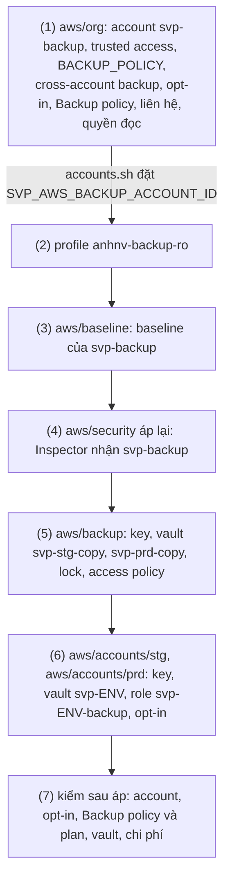

# Runbook: áp backup lần đầu (account `svp-backup`, Backup policy, vault)

Áp lần đầu phần sống lâu của backup stg, prd vào tổ chức đã có nền bảo mật: account `svp-backup` ở OU `Security` cùng baseline, liên hệ
`SECURITY` và dịch vụ phát hiện của nó; trusted access, policy type và Backup policy của AWS Backup ở Organizations, cross-account backup và
opt-in của management; vault copy có vault lock ở `svp-backup`; vault env, key, role và opt-in ở account stg, prd. Rồi kiểm từng phần sau áp.
Thiết kế: [ADR-0067](https://github.com/anhnvcoder/svp-backend/blob/main/docs/adr/0067-backup-dr.md) (account đích, Backup policy, lịch và
retention, vault lock, key, role, chi phí) và [phụ lục](https://github.com/anhnvcoder/svp-backend/blob/main/docs/adr/appendix/0067-backup-dr.md)
(JSON policy, giá trị có nguồn). Diễn tập khôi phục và xoá recovery point cuối buổi nằm ở runbook buổi
([`session-stg.md`](session-stg.md), [`session-prd.md`](session-prd.md)), không ở đây.

**Người học chạy mọi lệnh ở đây.** AI không chạy lệnh nào chạm account, kể cả lệnh chỉ đọc; AI đọc output dán lại. Lệnh `plan`, `apply` và
mong đợi của từng plan nằm ở README của root; runbook này giữ thứ tự, điểm dừng và phần kiểm sau áp. Một lần, ngoài buổi, trước buổi stg đầu
tiên có diễn tập khôi phục. Mọi lệnh chạy từ gốc repo này (`infra/`) trừ chỗ ghi `cd`. Bước nào đỏ thì dừng ở đó, dán output, không đi tiếp.

## Thứ tự áp lần đầu



- **(1)** `aws/org`; [README, Thêm account backup và Backup
  policy](../../aws/org/README.md#thêm-account-backup-và-backup-policy-vào-tổ-chức-đã-áp). Dán lại: output đối chiếu
  opt-in, **plan đủ** của hai lượt (điểm dừng), `Apply complete!`, `No changes.`, `describe-global-settings`.
- **(2)** —; [README `aws/org`, Profile](../../aws/org/README.md#profile). Dán lại: dòng `ok` của `sso-profiles.sh write`
  và `check` cho `anhnv-backup-ro` ([Bước (2)](#bước-2-profile-anhnv-backup-ro)).
- **(3)** `aws/baseline`; [README, Apply lần đầu](../../aws/baseline/README.md#apply-lần-đầu), mục account thêm vào org.
  Dán lại: dòng `Plan:`, `Apply complete!`.
- **(4)** `aws/security`; [Bước (4)](#bước-4-awssecurity-áp-lại). Dán lại: **plan đủ** (điểm dừng), `Apply complete!`.
- **(5)** `aws/backup`; [README, Apply lần đầu](../../aws/backup/README.md#apply-lần-đầu). Dán lại: dòng `Plan:`, `Apply
  complete!`, hai dòng `7d` của `verify.sh backup`.
- **(6)** `aws/accounts/<env>`; [README, Thêm vào account đã có
  baseline](../../aws/accounts/README.md#thêm-vào-account-đã-có-baseline). Dán lại: mỗi env: dòng `Plan:`, `Apply
  complete!`, `No changes.`, output `describe-region-settings`.
- **(7)** —; [Bước (7)](#bước-7-kiểm-sau-áp). Dán lại: output từng mục.

Thứ tự theo phụ thuộc: account phải có trước baseline, profile, vault và key policy chia sẻ cho nó; vault `svp-<env>-copy` phải có trước khi
copy job đầu tiên chạy. Backup policy có hiệu lực ngay ở bước (1): AWS sinh plan `svp-<env>` trong account env, nhưng giữa các buổi account
env không có tài nguyên nào mang tag `Backup`, nên lịch không tạo job nào tới khi env dựng lại. Vì thế không chạy buổi stg, prd nào từ bước
(1) tới hết bước (6).

## Trước khi bắt đầu

1. **Code trên `main`**: `git switch main && git pull --ff-only` trong bản clone này; thay đổi backup của `aws/org`, `aws/baseline`,
   `aws/backup`, `aws/accounts/<env>`, module `org-policies` đã merge.
2. **Giá trị ngoài repo** (không commit): `aws/org/org.auto.tfvars` có khoá `backup` trong `account_emails` trước mọi `plan` của bước (1),
   một email chưa account AWS nào dùng, kể cả account đã đóng hay `SUSPENDED` (README `aws/org`, mục Chuẩn bị). Thiếu khoá thì `plan` dừng ở
   validation của `account_emails`.
3. **Chi phí liên tục bắt đầu**, kể cả khi không có buổi: từ bước (3) baseline của `svp-backup` (check Security Hub, item Config, GuardDuty);
   từ bước (5), (6) ba CMK (`alias/svp-backup-copy`, `alias/svp-stg-backup`, `alias/svp-prd-backup`); từ buổi đầu, bản copy theo retention.
   Bảng giá và ước theo tháng: [ADR-0067 §13](https://github.com/anhnvcoder/svp-backend/blob/main/docs/adr/0067-backup-dr.md#13-chi-phí) và
   mục "Sống giữa buổi" của
   [phụ lục](https://github.com/anhnvcoder/svp-backend/blob/main/docs/adr/appendix/0067-backup-dr.md#sống-giữa-buổi). Budget tổng của org
   phải đủ cho khoản đó cộng các buổi: lệnh đọc ở mục **Mở terminal** của
   [`org-security-setup.md`](org-security-setup.md#mở-terminal).
4. **Phụ thuộc buổi**: từ khi code này ở `main`, `tf.sh <env> env …` cần `SVP_AWS_BACKUP_ACCOUNT_ID` (key RDS của root env chia sẻ cho
   `svp-backup`) và bước 17 của buổi cần plan, vault, role của runbook này. Buổi stg, prd chỉ chạy được sau bước (6).

## Mở terminal

```sh
cd infra
AWS_PROFILE=anhnv-sso aws sso login --region us-east-1
# Account ids live only in this terminal, never in a file.
export SVP_AWS_MGMT_ACCOUNT_ID=<12 số> SVP_AWS_LOG_ACCOUNT_ID=<12 số> SVP_AWS_SECURITY_ACCOUNT_ID=<12 số>
export SVP_AWS_STG_ACCOUNT_ID=<12 số> SVP_AWS_PRD_ACCOUNT_ID=<12 số>
export SVP_SESSION_DIR="$PWD/.session/$(date -u +%Y%m%dT%H%M%SZ)"   # check-account.sh marks its timeline here
aws/scripts/check-account.sh mgmt
```

Tìm `ok    account <12 số> of mgmt, arn:aws:sts::<12 số>:assumed-role/AWSReservedSSO_…`. Năm dòng `export` đầu đọc trên
trang SSO, chỉ lần này: `aws/scripts/accounts.sh` đòi đủ năm account thành viên mà `svp-backup` chỉ có sau bước (1). Từ
bước (1) `SVP_AWS_BACKUP_ACCOUNT_ID` và bốn biến kia đều do `eval "$(aws/scripts/accounts.sh)"` đặt: mở lại terminal
giữa chừng chỉ cần `export SVP_AWS_MGMT_ACCOUNT_ID=<12 số>`, `eval` đó và `check-account.sh mgmt`. Lệnh ghi của bước
(1), (3), (4), (5) chạy bằng `anhnv-sso` (root `aws/baseline`, `aws/backup` vào account đích qua
`OrganizationAccountAccessRole`); bước (6) bằng `anhnv-stg`, `anhnv-prd`. Trước mỗi bước, chạy lại `check-account.sh`
của account mà bước đó ghi.

## Bước (1): `aws/org`

**Điểm dừng.** Tạo account gần như không đảo ngược được: đóng account chờ 90 ngày, email không dùng lại được. Plan thứ hai gắn Backup policy
lên OU `Prod`, `NonProd` và đổi tag policy của cả tổ chức.

```sh
aws/scripts/check-account.sh mgmt
cd aws/org
```

Theo [README, Thêm account backup và Backup policy vào tổ chức đã
áp](../../aws/org/README.md#thêm-account-backup-và-backup-policy-vào-tổ-chức-đã-áp), bốn bước theo thứ tự: khoá `backup`
(điều 2 của **Trước khi bắt đầu**); đối chiếu opt-in của management với `backup.tf` (lệch thì dừng: danh sách sửa bằng
PR trước khi apply); plan có `-target` chỉ account, **dán plan đủ và chờ đọc cùng**, apply, `eval
"$(aws/scripts/accounts.sh)"` đặt `SVP_AWS_BACKUP_ACCOUNT_ID`; plan phần còn lại, **dán plan đủ**, apply, plan lần hai
`No changes.`, `describe-global-settings`. Dán các dòng `ok` của `accounts.sh` (không in id). `cd ../..` khi xong.

## Bước (2): profile `anhnv-backup-ro`

Ghi profile theo [README `aws/org`, Profile](../../aws/org/README.md#profile) (permission set `SvpReadOnly` ở account `svp-backup`; bước (1)
đã gán):

```sh
aws/scripts/sso-profiles.sh write
aws/scripts/sso-profiles.sh check
```

Mong `ok    profile anhnv-backup-ro: added, account of SVP_AWS_BACKUP_ACCOUNT_ID, role SvpReadOnly` (hay `up to date`), rồi ở `check`
`ok    account <12 số> of backup, arn:aws:sts::<12 số>:assumed-role/AWSReservedSSO_SvpReadOnly_…`. `FAIL  profile anhnv-backup-ro is
account …` là profile trỏ account khác: chạy lại `write`; `skip  profile anhnv-backup-ro: SVP_AWS_BACKUP_ACCOUNT_ID is not exported` là
chưa `eval` `accounts.sh`.

## Bước (3): `aws/baseline`

```sh
aws/scripts/check-account.sh mgmt
cd aws/baseline
```

Theo [README, Apply lần đầu](../../aws/baseline/README.md#apply-lần-đầu), đoạn cho account thêm vào org khi root đã áp: bước 1, 3, 4, bỏ bước
2. Plan chỉ thêm module của `svp-backup` (số tài nguyên mong đợi ở README); dòng `change`, `destroy` hay tài nguyên của module khác: dừng, dán
plan. `cd ../..` khi xong.

## Bước (4): `aws/security`, áp lại

GuardDuty (`auto_enable_organization_members = "ALL"`) và Security Hub (policy cấu hình gắn ở root) tự nhận account mới. Liên kết thành viên
Inspector thì đọc danh sách account `ACTIVE` của tổ chức lúc plan, nên root áp lại một lần để `svp-backup` có quét ECR như mọi account thành
viên ([README `aws/security`, Inspector](../../aws/security/README.md#inspector)).

**Điểm dừng.** Thay `aws_inspector2_enabler.members` là tắt rồi bật lại quét của mọi account thành viên.

```sh
aws/scripts/check-account.sh mgmt
cd aws/security
AWS_PROFILE=anhnv-sso TF_VAR_account_id="$SVP_AWS_MGMT_ACCOUNT_ID" TF_VAR_security_account_id="$SVP_AWS_SECURITY_ACCOUNT_ID" \
  TF_VAR_log_archive_account_id="$SVP_AWS_LOG_ACCOUNT_ID" terraform plan -out=security.tfplan
```

Mong đợi `Plan: 1 to add, 1 to change, 0 to destroy`: thêm `aws_inspector2_member_association.members["<id của svp-backup>"]`; đổi tại chỗ
(`~`) `aws_inspector2_enabler.members`, chỉ thêm id đó vào `account_ids`. Dừng (không apply, dán plan lại) nếu enabler bị thay (`-/+`,
`must be replaced`) hay plan có tài nguyên khác.

```sh
AWS_PROFILE=anhnv-sso TF_VAR_account_id="$SVP_AWS_MGMT_ACCOUNT_ID" TF_VAR_security_account_id="$SVP_AWS_SECURITY_ACCOUNT_ID" \
  TF_VAR_log_archive_account_id="$SVP_AWS_LOG_ACCOUNT_ID" terraform apply security.tfplan
rm security.tfplan
cd ../..
```

Lỗi `DataUnavailableException` (dữ liệu tổ chức còn đồng bộ sau bước (1)): đợi vài phút rồi plan, apply lại.

## Bước (5): `aws/backup`

```sh
aws/scripts/check-account.sh mgmt
cd aws/backup
```

Theo [README, Apply lần đầu](../../aws/backup/README.md#apply-lần-đầu): kiểm biến, `init`, plan, đọc, apply, kiểm hai vault bằng
`verify.sh backup`. Dòng `FAIL  7d: the vault … is Locked 'False'`: dừng, dán output. `cd ../..` khi xong.

## Bước (6): `aws/accounts/stg`, `aws/accounts/prd`

```sh
AWS_PROFILE=anhnv-sso aws sso login --region us-east-1   # one login for every profile of the same sso_session
aws/scripts/check-account.sh stg
```

Theo [README, Thêm vào account đã có baseline](../../aws/accounts/README.md#thêm-vào-account-đã-có-baseline) cho stg, rồi cùng mục cho prd
(`aws/scripts/check-account.sh prd` trước). Plan của mỗi account chỉ gồm phần
Backup của bảng ở README khi account đã có mọi phần khác; dòng `change`, `destroy` hay tài nguyên ngoài bảng: dừng, dán plan. Sau apply, plan
lần hai `No changes.`; opt-in `RDS`, `S3` của account đó kiểm ở dòng `7b` của `verify.sh backup` (mục 7b ở dưới).

## Bước (7): kiểm sau áp

Mọi lệnh chỉ đọc. Lệnh nào in lỗi quyền ở một profile chỉ đọc: dán lệnh và lỗi, đó cũng là kết quả kiểm của permission set.

### 7a–7d. Kiểm bằng script

Một lệnh đọc cả 7a–7d, mỗi kiểm một dòng `ok`, `FAIL` hay `note`; một `FAIL` không dừng kiểm sau, cuối cùng
`FAIL  N check(s) failed, each named above` và exit 1:

```sh
aws/scripts/verify.sh backup
```

Cần `anhnv-sso`, `anhnv-security-ro`, `anhnv-backup-ro`, `anhnv-stg-ro`, `anhnv-prd-ro` ([Bước
(2)](#bước-2-profile-anhnv-backup-ro) và [`sso-profiles.sh`](../../aws/org/README.md#bảy-profile-còn-lại)) và các biến
account của `accounts.sh`. Lệnh in `ok    profile <tên> is the account of <tên>` khi profile đúng account trước mỗi nhóm
kiểm; dòng `FAIL` đó nghĩa là bỏ cả nhóm của profile ấy.

- **7a** `svp-backup is ACTIVE in the OU Security with a SECURITY contact`: account, OU `Security`, liên hệ `SECURITY`.
- **7a** `<profile> <region>: Security Hub standards and Config recorder as expected`: hai chuẩn `READY` và recorder
  `True SUCCESS` ở hai region của `anhnv-backup-ro`.
- **7a** `svp-backup is a GuardDuty member in <region>`, `… a Security Hub member and Inspector scans only ECR`: dịch vụ
  phát hiện nhận account.
- **7b** `cross-account backup is on, the other global settings off`: `isCrossAccountBackupEnabled` `true`, khoá còn lại
  `false`.
- **7b** `<profile>: RDS and S3 are opted in to AWS Backup`: ba profile: `anhnv-sso`, `anhnv-stg-ro`, `anhnv-prd-ro`.
- **7c** `OU <Prod|NonProd> carries svp-backup-<env> and the effective policy of <env> has the plan svp-<env> only`:
  Backup policy đúng OU, policy hiệu lực chỉ có plan của env.
- **7c** `the plan svp-<env> has the rule daily into svp-<env> and the selection svp-<env>-tagged`: AWS đã sinh plan và
  selection trong account env.
- **7c** `the vault svp-<env> is not locked (<n> recovery points) and its role has the 4 policies`: vault env không
  lock, role có đúng bốn managed policy.
- **7d** `the vault svp-<env>-copy is locked and accepts copies from the account of <env> only`: vault copy lock, access
  policy một statement của account env.

Account mới có thể cần tới 24 giờ mới hiện ở GuardDuty, Security Hub (`FAIL  7a: … Member status … (a new account takes
up to 24 h)`): đọc lại hôm sau, vẫn `FAIL` thì dán output. `FAIL  7c: AWS has not generated the plan svp-<env> in the
account yet`: policy mới gắn, đọc lại sau. Các dòng `note` để so bằng mắt, dán lại: `7c: <env> rule schedule and
retention (vault days, copy days)` với lịch và hai retention của [ADR-0067
§4](https://github.com/anhnvcoder/svp-backend/blob/main/docs/adr/0067-backup-dr.md#4-backup-policy-lịch-retention), và
`7d: svp-<env>-copy lock min <n> days, max <n> days` với bảng Tài nguyên của [README
`aws/backup`](../../aws/backup/README.md#tài-nguyên). Bước 17 của buổi (`restore-drill.sh <env> backup`) kiểm lại plan,
selection và opt-in đủ chi tiết trước job đầu tiên. `note  7d: the copy of a recovery point across accounts is tested by
the first session` nghĩa là copy chéo account chỉ thử được khi env có tài nguyên: bước 17 của buổi stg đầu tiên chạy job
on-demand và copy job thật; lệnh **Đọc bản copy** của [`session-stg.md`](session-stg.md#1719-diễn-tập-khôi-phục) là phép
kiểm cuối của runbook này.

Account tạo trong tổ chức đã bật root tập trung nên không có credential root. Kiểm bằng phiên root giữ tay (đổi session
và gửi email cảnh báo, nên chỉ chạy khi người học chủ động chọn): như mục [7b](org-security-setup.md#7b-root-tập-trung)
của `org-security-setup.md`, thêm id của `svp-backup` vào vòng lặp của nó, khi cần.

### 7e. Chi phí sau 1 và 7 ngày

Cost Explorer có dữ liệu sau ~24 giờ. Sau 1 ngày và sau 7 ngày kể từ bước (3), theo dịch vụ, account `svp-backup` (ngày áp bước (3) dạng
`yyyy-mm-dd`):

```sh
aws/scripts/verify.sh cost backup <ngày áp bước 3>
```

Mỗi dòng dữ liệu là `note  <ngày>  <dịch vụ>  <số> USD`, cuối `ok    N row(s) from <ngày> to <hôm nay>, <tổng> USD`; chưa có dữ liệu thì
`note  no cost data from … yet (Cost Explorer lags about 24 hours)`. `FAIL  ce get-cost-and-usage (first use: turn Cost Explorer on once in
the console …)` là Cost Explorer chưa bật: [Bật Cost Explorer](org-security-setup.md#bật-cost-explorer-lần-đầu). So với mục "Sống giữa
buổi" của
[phụ lục ADR-0067](https://github.com/anhnvcoder/svp-backend/blob/main/docs/adr/appendix/0067-backup-dr.md#sống-giữa-buổi): baseline của
`svp-backup` và key `alias/svp-backup-copy` ở account này; key vault env tính ở account stg, prd. Lệch quá ±50 %: dán output.

## Gỡ lab

Chỉ khi lab kết thúc và không cần bản copy nữa: bản copy trong vault lock bị xoá cùng, kể cả bản còn trong hạn. Thứ tự, mỗi bước theo mục gỡ của
README root:

1. Mọi buổi đã gỡ, `sweep.sh <env>` sạch: vault `svp-<env>` không còn recovery point, không job nào chạy.
2. Vault env, key và role của nó: mục [Gỡ baseline](../../aws/accounts/README.md#gỡ-baseline-có-chủ-đích) của `aws/accounts` (AWS Backup không
   xoá vault còn recovery point).
3. Vault copy và key: mục [Gỡ có chủ đích](../../aws/backup/README.md#gỡ-có-chủ-đích) của `aws/backup` (sửa local không commit để bỏ
   `prevent_destroy`, `force_destroy` của vault; key vào `PendingDeletion` 30 ngày).
4. Baseline của mọi account: mục [Gỡ](../../aws/baseline/README.md#gỡ) của `aws/baseline`.
5. Account `svp-backup`, Backup policy, cross-account backup, trusted access, policy type `BACKUP_POLICY`: mục
   [Gỡ có chủ đích](../../aws/org/README.md#gỡ-có-chủ-đích) của `aws/org` (đóng account theo quy trình AWS, không bằng destroy).

Chi phí dừng khi key ở `PendingDeletion` (không tính) và account đóng; account đóng ở trạng thái đóng 90 ngày, email không dùng lại được.

## Khi một bước đỏ

- Lỗi ở `plan`: không có gì đổi trên account; đọc lỗi, sửa nguyên nhân (biến terminal, `org.auto.tfvars`, phiên SSO), chạy lại đúng bước.
- Lỗi giữa `apply`: phần đã tạo nằm trong state; `plan` lại cùng root chỉ còn phần chưa tạo. Dán lỗi và plan mới trước khi apply lại.
- Plan có `destroy` hay `-/+` ở tổ chức, account, vault hay key có sẵn: dừng, không apply, dán plan.
- `AccessDenied` khi root qua role assume `OrganizationAccountAccessRole` của `svp-backup`: account chưa tạo xong (vài phút sau bước (1)) hay
  `SVP_AWS_BACKUP_ACCOUNT_ID` sai; đọc lại output `backup_account_id`.
- Mất đường vào (Identity Center hỏng, phiên SSO không đăng nhập được): [`break-glass.md`](break-glass.md).
