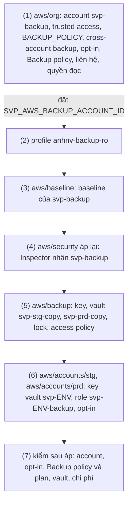

# Runbook: áp backup lần đầu (account `svp-backup`, Backup policy, vault)

Áp lần đầu phần sống lâu của backup stg, prd vào tổ chức đã có nền bảo mật: account `svp-backup` ở OU `Security` cùng baseline, liên hệ
`SECURITY` và dịch vụ phát hiện của nó; trusted access, policy type và Backup policy của AWS Backup ở Organizations, cross-account backup và
opt-in của management; vault copy có vault lock ở `svp-backup`; vault env, key, role và opt-in ở account stg, prd. Rồi kiểm từng phần sau áp.
Thiết kế: [ADR-0067](https://github.com/anhnvcoder/svp-backend/blob/main/docs/adr/0067-backup-dr.md) (account đích, Backup policy, lịch và
retention, vault lock, key, role, chi phí) và [phụ lục](https://github.com/anhnvcoder/svp-backend/blob/main/docs/adr/appendix/0067-backup-dr.md)
(JSON policy, giá trị có nguồn). Diễn tập khôi phục và xoá recovery point cuối buổi nằm ở runbook buổi
([`session-stg.md`](session-stg.md), [`session-prd.md`](session-prd.md)), không ở đây.

**Người học chạy mọi lệnh ở đây.** AI không chạy lệnh nào chạm account, kể cả lệnh chỉ đọc; AI đọc output dán lại. Lệnh `plan`, `apply` và
mong đợi của từng plan nằm ở README của root; runbook này giữ thứ tự, điểm dừng và phần kiểm sau áp. Một lần, ngoài buổi, trước buổi stg đầu
tiên có diễn tập khôi phục. Mọi lệnh chạy từ gốc repo này (`infra/`) trừ chỗ ghi `cd`. Bước nào đỏ thì dừng ở đó, dán output, không đi tiếp.

## Thứ tự áp lần đầu



| Bước | Root | Hướng dẫn | Dán lại |
| --- | --- | --- | --- |
| (1) | `aws/org` | [README, Thêm account backup và Backup policy](../../aws/org/README.md#thêm-account-backup-và-backup-policy-vào-tổ-chức-đã-áp) | output đối chiếu opt-in, **plan đủ** của hai lượt (điểm dừng), `Apply complete!`, `No changes.`, `describe-global-settings` |
| (2) | — | [README `aws/org`, Profile](../../aws/org/README.md#profile) | hai dòng của [Bước (2)](#bước-2-profile-anhnv-backup-ro) |
| (3) | `aws/baseline` | [README, Apply lần đầu](../../aws/baseline/README.md#apply-lần-đầu), mục account thêm vào org | dòng `Plan:`, `Apply complete!` |
| (4) | `aws/security` | [Bước (4)](#bước-4-awssecurity-áp-lại) | **plan đủ** (điểm dừng), `Apply complete!` |
| (5) | `aws/backup` | [README, Apply lần đầu](../../aws/backup/README.md#apply-lần-đầu) | dòng `Plan:`, `Apply complete!`, output `describe-backup-vault` |
| (6) | `aws/accounts/<env>` | [README, Thêm vào account đã có baseline](../../aws/accounts/README.md#thêm-vào-account-đã-có-baseline) | mỗi env: dòng `Plan:`, `Apply complete!`, `No changes.`, output `describe-region-settings` |
| (7) | — | [Bước (7)](#bước-7-kiểm-sau-áp) | output từng mục |

Thứ tự theo phụ thuộc: account phải có trước baseline, profile, vault và key policy chia sẻ cho nó; vault `svp-<env>-copy` phải có trước khi
copy job đầu tiên chạy. Backup policy có hiệu lực ngay ở bước (1): AWS sinh plan `svp-<env>` trong account env, nhưng giữa các buổi account
env không có tài nguyên nào mang tag `Backup`, nên lịch không tạo job nào tới khi env dựng lại. Vì thế không chạy buổi stg, prd nào từ bước
(1) tới hết bước (6).

## Trước khi bắt đầu

1. **Code trên `main`**: `git switch main && git pull --ff-only` trong bản clone này; thay đổi backup của `aws/org`, `aws/baseline`,
   `aws/backup`, `aws/accounts/<env>`, module `org-policies` đã merge.
2. **Giá trị ngoài repo** (không commit): `aws/org/org.auto.tfvars` có khoá `backup` trong `account_emails` trước mọi `plan` của bước (1),
   một email chưa account AWS nào dùng, kể cả account đã đóng hay `SUSPENDED` (README `aws/org`, mục Chuẩn bị). Thiếu khoá thì `plan` dừng ở
   validation của `account_emails`.
3. **Chi phí liên tục bắt đầu**, kể cả khi không có buổi: từ bước (3) baseline của `svp-backup` (check Security Hub, item Config, GuardDuty);
   từ bước (5), (6) ba CMK (`alias/svp-backup-copy`, `alias/svp-stg-backup`, `alias/svp-prd-backup`); từ buổi đầu, bản copy theo retention.
   Bảng giá và ước theo tháng: [ADR-0067 §13](https://github.com/anhnvcoder/svp-backend/blob/main/docs/adr/0067-backup-dr.md#13-chi-phí) và
   mục "Sống giữa buổi" của
   [phụ lục](https://github.com/anhnvcoder/svp-backend/blob/main/docs/adr/appendix/0067-backup-dr.md#sống-giữa-buổi). Budget tổng của org
   phải đủ cho khoản đó cộng các buổi: lệnh đọc ở mục **Mở terminal** của
   [`org-security-setup.md`](org-security-setup.md#mở-terminal).
4. **Phụ thuộc buổi**: từ khi code này ở `main`, `tf.sh <env> env …` cần `SVP_AWS_BACKUP_ACCOUNT_ID` (key RDS của root env chia sẻ cho
   `svp-backup`) và bước 12 của buổi cần plan, vault, role của runbook này. Buổi stg, prd chỉ chạy được sau bước (6).

## Mở terminal

```sh
cd infra
AWS_PROFILE=anhnv-sso aws sso login --region us-east-1
# Account ids live only in this terminal, never in a file.
export SVP_AWS_MGMT_ACCOUNT_ID=<12 số> SVP_AWS_LOG_ACCOUNT_ID=<12 số> SVP_AWS_SECURITY_ACCOUNT_ID=<12 số>
export SVP_AWS_STG_ACCOUNT_ID=<12 số> SVP_AWS_PRD_ACCOUNT_ID=<12 số>
export SVP_SESSION_DIR="$PWD/.session/$(date -u +%Y%m%dT%H%M%SZ)"   # check-account.sh marks its timeline here
aws/scripts/check-account.sh mgmt
```

Tìm `ok    account <12 số> of mgmt, arn:aws:sts::<12 số>:assumed-role/AWSReservedSSO_…`. Từ bước (1) thêm biến `SVP_AWS_BACKUP_ACCOUNT_ID`
(output `backup_account_id` của `aws/org`). Mở lại terminal giữa chừng: đặt lại mọi biến trên và biến đó, rồi chạy lại `check-account.sh
mgmt`. Lệnh ghi của bước (1), (3), (4), (5) chạy bằng `anhnv-sso` (root `aws/baseline`, `aws/backup` vào account đích qua
`OrganizationAccountAccessRole`); bước (6) bằng `anhnv-stg`, `anhnv-prd`. Trước mỗi bước, chạy lại `check-account.sh` của account mà bước đó
ghi.

## Bước (1): `aws/org`

**Điểm dừng.** Tạo account gần như không đảo ngược được: đóng account chờ 90 ngày, email không dùng lại được. Plan thứ hai gắn Backup policy
lên OU `Prod`, `NonProd` và đổi tag policy của cả tổ chức.

```sh
aws/scripts/check-account.sh mgmt
cd aws/org
```

Theo [README, Thêm account backup và Backup policy vào tổ chức đã áp](../../aws/org/README.md#thêm-account-backup-và-backup-policy-vào-tổ-chức-đã-áp),
bốn bước theo thứ tự: khoá `backup` (điều 2 của **Trước khi bắt đầu**); đối chiếu opt-in của management với `backup.tf` (lệch thì dừng: danh
sách sửa bằng PR trước khi apply); plan có `-target` chỉ account, **dán plan đủ và chờ đọc cùng**, apply, đặt `SVP_AWS_BACKUP_ACCOUNT_ID` từ
output; plan phần còn lại, **dán plan đủ**, apply, plan lần hai `No changes.`, `describe-global-settings`. Dán id mới đã che bớt (4 số cuối).
`cd ../..` khi xong.

## Bước (2): profile `anhnv-backup-ro`

Tạo profile theo [README `aws/org`, Profile](../../aws/org/README.md#profile) (permission set `SvpReadOnly` ở account `svp-backup`; bước (1)
đã gán). Kiểm, không in id account:

```sh
[ "$(AWS_PROFILE=anhnv-backup-ro aws sts get-caller-identity --region ap-southeast-1 --query Account --output text)" = \
  "$SVP_AWS_BACKUP_ACCOUNT_ID" ] && echo same-account
AWS_PROFILE=anhnv-backup-ro aws sts get-caller-identity --region ap-southeast-1 --query Arn --output text | sed -E 's/[0-9]{12}/<account>/'
```

Mong `same-account` và `arn:aws:sts::<account>:assumed-role/AWSReservedSSO_SvpReadOnly_…`. Không có `same-account`: profile trỏ account
khác, sửa `~/.aws/config` rồi kiểm lại.

## Bước (3): `aws/baseline`

```sh
aws/scripts/check-account.sh mgmt
cd aws/baseline
```

Theo [README, Apply lần đầu](../../aws/baseline/README.md#apply-lần-đầu), đoạn cho account thêm vào org khi root đã áp: bước 1, 3, 4, bỏ bước
2. Plan chỉ thêm module của `svp-backup` (số tài nguyên mong đợi ở README); dòng `change`, `destroy` hay tài nguyên của module khác: dừng, dán
plan. `cd ../..` khi xong.

## Bước (4): `aws/security`, áp lại

GuardDuty (`auto_enable_organization_members = "ALL"`) và Security Hub (policy cấu hình gắn ở root) tự nhận account mới. Liên kết thành viên
Inspector thì đọc danh sách account `ACTIVE` của tổ chức lúc plan, nên root áp lại một lần để `svp-backup` có quét ECR như mọi account thành
viên ([README `aws/security`, Inspector](../../aws/security/README.md#inspector)).

**Điểm dừng.** Thay `aws_inspector2_enabler.members` là tắt rồi bật lại quét của mọi account thành viên.

```sh
aws/scripts/check-account.sh mgmt
cd aws/security
AWS_PROFILE=anhnv-sso TF_VAR_account_id="$SVP_AWS_MGMT_ACCOUNT_ID" TF_VAR_security_account_id="$SVP_AWS_SECURITY_ACCOUNT_ID" \
  TF_VAR_log_archive_account_id="$SVP_AWS_LOG_ACCOUNT_ID" terraform plan -out=security.tfplan
```

Mong đợi `Plan: 1 to add, 1 to change, 0 to destroy`: thêm `aws_inspector2_member_association.members["<id của svp-backup>"]`; đổi tại chỗ
(`~`) `aws_inspector2_enabler.members`, chỉ thêm id đó vào `account_ids`. Dừng (không apply, dán plan lại) nếu enabler bị thay (`-/+`,
`must be replaced`) hay plan có tài nguyên khác.

```sh
AWS_PROFILE=anhnv-sso TF_VAR_account_id="$SVP_AWS_MGMT_ACCOUNT_ID" TF_VAR_security_account_id="$SVP_AWS_SECURITY_ACCOUNT_ID" \
  TF_VAR_log_archive_account_id="$SVP_AWS_LOG_ACCOUNT_ID" terraform apply security.tfplan
rm security.tfplan
cd ../..
```

Lỗi `DataUnavailableException` (dữ liệu tổ chức còn đồng bộ sau bước (1)): đợi vài phút rồi plan, apply lại.

## Bước (5): `aws/backup`

```sh
aws/scripts/check-account.sh mgmt
cd aws/backup
```

Theo [README, Apply lần đầu](../../aws/backup/README.md#apply-lần-đầu): kiểm biến, `init`, plan, đọc, apply, kiểm hai vault bằng
`anhnv-backup-ro`. Vault `Locked` `False`: dừng, dán output. `cd ../..` khi xong.

## Bước (6): `aws/accounts/stg`, `aws/accounts/prd`

```sh
AWS_PROFILE=anhnv-stg aws sso login --region us-east-1
aws/scripts/check-account.sh stg
```

Theo [README, Thêm vào account đã có baseline](../../aws/accounts/README.md#thêm-vào-account-đã-có-baseline) cho stg, rồi cùng mục cho prd
(`AWS_PROFILE=anhnv-prd aws sso login --region us-east-1`, `aws/scripts/check-account.sh prd` trước). Plan của mỗi account chỉ gồm phần
Backup của bảng ở README khi account đã có mọi phần khác; dòng `change`, `destroy` hay tài nguyên ngoài bảng: dừng, dán plan. Sau apply, plan
lần hai `No changes.` và `describe-region-settings` in `RDS`, `S3` là `True`.

## Bước (7): kiểm sau áp

Mọi lệnh chỉ đọc. Lệnh nào in lỗi quyền ở một profile chỉ đọc: dán lệnh và lỗi, đó cũng là kết quả kiểm của permission set.

### 7a. Account `svp-backup`

Account ở OU `Security`, liên hệ `SECURITY` (management `anhnv-sso`):

```sh
[ "$(AWS_PROFILE=anhnv-sso aws organizations list-parents --child-id "$SVP_AWS_BACKUP_ACCOUNT_ID" --region us-east-1 \
  --query 'Parents[0].Id' --output text)" = "$(AWS_PROFILE=anhnv-sso terraform -chdir=aws/org output -json organizational_unit_ids |
  jq -r .Security)" ] && echo ou-security
AWS_PROFILE=anhnv-sso aws organizations describe-account --account-id "$SVP_AWS_BACKUP_ACCOUNT_ID" --region us-east-1 \
  --query 'Account.[Name,Status]' --output text
AWS_PROFILE=anhnv-sso aws account get-alternate-contact --account-id "$SVP_AWS_BACKUP_ACCOUNT_ID" --alternate-contact-type SECURITY \
  --region us-east-1 --query 'AlternateContact.[AlternateContactType,Title]' --output text
```

Mong `ou-security`; `svp-backup ACTIVE`; `SECURITY <chức danh của security_contact>`. Account tạo trong tổ chức đã bật root tập trung nên
không có credential root; kiểm bằng phiên root như mục [7b](org-security-setup.md#7b-root-tập-trung) của `org-security-setup.md`, thêm id
của `svp-backup` vào vòng lặp của nó, khi cần.

Baseline (chuẩn Security Hub, recorder Config ở hai region, profile `anhnv-backup-ro`):

```sh
for r in ap-southeast-1 us-east-1; do
  echo "== $r"
  AWS_PROFILE=anhnv-backup-ro aws securityhub get-enabled-standards --region $r \
    --query 'StandardsSubscriptions[].[StandardsArn,StandardsStatus]' --output text
  AWS_PROFILE=anhnv-backup-ro aws configservice describe-configuration-recorder-status --region $r \
    --query 'ConfigurationRecordersStatus[].[name,recording,lastStatus]' --output text
done
```

Mong như mục 7a của [`org-security-setup.md`](org-security-setup.md#7a-dịch-vụ-bật): mỗi region hai chuẩn `READY`, recorder `True SUCCESS`
(Security Hub có thể tới 24 giờ mới bật chuẩn ở account mới).

Dịch vụ phát hiện nhận account (profile `anhnv-security-ro` của delegated admin; GuardDuty chạy với `R=ap-southeast-1` rồi `R=us-east-1`):

```sh
R=ap-southeast-1
D="$(AWS_PROFILE=anhnv-security-ro aws guardduty list-detectors --region "$R" --query 'DetectorIds[0]' --output text)"
AWS_PROFILE=anhnv-security-ro aws guardduty list-members --detector-id "$D" --region "$R" --output text \
  --query "Members[?AccountId=='$SVP_AWS_BACKUP_ACCOUNT_ID'].RelationshipStatus"
AWS_PROFILE=anhnv-security-ro aws securityhub list-members --region ap-southeast-1 --output text \
  --query "Members[?AccountId=='$SVP_AWS_BACKUP_ACCOUNT_ID'].MemberStatus"
AWS_PROFILE=anhnv-security-ro aws inspector2 batch-get-account-status --account-ids "$SVP_AWS_BACKUP_ACCOUNT_ID" --region ap-southeast-1 \
  --query 'accounts[].[resourceState.ecr.status, resourceState.ec2.status, resourceState.lambda.status]' --output text
```

Mong `Enabled` (mỗi region), `Enabled`, `ENABLED DISABLED DISABLED`. Rỗng: account mới có thể tới 24 giờ mới hiện ở GuardDuty, Security Hub;
đọc lại hôm sau, vẫn rỗng thì dán output.

### 7b. Cài đặt AWS Backup và opt-in

```sh
AWS_PROFILE=anhnv-sso aws backup describe-global-settings --region ap-southeast-1 --query 'GlobalSettings' --output json
for p in anhnv-sso anhnv-stg-ro anhnv-prd-ro; do
  printf '%s ' "$p"
  AWS_PROFILE=$p aws backup describe-region-settings --region ap-southeast-1 \
    --query 'ResourceTypeOptInPreference.[RDS,S3]' --output text
done
```

Mong `isCrossAccountBackupEnabled` `true`, hai khoá còn lại `false` (README `aws/org`); ba dòng `… True True`.

### 7c. Backup policy và plan ở account env

Policy gắn đúng OU, policy hiệu lực của mỗi account env chỉ có plan của env đó, và AWS đã sinh plan cùng selection trong account:

```sh
O="$(AWS_PROFILE=anhnv-sso terraform -chdir=aws/org output -json organizational_unit_ids)"
for ou in Prod NonProd; do
  printf '%s ' "$ou"
  AWS_PROFILE=anhnv-sso aws organizations list-policies-for-target --target-id "$(jq -r ".$ou" <<<"$O")" --filter BACKUP_POLICY \
    --region us-east-1 --query 'Policies[].Name' --output text
done
for e in stg prd; do
  case $e in stg) a=$SVP_AWS_STG_ACCOUNT_ID ;; prd) a=$SVP_AWS_PRD_ACCOUNT_ID ;; esac
  printf '%s ' "$e"
  AWS_PROFILE=anhnv-sso aws organizations describe-effective-policy --policy-type BACKUP_POLICY --target-id "$a" --region us-east-1 \
    --query 'EffectivePolicy.PolicyContent' --output text | jq -c '.plans | keys'
  id=$(AWS_PROFILE="anhnv-$e-ro" aws backup list-backup-plans --region ap-southeast-1 --output text \
    --query "BackupPlansList[?BackupPlanName=='svp-$e'].BackupPlanId")
  AWS_PROFILE="anhnv-$e-ro" aws backup get-backup-plan --backup-plan-id "$id" --region ap-southeast-1 --output text \
    --query 'BackupPlan.Rules[].[RuleName,TargetBackupVaultName,ScheduleExpression,Lifecycle.DeleteAfterDays,CopyActions[0].Lifecycle.DeleteAfterDays]'
  AWS_PROFILE="anhnv-$e-ro" aws backup list-backup-selections --backup-plan-id "$id" --region ap-southeast-1 \
    --query 'BackupSelectionsList[].SelectionName' --output text
done
```

Mong `Prod svp-backup-prd`, `NonProd svp-backup-stg`; với mỗi env: `["svp-<env>"]`, một rule `daily` vào vault `svp-<env>` với lịch và hai
retention (vault env, bản copy) đúng
[ADR-0067 §4](https://github.com/anhnvcoder/svp-backend/blob/main/docs/adr/0067-backup-dr.md#4-backup-policy-lịch-retention), và
`svp-<env>-tagged`. Lỗi `get-backup-plan` vì `id` rỗng: AWS chưa sinh plan trong account (policy mới gắn); đọc lại sau, vẫn chưa có thì dán
output. Bước 12 của buổi (`restore-drill.sh <env> backup`) kiểm lại plan, selection và opt-in đủ chi tiết trước job đầu tiên.

Vault env và role của nó (mỗi env, profile chỉ đọc của account đó):

```sh
for e in stg prd; do
  AWS_PROFILE="anhnv-$e-ro" aws backup describe-backup-vault --backup-vault-name "svp-$e" --region ap-southeast-1 \
    --query '[BackupVaultName,Locked,NumberOfRecoveryPoints]' --output text
  AWS_PROFILE="anhnv-$e-ro" aws iam list-attached-role-policies --role-name "svp-$e-backup" --region us-east-1 \
    --query 'AttachedPolicies[].PolicyName' --output text
done
```

Mong `svp-<env> False 0` (không lock, chưa có recovery point) và đúng bốn managed policy của AWS Backup mà
[ADR-0067 §7](https://github.com/anhnvcoder/svp-backend/blob/main/docs/adr/0067-backup-dr.md#7-role-của-aws-backup) liệt kê.

### 7d. Vault copy, lock, access policy

```sh
for e in stg prd; do
  case $e in stg) a=$SVP_AWS_STG_ACCOUNT_ID ;; prd) a=$SVP_AWS_PRD_ACCOUNT_ID ;; esac
  AWS_PROFILE=anhnv-backup-ro aws backup describe-backup-vault --backup-vault-name "svp-$e-copy" --region ap-southeast-1 \
    --query '[BackupVaultName,Locked,MinRetentionDays,MaxRetentionDays]' --output text
  AWS_PROFILE=anhnv-backup-ro aws backup get-backup-vault-access-policy --backup-vault-name "svp-$e-copy" --region ap-southeast-1 \
    --query Policy --output text | jq -c --arg p "arn:aws:iam::$a:root" '[.Statement[] | {Effect, Action, env_root: (.Principal.AWS == $p)}]'
done
```

Mong mỗi vault `True`, min và max của vault lock như bảng Tài nguyên của [README `aws/backup`](../../aws/backup/README.md#tài-nguyên); policy
một statement `{"Effect":"Allow","Action":"backup:CopyIntoBackupVault","env_root":true}`. `env_root` `false`: vault nhận copy từ account
khác account env của nó, dừng và dán output.

Copy chéo account chỉ thử được khi env có tài nguyên: bước 12 của buổi stg đầu tiên chạy job on-demand và copy job thật; lệnh **Đọc bản copy**
của [`session-stg.md`](session-stg.md#1214-diễn-tập-khôi-phục) là phép kiểm cuối của runbook này.

### 7e. Chi phí sau 1 và 7 ngày

Cost Explorer có dữ liệu sau ~24 giờ. Sau 1 ngày và sau 7 ngày kể từ bước (3), theo dịch vụ, account `svp-backup`:

```sh
AWS_PROFILE=anhnv-sso aws ce get-cost-and-usage --region us-east-1 --granularity DAILY --metrics UnblendedCost \
  --time-period Start=<ngày áp bước 3, yyyy-mm-dd>,End=<hôm nay, yyyy-mm-dd> --group-by Type=DIMENSION,Key=SERVICE \
  --filter "{\"Dimensions\":{\"Key\":\"LINKED_ACCOUNT\",\"Values\":[\"$SVP_AWS_BACKUP_ACCOUNT_ID\"]}}" \
  --query 'ResultsByTime[].[TimePeriod.Start, Groups[].[Keys[0], Metrics.UnblendedCost.Amount]]' --output text
```

So với mục "Sống giữa buổi" của
[phụ lục ADR-0067](https://github.com/anhnvcoder/svp-backend/blob/main/docs/adr/appendix/0067-backup-dr.md#sống-giữa-buổi): baseline của
`svp-backup` và key `alias/svp-backup-copy` ở account này; key vault env tính ở account stg, prd. Lệch quá ±50 %: dán output.

## Gỡ lab

Chỉ khi lab kết thúc và không cần bản copy nữa: bản copy trong vault lock bị xoá cùng, kể cả bản còn trong hạn. Thứ tự, mỗi bước theo mục gỡ của
README root:

1. Mọi buổi đã gỡ, `sweep.sh <env>` sạch: vault `svp-<env>` không còn recovery point, không job nào chạy.
2. Vault env, key và role của nó: mục [Gỡ baseline](../../aws/accounts/README.md#gỡ-baseline-có-chủ-đích) của `aws/accounts` (AWS Backup không
   xoá vault còn recovery point).
3. Vault copy và key: mục [Gỡ có chủ đích](../../aws/backup/README.md#gỡ-có-chủ-đích) của `aws/backup` (sửa local không commit để bỏ
   `prevent_destroy`, `force_destroy` của vault; key vào `PendingDeletion` 30 ngày).
4. Baseline của mọi account: mục [Gỡ](../../aws/baseline/README.md#gỡ) của `aws/baseline`.
5. Account `svp-backup`, Backup policy, cross-account backup, trusted access, policy type `BACKUP_POLICY`: mục
   [Gỡ có chủ đích](../../aws/org/README.md#gỡ-có-chủ-đích) của `aws/org` (đóng account theo quy trình AWS, không bằng destroy).

Chi phí dừng khi key ở `PendingDeletion` (không tính) và account đóng; account đóng ở trạng thái đóng 90 ngày, email không dùng lại được.

## Khi một bước đỏ

- Lỗi ở `plan`: không có gì đổi trên account; đọc lỗi, sửa nguyên nhân (biến terminal, `org.auto.tfvars`, phiên SSO), chạy lại đúng bước.
- Lỗi giữa `apply`: phần đã tạo nằm trong state; `plan` lại cùng root chỉ còn phần chưa tạo. Dán lỗi và plan mới trước khi apply lại.
- Plan có `destroy` hay `-/+` ở tổ chức, account, vault hay key có sẵn: dừng, không apply, dán plan.
- `AccessDenied` khi root qua role assume `OrganizationAccountAccessRole` của `svp-backup`: account chưa tạo xong (vài phút sau bước (1)) hay
  `SVP_AWS_BACKUP_ACCOUNT_ID` sai; đọc lại output `backup_account_id`.
- Mất đường vào (Identity Center hỏng, phiên SSO không đăng nhập được): [`break-glass.md`](break-glass.md).
