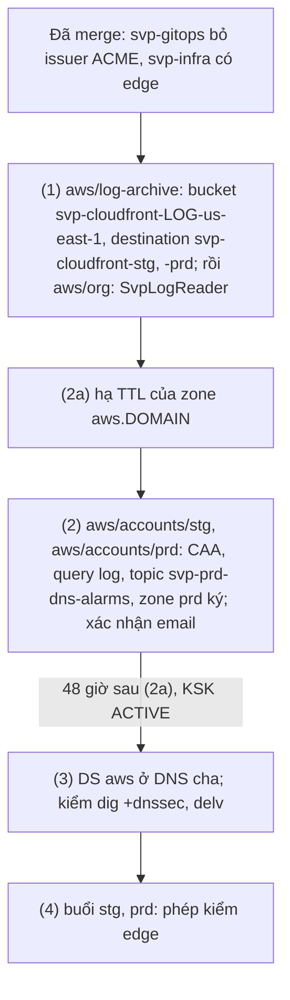

# Runbook: áp edge lần đầu (log CloudFront, CAA, DNSSEC)

← [accounts-setup](accounts-setup.md) · [Mục lục](README.md) · [platform-setup](platform-setup.md) →

> **Tóm tắt**
>
> - **Làm gì:** áp phần sống lâu của edge: bucket log CloudFront và delivery destination ở `svp-log-archive`, quyền đọc của
>   `SvpLogReader`, `CAA` ở zone hai env, DNSSEC và query log của zone prd cùng hai alarm `page`, rồi chuỗi tin cậy DNSSEC từ DNS cha.
>   Phần theo buổi (distribution, VPC origin, ALB, web ACL, cert ACM, bản ghi alias) do `aws/envs/<env>` dựng và gỡ theo runbook buổi.
> - **Khi nào và bao lâu:** một lần, ngoài buổi, sau [`accounts-setup.md`](accounts-setup.md) và trước buổi đầu có CloudFront. Lệnh chạy
>   khoảng một giờ, nhưng bước (3) chờ ít nhất 48 giờ sau bước (2a), rồi theo dõi tới hai tuần.
> - **Phí trong lúc chạy:** từ bước (2), account prd giữ key KMS DNSSEC, key và topic của alarm, hai alarm, log query DNS cả khi không
>   buổi; số tiền ở [08. Account env, Chi phí](../handbook/08-accounts.md#chi-phí) và phụ lục ADR-0061
>   ([§13](https://github.com/anhnvcoder/svp-backend/blob/main/docs/adr/appendix/0061-edge-cloudfront-waf-acm.md#13-chi-phí-edge)).

**Người học chạy mọi lệnh ở đây.** AI không chạy lệnh nào chạm account, kể cả lệnh chỉ đọc; AI đọc output dán lại. Mọi lệnh chạy từ gốc repo
này (`infra/`) trừ chỗ ghi `cd`. Bước nào đỏ thì dừng ở đó, dán output, không đi tiếp. `<domain>` dưới đây là domain cha ở DNS cha
(Cloudflare): zone prd là `aws.<domain>`, zone stg là `stg.aws.<domain>`. Vì sao từng phần: [08. Account env](../handbook/08-accounts.md)
(DNS, DNSSEC), [12. Media và edge](../handbook/12-media-edge.md) (CloudFront, log). Thiết kế:
[ADR-0061](https://github.com/anhnvcoder/svp-backend/blob/main/docs/adr/0061-edge-cloudfront-waf-acm.md) §8, §11, §12 và
[phụ lục](https://github.com/anhnvcoder/svp-backend/blob/main/docs/adr/appendix/0061-edge-cloudfront-waf-acm.md#11-dns).

## Điều kiện trước

- [ ] **Code đã merge**: PR `svp-gitops` bỏ issuer ACME khỏi nền tảng eks và PR edge của repo này ở `main`; `git switch main && git pull
  --ff-only` trong bản clone này. Kiểm `svp-gitops` không còn ACME ở nền tảng eks (không in dòng nào):

  ```sh
  git -C ../gitops fetch origin && git -C ../gitops grep -n -i acme origin/main -- platforms/eks
  ```

  `CAA` chỉ cho CA của Amazon cấp cert, nên Let's Encrypt bị chặn từ bước (2): bước (2) chỉ chạy khi không cluster nào còn xin cert ACME.
- [ ] **Giá trị ngoài repo** (git bỏ qua, không in giá trị). Root env không còn biến `acme_email` (Terraform chỉ cảnh báo `Value for
  undeclared variable`): `tfvars.sh env` xoá dòng của biến mà root không còn khai báo, và ghi `hosted_zone_id` từ output `zone_id` của
  `aws/accounts/<env>`; `domain`, `alarm_email` giữ nếu file đã có, chưa có thì hỏi ở terminal. Mỗi env một lệnh:

  ```sh
  aws/scripts/tfvars.sh env stg
  aws/scripts/tfvars.sh env prd
  ```

  - **Mong đợi:** `ok    aws/envs/<env>/<env>.auto.tfvars: hosted_zone_id from aws/accounts/<env>, domain, alarm_email; removed:
    acme_email written (N lines, mode 600)` rồi `ok    … : 3 of hosted_zone_id, domain, alarm_email`.
  - **Script hỏi:** `domain` là tên hosted zone của env (prd: `aws.<domain>`, stg: `stg.aws.<domain>`); `alarm_email` theo quy ước alias
    `<gmail>+svp-<env>-alarms@gmail.com` ([`org-security-setup.md`](org-security-setup.md#điền-giá-trị-lần-đầu)).
  - **Bẫy:** chưa có file thì `FAIL … stdin is not a terminal` nghĩa là chạy trong terminal thật để nhập `domain`, `alarm_email`.
- [ ] **`alarm_email` của prd**: `aws/accounts/prd/prd.auto.tfvars` có một dòng `alarm_email = "<email>"` (hộp thư của topic
  `svp-prd-dns-alarms`; file chưa có thì `aws/scripts/tfvars.sh example aws/accounts/prd` chép nó), rồi
  `grep -c '^alarm_email ' aws/accounts/prd/prd.auto.tfvars` in `1`.
- [ ] **Trên máy**: Terraform 1.15, AWS CLI v2, `jq`, `dig`; `delv` (BIND 9) khi có. Profile `anhnv-log-ro` đã ghi
  ([`org-security-setup.md`](org-security-setup.md#bước-4-awsorg-đủ), `sso-profiles.sh write`).

## Mở terminal

```sh
cd infra
AWS_PROFILE=anhnv-sso aws sso login --region us-east-1      # one login for every profile of the same sso_session
printf 'mgmt …%s\n' "${SVP_AWS_MGMT_ACCOUNT_ID: -4}"   # from .envrc (direnv), 4 last digits only
eval "$(aws/scripts/accounts.sh)"                           # sets the other five SVP_AWS_*_ACCOUNT_ID, no file
export SVP_SESSION_DIR="$PWD/.session/$(date -u +%Y%m%dT%H%M%SZ)"   # check-account.sh marks its timeline here
aws/scripts/check-account.sh mgmt
```

- **Mong đợi:** năm dòng `ok    SVP_AWS_<…>_ACCOUNT_ID: account svp-<tên>, ACTIVE` rồi `ok    account <12 số> of mgmt,
  arn:aws:sts::<12 số>:assumed-role/AWSReservedSSO_…`.
- **Bẫy:** mở lại terminal giữa chừng: direnv nạp lại biến account từ `.envrc`; đặt lại `SVP_SESSION_DIR` (mốc `ttl-lowered`,
  `zone-signed` của bước (2a), (2) nằm trong thư mục cũ: đọc chúng ở đó) và chạy lại `eval` trên.

## Thứ tự áp lần đầu



| Bước | Root, nơi làm | Dán lại |
| --- | --- | --- |
| [(1)](#bước-1-log-cloudfront-và-quyền-đọc) | `aws/log-archive`, rồi `aws/org` | Hai dòng `Plan:`, hai `Apply complete!`, `No changes.` của `aws/org`, output destination (che account) |
| [(2a)](#bước-2a-hạ-ttl-của-zone-prd) | zone `aws.<domain>` | Danh sách bản ghi trước và sau, `INSYNC` |
| [(2)](#bước-2-baseline-của-hai-account) | `aws/accounts/stg`, `aws/accounts/prd` | Hai dòng `Plan:`, hai `Apply complete!`, dòng `ok` của `verify.sh subscriptions prd`, dòng đầu của `verify.sh dnssec` |
| [(3)](#bước-3-chuỗi-tin-cậy) | DNS cha | Mọi dòng của `verify.sh dnssec` |
| [(4)](#bước-4-buổi-stg-prd) | buổi | Phép kiểm edge của runbook buổi |

Account dựng theo [`accounts-setup.md`](accounts-setup.md) đã có `CAA`, DNSSEC, query log và alarm từ lần apply đầu: ở bước (2) hai plan
là `No changes.`; vẫn làm (2a), rồi phần kiểm của bước (2) cùng lệnh ghi mốc `zone-signed` (mốc muộn hơn giờ ký thật, nên điều kiện chờ
ở 3b vẫn đúng), trước bước (3). Gỡ DNSSEC theo mục [Tắt ký DNSSEC](#tắt-ký-dnssec).

## Bước (1): log CloudFront và quyền đọc

Delivery destination `svp-cloudfront-<env>` phải có trước buổi đầu của env: root `aws/envs/<env>` tạo delivery tới nó.

```sh
aws/scripts/check-account.sh mgmt
cd aws/log-archive
AWS_PROFILE=anhnv-sso \
TF_VAR_account_id="$SVP_AWS_MGMT_ACCOUNT_ID" \
TF_VAR_log_archive_account_id="$SVP_AWS_LOG_ACCOUNT_ID" \
TF_VAR_security_account_id="$SVP_AWS_SECURITY_ACCOUNT_ID" \
TF_VAR_stg_account_id="$SVP_AWS_STG_ACCOUNT_ID" \
TF_VAR_prd_account_id="$SVP_AWS_PRD_ACCOUNT_ID" \
  terraform plan -input=false -out=log-archive.tfplan
AWS_PROFILE=anhnv-sso terraform show -no-color log-archive.tfplan > "$SVP_SESSION_DIR/log-archive-plan.txt"
```

- **Mong đợi:** chỉ thêm (`0 to change`, `0 to destroy`), `to add` bằng số tài nguyên liệt kê: bảy tài nguyên `["cloudfront"]` của
  bucket (bucket, versioning, mã hoá, chặn public, ownership, lifecycle, policy), hai
  `aws_cloudwatch_log_delivery_destination.cloudfront` và hai `aws_cloudwatch_log_delivery_destination_policy.cloudfront`
  (`["stg"]`, `["prd"]`), mọi cái `region = "us-east-1"`.
- **Bẫy:** có `change` hay `destroy`: dừng, dán plan.

```sh
AWS_PROFILE=anhnv-sso terraform apply -input=false log-archive.tfplan && rm log-archive.tfplan
AWS_PROFILE=anhnv-sso terraform output -json cloudfront_delivery_destination_arns | sed -E 's/:[0-9]{12}:/:<log>:/g'
cd ../org
```

- **Mong đợi:** hai ARN `arn:aws:logs:us-east-1:<log>:delivery-destination:svp-cloudfront-stg` và `…-prd`.

Tiếp `aws/org`:

```sh
AWS_PROFILE=anhnv-sso \
TF_VAR_account_id="$SVP_AWS_MGMT_ACCOUNT_ID" \
  terraform plan -input=false -out=org.tfplan
AWS_PROFILE=anhnv-sso terraform show -no-color org.tfplan > "$SVP_SESSION_DIR/org-plan.txt"
```

- **Mong đợi:** `Plan: 0 to add, 1 to change, 0 to destroy`, đúng `aws_ssoadmin_permission_set_inline_policy.log_reader` thêm
  `svp-cloudfront-<log>-us-east-1` vào hai danh sách `Resource`. Khác thì dừng, dán plan.
- **Thay đổi được phép:** thêm một sửa tại chỗ (`2 to change`) ở `aws_backup_global_settings.this`, chỉ `isDelegatedAdministratorEnabled
  "true" -> "false"` trong `global_settings`, khi cờ đó đã bật ngoài Terraform (trang Cross-account management của AWS Backup trên
  console). Apply là đúng thiết kế: `aws/org/backup.tf` giữ delegated administrator của AWS Backup tắt.

```sh
AWS_PROFILE=anhnv-sso terraform apply -input=false org.tfplan && rm org.tfplan
AWS_PROFILE=anhnv-sso \
TF_VAR_account_id="$SVP_AWS_MGMT_ACCOUNT_ID" \
  terraform plan -input=false   # No changes.
cd ../..
AWS_PROFILE=anhnv-log-ro aws s3 ls "s3://svp-cloudfront-$SVP_AWS_LOG_ACCOUNT_ID-us-east-1/" --region us-east-1; echo "exit $?"
```

- **Mong đợi:** lệnh cuối không in object nào (chưa buổi nào ghi log) và `exit 0`.
- **Bẫy:** `AccessDenied` là permission set chưa cập nhật: chờ vài phút, đăng nhập lại rồi chạy lại lệnh cuối:

  ```sh
  AWS_PROFILE=anhnv-sso aws sso login --region us-east-1   # one login for every profile of the same sso_session
  ```

## Bước (2a): hạ TTL của zone prd

Route 53 khuyên trước khi ký: TTL lớn nhất của zone còn 1 giờ, hạ TTL và trường minimum của `SOA`, để đường lui không phải chờ bản ghi cũ
hết hạn trong cache ([Route 53: Enabling DNSSEC
signing](https://docs.aws.amazon.com/Route53/latest/DeveloperGuide/dns-configuring-dnssec-enable-signing.html), bước 1). Zone prd có `NS`
ở đỉnh TTL 172 800 và `SOA` minimum 86 400 (Route 53 tạo, ngoài state); `NS` uỷ quyền stg không được ký (bản ghi ở điểm uỷ quyền, RFC 4035
§2.2) nên giữ nguyên. Đọc hiện trạng:

```sh
aws/scripts/check-account.sh prd
zone_id=$(AWS_PROFILE=anhnv-prd terraform -chdir=aws/accounts/prd output -raw zone_id)
AWS_PROFILE=anhnv-prd aws route53 list-resource-record-sets --hosted-zone-id "$zone_id" --region us-east-1 \
  --query 'ResourceRecordSets[].[Name,Type,TTL]' --output text
```

Dựng lô đổi từ chính hai bản ghi ở đỉnh (`NS` TTL 3 600, `SOA` minimum 300), đọc lại, rồi gửi:

```sh
AWS_PROFILE=anhnv-prd aws route53 list-resource-record-sets --hosted-zone-id "$zone_id" --region us-east-1 --output json |
  jq --arg apex "aws.<domain>." '{Changes: [.ResourceRecordSets[] | select(.Name == $apex and (.Type == "NS" or .Type == "SOA"))
    | if .Type == "NS" then .TTL = 3600 else .ResourceRecords[0].Value |= (split(" ") | .[6] = "300" | join(" ")) end
    | {Action: "UPSERT", ResourceRecordSet: .}]}' > /tmp/svp-ttl.json
jq -c '.Changes[].ResourceRecordSet | [.Name, .Type, .TTL, [.ResourceRecords[].Value]]' /tmp/svp-ttl.json
change=$(AWS_PROFILE=anhnv-prd aws route53 change-resource-record-sets --hosted-zone-id "$zone_id" \
  --change-batch file:///tmp/svp-ttl.json --region us-east-1 --query ChangeInfo.Id --output text)
AWS_PROFILE=anhnv-prd aws route53 get-change --id "$change" --region us-east-1 --query ChangeInfo.Status --output text
date -u +%Y-%m-%dT%H:%M:%SZ | tee "$SVP_SESSION_DIR/ttl-lowered"
```

- **Việc tay:** giữ tay vì chỉ làm một lần mỗi zone, trên hai bản ghi Terraform không quản, và người học đọc từng bản ghi trước khi gửi.
- **Kiểm:** lệnh `jq -c` in đúng hai dòng: `NS` với TTL 3600 và đủ bốn name server cũ trong mảng, `SOA` kết thúc bằng `86400` đã thành
  `300`; khác thì không gửi.
- **Mong đợi:** `get-change` in `INSYNC` (chạy lại sau vài giây khi còn `PENDING`). Mốc trong `ttl-lowered` là gốc của 48 giờ chờ ở bước
  (3).

## Bước (2): baseline của hai account

stg chỉ thêm `CAA`:

```sh
aws/scripts/check-account.sh stg
cd aws/accounts/stg
AWS_PROFILE=anhnv-stg \
TF_VAR_account_id="$SVP_AWS_STG_ACCOUNT_ID" \
TF_VAR_backup_account_id="$SVP_AWS_BACKUP_ACCOUNT_ID" \
  terraform plan -input=false -out=stg.tfplan
AWS_PROFILE=anhnv-stg terraform show -no-color stg.tfplan > "$SVP_SESSION_DIR/stg-plan.txt"
```

- **Mong đợi:** chỉ thêm một tài nguyên, `module.baseline.aws_route53_record.caa`, không `change` hay `destroy` (account dựng theo
  `accounts-setup.md`: `No changes.`).

```sh
AWS_PROFILE=anhnv-stg terraform apply -input=false stg.tfplan && rm stg.tfplan
cd ../prd
```

prd thêm module `alarms`, nên `init` trước:

```sh
../../scripts/check-account.sh prd
AWS_PROFILE=anhnv-prd TF_VAR_account_id="$SVP_AWS_PRD_ACCOUNT_ID" terraform init -backend-config=../../backend-prd.hcl
AWS_PROFILE=anhnv-prd \
TF_VAR_account_id="$SVP_AWS_PRD_ACCOUNT_ID" \
TF_VAR_backup_account_id="$SVP_AWS_BACKUP_ACCOUNT_ID" \
  terraform plan -input=false -out=prd.tfplan
AWS_PROFILE=anhnv-prd terraform show -no-color prd.tfplan > "$SVP_SESSION_DIR/prd-plan.txt"
```

- **Mong đợi:** chỉ thêm (`0 to change`, `0 to destroy`), `to add` bằng số tài nguyên liệt kê: bản ghi `caa`; 6 của DNSSEC
  (`aws_kms_key.dnssec[0]` và alias ở `us-east-1`,
  `aws_route53_key_signing_key.this[0]` tên `svp_prd_ksk`, `aws_route53_hosted_zone_dnssec.this[0]` với `signing_status = "SIGNING"`, hai
  `aws_cloudwatch_metric_alarm.dnssec`); 3 của query log (log group `/aws/route53/aws.<domain>`, resource policy,
  `aws_route53_query_log.this[0]`); 5 của `module.alarms` (key KMS, alias, topic `svp-prd-dns-alarms`, topic policy, subscription email),
  mọi cái `us-east-1` trừ bản ghi. Account dựng theo `accounts-setup.md`: `No changes.`.
- **Bẫy:** khác thì dừng, dán plan.

```sh
AWS_PROFILE=anhnv-prd terraform apply -input=false prd.tfplan && rm prd.tfplan
date -u +%Y-%m-%dT%H:%M:%SZ | tee "$SVP_SESSION_DIR/zone-signed"
cd ../../..
```

**Xác nhận email** (bỏ qua khi `accounts-setup.md` bước (6) đã xác nhận):

```sh
aws/scripts/verify.sh subscriptions prd
```

- **Việc tay:** mở link **Confirm subscription** của thư "AWS Notification - Subscription Confirmation" gửi tới `alarm_email` (xem cả thư
  rác). Giữ tay vì token nằm trong thư, không có API.
- **Mong đợi:** `ok    topic svp-prd-dns-alarms: every subscription is confirmed`.
- **Bẫy:** `FAIL  … a subscription is still PendingConfirmation` là chưa mở link.

**Trạng thái ký, KSK, alarm, CAA:**

```sh
aws/scripts/verify.sh dnssec
AWS_PROFILE=anhnv-prd aws cloudwatch describe-alarms --alarm-name-prefix svp-prd-dnssec- --region us-east-1 \
  --query 'MetricAlarms[].[AlarmName,StateValue]' --output text
for z in aws.<domain> stg.aws.<domain>; do echo "== $z"; dig +short CAA "$z" @1.1.1.1 | sort; done
```

- **Mong đợi:** ở bước này chỉ dòng đầu của `verify.sh dnssec` đã xanh: `ok    zone aws.<domain> is SIGNING and its KSK svp_prd_ksk is
  ACTIVE`. Các dòng sau (`FAIL  no DS for <domain> at 1.1.1.1`, `no DS aws.<domain> at the parent's name server`) đỏ tới khi bước (3)
  xong, đúng như vậy. Hai alarm `svp-prd-dnssec-internal-failure`, `svp-prd-dnssec-ksk-action-needed` ở `OK` hay `INSUFFICIENT_DATA`
  (Route 53 gửi metric DNSSEC thưa); mỗi zone tám dòng `0 issue "…"`, `0 issuewild "…"` cho `amazon.com`, `amazontrust.com`,
  `awstrust.com`, `amazonaws.com`.
- **Bẫy:** KSK ở trạng thái khác `ACTIVE`: runbook alarm KSK ở mục [Alarm DNSSEC](#alarm-dnssec), không sang bước (3).

## Bước (3): chuỗi tin cậy

Resolver chỉ kiểm chữ ký của `aws.<domain>` khi `<domain>` đã ký, TLD có `DS` của `<domain>`, và zone `<domain>` có `DS` tên `aws` trỏ KSK
của zone prd. Theo thứ tự, mỗi mục đạt mới sang mục sau.

### 3a. Domain cha đã ký

Mọi lệnh kiểm của bước này đọc bằng `aws/scripts/verify.sh dnssec` (dưới).

1. Cloudflare → chọn `<domain>` → **DNS** → **Settings** → **DNSSEC** → **Enable DNSSEC**. Cloudflare hiện bản ghi `DS` của `<domain>`
   (key tag, thuật toán, kiểu digest, digest; thuật toán 13 là ECDSA P-256 SHA-256)
   ([nguồn](https://developers.cloudflare.com/dns/dnssec/)).
2. Registrar của `<domain>` (nơi mua tên miền): mục DNSSEC hay **DS records** của domain → nhập bốn trường đó. Registrar là Cloudflare
   Registrar thì Cloudflare tự đặt `DS`, không còn việc ở bước này. Registrar có thể chèn `DS` theo lịch: chờ tới khi registry nhận.

- **Việc tay:** một lần, giữ tay vì registrar của TLD là bên thứ ba, không có API chung và cần đăng nhập của người học.
- **Mong đợi:** `verify.sh dnssec` in `ok    <domain> has a DS at 1.1.1.1 and validates` và `note  registrar: DS of <domain> is key tag …,
  algorithm …, digest type …, digest …` (so với giá trị Cloudflare đưa ra).
- **Bẫy:** `FAIL  no DS for <domain> at 1.1.1.1` là registrar chưa nhận hay chưa bật DNSSEC ở Cloudflare; `FAIL  <domain> does not
  validate at 1.1.1.1 (no ad flag)` là `DS` ở registrar sai hay chưa lan truyền: đừng đi tiếp. Bật DNSSEC ở Cloudflare mà không đặt `DS`
  ở registrar thì chưa có chuỗi tin cậy (không hỏng gì, chỉ chưa có `ad`); đặt `DS` sai thì resolver kiểm DNSSEC trả `SERVFAIL` cho cả
  `<domain>`: xoá `DS` đó ở registrar trước khi làm gì khác.

### 3b. Chờ

Thêm `DS` chỉ khi đã qua 48 giờ (TTL `NS` cũ, 172 800 giây) kể từ mốc `ttl-lowered` và một giờ kể từ mốc `zone-signed`: cache của resolver
không còn bản ghi chưa ký nào của zone.

```sh
cat "$SVP_SESSION_DIR/ttl-lowered" "$SVP_SESSION_DIR/zone-signed"; date -u +%Y-%m-%dT%H:%M:%SZ
```

### 3c. Lấy giá trị cho Cloudflare

```sh
aws/scripts/verify.sh dnssec
```

- **Mong đợi:** bốn dòng `note  Cloudflare: NS record, name aws, value <name server>` và `note  Cloudflare: DS record, name aws, key tag
  <n>, algorithm 13, digest type 2, digest <hex>`: giá trị cần nhập ở 3d. KSK phải `ACTIVE` (dòng `ok    zone … is SIGNING and its KSK
  svp_prd_ksk is ACTIVE`).

### 3d. Thêm `DS` ở DNS cha

Cloudflare, **DNS** → **Records** của `<domain>` → **Add record**: **Type** `DS`, **Name** `aws`, **TTL** 5 min (300 giây, lùi nhanh khi
hỏng, theo hướng dẫn Route 53), **Key Tag**, **Algorithm**, **Digest Type**, **Digest** lần lượt là bốn trường của dòng `note` ở 3c. Bốn
bản ghi `NS` `aws` đã đặt ở [`accounts-setup.md`, bước (5)](accounts-setup.md#bước-5-uỷ-quyền-zone-của-env).

- **Việc tay:** giữ tay vì ghi DNS của Cloudflare cần API token quyền sửa DNS của zone cha, mà lab không giữ. Có sẵn token **DNS Edit**
  thì dùng được API `POST /zones/{zone_id}/dns_records`
  ([nguồn](https://developers.cloudflare.com/api/resources/dns/subresources/records/methods/create/)).
- **Bẫy:** đã có `DS` `aws` (lần trước) thì sửa nó, không thêm cái thứ hai. Dán digest thiếu hay thừa một ký tự là chuỗi tin cậy hỏng.

### 3e, 3f. Kiểm lan truyền và xác thực

Chờ thêm 10 phút và TTL `NS` lớn nhất (resolver chỉ thấy `DS` khi `NS` của zone trong cache hết hạn; dòng `note  3e: NS TTL <n> s at the
parent, <m> s at the zone (3600 after 2a)` cho hai TTL đó), rồi:

```sh
aws/scripts/verify.sh dnssec
```

- **Mong đợi:** `ok    the DS of aws.<domain> at the parent is the DSRecord of the KSK`; ở mỗi resolver `1.1.1.1`, `8.8.8.8`: `ok
  aws.<domain> at <r>: NOERROR, ad` và `ok    stg.aws.<domain> at <r>: NOERROR, noad` (zone stg phân giải, uỷ quyền không `DS`, không cờ
  `ad`); `ok    delv: aws.<domain> is fully validated` khi `delv` có trên máy, thiếu thì `note  delv is not installed: the dig checks
  above are enough`. Dán mọi dòng `FAIL` và `note` của lượt chạy.
- **Bẫy:** `FAIL  … answers 'SERVFAIL'` ở zone prd hay zone stg: làm ngay [đường lui](#đường-lui). `FAIL  the DS of aws.<domain> at
  Cloudflare differs from the KSK's DSRecord`: sửa lại ở 3d.

### 3g. Theo dõi

Route 53 khuyên theo dõi phân giải tới hai tuần; chạy lại `verify.sh dnssec` vài ngày một lần, đọc email alarm. Sau đó, tuỳ chọn, tăng TTL
của `DS` `aws` lên 1 giờ ở Cloudflare (đường lui khi đó chờ 1 giờ thay vì 5 phút).

## Bước (4): buổi stg, prd

Buổi theo [`session-stg.md`](session-stg.md) và [`session-prd.md`](session-prd.md); phép kiểm của edge ở [trang phép kiểm edge của buổi
stg](session-stg-check-edge-media.md), buổi prd chạy lại với prd.

## Alarm DNSSEC

Hai alarm ở `us-east-1`, gửi topic `svp-prd-dns-alarms`, cả hai `page` (zone prd có thể ngừng phân giải), mỗi alarm một runbook ở repo code:

| Alarm | Runbook |
| --- | --- |
| `svp-prd-dnssec-internal-failure` | [`dnssec-internal-failure.md`](https://github.com/anhnvcoder/svp-backend/blob/main/docs/runbooks/dnssec-internal-failure.md) |
| `svp-prd-dnssec-ksk-action-needed` | [`dnssec-ksk-action-needed.md`](https://github.com/anhnvcoder/svp-backend/blob/main/docs/runbooks/dnssec-ksk-action-needed.md) |

Runbook alarm sửa nguyên nhân (key KMS tắt hay chờ xoá, key policy, KSK) và trỏ về đường lui dưới khi zone đang không phân giải.

## Tắt ký DNSSEC

Zone ký mà DNS cha còn `DS` `aws` thì mọi thay đổi làm chữ ký sai (tắt ký, xoá KSK, mất key KMS) khiến resolver kiểm DNSSEC trả
`SERVFAIL` cho cả zone prd lẫn zone stg dưới nó. Thứ tự luôn là: gỡ `DS` ở cha, chờ TTL của nó, rồi mới tắt ký. Vì sao module chỉ cho
tắt ký qua `dnssec_signing`: [README module `account-baseline`, Tắt ký DNSSEC](../../aws/modules/account-baseline/README.md#tắt-ký-dnssec).

### Đường lui

1. Đọc TTL của `DS` (cột 2) trước khi gỡ:

   ```sh
   pns=$(dig +short NS <domain> | head -n 1)
   dig +norec +noall +answer DS aws.<domain> @"$pns"
   ```

2. Cloudflare, DNS → Records của `<domain>`: xoá bản ghi `DS` `aws` (giữ tay như 3d). Kiểm DNS cha không còn nó (không
   in dòng nào), rồi chờ 10 phút cộng TTL vừa đọc:

   ```sh
   dig +norec +short DS aws.<domain> @"$pns"
   ```

3. Tắt ký ở root `aws/accounts/prd`:

   ```sh
   aws/scripts/check-account.sh prd
   cd aws/accounts/prd
   AWS_PROFILE=anhnv-prd \
   TF_VAR_account_id="$SVP_AWS_PRD_ACCOUNT_ID" \
   TF_VAR_backup_account_id="$SVP_AWS_BACKUP_ACCOUNT_ID" \
     terraform plan -input=false -var dnssec_signing=false -out=prd.tfplan
   AWS_PROFILE=anhnv-prd terraform show -no-color prd.tfplan > "$SVP_SESSION_DIR/prd-plan.txt"
   ```

   Mong đợi `Plan: 0 to add, 1 to change, 0 to destroy`, đúng `module.baseline.aws_route53_hosted_zone_dnssec.this[0]` với `signing_status`
   `SIGNING` → `NOT_SIGNING`. Rồi:

   ```sh
   AWS_PROFILE=anhnv-prd terraform apply -input=false prd.tfplan && rm prd.tfplan
   AWS_PROFILE=anhnv-prd aws route53 get-dnssec --region us-east-1 \
     --hosted-zone-id "$(AWS_PROFILE=anhnv-prd terraform output -raw zone_id)" --query Status.ServeSignature --output text
   cd ../../..
   ```

   Mong `NOT_SIGNING`; KSK vẫn `ACTIVE`, key KMS vẫn còn, nên ký lại chỉ cần apply với `dnssec_signing = true` rồi làm lại bước (3).
4. PR đổi `default` của biến `dnssec_signing` trong `aws/accounts/prd/variables.tf` thành `false`: lượt apply sau không ký lại. Ký lại về
   sau là PR ngược lại, rồi bước (3) từ 3b.
5. Kiểm hai zone phân giải lại: `verify.sh dnssec` sẽ `FAIL` ở các dòng cần `ad` vì zone đã `NOT_SIGNING`; đọc `dig +dnssec SOA` của zone
   prd và stg ở mỗi resolver, mong `NOERROR` không `ad` ở cả hai.

### Gỡ hẳn

Hiếm, chỉ khi bỏ DNSSEC lâu dài, sau [đường lui](#đường-lui) (zone đã `NOT_SIGNING`). Key KMS có `prevent_destroy`, nên Terraform không
bao giờ xoá nó: bỏ key khỏi state trước, xoá phần còn lại bằng Terraform, rồi lên lịch xoá key bằng tay. Không bao giờ đặt
`dnssec_enabled = false` khi key còn trong state: plan lỗi ở `prevent_destroy`.

1. Bỏ key và alias khỏi state (vẫn còn ở AWS):

   ```sh
   aws/scripts/check-account.sh prd
   cd aws/accounts/prd
   AWS_PROFILE=anhnv-prd terraform state rm 'module.baseline.aws_kms_key.dnssec[0]' 'module.baseline.aws_kms_alias.dnssec[0]'
   ```

   Từ đây tới bước 2 không apply nào khác: config còn `dnssec_enabled = true` thì Terraform tạo key mới và thay KSK.
2. PR đổi `dnssec_enabled = true` thành `false` trong `aws/accounts/prd/main.tf`; sau khi merge, ở bản clone đã cập nhật:

   ```sh
   AWS_PROFILE=anhnv-prd \
   TF_VAR_account_id="$SVP_AWS_PRD_ACCOUNT_ID" \
   TF_VAR_backup_account_id="$SVP_AWS_BACKUP_ACCOUNT_ID" \
     terraform plan -input=false -out=prd.tfplan
   AWS_PROFILE=anhnv-prd terraform show -no-color prd.tfplan > "$SVP_SESSION_DIR/prd-plan.txt"
   ```

   Mong đợi `Plan: 0 to add, 0 to change, 4 to destroy`: `aws_route53_hosted_zone_dnssec.this[0]`, `aws_route53_key_signing_key.this[0]`
   (Terraform tắt DNSSEC của zone trước, rồi xoá KSK; provider tắt KSK đang `ACTIVE` trước khi xoá) và hai
   `aws_cloudwatch_metric_alarm.dnssec`.
   Có key KMS trong plan là bước 1 chưa chạy: dừng. Rồi:

   ```sh
   AWS_PROFILE=anhnv-prd terraform apply -input=false prd.tfplan && rm prd.tfplan
   cd ../../..
   ```

3. Lên lịch xoá key qua alias của nó (`schedule-key-deletion` chỉ nhận id hay ARN):

   ```sh
   key=$(AWS_PROFILE=anhnv-prd aws kms describe-key --key-id alias/svp-dnssec --region us-east-1 --query KeyMetadata.KeyId --output text)
   AWS_PROFILE=anhnv-prd aws kms schedule-key-deletion --key-id "$key" --pending-window-in-days 30 --region us-east-1 \
     --query KeyState --output text
   ```

   Mong `PendingDeletion`. Huỷ được trong 30 ngày: `AWS_PROFILE=anhnv-prd aws kms cancel-key-deletion --key-id "$key" --region us-east-1`.
   Alias `alias/svp-dnssec` còn trỏ key tới khi key bị xoá; `sweep.sh prd` liệt kê nó ở mục alias của key chờ xoá.

## Gỡ

Phần sống lâu của runbook này gỡ cùng root của nó khi lab kết thúc: bucket log CloudFront và destination với `aws/log-archive`
([`lab-teardown.md`](lab-teardown.md#awslog-archive)); `CAA`, DNSSEC, query log, alarm với baseline của account env
([`lab-teardown.md`, `aws/accounts/<env>`](lab-teardown.md#awsaccountsenv), sau [đường lui](#đường-lui)). Bản ghi `NS`, `DS` ở DNS cha
xoá tay trên Cloudflare.

## Khi một bước đỏ

- Lỗi ở `plan`: không gì đổi trên account; sửa nguyên nhân (biến terminal, `.auto.tfvars`, phiên SSO), chạy lại đúng bước.
- `Error acquiring the state lock` kèm Lock ID (thường sau Ctrl+C một lệnh đang chờ nhập):
  [`operations.md`, Khoá state kẹt](../reference/operations.md#khoá-state-kẹt).
- Lỗi giữa `apply`: phần đã tạo nằm trong state; `plan` lại chỉ còn phần chưa tạo. Dán lỗi và plan mới trước khi apply lại;
  `-target`: [`operations.md`, Khi apply lỗi giữa chừng](../reference/operations.md#khi-apply-lỗi-giữa-chừng).
- Plan có `destroy` hay `-/+` ở zone, bucket, key có sẵn: dừng, không apply, dán plan. `-/+` lặp lại ở mọi plan là lỗi code.
- `SERVFAIL` ở zone prd hay stg sau bước (3): [đường lui](#đường-lui) ngay, rồi dán output của `verify.sh dnssec`.
