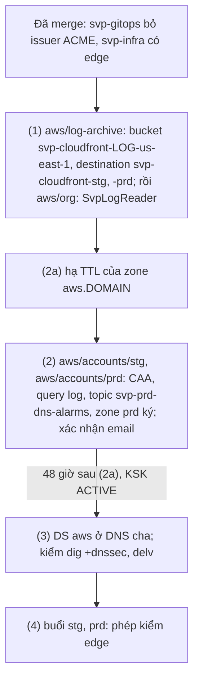

# Runbook: áp edge lần đầu (log CloudFront, CAA, DNSSEC)

Áp lần đầu phần sống lâu của edge: bucket log CloudFront và delivery destination ở account Log Archive, quyền đọc của `SvpLogReader`, bản ghi
`CAA` ở zone của hai env, DNSSEC và query log của zone prd cùng hai alarm `page`, rồi chuỗi tin cậy DNSSEC từ DNS cha. Phần sống theo buổi
(distribution, VPC origin, ALB, web ACL, cert ACM, bản ghi alias) do root `aws/envs/<env>` dựng và gỡ theo runbook buổi. Thiết kế:
[ADR-0061](https://github.com/anhnvcoder/svp-backend/blob/main/docs/adr/0061-edge-cloudfront-waf-acm.md) §8, §11, §12 và
[phụ lục](https://github.com/anhnvcoder/svp-backend/blob/main/docs/adr/appendix/0061-edge-cloudfront-waf-acm.md#11-dns).

**Người học chạy mọi lệnh ở đây.** AI không chạy lệnh nào chạm account, kể cả lệnh chỉ đọc; AI đọc output dán lại. Mọi lệnh chạy từ gốc repo
này (`infra/`) trừ chỗ ghi `cd`. Bước nào đỏ thì dừng ở đó, dán output, không đi tiếp. `<domain>` dưới đây là domain cha ở DNS cha
(Cloudflare): zone prd là `aws.<domain>`, zone stg là `stg.aws.<domain>`.

## Thứ tự áp lần đầu



| Bước | Root hay việc | Mục | Dán lại |
| --- | --- | --- | --- |
| (1) | `aws/log-archive`, rồi `aws/org` | [Bước (1)](#bước-1-log-cloudfront-và-quyền-đọc) | hai dòng `Plan:`, hai `Apply complete!`, `No changes.` của `aws/org`, output destination (che account) |
| (2a) | zone `aws.<domain>` | [Bước (2a)](#bước-2a-hạ-ttl-của-zone-prd) | danh sách bản ghi trước và sau, `INSYNC` |
| (2) | `aws/accounts/stg`, `aws/accounts/prd` | [Bước (2)](#bước-2-baseline-của-hai-account) | hai dòng `Plan:`, hai `Apply complete!`, `confirmed`, output `get-dnssec` |
| (3) | DNS cha | [Bước (3)](#bước-3-chuỗi-tin-cậy) | output từng lệnh kiểm |
| (4) | buổi | [Bước (4)](#bước-4-buổi-stg-prd) | phép kiểm edge của runbook buổi |

CAA chỉ cho CA của Amazon cấp cert, nên Let's Encrypt bị chặn từ bước (2): bước (2) chỉ chạy khi không cluster nào còn xin cert ACME (điều 1 của
mục dưới). Gỡ DNSSEC theo mục [Tắt ký DNSSEC](#tắt-ký-dnssec).

## Trước khi bắt đầu

1. **Code đã merge**: PR `svp-gitops` bỏ issuer ACME khỏi nền tảng eks và PR edge của repo này ở `main`; `git switch main && git pull --ff-only`
   trong bản clone này. Kiểm `svp-gitops` không còn ACME ở nền tảng eks (không in dòng nào):

   ```sh
   git -C ../gitops fetch origin && git -C ../gitops grep -n -i acme origin/main -- platforms/eks
   ```

2. **Giá trị ngoài repo** (git bỏ qua, không in giá trị):
   - Root env không còn biến `acme_email`: xoá dòng đó khỏi `aws/envs/stg/stg.auto.tfvars`, `aws/envs/prd/prd.auto.tfvars` (Terraform chỉ cảnh
     báo `Value for undeclared variable`), rồi đếm:

     ```sh
     sed -i '' '/^acme_email[[:space:]]*=/d' aws/envs/stg/stg.auto.tfvars aws/envs/prd/prd.auto.tfvars
     grep -c -E '^(hosted_zone_id|domain|alarm_email) ' aws/envs/stg/stg.auto.tfvars aws/envs/prd/prd.auto.tfvars   # 3 mỗi file
     ```

   - `aws/accounts/prd/prd.auto.tfvars`: thêm trong editor một dòng `alarm_email = "<email>"` (hộp thư của topic `svp-prd-dns-alarms`, dạng ở
     `prd.auto.tfvars.example`), rồi `grep -c '^alarm_email ' aws/accounts/prd/prd.auto.tfvars` in `1`.
3. **Chi phí liên tục**: từ bước (2), account prd giữ key KMS DNSSEC, key và topic của alarm DNSSEC, hai alarm, log query DNS cả khi không có
   buổi; bảng "Lúc không buổi" ở
   [phụ lục ADR-0061 §13](https://github.com/anhnvcoder/svp-backend/blob/main/docs/adr/appendix/0061-edge-cloudfront-waf-acm.md#13-chi-phí-edge).
4. **Trên máy**: Terraform 1.15, AWS CLI v2, `jq`, `dig`; `delv` (BIND 9) khi có. Profile `anhnv-log-ro` đã tạo
   ([`org-security-setup.md`](org-security-setup.md#bước-4-awsorg-đủ), bốn profile chỉ đọc).

## Mở terminal

```sh
cd infra
AWS_PROFILE=anhnv-sso aws sso login --region us-east-1      # cùng sso_session thì một lần cho mọi profile
export SVP_AWS_MGMT_ACCOUNT_ID=<12 số> SVP_AWS_LOG_ACCOUNT_ID=<12 số> SVP_AWS_SECURITY_ACCOUNT_ID=<12 số>
export SVP_AWS_STG_ACCOUNT_ID=<12 số> SVP_AWS_PRD_ACCOUNT_ID=<12 số>             # đọc trên trang SSO; không ghi vào file nào
export SVP_SESSION_DIR="$PWD/.session/$(date -u +%Y%m%dT%H%M%SZ)"                # check-account.sh ghi mốc ở đây
aws/scripts/check-account.sh mgmt
```

Tìm `ok    account <12 số> of mgmt, arn:aws:sts::<12 số>:assumed-role/AWSReservedSSO_…`. Mở lại terminal giữa chừng: đặt lại cả sáu biến.

## Bước (1): log CloudFront và quyền đọc

Delivery destination `svp-cloudfront-<env>` phải có trước buổi đầu của env: root `aws/envs/<env>` tạo delivery tới nó.

```sh
aws/scripts/check-account.sh mgmt
cd aws/log-archive
AWS_PROFILE=anhnv-sso TF_VAR_account_id="$SVP_AWS_MGMT_ACCOUNT_ID" TF_VAR_log_archive_account_id="$SVP_AWS_LOG_ACCOUNT_ID" \
  TF_VAR_security_account_id="$SVP_AWS_SECURITY_ACCOUNT_ID" TF_VAR_stg_account_id="$SVP_AWS_STG_ACCOUNT_ID" \
  TF_VAR_prd_account_id="$SVP_AWS_PRD_ACCOUNT_ID" \
  terraform plan -out=log-archive.tfplan
```

Mong đợi `Plan: 11 to add, 0 to change, 0 to destroy`: bảy tài nguyên `["cloudfront"]` của bucket (bucket, versioning, mã hoá, chặn public,
ownership, lifecycle, policy), hai `aws_cloudwatch_log_delivery_destination.cloudfront` và hai
`aws_cloudwatch_log_delivery_destination_policy.cloudfront` (`["stg"]`, `["prd"]`), mọi cái `region = "us-east-1"`. Có `change` hay `destroy`:
dừng, dán plan. Rồi:

```sh
AWS_PROFILE=anhnv-sso TF_VAR_account_id="$SVP_AWS_MGMT_ACCOUNT_ID" TF_VAR_log_archive_account_id="$SVP_AWS_LOG_ACCOUNT_ID" \
  TF_VAR_security_account_id="$SVP_AWS_SECURITY_ACCOUNT_ID" TF_VAR_stg_account_id="$SVP_AWS_STG_ACCOUNT_ID" \
  TF_VAR_prd_account_id="$SVP_AWS_PRD_ACCOUNT_ID" \
  terraform apply log-archive.tfplan && rm log-archive.tfplan
AWS_PROFILE=anhnv-sso terraform output -json cloudfront_delivery_destination_arns | sed -E 's/:[0-9]{12}:/:<log>:/g'
cd ../org
```

Output là hai ARN `arn:aws:logs:us-east-1:<log>:delivery-destination:svp-cloudfront-stg` và `…-prd`. Tiếp `aws/org`:

```sh
AWS_PROFILE=anhnv-sso TF_VAR_account_id="$SVP_AWS_MGMT_ACCOUNT_ID" terraform plan -out=org.tfplan
```

Mong đợi `Plan: 0 to add, 1 to change, 0 to destroy`, đúng `aws_ssoadmin_permission_set_inline_policy.log_reader` thêm
`svp-cloudfront-<log>-us-east-1` vào hai danh sách `Resource`. Khác thì dừng, dán plan. Rồi:

```sh
AWS_PROFILE=anhnv-sso TF_VAR_account_id="$SVP_AWS_MGMT_ACCOUNT_ID" terraform apply org.tfplan && rm org.tfplan
AWS_PROFILE=anhnv-sso TF_VAR_account_id="$SVP_AWS_MGMT_ACCOUNT_ID" terraform plan         # No changes.
cd ../..
AWS_PROFILE=anhnv-log-ro aws s3 ls "s3://svp-cloudfront-$SVP_AWS_LOG_ACCOUNT_ID-us-east-1/" --region us-east-1; echo "exit $?"
```

Lệnh cuối không in object nào (chưa buổi nào ghi log) và `exit 0`; `AccessDenied` là permission set chưa cập nhật: chờ vài phút,
đăng nhập lại rồi chạy lại lệnh cuối:

```sh
AWS_PROFILE=anhnv-log-ro aws sso login --region us-east-1
```

## Bước (2a): hạ TTL của zone prd

Route 53 khuyên trước khi ký: TTL lớn nhất của zone còn 1 giờ, hạ TTL và trường minimum của `SOA`, để đường lui không phải chờ bản ghi cũ hết hạn
trong cache
([Route 53: Enabling DNSSEC signing](https://docs.aws.amazon.com/Route53/latest/DeveloperGuide/dns-configuring-dnssec-enable-signing.html),
bước 1). Zone prd có `NS` ở đỉnh TTL 172 800 (Route 53 tạo, ngoài state) và `SOA` minimum 86 400; `NS` uỷ quyền stg không được ký (bản ghi ở
điểm uỷ quyền, RFC 4035 §2.2) nên giữ nguyên. Đọc hiện trạng:

```sh
aws/scripts/check-account.sh prd
zone_id=$(AWS_PROFILE=anhnv-prd terraform -chdir=aws/accounts/prd output -raw zone_id)
AWS_PROFILE=anhnv-prd aws route53 list-resource-record-sets --hosted-zone-id "$zone_id" --region us-east-1 \
  --query 'ResourceRecordSets[].[Name,Type,TTL]' --output text
```

Dựng lô đổi từ chính hai bản ghi ở đỉnh (`NS` TTL 3 600, `SOA` minimum 300), đọc lại, rồi gửi:

```sh
AWS_PROFILE=anhnv-prd aws route53 list-resource-record-sets --hosted-zone-id "$zone_id" --region us-east-1 --output json |
  jq --arg apex "aws.<domain>." '{Changes: [.ResourceRecordSets[] | select(.Name == $apex and (.Type == "NS" or .Type == "SOA"))
    | if .Type == "NS" then .TTL = 3600 else .ResourceRecords[0].Value |= (split(" ") | .[6] = "300" | join(" ")) end
    | {Action: "UPSERT", ResourceRecordSet: .}]}' > /tmp/svp-ttl.json
jq -c '.Changes[].ResourceRecordSet | [.Name, .Type, .TTL, [.ResourceRecords[].Value]]' /tmp/svp-ttl.json
change=$(AWS_PROFILE=anhnv-prd aws route53 change-resource-record-sets --hosted-zone-id "$zone_id" \
  --change-batch file:///tmp/svp-ttl.json --region us-east-1 --query ChangeInfo.Id --output text)
AWS_PROFILE=anhnv-prd aws route53 get-change --id "$change" --region us-east-1 --query ChangeInfo.Status --output text
date -u +%Y-%m-%dT%H:%M:%SZ | tee "$SVP_SESSION_DIR/ttl-lowered"
```

Lệnh `jq -c` phải in đúng hai dòng: `NS` với TTL 3600 và đủ bốn name server cũ trong mảng, `SOA` kết thúc bằng `86400` đã thành `300`; khác thì
không gửi.
`get-change` in `INSYNC` (chạy lại sau vài giây khi còn `PENDING`). Mốc trong `ttl-lowered` là gốc của 48 giờ chờ ở bước (3).

## Bước (2): baseline của hai account

stg chỉ thêm `CAA`:

```sh
aws/scripts/check-account.sh stg
cd aws/accounts/stg
AWS_PROFILE=anhnv-stg TF_VAR_account_id="$SVP_AWS_STG_ACCOUNT_ID" terraform plan -out=stg.tfplan
```

Mong đợi `Plan: 1 to add, 0 to change, 0 to destroy`, đúng `module.baseline.aws_route53_record.caa`. Rồi:

```sh
AWS_PROFILE=anhnv-stg TF_VAR_account_id="$SVP_AWS_STG_ACCOUNT_ID" terraform apply stg.tfplan && rm stg.tfplan
cd ../prd
```

prd thêm module `alarms`, nên `init` trước:

```sh
../../scripts/check-account.sh prd
AWS_PROFILE=anhnv-prd TF_VAR_account_id="$SVP_AWS_PRD_ACCOUNT_ID" terraform init -backend-config=../../backend-prd.hcl
AWS_PROFILE=anhnv-prd TF_VAR_account_id="$SVP_AWS_PRD_ACCOUNT_ID" terraform plan -out=prd.tfplan
```

Mong đợi `Plan: 15 to add, 0 to change, 0 to destroy`: bản ghi `caa`; 6 của DNSSEC (`aws_kms_key.dnssec[0]` và alias ở `us-east-1`,
`aws_route53_key_signing_key.this[0]` tên `svp_prd_ksk`, `aws_route53_hosted_zone_dnssec.this[0]` với `signing_status = "SIGNING"`, hai
`aws_cloudwatch_metric_alarm.dnssec`); 3 của query log (log group `/aws/route53/aws.<domain>`, resource policy, `aws_route53_query_log.this[0]`);
5 của `module.alarms` (key KMS, alias, topic `svp-prd-dns-alarms`, topic policy, subscription email), mọi cái `us-east-1` trừ bản ghi. Khác thì
dừng, dán plan. Rồi:

```sh
AWS_PROFILE=anhnv-prd TF_VAR_account_id="$SVP_AWS_PRD_ACCOUNT_ID" terraform apply prd.tfplan && rm prd.tfplan
date -u +%Y-%m-%dT%H:%M:%SZ | tee "$SVP_SESSION_DIR/zone-signed"
cd ../../..
```

**Xác nhận email**: mở link "Confirm subscription" của thư "AWS Notification - Subscription Confirmation" gửi tới `alarm_email`, rồi đọc (mong
`confirmed`; `PendingConfirmation` là chưa mở link):

```sh
AWS_PROFILE=anhnv-prd aws sns list-subscriptions-by-topic --region us-east-1 \
  --topic-arn "arn:aws:sns:us-east-1:$SVP_AWS_PRD_ACCOUNT_ID:svp-prd-dns-alarms" --query 'Subscriptions[].SubscriptionArn' --output text |
  sed -E 's/^arn:.*/confirmed/'
```

**Trạng thái ký, KSK, alarm, CAA:**

```sh
zone_id=$(AWS_PROFILE=anhnv-prd terraform -chdir=aws/accounts/prd output -raw zone_id)
AWS_PROFILE=anhnv-prd aws route53 get-dnssec --hosted-zone-id "$zone_id" --region us-east-1 \
  --query '{Signing:Status.ServeSignature,KSK:KeySigningKeys[].[Name,Status]}' --output json
AWS_PROFILE=anhnv-prd aws cloudwatch describe-alarms --alarm-name-prefix svp-prd-dnssec- --region us-east-1 \
  --query 'MetricAlarms[].[AlarmName,StateValue]' --output text
for z in aws.<domain> stg.aws.<domain>; do echo "== $z"; dig +short CAA "$z" @1.1.1.1 | sort; done
```

Mong `SIGNING`, KSK `svp_prd_ksk` `ACTIVE`; hai alarm `svp-prd-dnssec-internal-failure`, `svp-prd-dnssec-ksk-action-needed` ở `OK` hay
`INSUFFICIENT_DATA` (Route 53 gửi metric DNSSEC thưa, thiếu dữ liệu là bình thường); mỗi zone tám dòng `0 issue "…"`, `0 issuewild "…"` cho
`amazon.com`, `amazontrust.com`, `awstrust.com`, `amazonaws.com`. KSK ở trạng thái khác `ACTIVE`: runbook alarm KSK ở mục
[Alarm DNSSEC](#alarm-dnssec), không sang bước (3).

## Bước (3): chuỗi tin cậy

Resolver chỉ kiểm chữ ký của `aws.<domain>` khi `<domain>` đã ký, TLD có `DS` của `<domain>`, và zone `<domain>` có `DS` tên `aws` trỏ KSK của
zone prd. Theo thứ tự, mỗi mục đạt mới sang mục sau.

**3a. Domain cha đã ký.** Bật DNSSEC của `<domain>` ở Cloudflare (DNS → Settings → DNSSEC) và đặt `DS` nó đưa ra ở registrar của TLD là việc
một lần; kiểm:

```sh
dig +short DS <domain> @1.1.1.1
dig +dnssec SOA <domain> @1.1.1.1 | grep -E '^;; flags:'
```

Mong ít nhất một dòng `DS` và cờ `ad` trong dòng `flags`. Chưa có: làm việc một lần đó, chờ registry nhận (registrar có thể chỉ chèn `DS` theo
lịch), không đi tiếp.

**3b. Chờ.** Thêm `DS` chỉ khi đã qua 48 giờ (TTL `NS` cũ, 172 800 giây) kể từ mốc `ttl-lowered` và một giờ kể từ mốc `zone-signed`: cache của
resolver không còn bản ghi chưa ký nào của zone.

```sh
cat "$SVP_SESSION_DIR/ttl-lowered" "$SVP_SESSION_DIR/zone-signed"; date -u +%Y-%m-%dT%H:%M:%SZ
```

**3c. Lấy `DS`:**

```sh
aws/scripts/check-account.sh prd
zone_id=$(AWS_PROFILE=anhnv-prd terraform -chdir=aws/accounts/prd output -raw zone_id)
AWS_PROFILE=anhnv-prd aws route53 get-dnssec --hosted-zone-id "$zone_id" --region us-east-1 \
  --query 'KeySigningKeys[?Name==`svp_prd_ksk`].[Status,DSRecord]' --output text
```

Mong `ACTIVE` và giá trị `DSRecord` dạng `<key tag> 13 2 <digest hex>` (thuật toán 13 là ECDSA P-256 SHA-256, digest 2 là SHA-256).

**3d. Thêm `DS` ở DNS cha.** Cloudflare, DNS → Records của `<domain>` → Add record: **Type** `DS`, **Name** `aws`, **TTL** 5 min (300 giây,
lùi nhanh khi hỏng, theo hướng dẫn Route 53), **Key Tag**, **Algorithm**, **Digest Type**, **Digest** lần lượt là bốn trường của `DSRecord`.
Đã có `DS` `aws` (lần trước) thì sửa nó, không thêm cái thứ hai.

**3e. Kiểm lan truyền ở DNS cha**, rồi chờ thêm 10 phút và TTL `NS` lớn nhất (resolver chỉ thấy `DS` khi `NS` của zone trong cache hết hạn):

```sh
pns=$(dig +short NS <domain> | head -n 1)
dig +norec +short DS aws.<domain> @"$pns"                              # đúng giá trị DSRecord
dig +norec +noall +authority NS aws.<domain> @"$pns"                   # cột 2: TTL NS ở DNS cha
dig +noall +answer NS aws.<domain> @"$(dig +short NS aws.<domain> | head -n 1)"   # cột 2: 3600 sau bước (2a)
```

**3f. Kiểm resolver xác thực được**, cả zone stg vẫn phân giải (uỷ quyền không `DS`, không cờ `ad`, không lỗi):

```sh
for r in 1.1.1.1 8.8.8.8; do
  echo "== $r"
  dig +dnssec SOA aws.<domain> @"$r" | grep -E '^;; (flags|->>HEADER)'
  dig +dnssec SOA stg.aws.<domain> @"$r" | grep -E '^;; (flags|->>HEADER)'
done
delv @1.1.1.1 aws.<domain> SOA
```

Mong ở mỗi resolver: zone prd `status: NOERROR` và cờ `ad`; zone stg `status: NOERROR`, không `ad`. `delv` in `; fully validated`; `delv` báo
thiếu thuật toán hay không có trên máy: hai dòng `dig` đủ. `SERVFAIL` ở zone prd hay zone stg: làm ngay [đường lui](#đường-lui).

**3g. Theo dõi.** Route 53 khuyên theo dõi phân giải tới hai tuần; lặp lại 3f vài ngày một lần, đọc email alarm. Sau đó, tuỳ chọn, tăng TTL
của `DS` `aws` lên 1 giờ ở Cloudflare (đường lui khi đó chờ 1 giờ thay vì 5 phút).

## Bước (4): buổi stg, prd

Buổi theo [`session-stg.md`](session-stg.md) và [`session-prd.md`](session-prd.md); phép kiểm của edge ở mục
[Phép kiểm edge](session-stg.md#phép-kiểm-edge) của buổi stg, buổi prd chạy lại với prd.

## Alarm DNSSEC

Hai alarm ở `us-east-1`, gửi topic `svp-prd-dns-alarms`, cả hai `page` (zone prd có thể ngừng phân giải), mỗi alarm một runbook ở repo code:

| Alarm | Runbook |
| --- | --- |
| `svp-prd-dnssec-internal-failure` | [`dnssec-internal-failure.md`](https://github.com/anhnvcoder/svp-backend/blob/main/docs/runbooks/dnssec-internal-failure.md) |
| `svp-prd-dnssec-ksk-action-needed` | [`dnssec-ksk-action-needed.md`](https://github.com/anhnvcoder/svp-backend/blob/main/docs/runbooks/dnssec-ksk-action-needed.md) |

Runbook alarm sửa nguyên nhân (key KMS tắt hay chờ xoá, key policy, KSK) và trỏ về đường lui dưới khi zone đang không phân giải.

## Tắt ký DNSSEC

Zone ký mà DNS cha còn `DS` `aws` thì mọi thay đổi làm chữ ký sai (tắt ký, xoá KSK, mất key KMS) khiến resolver kiểm DNSSEC trả `SERVFAIL` cho cả
zone prd lẫn zone stg dưới nó. Thứ tự luôn là: gỡ `DS` ở cha, chờ TTL của nó, rồi mới tắt ký. Lý do của thiết kế:
[README module `account-baseline`, Tắt ký DNSSEC](../../aws/modules/account-baseline/README.md#tắt-ký-dnssec).

### Đường lui

1. Đọc TTL của `DS` (cột 2) trước khi gỡ:

   ```sh
   pns=$(dig +short NS <domain> | head -n 1)
   dig +norec +noall +answer DS aws.<domain> @"$pns"
   ```

2. Cloudflare, DNS → Records của `<domain>`: xoá bản ghi `DS` `aws`. Kiểm DNS cha không còn nó (không in dòng nào), rồi chờ 10 phút cộng TTL
   vừa đọc:

   ```sh
   dig +norec +short DS aws.<domain> @"$pns"
   ```

3. Tắt ký ở root `aws/accounts/prd`:

   ```sh
   aws/scripts/check-account.sh prd
   cd aws/accounts/prd
   AWS_PROFILE=anhnv-prd TF_VAR_account_id="$SVP_AWS_PRD_ACCOUNT_ID" terraform plan -var dnssec_signing=false -out=prd.tfplan
   ```

   Mong đợi `Plan: 0 to add, 1 to change, 0 to destroy`, đúng `module.baseline.aws_route53_hosted_zone_dnssec.this[0]` với `signing_status`
   `SIGNING` → `NOT_SIGNING`. Rồi:

   ```sh
   AWS_PROFILE=anhnv-prd TF_VAR_account_id="$SVP_AWS_PRD_ACCOUNT_ID" terraform apply prd.tfplan && rm prd.tfplan
   AWS_PROFILE=anhnv-prd aws route53 get-dnssec --region us-east-1 \
     --hosted-zone-id "$(AWS_PROFILE=anhnv-prd terraform output -raw zone_id)" --query Status.ServeSignature --output text
   cd ../../..
   ```

   Mong `NOT_SIGNING`; KSK vẫn `ACTIVE`, key KMS vẫn còn, nên ký lại chỉ cần apply với `dnssec_signing = true` rồi làm lại bước (3).
4. PR đổi `default` của biến `dnssec_signing` trong `aws/accounts/prd/variables.tf` thành `false`: lượt apply sau không ký lại. Ký lại về sau là
   PR ngược lại, rồi bước (3) từ 3b.
5. Kiểm hai zone phân giải lại: lệnh của 3f, mong `NOERROR` không `ad` ở cả hai.

### Gỡ hẳn

Hiếm, chỉ khi bỏ DNSSEC lâu dài, sau [đường lui](#đường-lui) (zone đã `NOT_SIGNING`). Key KMS có `prevent_destroy`, nên Terraform không bao giờ xoá
nó: bỏ key khỏi state trước, xoá phần còn lại bằng Terraform, rồi lên lịch xoá key bằng tay. Không bao giờ đặt `dnssec_enabled = false` khi key
còn trong state: plan lỗi ở `prevent_destroy`.

1. Bỏ key và alias khỏi state (vẫn còn ở AWS):

   ```sh
   aws/scripts/check-account.sh prd
   cd aws/accounts/prd
   AWS_PROFILE=anhnv-prd terraform state rm 'module.baseline.aws_kms_key.dnssec[0]' 'module.baseline.aws_kms_alias.dnssec[0]'
   ```

   Từ đây tới bước 2 không apply nào khác: config còn `dnssec_enabled = true` thì Terraform tạo key mới và thay KSK.
2. PR đổi `dnssec_enabled = true` thành `false` trong `aws/accounts/prd/main.tf`; sau khi merge, ở bản clone đã cập nhật:

   ```sh
   AWS_PROFILE=anhnv-prd TF_VAR_account_id="$SVP_AWS_PRD_ACCOUNT_ID" terraform plan -out=prd.tfplan
   ```

   Mong đợi `Plan: 0 to add, 0 to change, 4 to destroy`: `aws_route53_hosted_zone_dnssec.this[0]`, `aws_route53_key_signing_key.this[0]`
   (Terraform tắt DNSSEC của zone trước, rồi xoá KSK; provider tắt KSK đang `ACTIVE` trước khi xoá) và hai `aws_cloudwatch_metric_alarm.dnssec`.
   Có key KMS trong plan là bước 1 chưa chạy: dừng. Rồi:

   ```sh
   AWS_PROFILE=anhnv-prd TF_VAR_account_id="$SVP_AWS_PRD_ACCOUNT_ID" terraform apply prd.tfplan && rm prd.tfplan
   cd ../../..
   ```

3. Lên lịch xoá key qua alias của nó (`schedule-key-deletion` chỉ nhận id hay ARN):

   ```sh
   key=$(AWS_PROFILE=anhnv-prd aws kms describe-key --key-id alias/svp-dnssec --region us-east-1 --query KeyMetadata.KeyId --output text)
   AWS_PROFILE=anhnv-prd aws kms schedule-key-deletion --key-id "$key" --pending-window-in-days 30 --region us-east-1 \
     --query KeyState --output text
   ```

   Mong `PendingDeletion`. Huỷ được trong 30 ngày: `AWS_PROFILE=anhnv-prd aws kms cancel-key-deletion --key-id "$key" --region us-east-1`.
   Alias `alias/svp-dnssec` còn trỏ key tới khi key bị xoá; `sweep.sh prd` liệt kê nó ở mục alias của key chờ xoá.

## Khi một bước đỏ

- Lỗi ở `plan`: không gì đổi trên account; sửa nguyên nhân (biến terminal, `.auto.tfvars`, phiên SSO), chạy lại đúng bước.
- Lỗi giữa `apply`: phần đã tạo nằm trong state; `plan` lại chỉ còn phần chưa tạo. Dán lỗi và plan mới trước khi apply lại.
- Plan có `destroy` hay `-/+` ở zone, bucket, key có sẵn: dừng, không apply, dán plan.
- `SERVFAIL` ở zone prd hay stg sau bước (3): [đường lui](#đường-lui) ngay, rồi dán output của 3c, 3e, 3f.
