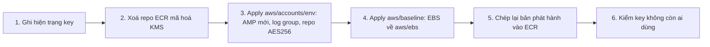

# Runbook: đưa ECR, AMP, log group ứng dụng và EBS về key của AWS

[Mục lục](README.md)

> **Tóm tắt**
>
> - **Làm gì:** áp lên account đang chạy phần code mà ở đó repo ECR mã hoá AES256, workspace AMP và log group `/svp/<env>/otel` dùng
>   key của dịch vụ, EBS mặc định dùng `aws/ebs`; sáu CMK `alias/svp-<env>-ecr`, `alias/svp-<env>-observability`, `alias/svp-ebs`
>   (stg, prd) thôi mã hoá dữ liệu mới, rồi kiểm từng key không còn gì dùng nó. Lý do và bảng key:
>   [ADR-0087](https://github.com/anhnvcoder/svp-backend/blob/main/docs/adr/0087-kms-key-consolidation.md).
> - **Khi nào và bao lâu:** một lần, giữa hai buổi, sau khi PR của code này merge; mỗi root một lượt plan, apply, plan lần hai, vài
>   phút. Lịch xoá key là PR sau, khi mọi phép kiểm ở [bước 6](#bước-6-kiểm-key-không-còn-ai-dùng) trống.
> - **Phí trong lúc chạy:** không tốn thêm. Sáu key vẫn tính $1 mỗi key-tháng tới khi PR sau lên lịch xoá chúng (key chờ xoá không
>   tính tiền); bản phát hành chép lại vào ECR ở bước 5 tính lưu trữ như trước.

**Người học chạy mọi lệnh ở đây.** AI không chạy lệnh nào chạm account, kể cả lệnh chỉ đọc; AI đọc output dán lại. Mọi lệnh chạy từ gốc repo
này (`infra/`) trừ chỗ ghi `cd`. Bước nào đỏ thì dừng ở đó, dán output, không đi tiếp.



Bước 2, 3 làm cho stg rồi cho prd; account nào chưa từng apply `aws/accounts/<env>` thì bỏ qua account đó.

## Điều kiện trước

- [ ] **Không buổi nào đang chạy**: buổi trước đã xong tới hai lượt `sweep.sh`. Workspace AMP được thay mới ở bước 3, root env của
  buổi đang mở sẽ trỏ vào workspace đã xoá.
- [ ] **Code trên `main`**: PR đổi key đã merge; `git switch main && git pull --ff-only` trong bản clone này.
- [ ] **Chấp nhận mất lịch sử metric**: workspace AMP không đổi được key, nên workspace mới bắt đầu trống (stg giữ 31 ngày, prd 150 ngày).
- [ ] **Không merge PR nào của `svp-backend`, `svp-frontend` có image** từ bước 2 tới hết bước 3: leg `ecr-copy` của lượt đó đỏ vì repo
  chưa có; chạy lại leg sau bước 3 là đủ.

## Mở terminal

```sh
cd infra
AWS_PROFILE=anhnv-sso aws --no-cli-pager sso login --region us-east-1   # one login per sso_session
printf 'stg …%s prd …%s\n' "${SVP_AWS_STG_ACCOUNT_ID: -4}" "${SVP_AWS_PRD_ACCOUNT_ID: -4}"
export SVP_SESSION_DIR="$PWD/.session/$(date -u +%Y%m%dT%H%M%SZ)"      # check-account.sh writes its marks here
mkdir -p "$SVP_SESSION_DIR"
```

Biến account nạp qua direnv từ `.envrc` ở thư mục chứa các clone
([Biến account và direnv](../reference/operations.md#biến-account-và-direnv)). Ví dụ dưới là stg; với prd thay `stg` bằng `prd`,
`anhnv-stg` bằng `anhnv-prd`, `SVP_AWS_STG_ACCOUNT_ID` bằng `SVP_AWS_PRD_ACCOUNT_ID`.

## Bước 1: ghi hiện trạng key

```sh
for a in svp-stg-ecr svp-stg-observability svp-ebs; do
  AWS_PROFILE=anhnv-stg-ro aws --no-cli-pager kms describe-key --key-id "alias/$a" --region ap-southeast-1 \
    --query 'KeyMetadata.[KeyId,KeyState]' --output text
done | tee "$SVP_SESSION_DIR/stg-keys.txt"
AWS_PROFILE=anhnv-stg-ro aws --no-cli-pager amp list-workspaces --alias svp-stg --region ap-southeast-1 \
  --query 'workspaces[].[workspaceId,status.statusCode]' --output text | tee "$SVP_SESSION_DIR/stg-amp.txt"
```

- **Mong đợi:** ba dòng `<key-id> Enabled`. File này giữ id của ba key cho đường cứu ở [Khi một bước đỏ](#khi-một-bước-đỏ). Rồi
  một dòng `<workspace-id> ACTIVE`: workspace cũ, bước 3 thay nó bằng workspace có id khác.
- **`AccessDeniedException` ở `aps:ListWorkspaces`:** permission set `SvpReadOnly` chưa có statement `ReadPrometheusWorkspaces`, tức
  `aws/org` chưa apply bản có nó. Apply `aws/org` trước
  ([`org-security-setup.md`, bước (4)](org-security-setup.md#bước-4-awsorg-đủ), mục 4b), hay chạy lệnh `list-workspaces` bằng
  `anhnv-stg` lần này.

## Bước 2: xoá repo ECR mã hoá KMS

Mã hoá của repo ECR không đổi được sau khi tạo; Terraform đổi bằng xoá rồi tạo lại, mà ECR từ chối xoá repo còn image
(`RepositoryNotEmpty`). Bước này xoá hẳn mọi repo còn mã hoá KMS: tám repo phát hành (bản gốc có chữ ký ở GHCR, bước 5 chép lại) và các
repo pull-through cache (upstream giữ bản gốc, `ecr-warm.sh` của buổi kế kéo lại). Đây là lệnh ghi.

```sh
aws/scripts/check-account.sh stg
AWS_PROFILE=anhnv-stg aws --no-cli-pager ecr describe-repositories --region ap-southeast-1 \
  --query 'repositories[?encryptionConfiguration.encryptionType==`KMS`].repositoryName' --output text | tr '\t' '\n' \
  | tee "$SVP_SESSION_DIR/stg-ecr-kms.txt"
```

- **Mong đợi:** tám dòng `svp-backend/…`, `svp-frontend/web` và các repo dưới `ghcr/`, `docker-hub/`, `quay/`, `k8s/`, `ecr-public/`.
- **Dừng** nếu có tên khác những tiền tố đó: dán danh sách.

```sh
while read -r r; do
  AWS_PROFILE=anhnv-stg aws --no-cli-pager ecr delete-repository --repository-name "$r" --force --region ap-southeast-1 \
    --query repository.repositoryName --output text
done < "$SVP_SESSION_DIR/stg-ecr-kms.txt"
```

- **Mong đợi:** mỗi repo một dòng tên của nó. Lệnh `describe-repositories` ở trên chạy lại in dòng trống.

## Bước 3: apply `aws/accounts/<env>`

**Bẫy:** đổi `encryption_type` của creation template ECR từ `KMS` sang `AES256` tại chỗ không xoá ARN key cũ. Ở provider AWS,
`kms_key` của template vừa Optional vừa Computed: code không đặt thì Terraform giữ giá trị trong state, plan chỉ hiện
`encryption_type = "KMS" -> "AES256"` kèm `# (1 unchanged attribute hidden)`, còn `after` của `terraform show -json` vẫn mang ARN key
ECR cũ. Template như vậy vẫn trỏ vào key sắp xoá. Cách chắc là tạo lại năm template bằng `-replace`: template mới không có
`kms_key`.

```sh
aws/scripts/check-account.sh stg
AWS_PROFILE=anhnv-stg TF_VAR_account_id="$SVP_AWS_STG_ACCOUNT_ID" \
  terraform -chdir=aws/accounts/stg init -backend-config=../../backend-stg.hcl
AWS_PROFILE=anhnv-stg terraform -chdir=aws/accounts/stg state list | grep creation_template
```

Lệnh `terraform` của bước này chạy từ gốc `infra/` bằng `-chdir`: đường dẫn trong lệnh (`-backend-config`, `stg.tfplan`) tính từ
`aws/accounts/stg`.

- **Mong đợi:** năm dòng `module.registry.aws_ecr_repository_creation_template.cache["…"]` (`docker-hub`, `ecr-public`, `ghcr`, `k8s`,
  `quay`): dùng lệnh `plan` có `-replace` ngay dưới. Không dòng nào (account chưa có template): dùng lệnh `plan` không `-replace`
  sau nó, cùng "Mong đợi" riêng của nó.

```sh
AWS_PROFILE=anhnv-stg \
TF_VAR_account_id="$SVP_AWS_STG_ACCOUNT_ID" \
TF_VAR_backup_account_id="$SVP_AWS_BACKUP_ACCOUNT_ID" \
  terraform -chdir=aws/accounts/stg plan -input=false -out=stg.tfplan \
    -replace='module.registry.aws_ecr_repository_creation_template.cache["docker-hub"]' \
    -replace='module.registry.aws_ecr_repository_creation_template.cache["ecr-public"]' \
    -replace='module.registry.aws_ecr_repository_creation_template.cache["ghcr"]' \
    -replace='module.registry.aws_ecr_repository_creation_template.cache["k8s"]' \
    -replace='module.registry.aws_ecr_repository_creation_template.cache["quay"]'
AWS_PROFILE=anhnv-stg terraform -chdir=aws/accounts/stg show -no-color stg.tfplan > "$SVP_SESSION_DIR/stg-plan.txt"
AWS_PROFILE=anhnv-stg terraform -chdir=aws/accounts/stg show -json stg.tfplan | jq -r '.resource_changes[]
  | select(.type == "aws_ecr_repository_creation_template")
  | [.address, (.change.actions | join(",")), (.change.after.encryption_configuration[0].kms_key // "no-key")] | @tsv'
```

- **Mong đợi:** `Plan: 15 to add, 3 to change, 7 to destroy.`, chỉ các tài nguyên sau:
  - `module.observability.aws_prometheus_workspace.this` và `aws_prometheus_workspace_configuration.this`: `must be replaced`
    (`kms_key_arn` thành `null`);
  - `module.observability.aws_cloudwatch_log_group.otel`: `updated in-place`, `kms_key_id` bỏ;
  - `module.observability.aws_kms_key.observability`: `updated in-place`, chỉ `policy` (mất statement `AccountUsesKeyThroughPrometheus`);
  - `module.registry.aws_ecr_repository.release["…"]`: tám `will be created`, `encryption_type = "AES256"`;
  - `module.registry.aws_ecr_repository_creation_template.cache["…"]`: năm `must be replaced`, `AES256`;
  - `module.registry.aws_iam_role_policy.template`: `updated in-place`, mất statement `EncryptWithEcrKey`.

  Lệnh `jq` in năm dòng `<địa chỉ template>  delete,create  no-key`: template mới không mang ARN key nào.
- **Dừng** (không apply, dán plan) nếu có `destroy` hay `replace` ở `aws_kms_key`, `aws_kms_alias`, bucket state, vault, zone, nếu
  dòng `jq` nào in ARN `arn:aws:kms:…`, hay plan khác danh sách trên.

```sh
AWS_PROFILE=anhnv-stg \
TF_VAR_account_id="$SVP_AWS_STG_ACCOUNT_ID" \
TF_VAR_backup_account_id="$SVP_AWS_BACKUP_ACCOUNT_ID" \
  terraform -chdir=aws/accounts/stg plan -input=false -out=stg.tfplan
AWS_PROFILE=anhnv-stg terraform -chdir=aws/accounts/stg show -no-color stg.tfplan > "$SVP_SESSION_DIR/stg-plan.txt"
AWS_PROFILE=anhnv-stg terraform -chdir=aws/accounts/stg show -json stg.tfplan | jq -r '.resource_changes[]
  | select(.type == "aws_ecr_repository_creation_template")
  | [.address, (.change.actions | join(",")), (.change.after.encryption_configuration[0].kms_key // "no-key")] | @tsv'
```

- **Account chưa có template:** chạy khối này thay cho khối có `-replace` ở trên. Mong đợi
  `Plan: 15 to add, 3 to change, 2 to destroy.`: cùng danh sách tài nguyên như trên, chỉ khác năm template là `will be created`
  (không phải `must be replaced`), và `jq` in năm dòng `<địa chỉ template>  create  no-key`. **Dừng** theo cùng luật; hai `destroy`
  còn lại là hai tài nguyên AMP.

Apply plan vừa đọc (của khối nào trong hai khối trên), rồi kiểm ba tài nguyên đã đổi:

```sh
AWS_PROFILE=anhnv-stg terraform -chdir=aws/accounts/stg apply -input=false stg.tfplan && rm aws/accounts/stg/stg.tfplan
AWS_PROFILE=anhnv-stg aws --no-cli-pager amp list-workspaces --alias svp-stg --region ap-southeast-1 \
  --query 'workspaces[].[workspaceId,status.statusCode]' --output text
AWS_PROFILE=anhnv-stg aws --no-cli-pager logs describe-log-groups --log-group-name-prefix /svp/stg/otel --region ap-southeast-1 \
  --query 'logGroups[].[logGroupName,kmsKeyId]' --output text
AWS_PROFILE=anhnv-stg aws --no-cli-pager ecr describe-repository-creation-templates --region ap-southeast-1 \
  --query 'repositoryCreationTemplates[].[prefix,encryptionConfiguration.encryptionType,encryptionConfiguration.kmsKey]' \
  --output text
```

- **Mong đợi:** đúng một workspace `ACTIVE` (id mới, khác id trong `stg-amp.txt` của bước 1); log group `/svp/stg/otel None`; năm
  template `<prefix> AES256 None`.

Plan lần hai, không `-replace` (giữ `-replace` thì template bị tạo lại lần nữa) và không `-out` (không để lại file plan):

```sh
AWS_PROFILE=anhnv-stg \
TF_VAR_account_id="$SVP_AWS_STG_ACCOUNT_ID" \
TF_VAR_backup_account_id="$SVP_AWS_BACKUP_ACCOUNT_ID" \
  terraform -chdir=aws/accounts/stg plan -input=false
```

- **Mong đợi:** `No changes.`.
- **Việc tay:** không. Buổi kế lấy id workspace mới từ output của root này như mọi buổi.

## Bước 4: apply `aws/baseline`

```sh
aws/scripts/check-account.sh mgmt
cd aws/baseline
AWS_PROFILE=anhnv-sso terraform init -backend-config=../backend.hcl
AWS_PROFILE=anhnv-sso \
TF_VAR_account_id="$SVP_AWS_MGMT_ACCOUNT_ID" \
TF_VAR_log_archive_account_id="$SVP_AWS_LOG_ACCOUNT_ID" \
TF_VAR_security_account_id="$SVP_AWS_SECURITY_ACCOUNT_ID" \
TF_VAR_backup_account_id="$SVP_AWS_BACKUP_ACCOUNT_ID" \
TF_VAR_stg_account_id="$SVP_AWS_STG_ACCOUNT_ID" \
TF_VAR_prd_account_id="$SVP_AWS_PRD_ACCOUNT_ID" \
  terraform plan -input=false -out=baseline.tfplan
AWS_PROFILE=anhnv-sso terraform show -no-color baseline.tfplan > "$SVP_SESSION_DIR/baseline-plan.txt"
```

- **Mong đợi:** `Plan: 0 to add, 0 to change, 2 to destroy.`: `module.stg.aws_ebs_default_kms_key.this[0]` và
  `module.prd.aws_ebs_default_kms_key.this[0]`. Hai `aws_kms_key` EBS và alias `alias/svp-ebs` không đổi.
- **Dừng** (không apply, dán plan) nếu plan khác.

```sh
AWS_PROFILE=anhnv-sso terraform apply -input=false baseline.tfplan && rm baseline.tfplan
cd ../..
ebs_default=$(AWS_PROFILE=anhnv-stg-ro aws --no-cli-pager ec2 get-ebs-default-kms-key-id --region ap-southeast-1 \
  --query KmsKeyId --output text)
printf '%s\n' "$ebs_default"
AWS_PROFILE=anhnv-stg-ro aws --no-cli-pager kms describe-key --key-id "$ebs_default" --region ap-southeast-1 \
  --query 'KeyMetadata.[KeyManager,Description]' --output text
```

- **Mong đợi:** ARN `arn:aws:kms:ap-southeast-1:<stg>:key/<id>`: EC2 trả ARN key của key AWS quản lý `aws/ebs` khi key đó đã có
  (`alias/aws/ebs` khi account chưa từng dùng nó), không phải id key `alias/svp-ebs` trong `stg-keys.txt` của bước 1. Rồi
  `AWS  Default key that protects my EBS volumes when no other key is defined`. prd tương tự với `anhnv-prd-ro`. Plan lần hai:
  `No changes.`.
- **Bẫy:** destroy `aws_ebs_default_kms_key` gọi `ResetEbsDefaultKmsKeyId`, mà SCP `svp-protect-baseline` chặn với mọi principal trừ
  `OrganizationAccountAccessRole`; root này đi qua đúng role đó nên được. Lệnh gõ tay bằng `anhnv-stg` thì bị từ chối và có thư
  `svp-security-denied-storage`.

## Bước 5: chép lại bản phát hành vào ECR

ECR chỉ nhận bản phát hành qua CI ([ADR-0062](https://github.com/anhnvcoder/svp-backend/blob/main/docs/adr/0062-ecr-registry-ci-oidc.md)
§3–§5), không đăng nhập ECR từ máy.

- **stg:** trước buổi stg kế, chạy một lượt phát hành mọi service của hai repo code; leg `ecr-copy` chép từng bản vào repo AES256 mới,
  PR promote stg đưa digest mới vào `svp-gitops`:

```sh
gh workflow run images.yml --repo anhnvcoder/svp-backend --ref main -f services=all
gh workflow run images.yml --repo anhnvcoder/svp-frontend --ref main -f services=all
```

- **Mong đợi:** hai lượt xanh, mọi leg `ecr-copy` xanh, PR promote stg merge. Rồi:

```sh
for r in gateway user-service video-service engagement-service feed-service media-worker dlq-replay; do
  printf '%s ' "$r"
  AWS_PROFILE=anhnv-stg-ro aws --no-cli-pager ecr describe-images --repository-name "svp-backend/${r}" --region ap-southeast-1 \
    --query 'length(imageDetails)' --output text
done
AWS_PROFILE=anhnv-stg-ro aws --no-cli-pager ecr describe-images --repository-name svp-frontend/web --region ap-southeast-1 \
  --query 'length(imageDetails)' --output text
```

- **Mong đợi:** mỗi repo số lớn hơn 0 (image, chữ ký, attestation đều là artifact của repo).
- **prd:** không làm gì thêm; bước promote prd của [buổi prd](session-prd.md#cổng-promote-prd-trước-mọi-lệnh-tốn-tiền) chép mọi bản
  sang ECR prd.
- **Cache:** `ecr-warm.sh` ở bước 11 của buổi kéo lại image bên thứ ba vào repo cache mới tạo theo template AES256.

## Bước 6: kiểm key không còn ai dùng

Chạy lúc PR lên lịch xoá key sẵn sàng. Log ghi trước bước 3 còn mã hoá bằng key observability tới hết retention của log group (stg 7
ngày, prd 30 ngày) sau bước 3: chạy bước này sau mốc đó, khi `SVP_SESSION_DIR` đã khác bước 1. Id key đọc lại từ alias ngay đây, không
dựa vào file của bước 1.

```sh
ecr=$(AWS_PROFILE=anhnv-stg-ro aws --no-cli-pager kms describe-key --key-id alias/svp-stg-ecr --region ap-southeast-1 \
  --query KeyMetadata.KeyId --output text)
obs=$(AWS_PROFILE=anhnv-stg-ro aws --no-cli-pager kms describe-key --key-id alias/svp-stg-observability --region ap-southeast-1 \
  --query KeyMetadata.KeyId --output text)
ebs=$(AWS_PROFILE=anhnv-stg-ro aws --no-cli-pager kms describe-key --key-id alias/svp-ebs --region ap-southeast-1 \
  --query KeyMetadata.KeyId --output text)
printf 'ecr %s\nobs %s\nebs %s\n' "$ecr" "$obs" "$ebs"
AWS_PROFILE=anhnv-stg-ro aws --no-cli-pager ecr describe-repositories --region ap-southeast-1 \
  --query 'repositories[?encryptionConfiguration.encryptionType==`KMS`].repositoryName' --output text
ebs_arn="arn:aws:kms:ap-southeast-1:${SVP_AWS_STG_ACCOUNT_ID}:key/${ebs}"
AWS_PROFILE=anhnv-stg-ro aws --no-cli-pager ec2 describe-volumes --region ap-southeast-1 \
  --query "Volumes[?KmsKeyId=='${ebs_arn}'].VolumeId" --output text
AWS_PROFILE=anhnv-stg-ro aws --no-cli-pager ec2 describe-snapshots --owner-ids self --region ap-southeast-1 \
  --query "Snapshots[?KmsKeyId=='${ebs_arn}'].SnapshotId" --output text
for k in "$ecr" "$obs" "$ebs"; do
  printf '%s grants ' "$k"
  AWS_PROFILE=anhnv-stg-ro aws --no-cli-pager kms list-grants --key-id "$k" --region ap-southeast-1 --query 'length(Grants)' --output text
done
```

- **Mong đợi:** ba dòng đầu là id key (không `None`); ba lệnh `describe-*` in dòng trống; mỗi key `0` grant. Repo ECR, workspace AMP
  và volume EBS dùng key qua grant, nên key không grant nào là key không tài nguyên nào của các dịch vụ đó còn dùng.
- **Kiểm thêm:** CloudTrail của account ghi mọi lời gọi KMS; lệnh sau in lời gọi gần nhất tới key observability (log group không dùng
  grant):

```sh
AWS_PROFILE=anhnv-stg-ro aws --no-cli-pager cloudtrail lookup-events --region ap-southeast-1 --max-results 5 \
  --lookup-attributes "AttributeKey=ResourceName,AttributeValue=arn:aws:kms:ap-southeast-1:${SVP_AWS_STG_ACCOUNT_ID}:key/${obs}" \
  --query 'Events[].[EventTime,EventName]' --output text
```

- **Mong đợi:** không dòng nào mới hơn mốc retention trên. Đủ cả hai env thì dán output để mở PR gỡ block của sáu key; apply PR đó
  lên lịch xoá key (30 ngày chờ).

## Khi một bước đỏ

| Lỗi | Nghĩa | Làm gì |
| --- | --- | --- |
| `RepositoryNotEmptyException` ở `aws_ecr_repository.release` | Repo phát hành còn image, bước 2 chưa xoá nó | Chạy lại bước 2 rồi plan lại |
| `RepositoryAlreadyExistsException` | Một lượt `ecr-copy` hay pull tạo lại repo giữa bước 2 và 3 | Xoá repo đó như bước 2, plan lại |
| Plan đòi tạo lại `aws_kms_key` hay xoá alias | Code không phải bản của `main` | Dừng, `git pull --ff-only`, plan lại |
| Một key lỡ vào `PendingDeletion` | Ai đó chạy `schedule-key-deletion`, hay một PR gỡ block quá sớm | `cancel-key-deletion` rồi `enable-key` bên dưới, trong 30 ngày chờ |

```sh
AWS_PROFILE=anhnv-stg aws --no-cli-pager kms cancel-key-deletion --key-id <key-id> --region ap-southeast-1
AWS_PROFILE=anhnv-stg aws --no-cli-pager kms enable-key --key-id <key-id> --region ap-southeast-1
```

Key `alias/svp-ebs` mang tag `Stack=security-baseline`, nhưng SCP `svp-protect-baseline` chỉ chặn `DisableKey`, `DisableKeyRotation`,
`PutKeyPolicy`, `ScheduleKeyDeletion` và sửa tag, alias: `CancelKeyDeletion`, `EnableKey` chạy được bằng `anhnv-stg`.
