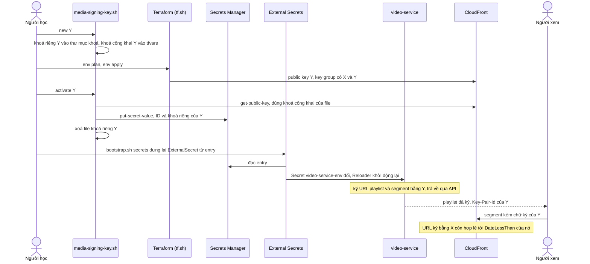

# Runbook: khoá ký URL media premium

[Mục lục](README.md)

> **Tóm tắt**
>
> - **Làm gì:** dựng khoá ký URL `premium/*` của distribution media cho một env, xoay sang ô kia, thay khoá bị lộ, dọn khoá riêng
>   trên máy.
> - **Khi nào và bao lâu:** lần đầu ở bước 7–10 của mỗi buổi stg hay prd (khoá đi cùng root env, bị gỡ cuối buổi); xoay khi muốn thay
>   khoá đang dùng; thay ngay khi khoá riêng lộ. Mỗi việc vài phút cộng một lượt `plan`, `apply` của root env.
> - **Phí trong lúc chạy:** không thêm: CloudFront public key, key group và URL ký không tính tiền (ADR-0073 §10); entry Secrets
>   Manager nằm trong phí của env.

Người xem chỉ đọc được object `premium/*` của bucket media qua distribution media bằng URL đã ký: distribution đòi chữ
ký ở mọi path ngoài hai tiền tố công khai `media/`, `preview/`. Distribution tin key group `svp-<env>-media` của module
[`media`](../../aws/modules/media/README.md): tối đa hai ô `a`, `b`, mỗi ô một CloudFront public key.
video-service ký bằng khoá riêng của ô đang dùng, đọc từ entry Secrets Manager `svp/<env>/media-signing` qua External Secrets (Secret
`svp/video-service-env`). Runbook này làm bốn việc: dựng khoá lần đầu của một env (mỗi buổi), xoay sang ô kia, thay khoá bị lộ, dọn. Thiết
kế: [ADR-0073](https://github.com/anhnvcoder/svp-backend/blob/main/docs/adr/0073-premium-playback.md) §5, §8; biến, output của root env
và lý do: mục [CloudFront signed URL và key group](../handbook/12-media-edge.md#cloudfront-signed-url-và-key-group) của chương 12.

**Người học chạy mọi lệnh ở đây.** AI không chạy lệnh nào chạm account hay cluster, kể cả lệnh chỉ đọc; AI đọc output dán lại. Bước nào
đỏ thì dừng ở đó, dán output, đọc [Khi một bước đỏ](#khi-một-bước-đỏ).

## Điều kiện trước

- [ ] Terminal của buổi đang chạy đã mở theo trang chủ buổi ([mục Mở terminal của buổi](session-stg.md#mở-terminal)): biến account và
      `SVP_SESSION_DIR` của buổi đó.
- [ ] `openssl` và `jq` có trên máy. Lần đầu của account không cần gì thêm: CloudFront public key, key group không có quota phải xin.
- [ ] Xoay khoá, khoá bị lộ: env đang chạy (sau bước 15 của buổi); ở prd tunnel tới API mở ([trang dựng của buổi prd, mục
      tunnel](session-prd-deploy.md#tunnel-tới-api-sau-bước-9-trước-bước-11)).
- [ ] Phép (d): bản clone repo code ở `../backend`.

## Mở terminal

Mọi lệnh chạy từ gốc repo này (`infra/`), trong terminal của buổi đang chạy. `new` đọc `timeline.tsv` của buổi để biết root env đã
apply chưa, nên thư mục buổi sai làm nó bỏ nhầm ô kia. Lệnh viết cho stg; ở prd thay `stg` bằng `prd`, `anhnv-stg` bằng `anhnv-prd`,
`svp-stg` bằng `svp-prd`, và mở tunnel tới API trước lệnh tới cluster.

```sh
aws/scripts/check-account.sh stg
echo "$SVP_SESSION_DIR"
```

- **Mong đợi:** dòng `ok    account <12 số> of stg, …` với đúng account stg; thư mục là thư mục của buổi đang chạy, nơi script buổi ghi
  `timeline.tsv`.
- **Bẫy:** `FAIL` ở dòng đầu thì dừng, không chạy gì nữa (phiên SSO hết hạn hay biến account sai).

## Script khoá ký

Mọi lệnh ghi khoá đi qua một script:

```sh
aws/scripts/media-signing-key.sh [--print] stg|prd new|activate a|b
```

| Lệnh | Làm gì |
| --- | --- |
| `new <ô>` | kiểm account; sinh khoá RSA 2048 vào `${XDG_STATE_HOME:-$HOME/.local/state}/svp/media-signing/<env>-<ô>.pem` (thư mục 700, file 600, ngoài repo); ghi khoá công khai vào ô đó của `aws/envs/<env>/media-signing.auto.tfvars.json` (git bỏ qua). Ô kia ở lại khi root env đã apply trong buổi này, bị bỏ khi chưa (đầu buổi) |
| `activate <ô>` | kiểm account; đọc ID của ô từ output `media_signing_key_ids` của root env; kiểm CloudFront giữ đúng khoá công khai của file dưới ID đó; ghi ID và khoá riêng vào entry `svp/<env>/media-signing` từ một file trong thư mục khoá; xoá file khoá riêng |
| `--print` | in mọi lệnh sẽ chạy, không chạy gì, không cần credential |

Không giá trị nào của khoá riêng hay của entry đi qua dòng lệnh, stdout hay stderr. Ô **đang dùng** là ô mà entry giữ: file khoá
riêng của nó đã bị `activate` xoá. Khoá riêng chỉ còn ở entry; mất entry thì sinh khoá mới (`new`), không có bản nào để khôi phục.

## Kiểm

Bốn phép kiểm, các mục dưới gọi theo số. Phép (c), (d) cần cluster (prd: tunnel mở).

(a) **ID trong key group**: key group giữ đúng các khoá của output root env.

```sh
AWS_PROFILE=anhnv-stg aws cloudfront list-key-groups --region ap-southeast-1 --output json \
  --query "KeyGroupList.Items[?KeyGroup.KeyGroupConfig.Name=='svp-stg-media'].KeyGroup.KeyGroupConfig.Items"
AWS_PROFILE=anhnv-stg terraform -chdir=aws/envs/stg output -json media_signing_key_ids
```

- **Mong đợi:** cùng một tập ID ở hai output (một ID đầu buổi, hai ID sau một lần xoay). ID là `Key-Pair-Id` của URL đã ký, không phải
  bí mật.

(b) **Entry có giá trị**, không in giá trị (chỉ đọc version):

```sh
AWS_PROFILE=anhnv-stg aws secretsmanager list-secret-version-ids --secret-id svp/stg/media-signing --region ap-southeast-1 \
  --query "Versions[?contains(VersionStages, 'AWSCURRENT')].[VersionId,CreatedDate]" --output text
```

- **Mong đợi:** một dòng, `VersionId` bằng `version` của dòng `ok entry svp/stg/media-signing: …` mà `activate` in.
- **Bẫy:** không dòng nào: entry chưa có giá trị (`activate` chưa chạy hay đỏ).

(c) **video-service khởi động lại với ô mới**: Secret của nó mang ID của ô vừa `activate`, mọi pod khởi động sau lúc đó.

```sh
AWS_PROFILE=anhnv-stg kubectl --context svp-stg -n svp get secret video-service-env -o jsonpath='{.data.MEDIA_SIGNING_KEY_ID}' | base64 -d; echo
AWS_PROFILE=anhnv-stg kubectl --context svp-stg -n svp rollout status deployment/video-service --timeout=10m
AWS_PROFILE=anhnv-stg kubectl --context svp-stg -n svp get pods -l app.kubernetes.io/name=video-service \
  -o custom-columns=NAME:.metadata.name,STARTED:.status.startTime
```

Lệnh đầu chỉ đọc khoá `MEDIA_SIGNING_KEY_ID` của Secret, không đọc `MEDIA_SIGNING_KEY`.

- **Mong đợi:** ID của ô vừa `activate` (output của (a)), dòng `successfully rolled out`, mọi `STARTED` sau thời điểm của `activate`.
  video-service đọc khoá lúc khởi động, nên pod khởi động sau lúc Secret đổi ký mọi URL bằng ô mới.

(d) **URL mới mang `Key-Pair-Id` của ô mới, CloudFront nhận chúng**:

```sh
make -C ../backend eks-premium-check CONTEXT=svp-stg DOMAIN="$(jq -r .domain "$SVP_SESSION_DIR/cluster-values.json")"
```

- **Mong đợi:** dòng cuối `ok every check of the premium edge`: segment ký bằng khoá hiện tại trả 200, các ca âm trả 403 (**Kiểm edge
  premium** của ADR-0073).
- **Việc tay:** mở một video premium có vé trên `https://<domain>`, DevTools → Network, query của một segment `.ts` có
  `Key-Pair-Id=<ID của ô mới>`.

## Lần đầu của một env

Root env và entry bị destroy cuối mỗi buổi, nên mỗi buổi dựng khoá lại từ đầu, trong chuỗi bước của trang chủ buổi ([bảng Thứ
tự](session-stg.md#thứ-tự); prd cùng số bước):

1. Bước 7, trước `plan` của root env: `aws/scripts/media-signing-key.sh stg new a`. Ô `b` của buổi trước (nếu có) bị bỏ khỏi file tfvars:
   khoá của nó đã đi cùng root env.
   - **Mong đợi:** `ok slot a: private key in … (owner only, not shown), public key in …media-signing.auto.tfvars.json (slots a)`; dòng
     `note slot b dropped …` là đúng ý.
2. Bước 8, 9: `plan`, `apply` của root env tạo public key `svp-stg-media-a-<8 hex>`, key group `svp-stg-media` và entry
   `svp/stg/media-signing` rỗng.
3. Bước 10, sau `apply`: `aws/scripts/media-signing-key.sh stg activate a`. Rồi phép (a), (b).
   - **Mong đợi:** `ok entry svp/stg/media-signing: key <ID> of slot a (not shown), version <id>; …pem deleted`.
   - **Bẫy:** `bootstrap.sh stg secrets` của bước 11 dừng khi entry chưa có giá trị: chạy bước này trước.
4. Sau bước 15 (Argo CD tạo ExternalSecret `video-service-env` từ entry): phép (c); phép (d) ở bước 16 ([mục Phép kiểm edge
   premium](session-stg-check-edge-media.md#phép-kiểm-edge-premium)).

## Xoay khoá ký

Thay khoá đang dùng mà không làm hỏng URL còn hạn: khoá mới vào key group trước, video-service chuyển sang nó, khoá cũ ở lại để URL
đã ký bằng nó chạy tới hạn. Gọi ô đang dùng là `X`, ô kia là `Y` (phép (a), (c) cho biết `X`). Env đang chạy (sau bước 15), prd thì
tunnel mở.



1. Khoá mới vào ô `Y`:

   ```sh
   aws/scripts/media-signing-key.sh stg new Y
   ```

   - **Mong đợi:** `ok slot Y: … (slots a b)`: hai ô đều ở file tfvars. `Y` còn khoá của lần xoay trước thì có thêm
     `warn slot Y … is replaced: …`: đúng ý, `Y` không phải ô đang dùng.
   - **Bẫy:** `FAIL …stg-Y.pem exists`: `Y` đã có khoá riêng chưa activate. Chạy phép (a): ID của `Y` có trong key group (đã `new` và
     `apply` trong buổi này, mục **Khoá bị lộ**, ô không dùng) thì bỏ bước 1–2, sang bước 3. Không có ID của `Y` (pem sót từ buổi trước,
     khoá của nó chưa vào key group) thì xoá nó rồi làm lại từ bước 1:

     ```sh
     rm -f "${XDG_STATE_HOME:-$HOME/.local/state}/svp/media-signing/stg-Y.pem"
     ```

2. Khoá công khai mới vào key group:

   ```sh
   aws/scripts/tf.sh stg env plan
   aws/scripts/tf.sh stg env apply
   ```

   - **Kiểm:** đọc file text của plan trước `apply`: chỉ `module.media.aws_cloudfront_public_key.media["Y"]` thêm (`Y` có khoá cũ: thêm
     khoá mới rồi xoá khoá cũ, `create_before_destroy`) và `module.media.aws_cloudfront_key_group.media` đổi tại chỗ; có tài nguyên khác
     thì dừng, dán plan.
   - **Mong đợi:** sau `apply`, phép (a) có hai ID: key group tin cả `X` lẫn `Y`, video-service vẫn ký bằng `X`.
3. Khoá riêng của `Y` vào entry:

   ```sh
   aws/scripts/media-signing-key.sh stg activate Y
   ```

   - **Mong đợi:** `ok entry svp/stg/media-signing: key <ID của Y> of slot Y (not shown), version <id>; …pem deleted`. Rồi phép (b).
4. video-service đọc entry mới:

   ```sh
   aws/scripts/bootstrap.sh stg secrets
   ```

   ExternalSecret của chart `svp-cluster` dùng `refreshPolicy: OnChange`, nên không tự đọc lại entry: lượt này dựng lại mọi ExternalSecret
   của client từ entry, Reloader khởi động lại video-service ([mục Đổi một secret của env đang chạy của trang chủ
   buổi](session-stg.md#đổi-một-secret-của-env-đang-chạy)).
   - **Mong đợi:** cùng các dòng `ok` của mục đó. Rồi phép (c), (d).
5. URL ký bằng `X` còn chạy tới hạn của chúng. Hạn là bội nhỏ nhất của 900 s không sớm hơn lúc ký + độ dài video + 5 phút (**Hạn chữ ký**
   của ADR-0073 §5), nên sớm hơn lúc ký + độ dài video + 20 phút. Pod cuối ký bằng `X` dừng lúc `rollout status` của phép (c) xong; độ dài
   tối đa là `MaxDuration` của `services/media-worker/internal/transcode/probe.go` ở repo code. Vậy URL cuối ký bằng `X` hết hạn trước mốc
   đó + `MaxDuration` + 20 phút. `X` ở lại key group tới lần xoay sau; lần xoay sau thay khoá của `X`, nên không bắt đầu trước mốc này.

Thứ tự này là cách xoay của CloudFront: thêm khoá mới vào key group, đổi khoá ký, giữ khoá cũ tới khi URL ký bằng nó hết hạn
([Specify signers](https://docs.aws.amazon.com/AmazonCloudFront/latest/DeveloperGuide/private-content-trusted-signers.html)).

## Khoá bị lộ

Lộ là khoá riêng ra khỏi thư mục khoá hay entry (chép, in, commit, gửi đi), hay nghi vậy. Thay ngay ô lộ: apply gỡ khoá công khai cũ
khỏi key group, mọi URL đã ký bằng nó hỏng (403), kể cả của người có vé: chấp nhận (ADR-0073 §8). Gọi ô lộ là `X`.

**`X` là ô đang dùng** (phép (a), (c)):

```sh
aws/scripts/media-signing-key.sh stg new X
aws/scripts/tf.sh stg env plan
aws/scripts/tf.sh stg env apply
aws/scripts/media-signing-key.sh stg activate X
aws/scripts/bootstrap.sh stg secrets
```

Chạy liền nhau: từ `apply` tới khi video-service khởi động lại xong, video-service còn ký bằng khoá đã bị gỡ nên segment premium trả
403 (vài phút). Plan như bước 2 của **Xoay khoá ký** với `X` thay cho `Y` (thêm khoá mới, xoá khoá cũ của `X`). `activate X` rồi
`bootstrap.sh stg secrets` đưa khoá mới của `X` tới video-service.

- **Mong đợi:** dòng `warn slot X … is replaced` của `new` nhắc đúng hai lệnh cuối. Rồi phép (a) (ID của `X` đã đổi), (b), (c), (d).
- **Bẫy:** không activate ô kia: nó không còn file khoá riêng (`activate` của nó đã xoá file), lệnh dừng ở `FAIL no …pem`.

**`X` không phải ô đang dùng** (ô cũ sau một lần xoay):

```sh
aws/scripts/media-signing-key.sh stg new X
aws/scripts/tf.sh stg env plan
aws/scripts/tf.sh stg env apply
```

Không `activate`: video-service vẫn ký bằng ô đang dùng. Khoá riêng mới của `X` ở lại thư mục khoá (chưa activate), nên lần xoay sau sang
`X` bắt đầu ở bước 3 của **Xoay khoá ký**.

- **Mong đợi:** phép (a): ID của `X` đã đổi.

## Gỡ

- **Thư mục khoá**: sau `activate`, file khoá riêng của ô đó không còn. Đọc (không in nội dung file nào):

  ```sh
  ls -l "${XDG_STATE_HOME:-$HOME/.local/state}/svp/media-signing/"
  ```

  Mong rỗng, hay chỉ `<env>-<ô>.pem` của ô vừa `new` mà chưa activate (mục **Khoá bị lộ**, ô không dùng). Khoá riêng sót từ một
  `new` không có `apply` sau nó (buổi bỏ dở) làm `new` lần sau của ô đó dừng với `FAIL …pem exists`; file tạm `entry.*`, `tfvars.*`
  chỉ sót khi script bị giết giữa chừng. Xoá đúng file đó (ví dụ ô `a` của stg):

  ```sh
  rm -f "${XDG_STATE_HOME:-$HOME/.local/state}/svp/media-signing/stg-a.pem"
  ```

- **Cuối buổi**: destroy root env xoá public key, key group và entry (`recovery_window_in_days = 0`, không chặn buổi
  sau), nhưng không xoá khoá riêng ở máy này: đọc lại thư mục khoá ở trên và xoá `<env>-<ô>.pem` còn lại (lệnh `rm -f`
  như trên). File `aws/envs/<env>/media-signing.auto.tfvars.json` ở lại (git bỏ qua, chỉ khoá công khai); `new a` của
  buổi sau bỏ ô `b` của nó.
- **Sót**: `sweep.sh <env>` liệt kê key group `svp-<env>-media` và public key `svp-<env>-media-*` còn lại là sót; xoá sau
  distribution media theo mục [Lệnh xoá tay theo loại](session-stg.md#lệnh-xoá-tay-theo-loại) của `session-stg.md` (key group trước,
  rồi public key).

## Khi một bước đỏ

| Dòng đỏ | Nghĩa | Làm |
| --- | --- | --- |
| `FAIL … is inside …: a private key never sits in the repository` | `XDG_STATE_HOME` trỏ vào trong repo | Đặt `XDG_STATE_HOME` ra ngoài repo, chạy lại |
| `FAIL …<env>-<ô>.pem exists` (lúc `new`) | Ô đó có khoá riêng chưa activate | Bẫy của bước 1, **Xoay khoá ký** |
| `FAIL no …pem` (lúc `activate`) | Ô đã là ô đang dùng, hay chưa `new` | Phép (a), (c) để biết ô đang dùng; khoá mới thì `new`, `plan`, `apply`, rồi `activate` |
| `FAIL terraform output media_signing_key_ids …` | Root env chưa apply | `tf.sh <env> env plan`, `apply`, rồi `activate` lại |
| `FAIL slot <ô> has no key in output …` | `apply` sau `new` chưa chạy | `tf.sh <env> env plan`, `apply`, rồi `activate` lại |
| `FAIL CloudFront public key … is not the public key of …` | Key group còn khoá cũ của ô: `apply` sau `new` chưa chạy | Như dòng trên |
| `bootstrap.sh <env> secrets` dừng vì entry rỗng | `activate` chưa chạy hay đỏ | Bước 3 của **Lần đầu của một env**, rồi phép (b) |
| Phép (d) có segment ký bằng khoá hiện tại trả 403 | video-service chưa khởi động lại sau `activate` | `bootstrap.sh <env> secrets`, rồi phép (c), (d) |
