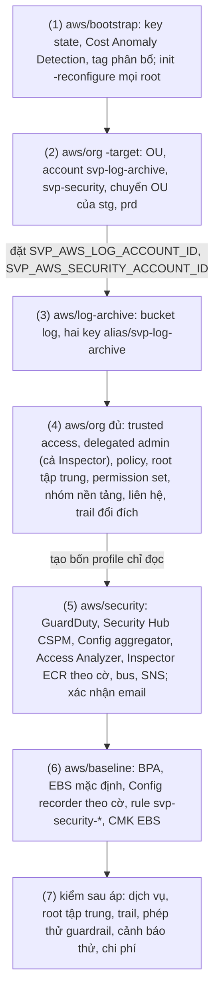

# Runbook: áp nền bảo mật cấp org lần đầu

Áp lần đầu nền bảo mật của tổ chức AWS theo AWS Security Reference Architecture: hai account mới `svp-log-archive`, `svp-security`, OU
`Security`, `Workloads/Prod`, `Workloads/NonProd`, policy của tổ chức, root tập trung, permission set chỉ đọc, dịch vụ phát hiện (cả Amazon
Inspector quét ECR của account thành viên), baseline của mọi account của tổ chức (bảng "Áp gì ở account nào" của
[README `aws/baseline`](../../aws/baseline/README.md#áp-gì-ở-account-nào)); rồi kiểm dịch vụ bật, guardrail chặn đúng và cảnh báo tới email.
Security Hub CSPM, AWS Config recorder và Inspector ECR của từng account theo cờ của
[`aws/paid-features.json`](../../aws/paid-features.json) ([ADR-0071](https://github.com/anhnvcoder/svp-backend/blob/main/docs/adr/0071-paid-features.md));
mong đợi dưới đây tính theo file của repo, nơi chỉ stg tắt ba dịch vụ đó. Đổi cờ sau khi đã áp: [`paid-features.md`](paid-features.md).
Thiết kế: [ADR-0059](https://github.com/anhnvcoder/svp-backend/blob/main/docs/adr/0059-org-structure-guardrails.md) (account, OU, policy, root
tập trung, permission set, baseline), [ADR-0060](https://github.com/anhnvcoder/svp-backend/blob/main/docs/adr/0060-org-detection-logging.md)
(phát hiện, log, cảnh báo, chi phí) và [ADR-0062](https://github.com/anhnvcoder/svp-backend/blob/main/docs/adr/0062-ecr-registry-ci-oidc.md)
§10 (Inspector). Tổ chức đã áp trước khi có Inspector: thêm nó theo [`platform-setup.md`](platform-setup.md#thứ-tự-áp-lần-đầu), bước (1), (2).
Account `svp-backup` và Backup policy thêm sau runbook này, theo [`backup-setup.md`](backup-setup.md#thứ-tự-áp-lần-đầu).

**Người học chạy mọi lệnh ở đây.** AI không chạy lệnh nào chạm account, kể cả lệnh chỉ đọc; AI đọc output dán lại. Lệnh `plan`, `apply` và
mong đợi của từng plan nằm ở README của root; runbook này giữ thứ tự, điểm dừng và phần kiểm sau áp. Mọi lệnh chạy từ gốc repo này (`infra/`)
trừ chỗ ghi `cd`. Bước nào đỏ thì dừng ở đó, dán output, không đi tiếp.

## Thứ tự áp lần đầu



| Bước | Root | Hướng dẫn | Dán lại |
| --- | --- | --- | --- |
| (1) | `aws/bootstrap` | [README mục 5](../../aws/bootstrap/README.md#5-áp-thay-đổi-khi-state-đã-ở-bucket) | dòng `Plan:`, `Apply complete!`, `No changes.` của plan cuối |
| (2) | `aws/org` (`-target`) | [README, Bước (2)](../../aws/org/README.md#bước-2-tổ-chức-ou-account) | **plan đủ** (điểm dừng), `Apply complete!`, hai id đã che bớt |
| (3) | `aws/log-archive` | [README, Apply lần đầu](../../aws/log-archive/README.md#apply-lần-đầu) | dòng `Plan:`, `Apply complete!`, số bucket và key của output |
| (4) | `aws/org` (đủ) | [README, Bước (4)](../../aws/org/README.md#bước-4-đủ-root) | **plan đủ** (điểm dừng), `Apply complete!`, `No changes.`, `get-trail-status` |
| (5) | `aws/security` | [README, Apply](../../aws/security/README.md#apply-bước-5-của-thứ-tự-áp-lần-đầu) | dòng `Plan:`, `Apply complete!`, output mục "Kiểm nhanh" |
| (6) | `aws/baseline` | [README, Apply lần đầu](../../aws/baseline/README.md#apply-lần-đầu) | output mục "Kiểm cái đã có", dòng `Plan:`, `Apply complete!` |
| (7) | — | [Bước (7)](#bước-7-kiểm-sau-áp) | output từng mục |

## Trước khi bắt đầu

1. **Code trên `main`**: `git switch main && git pull --ff-only` trong bản clone này. Các root `aws/log-archive`, `aws/security`,
   `aws/baseline` và thay đổi của `aws/org`, `aws/bootstrap` đã merge.
2. **Giá trị ngoài repo** (không commit, mỗi file tạo từ `.example` cùng thư mục):
   - `aws/org/org.auto.tfvars`: `account_emails` với hai khoá mới `log-archive`, `security`, mỗi khoá một email chưa account AWS nào dùng, kể
     cả account đã đóng hay `SUSPENDED`; `security_contact`; `sso_user_name`, `sso_region` (README `aws/org`, mục Chuẩn bị).
   - `aws/security/security.auto.tfvars`: `security_alert_email`, hộp thư nhận mọi cảnh báo bảo mật.
   - `aws/baseline/baseline.auto.tfvars`: `sso_region` bằng giá trị của `org.auto.tfvars`.
3. **Chi phí liên tục**: từ bước (5) dịch vụ phát hiện tính tiền mỗi tháng ở mọi account của tổ chức, kể cả khi không có buổi; bước (1),
   (3), (6) thêm KMS key. Đọc bảng ở [ADR-0060 §12](https://github.com/anhnvcoder/svp-backend/blob/main/docs/adr/0060-org-detection-logging.md#12-chi-phí-liên-tục)
   và [phụ lục](https://github.com/anhnvcoder/svp-backend/blob/main/docs/adr/appendix/0060-org-detection-logging.md#12-chi-phí-liên-tục).
   Inspector tính theo digest image được quét ở registry của account env (không có registry thì $0):
   [ADR-0062 §11](https://github.com/anhnvcoder/svp-backend/blob/main/docs/adr/0062-ecr-registry-ci-oidc.md#11-chi-phí-registry).
   Account có cờ `off` không trả phần đó:
   [bảng tháng không buổi của ADR-0071](https://github.com/anhnvcoder/svp-backend/blob/main/docs/adr/appendix/0071-paid-features.md#bảng-tháng-không-buổi).
   Budget tổng của org phải đủ cho khoản đó cộng các buổi: lệnh đọc ở cuối mục [Mở terminal](#mở-terminal) (cần biến và phiên SSO của mục đó).
4. **Phụ thuộc buổi**: từ khi code này ở `main`, root `aws/envs/stg`, `aws/envs/prd` ghi flow log và log WAF vào bucket của `svp-log-archive`
   và cần `SVP_AWS_LOG_ACCOUNT_ID`. Buổi stg, prd chỉ chạy được sau khi bước (1)–(3) đã áp.

## Mở terminal

```sh
cd infra
AWS_PROFILE=anhnv-sso aws sso login --region us-east-1
export SVP_AWS_MGMT_ACCOUNT_ID=<12 số> SVP_AWS_STG_ACCOUNT_ID=<12 số> SVP_AWS_PRD_ACCOUNT_ID=<12 số>   # đọc trên trang SSO; không ghi vào file nào
export SVP_SESSION_DIR="$PWD/.session/$(date -u +%Y%m%dT%H%M%SZ)"                                      # check-account.sh ghi mốc ở đây
aws/scripts/check-account.sh mgmt
```

Tìm `ok    account <12 số> of mgmt, arn:aws:sts::<12 số>:assumed-role/AWSReservedSSO_…`. Từ bước (2) thêm hai biến
`SVP_AWS_LOG_ACCOUNT_ID`, `SVP_AWS_SECURITY_ACCOUNT_ID`. Mở lại terminal giữa chừng: đặt lại mọi biến của khối trên và hai biến của bước
(2), rồi chạy lại `check-account.sh mgmt`.
Mọi lệnh ghi của bước (1)–(6) chạy bằng `anhnv-sso` (root `aws/log-archive`, `aws/security`, `aws/baseline` vào account đích qua
`OrganizationAccountAccessRole`); trước mỗi bước, chạy lại `check-account.sh mgmt`.

Budget tổng của org (điều 3 của mục Trước khi bắt đầu):

```sh
AWS_PROFILE=anhnv-sso aws budgets describe-budget --account-id "$SVP_AWS_MGMT_ACCOUNT_ID" --budget-name svp-monthly --region us-east-1 \
  --query 'Budget.BudgetLimit' --output text
```

Hạn mức thấp hơn ước của ADR cộng chi phí buổi trong tháng: đổi `budget_limit_usd` của `aws/bootstrap/bootstrap.auto.tfvars` trước bước (1).

## Cái đã có trước khi áp

Lần đọc hiện trạng trước thiết kế (ADR-0059, mục Bối cảnh) không thấy dịch vụ bảo mật nào bật tay. Tổ chức, OU `Workloads`, `svp-stg`, `svp-prd`
đã ở state `aws/org`; policy type SCP, RCP đã bật và `aws/org` giữ chúng trong danh sách. OU `Production`, `Development` (hai account demo đã
đóng) ở ngoài Terraform ([README `aws/org`, OU ngoài Terraform](../../aws/org/README.md#ou-ngoài-terraform)). Ba chỗ có thể đổi từ lần đọc đó tới
lúc áp, mỗi chỗ có lệnh đọc và lệnh nhập vào state ở README của root:

| Có thể đã có | Đọc ở bước | Hướng dẫn nhập vào state |
| --- | --- | --- |
| Tổ chức chưa ở state (root dựng lại từ đầu) | (2) | [README `aws/org`, Chuẩn bị](../../aws/org/README.md#chuẩn-bị) |
| Monitor Cost Anomaly Detection do AWS tự tạo | (1) | [README `aws/bootstrap`, mục 5](../../aws/bootstrap/README.md#5-áp-thay-đổi-khi-state-đã-ở-bucket) |
| `AWSServiceRoleForConfig`, recorder Config | (6) | [README `aws/baseline`, Kiểm cái đã có](../../aws/baseline/README.md#2-kiểm-cái-đã-có) |

## Bước (1): `aws/bootstrap`

```sh
aws/scripts/check-account.sh mgmt
cd aws/bootstrap
```

Theo [README mục 5](../../aws/bootstrap/README.md#5-áp-thay-đổi-khi-state-đã-ở-bucket): kiểm monitor và tag, plan, apply, sinh lại
`aws/backend.hcl` (lần đầu có `kms_key_id`), `terraform init -reconfigure` ở mọi root dùng nó, kể cả ba root mới. Tag `Env` chưa có trong dữ
liệu billing thì `apply` lỗi ở đúng tag đó; thứ tự áp không đổi (README, mục Tag phân bổ chi phí). `cd ../..` về `infra/` khi xong.

## Bước (2): `aws/org`, chỉ tổ chức, OU, account

**Điểm dừng.** Tạo account gần như không đảo ngược được: đóng account chờ 90 ngày, email không dùng lại được.

```sh
aws/scripts/check-account.sh mgmt
cd aws/org
```

Theo [README, Bước (2)](../../aws/org/README.md#bước-2-tổ-chức-ou-account): plan có `-target`, **dán plan đủ và chờ đọc cùng** trước khi
apply; rồi apply file plan, đặt `SVP_AWS_LOG_ACCOUNT_ID`, `SVP_AWS_SECURITY_ACCOUNT_ID` từ output. Lỗi email đã dùng: đổi email trong
`org.auto.tfvars`, không sửa code. Dán hai id đã che bớt (4 số cuối). `cd ../..` khi xong.

## Bước (3): `aws/log-archive`

```sh
aws/scripts/check-account.sh mgmt
cd aws/log-archive
```

Theo [README, Apply lần đầu](../../aws/log-archive/README.md#apply-lần-đầu). Từ đây buổi stg, prd chạy được (mục Phụ thuộc buổi ở trên).
`cd ../..` khi xong.

## Bước (4): `aws/org` đủ

**Điểm dừng.** Plan này gắn SCP, RCP, declarative policy, tag policy lên root của tổ chức và đổi đích trail: đọc cùng trước khi apply.

```sh
aws/scripts/check-account.sh mgmt
cd aws/org
```

Theo [README, Bước (4)](../../aws/org/README.md#bước-4-đủ-root): plan, đọc, apply, plan lần hai `No changes.`, `get-trail-status`. Delegated
admin và cấu hình tổ chức của dịch vụ có thể mất vài phút mới nhận: lỗi kiểu đó thì chờ rồi chạy lại đúng bước này. `cd ../..` khi xong.

**Bốn profile chỉ đọc**, ngay sau bước này (bước (5), (6), (7) dùng chúng): `anhnv-stg-ro`, `anhnv-prd-ro`, `anhnv-security-ro` (`SvpReadOnly`),
`anhnv-log-ro` (`SvpLogReader`), theo [README `aws/org`, Profile](../../aws/org/README.md#profile). Dán bốn dòng `get-caller-identity`, che
account: `Arn` là `AWSReservedSSO_SvpReadOnly_…` ở ba profile đầu, `AWSReservedSSO_SvpLogReader_…` ở `anhnv-log-ro`.

## Bước (5): `aws/security`

**Điểm dừng chi phí.** Từ apply này GuardDuty, Security Hub CSPM, Config tính tiền mỗi tháng (mục Trước khi bắt đầu, điều 3). Áp khi đã chọn
thời điểm.

```sh
aws/scripts/check-account.sh mgmt
cd aws/security
```

Theo [README, Apply](../../aws/security/README.md#apply-bước-5-của-thứ-tự-áp-lần-đầu): giá trị cá nhân, plan, apply, **xác nhận email SNS**
(thư "AWS Notification - Subscription Confirmation" tới `security_alert_email`), kiểm nhanh. Root đọc cờ `security_hub`, `inspector_ecr`:
account `off` gắn policy `svp-security-off`, không có liên kết Inspector, và có rule `svp-security-guardduty-findings` giữ email finding
GuardDuty của nó (mục Cờ chi phí của [README `aws/security`](../../aws/security/README.md#cờ-chi-phí)). `cd ../..` khi xong.

## Bước (6): `aws/baseline`

```sh
aws/scripts/check-account.sh mgmt
cd aws/baseline
```

Theo [README, Apply lần đầu](../../aws/baseline/README.md#apply-lần-đầu): kiểm cái đã có, plan, apply. Apply có thể sinh vài email
`svp-security-detection` (recorder, delivery channel mới); thiếu email ở account hay region nào cũng chưa phải lỗi: rule có thể được tạo sau
recorder trong cùng apply. Account có cờ `config_recording` `off` không có recorder, delivery channel ở hai region (mục Cờ chi phí của
[README `aws/baseline`](../../aws/baseline/README.md#cờ-chi-phí)). Lần đầu, (5) đi trước (6) với cờ của file; đổi cờ sau đó theo thứ tự của
[`paid-features.md`](paid-features.md#thứ-tự-apply-cờ). Đường cảnh báo kiểm ở [7e](#7e-cảnh-báo-thử). `cd ../..` khi xong.

## Bước (7): kiểm sau áp

Chạy sau bước (6) ít nhất 30 phút (GuardDuty, Security Hub nhận account có sẵn có thể tới 24 giờ: mục nào chưa đủ thì đọc lại hôm sau). Lệnh
chỉ đọc trừ phép thử guardrail. Dán output từng mục; che 8 số đầu của account ID.

### 7a. Dịch vụ bật

GuardDuty, publishing destination, Access Analyzer, cấu hình tập trung của Security Hub, nguồn aggregator Config: lệnh và mong đợi ở
[README `aws/security`, Kiểm nhanh](../../aws/security/README.md#6-kiểm-nhanh). Thêm:

```sh
AWS_PROFILE=anhnv-sso aws organizations list-delegated-services-for-account --account-id "$SVP_AWS_SECURITY_ACCOUNT_ID" --region us-east-1 \
  --query 'DelegatedServices[].ServicePrincipal' --output text
R="$(AWS_PROFILE=anhnv-sso terraform -chdir=aws/org output -raw root_id)"
for t in SERVICE_CONTROL_POLICY RESOURCE_CONTROL_POLICY DECLARATIVE_POLICY_EC2 TAG_POLICY; do
  AWS_PROFILE=anhnv-sso aws organizations list-policies-for-target --target-id "$R" --filter "$t" --region us-east-1 \
    --query 'Policies[].Name' --output text
done
AWS_PROFILE=anhnv-sso aws organizations list-policies-for-target --filter SERVICE_CONTROL_POLICY --region us-east-1 --query 'Policies[].Name' \
  --target-id "$(AWS_PROFILE=anhnv-sso terraform -chdir=aws/org output -json organizational_unit_ids | jq -r .Prod)" --output text
AWS_PROFILE=anhnv-security-ro aws securityhub list-members --region ap-southeast-1 --query 'Members[].[AccountId,MemberStatus]' --output text
```

Mong: principal của GuardDuty, Security Hub, `config.amazonaws.com`, `config-multiaccountsetup.amazonaws.com`, Access Analyzer, Inspector
(`inspector2.amazonaws.com`; trạng thái quét của từng account ở phần Inspector của "Kiểm nhanh" trên: chỉ ECR, mọi account thành viên
`ACTIVE` trừ `svp-security` và account có `inspector_ecr` `off` là thành viên `ENABLED`); ở root
`FullAWSAccess` với năm SCP `svp-*` (danh sách ở README [`org-policies`](../../aws/modules/org-policies/README.md)), `RCPFullAWSAccess` với
`svp-data-perimeter`, `svp-ec2-baseline`, `svp-tags`; ở OU `Prod` `FullAWSAccess` với `svp-prod-guardrails`; mỗi account `ACTIVE` của tổ
chức trừ `svp-security`, kể cả management, một member Security Hub `Enabled` (danh sách account: lệnh `list-accounts` ở bước 4 của mục
[Gỡ có chủ đích](../../aws/org/README.md#gỡ-có-chủ-đích) của README `aws/org`); account có `security_hub` `off` không `Enabled` (policy
`svp-security-off` tắt Security Hub ở đó).

Chuẩn Security Hub và recorder Config của từng account, hai region (`anhnv-sso` là management; `svp-log-archive` hiện qua member Security Hub
và nguồn aggregator ở trên):

```sh
for p in anhnv-sso anhnv-security-ro anhnv-stg-ro anhnv-prd-ro; do
  for r in ap-southeast-1 us-east-1; do
    echo "== $p $r"
    AWS_PROFILE=$p aws securityhub get-enabled-standards --region $r \
      --query 'StandardsSubscriptions[].[StandardsArn,StandardsStatus]' --output text
    AWS_PROFILE=$p aws configservice describe-configuration-recorders --region $r \
      --query 'ConfigurationRecorders[].[name,recordingMode.recordingFrequency]' --output text
    AWS_PROFILE=$p aws configservice describe-configuration-recorder-status --region $r \
      --query 'ConfigurationRecordersStatus[].[name,recording,lastStatus]' --output text
  done
done
```

Mong mỗi cặp: hai chuẩn `…/aws-foundational-security-best-practices/v/1.0.0`, `…/cis-aws-foundations-benchmark/v/5.0.0` ở `READY`; recorder
`CONTINUOUS`; trạng thái `True SUCCESS`. Trừ account có cờ `off` (`anhnv-stg-ro` với file của repo): `security_hub` `off` thì
`get-enabled-standards` không in chuẩn nào hay báo lỗi `InvalidAccessException` (account không bật Security Hub); `config_recording` `off`
thì hai lệnh Config không in gì. Lỗi quyền ở một profile chỉ đọc: dán lệnh và lỗi, đó cũng là kết quả kiểm của permission set.

Control FAILED ban đầu, theo control (đầu vào của việc sửa sau, không phải lỗi của bước này):

```sh
AWS_PROFILE=anhnv-security-ro aws securityhub get-findings --region ap-southeast-1 --output text \
  --filters '{"ComplianceStatus":[{"Value":"FAILED","Comparison":"EQUALS"}],"RecordState":[{"Value":"ACTIVE","Comparison":"EQUALS"}]}' \
  --query 'Findings[].Compliance.SecurityControlId' | tr '\t' '\n' | sort | uniq -c | sort -rn
```

Dán cả danh sách, cùng điểm "Security score" ở trang Summary của Security Hub trên console của `svp-security` (profile `anhnv-security-ro`).

Rule `svp-security-admin-sso` phải ở đúng region của Identity Center (`sso_region` của `org.auto.tfvars`), không thì nó im lặng:

```sh
AWS_PROFILE=anhnv-sso aws events describe-rule --name svp-security-admin-sso --region <sso_region> --query State --output text
```

Mong `ENABLED`; `ResourceNotFoundException` là `sso_region` của `baseline.auto.tfvars` sai.

### 7b. Root tập trung

```sh
AWS_PROFILE=anhnv-sso aws iam list-organizations-features --region us-east-1 --query 'EnabledFeatures' --output text
for id in "$SVP_AWS_LOG_ACCOUNT_ID" "$SVP_AWS_SECURITY_ACCOUNT_ID" "$SVP_AWS_STG_ACCOUNT_ID" "$SVP_AWS_PRD_ACCOUNT_ID"; do
  (
    creds=$(AWS_PROFILE=anhnv-sso aws sts assume-root --target-principal "$id" --region ap-southeast-1 \
      --task-policy-arn arn=arn:aws:iam::aws:policy/root-task/IAMAuditRootUserCredentials \
      --query 'Credentials.[AccessKeyId,SecretAccessKey,SessionToken]' --output text) || exit 1
    read -r AWS_ACCESS_KEY_ID AWS_SECRET_ACCESS_KEY AWS_SESSION_TOKEN <<<"$creds"
    export AWS_ACCESS_KEY_ID AWS_SECRET_ACCESS_KEY AWS_SESSION_TOKEN
    unset AWS_PROFILE
    printf '%s password: ' "${id: -4}"; aws iam get-login-profile --region us-east-1 2>&1 | grep -q NoSuchEntity && echo none || echo PRESENT
    printf '%s access keys: ' "${id: -4}"; aws iam list-access-keys --region us-east-1 --query 'length(AccessKeyMetadata)' --output text
    printf '%s mfa: ' "${id: -4}"; aws iam list-mfa-devices --region us-east-1 --query 'length(MFADevices)' --output text
  )
done
```

Mong `RootCredentialsManagement RootSessions`; mỗi account `none`, `0`, `0`. Credential của phiên root chỉ nằm trong subshell, không in ra.
Mỗi `assume-root` sinh một email `svp-security-root-session` (mục 7e). `PRESENT` hay số khác `0`: dọn theo
[`break-glass.md`](break-glass.md#dọn-sau-khi-dùng).

### 7c. Trail

`get-trail-status` ở [README `aws/org`, Bước (4)](../../aws/org/README.md#bước-4-đủ-root). Thêm, sau bước (4) ít nhất một giờ:

```sh
O="$(AWS_PROFILE=anhnv-sso terraform -chdir=aws/org output -raw organization_id)"
AWS_PROFILE=anhnv-log-ro aws s3 ls "s3://svp-cloudtrail-$SVP_AWS_LOG_ACCOUNT_ID-ap-southeast-1/AWSLogs/$O/" --region ap-southeast-1 |
  awk '{print substr($2, 9)}'
AWS_PROFILE=anhnv-sso aws s3api list-objects-v2 --bucket "svp-cloudtrail-$SVP_AWS_MGMT_ACCOUNT_ID-ap-southeast-1" --region ap-southeast-1 \
  --query 'max_by(Contents, &LastModified).LastModified' --output text
```

Mong một dòng mỗi account `ACTIVE` của tổ chức, kể cả management (4 số cuối và `/`; danh sách account như mục 7a): log mới của mọi account vào
bucket Log Archive, đọc được bằng
`SvpLogReader` (quyền `kms:Decrypt` qua S3 chưa được thử ở lệnh này; đọc một object bằng `aws s3 cp … -` khi cần). Lệnh sau là lần ghi cuối vào
bucket trail cũ của management: trước lúc apply bước (4) cộng vài phút giao log, không mới hơn.

### 7d. Phép thử guardrail

Mỗi probe là một lệnh mà guardrail phải từ chối, chọn sao cho không đổi gì nếu guardrail hỏng (`--dry-run`, giá trị đang có, user tạm có lệnh
xoá viết sẵn). Chạy bằng `SvpAdmin`: `anhnv-stg`, probe Spot bằng `anhnv-prd`. Lệnh bị từ chối phải nói `explicit deny in a service control
policy`. Lỗi EC2 chỉ có `Encoded authorization failure message` thì giải mã, mong `"explicitDeny":true`:

```sh
AWS_PROFILE=anhnv-stg aws sts decode-authorization-message --encoded-message <chuỗi> --region ap-southeast-1 --query DecodedMessage --output text |
  jq -c '{allowed, explicitDeny}'
```

**Lệnh không bị từ chối: dừng, chạy lệnh hoàn tác viết sẵn ngay dưới nó, dán output.** Đó là lỗi của guardrail, sửa bằng PR, không thử tiếp.

| Probe | Policy chặn | Từ chối mong đợi | Email (rule) |
| --- | --- | --- | --- |
| `iam create-user` | `svp-deny-iam-users` | `AccessDenied` | `svp-security-denied-iam` |
| `s3control put-public-access-block` | `svp-protect-baseline` | `AccessDenied` | `svp-security-denied-storage` |
| `ec2 disable-ebs-encryption-by-default --dry-run` | `svp-protect-baseline` | `UnauthorizedOperation` | `svp-security-denied-storage` |
| `kms disable-key-rotation` (CMK EBS) | `svp-protect-baseline` | `AccessDeniedException` | `svp-security-denied-storage` |
| `events disable-rule` (`svp-security-trail`) | `svp-protect-baseline` | `AccessDeniedException` | `svp-security-alert-rules` |
| `ec2 run-instances --dry-run` Spot ở prd | `svp-prod-guardrails` | `UnauthorizedOperation` | không bắt buộc |
| `ec2 get-*` (đọc) | `svp-ec2-baseline` | không từ chối; giá trị do declarative policy đặt | không |

```sh
aws/scripts/check-account.sh stg
```

IAM user (hoàn tác chỉ khi lệnh tạo thành công):

```sh
U="svp-scp-probe-$(date -u +%y%m%d)"
AWS_PROFILE=anhnv-stg aws iam create-user --user-name "$U" --region us-east-1
AWS_PROFILE=anhnv-stg aws iam delete-user --user-name "$U" --region us-east-1        # hoàn tác
```

S3 Block Public Access cấp account, đúng bốn cờ `true` đang có (không cần hoàn tác):

```sh
AWS_PROFILE=anhnv-stg aws s3control put-public-access-block --account-id "$SVP_AWS_STG_ACCOUNT_ID" --region ap-southeast-1 \
  --public-access-block-configuration BlockPublicAcls=true,IgnorePublicAcls=true,BlockPublicPolicy=true,RestrictPublicBuckets=true
AWS_PROFILE=anhnv-stg aws s3control get-public-access-block --account-id "$SVP_AWS_STG_ACCOUNT_ID" --region ap-southeast-1 --output text
```

EBS mã hoá mặc định (`DryRunOperation` là guardrail hỏng; `--dry-run` không đổi gì):

```sh
AWS_PROFILE=anhnv-stg aws ec2 disable-ebs-encryption-by-default --dry-run --region ap-southeast-1
AWS_PROFILE=anhnv-stg aws ec2 get-ebs-encryption-by-default --region ap-southeast-1 --output text
AWS_PROFILE=anhnv-stg aws ec2 get-ebs-default-kms-key-id --region ap-southeast-1 --output text
```

Mong sau lệnh bị từ chối: `True`; key mặc định là ARN của key `alias/svp-ebs` của stg (lệnh dưới in ARN đó).

CMK EBS (API không nhận alias: lấy ARN trước; không thử `disable-key`, `schedule-key-deletion`: guardrail hỏng thì volume mới hỏng):

```sh
K="$(AWS_PROFILE=anhnv-stg aws kms describe-key --key-id alias/svp-ebs --region ap-southeast-1 --query KeyMetadata.Arn --output text)"
AWS_PROFILE=anhnv-stg aws kms disable-key-rotation --key-id "$K" --region ap-southeast-1
AWS_PROFILE=anhnv-stg aws kms enable-key-rotation --key-id "$K" --region ap-southeast-1                       # hoàn tác
AWS_PROFILE=anhnv-stg aws kms get-key-rotation-status --key-id "$K" --region ap-southeast-1 --query KeyRotationEnabled --output text
```

Mong `True` ở dòng cuối.

Rule cảnh báo (probe của dịch vụ API JSON, mã `AccessDeniedException`):

```sh
AWS_PROFILE=anhnv-stg aws events disable-rule --name svp-security-trail --region ap-southeast-1
AWS_PROFILE=anhnv-stg aws events enable-rule --name svp-security-trail --region ap-southeast-1                # hoàn tác
AWS_PROFILE=anhnv-stg aws events describe-rule --name svp-security-trail --region ap-southeast-1 --query State --output text
```

Mong `ENABLED` ở dòng cuối.

Spot ở prd (`--dry-run`: không instance nào được tạo dù guardrail hỏng; `DryRunOperation` là guardrail hỏng):

```sh
aws/scripts/check-account.sh prd
AMI="$(AWS_PROFILE=anhnv-prd aws ssm get-parameter --name /aws/service/ami-amazon-linux-latest/al2023-ami-kernel-default-arm64 \
  --region ap-southeast-1 --query Parameter.Value --output text)"
AWS_PROFILE=anhnv-prd aws ec2 run-instances --dry-run --image-id "$AMI" --instance-type t4g.nano --region ap-southeast-1 \
  --instance-market-options MarketType=spot --metadata-options HttpTokens=required
```

Lỗi khác hai mã trên (ví dụ account không có VPC mặc định): dán lại, không kết luận.

Declarative policy EC2 (chỉ đọc, ở stg):

```sh
for c in get-instance-metadata-defaults get-serial-console-access-status get-snapshot-block-public-access-state \
  get-image-block-public-access-state; do
  AWS_PROFILE=anhnv-stg aws ec2 "$c" --region ap-southeast-1 --output json
done
```

Mong `HttpTokens` `required`, `HttpPutResponseHopLimit` `1`; serial console `false`; snapshot `block-all-sharing`; AMI
`block-new-sharing`; mỗi kết quả có `ManagedBy` `declarative-policy`. Giá trị đủ ở
[ADR-0059 §5](https://github.com/anhnvcoder/svp-backend/blob/main/docs/adr/0059-org-structure-guardrails.md#5-declarative-policy-ec2).

### 7e. Cảnh báo thử

Finding mẫu GuardDuty mức HIGH ở `svp-stg`: finding đi về delegated admin ở `svp-security`, rồi tới email: qua aggregator Security Hub và
rule `svp-security-findings` khi cờ `security_hub` của stg là `always`, qua rule `svp-security-guardduty-findings` khi `off`.

```sh
D="$(AWS_PROFILE=anhnv-stg aws guardduty list-detectors --region ap-southeast-1 --query 'DetectorIds[0]' --output text)"
AWS_PROFILE=anhnv-stg aws guardduty create-sample-findings --detector-id "$D" --region ap-southeast-1 \
  --finding-types 'CryptoCurrency:EC2/BitcoinTool.B!DNS'
```

Trong 30 phút sau phép thử guardrail và lệnh trên, hộp thư `security_alert_email` phải có (thư SNS của topic `svp-security-alarms`, mỗi thư một
dòng có tên sự kiện hay tiêu đề finding, account, region và URL runbook
[`security-alert.md`](https://github.com/anhnvcoder/svp-backend/blob/main/docs/runbooks/security-alert.md)):

- năm thư của năm probe chặn ở mục 7d, theo cột Email của bảng; probe Spot, declarative không bắt buộc;
- bốn thư `AssumeRoot` của mục 7b (rule `svp-security-root-session` của management);
- một thư finding `[SAMPLE] …` mức HIGH của account stg (rule `svp-security-findings`, hay `svp-security-guardduty-findings` khi
  `security_hub` của stg là `off`).

Finding của Inspector vào Security Hub như GuardDuty nhưng không tới email (rule `svp-security-findings` chỉ lọc GuardDuty, Access Analyzer):
đọc chúng ở phép kiểm (a) của mục [Phép kiểm nền tảng managed](session-stg.md#phép-kiểm-nền-tảng-managed) của runbook buổi (account có
`inspector_ecr` `always`).

Dán danh sách tiêu đề và giờ nhận, cùng nguyên văn một thư (che account). Thiếu thư nào: đọc lại subscription (README `aws/security`, mục
5), rồi dán lệnh của probe đó và giờ chạy; rule nguồn, account, region theo phụ lục
[ADR-0060 §10](https://github.com/anhnvcoder/svp-backend/blob/main/docs/adr/appendix/0060-org-detection-logging.md#10-đường-cảnh-báo).
Finding mẫu ở lại tới khi GuardDuty tự xoá (90 ngày); đổi trạng thái nó theo runbook `security-alert.md`.

### 7f. Chi phí sau 1 và 7 ngày

Cost Explorer có dữ liệu sau ~24 giờ. Sau 1 ngày và sau 7 ngày kể từ bước (5), theo dịch vụ, cả org:

```sh
AWS_PROFILE=anhnv-sso aws ce get-cost-and-usage --region us-east-1 --granularity DAILY --metrics UnblendedCost \
  --time-period Start=<ngày áp bước 5, yyyy-mm-dd>,End=<hôm nay, yyyy-mm-dd> --group-by Type=DIMENSION,Key=SERVICE \
  --filter '{"Dimensions":{"Key":"SERVICE","Values":["Amazon GuardDuty","AWS Security Hub","AWS Config","AWS Key Management Service","Amazon Simple Storage Service","AWS CloudTrail"]}}' \
  --query 'ResultsByTime[].[TimePeriod.Start, Groups[].[Keys[0], Metrics.UnblendedCost.Amount]]' --output text
```

So với [ADR-0060 §12](https://github.com/anhnvcoder/svp-backend/blob/main/docs/adr/0060-org-detection-logging.md#12-chi-phí-liên-tục). Trong 30
ngày dùng thử GuardDuty và Security Hub ghi $0: đọc chi phí ước sau dùng thử ở trang "Usage" của GuardDuty và Security Hub trên console của
`svp-security`, dán cả hai. Monitor, subscription Cost Anomaly Detection và trạng thái tag phân bổ: hai lệnh đọc ở
[README `aws/bootstrap`, mục 5](../../aws/bootstrap/README.md#5-áp-thay-đổi-khi-state-đã-ở-bucket), mong monitor `svp-services` và ba tag
`Active` (`Env` chỉ sau buổi stg hay prd đầu tiên).

## Khi một bước đỏ

- Lỗi ở `plan`: không có gì đổi trên account; đọc lỗi, sửa nguyên nhân (biến terminal, file `.auto.tfvars`, phiên SSO), chạy lại đúng bước.
- Lỗi giữa `apply`: phần đã tạo nằm trong state; `plan` lại cùng root chỉ còn phần chưa tạo. Dán lỗi và plan mới trước khi apply lại.
- Plan có `destroy` hay `-/+` ở tổ chức, account, bucket hay key có sẵn: dừng, không apply, dán plan.
- Mất đường vào (Identity Center hỏng, phiên SSO không đăng nhập được): [`break-glass.md`](break-glass.md).
