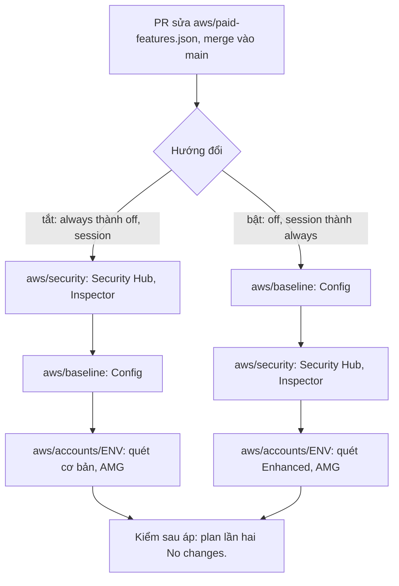

# Runbook: đổi cờ chi phí của một account

Đổi giá trị một cờ chi phí (dịch vụ AWS tốn tiền mà hệ thống không cần để chạy) của một account, rồi áp các root đọc cờ đó theo đúng thứ tự.
Cờ của mọi account nằm ở file commit [`aws/paid-features.json`](../../aws/paid-features.json); module
[`paid-features`](../../aws/modules/paid-features/README.md) kiểm giá trị (cờ nào, giá trị nào, account nào đặt được) và trả cờ cho các root.
Thiết kế và lý do: [ADR-0071](https://github.com/anhnvcoder/svp-backend/blob/main/docs/adr/0071-paid-features.md); chi phí tháng không buổi,
mỗi buổi của từng giá trị:
[bảng tháng không buổi](https://github.com/anhnvcoder/svp-backend/blob/main/docs/adr/appendix/0071-paid-features.md#bảng-tháng-không-buổi);
plan xoá, sửa gì khi đổi từng cờ, mất gì và giá lúc bật lại:
[Đổi cờ](https://github.com/anhnvcoder/svp-backend/blob/main/docs/adr/appendix/0071-paid-features.md#đổi-cờ) của phụ lục.

**Người học chạy mọi lệnh ở đây.** AI không chạy lệnh nào chạm account, kể cả lệnh chỉ đọc; AI đọc output dán lại. Mọi lệnh chạy từ gốc repo
này (`infra/`) trừ chỗ ghi `cd`. Bước nào đỏ thì dừng ở đó, dán output, không đi tiếp. Cũng là runbook áp lần đầu file của repo lên tổ chức
đã áp khi mọi dịch vụ còn bật.

## Cờ và root

| Cờ | Root đọc cờ | Tài nguyên đổi khi đổi cờ |
| --- | --- | --- |
| `managed_grafana` | `aws/accounts/<env>` | workspace AMG `svp-<env>`, role `svp-<env>-grafana` và policy, hai gán nhóm, service account `svp-grafana-operator`, tham số SSM `/svp/<env>/grafana-workspace-id` |
| `inspector_ecr` | `aws/security`, `aws/accounts/<env>` | liên kết thành viên và enabler `members` của Inspector; cấu hình quét của registry (`ENHANCED`, `CONTINUOUS_SCAN` hay `BASIC`, `SCAN_ON_PUSH`) |
| `security_hub` | `aws/security` | policy `svp-security-off` và association của account, rule `svp-security-guardduty-findings` hai region và đích của nó, role `svp-security-guardduty-forwarder` |
| `config_recording` | `aws/baseline` | recorder, delivery channel, recorder status ở hai region trong module của account |

Không cờ nào chạm KMS key, bucket, vault, recovery point hay log group. Guardrail lõi (CloudTrail, GuardDuty, Access Analyzer, policy của tổ
chức, budget, AWS Backup) không có cờ: [ADR-0071 §8](https://github.com/anhnvcoder/svp-backend/blob/main/docs/adr/0071-paid-features.md#8-không-bao-giờ-tắt).

## Thứ tự apply cờ



Chỉ áp root đọc cờ đã đổi (bảng trên), theo thứ tự của hướng đổi; root không đọc cờ nào đã đổi thì bỏ qua. Lý do: control của Security Hub là
rule Config, nên recorder phải ghi trước khi Security Hub bật lại và còn ghi tới khi Security Hub đã tắt; bật, tắt quét ECR của Inspector tự
đổi kiểu quét của registry giữa Enhanced và Basic, nên `aws/accounts/<env>` đi sau để đặt lại cấu hình quét
([ADR-0071 §10](https://github.com/anhnvcoder/svp-backend/blob/main/docs/adr/0071-paid-features.md#10-thứ-tự-áp-và-đổi-cờ)). Một PR chỉ đổi
theo một hướng: cần cả tắt lẫn bật thì hai PR, áp xong PR trước rồi mới tới PR sau.

## Trước khi bắt đầu

1. **Không buổi nào đang chạy**: buổi trước đã xong tới hai lượt `sweep.sh`. Root `aws/accounts/<env>` trong buổi chỉ apply qua
   `aws/scripts/tf.sh <env> account` (mục 3–5 của [`session-stg.md`](session-stg.md#35-root-account-mở-tính-năng-của-buổi)); lệnh trần dưới
   đây tính trạng thái giữa buổi (`session_open = false`) và sẽ xoá workspace AMG của buổi đang mở.
2. **Tháng có từ hai buổi stg**: `managed_grafana` của stg là `session` đắt hơn `always` từ buổi thứ hai
   ([ADR-0071 §3](https://github.com/anhnvcoder/svp-backend/blob/main/docs/adr/0071-paid-features.md#3-managed_grafana)): đổi về `always`
   theo runbook này trước buổi đầu của tháng đó, và về `session` sau buổi cuối.
3. **Sửa file qua PR**: đổi giá trị trong `aws/paid-features.json` (chỉ ghi giá trị khác `always`; cờ về `always` thì xoá khoá đó), mở PR,
   chờ `infra-ok` xanh, merge. Giá trị sai luật (`security_hub` `always` mà `config_recording` `off` ở cùng account, cờ của account env đặt ở
   account khác…) làm mọi plan dừng ở `validation` của module, nên đọc lại luật ở
   [README module `paid-features`](../../aws/modules/paid-features/README.md#kiểm) trước khi mở PR.
4. **Code trên `main`**: `git switch main && git pull --ff-only` trong bản clone này.

## Mở terminal

```sh
cd infra
AWS_PROFILE=anhnv-sso aws sso login --region us-east-1
AWS_PROFILE=anhnv-stg aws sso login --region us-east-1      # skip when both profiles share one sso_session
export SVP_AWS_MGMT_ACCOUNT_ID=<12 số> SVP_AWS_LOG_ACCOUNT_ID=<12 số> SVP_AWS_SECURITY_ACCOUNT_ID=<12 số> SVP_AWS_BACKUP_ACCOUNT_ID=<12 số>
export SVP_AWS_STG_ACCOUNT_ID=<12 số> SVP_AWS_PRD_ACCOUNT_ID=<12 số>
export SVP_SESSION_DIR="$PWD/.session/$(date -u +%Y%m%dT%H%M%SZ)"      # check-account.sh writes its marks here
jq -r 'to_entries[] | .key as $a | .value | to_entries[] | "\($a) \(.key) \(.value)"' aws/paid-features.json
```

Biến account đọc trên trang SSO, không ghi vào file nào. Lệnh `jq` in mỗi cờ khác `always` một dòng `<account> <cờ> <giá trị>`: phải đúng file
vừa merge. Mở lại terminal giữa chừng: đặt lại mọi biến của khối trên.

## `aws/security`

Tắt: bước đầu. Bật: sau `aws/baseline`. Chỉ khi `security_hub` hay `inspector_ecr` đổi.

```sh
aws/scripts/check-account.sh mgmt
cd aws/security
AWS_PROFILE=anhnv-sso terraform init -backend-config=../backend.hcl
AWS_PROFILE=anhnv-sso TF_VAR_account_id="$SVP_AWS_MGMT_ACCOUNT_ID" TF_VAR_security_account_id="$SVP_AWS_SECURITY_ACCOUNT_ID" \
  TF_VAR_log_archive_account_id="$SVP_AWS_LOG_ACCOUNT_ID" terraform plan -out=security.tfplan
```

Đọc plan theo [Đổi cờ](https://github.com/anhnvcoder/svp-backend/blob/main/docs/adr/appendix/0071-paid-features.md#đổi-cờ):

- `security_hub` thành `off`: chỉ thêm (policy `svp-security-off` khi chưa có, association của account, rule GuardDuty, đích, role); thêm
  account vào `detail.accountId` của rule đã có là `change`. Về `always`: ngược lại, xoá đúng những thứ đó.
- `inspector_ecr` thành `off`: `aws_inspector2_enabler.members` sửa tại chỗ (bỏ id account), `aws_inspector2_member_association.members["<id>"]`
  xoá. Về `always`: thêm liên kết, enabler sửa tại chỗ.

Dừng (không apply, dán plan) nếu plan chạm tài nguyên khác: detector GuardDuty, analyzer, aggregator Config, bus, topic, KMS key. Rồi:

```sh
AWS_PROFILE=anhnv-sso TF_VAR_account_id="$SVP_AWS_MGMT_ACCOUNT_ID" TF_VAR_security_account_id="$SVP_AWS_SECURITY_ACCOUNT_ID" \
  TF_VAR_log_archive_account_id="$SVP_AWS_LOG_ACCOUNT_ID" terraform apply security.tfplan && rm security.tfplan
cd ../..
```

Kiểm: phần Security Hub, Inspector của [Kiểm nhanh](../../aws/security/README.md#6-kiểm-nhanh) (association của account `off` `SUCCESS`,
có thể `PENDING` tới 24 giờ; account `off` của `inspector_ecr` không có trong `list-members`), rồi plan lần hai bằng lệnh `plan` trên: mong
`No changes.`.

## `aws/baseline`

Tắt: sau `aws/security`. Bật: bước đầu. Chỉ khi `config_recording` đổi.

```sh
aws/scripts/check-account.sh mgmt
cd aws/baseline
AWS_PROFILE=anhnv-sso terraform init -backend-config=../backend.hcl
AWS_PROFILE=anhnv-sso TF_VAR_account_id="$SVP_AWS_MGMT_ACCOUNT_ID" TF_VAR_log_archive_account_id="$SVP_AWS_LOG_ACCOUNT_ID" \
  TF_VAR_security_account_id="$SVP_AWS_SECURITY_ACCOUNT_ID" TF_VAR_backup_account_id="$SVP_AWS_BACKUP_ACCOUNT_ID" \
  TF_VAR_stg_account_id="$SVP_AWS_STG_ACCOUNT_ID" TF_VAR_prd_account_id="$SVP_AWS_PRD_ACCOUNT_ID" terraform plan -out=baseline.tfplan
```

Mong mỗi account đổi cờ 6 tài nguyên trong module của nó (`module.stg` với stg): `aws_config_configuration_recorder_status.this`,
`aws_config_delivery_channel.this`, `aws_config_configuration_recorder.this`, mỗi cái hai khoá region; `off` là `6 to destroy`, `always` là
`6 to add`. `aws_iam_service_linked_role.config`, key EBS, rule `svp-security-*` không đổi. Khác thì dừng, dán plan. Rồi:

```sh
AWS_PROFILE=anhnv-sso TF_VAR_account_id="$SVP_AWS_MGMT_ACCOUNT_ID" TF_VAR_log_archive_account_id="$SVP_AWS_LOG_ACCOUNT_ID" \
  TF_VAR_security_account_id="$SVP_AWS_SECURITY_ACCOUNT_ID" TF_VAR_backup_account_id="$SVP_AWS_BACKUP_ACCOUNT_ID" \
  TF_VAR_stg_account_id="$SVP_AWS_STG_ACCOUNT_ID" TF_VAR_prd_account_id="$SVP_AWS_PRD_ACCOUNT_ID" terraform apply baseline.tfplan && rm baseline.tfplan
cd ../..
```

Apply có thể sinh email `svp-security-detection` (recorder, delivery channel bị xoá hay tạo): đúng ý. Kiểm recorder của account đó ở hai region
(ví dụ stg; prd dùng `anhnv-prd-ro`, account dùng chung dùng vòng lặp ở mục 7a của
[`org-security-setup.md`](org-security-setup.md#7a-dịch-vụ-bật)):

```sh
for r in ap-southeast-1 us-east-1; do
  AWS_PROFILE=anhnv-stg-ro aws configservice describe-configuration-recorder-status --region "$r" \
    --query 'ConfigurationRecordersStatus[].[name,recording,lastStatus]' --output text
done
```

Mong không dòng nào khi `off`, `True SUCCESS` ở mỗi region khi `always`. Rồi plan lần hai bằng lệnh `plan` trên: mong `No changes.`.

## `aws/accounts/<env>`

Bước cuối ở cả hai hướng. Chỉ khi `managed_grafana` hay `inspector_ecr` của env đổi. Ví dụ là stg; với prd thay `stg` bằng `prd`, `anhnv-stg`
bằng `anhnv-prd`, `SVP_AWS_STG_ACCOUNT_ID` bằng `SVP_AWS_PRD_ACCOUNT_ID`.

```sh
aws/scripts/check-account.sh stg
cd aws/accounts/stg
AWS_PROFILE=anhnv-stg TF_VAR_account_id="$SVP_AWS_STG_ACCOUNT_ID" terraform init -backend-config=../../backend-stg.hcl
AWS_PROFILE=anhnv-stg TF_VAR_account_id="$SVP_AWS_STG_ACCOUNT_ID" TF_VAR_backup_account_id="$SVP_AWS_BACKUP_ACCOUNT_ID" terraform plan -out=stg.tfplan
```

Đọc plan:

- `inspector_ecr`: `module.registry.aws_ecr_registry_scanning_configuration.this` sửa tại chỗ (`1 to change`).
- `managed_grafana` thành `session`: `7 to destroy`, đúng bảy tài nguyên AMG của bảng trên dưới `module.observability` (`[0]`); về `always`:
  `7 to add` cùng bảy tài nguyên. Data source, dashboard trong workspace mất cùng nó; Grafana Operator dựng lại ở buổi sau.

Dừng (không apply, dán plan) nếu plan chạm tài nguyên khác (baseline, key, workspace AMP, log group, vault, repo ECR). Rồi:

```sh
AWS_PROFILE=anhnv-stg TF_VAR_account_id="$SVP_AWS_STG_ACCOUNT_ID" TF_VAR_backup_account_id="$SVP_AWS_BACKUP_ACCOUNT_ID" terraform apply stg.tfplan && rm stg.tfplan
cd ../../..
AWS_PROFILE=anhnv-stg aws ecr get-registry-scanning-configuration --region ap-southeast-1 --output text \
  --query 'scanningConfiguration.[scanType,rules[0].scanFrequency]'
AWS_PROFILE=anhnv-stg aws grafana list-workspaces --region ap-southeast-1 --query "workspaces[?name=='svp-stg'].status" --output text
```

Mong `ENHANCED CONTINUOUS_SCAN` khi `inspector_ecr` là `always`, `BASIC SCAN_ON_PUSH` khi `off`; workspace `ACTIVE` khi `managed_grafana` là
`always`, không dòng nào khi `session`. Rồi plan lần hai bằng lệnh `plan` trên (trong `aws/accounts/stg`): mong `No changes.`.

## Sau khi áp

- Mỗi root đã áp có plan lần hai `No changes.`; dán ba dòng đó.
- Buổi kế theo cờ mới: bước, phép kiểm và quét sót đổi theo cờ ở mục
  [Cờ chi phí của buổi](session-stg.md#cờ-chi-phí-của-buổi) của runbook buổi.
- Sau một ngày: chi phí theo dịch vụ ở Cost Explorer (lệnh của mục 7f của
  [`org-security-setup.md`](org-security-setup.md#7f-chi-phí-sau-1-và-7-ngày), thêm `Amazon Inspector`, `Amazon Managed Grafana` vào bộ
  lọc), so với bảng tháng không buổi của ADR-0071.

## Khi một bước đỏ

- Lỗi ở `plan`: không có gì đổi trên account. `Invalid value for variable` ở `module.paid_features` là file sai luật: sửa bằng PR mới, không
  sửa file tại chỗ rồi áp.
- Lỗi giữa `apply`: phần đã đổi nằm trong state; `plan` lại cùng root chỉ còn phần chưa đổi. Dán lỗi và plan mới trước khi apply lại.
- Dừng giữa hai root (một root đã áp, root sau chưa): không đảo file; sửa nguyên nhân rồi áp tiếp root sau theo đúng thứ tự.
- Plan có `destroy` hay `-/+` ở KMS key, bucket, vault, log group hay detector: dừng, không apply, dán plan.
