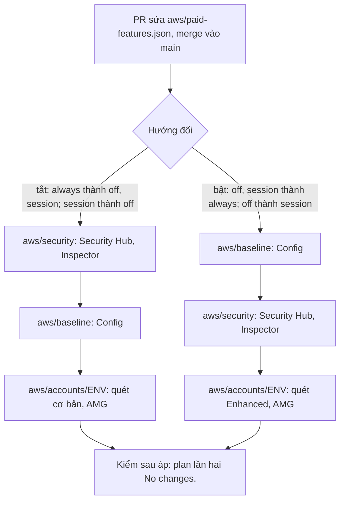

# Runbook: đổi cờ chi phí của một account

[Mục lục](README.md)

> **Tóm tắt**
>
> - **Làm gì:** đổi giá trị một cờ chi phí (dịch vụ AWS tốn tiền mà hệ thống không cần để chạy) của một account trong
>   [`aws/paid-features.json`](../../aws/paid-features.json) qua PR, rồi áp các root đọc cờ đó theo đúng thứ tự của hướng đổi.
> - **Khi nào và bao lâu:** trước buổi cần phép kiểm `chuẩn ngành` có cờ, trước và sau buổi prd, hay khi đổi giá trị giữa các buổi;
>   mỗi root một lượt plan, apply, plan lần hai, khoảng vài phút mỗi root. Không chạy khi một buổi đang mở.
> - **Phí trong lúc chạy:** đổi cờ không tốn tiền; giá trị mới tính từ lúc áp. Bật lại một dịch vụ trả lượt đầu (Inspector quét lại,
>   Security Hub chạy lại mọi check, Config ghi lại mọi tài nguyên). Số tiền mỗi cờ: chương
>   [15. Chi phí](../handbook/15-cost.md#chi-phí).

**Người học chạy mọi lệnh ở đây.** AI không chạy lệnh nào chạm account, kể cả lệnh chỉ đọc; AI đọc output dán lại. Mọi lệnh chạy từ gốc repo
này (`infra/`) trừ chỗ ghi `cd`. Bước nào đỏ thì dừng ở đó, dán output, không đi tiếp. Cũng là runbook áp lần đầu file của repo lên tổ chức
đã áp khi mọi dịch vụ còn bật.

## Điều kiện trước

- [ ] **Không buổi nào đang chạy**: buổi trước đã xong tới hai lượt `sweep.sh`. Root `aws/accounts/<env>` trong buổi chỉ apply qua
  `aws/scripts/tf.sh <env> account` ([mục 3–5 của `session-stg-deploy.md`](session-stg-deploy.md#35-root-account-mở-tính-năng-của-buổi));
  lệnh trần dưới đây tính trạng thái giữa
  buổi (`session_open = false`) và sẽ xoá workspace AMG của buổi đang mở.
- [ ] **Giá trị mới đã chọn** theo bước [Sửa file cờ qua PR](#sửa-file-cờ-qua-pr): cờ nào, account nào, hướng bật hay tắt.
- [ ] **Code trên `main`**: `git switch main && git pull --ff-only` trong bản clone này, để `jq` của [Mở terminal](#mở-terminal) in
  giá trị đang áp.
- [ ] **Đăng nhập SSO và biến account**: khối của [Mở terminal](#mở-terminal) chạy không lỗi.

## Mở terminal

```sh
cd infra
AWS_PROFILE=anhnv-sso aws --no-cli-pager sso login --region us-east-1   # one login per sso_session
printf 'mgmt …%s\n' "${SVP_AWS_MGMT_ACCOUNT_ID: -4}"   # account ids come from .envrc (direnv), 4 last digits only
export SVP_SESSION_DIR="$PWD/.session/$(date -u +%Y%m%dT%H%M%SZ)"      # check-account.sh writes its marks here
jq -r 'to_entries[] | .key as $a | .value | to_entries[] | "\($a) \(.key) \(.value)"' aws/paid-features.json
```

Một lần đăng nhập cho mọi profile chung `sso_session` của runbook này: `anhnv-sso`, `anhnv-stg`, `anhnv-prd`,
`anhnv-stg-ro`, `anhnv-prd-ro`, `anhnv-security-ro`. Biến account nạp qua direnv từ `.envrc` ở thư mục chứa các clone
([Biến account và direnv](../reference/operations.md#biến-account-và-direnv)), không file commit nào chứa chúng. Lệnh `jq` in mỗi cờ
khác `always` một dòng `<account> <cờ> <giá trị>`: giá trị đang áp, điểm xuất phát của lần đổi. Mở lại terminal giữa chừng: direnv
nạp lại biến account; export lại `SVP_SESSION_DIR` của khối trên.

## Sửa file cờ qua PR

Đổi giá trị trong `aws/paid-features.json`: chỉ ghi giá trị khác `always`; cờ về `always` thì xoá khoá đó. Mở PR, chờ `infra-ok` xanh,
merge. Comment Infracost của PR chỉ có chênh ở project của root đọc cờ mà `infracost.yml` liệt kê
([Project](../reference/ci.md#project)).

- **Mong đợi:** `make check` của PR xanh. Giá trị sai luật (`security_hub` `always` mà `config_recording` `off` ở cùng account, cờ của
  account env đặt ở account khác…) làm mọi plan dừng ở `validation` của module; luật đủ ở
  [`variables.tf`](../../aws/modules/paid-features/variables.tf) của module, đọc lại trước khi mở PR.
- **Buổi chọn bật phép kiểm `chuẩn ngành`**: đường mặc định của buổi chỉ chạy phép kiểm `lõi`, với giá trị của file
  ([ADR-0078](https://github.com/anhnvcoder/svp-backend/blob/main/docs/adr/0078-paid-features-lean-defaults.md) §6). Phép `chuẩn
  ngành` nào cần cờ nào: [mục Phép kiểm lõi và chuẩn ngành của `session-stg.md`](session-stg.md#phép-kiểm-lõi-và-chuẩn-ngành);
  phần thêm vào buổi ở dòng `Loại:` của từng phép.
  Giá trị buổi stg cần:

  | Phép kiểm `chuẩn ngành` | Giá trị của `stg` | Root áp, hướng bật |
  | --- | --- | --- |
  | Dashboard (SLO, lag Kafka, Explore, Grafana Operator) | `managed_grafana` `session`; `always` khi tháng có từ hai buổi cần nó (`session` đắt hơn `always` từ buổi thứ hai, [ADR-0071 §3](https://github.com/anhnvcoder/svp-backend/blob/main/docs/adr/0071-paid-features.md#3-managed_grafana)) | `aws/accounts/stg` (`off` → `session`: `No changes.`, bước 3–5 của buổi tạo workspace; PR đổi cờ thêm lại project `accounts-stg-session` vào `infracost.yml` như mục [Project](../reference/ci.md#project), để comment giá thấy workspace) |
  | Inspector quét repo cache | `inspector_ecr` `always` | `aws/security`, rồi `aws/accounts/stg` |
  | Control Security Hub của buổi | `security_hub` và `config_recording` `always` | `aws/baseline`, rồi `aws/security` |
  | Phép `chuẩn ngành` khác (thang k6, diễn tập, edge, kiểm sâu nền tảng managed) | không cần cờ | — |

  Sau buổi cuối cần giá trị đó, đổi về giá trị của file theo hướng tắt. Ví dụ đủ một vòng bật rồi trả cờ: kịch bản của chương
  [15. Chi phí](../handbook/15-cost.md#kịch-bản-thực-tế).
- **Buổi prd**: prd giữa các buổi có cùng giá trị rẻ như stg; buổi prd chạy với giá trị production
  ([ADR-0078](https://github.com/anhnvcoder/svp-backend/blob/main/docs/adr/0078-paid-features-lean-defaults.md) §3), nên không cần bảng
  trên. Trước buổi, một PR xoá khoá `prd` khỏi file (mọi cờ `always`) và áp theo hướng bật: `aws/baseline`, `aws/security`,
  `aws/accounts/prd`. Sau buổi (hai lượt `sweep.sh` đã xong), một PR ghi lại khoá `prd` như trước (cả bốn cờ `off`) và áp theo hướng tắt:
  `aws/security`, `aws/baseline`, `aws/accounts/prd`. Khoá của account dùng chung giữ nguyên ở cả hai PR.
- **Bẫy:** quên PR trước buổi prd thì buổi prd chạy với giá trị rẻ: phép `chuẩn ngành` cần cờ không chạy được.
- **Kéo về:** sau merge, lấy file vừa merge về bản clone này rồi in lại cờ.

```sh
git switch main && git pull --ff-only
jq -r 'to_entries[] | .key as $a | .value | to_entries[] | "\($a) \(.key) \(.value)"' aws/paid-features.json
```

- **Mong đợi:** mỗi dòng `<account> <cờ> <giá trị>` khớp file của PR vừa merge. Còn giá trị cũ thì chưa pull đúng `main`: dừng, chưa
  plan root nào (plan đọc file cũ sẽ ra `No changes.` và cờ không được áp).

## Thứ tự apply cờ

Chỉ áp root đọc cờ đã đổi, theo thứ tự của hướng đổi; root không đọc cờ nào đã đổi thì bỏ qua.

| Cờ | Root đọc cờ | Tài nguyên đổi khi đổi cờ |
| --- | --- | --- |
| `managed_grafana` | `aws/accounts/<env>`; `aws/envs/<env>` ở plan của buổi kế | bảy tài nguyên AMG: workspace `svp-<env>`, role `svp-<env>-grafana` và policy, hai gán nhóm, service account `svp-grafana-operator`, tham số SSM `/svp/<env>/grafana-workspace-id`; ở root env (`off`): `grafanaUrl` rỗng, không entry `svp/<env>/grafana-operator` |
| `inspector_ecr` | `aws/security`, `aws/accounts/<env>` | liên kết thành viên và enabler `members` của Inspector; cấu hình quét của registry (`ENHANCED`, `CONTINUOUS_SCAN` hay `BASIC`, `SCAN_ON_PUSH`) |
| `security_hub` | `aws/security` | policy `svp-security-off` và association của account, rule `svp-security-guardduty-findings` hai region và đích của nó, role `svp-security-guardduty-forwarder` |
| `config_recording` | `aws/baseline` | recorder, delivery channel, recorder status ở hai region trong module của account |

Root `aws/envs/<env>` chỉ sống trong buổi nên không áp ở runbook này: plan của buổi kế đọc cờ mới. Không cờ nào chạm KMS key, bucket,
vault, recovery point hay log group. Guardrail lõi (CloudTrail, GuardDuty, Access Analyzer, policy của tổ chức, budget, AWS Backup)
không có cờ: [ADR-0071 §8](https://github.com/anhnvcoder/svp-backend/blob/main/docs/adr/0071-paid-features.md#8-không-bao-giờ-tắt).



- **Tắt** cờ của một account: `aws/security` trước (Security Hub, Inspector), rồi `aws/baseline` (Config), rồi `aws/accounts/<env>`
  (quét cơ bản của registry).
- **Bật** cờ: `aws/baseline` trước, rồi `aws/security`, rồi `aws/accounts/<env>`.
- **Vì sao**: control của Security Hub là rule Config, nên recorder phải ghi trước khi Security Hub bật lại và còn ghi tới khi Security
  Hub đã tắt; bật, tắt quét ECR của Inspector tự đổi kiểu quét của registry giữa Enhanced và Basic, nên `aws/accounts/<env>` đi sau để
  đặt lại cấu hình quét
  ([ADR-0071 §10](https://github.com/anhnvcoder/svp-backend/blob/main/docs/adr/0071-paid-features.md#10-thứ-tự-áp-và-đổi-cờ)).
- **Một PR một hướng**: cần cả tắt lẫn bật thì hai PR, áp xong PR trước rồi mới tới PR sau.

## `aws/security`

Tắt: bước đầu. Bật: sau `aws/baseline`. Chỉ khi `security_hub` hay `inspector_ecr` đổi.

```sh
aws/scripts/check-account.sh mgmt
cd aws/security
AWS_PROFILE=anhnv-sso terraform init -backend-config=../backend.hcl
AWS_PROFILE=anhnv-sso \
TF_VAR_account_id="$SVP_AWS_MGMT_ACCOUNT_ID" \
TF_VAR_security_account_id="$SVP_AWS_SECURITY_ACCOUNT_ID" \
TF_VAR_log_archive_account_id="$SVP_AWS_LOG_ACCOUNT_ID" \
  terraform plan -input=false -out=security.tfplan
AWS_PROFILE=anhnv-sso terraform show -no-color security.tfplan > "$SVP_SESSION_DIR/security-plan.txt"
```

- **Mong đợi** (theo [Đổi cờ](https://github.com/anhnvcoder/svp-backend/blob/main/docs/adr/appendix/0071-paid-features.md#đổi-cờ)):
  - `security_hub` thành `off`: chỉ thêm (policy `svp-security-off` khi chưa có, association của account, rule GuardDuty, đích, role);
    thêm account vào `detail.accountId` của rule đã có là `change`. Về `always`: ngược lại, xoá đúng những thứ đó.
  - `inspector_ecr` thành `off`: `aws_inspector2_enabler.members` sửa tại chỗ (bỏ id account),
    `aws_inspector2_member_association.members["<id>"]` xoá. Về `always`: thêm liên kết, enabler sửa tại chỗ.
- **Dừng** (không apply, dán plan) nếu plan chạm tài nguyên khác: detector GuardDuty, analyzer, aggregator Config, bus, topic, KMS key.

```sh
AWS_PROFILE=anhnv-sso terraform apply -input=false security.tfplan && rm security.tfplan
cd ../..
```

- **Kiểm:** phần Security Hub, Inspector của [5f. Kiểm nhanh](org-security-setup.md#5f-kiểm-nhanh) của `org-security-setup.md`
  (association của account `off` `SUCCESS`; account `off` của `inspector_ecr` không có trong `list-members`), rồi plan lần hai bằng lệnh
  `plan` trên: mong `No changes.`.
- **Bẫy:** association có thể `PENDING` tới 24 giờ; chưa `SUCCESS` ngay sau apply chưa phải lỗi.

## `aws/baseline`

Tắt: sau `aws/security`. Bật: bước đầu. Chỉ khi `config_recording` đổi.

```sh
aws/scripts/check-account.sh mgmt
cd aws/baseline
AWS_PROFILE=anhnv-sso terraform init -backend-config=../backend.hcl
AWS_PROFILE=anhnv-sso \
TF_VAR_account_id="$SVP_AWS_MGMT_ACCOUNT_ID" \
TF_VAR_log_archive_account_id="$SVP_AWS_LOG_ACCOUNT_ID" \
TF_VAR_security_account_id="$SVP_AWS_SECURITY_ACCOUNT_ID" \
TF_VAR_backup_account_id="$SVP_AWS_BACKUP_ACCOUNT_ID" \
TF_VAR_stg_account_id="$SVP_AWS_STG_ACCOUNT_ID" \
TF_VAR_prd_account_id="$SVP_AWS_PRD_ACCOUNT_ID" \
  terraform plan -input=false -out=baseline.tfplan
AWS_PROFILE=anhnv-sso terraform show -no-color baseline.tfplan > "$SVP_SESSION_DIR/baseline-plan.txt"
```

- **Mong đợi:** mỗi account đổi cờ 6 tài nguyên trong module của nó (`module.stg` với stg):
  `aws_config_configuration_recorder_status.this`, `aws_config_delivery_channel.this`, `aws_config_configuration_recorder.this`, mỗi cái
  hai khoá region; `off` là `6 to destroy`, `always` thêm đúng sáu tài nguyên đó. `aws_iam_service_linked_role.config`, key EBS, rule
  `svp-security-*` không đổi.
- **Dừng** (không apply, dán plan) nếu plan khác.

```sh
AWS_PROFILE=anhnv-sso terraform apply -input=false baseline.tfplan && rm baseline.tfplan
cd ../..
```

- **Việc tay:** apply có thể sinh email `svp-security-detection` (recorder, delivery channel bị xoá hay tạo): đúng ý, không cần xử lý.
- **Kiểm:** recorder của account đó ở hai region (ví dụ stg; prd dùng `anhnv-prd-ro`, account dùng chung dùng vòng lặp ở
  [7a. Dịch vụ bật](org-security-setup.md#7a-dịch-vụ-bật) của `org-security-setup.md`):

```sh
for r in ap-southeast-1 us-east-1; do
  AWS_PROFILE=anhnv-stg-ro aws --no-cli-pager configservice describe-configuration-recorder-status --region "$r" \
    --query 'ConfigurationRecordersStatus[].[name,recording,lastStatus]' --output text
done
```

- **Mong đợi:** không dòng nào khi `off`, `True SUCCESS` ở mỗi region khi `always`. Rồi plan lần hai bằng lệnh `plan` trên: mong
  `No changes.`.

## `aws/accounts/<env>`

Bước cuối ở cả hai hướng. Chỉ khi `managed_grafana` hay `inspector_ecr` của env đổi. Ví dụ là stg; với prd thay `stg` bằng `prd`,
`anhnv-stg` bằng `anhnv-prd`, `SVP_AWS_STG_ACCOUNT_ID` bằng `SVP_AWS_PRD_ACCOUNT_ID`.

```sh
aws/scripts/check-account.sh stg
cd aws/accounts/stg
AWS_PROFILE=anhnv-stg TF_VAR_account_id="$SVP_AWS_STG_ACCOUNT_ID" terraform init -backend-config=../../backend-stg.hcl
AWS_PROFILE=anhnv-stg \
TF_VAR_account_id="$SVP_AWS_STG_ACCOUNT_ID" \
TF_VAR_backup_account_id="$SVP_AWS_BACKUP_ACCOUNT_ID" \
  terraform plan -input=false -out=stg.tfplan
AWS_PROFILE=anhnv-stg terraform show -no-color stg.tfplan > "$SVP_SESSION_DIR/stg-plan.txt"
```

- **Mong đợi:**
  - `inspector_ecr`: `module.registry.aws_ecr_registry_scanning_configuration.this` sửa tại chỗ (`1 to change`).
  - `managed_grafana`: bảy tài nguyên AMG của bảng ở [Thứ tự apply cờ](#thứ-tự-apply-cờ) dưới `module.observability` (`[0]`), không buổi
    nào mở (`session_open = false`):

    | Từ | Sang | Plan |
    | --- | --- | --- |
    | `always` | `session`, `off` | `7 to destroy` |
    | `session` | `always` | thêm bảy tài nguyên AMG |
    | `session` | `off` | `No changes.` (ngoài buổi không có workspace) |
    | `off` | `always` | thêm bảy tài nguyên AMG |
    | `off` | `session` | `No changes.`; buổi kế thêm 7 ở bước mở `tf.sh <env> account plan --open` |

    Data source, dashboard trong workspace mất cùng nó; Grafana Operator dựng lại ở buổi có workspace.
- **Dừng** (không apply, dán plan) nếu plan chạm tài nguyên khác: baseline, key, workspace AMP, log group, vault, repo ECR.
- **Bẫy:** trên máy, biến `session_open` chỉ do lệnh `account` của `aws/scripts/tf.sh` đặt (`plan --open` là `true`, `--close` là `false`);
  `terraform plan` trần ở đây luôn tính trạng thái giữa buổi. Với cờ `always` hay `off`, `session_open` không đổi gì.

```sh
AWS_PROFILE=anhnv-stg terraform apply -input=false stg.tfplan && rm stg.tfplan
cd ../../..
AWS_PROFILE=anhnv-stg aws --no-cli-pager ecr get-registry-scanning-configuration --region ap-southeast-1 --output text \
  --query 'scanningConfiguration.[scanType,rules[0].scanFrequency]'
AWS_PROFILE=anhnv-stg aws --no-cli-pager grafana list-workspaces --region ap-southeast-1 --query "workspaces[?name=='svp-stg'].status" --output text
```

- **Mong đợi:** `ENHANCED CONTINUOUS_SCAN` khi `inspector_ecr` là `always`, `BASIC SCAN_ON_PUSH` khi `off`; workspace `ACTIVE` khi
  `managed_grafana` là `always`, không dòng nào khi `session` hay `off`.
- **Kiểm:** plan lần hai bằng lệnh `plan` trên (trong `aws/accounts/stg`): mong `No changes.`.

## Sau khi áp

- Mỗi root đã áp có plan lần hai `No changes.`; dán ba dòng đó.
- Buổi kế theo cờ mới: bước, phép kiểm và quét sót đổi theo cờ ở [mục Cờ chi phí của buổi của
  `session-stg.md`](session-stg.md#cờ-chi-phí-của-buổi).
- Sau một ngày: chi phí theo dịch vụ ở Cost Explorer ([lệnh của mục 7f của
  `org-security-setup.md`](org-security-setup.md#7f-chi-phí-sau-1-và-7-ngày), thêm `Amazon Inspector`,
  `Amazon Managed Grafana` vào bộ lọc), so với bảng phí của chương [15. Chi phí](../handbook/15-cost.md#chi-phí).

## Gỡ

Runbook này không tạo tài nguyên riêng để gỡ. Hoàn tác một lần đổi cờ là một lần đổi cờ ngược lại: PR trả giá trị cũ, rồi áp theo
hướng ngược ở [Thứ tự apply cờ](#thứ-tự-apply-cờ).

## Khi một bước đỏ

- Lỗi ở `plan`: không có gì đổi trên account. `Invalid value for variable` ở `module.paid_features` là file sai luật: sửa bằng PR mới, không
  sửa file tại chỗ rồi áp.
- `Error acquiring the state lock` kèm Lock ID (thường sau Ctrl+C một lệnh đang chờ nhập):
  [`operations.md`, Khoá state kẹt](../reference/operations.md#khoá-state-kẹt).
- Lỗi giữa `apply`: phần đã đổi nằm trong state; `plan` lại cùng root chỉ còn phần chưa đổi. Dán lỗi và plan mới trước khi apply lại.
- Dừng giữa hai root (một root đã áp, root sau chưa): không đảo file; sửa nguyên nhân rồi áp tiếp root sau theo đúng thứ tự.
- Plan có `destroy` hay `-/+` ở KMS key, bucket, vault, log group hay detector: dừng, không apply, dán plan.
