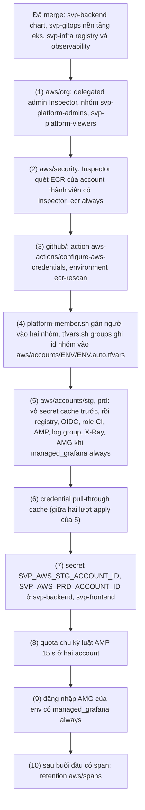

# Runbook: áp nền tảng managed lần đầu (registry, observability, Inspector, CI ECR)

Áp một lần phần sống lâu của nền tảng managed: Inspector của tổ chức, hai nhóm nền tảng của IAM Identity Center, environment
`ecr-rescan` và action AWS của hai repo code, registry ECR (repo phát hành, pull-through cache, role CI) và observability (workspace AMP, log
group ứng dụng, Transaction Search của X-Ray, Amazon Managed Grafana khi cờ `managed_grafana` của env là `always`) ở hai account env; rồi
các bước tay Terraform không làm: credential của
cache, secret account của CI, quota chu kỳ luật AMP, retention của `aws/spans`. Phần sống theo buổi (endpoint interface, role Pod Identity,
luật trên AMP, dashboard) do root `aws/envs/<env>` và Argo CD dựng, gỡ theo runbook buổi. Thiết kế:
[ADR-0062](https://github.com/anhnvcoder/svp-backend/blob/main/docs/adr/0062-ecr-registry-ci-oidc.md) (registry, cache, role CI, Inspector),
[ADR-0063](https://github.com/anhnvcoder/svp-backend/blob/main/docs/adr/0063-managed-observability.md) (AMP, CloudWatch Logs, X-Ray, AMG, luật),
[ADR-0064](https://github.com/anhnvcoder/svp-backend/blob/main/docs/adr/0064-interface-endpoints.md) (endpoint interface),
[ADR-0071](https://github.com/anhnvcoder/svp-backend/blob/main/docs/adr/0071-paid-features.md) (cờ chi phí: AMG, Inspector ECR theo account).
Cờ của từng account nằm ở [`aws/paid-features.json`](../../aws/paid-features.json); đổi cờ theo [`paid-features.md`](paid-features.md).

**Người học chạy mọi lệnh ở đây.** AI không chạy lệnh nào chạm account, kể cả lệnh chỉ đọc; AI đọc output dán lại. Mọi lệnh chạy từ gốc repo
này (`infra/`) trừ chỗ ghi `cd`. Bước nào đỏ thì dừng ở đó, dán output, không đi tiếp. Token và PAT chỉ đi qua prompt không echo hay stdin
của script (`cache-secrets.sh`, `make github-secrets`), không bao giờ nằm trên dòng lệnh, trong lịch sử shell hay trong file. Lệnh
chạy được trong zsh (shell mặc định của macOS) và bash.

## Thứ tự áp lần đầu



- **(1)** `aws/org`; [Bước (1)](#bước-1-awsorg). Dán lại: dòng `Plan:`, `Apply complete!`, `No changes.`.
- **(2)** `aws/security`; [Bước (2)](#bước-2-awssecurity). Dán lại: dòng `Plan:`, `Apply complete!`, output phần
  Inspector của "Kiểm nhanh".
- **(3)** `github/`; [Bước (3)](#bước-3-github). Dán lại: dòng `Plan:`, `Apply complete!`, `No changes.`.
- **(4)** Identity Center, tfvars; [Bước (4)](#bước-4-nhóm-nền-tảng). Dán lại: dòng `ok` của `platform-member.sh count`
  mỗi nhóm, hai dòng `ok` của `tfvars.sh groups`.
- **(5), (6)** `aws/accounts/stg`, `aws/accounts/prd`; [Bước (5)](#bước-5-awsaccountsenv), [Bước
  (6)](#bước-6-credential-của-pull-through-cache). Dán lại: mỗi account: hai dòng `Plan:`, hai `Apply complete!`, `No
  changes.`, tên role, hai dòng `ok` của `cache-secrets.sh`, `validate`.
- **(7)** GitHub; [Bước (7)](#bước-7-biến-ci-ecr). Dán lại: các dòng `ok` của `make github-secrets`.
- **(8)** Service Quotas; [Bước (8)](#bước-8-quota-chu-kỳ-luật-amp). Dán lại: dòng `ok`, `note` của `preflight.sh
  quotas`.
- **(9)** AMG; [Bước (9)](#bước-9-grafana-managed). Dán lại: vai trò thấy được sau khi đăng nhập.
- **(10)** log group `aws/spans`; [Bước (10)](#bước-10-retention-của-awsspans). Dán lại: output `describe-log-groups`.

Job ECR của `svp-backend`, `svp-frontend` (chép bản phát hành vào ECR, promote prd, rescan) chỉ chạy được sau bước (7): chúng nhận role của bước
(5) và đọc secret của bước (7), nên PR thêm các job đó merge sau runbook này. Xoay PAT và token: mục [Xoay credential](#xoay-credential).

## Trước khi bắt đầu

1. **Code trên `main`**: `git switch main && git pull --ff-only` trong bản clone này; module `registry`, `observability`,
   `aws/security/inspector.tf`, environment `ecr-rescan` của `github/` đã merge. Phép thử trước khi dựng của ADR-0062, ADR-0063 (mục "Xác
   nhận": chép bản phát hành sang ECR `IMMUTABLE` rồi `cosign verify`, kéo qua cache theo tag rồi theo digest, đăng nhập AMG bằng Identity
   Center khác region) đã đạt ở account sandbox.
2. **Chi phí liên tục**: từ bước (5), mỗi account env giữ hai key KMS, bốn secret, lưu trữ ECR tăng theo số bản phát hành và, khi cờ
   `managed_grafana` là `always`, workspace AMG (tính cả tháng không buổi); từ bước (2) Inspector tính mỗi digest bên thứ ba mới ở account có
   `inspector_ecr` `always`. Phần theo cờ ở
   [bảng tháng không buổi của ADR-0071](https://github.com/anhnvcoder/svp-backend/blob/main/docs/adr/appendix/0071-paid-features.md#bảng-tháng-không-buổi);
   phần còn lại ở
   [ADR-0062 §11](https://github.com/anhnvcoder/svp-backend/blob/main/docs/adr/0062-ecr-registry-ci-oidc.md#11-chi-phí-registry) và
   [ADR-0063 §12](https://github.com/anhnvcoder/svp-backend/blob/main/docs/adr/0063-managed-observability.md#12-chi-phí-hợp-đồng-cluster-và-adr-cũ);
   budget của org đủ cho khoản đó cộng các buổi (lệnh đọc ở [`org-security-setup.md`](org-security-setup.md#mở-terminal)).
3. **Credential để sẵn** (chưa dán vào đâu): PAT (classic) của GitHub chỉ scope `read:packages`, hạn 90 ngày (GitHub Packages chỉ nhận PAT
   classic); personal access token của Docker Hub quyền "Public Repo Read-only", hạn 90 ngày. Ghi ngày hết hạn vào lịch của người học.
4. **Trên máy**: Terraform 1.15, AWS CLI v2, `jq`, `gh` đăng nhập tài khoản admin của mọi repo (`gh auth status`, scope `repo`).

## Mở terminal

```sh
cd infra
AWS_PROFILE=anhnv-sso aws sso login --region us-east-1      # one login for every profile of the same sso_session
export SVP_AWS_MGMT_ACCOUNT_ID=<12 số>                      # typed by hand: the value check-account.sh compares against
eval "$(aws/scripts/accounts.sh)"                           # sets the other five SVP_AWS_*_ACCOUNT_ID, no file
export SVP_SESSION_DIR="$PWD/.session/$(date -u +%Y%m%dT%H%M%SZ)"   # check-account.sh marks its timeline here
aws/scripts/check-account.sh mgmt
```

Tìm năm dòng `ok    SVP_AWS_<…>_ACCOUNT_ID: account svp-<tên>, ACTIVE` của `accounts.sh` (không in id) rồi
`ok    account <12 số> of mgmt, arn:aws:sts::<12 số>:assumed-role/AWSReservedSSO_…`. `FAIL  no account svp-<tên> in the organization` thì
`aws/org` chưa tạo account đó; `FAIL  profile anhnv-sso is account …` thì `SVP_AWS_MGMT_ACCOUNT_ID` sai. Mở lại terminal giữa chừng: đặt lại
`SVP_AWS_MGMT_ACCOUNT_ID` và `SVP_SESSION_DIR`, chạy lại `eval` trên.

## Bước (1): `aws/org`

```sh
aws/scripts/check-account.sh mgmt
cd aws/org
```

Theo [README `aws/org`, Thêm Inspector và nhóm nền tảng](../../aws/org/README.md#thêm-inspector-và-nhóm-nền-tảng-vào-tổ-chức-đã-áp): lệnh `plan`,
`apply` của bước (4) ở README đó, mong đợi `Plan: 3 to add, 1 to change, 0 to destroy` (delegated admin Inspector, hai nhóm; tổ chức chỉ thêm
`inspector2.amazonaws.com`), plan lần hai `No changes.`. `cd ../..` khi xong.

## Bước (2): `aws/security`

```sh
aws/scripts/check-account.sh mgmt
cd aws/security
```

Theo [README `aws/security`, Thêm Inspector vào root đã áp](../../aws/security/README.md#thêm-inspector-vào-root-đã-áp): mong đợi
`1 to import`, `1 to change`, `0 to destroy`, một liên kết thành viên mỗi account thành viên có `inspector_ecr` khác `off`, đúng như mục
"Kiểm plan Inspector" của README đó; sau apply phần Inspector của [Kiểm nhanh](../../aws/security/README.md#6-kiểm-nhanh) (`ecr` `true`, mỗi
account `ENABLED DISABLED DISABLED`, các thành viên đó `ENABLED`, account `off` không có), plan lần hai `No changes.`. `cd ../..` khi xong.

## Bước (3): `github/`

```sh
aws/scripts/check-account.sh mgmt
cd github
```

Theo [README `github/`](../../github/README.md#thay-đổi-thường-gặp), đoạn "Environment `ecr-rescan` và action AWS cho job ECR": lệnh của mục "Lệnh
người học chạy", mong đợi `Plan: 4 to add, 2 to change, 0 to destroy` (environment `ecr-rescan` và luật nhánh `main` của nó ở hai repo;
`patterns_allowed` của `svp-backend`, `svp-frontend` thêm đúng `aws-actions/configure-aws-credentials@*`), plan lần hai `No changes.`. Rồi
`make github-check` (chỉ đọc). `cd ..` khi xong.

## Bước (4): nhóm nền tảng

Gán người vào hai nhóm bằng script, ở region của instance (đọc từ `sso_region` của `aws/org/org.auto.tfvars`):
`svp-platform-admins` (vai trò `ADMIN` của Grafana) hay `svp-platform-viewers` (`VIEWER`). Người học chọn user lúc chạy
(user name như ở góc phải trên của AWS access portal); ai thuộc nhóm không nằm trong cấu hình Terraform:

```sh
aws/scripts/platform-member.sh add admins <user-name>
aws/scripts/platform-member.sh count admins
aws/scripts/platform-member.sh count viewers
```

`add` in `ok    <user-name> added to svp-platform-admins` (hay `skip  … is already a member`); `count` in `ok
svp-platform-admins has N member(s)`, chỉ số lượng, không id. Mong ít nhất `1` ở nhóm admin. `FAIL  no user <user-name>
in Identity Center` là tên sai hay user chưa tạo ([`aws/org`, Profile
gốc](../../aws/org/README.md#profile-gốc-anhnv-sso), bước 3); `FAIL  terraform output platform_admin_group_id of
aws/org` là `aws/org` chưa apply bước (1) hay chưa `init`. Gỡ người: `remove admins <user-name>`.

Ghi id hai nhóm vào `<env>.auto.tfvars` của hai root `aws/accounts/<env>` (git bỏ qua; repo public không giữ id nhóm), không in giá trị:

```sh
aws/scripts/tfvars.sh example aws/accounts/stg      # only when the file is missing
aws/scripts/tfvars.sh groups stg
aws/scripts/tfvars.sh example aws/accounts/prd
aws/scripts/tfvars.sh groups prd
```

Mỗi `groups` in `ok    aws/accounts/<env>/<env>.auto.tfvars: platform_admin_group_id, platform_viewer_group_id from
aws/org written (N lines, mode 600)` (hay `already as written, file unchanged` khi chạy lại). Script chỉ đổi hai dòng
của hai biến đó, giữ nguyên dòng và comment khác; file có biến đó hai lần thì `FAIL … is set more than once` và không
ghi gì: giữ một dòng rồi chạy lại.

## Bước (5): `aws/accounts/<env>`

Ví dụ là stg; với prd thay `stg` bằng `prd`, `anhnv-stg` bằng `anhnv-prd`, `SVP_AWS_STG_ACCOUNT_ID` bằng `SVP_AWS_PRD_ACCOUNT_ID`. Làm stg trọn bước
(5) và (6), rồi prd.

Rule cache của GHCR, Docker Hub trỏ secret có credential (`credentialArn`); API tạo rule có lỗi `SecretNotFoundException`,
`UnableToAccessSecretException`. Nên vỏ hai secret đi trước bằng một lượt apply có `-target`, giá trị ghi ở bước (6), rồi mới tới lượt đủ:

```sh
aws/scripts/check-account.sh stg
cd aws/accounts/stg
AWS_PROFILE=anhnv-stg TF_VAR_account_id="$SVP_AWS_STG_ACCOUNT_ID" terraform init -backend-config=../../backend-stg.hcl
AWS_PROFILE=anhnv-stg TF_VAR_account_id="$SVP_AWS_STG_ACCOUNT_ID" TF_VAR_backup_account_id="$SVP_AWS_BACKUP_ACCOUNT_ID" terraform plan \
  -target='module.registry.aws_secretsmanager_secret.cache' -out=stg.tfplan
```

Mong `Plan: 2 to add, 0 to change, 0 to destroy`: đúng `module.registry.aws_secretsmanager_secret.cache["ghcr"]`, `["docker-hub"]`; cảnh báo
"Resource targeting is in effect" là đúng ý. Khác thì dừng, dán plan. Rồi:

```sh
AWS_PROFILE=anhnv-stg TF_VAR_account_id="$SVP_AWS_STG_ACCOUNT_ID" TF_VAR_backup_account_id="$SVP_AWS_BACKUP_ACCOUNT_ID" terraform apply stg.tfplan && rm stg.tfplan
cd ../../..
```

Làm bước (6) cho account này, rồi quay lại lượt đủ:

```sh
aws/scripts/check-account.sh stg
cd aws/accounts/stg
AWS_PROFILE=anhnv-stg TF_VAR_account_id="$SVP_AWS_STG_ACCOUNT_ID" TF_VAR_backup_account_id="$SVP_AWS_BACKUP_ACCOUNT_ID" terraform plan -out=stg.tfplan
```

Mong chỉ thêm đúng các dòng của danh sách ở [README `aws/accounts`, Thêm vào account đã có
baseline](../../aws/accounts/README.md#thêm-vào-account-đã-có-baseline) (cột của env này, theo `aws/paid-features.json`
của repo: cả stg lẫn prd không có AMG giữa các buổi) trừ hai secret đã có; dòng cuối của plan có dạng `Plan: <n> to add,
0 to change, 0
to destroy`. Có `change`, `destroy` hay tài nguyên của `module.baseline`, `module.alarms`: dừng, dán plan. Rồi:

```sh
AWS_PROFILE=anhnv-stg TF_VAR_account_id="$SVP_AWS_STG_ACCOUNT_ID" TF_VAR_backup_account_id="$SVP_AWS_BACKUP_ACCOUNT_ID" terraform apply stg.tfplan && rm stg.tfplan
# Expect: No changes.
AWS_PROFILE=anhnv-stg TF_VAR_account_id="$SVP_AWS_STG_ACCOUNT_ID" TF_VAR_backup_account_id="$SVP_AWS_BACKUP_ACCOUNT_ID" terraform plan
AWS_PROFILE=anhnv-stg TF_VAR_account_id="$SVP_AWS_STG_ACCOUNT_ID" terraform output -json ci_role_arns | jq -r 'keys[]'
cd ../../..
for p in ghcr docker-hub quay k8s ecr-public; do
  AWS_PROFILE=anhnv-stg aws ecr validate-pull-through-cache-rule --ecr-repository-prefix "$p" --region ap-southeast-1 \
    --query '[ecrRepositoryPrefix,isValid,failure]' --output text
done
```

Lệnh `output` in đúng tên role của `ci_roles` ở `locals` của root: stg `svp-ci-ecr-release-backend`, `svp-ci-ecr-release-frontend` và hai
`svp-ci-ecr-rescan-*`; prd `svp-ci-ecr-promote` và hai `svp-ci-ecr-rescan-*`. Role plan chỉ đọc `svp-ci-terraform-plan` (ở cả hai
account, do module `ci_plan_role` tạo) không nằm trong `ci_roles`: lấy ARN từ output `ci_plan_role_arn`, bật plan cho env theo
[`github-setup.md`](github-setup.md#environment-terraform-plan). Mỗi rule một dòng `<tiền tố> True None`; `False` ở `ghcr` hay
`docker-hub` kèm `failure` là credential của bước (6) sai: ghi lại theo bước đó rồi chạy lại vòng `validate`.

Apply đỏ ở `aws_grafana_workspace` (env có `managed_grafana` `always`) khi Identity Center chưa bật cho AMG ở account thành viên hay khác
region không đăng nhập được: dừng, dán lỗi (phép thử trước khi dựng của ADR-0063 đã kiểm điều này, khác kết quả đó là việc của ADR).

Lệnh `plan` trần ở đây tính trạng thái giữa buổi: biến `session_open` của root mặc định `false`, nên env có `managed_grafana` `session` không
có workspace AMG. Trong một buổi, root `aws/accounts/<env>` chỉ apply qua `aws/scripts/tf.sh <env> account` (mục 3–5 của
[`session-stg.md`](session-stg.md#35-root-account-mở-tính-năng-của-buổi)): lệnh trần lúc đó xoá workspace mà cluster đang dùng.

## Bước (6): credential của pull-through cache

Module chỉ tạo vỏ `ecr-pullthroughcache/ghcr`, `ecr-pullthroughcache/docker-hub` (mã hoá bằng key `aws/secretsmanager`: ECR không nhận key do khách
hàng quản lý cho secret này); giá trị là JSON hai khoá `username`, `accessToken`
([README module `registry`](../../aws/modules/registry/README.md#pull-through-cache)). Cùng PAT cho hai account. Mỗi account:

```sh
aws/scripts/cache-secrets.sh stg ghcr
aws/scripts/cache-secrets.sh stg dockerhub
```

Mỗi lệnh kiểm account, kiểm entry đã có, rồi hỏi user và token ở terminal (token không echo; stdin không phải terminal
thì nhận `{"username": "…", "accessToken": "…"}`). Token phải đúng dạng của nơi cấp: `ghp_…` cho GHCR, `dckr_pat_…` cho
Docker Hub; sai dạng thì `FAIL  the token is not of the form ghp_... (or is empty); nothing written` và không ghi gì.
Thành công in `ok    entry ecr-pullthroughcache/ghcr of stg: version <8 ký tự> (value not shown); next: …`: dán hai dòng
đó. Token đi vào lệnh ghi version mới của secret qua pipe từ `printf` (lệnh có sẵn của shell nên không thành tiến
trình), không lên dòng lệnh, file hay màn hình; lỗi của `aws` in ra đã cắt token. Mỗi lần chạy ghi một version mới của
entry nên chạy lại sau lỗi là an toàn. `FAIL  no entry … in stg: apply aws/accounts/stg first` là lượt `-target` đầu của
bước (5) chưa chạy.

Tạo PAT và token giữ tay vì do bên thứ ba cấp, bằng chính tài khoản của người học trên trang web của họ (lab không giữ công cụ nào để tạo
thay): PAT
classic scope `read:packages` ở <https://github.com/settings/tokens>, token Docker Hub quyền "Public Repo Read-only" ở
Docker Hub → **Account settings** → **Personal access tokens**; đặt hạn 90 ngày. Cùng PAT cho hai account.

## Bước (7): biến CI ECR

Hai secret repo `SVP_AWS_STG_ACCOUNT_ID`, `SVP_AWS_PRD_ACCOUNT_ID` ở `svp-backend` và `svp-frontend`: workflow dựng ARN role từ chúng (region,
tên role cố định trong workflow); là secret để GitHub che account ID trong log của repo public. Hai biến cùng tên đã export trong terminal
(`eval "$(aws/scripts/accounts.sh)"`), `gh` đăng nhập tài khoản admin của hai repo (`gh auth status`):

```sh
make github-secrets
```

Lệnh nằm trong [`github-setup.md`](github-setup.md#thứ-tự-trên-một-account-mới) (bước 7 của mục đó, cùng các target
`make github-*` khác). Mong mỗi repo hai dòng `ok    secret SVP_AWS_<STG|PRD>_ACCOUNT_ID of <repo>`. Giá trị đi qua
stdin của `gh`, không lên dòng lệnh hay màn hình. Biến thiếu hay không đủ 12 chữ số: `FAIL  SVP_AWS_<…>_ACCOUNT_ID is
not set` (hay `is not 12 digits`) và chưa secret nào được ghi. Kiểm: `gh secret list -R anhnvcoder/<repo>` (chỉ in tên)
có hai tên đó.

Secret không có resource Terraform (giá trị sẽ nằm rõ trong state): bảng "Không quản" của
[`github/README.md`](../../github/README.md#không-quản-và-vì-sao).

Secret account của CI plan (environment `terraform-plan` của `svp-infra`, cho role plan chỉ đọc mà bước (5) tạo) đặt khi bật plan cho env:
lệnh (`make github-secrets ENV=<stg|prd>`) và thứ tự ở [`github-setup.md`](github-setup.md#environment-terraform-plan).

## Bước (8): quota chu kỳ luật AMP

Chart ghi `interval: 15s` vào mỗi nhóm luật như k3d; AMP mặc định tối thiểu 30 s, chỉnh được qua quota "Rule evaluation
interval" ([AMP quotas](https://docs.aws.amazon.com/prometheus/latest/userguide/AMP_quotas.html)). Workspace có từ bước
(5). Mỗi account (stg rồi prd), đọc quota (mã quota tra theo tên, không chép mã vào đây), rồi xin 15 nếu chưa đủ:

```sh
aws/scripts/preflight.sh quotas stg
aws/scripts/preflight.sh quotas stg request
```

Lệnh đầu in mỗi quota một dòng; dòng của AMP là `ok    L-… AMP rule evaluation interval (seconds): 15.0 (max 15)` khi đã
đủ, hay `FAIL  L-… …: 30.0, needs max 15: run preflight.sh quotas stg request` khi chưa. Lệnh sau là lệnh duy nhất ghi:
gửi yêu cầu cho mỗi quota thiếu và in `note  L-… …: 30.0, asked for 15 (<id> PENDING|CASE_OPENED): wait for APPROVED,
then run quotas again`; quota đã có yêu cầu mở thì `note  … a request is already open … not sent again`, nên chạy lại
không gửi hai lần. Chờ `APPROVED` rồi chạy lại lệnh đầu tới khi mọi dòng `ok`. Quota EC2 và Elastic IP của cùng lệnh đọc
theo [`aws/org`, Quota](../../aws/org/README.md#quota-và-xác-minh-cloudfront-của-account-workload).

Service Quotas từ chối vì giá trị xin nhỏ hơn giá trị đang có (lỗi `IllegalArgumentException`, `InvalidParameterValue`; script in
`FAIL  service-quotas request-service-quota-increase …`): mở case trên console AWS
Support từ account đó (**Create case** → **Service limit increase** → Amazon Managed Service for Prometheus, quota "Rule evaluation interval",
giá trị 15 s, region `ap-southeast-1`), dán id case. AWS từ chối hẳn: không chạy buổi có luật trên AMP; báo AI (ADR-0063 §5: quyết lại bằng ADR
mới, không chạy với 30 s). Buổi stg đầu kiểm chu kỳ thật ở phép kiểm cảnh báo của runbook buổi.

## Bước (9): Grafana managed

Root `aws/envs/<env>` đọc id workspace AMG từ tham số SSM `/svp/<env>/grafana-workspace-id` mà `aws/accounts/<env>` ghi cùng workspace (AMG
không có data source tìm theo tên), nên không có id nào phải chép vào `<env>.auto.tfvars`. Theo cờ `managed_grafana` của env:

- `always` (env vắng khỏi file, như prd trong buổi prd): workspace có từ lúc áp cờ đó. Đăng nhập: mở `grafana_url` của account
  (`AWS_PROFILE=anhnv-prd terraform -chdir=aws/accounts/prd output -raw grafana_url`) trên trình duyệt, **Sign in with AWS IAM Identity
  Center** bằng user của bước (4). Mong vào được, user nhóm admin thấy mục **Administration**, user nhóm viewer chỉ xem. Dashboard và data source
  chưa có: Grafana Operator tạo chúng trong buổi. Dán vai trò thấy được (không dán URL).
- `session` (stg và prd theo file của repo): không có workspace giữa các buổi, output `grafana_url` là `null`. Đăng
  nhập lần đầu ở buổi stg đầu (prd: ở buổi prd, sau khi đổi cờ), sau bước 5 của
  [`session-stg.md`](session-stg.md#35-root-account-mở-tính-năng-của-buổi), cùng cách và cùng mong đợi.

## Bước (10): retention của `aws/spans`

X-Ray tạo log group `aws/spans` khi span đầu tiên tới (buổi đầu của env); Terraform không tạo hay nhận được nó, nên retention đặt tay một lần mỗi
account ([README module `observability`](../../aws/modules/observability/README.md#bước-tay-retention-của-awsspans)). Sau buổi đầu có span của
env đó, in lệnh từ output, đọc, rồi chạy đúng lệnh đã in:

```sh
aws/scripts/check-account.sh stg
AWS_PROFILE=anhnv-stg terraform -chdir=aws/accounts/stg output -raw spans_retention_command; echo
AWS_PROFILE=anhnv-stg aws logs describe-log-groups --log-group-name-prefix aws/spans --region ap-southeast-1 \
  --query 'logGroups[].[logGroupName,retentionInDays]' --output text
```

Lệnh in ra có dạng `AWS_PROFILE=anhnv-stg aws logs put-retention-policy --log-group-name aws/spans --retention-in-days <n> --region ap-southeast-1`.
Sau khi chạy nó, lệnh `describe-log-groups` in `aws/spans <n>` (`<n>` là `span_retention_days` của env); `None` là chưa đặt. Không có
dòng nào: X-Ray chưa nhận span, làm sau buổi kế.

## Xoay credential

| Credential | Hạn | Xoay |
| --- | --- | --- |
| PAT GitHub `read:packages`, token Docker Hub của cache | 90 ngày | trước hạn: tạo mới, ghi theo bước (6) ở hai account, chạy vòng `validate` của bước (5), rồi thu hồi bản cũ trên GitHub, Docker Hub |
| Token của service account `svp-grafana-operator` (AMG) | 1 ngày | tự: mỗi `bootstrap.sh <env> secrets` xoá mọi token cũ rồi tạo token mới vào entry `svp/<env>/grafana-operator` |
| Secret account của CI (bước 7) | không hạn | chỉ khi account đổi: chạy lại bước (7) |

Cache hết credential (PAT hết hạn) thì ECR vẫn trả bản đã cache, nhưng image chưa cache kéo lỗi: làm nóng cache của buổi đỏ ở dòng của GHCR,
Docker Hub. Một PAT hay token lộ: thu hồi nó trên GitHub, Docker Hub trước (giữ tay, trên trang của họ), rồi tạo bản mới và ghi bằng
`cache-secrets.sh` như bước (6). Xoay trước hạn: tạo PAT mới, chạy lại `cache-secrets.sh <env> ghcr|dockerhub` ở hai account, chạy vòng
`validate` của bước (5), rồi thu hồi bản cũ.

Token AMG lộ giữa buổi: chạy lại `aws/scripts/bootstrap.sh <env> secrets` (xoá mọi token cũ, ghi token mới). Ngoài buổi, xoá token còn lại
(env có `managed_grafana` `session`, stg và prd với file của repo, thì ngoài buổi không có workspace, cũng không token
nào). Terminal có các biến của
[Mở terminal](#mở-terminal) (`grafana-tokens.sh` đối chiếu account của profile với biến account của env). Ví dụ là stg;
với prd thay như bước (5). Đọc trước:

```sh
aws/scripts/grafana-tokens.sh stg list
```

Tìm `ok    svp-grafana-operator of stg: N token(s)` rồi mỗi token một dòng `note  token <id> expires <hạn>`. Không có
workspace thì `skip  no Grafana workspace in stg …, so no token`: không còn gì để thu hồi. Account sai thì
`grafana-tokens.sh` in `FAIL  profile anhnv-stg is account …: stop here and check the profile` và dừng: không làm
tiếp, dán dòng lỗi. Rồi xoá mọi token (script kiểm lại account ngay trước mỗi lần xoá và đọc lại sau khi xoá):

```sh
aws/scripts/grafana-tokens.sh stg revoke
```

Mong `ok    token <id> deleted` mỗi token và dòng cuối `ok    no token of svp-grafana-operator left in stg`; còn token thì `FAIL  tokens of
svp-grafana-operator left after the deletes: …`, chạy lại lệnh. Không đọc khoá của token: API chỉ trả khoá lúc tạo.

## Khi một bước đỏ

- Lỗi ở `plan`: không có gì đổi trên account; đọc lỗi, sửa nguyên nhân (biến terminal, file `.auto.tfvars`, phiên SSO), chạy lại đúng bước.
- Lỗi giữa `apply`: phần đã tạo nằm trong state; `plan` lại cùng root chỉ còn phần chưa tạo. Dán lỗi và plan mới trước khi apply lại.
- Plan có `destroy` hay `-/+` ở tài nguyên có sẵn (baseline, tổ chức, repo GitHub): dừng, không apply, dán plan.
- Gỡ hẳn registry, observability của một env: mục "Gỡ baseline" của [README `aws/accounts`](../../aws/accounts/README.md#gỡ-baseline-có-chủ-đích).
