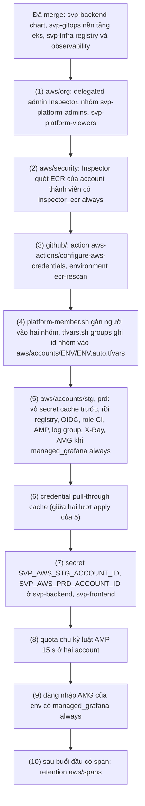

# Runbook: áp nền tảng managed lần đầu (registry, observability, Inspector, CI ECR)

← [edge-setup](edge-setup.md) · [Mục lục](README.md) · [github-setup, bước 7](github-setup.md#thứ-tự-trên-một-account-mới) →

> **Tóm tắt**
>
> - **Làm gì:** áp và kiểm phần sống lâu của nền tảng managed: Inspector của tổ chức, hai nhóm nền tảng của IAM Identity Center,
>   environment `ecr-rescan` và action AWS của hai repo code, registry ECR, role CI, role plan và observability ở hai account env; rồi các
>   bước tay Terraform không làm: credential của cache, secret account của CI, quota, xác minh CloudFront, đăng nhập AMG, retention của
>   `aws/spans`. Phần theo buổi (endpoint interface, role Pod Identity, luật trên AMP, dashboard) do `aws/envs/<env>` và Argo CD dựng.
> - **Khi nào và bao lâu:** một lần, ngoài buổi, sau [`edge-setup.md`](edge-setup.md), trước buổi stg đầu. Lệnh chạy khoảng một giờ;
>   quota và case Support chờ từ vài giờ tới vài ngày; bước (10) làm sau buổi đầu có span.
> - **Phí trong lúc chạy:** từ bước (5) mỗi account env giữ hai key KMS, bốn secret, lưu trữ ECR tăng theo số bản phát hành và, khi cờ
>   `managed_grafana` là `always`, workspace AMG; từ bước (2) Inspector tính mỗi digest bên thứ ba mới ở account có `inspector_ecr`
>   `always`. Số tiền ở [08. Account env, Chi phí](../handbook/08-accounts.md#chi-phí).

**Người học chạy mọi lệnh ở đây.** AI không chạy lệnh nào chạm account, kể cả lệnh chỉ đọc; AI đọc output dán lại. Mọi lệnh chạy từ gốc repo
này (`infra/`) trừ chỗ ghi `cd`. Bước nào đỏ thì dừng ở đó, dán output, không đi tiếp. Token và PAT chỉ đi qua prompt không echo hay stdin
của script (`cache-secrets.sh`, `make github-secrets`), không bao giờ nằm trên dòng lệnh, trong lịch sử shell hay trong file. Lệnh chạy
được trong zsh và bash. Cờ của từng account ở [`aws/paid-features.json`](../../aws/paid-features.json); đổi cờ theo
[`paid-features.md`](paid-features.md). Vì sao từng phần: [08. Account env](../handbook/08-accounts.md),
[05. Bảo mật](../handbook/05-security.md#amazon-inspector) (Inspector).

## Điều kiện trước

- [ ] **Code trên `main`**: `git switch main && git pull --ff-only` trong bản clone này; module `registry`, `observability`,
  `aws/security/inspector.tf`, environment `ecr-rescan` của `github/` đã merge. Phép thử trước khi dựng của ADR-0062, ADR-0063 (mục
  "Xác nhận": chép bản phát hành sang ECR `IMMUTABLE` rồi `cosign verify`, kéo qua cache theo tag rồi theo digest, đăng nhập AMG bằng
  Identity Center khác region) đã đạt ở account sandbox.
- [ ] **Baseline của hai account env** đã áp theo [`accounts-setup.md`](accounts-setup.md) (registry, observability, role CI tạo ở đó).
  Account dựng trước khi root có registry, observability: [N3](#n3-awsaccountsenv-thêm-registry-observability) dưới.
- [ ] **Budget đủ**: budget tổng của org đủ cho phí giữ cộng các buổi (lệnh đọc ở
  [`org-security-setup.md`](org-security-setup.md#mở-terminal)).
- [ ] **Credential để sẵn** (chưa dán vào đâu): PAT (classic) của GitHub chỉ scope `read:packages`, hạn 90 ngày (GitHub Packages chỉ nhận
  PAT classic); personal access token của Docker Hub quyền "Public Repo Read-only", hạn 90 ngày. Cách tạo và chỗ giữ bản sao: bước (6).
- [ ] **Trên máy**: Terraform 1.15, AWS CLI v2, `jq`, `gh` đăng nhập tài khoản admin của mọi repo (`gh auth status`, scope `repo`).

## Mở terminal

```sh
cd infra
AWS_PROFILE=anhnv-sso aws sso login --region us-east-1      # one login for every profile of the same sso_session
printf 'mgmt …%s\n' "${SVP_AWS_MGMT_ACCOUNT_ID: -4}"   # from .envrc (direnv), 4 last digits only
eval "$(aws/scripts/accounts.sh)"                           # sets the other five SVP_AWS_*_ACCOUNT_ID, no file
export SVP_SESSION_DIR="$PWD/.session/$(date -u +%Y%m%dT%H%M%SZ)"   # check-account.sh marks its timeline here
aws/scripts/check-account.sh mgmt
```

- **Mong đợi:** năm dòng `ok    SVP_AWS_<…>_ACCOUNT_ID: account svp-<tên>, ACTIVE` của `accounts.sh` (không in id) rồi `ok    account
  <12 số> of mgmt, arn:aws:sts::<12 số>:assumed-role/AWSReservedSSO_…`.
- **Bẫy:** `FAIL  no account svp-<tên> in the organization` thì `aws/org` chưa tạo account đó; `FAIL  profile anhnv-sso is account …` thì
  `SVP_AWS_MGMT_ACCOUNT_ID` sai. Mở lại terminal giữa chừng: đặt lại `SVP_AWS_MGMT_ACCOUNT_ID` và `SVP_SESSION_DIR`, chạy lại `eval` trên.

## Thứ tự áp lần đầu



| Bước | Nơi làm | Dán lại |
| --- | --- | --- |
| [(1)](#bước-1-awsorg) | `aws/org` | Dòng `Plan:`, `Apply complete!`, `No changes.` |
| [(2)](#bước-2-awssecurity) | `aws/security` | Dòng `Plan:`, `Apply complete!`, phần Inspector của "Kiểm nhanh" |
| [(3)](#bước-3-github) | `github/` | Dòng `Plan:`, `Apply complete!`, `No changes.` |
| [(4)](#bước-4-nhóm-nền-tảng) | Identity Center, tfvars | Dòng `ok` của `platform-member.sh count` mỗi nhóm, hai dòng `ok` của `tfvars.sh groups` |
| [(5)](#bước-5-awsaccountsenv), [(6)](#bước-6-credential-của-pull-through-cache) | `aws/accounts/stg`, `aws/accounts/prd` | Mỗi account: dòng `Plan:`, `Apply complete!`, `No changes.`, tên role, hai dòng `ok` của `cache-secrets.sh`, `validate`, kiểm role plan |
| [(7)](#bước-7-biến-ci-ecr) | GitHub | Các dòng `ok` của `make github-secrets` |
| [(8)](#bước-8-quota-chu-kỳ-luật-amp) | Service Quotas, Support Center | Dòng `ok`, `note` của `preflight.sh quotas`, số case |
| [(9)](#bước-9-grafana-managed) | AMG | Vai trò thấy được sau khi đăng nhập |
| [(10)](#bước-10-retention-của-awsspans) | log group `aws/spans` | Output `describe-log-groups` |

Tổ chức dựng mới theo [`org-security-setup.md`](org-security-setup.md) đã áp Inspector, nhóm nền tảng (bước (4), (5) của trang đó) và
[`accounts-setup.md`](accounts-setup.md) đã tạo registry, observability: bước (1), (2) chỉ còn kiểm (`No changes.`), bước (5) chỉ còn
lượt kiểm. Job ECR của `svp-backend`, `svp-frontend` (chép bản phát hành, promote prd, rescan) chỉ chạy được sau bước (7): chúng nhận
role của bước (5) và đọc secret của bước (7), nên PR thêm các job đó merge sau runbook này. Xoay PAT và token: mục
[Xoay credential](#xoay-credential).

## Bước (1): `aws/org`

```sh
aws/scripts/check-account.sh mgmt
cd aws/org
```

Lệnh `plan`, `apply` của [`org-security-setup.md`, bước (4)](org-security-setup.md#bước-4-awsorg-đủ).

- **Mong đợi:** tổ chức dựng mới: `No changes.` (delegated admin Inspector, hai nhóm đã có). Tổ chức dựng trước khi có Inspector và nhóm
  nền tảng: plan của [N1](#n1-awsorg-thêm-inspector-và-nhóm-nền-tảng). Plan lần hai `No changes.`. `cd ../..` khi xong.

## Bước (2): `aws/security`

```sh
aws/scripts/check-account.sh mgmt
cd aws/security
```

Lệnh `plan`, `apply` của [`org-security-setup.md`, bước (5)](org-security-setup.md#bước-5-awssecurity).

- **Mong đợi:** tổ chức dựng mới: `No changes.`. Root áp trước khi có Inspector: plan của [N2](#n2-awssecurity-thêm-inspector).
- **Kiểm:** phần Inspector của [`org-security-setup.md`, 5f](org-security-setup.md#5f-kiểm-nhanh): `ecr` `true`, mỗi account `ENABLED
  DISABLED DISABLED`, các thành viên có `inspector_ecr` khác `off` là `ENABLED`, account `off` không có. Plan lần hai `No changes.`.
  `cd ../..` khi xong.

## Bước (3): `github/`

```sh
aws/scripts/check-account.sh mgmt
```

Từ gốc `infra/` (không `cd github`: target `make github-*` chạy từ đó). Lệnh của
[`github-setup.md`, Lệnh người học chạy](github-setup.md#lệnh-người-học-chạy-plan-apply).

- **Mong đợi:** environment `ecr-rescan` và action AWS đã có thì `No changes.`; chưa có thì plan của
  [`github-setup.md`, Environment `ecr-rescan`](github-setup.md#environment-ecr-rescan-và-action-aws-cho-job-ecr) (`Plan: 4 to add, 2 to
  change, 0 to destroy`). Plan lần hai `No changes.`, rồi `make github-check` (chỉ đọc).

## Bước (4): nhóm nền tảng

Hai nhóm của Identity Center cấp quyền theo nhóm cho công cụ nền tảng của stg, prd: `svp-platform-admins` (vai trò `ADMIN` của Grafana;
Argo CD không SSO) và `svp-platform-viewers` (`VIEWER`). Code chỉ tạo nhóm; ai thuộc nhóm là quyết định về người, nên gán bằng
script lúc chạy, ở region của instance (đọc từ `sso_region` của `aws/org/org.auto.tfvars`):

```sh
aws/scripts/platform-member.sh add admins <user-name>
aws/scripts/platform-member.sh count admins
aws/scripts/platform-member.sh count viewers
```

- **Việc tay:** chọn user (user name như ở góc phải trên của AWS access portal); gỡ người: `remove admins <user-name>`.
- **Mong đợi:** `add` in `ok    <user-name> added to svp-platform-admins` (hay `skip  … is already a member`); `count` in `ok
  svp-platform-admins has N member(s)`, chỉ số lượng, không id. Ít nhất `1` ở nhóm admin.
- **Bẫy:** `FAIL  no user <user-name> in Identity Center` là tên sai hay user chưa tạo
  ([`org-security-setup.md`, Profile gốc](org-security-setup.md#profile-gốc-anhnv-sso)); `FAIL  terraform output platform_admin_group_id
  of aws/org` là `aws/org` chưa áp bước (1) hay chưa `init`.

Ghi id hai nhóm vào `<env>.auto.tfvars` của hai root `aws/accounts/<env>` (git bỏ qua; repo public không giữ id nhóm), không in giá trị:

```sh
aws/scripts/tfvars.sh example aws/accounts/stg      # only when the file is missing
aws/scripts/tfvars.sh groups stg
aws/scripts/tfvars.sh example aws/accounts/prd
aws/scripts/tfvars.sh groups prd
```

- **Mong đợi:** mỗi `groups` in `ok    aws/accounts/<env>/<env>.auto.tfvars: platform_admin_group_id, platform_viewer_group_id from
  aws/org written (N lines, mode 600)` (hay `already as written, file unchanged` khi chạy lại). Script chỉ đổi hai dòng đó.
- **Bẫy:** file có biến đó hai lần thì `FAIL … is set more than once` và không ghi gì: giữ một dòng rồi chạy lại.

## Bước (5): `aws/accounts/<env>`

Ví dụ là stg; với prd thay `stg` bằng `prd`, `anhnv-stg` bằng `anhnv-prd`, `SVP_AWS_STG_ACCOUNT_ID` bằng `SVP_AWS_PRD_ACCOUNT_ID`. Làm stg
theo thứ tự 5a, bước (6) (ghi credential vào hai secret), 5b, rồi prd: vòng `validate` ở cuối 5b đọc credential của bước (6). Account dựng
theo `accounts-setup.md` đã có mọi tài nguyên: bỏ 5a, làm 5b (plan mong `No changes.`) và phần kiểm, bước (6) trước vòng `validate` nếu
chưa ghi credential.

### 5a. Vỏ secret cache trước

Rule cache của GHCR, Docker Hub trỏ secret có credential (`credentialArn`); API tạo rule có lỗi `SecretNotFoundException`,
`UnableToAccessSecretException`. Nên vỏ hai secret đi trước bằng một lượt apply có `-target`, giá trị ghi ở bước (6), rồi mới tới lượt đủ:

```sh
aws/scripts/check-account.sh stg
cd aws/accounts/stg
AWS_PROFILE=anhnv-stg TF_VAR_account_id="$SVP_AWS_STG_ACCOUNT_ID" terraform init -backend-config=../../backend-stg.hcl
AWS_PROFILE=anhnv-stg TF_VAR_account_id="$SVP_AWS_STG_ACCOUNT_ID" TF_VAR_backup_account_id="$SVP_AWS_BACKUP_ACCOUNT_ID" terraform plan \
  -target='module.registry.aws_secretsmanager_secret.cache' -out=stg.tfplan
```

- **Mong đợi:** `Plan: 2 to add, 0 to change, 0 to destroy`: đúng `module.registry.aws_secretsmanager_secret.cache["ghcr"]`,
  `["docker-hub"]`; cảnh báo "Resource targeting is in effect" là đúng ý. Khác thì dừng, dán plan.

```sh
AWS_PROFILE=anhnv-stg TF_VAR_account_id="$SVP_AWS_STG_ACCOUNT_ID" TF_VAR_backup_account_id="$SVP_AWS_BACKUP_ACCOUNT_ID" terraform apply stg.tfplan && rm stg.tfplan
cd ../../..
```

Làm bước (6) cho account này, rồi quay lại lượt đủ.

### 5b. Lượt đủ

```sh
aws/scripts/check-account.sh stg
cd aws/accounts/stg
AWS_PROFILE=anhnv-stg TF_VAR_account_id="$SVP_AWS_STG_ACCOUNT_ID" TF_VAR_backup_account_id="$SVP_AWS_BACKUP_ACCOUNT_ID" terraform plan -out=stg.tfplan
```

- **Mong đợi:** chỉ thêm đúng các dòng của danh sách ở [`accounts-setup.md`, N1](accounts-setup.md#n1-phần-của-root-và-số-tài-nguyên)
  (cột của env này, theo `aws/paid-features.json` của repo: cả stg lẫn prd không có AMG giữa các buổi) trừ hai secret đã có; dòng cuối
  có dạng `Plan: <n> to add, 0 to change, 0 to destroy`.
- **Bẫy:** có `change`, `destroy` hay tài nguyên của `module.baseline`, `module.alarms`: dừng, dán plan. Lệnh `plan` trần ở đây tính
  trạng thái giữa buổi: biến `session_open` mặc định `false`, nên env có `managed_grafana` `session` không có workspace AMG. Trong một buổi,
  root này chỉ apply qua `aws/scripts/tf.sh <env> account` ([bước mở tính năng của buổi](session-stg-deploy.md)): lệnh trần lúc đó xoá
  workspace mà cluster đang dùng.

```sh
AWS_PROFILE=anhnv-stg TF_VAR_account_id="$SVP_AWS_STG_ACCOUNT_ID" TF_VAR_backup_account_id="$SVP_AWS_BACKUP_ACCOUNT_ID" terraform apply stg.tfplan && rm stg.tfplan
# Expect: No changes.
AWS_PROFILE=anhnv-stg TF_VAR_account_id="$SVP_AWS_STG_ACCOUNT_ID" TF_VAR_backup_account_id="$SVP_AWS_BACKUP_ACCOUNT_ID" terraform plan
AWS_PROFILE=anhnv-stg TF_VAR_account_id="$SVP_AWS_STG_ACCOUNT_ID" terraform output -json ci_role_arns | jq -r 'keys[]'
cd ../../..
for p in ghcr docker-hub quay k8s ecr-public; do
  AWS_PROFILE=anhnv-stg aws ecr validate-pull-through-cache-rule --ecr-repository-prefix "$p" --region ap-southeast-1 \
    --query '[ecrRepositoryPrefix,isValid,failure]' --output text
done
```

- **Mong đợi:** lệnh `output` in đúng tên role của `ci_roles` ở `locals` của root: stg `svp-ci-ecr-release-backend`,
  `svp-ci-ecr-release-frontend` và hai `svp-ci-ecr-rescan-*`; prd `svp-ci-ecr-promote` và hai `svp-ci-ecr-rescan-*`. Vòng `validate`: mỗi
  rule một dòng `<tiền tố> True None`.
- **Bẫy:** `False` ở `ghcr` hay `docker-hub` kèm `failure` là credential của bước (6) sai: ghi lại theo bước đó rồi chạy lại vòng
  `validate`. Apply đỏ ở `aws_grafana_workspace` (env có `managed_grafana` `always`) khi Identity Center chưa bật cho AMG ở account thành
  viên hay khác region không đăng nhập được: dừng, dán lỗi (phép thử trước khi dựng của ADR-0063 đã kiểm điều này).

### Role plan của CI

Role chỉ đọc `svp-ci-terraform-plan` (module `ci_plan_role`, ở cả hai account) không nằm trong `ci_roles`; `plan` của root tạo bốn tài
nguyên của nó và sửa tại chỗ key policy `module.baseline.aws_kms_key.state` (statement `CiPlanReadsState`). Vì sao role có quyền này:
[14. CI](../handbook/14-ci.md#role-plan-svp-ci-terraform-plan). Sau apply (từ `infra/`):

```sh
cd aws/accounts/stg
AWS_PROFILE=anhnv-stg TF_VAR_account_id="$SVP_AWS_STG_ACCOUNT_ID" terraform output -raw ci_plan_role_arn
cd ../../..   # về gốc infra/ cho các lệnh sau
AWS_PROFILE=anhnv-stg aws iam get-role --role-name svp-ci-terraform-plan --region us-east-1 \
  --query 'Role.{Max:MaxSessionDuration,Sub:AssumeRolePolicyDocument.Statement[0].Condition.StringEquals}' --output json
AWS_PROFILE=anhnv-stg aws iam list-attached-role-policies --role-name svp-ci-terraform-plan --region us-east-1 \
  --query 'AttachedPolicies[].PolicyName' --output text
AWS_PROFILE=anhnv-stg aws iam list-role-policies --role-name svp-ci-terraform-plan --region us-east-1 --query PolicyNames --output text
key=$(AWS_PROFILE=anhnv-stg aws kms describe-key --key-id alias/svp-tfstate --region ap-southeast-1 --query KeyMetadata.KeyId --output text)
AWS_PROFILE=anhnv-stg aws kms get-key-policy --key-id "$key" --region ap-southeast-1 --output text --query Policy \
  | jq -r '.Statement[].Sid'
```

- **Mong đợi:** ARN `arn:aws:iam::<account>:role/svp-ci-terraform-plan` với account của env; `Max` là `3600`, `Sub` có đúng hai khoá
  `token.actions.githubusercontent.com:aud` = `sts.amazonaws.com` và `token.actions.githubusercontent.com:sub` bằng `subject` của lời gọi
  module (`local.github_infra` + `:environment:terraform-plan`); policy gắn là `ReadOnlyAccess`; hai policy inline
  `svp-ci-terraform-plan-deny`, `svp-ci-terraform-plan-read`; Sid của key policy có `CiPlanReadsState` cạnh `AccountAdministersKey`,
  `SvpAdminUsesKey`. Khác thì dừng và dán lại output.
- **Kiểm:** lượt plan thật đầu tiên trên PR (sau khi đặt secret và biến bật plan `SVP_TF_PLAN_ENVS` theo
  [`github-setup.md`](github-setup.md#environment-terraform-plan)) là phép kiểm cuối: refresh qua mà không `AccessDenied`.
- **Bẫy:** với file của repo không env nào có cờ `session`, nên `tf.sh <env> account` không làm gì; env có cờ `session` thì trong buổi root
  chỉ apply qua `aws/scripts/tf.sh <env> account plan --open` rồi `tf.sh <env> account apply`: plan mở buổi có cùng phần role.

## Bước (6): credential của pull-through cache

Module chỉ tạo vỏ `ecr-pullthroughcache/ghcr`, `ecr-pullthroughcache/docker-hub` (mã hoá bằng key `aws/secretsmanager`: ECR không nhận key
do khách hàng quản lý cho secret này); giá trị là JSON hai khoá `username`, `accessToken`
([08. Account env](../handbook/08-accounts.md#ecr-pull-through-cache)). Cùng PAT cho hai account. Mỗi account:

```sh
aws/scripts/cache-secrets.sh stg ghcr
aws/scripts/cache-secrets.sh stg dockerhub
```

- **Script hỏi:** user và token ở terminal (token không echo; stdin không phải terminal thì nhận `{"username": "…", "accessToken": "…"}`).
  Token phải đúng dạng của nơi cấp: `ghp_…` cho GHCR, `dckr_pat_…` cho Docker Hub.
- **Mong đợi:** `ok    entry ecr-pullthroughcache/ghcr of stg: version <8 ký tự> (value not shown); next: …`: dán hai dòng đó. Token đi
  vào lệnh ghi version mới qua pipe từ `printf` (lệnh có sẵn của shell nên không thành tiến trình), không lên dòng lệnh, file hay màn hình;
  lỗi của `aws` in ra đã cắt token. Mỗi lần chạy ghi một version mới nên chạy lại sau lỗi là an toàn.
- **Bẫy:** sai dạng thì `FAIL  the token is not of the form ghp_... (or is empty); nothing written`. `FAIL  no entry … in stg: apply
  aws/accounts/stg first` là lượt `-target` của 5a chưa chạy.
- **Việc tay:** tạo PAT và token giữ tay vì do bên thứ ba cấp, bằng chính tài khoản của người học: PAT classic scope `read:packages` ở
  <https://github.com/settings/tokens> (**Generate new token (classic)**), token Docker Hub quyền "Public Repo Read-only" ở Docker Hub →
  **Account settings** → **Personal access tokens**; hạn 90 ngày; cùng một cặp cho stg và prd. Giá trị chỉ hiện một lần: giữ bản sao
  trong password manager ngay lúc đó (Secrets Manager là chỗ duy nhất của chúng ở AWS; ghi lại một account sau này cần giá trị gốc). Đặt
  nhắc lịch trước hạn khoảng 7 ngày cho cả hai token; vòng xoay ở [Xoay credential](#xoay-credential).

## Bước (7): biến CI ECR

Hai secret repo `SVP_AWS_STG_ACCOUNT_ID`, `SVP_AWS_PRD_ACCOUNT_ID` ở `svp-backend` và `svp-frontend`: workflow dựng ARN role từ chúng
(region, tên role cố định trong workflow); là secret để GitHub che account ID trong log của repo public. Hai biến cùng tên đã nạp qua
direnv ([`operations.md`](../reference/operations.md#biến-account-và-direnv)), `gh` đăng nhập tài khoản admin của hai repo:

```sh
make github-secrets
```

- **Mong đợi:** mỗi repo hai dòng `ok    secret SVP_AWS_<STG|PRD>_ACCOUNT_ID of <repo>`. Giá trị đi qua stdin của `gh`.
- **Kiểm:** `gh secret list -R anhnvcoder/<repo>` (chỉ in tên) có hai tên đó.
- **Bẫy:** biến thiếu hay không đủ 12 chữ số: `FAIL  SVP_AWS_<…>_ACCOUNT_ID is not set` (hay `is not 12 digits`) và chưa secret nào được
  ghi.

Lệnh này là bước 7 của [`github-setup.md`, Thứ tự trên một account mới](github-setup.md#thứ-tự-trên-một-account-mới). Secret không có
resource Terraform (giá trị sẽ nằm rõ trong state): [`github/README.md`](../../github/README.md#không-quản-và-vì-sao). Secret account
của CI plan (environment `terraform-plan` của `svp-infra`, cho role plan của bước (5)) đặt khi bật plan cho env: `make github-secrets
ENV=<stg|prd>`, thứ tự ở [`github-setup.md`](github-setup.md#environment-terraform-plan).

## Bước (8): quota chu kỳ luật AMP

Chart ghi `interval: 15s` vào mỗi nhóm luật như k3d; AMP mặc định tối thiểu 30 s, chỉnh được qua quota "Rule evaluation interval"
([AMP quotas](https://docs.aws.amazon.com/prometheus/latest/userguide/AMP_quotas.html)). Cùng lệnh đọc mọi quota của `quota_table` trong
`aws/scripts/preflight.sh` (một nguồn cho mọi runbook): EC2 vCPU on-demand và Spot, Elastic IP, chu kỳ luật AMP; account mới có quota
EC2 mặc định (5 cho mỗi mã ở `ap-southeast-1`), chưa đủ cho buổi. Mức vCPU của prd cộng thêm `limits.cpu` của NodePool đọc từ
`origin/main` của `svp-gitops`. Mỗi account (stg rồi prd):

```sh
aws/scripts/preflight.sh quotas stg
aws/scripts/preflight.sh quotas stg request
```

- **Mong đợi:** lệnh đầu in mỗi quota một dòng: `ok    <mã> <tên>: <giá trị> (min|max <cần>)` khi đủ, dòng của AMP là `ok    L-… AMP rule
  evaluation interval (seconds): 15.0 (max 15)`; `FAIL  <mã> <tên>: <giá trị>, needs min|max <cần>: run preflight.sh quotas <env>
  request` khi thiếu. Lệnh sau là lệnh duy nhất ghi: mỗi quota thiếu một yêu cầu, in `note  <mã> <tên>: <giá trị>, asked for <cần> (<id>
  PENDING|CASE_OPENED): wait for APPROVED, then run quotas again`; quota đã có yêu cầu mở thì `note  … a request is already open … not
  sent again`.
- **Kiểm:** chờ `APPROVED` (account mới thường vài giờ tới 1–2 ngày) rồi chạy lại lệnh đầu tới khi mọi dòng `ok`. Mỗi yêu cầu thành một
  case loại "Service limits" trong Support Center của account đó.
- **Bẫy:** quota AMP bị Service Quotas từ chối: mục dưới.

### Khi Service Quotas từ chối: mở case Support

Quota này là chu kỳ **tối thiểu**, xin 15 là xin giảm, nên API Service Quotas từ chối (script in `FAIL  service-quotas
request-service-quota-increase …` với `IllegalArgumentException … greater than the default quota value of 30.0`). Đường còn lại là một
case Support, gói Basic mở được loại này. Mỗi account một case (quota tính theo account):

1. Đăng nhập AWS access portal, chọn đúng account (`svp-stg`, rồi `svp-prd`), role `SvpAdmin`. Case mở ở account nào thì chỉ quota của
   account đó đổi.
2. Mở [Support Center](https://support.console.aws.amazon.com/support/home), **Create case**, chọn **Service limit increase** (không chọn
   Technical: gói Basic không mở được).
3. Điền: Service **Service Limit Increase**, Category **General**, Severity **General question**; Contact method **Web**.
4. Subject, Description chép từ khối dưới, thay `<env>`. Mã quota lấy ở dòng `L-…` mà `preflight.sh quotas <env>` in (`L-8DEDEE8E` ở
   `ap-southeast-1`).

   ```text
   Subject: Amazon Managed Service for Prometheus: lower "Rule evaluation interval" (L-8DEDEE8E) to 15 seconds in ap-southeast-1

   Description:
   Service: Amazon Managed Service for Prometheus (AMP)
   Region: ap-southeast-1
   Quota: Rule evaluation interval (quota code L-8DEDEE8E)
   Current value: 30 seconds (default)
   Requested value: 15 seconds

   Use case: the alerting and recording rules of our AMP workspace (environment <env>) use a 15 second evaluation
   interval, the same as the self-managed Prometheus they come from, so that alert latency and recording rule
   resolution stay the same on AMP. The workspace has few rule groups and a small number of series.

   Why a support case: the Service Quotas API rejects this request (IllegalArgumentException: the requested value
   must be greater than the default quota value of 30.0), because this quota is a minimum interval and the request
   lowers it.
   ```

5. **Submit**. Ghi id case vào thư mục buổi, không vào file commit (một file cho mọi case Support, cả case xác minh CloudFront):
   `printf '%s\t<env>\tamp-rule-interval\t<case-id>\n' "$(date -u +%FT%TZ)" >>"$SVP_SESSION_DIR/support-cases.tsv"` (ngoài buổi: ghi chú
   của người học).

- **Mong đợi:** AWS trả lời qua email root của account đó và ở **Your support cases**. Sáng hôm sau `aws/scripts/preflight.sh quotas
  <env>` in `ok    L-… AMP rule evaluation interval (seconds): 15.0 (max 15)`.
- **Bẫy:** case bị từ chối: không chạy buổi có luật trên AMP; báo AI (ADR-0063 §5: quyết lại bằng ADR mới, không chạy với 30 s). Buổi stg
  đầu kiểm chu kỳ thật ở phép kiểm cảnh báo của runbook buổi.

### Xác minh CloudFront của account workload

Account mới chưa dùng được CloudFront tới khi AWS xác minh. Trên console của từng account (access portal, permission set `SvpAdmin`),
Support Center mở bằng ô chat với trợ lý AI: gõ yêu cầu, ví dụ `Please verify this new account so it can create Amazon CloudFront
distributions. It is a member account of organization <o-…> (management account <id>), used for a <staging|production> environment.`;
trợ lý không tự giải quyết được thì hiện form tạo case đã điền sẵn.

- **Việc tay:** giữ tay vì xác minh là case ở Support Center, và AWS Support API chỉ dùng được với gói Support trả phí (Business Support
  trở lên; [nguồn](https://docs.aws.amazon.com/awssupport/latest/user/about-support-api.html)) mà lab không mua. Kiểm Case type "Account
  and billing", Service "Account Activation", Category "Account Verification", Severity "General question", liên lạc qua Web, rồi
  Submit; dán số case. Ghi id case cùng file với case quota AMP:
  `printf '%s\t<account>\tcloudfront-verify\t<case-id>\n' "$(date -u +%FT%TZ)" >>"$SVP_SESSION_DIR/support-cases.tsv"`.
- **Mong đợi:** AWS trả lời qua email root của account đó và ở **Your support cases**. Buổi stg, prd chỉ bắt đầu khi quota đã duyệt và case
  đã xong.
- **Bẫy:** không có API đọc trạng thái xác minh, nên bảng dưới giữ trạng thái theo account; đổi dòng của account khi case xong.

| Account | Xác minh CloudFront | Việc |
| --- | --- | --- |
| management | case đã mở | chờ AWS trả lời; id case ở `support-cases.tsv` |
| `svp-stg` | dùng được: account từng có distribution tạo trên console | không cần case |
| `svp-prd` | chưa kiểm | apply đầu có CloudFront (`aws/envs/prd`) đỏ ở `aws_cloudfront_distribution` với `AccessDenied: Your account must be verified before you can add new CloudFront resources`: mở case như trên từ account prd, gỡ buổi, chờ xác nhận |

## Bước (9): Grafana managed

Root `aws/envs/<env>` đọc id workspace AMG từ tham số SSM `/svp/<env>/grafana-workspace-id` mà `aws/accounts/<env>` ghi cùng workspace (AMG
không có data source tìm theo tên), nên không có id nào phải chép vào `<env>.auto.tfvars`. Theo cờ `managed_grafana` của env:

- `always` (env vắng khỏi file, như prd trong buổi prd): workspace có từ lúc áp cờ đó. Mở `grafana_url` của account
  (`AWS_PROFILE=anhnv-prd terraform -chdir=aws/accounts/prd output -raw grafana_url`) trên trình duyệt, **Sign in with AWS IAM Identity
  Center** bằng user của bước (4).
- `session`: không có workspace giữa các buổi, output `grafana_url` là `null`. Đăng nhập lần đầu ở buổi đầu có cờ này, sau [bước mở tính
  năng của buổi](session-stg-deploy.md), cùng cách và cùng mong đợi.
- `off` (stg và prd theo file của repo): không bao giờ có workspace, `grafana_url` là `null`, root env đưa `grafanaUrl` rỗng vào cluster:
  bước này không có gì để làm. Đăng nhập lần đầu ở buổi đầu đổi cờ sang giá trị khác (prd: buổi prd;
  [`paid-features.md`](paid-features.md)).

- **Mong đợi:** vào được; user nhóm admin thấy mục **Administration**, user nhóm viewer chỉ xem. Dashboard và data source chưa có: Grafana
  Operator tạo chúng trong buổi. Dán vai trò thấy được (không dán URL).

## Bước (10): retention của `aws/spans`

X-Ray tạo log group `aws/spans` khi span đầu tiên tới (buổi đầu của env); Terraform không tạo hay nhận được nó, nên retention đặt tay một
lần mỗi account ([08. Account env](../handbook/08-accounts.md#amazon-cloudwatch-logs-và-aws-x-ray)). Sau buổi đầu có span của env đó, in
lệnh từ output, đọc, rồi chạy đúng lệnh đã in:

```sh
aws/scripts/check-account.sh stg
AWS_PROFILE=anhnv-stg terraform -chdir=aws/accounts/stg output -raw spans_retention_command; echo
AWS_PROFILE=anhnv-stg aws logs describe-log-groups --log-group-name-prefix aws/spans --region ap-southeast-1 \
  --query 'logGroups[].[logGroupName,retentionInDays]' --output text
```

- **Mong đợi:** lệnh in ra có dạng `AWS_PROFILE=anhnv-stg aws logs put-retention-policy --log-group-name aws/spans --retention-in-days <n>
  --region ap-southeast-1`; chạy nó không in gì là thành công. Sau đó `describe-log-groups` in `aws/spans <n>` (`<n>` là
  `span_retention_days` của env); `None` là chưa đặt. Đổi `span_retention_days` thì chạy lại.
- **Bẫy:** `ResourceNotFoundException`, hay `describe-log-groups` không in dòng nào: X-Ray chưa nhận span, làm sau buổi kế.

## Xoay credential

| Credential | Hạn | Xoay |
| --- | --- | --- |
| PAT GitHub `read:packages`, token Docker Hub của cache | 90 ngày | trước hạn: tạo mới, ghi theo bước (6) ở hai account, chạy vòng `validate` của bước (5), rồi thu hồi bản cũ trên GitHub, Docker Hub |
| Token của service account `svp-grafana-operator` (AMG) | 1 ngày | tự: mỗi `bootstrap.sh <env> secrets` xoá mọi token cũ rồi tạo token mới vào entry `svp/<env>/grafana-operator` |
| Secret account của CI (bước 7) | không hạn | chỉ khi account đổi: chạy lại bước (7) |

Cache hết credential (PAT hết hạn) thì ECR vẫn trả bản đã cache, nhưng image chưa cache kéo lỗi: làm nóng cache của buổi đỏ ở dòng của GHCR,
Docker Hub. Một PAT hay token lộ: thu hồi nó trên GitHub, Docker Hub trước (giữ tay, trên trang của họ), rồi tạo bản mới và ghi bằng
`cache-secrets.sh` như bước (6).

Token AMG lộ giữa buổi: chạy lại `aws/scripts/bootstrap.sh <env> secrets` (xoá mọi token cũ, ghi token mới). Ngoài buổi, xoá token còn lại
(env có `managed_grafana` `session` thì ngoài buổi không có workspace, cũng không token nào; env có `off`, stg và prd với file của repo,
không bao giờ có). Terminal có các biến của [Mở terminal](#mở-terminal) (`grafana-tokens.sh` đối chiếu account của profile với biến
account của env). Ví dụ là stg; với prd thay như bước (5). Đọc trước:

```sh
aws/scripts/grafana-tokens.sh stg list
```

- **Mong đợi:** `ok    svp-grafana-operator of stg: N token(s)` rồi mỗi token một dòng `note  token <id> expires <hạn>`. Không có workspace
  thì `skip  no Grafana workspace in stg …, so no token`, cờ `off` thì `skip  managed_grafana of stg is off …` trước mọi lệnh gọi AWS:
  không còn gì để thu hồi.
- **Bẫy:** account sai thì `FAIL  profile anhnv-stg is account …: stop here and check the profile` và dừng: dán dòng lỗi.

Rồi xoá mọi token (script kiểm lại account ngay trước mỗi lần xoá và đọc lại sau khi xoá):

```sh
aws/scripts/grafana-tokens.sh stg revoke
```

- **Mong đợi:** `ok    token <id> deleted` mỗi token và dòng cuối `ok    no token of svp-grafana-operator left in stg`.
- **Bẫy:** còn token thì `FAIL  tokens of svp-grafana-operator left after the deletes: …`: chạy lại lệnh. Không đọc khoá của token: API chỉ
  trả khoá lúc tạo.

## Gỡ

Mọi thứ của runbook này sống suốt lab. Gỡ hẳn registry, observability, role CI của một env cùng baseline của nó:
[`lab-teardown.md`, `aws/accounts/<env>`](lab-teardown.md#awsaccountsenv). Nhóm nền tảng, delegated admin Inspector gỡ ở phần 1 của
[`aws/org`](lab-teardown.md#phần-1-trail-delegated-admin-quyền-sso); Inspector của `aws/security` ở
[`aws/security`](lab-teardown.md#awssecurity).
PAT, token của cache: thu hồi trên GitHub, Docker Hub.

## Khi một bước đỏ

- Lỗi ở `plan`: không có gì đổi trên account; đọc lỗi, sửa nguyên nhân (biến terminal, file `.auto.tfvars`, phiên SSO), chạy lại đúng bước.
- Lỗi giữa `apply`: phần đã tạo nằm trong state; `plan` lại cùng root chỉ còn phần chưa tạo. Dán lỗi và plan mới trước khi apply lại;
  `-target` và áp code của PR chưa merge: [`operations.md`, Khi apply lỗi giữa chừng](../reference/operations.md#khi-apply-lỗi-giữa-chừng).
- Plan có `destroy` hay `-/+` ở tài nguyên có sẵn (baseline, tổ chức, repo GitHub): dừng, không apply, dán plan. `-/+` lặp lại ở mọi plan là
  lỗi code, không phải việc apply thêm.

## Nâng cấp tổ chức dựng trước

Dùng khi tổ chức hay account env đã áp trước khi code có Inspector, nhóm nền tảng, registry hay observability. Làm N1 ở bước (1), N2 ở bước
(2), N3 ở bước (5).

### N1. `aws/org`: thêm Inspector và nhóm nền tảng

Apply `aws/org` trước `aws/security` (root đó cấu hình Inspector từ `svp-security`, cần delegated admin có sẵn), cùng lệnh `plan`, `apply`
của [`org-security-setup.md`, bước (4)](org-security-setup.md#bước-4-awsorg-đủ).

- **Mong đợi:** `Plan: 3 to add, 1 to change, 0 to destroy`: thêm `aws_inspector2_delegated_admin_account.security`,
  `aws_identitystore_group.platform["admins"]`, `aws_identitystore_group.platform["viewers"]`; đổi tại chỗ (`~`) chỉ tổ chức, chỉ một dòng
  `+ "inspector2.amazonaws.com"` trong `aws_service_access_principals`, không dòng `-` nào.
- **Bẫy:** dừng (không apply, dán plan lại) nếu có `destroy`, `-/+` hay thay đổi nào khác.
- **Kiểm:** sau apply, Inspector tự bật mọi loại quét ở `svp-security`; `aws/security` thu về chỉ ECR (N2). Plan lần hai `No changes.`; rồi
  ghi id nhóm theo bước (4).

### N2. `aws/security`: thêm Inspector

Sau N1, cùng lệnh plan, apply của [`org-security-setup.md`, bước (5)](org-security-setup.md#bước-5-awssecurity).

- **Mong đợi:** phần Inspector của plan là `1 to import`, `1 to change`: import và đổi `aws_inspector2_enabler.security`; thêm
  `aws_inspector2_organization_configuration.this`, một `aws_inspector2_member_association.members` mỗi thành viên có `inspector_ecr` khác
  `off`, `aws_inspector2_enabler.members`. Plan còn các thay đổi của cờ chi phí nếu root chưa áp chúng.
- **Bẫy:** dừng (không apply, dán plan lại) nếu có dòng `destroy`, thay đổi ngoài hai nhóm đó, hay Inspector không đúng như
  [`org-security-setup.md`, 5c](org-security-setup.md#5c-kiểm-plan-inspector).
- **Kiểm:** sau apply, phần Inspector của [5f](org-security-setup.md#5f-kiểm-nhanh), rồi plan lần hai `No changes.`.

### N3. `aws/accounts/<env>`: thêm registry, observability

Account đã có baseline mà chưa có registry, observability: làm 5a (vỏ secret), bước (6), rồi lượt đủ theo
[`accounts-setup.md`, Thêm vào account đã có baseline](accounts-setup.md#thêm-vào-account-đã-có-baseline) thay 5b (cùng lượt đó thêm mọi
phần còn thiếu khác), rồi phần kiểm của 5b và [Role plan của CI](#role-plan-của-ci).
