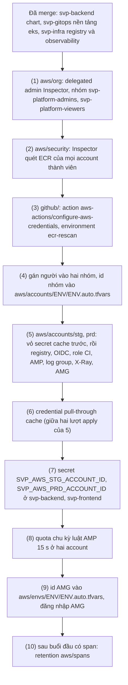

# Runbook: áp nền tảng managed lần đầu (registry, observability, Inspector, CI ECR)

Áp một lần phần sống lâu của nền tảng managed: Inspector của tổ chức, hai nhóm nền tảng của IAM Identity Center, environment
`ecr-rescan` và action AWS của hai repo code, registry ECR (repo phát hành, pull-through cache, role CI) và observability (workspace AMP, log
group ứng dụng, Transaction Search của X-Ray, Amazon Managed Grafana) ở hai account env; rồi các bước tay Terraform không làm: credential của
cache, secret account của CI, quota chu kỳ luật AMP, retention của `aws/spans`. Phần sống theo buổi (endpoint interface, role Pod Identity,
luật trên AMP, dashboard) do root `aws/envs/<env>` và Argo CD dựng, gỡ theo runbook buổi. Thiết kế:
[ADR-0062](https://github.com/anhnvcoder/svp-backend/blob/main/docs/adr/0062-ecr-registry-ci-oidc.md) (registry, cache, role CI, Inspector),
[ADR-0063](https://github.com/anhnvcoder/svp-backend/blob/main/docs/adr/0063-managed-observability.md) (AMP, CloudWatch Logs, X-Ray, AMG, luật),
[ADR-0064](https://github.com/anhnvcoder/svp-backend/blob/main/docs/adr/0064-interface-endpoints.md) (endpoint interface).

**Người học chạy mọi lệnh ở đây.** AI không chạy lệnh nào chạm account, kể cả lệnh chỉ đọc; AI đọc output dán lại. Mọi lệnh chạy từ gốc repo
này (`infra/`) trừ chỗ ghi `cd`. Bước nào đỏ thì dừng ở đó, dán output, không đi tiếp. Token và PAT chỉ đi qua stdin (prompt `read -s`, rồi
`printf`, lệnh có sẵn của shell nên không thành tiến trình), không bao giờ nằm trên dòng lệnh, trong lịch sử shell hay trong file. Lệnh
chạy được trong zsh (shell mặc định của macOS) và bash.

## Thứ tự áp lần đầu



| Bước | Root hay việc | Mục | Dán lại |
| --- | --- | --- | --- |
| (1) | `aws/org` | [Bước (1)](#bước-1-awsorg) | dòng `Plan:`, `Apply complete!`, `No changes.` |
| (2) | `aws/security` | [Bước (2)](#bước-2-awssecurity) | dòng `Plan:`, `Apply complete!`, output phần Inspector của "Kiểm nhanh" |
| (3) | `github/` | [Bước (3)](#bước-3-github) | dòng `Plan:`, `Apply complete!`, `No changes.` |
| (4) | Identity Center, tfvars | [Bước (4)](#bước-4-nhóm-nền-tảng) | số thành viên mỗi nhóm, hai dòng `2` |
| (5), (6) | `aws/accounts/stg`, `aws/accounts/prd` | [Bước (5)](#bước-5-awsaccountsenv), [Bước (6)](#bước-6-credential-của-pull-through-cache) | mỗi account: hai dòng `Plan:`, hai `Apply complete!`, `No changes.`, tên role, hai `VersionId` (che), `validate` |
| (7) | GitHub | [Bước (7)](#bước-7-biến-ci-ecr) | `gh secret list` (chỉ tên) |
| (8) | Service Quotas | [Bước (8)](#bước-8-quota-chu-kỳ-luật-amp) | mã quota, trạng thái yêu cầu |
| (9) | tfvars, AMG | [Bước (9)](#bước-9-grafana-managed) | dòng `1`, vai trò thấy được sau khi đăng nhập |
| (10) | log group `aws/spans` | [Bước (10)](#bước-10-retention-của-awsspans) | output `describe-log-groups` |

Job ECR của `svp-backend`, `svp-frontend` (chép bản phát hành vào ECR, promote prd, rescan) chỉ chạy được sau bước (7): chúng nhận role của bước
(5) và đọc secret của bước (7), nên PR thêm các job đó merge sau runbook này. Xoay PAT và token: mục [Xoay credential](#xoay-credential).

## Trước khi bắt đầu

1. **Code trên `main`**: `git switch main && git pull --ff-only` trong bản clone này; module `registry`, `observability`,
   `aws/security/inspector.tf`, environment `ecr-rescan` của `github/` đã merge. Phép thử trước khi dựng của ADR-0062, ADR-0063 (mục "Xác
   nhận": chép bản phát hành sang ECR `IMMUTABLE` rồi `cosign verify`, kéo qua cache theo tag rồi theo digest, đăng nhập AMG bằng Identity
   Center khác region) đã đạt ở account sandbox.
2. **Chi phí liên tục**: từ bước (5), mỗi account env giữ hai key KMS, bốn secret, workspace AMG (tính cả tháng không buổi) và lưu trữ ECR tăng theo
   số bản phát hành; từ bước (2) Inspector tính mỗi digest bên thứ ba mới. Bảng ở
   [ADR-0062 §11](https://github.com/anhnvcoder/svp-backend/blob/main/docs/adr/0062-ecr-registry-ci-oidc.md#11-chi-phí-registry) và
   [ADR-0063 §12](https://github.com/anhnvcoder/svp-backend/blob/main/docs/adr/0063-managed-observability.md#12-chi-phí-hợp-đồng-cluster-và-adr-cũ);
   budget của org đủ cho khoản đó cộng các buổi (lệnh đọc ở [`org-security-setup.md`](org-security-setup.md#mở-terminal)).
3. **Credential để sẵn** (chưa dán vào đâu): PAT (classic) của GitHub chỉ scope `read:packages`, hạn 90 ngày (GitHub Packages chỉ nhận PAT
   classic); personal access token của Docker Hub quyền "Public Repo Read-only", hạn 90 ngày. Ghi ngày hết hạn vào lịch của người học.
4. **Trên máy**: Terraform 1.15, AWS CLI v2, `jq`, `gh` đăng nhập tài khoản admin của mọi repo (`gh auth status`, scope `repo`).

## Mở terminal

```sh
cd infra
AWS_PROFILE=anhnv-sso aws sso login --region us-east-1      # cùng sso_session thì một lần cho mọi profile
export SVP_AWS_MGMT_ACCOUNT_ID=<12 số> SVP_AWS_LOG_ACCOUNT_ID=<12 số> SVP_AWS_SECURITY_ACCOUNT_ID=<12 số>
export SVP_AWS_STG_ACCOUNT_ID=<12 số> SVP_AWS_PRD_ACCOUNT_ID=<12 số>             # đọc trên trang SSO; không ghi vào file nào
export SVP_SESSION_DIR="$PWD/.session/$(date -u +%Y%m%dT%H%M%SZ)"                # check-account.sh ghi mốc ở đây
aws/scripts/check-account.sh mgmt
```

Tìm `ok    account <12 số> of mgmt, arn:aws:sts::<12 số>:assumed-role/AWSReservedSSO_…`. Mở lại terminal giữa chừng: đặt lại cả sáu biến.

## Bước (1): `aws/org`

```sh
aws/scripts/check-account.sh mgmt
cd aws/org
```

Theo [README `aws/org`, Thêm Inspector và nhóm nền tảng](../../aws/org/README.md#thêm-inspector-và-nhóm-nền-tảng-vào-tổ-chức-đã-áp): lệnh `plan`,
`apply` của bước (4) ở README đó, mong đợi `Plan: 3 to add, 1 to change, 0 to destroy` (delegated admin Inspector, hai nhóm; tổ chức chỉ thêm
`inspector2.amazonaws.com`), plan lần hai `No changes.`. `cd ../..` khi xong.

## Bước (2): `aws/security`

```sh
aws/scripts/check-account.sh mgmt
cd aws/security
```

Theo [README `aws/security`, Thêm Inspector vào root đã áp](../../aws/security/README.md#thêm-inspector-vào-root-đã-áp): mong đợi
`Plan: 1 to import, 5 to add, 1 to change, 0 to destroy`, đúng như mục "Kiểm plan Inspector" của README đó; sau apply phần Inspector của
[Kiểm nhanh](../../aws/security/README.md#6-kiểm-nhanh) (`ecr` `true`, mỗi account `ENABLED DISABLED DISABLED`, ba thành viên `ENABLED`), plan
lần hai `No changes.`. `cd ../..` khi xong.

## Bước (3): `github/`

```sh
aws/scripts/check-account.sh mgmt
cd github
```

Theo [README `github/`](../../github/README.md#thay-đổi-thường-gặp), đoạn "Environment `ecr-rescan` và action AWS cho job ECR": lệnh của mục "Lệnh
người học chạy", mong đợi `Plan: 4 to add, 2 to change, 0 to destroy` (environment `ecr-rescan` và luật nhánh `main` của nó ở hai repo;
`patterns_allowed` của `svp-backend`, `svp-frontend` thêm đúng `aws-actions/configure-aws-credentials@*`), plan lần hai `No changes.`. Rồi
`make github-check` (chỉ đọc). `cd ..` khi xong.

## Bước (4): nhóm nền tảng

Gán người vào hai nhóm trên console IAM Identity Center ở region của instance (`sso_region` của `aws/org/org.auto.tfvars`): **Groups** →
`svp-platform-admins` (vai trò `ADMIN` của Grafana) hay `svp-platform-viewers` (`VIEWER`) → **Add users**. Đọc lại số thành viên (không in id):

```sh
sso_region=<sso_region của aws/org/org.auto.tfvars>
store=$(AWS_PROFILE=anhnv-sso aws sso-admin list-instances --region "$sso_region" --query 'Instances[0].IdentityStoreId' --output text)
for g in platform_admin_group_id platform_viewer_group_id; do
  printf '%s: ' "$g"
  AWS_PROFILE=anhnv-sso aws identitystore list-group-memberships --identity-store-id "$store" --region "$sso_region" \
    --group-id "$(AWS_PROFILE=anhnv-sso terraform -chdir=aws/org output -raw "$g")" --query 'length(GroupMemberships)' --output text
done
```

Mong ít nhất `1` ở nhóm admin. Ghi id hai nhóm vào `<env>.auto.tfvars` của hai root `aws/accounts/<env>` (git bỏ qua; repo public không giữ id
nhóm), mỗi biến một dòng, không in giá trị:

```sh
for e in stg prd; do
  f=aws/accounts/$e/$e.auto.tfvars
  for g in platform_admin_group_id platform_viewer_group_id; do
    grep -q "^$g " "$f" || printf '%s = "%s"\n' "$g" "$(AWS_PROFILE=anhnv-sso terraform -chdir=aws/org output -raw "$g")" >>"$f"
  done
  grep -c -E '^platform_(admin|viewer)_group_id ' "$f"      # 2
done
```

Mỗi file in `2`. File đã có dòng của một biến (từ `.example`) thì lệnh không ghi thêm: sửa giá trị đó trong editor cho đúng output của `aws/org`.

## Bước (5): `aws/accounts/<env>`

Ví dụ là stg; với prd thay `stg` bằng `prd`, `anhnv-stg` bằng `anhnv-prd`, `SVP_AWS_STG_ACCOUNT_ID` bằng `SVP_AWS_PRD_ACCOUNT_ID`. Làm stg trọn bước
(5) và (6), rồi prd.

Rule cache của GHCR, Docker Hub trỏ secret có credential (`credentialArn`); API tạo rule có lỗi `SecretNotFoundException`,
`UnableToAccessSecretException`. Nên vỏ hai secret đi trước bằng một lượt apply có `-target`, giá trị ghi ở bước (6), rồi mới tới lượt đủ:

```sh
aws/scripts/check-account.sh stg
cd aws/accounts/stg
AWS_PROFILE=anhnv-stg TF_VAR_account_id="$SVP_AWS_STG_ACCOUNT_ID" terraform init -backend-config=../../backend-stg.hcl
AWS_PROFILE=anhnv-stg TF_VAR_account_id="$SVP_AWS_STG_ACCOUNT_ID" TF_VAR_backup_account_id="$SVP_AWS_BACKUP_ACCOUNT_ID" terraform plan \
  -target='module.registry.aws_secretsmanager_secret.cache' -out=stg.tfplan
```

Mong `Plan: 2 to add, 0 to change, 0 to destroy`: đúng `module.registry.aws_secretsmanager_secret.cache["ghcr"]`, `["docker-hub"]`; cảnh báo
"Resource targeting is in effect" là đúng ý. Khác thì dừng, dán plan. Rồi:

```sh
AWS_PROFILE=anhnv-stg TF_VAR_account_id="$SVP_AWS_STG_ACCOUNT_ID" TF_VAR_backup_account_id="$SVP_AWS_BACKUP_ACCOUNT_ID" terraform apply stg.tfplan && rm stg.tfplan
cd ../../..
```

Làm bước (6) cho account này, rồi quay lại lượt đủ:

```sh
aws/scripts/check-account.sh stg
cd aws/accounts/stg
AWS_PROFILE=anhnv-stg TF_VAR_account_id="$SVP_AWS_STG_ACCOUNT_ID" TF_VAR_backup_account_id="$SVP_AWS_BACKUP_ACCOUNT_ID" terraform plan -out=stg.tfplan
```

Mong chỉ thêm: stg `Plan: 46 to add, 0 to change, 0 to destroy`, prd `Plan: 44 to add, 0 to change, 0 to destroy`: danh sách ở
[README `aws/accounts`, Thêm vào account đã có baseline](../../aws/accounts/README.md#thêm-vào-account-đã-có-baseline) trừ hai secret đã có. Có
`change`, `destroy` hay tài nguyên của `module.baseline`, `module.alarms`: dừng, dán plan. Rồi:

```sh
AWS_PROFILE=anhnv-stg TF_VAR_account_id="$SVP_AWS_STG_ACCOUNT_ID" TF_VAR_backup_account_id="$SVP_AWS_BACKUP_ACCOUNT_ID" terraform apply stg.tfplan && rm stg.tfplan
# Expect: No changes.
AWS_PROFILE=anhnv-stg TF_VAR_account_id="$SVP_AWS_STG_ACCOUNT_ID" TF_VAR_backup_account_id="$SVP_AWS_BACKUP_ACCOUNT_ID" terraform plan
AWS_PROFILE=anhnv-stg TF_VAR_account_id="$SVP_AWS_STG_ACCOUNT_ID" terraform output -json ci_role_arns | jq -r 'keys[]'
cd ../../..
for p in ghcr docker-hub quay k8s ecr-public; do
  AWS_PROFILE=anhnv-stg aws ecr validate-pull-through-cache-rule --ecr-repository-prefix "$p" --region ap-southeast-1 \
    --query '[ecrRepositoryPrefix,isValid,failure]' --output text
done
```

Lệnh `output` in đúng tên role của `ci_roles` ở `locals` của root: stg `svp-ci-ecr-release-backend`, `svp-ci-ecr-release-frontend` và hai
`svp-ci-ecr-rescan-*`; prd `svp-ci-ecr-promote` và hai `svp-ci-ecr-rescan-*`. Mỗi rule một dòng `<tiền tố> True None`; `False` ở `ghcr` hay
`docker-hub` kèm `failure` là credential của bước (6) sai: ghi lại theo bước đó rồi chạy lại vòng `validate`.

Apply đỏ ở `aws_grafana_workspace` khi Identity Center chưa bật cho AMG ở account thành viên hay khác region không đăng nhập được: dừng, dán lỗi
(phép thử trước khi dựng của ADR-0063 đã kiểm điều này, khác kết quả đó là việc của ADR).

## Bước (6): credential của pull-through cache

Module chỉ tạo vỏ `ecr-pullthroughcache/ghcr`, `ecr-pullthroughcache/docker-hub` (mã hoá bằng key `aws/secretsmanager`: ECR không nhận key do khách
hàng quản lý cho secret này); giá trị là JSON hai khoá `username`, `accessToken`
([README module `registry`](../../aws/modules/registry/README.md#pull-through-cache)). Cùng PAT cho hai account. Mỗi account:

```sh
aws/scripts/check-account.sh stg
printf 'GitHub user: '; read -r u; printf 'PAT read:packages: '; read -rs t; echo
printf '{"username":"%s","accessToken":"%s"}' "$u" "$t" |
  AWS_PROFILE=anhnv-stg aws secretsmanager put-secret-value --secret-id ecr-pullthroughcache/ghcr \
    --secret-string file:///dev/stdin --region ap-southeast-1 --query VersionId --output text | cut -c 1-8
printf 'Docker Hub user: '; read -r u; printf 'Docker Hub token (Public Repo Read-only): '; read -rs t; echo
printf '{"username":"%s","accessToken":"%s"}' "$u" "$t" |
  AWS_PROFILE=anhnv-stg aws secretsmanager put-secret-value --secret-id ecr-pullthroughcache/docker-hub \
    --secret-string file:///dev/stdin --region ap-southeast-1 --query VersionId --output text | cut -c 1-8
unset u t
```

Mỗi lệnh `put-secret-value` in 8 ký tự đầu của `VersionId`; dán hai dòng đó. PAT của GitHub có dạng `ghp_…`, token Docker Hub `dckr_pat_…`: chỉ
chữ, số, `_`, nên `printf` dựng JSON không cần thoát ký tự. Lệnh lỗi thì token mất cùng shell này: chạy lại cả khối.

## Bước (7): biến CI ECR

Hai secret repo `SVP_AWS_STG_ACCOUNT_ID`, `SVP_AWS_PRD_ACCOUNT_ID` ở `svp-backend` và `svp-frontend`: workflow dựng ARN role từ chúng (region,
tên role cố định trong workflow); là secret để GitHub che account ID trong log của repo public. `gh secret set` đọc giá trị từ stdin:

```sh
for r in svp-backend svp-frontend; do
  printf '%s' "$SVP_AWS_STG_ACCOUNT_ID" | gh secret set SVP_AWS_STG_ACCOUNT_ID -R "anhnvcoder/$r"
  printf '%s' "$SVP_AWS_PRD_ACCOUNT_ID" | gh secret set SVP_AWS_PRD_ACCOUNT_ID -R "anhnvcoder/$r"
  gh secret list -R "anhnvcoder/$r" | grep -E '^SVP_AWS_(STG|PRD)_ACCOUNT_ID'
done
```

Mong hai dòng mỗi repo. Secret không có resource Terraform (giá trị sẽ nằm rõ trong state): bảng "Không quản" của
[`github/README.md`](../../github/README.md#không-quản-và-vì-sao).

## Bước (8): quota chu kỳ luật AMP

Chart ghi `interval: 15s` vào mỗi nhóm luật như k3d; AMP mặc định tối thiểu 30 s, chỉnh được qua quota "Rule evaluation interval"
([AMP quotas](https://docs.aws.amazon.com/prometheus/latest/userguide/AMP_quotas.html)). Workspace có từ bước (5). Mỗi account (stg rồi prd), tìm
mã quota rồi xin 15:

```sh
aws/scripts/check-account.sh stg
AWS_PROFILE=anhnv-stg aws service-quotas list-aws-default-service-quotas --service-code aps --region ap-southeast-1 \
  --query "Quotas[?contains(QuotaName, 'valuation interval')].[QuotaCode,QuotaName,Value,Adjustable]" --output text
AWS_PROFILE=anhnv-stg aws service-quotas request-service-quota-increase --service-code aps --quota-code <QuotaCode trên> \
  --desired-value 15 --region ap-southeast-1 --query 'RequestedQuota.[Id,Status]' --output text
```

Lệnh đầu in một dòng `L-… Rule evaluation interval 30.0 True` (tên chính xác có thể khác: dán cả dòng). Lệnh sau in id yêu cầu và `PENDING` hay
`CASE_OPENED`; đọc lại tới khi `APPROVED`:

```sh
AWS_PROFILE=anhnv-stg aws service-quotas get-requested-service-quota-change --request-id <Id trên> --region ap-southeast-1 \
  --query 'RequestedQuota.[Status,DesiredValue]' --output text
```

Service Quotas từ chối vì giá trị xin nhỏ hơn giá trị đang có (lỗi `IllegalArgumentException`, `InvalidParameterValue`): mở case trên console AWS
Support từ account đó (**Create case** → **Service limit increase** → Amazon Managed Service for Prometheus, quota "Rule evaluation interval",
giá trị 15 s, region `ap-southeast-1`), dán id case. AWS từ chối hẳn: không chạy buổi có luật trên AMP; báo AI (ADR-0063 §5: quyết lại bằng ADR
mới, không chạy với 30 s). Buổi stg đầu kiểm chu kỳ thật ở phép kiểm cảnh báo của runbook buổi.

## Bước (9): Grafana managed

AMG không có data source tìm theo tên, nên root `aws/envs/<env>` nhận id workspace qua biến `grafana_workspace_id` của `<env>.auto.tfvars` (git bỏ
qua). Id là nhãn đầu của output `grafana_url`, không đổi giữa các buổi:

```sh
for e in stg prd; do
  f=aws/envs/$e/$e.auto.tfvars
  ws=$(AWS_PROFILE=anhnv-$e terraform -chdir=aws/accounts/$e output -raw grafana_url | sed -E 's#^https://(g-[0-9a-z]+)\..*#\1#')
  grep -q '^grafana_workspace_id ' "$f" || printf 'grafana_workspace_id = "%s"\n' "$ws" >>"$f"
  grep -c '^grafana_workspace_id ' "$f"      # 1
done
unset ws
```

Mỗi file in `1`. File chưa có (env chưa có buổi nào): tạo theo điều kiện 5 của [`session-stg.md`](session-stg.md#điều-kiện-trước-buổi) trước.

Đăng nhập: mở `grafana_url` của mỗi account (`AWS_PROFILE=anhnv-stg terraform -chdir=aws/accounts/stg output -raw grafana_url`) trên trình duyệt,
**Sign in with AWS IAM Identity Center** bằng user của bước (4). Mong vào được, user nhóm admin thấy mục **Administration**, user nhóm viewer chỉ
xem. Dashboard và data source chưa có: Grafana Operator tạo chúng trong buổi. Dán vai trò thấy được (không dán URL).

## Bước (10): retention của `aws/spans`

X-Ray tạo log group `aws/spans` khi span đầu tiên tới (buổi đầu của env); Terraform không tạo hay nhận được nó, nên retention đặt tay một lần mỗi
account ([README module `observability`](../../aws/modules/observability/README.md#bước-tay-retention-của-awsspans)). Sau buổi đầu có span của
env đó, in lệnh từ output, đọc, rồi chạy đúng lệnh đã in:

```sh
aws/scripts/check-account.sh stg
AWS_PROFILE=anhnv-stg terraform -chdir=aws/accounts/stg output -raw spans_retention_command; echo
AWS_PROFILE=anhnv-stg aws logs describe-log-groups --log-group-name-prefix aws/spans --region ap-southeast-1 \
  --query 'logGroups[].[logGroupName,retentionInDays]' --output text
```

Lệnh in ra có dạng `AWS_PROFILE=anhnv-stg aws logs put-retention-policy --log-group-name aws/spans --retention-in-days <n> --region ap-southeast-1`.
Sau khi chạy nó, lệnh `describe-log-groups` in `aws/spans <n>` (`<n>` là `span_retention_days` của env); `None` là chưa đặt. Không có
dòng nào: X-Ray chưa nhận span, làm sau buổi kế.

## Xoay credential

| Credential | Hạn | Xoay |
| --- | --- | --- |
| PAT GitHub `read:packages`, token Docker Hub của cache | 90 ngày | trước hạn: tạo mới, ghi theo bước (6) ở hai account, chạy vòng `validate` của bước (5), rồi thu hồi bản cũ trên GitHub, Docker Hub |
| Token của service account `svp-grafana-operator` (AMG) | 1 ngày | tự: mỗi `bootstrap.sh <env> secrets` xoá mọi token cũ rồi tạo token mới vào entry `svp/<env>/grafana-operator` |
| Secret account của CI (bước 7) | không hạn | chỉ khi account đổi: chạy lại bước (7) |

Cache hết credential (PAT hết hạn) thì ECR vẫn trả bản đã cache, nhưng image chưa cache kéo lỗi: làm nóng cache của buổi đỏ ở dòng của GHCR,
Docker Hub. Một PAT hay token lộ: thu hồi nó trên GitHub, Docker Hub trước, rồi tạo, ghi bản mới như trên. Token AMG lộ giữa buổi: chạy lại
`aws/scripts/bootstrap.sh <env> secrets` (xoá mọi token cũ, ghi token mới); ngoài buổi, xoá token còn lại. Terminal có các biến của
[Mở terminal](#mở-terminal) (`check-account.sh` cần biến account và `SVP_SESSION_DIR`). Ví dụ là stg; với prd thay như bước (5). Đọc trước:

```sh
aws/scripts/check-account.sh stg
ws=$(AWS_PROFILE=anhnv-stg terraform -chdir=aws/accounts/stg output -raw grafana_url | sed -E 's#^https://(g-[0-9a-z]+)\..*#\1#')
sa=$(AWS_PROFILE=anhnv-stg aws grafana list-workspace-service-accounts --workspace-id "$ws" --region ap-southeast-1 \
  --query "serviceAccounts[?name=='svp-grafana-operator'].id | [0]" --output text)
AWS_PROFILE=anhnv-stg aws grafana list-workspace-service-account-tokens --workspace-id "$ws" --service-account-id "$sa" \
  --region ap-southeast-1 --query 'serviceAccountTokens[].[id,expiresAt]' --output text
```

Tìm `ok    account <12 số> of stg, …` rồi mỗi token một dòng id và hạn. `check-account.sh` dừng ở account khác: không làm tiếp, dán dòng lỗi.
Không dòng token nào: không còn gì để thu hồi. Rồi xoá từng token, lệnh xoá chỉ chạy khi account vẫn đúng:

```sh
aws/scripts/check-account.sh stg &&
  AWS_PROFILE=anhnv-stg aws grafana delete-workspace-service-account-token --workspace-id "$ws" --service-account-id "$sa" \
    --token-id <id trên> --region ap-southeast-1
```

Chạy lại lệnh `list-workspace-service-account-tokens` ở khối trên; mong không dòng nào.

## Khi một bước đỏ

- Lỗi ở `plan`: không có gì đổi trên account; đọc lỗi, sửa nguyên nhân (biến terminal, file `.auto.tfvars`, phiên SSO), chạy lại đúng bước.
- Lỗi giữa `apply`: phần đã tạo nằm trong state; `plan` lại cùng root chỉ còn phần chưa tạo. Dán lỗi và plan mới trước khi apply lại.
- Plan có `destroy` hay `-/+` ở tài nguyên có sẵn (baseline, tổ chức, repo GitHub): dừng, không apply, dán plan.
- Gỡ hẳn registry, observability của một env: mục "Gỡ baseline" của [README `aws/accounts`](../../aws/accounts/README.md#gỡ-baseline-có-chủ-đích).
