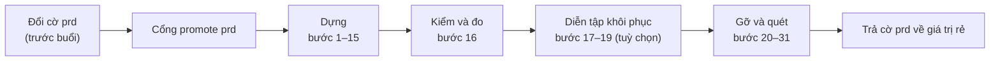

# Runbook: một buổi AWS prd

← [Gỡ buổi stg](session-stg-teardown.md) · [Mục lục](README.md) · [Dựng prd](session-prd-deploy.md) →

> **Tóm tắt**
>
> - **Làm gì:** dựng env prd mức production trong account `svp-prd`, chạy đúng commit `svp-gitops` mà stg đã chạy, đo (failover, drain
>   một AZ, khởi động lại một broker MSK), diễn tập khôi phục, gỡ sạch và trả cờ prd về giá trị rẻ, tất cả trong một buổi.
> - **Khi nào và bao lâu:** một lần trong lộ trình (buổi capstone), sau một buổi stg xanh với cùng code. Tối đa 4 giờ từ cổng promote tới
>   hai lượt `sweep.sh` sạch; đổi cờ và cổng promote làm trước mốc đó.
> - **Phí trong lúc chạy:** tính theo giờ từ lúc apply root env tới lúc gỡ sạch, cộng phần nền tảng, edge, transcode và backup của buổi;
>   số ở [Chi phí và giới hạn](#chi-phí-và-giới-hạn) và bảng [Chi phí](../handbook/15-cost.md#chi-phí).

Buổi prd là buổi capstone của lộ trình
([ADR-0078](https://github.com/anhnvcoder/svp-backend/blob/main/docs/adr/0078-paid-features-lean-defaults.md) §3): mở bằng đổi cờ
prd về giá trị production, kết thúc bằng trả prd về giá trị rẻ của file. Buổi dựng env prd trong account `svp-prd`
(`aws/envs/prd`, mức production: NAT mỗi AZ, RDS Multi-AZ, MSK ba broker trên ba AZ, ElastiCache primary và replica Multi-AZ, nhóm
node hệ thống và node Karpenter on-demand trải ba AZ, bảo vệ xoá), cài Argo CD và root GitOps qua tunnel SSM (`aws/gitops/prd`),
chạy đúng commit `svp-gitops` mà stg đã chạy, đo (thời gian dựng, failover RDS Multi-AZ, drain một AZ, khởi động lại một broker
MSK khi đang ghi, failover Valkey, alarm), diễn tập khôi phục (backup on-demand và copy sang account `svp-backup`, PITR của RDS,
một object S3 từ AWS Backup), rồi gỡ sạch trong cùng buổi. Các diễn tập, khi buổi chọn chạy (phép `chuẩn ngành`), là chỗ kiểm bù
của nhóm "giảm có điều kiện" ở stg
([ADR-0055](https://github.com/anhnvcoder/svp-backend/blob/main/docs/adr/0055-environment-matrix.md) §4).

Thiết kế nằm ở các ADR của repo code, mỗi cái một phần của buổi:

- [ADR-0048](https://github.com/anhnvcoder/svp-backend/blob/main/docs/adr/0048-prd-aws.md)
  (§4 truy cập API, §6 bootstrap EKS, §7 ghim revision, §8 promote, §9 kết thúc buổi, §10 chi phí)
- [ADR-0053](https://github.com/anhnvcoder/svp-backend/blob/main/docs/adr/0053-msk-elasticache-valkey.md)
  (Kafka là Amazon MSK, Valkey là ElastiCache; prd mất một AZ không mất event đã xác nhận)
- [ADR-0051](https://github.com/anhnvcoder/svp-backend/blob/main/docs/adr/0051-dns-prd-apex.md) (zone của mỗi env)
- [ADR-0052](https://github.com/anhnvcoder/svp-backend/blob/main/docs/adr/0052-cloudfront-flat-rate-free.md)
  (web ACL WAF; gói flat-rate Free chỉ ở media của stg)
- [ADR-0056](https://github.com/anhnvcoder/svp-backend/blob/main/docs/adr/0056-eks-platform-ha.md)
  (Karpenter, Envoy và Kyverno HA, trải zone)
- [ADR-0057](https://github.com/anhnvcoder/svp-backend/blob/main/docs/adr/0057-postgres17-verify-full.md)
  (PostgreSQL 17, `verify-full`, không proxy kết nối)
- [ADR-0058](https://github.com/anhnvcoder/svp-backend/blob/main/docs/adr/0058-managed-data-operations.md) (CloudWatch alarm tới email)
- [ADR-0061](https://github.com/anhnvcoder/svp-backend/blob/main/docs/adr/0061-edge-cloudfront-waf-acm.md)
  (edge: CloudFront, VPC origin, ALB internal, WAF, cert ACM, log CloudFront, DNS)
- [ADR-0062](https://github.com/anhnvcoder/svp-backend/blob/main/docs/adr/0062-ecr-registry-ci-oidc.md)
  (image từ ECR của account prd, chỉ vào qua `promote-prd`)
- [ADR-0063](https://github.com/anhnvcoder/svp-backend/blob/main/docs/adr/0063-managed-observability.md)
  (telemetry vào dịch vụ managed sống qua destroy)
- [ADR-0064](https://github.com/anhnvcoder/svp-backend/blob/main/docs/adr/0064-interface-endpoints.md)
  (endpoint interface ở mọi AZ của prd)
- [ADR-0066](https://github.com/anhnvcoder/svp-backend/blob/main/docs/adr/0066-mediaconvert-transcode.md)
  (transcode bằng AWS Elemental MediaConvert, giống hệt stg)
- [ADR-0067](https://github.com/anhnvcoder/svp-backend/blob/main/docs/adr/0067-backup-dr.md)
  (backup và DR, giống stg trừ retention, vault lock và OU của Backup policy)

Buổi prd đi đúng chuỗi script của buổi stg; khác biệt là dữ liệu (dòng `prd` của `env_table` trong `aws/scripts/lib.sh`: profile
`anhnv-prd`, biến `SVP_AWS_PRD_ACCOUNT_ID`, tunnel cổng 6443, file `teardown.tfvars`, không thang k6) và các bước tay ở các trang
này. Mọi mục chung với stg (luật chạy lệnh, thư mục buổi, mở lại terminal, ý nghĩa từng bước script, xác nhận email của alarm,
tunnel tới API, phép kiểm nền tảng, đổi secret) nằm ở [trang chủ buổi stg](session-stg.md): đọc nó trước, thay `stg` bằng `prd` và
`anhnv-stg` bằng `anhnv-prd`. Các trang prd chỉ ghi phần riêng của prd, và trỏ về mục tương ứng của stg ở chỗ prd chạy giống.

Mỗi bước và phép kiểm mang dòng `Loại:` `lõi` hay `chuẩn ngành` theo [mục Phép kiểm lõi và chuẩn ngành của trang chủ buổi
stg](session-stg.md#phép-kiểm-lõi-và-chuẩn-ngành); đường mặc định chỉ chạy `lõi`. Buổi này chạy với giá trị
production, nên phép `chuẩn ngành` không cần đổi cờ nào thêm: chọn chạy phép nào là chọn thời gian và chi phí ghi ở dòng `Loại:` của nó.
Phép kiểm prd mà tài liệu khác đặt ở buổi prd sau đó (so dữ liệu ở buổi kế) chỉ còn ở stg.

**Người học chạy mọi lệnh ở đây.** AI không chạy lệnh nào chạm account hay cluster, kể cả lệnh chỉ đọc; AI đọc output dán lại và nhắc tới
khi năm bước của mục [Kết thúc buổi](#kết-thúc-buổi) (gỡ, quét, trả cờ) đều xong. Lệnh in sẵn toàn bộ chuỗi script của buổi, không chạy gì:

```sh
aws/scripts/session.sh --print prd                 # mọi lệnh script của buổi, theo thứ tự, không chạy gì
```



## Chi phí và giới hạn

- **Trần một buổi C ≈ $11,0** = 4 giờ × (H₀ $0,90 + H_k $1,09)/giờ + O₀ $2,8 + O_k $0,22. Nguồn: ADR-0053 §16 và bảng ở phụ lục của nó;
  H_k là 3 broker `kafka.m7g.large` cộng 2 node `cache.m7g.large` cộng phần nhỏ; H₀, O₀ ở phụ lục ADR-0048. Cộng thêm:
  - node Karpenter on-demand ngoài nhóm hệ thống, KMS key và CloudWatch alarm (ADR-0056, ADR-0058);
  - phần edge (ALB, ba web ACL, log): bảng "Thêm mỗi buổi" ở phụ lục ADR-0061 §13;
  - phần nền tảng managed (endpoint interface ở mọi AZ, mẫu AMP, log, span, Inspector mỗi digest bên thứ ba mới, AMG của tháng
    buổi): bảng tổng ở [ADR-0063
    §12](https://github.com/anhnvcoder/svp-backend/blob/main/docs/adr/0063-managed-observability.md#12-chi-phí-hợp-đồng-cluster-và-adr-cũ)
    và phụ lục của nó;
  - phần transcode (job MediaConvert của buổi, endpoint `mediaconvert` ở mọi AZ, SQS, request S3; $0 lúc không buổi):
    [ADR-0066 §12](https://github.com/anhnvcoder/svp-backend/blob/main/docs/adr/0066-mediaconvert-transcode.md#12-chi-phí) và mục "Chi phí"
    của phụ lục;
  - phần backup mỗi buổi (instance `svp-prd-pitr` của diễn tập theo lớp của nguồn, key `uploads`, hai alarm backup, request và restore
    S3): cộng vào C. Bản copy ở `svp-backup` và ba key của vault sống giữa các buổi, báo riêng như R:
    [ADR-0067 §13](https://github.com/anhnvcoder/svp-backend/blob/main/docs/adr/0067-backup-dr.md#13-chi-phí) và mục "Chi phí" của phụ lục.

  Buổi đo số thật ở Cost Explorer. Cả buổi với giá trị production, gồm lượt bật lại của cờ:
  [ADR-0078 §8](https://github.com/anhnvcoder/svp-backend/blob/main/docs/adr/0078-paid-features-lean-defaults.md).
- **Phí giữ R ≈ $4,6/tháng** giữa các buổi (trail, KMS, bucket state của management; bucket state, KMS key, zone của hai baseline), báo
  riêng, không cộng vào C. Cộng phần edge lúc không buổi (key DNSSEC, topic và alarm DNSSEC, query log: bảng "Lúc không buổi" ở phụ lục
  ADR-0061 §13) và phần registry, observability lúc không buổi (key KMS, secret của cache, lưu trữ ECR: cùng bảng của ADR-0063 §12; giữa
  các buổi prd không có AMG). Tháng không buổi của cả org với giá trị rẻ của file:
  [ADR-0078 §8](https://github.com/anhnvcoder/svp-backend/blob/main/docs/adr/0078-paid-features-lean-defaults.md); đổi cờ prd trước và
  sau buổi: §3, §7.
- **Cả buổi 4 giờ**, từ cổng promote tới hai lượt `sweep.sh` sạch. Quá 3 giờ mà chưa đo xong thì bỏ phần đo còn lại, sang gỡ. Quên gỡ 24
  giờ ≈ $48 (24 × (H₀ + H_k)); budget `svp-prd-monthly` và budget tổng của org gửi email ở 50 %, 80 %, 100 %.
- Ba distribution của prd (web, api, media) và ba web ACL là pay-as-you-go, có access log; prd không đăng ký gói flat-rate nào. Web ACL sót
  tính phí theo giờ, nên `sweep.sh` bắt nó.
- MSK và ElastiCache dựng, gỡ lâu như stg ([mục Giới hạn của trang chủ buổi stg](session-stg.md#giới-hạn); số giả định của ADR-0053 §16,
  số đo của buổi stg thay nó khi đã có).

## Đổi cờ prd trước buổi

Loại: `lõi` (bước dựng prd ở giá trị production của buổi). Giữa các buổi prd có giá trị rẻ của `aws/paid-features.json` như stg;
buổi này chạy với giá trị production
([ADR-0078](https://github.com/anhnvcoder/svp-backend/blob/main/docs/adr/0078-paid-features-lean-defaults.md) §3). Làm trước buổi,
trước cổng promote và mốc bắt đầu 4 giờ, theo [`paid-features.md`](paid-features.md#sửa-file-cờ-qua-pr) và [Thứ tự apply
cờ](paid-features.md#thứ-tự-apply-cờ):

1. Một PR xoá khoá `prd` khỏi file (mọi cờ của prd thành `always`); `infra-ok` xanh, merge.
2. Áp theo hướng bật: `aws/baseline`, `aws/security`, `aws/accounts/prd`, mỗi root đọc plan rồi apply theo mục của root đó trong
   `paid-features.md`; plan chỉ chạm tài nguyên của bốn cờ (AMG `svp-prd`, Inspector, Security Hub, Config); plan lần hai `No changes.`
   ở cả ba.
3. Kiểm điều kiện **Cờ prd ở giá trị production** dưới (lệnh `jq`, mong `"absent"`).

Account dùng chung giữ giá trị của file suốt buổi. Buổi kết thúc bằng trả prd về giá trị rẻ: bước 5 của mục
[Gỡ, quét sót, trả cờ](#gỡ-quét-sót-trả-cờ).

## Điều kiện trước

- [ ] **Org, profile, baseline và DNS.** Root `aws/org` đã apply (account `svp-prd`, SCP, permission set `SvpAdmin` gán vào account đó);
  profile `anhnv-prd` đã ghi bằng `aws/scripts/sso-profiles.sh write`
  ([`org-security-setup.md`, 4c](org-security-setup.md#4c-profile-của-account-thành-viên)); baseline `aws/accounts/prd` đã apply và zone
  gốc `aws.<domain>` của nó đã được uỷ quyền bằng bốn bản ghi `NS` `aws` ở DNS cha của domain
  ([`accounts-setup.md`, bước 5](accounts-setup.md#bước-5-uỷ-quyền-zone-của-env)); zone `stg.aws.<domain>` là zone con của nó, uỷ quyền
  bằng `delegated_subdomains` của chính root `aws/accounts/prd`.
- [ ] **Buổi stg xong.** Buổi stg ở account `svp-stg` đã chạy xong theo [trang chủ buổi stg](session-stg.md), và mọi PR của code,
      `svp-gitops`, repo này đã merge.
- [ ] **Bằng chứng stg.** Commit `svp-gitops` sẽ promote (`stg_ref`) có commit status `argocd/stg` trạng thái `success` (Argo CD
  Notifications của stg ghi khi sync xong commit đó). Job `promote-prd` từ chối commit không có nó. `stg_ref` là commit ghi ở
  `stg-ref.txt` của thư mục buổi stg ([bước 16 của buổi stg](session-stg-check-release.md)) mà buổi đó đã qua các phép `lõi` (a), (f) của
  [mục Phép kiểm transcode](session-stg-check-edge-media.md#phép-kiểm-transcode): prd chạy đúng `platforms/` có bridge MediaConvert
  mà stg đã kiểm. Promote theo mục "Promote" của
  [README `svp-gitops`](https://github.com/anhnvcoder/svp-gitops/blob/main/README.md#promote), làm ở
  [Cổng promote prd](#cổng-promote-prd-trước-mọi-lệnh-tốn-tiền) dưới. Kiểm:

    ```sh
    gh api "repos/anhnvcoder/svp-gitops/commits/<stg_ref>/statuses" --jq '.[] | select(.context == "argocd/stg") | "\(.state) \(.created_at)"' | head -n 1
    ```

- [ ] **Xác minh CloudFront và quota.** AWS đã xác minh account prd cho CloudFront (case Support mở từ account prd, như điều kiện 1 của
  [trang chủ buổi stg](session-stg.md#điều-kiện-trước)) và quota EC2 on-demand đủ cho mọi node của prd, cả
  node Karpenter (NodePool prd on-demand). Đọc quota (chỉ đọc) ở terminal của buổi:

    ```sh
    aws/scripts/preflight.sh quotas prd
    ```

  - **Mong đợi:** mỗi quota một dòng `ok    <mã> <tên>: <giá trị> (min|max <cần>)`.
  - **Bẫy:** thiếu thì `FAIL  <mã> …: run preflight.sh quotas prd request`: xin tăng bằng đúng lệnh đó, chờ `APPROVED` trước buổi. Quota
    vCPU on-demand chuẩn (`L-1216C47A`) cần ≥ 14 vCPU cộng `limits.cpu` của NodePool prd (`envs/prd/svp-cluster.yaml` của `svp-gitops`,
    số ở ADR-0056 §2): nhóm node hệ thống tới `system_node_max_size` 6 node `m7g.large` × 2 vCPU, bastion `t4g.nano` 2 vCPU
    ([trang loại instance của AWS](https://aws.amazon.com/ec2/instance-types/)); số cần ở `quota_table` của script.
- [ ] **Công cụ.** Trên máy, ngoài các công cụ của stg: `gh` đã đăng nhập.
- [ ] **File cấu hình prd.** `aws/backend-prd.hcl` và `aws/envs/prd/prd.auto.tfvars` như [điều kiện 4, 5 của
      stg](session-stg.md#điều-kiện-trước) (root `aws/accounts/prd`; `domain = "aws.<domain>"`: tên zone prd, web ở
  đỉnh, API ở `api.aws.<domain>`; `alarm_email` là hộp thư nhận alarm). Root env đọc id workspace AMG `svp-prd` từ tham số SSM
  `/svp/prd/grafana-workspace-id` của `aws/accounts/prd`; dòng `grafana_workspace_id` có sẵn trong file thì script xoá:

    ```sh
    aws/scripts/tfvars.sh backend prd
    aws/scripts/tfvars.sh env prd
    ```

- [ ] **Không gói CloudFront nào.** prd không đăng ký gói flat-rate, nên một gói còn ở account là sót (của buổi trước hay của console),
  giữ distribution của nó. Mỗi buổi, trước bước 3 (chỉ đọc):

    ```sh
    aws/scripts/preflight.sh freetier prd
    ```

  - **Mong đợi:** `ok    no CloudFront flat-rate plan in prd` và `ok    account plan of prd is PAID` (account thành viên của tổ chức:
    `… is PAID (member of an organization, no account plan)`, cũng đạt); dán lại.
  - **Bẫy:** `FAIL  N CloudFront plan(s) left in prd …`: huỷ gói theo [mục Lệnh xoá tay theo loại (CloudFront) của trang chủ buổi
    stg](session-stg.md#lệnh-xoá-tay-theo-loại) với `AWS_PROFILE=anhnv-prd`, rồi chạy lại.
- [ ] **Nền bảo mật của org đã áp** tới ít nhất bước (3) của
  [`org-security-setup.md`](org-security-setup.md#thứ-tự-áp-lần-đầu), và biến `SVP_AWS_LOG_ACCOUNT_ID` đã nạp: như [điều kiện 6 của
  stg](session-stg.md#điều-kiện-trước) (root env prd ghi flow log, log WAF vào bucket của `svp-log-archive`).
- [ ] **Edge đã áp lần đầu** theo [`edge-setup.md`](edge-setup.md#thứ-tự-áp-lần-đầu) tới hết bước (3), như [điều kiện 7 của
      stg](session-stg.md#điều-kiện-trước) (destination `svp-cloudfront-prd`, `CAA`, zone `aws.<domain>` ký và có
  `DS` ở DNS cha); file có sẵn từ trước còn dòng `acme_email` thì xoá như điều kiện 5 của stg.
- [ ] **Nền tảng managed đã áp** theo [`platform-setup.md`](platform-setup.md#thứ-tự-áp-lần-đầu) tới hết bước (9) cho account prd, như
  [điều kiện 8 của stg](session-stg.md#điều-kiện-trước): registry, cache có credential, AMP, log group
  `/svp/prd/otel`, quota chu kỳ luật 15 s (AMG `svp-prd` có từ bước đổi cờ trước buổi); role `svp-ci-ecr-promote` có, nên `promote-prd`
  của cổng dưới chép được image vào ECR prd.
- [ ] **Backup đã áp** theo [`backup-setup.md`](backup-setup.md#thứ-tự-áp-lần-đầu), như [điều kiện 10 của
      stg](session-stg.md#điều-kiện-trước), với Backup policy `svp-backup-prd` gắn OU `Prod`, vault
  `svp-prd-copy`, vault `svp-prd` cùng role `svp-prd-backup` và opt-in của `aws/accounts/prd`.
- [ ] **Cờ prd ở giá trị production.** Mục [Đổi cờ prd trước buổi](#đổi-cờ-prd-trước-buổi) đã xong. Kiểm (chỉ đọc, không chạm account):

    ```sh
    jq -c '.prd // "absent"' aws/paid-features.json
    ```

  Mong `"absent"`; in object cờ thì dừng, làm đổi cờ đó trước. Mọi mong đợi của runbook này tính theo giá trị production.

## Mở terminal

Như [mục Mở terminal của buổi stg](session-stg.md#mở-terminal) (cùng phiên SSO dùng chung cho mọi
profile, cùng cách đọc `FAIL`), vì `accounts.sh` đặt cả `SVP_AWS_PRD_ACCOUNT_ID`. Các trang pha của buổi prd trỏ về mục này thay vì chép:

```sh
cd infra
AWS_PROFILE=anhnv-sso aws sso login --region us-east-1                          # one login per sso_session
printf 'mgmt …%s\n' "${SVP_AWS_MGMT_ACCOUNT_ID: -4}"
eval "$(aws/scripts/accounts.sh)"
export SVP_SESSION_DIR="$PWD/.session/$(date -u +%Y%m%dT%H%M%SZ)"
aws/scripts/sso-profiles.sh check
```

Terminal này giữ biến `SVP_SESSION_DIR` và các biến account cho cả buổi; mở lại terminal giữa buổi thì không chạy dòng `export
SVP_SESSION_DIR` của khối (nó tạo thư mục mới, mất `timeline.tsv`): đặt `SVP_SESSION_DIR` là thư mục của buổi đang dở theo khối "Mở lại
terminal giữa buổi" của [trang chủ buổi stg](session-stg.md#mở-terminal).

## Thứ tự

Các bước script, theo đúng thứ tự `session.sh --print prd`. Đường mặc định chạy các mục `lõi` và bỏ bước 17–19. Các mục tay của prd chen
giữa các bước, nằm ở các trang pha (bảng dưới).

| # | Lệnh | Hạn | Dán lại cho AI | Loại |
| --- | --- | --- | --- | --- |
| 1 | `aws/scripts/check-account.sh prd` | 2 phút | dòng `ok account …` (account, ARN) | `lõi` |
| 2 | `aws/scripts/check-dns.sh prd` | 2 phút | ba dòng `ok` hay dòng `FAIL` | `lõi` |
| 3 | `aws/scripts/tf.sh prd account init` | 1 phút | dòng `ok no session feature of prd in aws/paid-features.json …` | `lõi` |
| 4 | `aws/scripts/tf.sh prd account plan --open` | 1 phút | dòng `ok no session feature of prd in aws/paid-features.json …` | `lõi` |
| 5 | `aws/scripts/tf.sh prd account apply` | 1 phút | dòng `ok no session feature of prd in aws/paid-features.json …` | `lõi` |
| 6 | `aws/scripts/tf.sh prd env init` | 5 phút | dòng cuối | `lõi` |
| 7 | `aws/scripts/media-signing-key.sh prd new a` | 1 phút | dòng `ok slot a: …` và mọi dòng `warn`/`note` | `lõi` |
| 8 | `aws/scripts/tf.sh prd env plan` | 5 phút | dòng `Plan: N to add, 0 to change, 0 to destroy` và đường dẫn file text của plan | `lõi` |
| 9 | `aws/scripts/tf.sh prd env apply` | 70 phút | dòng `Apply complete! …`, hai dòng `mark` và hai dòng `Creation complete after …` của cluster MSK, replication group ElastiCache | `lõi` |
| 10 | `aws/scripts/media-signing-key.sh prd activate a` | 2 phút | dòng `ok entry …` (không có khoá) | `lõi` |
| 11 | `aws/scripts/bootstrap.sh prd secrets` | 5 phút | mọi dòng `ok`/`FAIL` | `lõi` |
| 12 | `aws/scripts/tf.sh prd gitops init` | 2 phút | dòng cuối | `lõi` |
| 13 | `aws/scripts/tf.sh prd gitops plan` | 5 phút | dòng `ok chart svp-cluster at …`, dòng `Plan: …` | `lõi` |
| 14 | `aws/scripts/tf.sh prd gitops apply` | 15 phút | dòng `Apply complete! …`, output `bootstrap_revision` | `lõi` |
| 15 | `aws/scripts/bootstrap.sh prd wait` | 45 phút | mọi dòng `ok`/`FAIL` | `lõi` |
| 16 | `aws/scripts/measure.sh prd` | 10 phút | dòng `ok smoke passed …` | `lõi` |
| 17 | `aws/scripts/restore-drill.sh prd backup` | 60 phút | mọi dòng `ok`/`FAIL`, dòng `PASS backup …` | `chuẩn ngành` |
| 18 | `aws/scripts/restore-drill.sh prd rds` | 75 phút | mọi dòng `ok`/`FAIL`, dòng `PASS rds …` hay `FAIL rds …` | `chuẩn ngành` |
| 19 | `aws/scripts/restore-drill.sh prd s3` | 30 phút | mọi dòng `ok`/`FAIL`, dòng `PASS s3 …` hay `FAIL s3 …` | `chuẩn ngành` |
| 20 | `aws/scripts/pre-destroy.sh prd` | 30 phút | mọi dòng `ok`/`FAIL`/`note` | `lõi` |
| 21 | `aws/scripts/tf.sh prd gitops plan --destroy` | 5 phút | dòng `Plan: 0 to add, 0 to change, N to destroy` | `lõi` |
| 22 | `aws/scripts/tf.sh prd gitops destroy` | 10 phút | dòng `Apply complete! …` | `lõi` |
| 23 | `aws/scripts/tf.sh prd env plan --teardown` | 5 phút | dòng `note … targets …`, dòng `Plan: 0 to add, N to change, 0 to destroy` và đường dẫn file text (hay dòng `skip`) | `lõi` |
| 24 | `aws/scripts/tf.sh prd env apply --teardown` | 10 phút | dòng `Apply complete! …`, mốc `env-teardown-applied` (hay dòng `skip`) | `lõi` |
| 25 | `aws/scripts/restore-drill.sh prd cleanup` | 30 phút | mọi dòng `ok`/`FAIL`/`skip`, mốc `backup-drained` | `lõi` |
| 26 | `aws/scripts/tf.sh prd env plan --destroy` | 5 phút | dòng `Plan: 0 to add, 0 to change, N to destroy` và đường dẫn file text của plan | `lõi` |
| 27 | `aws/scripts/tf.sh prd env destroy` | 60 phút | dòng `Apply complete! Resources: 0 added, 0 changed, N destroyed.` và hai dòng `Destruction complete after …` của cluster MSK, replication group ElastiCache | `lõi` |
| 28 | `aws/scripts/tf.sh prd account plan --close` | 1 phút | dòng `ok no session feature of prd in aws/paid-features.json …` | `lõi` |
| 29 | `aws/scripts/tf.sh prd account apply` | 1 phút | dòng `ok no session feature of prd in aws/paid-features.json …` | `lõi` |
| 30 | `aws/scripts/sweep.sh prd` | 5 phút | toàn bộ output | `lõi` |
| 31 | `aws/scripts/sweep.sh mgmt` | 5 phút | toàn bộ output | `lõi` |

### Các trang của buổi

| Pha | Trang | Bước | Loại | Có gì |
| --- | --- | --- | --- | --- |
| Trước buổi | trang này | — | `lõi` | Đổi cờ prd, điều kiện, cổng promote prd |
| Dựng | [`session-prd-deploy.md`](session-prd-deploy.md) | 1–15 | `lõi` | Account, DNS, root account, root env, khoá ký, tunnel, secret, root gitops, chờ |
| Kiểm và đo | [`session-prd-checks.md`](session-prd-checks.md) | 16 | `lõi`, `chuẩn ngành` | Smoke, phép kiểm edge, nền tảng managed, transcode, Đo 1–6 |
| Diễn tập | [`session-prd-drills.md`](session-prd-drills.md) | 17–19 | `chuẩn ngành` | Backup on-demand, PITR của RDS, object S3 |
| Gỡ | trang này, [Kết thúc buổi](#kết-thúc-buổi) | 20–31 | `lõi` | Finding bảo mật, destroy gitops và env, sweep, trả cờ |

Các mục tay chen giữa bước và trang chứa chúng: cổng promote trước bước 1 (trang này); email của alarm sau bước 9, tunnel sau bước 9 trước
bước 11, làm nóng cache sau bước 11 (trang dựng); phát video và CORS của media, phép kiểm edge, phép kiểm nền tảng, migration của
release, xác thực qua CloudFront, trải zone và chạy thử DLQ, service mesh, bảo vệ của account, data event của trail, phép kiểm nền tảng
managed, commit status, phép kiểm transcode và mục Đo sau bước 16 (trang kiểm); đọc bản copy sau bước 17 (trang diễn tập); ghi truy vấn
dữ liệu và finding bảo mật trước bước 20, đọc recovery point sau bước 25, final snapshot sau bước 27, chạy lại truy vấn dữ liệu sau
bước 31, trả prd về giá trị rẻ sau cùng (trang này).

## Cổng promote prd (trước mọi lệnh tốn tiền)

Loại: `lõi`.

prd chỉ chạy commit `svp-gitops` stg đã chạy: khoá `gitopsRevision` của `envs/prd/charts.yaml` phải có giá trị trước bước 13 (plan của root
gitops dừng khi khoá vắng, `require_pinned_revision = true`). Làm cổng này **trước bước 1**, khi chưa tài nguyên nào tính tiền:

1. Dispatch job `promote-prd` của repo code với `stg_ref` là commit có bằng chứng stg (điều kiện **Bằng chứng stg**):

   ```sh
   gh workflow run images.yml -R anhnvcoder/svp-backend --ref main -f promote_prd=true -f stg_ref=<stg_ref 40 hex>
   gh run list -R anhnvcoder/svp-backend --workflow images.yml --limit 1
   ```

2. Duyệt environment `promote-prd` của lượt chạy đó (trang của run trên GitHub, "Review deployments"). Job mở PR ở `svp-gitops` (nhánh
   `bot/promote-prd`) đặt `gitopsRevision = <stg_ref>` cùng image và chart của commit đó.
3. Code Owner duyệt PR đó, check của `svp-gitops` xanh, merge.
4. Kiểm cổng bằng script (sau khi PR đã merge), thay các lệnh `git show`/`grep` tay:

   ```sh
   aws/scripts/preflight.sh promote
   ```

   Script không gọi `aws`; nó đọc hai bản clone `../backend` và `../gitops` (`SVP_BACKEND_DIR`, `SVP_GITOPS_DIR` đổi chỗ),
   `git fetch origin` rồi đọc `origin/main`, không đổi nhánh. Mong, theo thứ tự:

   - `ok    clone … is clean and fetched` hai lần; clone có thay đổi trên file đã theo dõi thì `FAIL … has uncommitted changes`;
   - `ok    envs/prd/charts.yaml: revision <40 hex>, gitopsRevision <40 hex>`: `revision` là commit của repo code (chart),
     `gitopsRevision` là commit `svp-gitops` (`stg_ref`). `FAIL  gitopsRevision … is '', not a commit: promote-prd has not merged` là
     bước 1–3 chưa xong;
   - `ok    chart revision <…> has the eks Collector and canaryPrometheus`: **chart có nền tảng managed**. `revision` phải là
     commit của repo code có Collector theo nền tảng và value `canaryPrometheus`. Values eks của `svp-gitops` chỉ đúng với
     chart đó; chart cũ chạy với chúng thì Prometheus thành agent mà canary cũ vẫn hỏi nó (Inconclusive), Collector cũ gửi
     tới Prometheus, Loki, Tempo không còn trên eks (mất metric, log, trace), không luật trên AMP, không dashboard ở AMG,
     image kéo thẳng upstream, Kyverno và External Secrets bị NetworkPolicy chặn tới endpoint interface (Secret không tạo
     được);
   - `ok    media-worker runs mediaconvert at <…> and the chart at <…> takes args`: **bản ghim có transcode MediaConvert**. Ở
     `gitopsRevision` (`G`), release `media-worker` của nền tảng eks chạy lệnh con `mediaconvert`, nhận ba biến của queue,
     role, hàng đợi từ hợp đồng cluster và được ra TCP 443 trong VPC (endpoint interface); ở `revision` (`R`), schema của
     chart `svp-service` nhận value `args` và Deployment đưa nó vào container chính.

   Script nêu điều kiện hụt trong mỗi `FAIL`. Hụt chart hay bản ghim (prd sẽ chạy `media-worker serve` với ffmpeg, hay pod không
   khởi động): **không dựng prd**; promote lại từ `stg_ref` của một buổi stg đã chạy với chart mới và đã qua phép kiểm transcode. Dán
   lại mọi dòng `ok`/`FAIL`.

Job từ chối (`stg_ref` không có `argocd/stg` `success`, hay không trên `main`), environment hay PR bị từ chối: **dừng buổi**, không chạy
bước 1. Job `promote-prd` chép và kiểm mọi image của `envs/stg/images/` vào ECR prd trước khi mở PR; một image lỗi thì không có PR: đọc
log của job, dán dòng lỗi (`vuln` quá hạn thì dòng đó nêu lệnh rescan).

## Kết thúc buổi

Gồm finding bảo mật (chỉ đọc, trước bước 20), gỡ và quét sót (bước 20–31), trả cờ prd về giá trị rẻ. Chạy cả khi buổi dừng sớm.

### Finding bảo mật của buổi (trước bước 20)

Loại: `lõi` (finding GuardDuty); dòng control FAILED là phần `chuẩn ngành` của [mục Control Security Hub của
buổi](session-stg-drills.md#control-security-hub-của-buổi), có sẵn vì cờ `security_hub` của prd là `always`
trong buổi.

Chỉ đọc, khi tài nguyên của buổi còn sống, cả khi buổi dừng sớm: lệnh và cách xử lý của [mục Finding bảo mật của buổi của trang diễn tập
stg](session-stg-drills.md#finding-bảo-mật-của-buổi-sau-bước-19-trước-bước-20), cùng điều kiện (bước (4),
(5) của nền bảo mật org), với `prd`:

```sh
aws/scripts/preflight.sh findings prd
```

Script lọc theo `SVP_AWS_PRD_ACCOUNT_ID`: `findings stg` chạy ở terminal prd thì đọc finding của account stg. Mốc của diễn tập prd cũng
nằm trong `timeline.tsv` của buổi. Không chạy bước 17 thì dòng `FAIL  no recovery point in svp-prd-copy created after …` đứng trước phần
security là đúng như mong đợi, như stg.

### Gỡ, quét sót, trả cờ

Loại: `lõi`.

Theo thứ tự, mỗi bước xong mới sang bước sau:

1. **Destroy root gitops rồi root env** (bước 20–27, tunnel còn mở tới hết bước 22).
   - **Bảo vệ của prd được nhấc trước.** Bước 23 đọc `terraform state list` của `aws/envs/prd` rồi plan với `prd.tfvars` và
     `teardown.tfvars`, chỉ nhắm (`-target`) DB instance, ALB edge và bucket có trong state. Đọc `prd-env-teardown-plan.txt`: chỉ
     `to change`, deletion protection của RDS và của ALB `svp-prd-edge` về `false`, `force_destroy` của bucket; cảnh báo "Resource
     targeting is in effect" của Terraform là đúng ý. Bước 24 apply nó. `tf.sh prd env plan --destroy` dừng với `FAIL the protections
     of aws/envs/prd are still on` khi chưa có mốc `env-teardown-applied`.
   - **Backup được dọn sau bước 24.** Apply của bước 24 cũng gắn lại tag `Backup`, nên bước 25 (`restore-drill.sh prd cleanup`, mục
     [23–27 của trang teardown stg](session-stg-teardown.md)) chạy sau nó: xoá
     `svp-prd-pitr` nếu còn, gỡ tag, chờ job, xoá recovery point của vault `svp-prd` đã có bản copy, ghi `backup-drained`. Thiếu mốc đó
     thì `plan --destroy` dừng với `FAIL the backups of prd are not drained`.
   - **Rồi plan `-destroy`** với cả hai file, không `-target`. Destroy vẫn ghi final snapshot của RDS (`skip_final_snapshot` giữ `false`)
     và giữ backup tự động. Bước 28, 29 (đóng root account) in `ok no session feature of prd …` như bước 3–5 (cùng điều kiện **Cờ prd ở
     giá trị production**).
   - **Lệnh terraform tương ứng**, khi cần chạy tay từ `aws/envs/prd` (`teardown.tfvars` chỉ đặt `rds_deletion_protection = false`,
     `media_force_destroy = true` và `edge_alb_deletion_protection = false`; không đổi cỡ, log hay mã hoá): `apply` nhấc bảo vệ, rồi
     `cleanup`, rồi `destroy` cùng hai file. MSK và ElastiCache không có bảo vệ xoá để nhấc: `destroy` gỡ chúng cùng secret `AmazonMSK_*`
     (xoá ngay) và để KMS key của root ở `PendingDeletion`.

     ```sh
     cd aws/envs/prd          # từ infra/, thư mục của terminal buổi
     AWS_PROFILE=anhnv-prd TF_VAR_account_id="$SVP_AWS_PRD_ACCOUNT_ID" TF_VAR_log_archive_account_id="$SVP_AWS_LOG_ACCOUNT_ID" \
       TF_VAR_backup_account_id="$SVP_AWS_BACKUP_ACCOUNT_ID" terraform apply -var-file=prd.tfvars -var-file=teardown.tfvars
     ../../scripts/restore-drill.sh prd cleanup
     AWS_PROFILE=anhnv-prd TF_VAR_account_id="$SVP_AWS_PRD_ACCOUNT_ID" TF_VAR_log_archive_account_id="$SVP_AWS_LOG_ACCOUNT_ID" \
       TF_VAR_backup_account_id="$SVP_AWS_BACKUP_ACCOUNT_ID" terraform destroy -var-file=prd.tfvars -var-file=teardown.tfvars
     cd ../../..              # về infra/ cho các lệnh sau
     ```

   - `cleanup` chạy sau `apply` cuối cùng vào root này (apply nào cũng gắn lại tag `Backup`) và ngay trước `destroy`: gỡ tag
     `Backup` khỏi instance và hai bucket, chờ mọi job AWS Backup của account kết thúc, xoá recovery point của vault `svp-prd` đã
     có bản copy `COMPLETED` trong `svp-prd-copy`, in lệnh cho cái chưa có. Vault `svp-prd` và bản copy giữ; key RDS, key
     `uploads` chỉ bị xoá ở `destroy` sau bước này. Lý do:
     [ADR-0067](https://github.com/anhnvcoder/svp-backend/blob/main/docs/adr/0067-backup-dr.md) §11.
   - **Bẫy, apply bước 9 đỏ giữa chừng** (vd thiếu quota): vẫn làm bước 23, 24, 25 trước `plan --destroy`, với `--no-cluster` khi chưa có
     cluster EKS (điều kiện ở [mục 23–27 của trang teardown stg](session-stg-teardown.md)). Plan chỉ nhắm những gì đã được tạo nên không tạo
     thêm phần còn thiếu và không gặp lại lỗi cũ; state không có DB instance, ALB hay bucket nào thì bước 23 in `skip`, ghi mốc
     `env-teardown-applied` (không có gì để nhấc) và bước 24 in `skip`; bước 25 in `skip` cho phần chưa tạo.
2. **Recovery point, final snapshot và backup tự động.** Đọc recovery point của buổi (lệnh đầu: vault `svp-prd` của account không còn
   recovery point nào sau bước 25, mong `0`; bản copy của buổi còn ở `svp-prd-copy`: lệnh
   [Đọc bản copy](session-prd-drills.md#đọc-bản-copy) của trang diễn tập, mong cùng ba dòng như lúc đọc sau bước 17). Snapshot
   `awsbackup:*` của AWS Backup không phải `manual`, không hiện ở lệnh thứ hai. Đọc final snapshot có thật (dán tên và thời điểm: bằng
   chứng bảo vệ chạy), rồi xoá nó; đọc backup tự động được giữ, rồi xoá từng cái:

   ```sh
   AWS_PROFILE=anhnv-prd aws backup list-recovery-points-by-backup-vault --backup-vault-name svp-prd --region ap-southeast-1 \
     --query 'length(RecoveryPoints)' --output text
   AWS_PROFILE=anhnv-prd aws rds describe-db-snapshots --db-instance-identifier svp-prd --snapshot-type manual --region ap-southeast-1 \
     --query 'DBSnapshots[].[DBSnapshotIdentifier,SnapshotCreateTime,Status]' --output text
   AWS_PROFILE=anhnv-prd aws rds delete-db-snapshot --db-snapshot-identifier <svp-prd-final-…> --region ap-southeast-1 --query 'DBSnapshot.Status' --output text
   AWS_PROFILE=anhnv-prd aws rds describe-db-instance-automated-backups --db-instance-identifier svp-prd --region ap-southeast-1 \
     --query 'DBInstanceAutomatedBackups[].[DBInstanceAutomatedBackupsArn,Status]' --output text
   AWS_PROFILE=anhnv-prd aws rds delete-db-instance-automated-backup --db-instance-automated-backups-arn <arn> --region ap-southeast-1 \
     --query 'DBInstanceAutomatedBackup.Status' --output text
   ```

3. **`aws/scripts/sweep.sh prd`** (profile `anhnv-prd`): chỉ còn dòng `kept`, exit 0.
   - **Còn lại đúng:** `Stack=baseline` (bucket state, KMS key state, zone `aws.<domain>` cùng `CAA` và bản ghi `NS` uỷ quyền
     `stg.aws.<domain>` dưới đỉnh của nó, ở `us-east-1` key DNSSEC, hai alarm DNSSEC, log group query log, topic `svp-prd-dns-alarms` và
     key của nó; registry ECR, rule và repo của cache, OIDC provider, role CI, workspace AMP, log group `/svp/prd/otel`, workspace AMG và
     tham số SSM `/svp/prd/grafana-workspace-id` của nó (cờ `managed_grafana` là `always` theo điều kiện **Cờ prd ở giá trị production**;
     đổi cờ về giá trị rẻ sau buổi xoá chúng), key của chúng; vault `svp-prd`, role `svp-prd-backup` và key của vault);
     `Stack=security-baseline` (CMK EBS); và `pending deletion` (KMS key của root env: RDS, MSK, alarm, Secrets của EKS; 7 ngày).
     Không endpoint interface, không rule groups namespace của AMP.
   - **Không được còn:** dòng MSK, ElastiCache, `AmazonMSK_*`, log group `/aws/msk/svp-prd` (phép kiểm (f) của ADR-0053); instance, launch
     template, instance profile, hàng đợi SQS hay rule EventBridge nào của Karpenter; queue MediaConvert `svp-prd`, role
     `svp-prd-mediaconvert`, hàng đợi `svp-prd-transcode-events*`, rule `svp-prd-mediaconvert-job-state` (phép kiểm gỡ của ADR-0066);
     recovery point, job AWS Backup chưa kết thúc hay instance `svp-prd-pitr` (phép kiểm gỡ của ADR-0067); key group `svp-prd-media`,
     public key `svp-prd-media-*`, entry `svp/prd/media-signing` (phép kiểm gỡ của ADR-0073).
   - **Bẫy:** còn gì khác thì chạy lệnh `delete:` nó in, rồi chạy lại. Gói của account rỗng (mong `[]`), cùng lượt sweep sạch này:

     ```sh
     AWS_PROFILE=anhnv-prd aws pricing-plan-manager list-subscriptions --region us-east-1 --query 'subscriptionSummaries[].[arn,planTier,status]' --output json
     ```

4. **`aws/scripts/sweep.sh mgmt`** (profile `anhnv-sso`): chỉ `Stack=bootstrap|org|security-baseline|security` (bucket state, trail,
   baseline bảo mật, detector GuardDuty của management), không hosted zone, exit 0.
5. **Trả prd về giá trị rẻ** (khi bước 3, 4 cùng exit 0): một PR ghi lại khoá `prd` của `aws/paid-features.json` như trước buổi
   (`managed_grafana`, `inspector_ecr`, `security_hub`, `config_recording` đều `off`), `infra-ok` xanh, merge; rồi áp theo hướng
   tắt: `aws/security`, `aws/baseline`, `aws/accounts/prd` (theo [Thứ tự apply cờ](paid-features.md#thứ-tự-apply-cờ), plan lần hai
   `No changes.` ở cả ba). Rồi `aws/scripts/sweep.sh prd` lần nữa: exit 0, không còn workspace AMG `svp-prd` hay tham số
   `/svp/prd/grafana-workspace-id` (với `off` chúng là sót). Quên bước này thì prd giữ giá trị production cả tháng: AMG,
   Inspector, Security Hub, Config tính tiền giữa các buổi
   ([ADR-0078](https://github.com/anhnvcoder/svp-backend/blob/main/docs/adr/0078-paid-features-lean-defaults.md) §8).

Một lượt `sweep.sh prd` chạy trước bước 2 được phép exit khác 0 (final snapshot, backup tự động còn đó) và chỉ để xem.
**Buổi chỉ xong khi lượt `sweep.sh prd` sau bước 2 và lượt `sweep.sh mgmt` cùng exit 0, và prd đã về giá trị rẻ (bước 5).** AI nhắc tới
khi người học xác nhận đủ năm bước.

Sau buổi:

- Truy vấn dữ liệu đã ghi trước bước 20 (`chuẩn ngành`, mục
  [Nền tảng managed (e) ở prd](session-prd-checks.md#nền-tảng-managed-e-ở-prd-dữ-liệu-còn-sau-destroy)): cùng ngày, chạy lại nó
  (`after-destroy.txt` của `.session/persist-prd/`) và dán `diff`.
- Span của account prd: retention của `aws/spans` theo bước (10) của
  [`platform-setup.md`](platform-setup.md#bước-10-retention-của-awsspans).
- Sau 24 giờ: Cost Explorer của account prd theo dịch vụ, so với C.

### Web ACL WAF sót

Loại: `lõi`.

Lệnh xoá web ACL (sau khi distribution đã xoá) dùng chung cho hai env: [mục Lệnh xoá tay theo loại của trang chủ buổi
stg](session-stg.md#lệnh-xoá-tay-theo-loại), với `AWS_PROFILE=anhnv-prd`. Loại sót khác: cùng mục đó, với
`AWS_PROFILE=anhnv-prd`.

## Gỡ

Gỡ, quét sót và trả cờ ở mục [Kết thúc buổi](#kết-thúc-buổi) (bước 20–31, `sweep.sh prd` rồi `sweep.sh mgmt`, trả cờ prd về giá
trị rẻ); chạy cả khi buổi dừng sớm. Destroy kẹt hay tài nguyên sót: mục [Gỡ, quét sót, trả cờ](#gỡ-quét-sót-trả-cờ).

## Khi một bước đỏ

- **Job `promote-prd`, environment hay PR bị từ chối:** dừng buổi, không chạy bước 1 ([Cổng promote
prd](#cổng-promote-prd-trước-mọi-lệnh-tốn-tiền)).
- **Bước dựng đỏ** (1–15): trang dựng, mục của bước đó ([`session-prd-deploy.md`](session-prd-deploy.md)); apply bước 9 đỏ thì vẫn gỡ theo
  bẫy ở bước 1 của [Gỡ, quét sót, trả cờ](#gỡ-quét-sót-trả-cờ).
- **Destroy kẹt, `sweep.sh` còn dòng sót:** [mục Destroy kẹt và Lệnh xoá tay theo loại của trang chủ buổi stg](session-stg.md#destroy-kẹt)
  (anchor `#lệnh-xoá-tay-theo-loại` ở trang đó), với `AWS_PROFILE=anhnv-prd`.
- **Cần dừng sớm:** bỏ phần đo còn lại, làm finding bảo mật rồi bước 20–31 và trả cờ; buổi chỉ xong khi đủ năm bước của mục
  [Gỡ, quét sót, trả cờ](#gỡ-quét-sót-trả-cờ).
