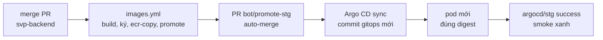

# Runbook: phép kiểm release của buổi stg (bước 16)

← [Dựng env](session-stg-deploy.md) · [Mục lục](README.md) · [Phép kiểm nền tảng](session-stg-check-platform.md) →

> **Tóm tắt**
>
> - **Làm gì:** chứng minh phần triển khai của buổi chạy đúng: smoke đầu-cuối, seed và thang k6, dashboard SLO khi giữ tải, commit
>   status `argocd/stg`, deploy một bản phát hành qua GitOps, Job migration của release, xác thực qua CloudFront, image `dlq-replay` ở
>   ECR. `lõi`: smoke, commit status, deploy qua GitOps, migration, xác thực qua CloudFront, image; `chuẩn ngành`: seed và thang k6,
>   dashboard. Cờ cần bật: `managed_grafana` `session` cho
>   dashboard SLO; các phép còn lại không cần cờ.
> - **Khi nào và bao lâu:** sau bước 15, tunnel mở. `measure.sh stg --smoke` chạy đầu tiên; thang k6 chạy tới mốc 3 giờ của buổi và các
>   phép sau smoke làm trong lúc chờ bậc k6. Hạn từng phép ở dòng `Loại:` của nó.
> - **Phí trong lúc chạy:** phép `lõi` không tốn thêm; seed, thang k6 và dashboard là khoản `chuẩn ngành` ghi ở dòng `Loại:` của từng
>   mục ([Giới hạn](session-stg.md#giới-hạn)).

## Điều kiện trước

- [ ] **Bước 1–15 xong**: apply root env và root gitops thành công, `bootstrap.sh stg wait` (bước 15) báo mọi Application `Healthy`
  ([`session-stg-deploy.md`](session-stg-deploy.md#15-chờ-argo-cd)).
- [ ] **Tunnel tới API còn mở** ([Tunnel tới API](session-stg-deploy.md#tunnel-tới-api-sau-bước-9-trước-bước-11), giữ tới hết bước 22).
- [ ] **Terminal của buổi** ([Mở terminal](session-stg.md#mở-terminal)): cùng `SVP_SESSION_DIR` với các bước trước.
- [ ] **Cờ của buổi đã đọc** ([Cờ chi phí của buổi](session-stg.md#cờ-chi-phí-của-buổi)): chỉ dashboard SLO cần `managed_grafana`
  `session`; đường mặc định chỉ chạy các mục `lõi` ([Phép kiểm lõi và chuẩn ngành](session-stg.md#phép-kiểm-lõi-và-chuẩn-ngành)).
- [ ] **Cluster còn chạy** khi đọc commit status `argocd/stg` (trước bước 20) và có `gh` đã đăng nhập để đọc commit của `svp-gitops`.
- [ ] **PR vô hại ở `svp-backend` đã mở trước buổi**, check xanh, chưa merge (mục [Deploy qua GitOps](#deploy-qua-gitops)).
- [ ] **Hàm dùng chung đã nạp** ([Hàm dùng chung của phép đo](session-stg.md#hàm-dùng-chung-của-phép-đo)): `insights` của mục Migration.

## Mở terminal

Dùng đúng terminal của buổi: mục [Mở terminal](session-stg.md#mở-terminal) của trang chủ (mở lại giữa buổi: cùng mục đó, với
`SVP_SESSION_DIR` là thư mục của buổi đang dở). Lệnh chạy từ gốc repo (`infra/`).
Trang này cần `SVP_SESSION_DIR`.

## Smoke

Loại: `lõi`. Luồng đầu-cuối qua `https://api.<domain>`, tức CloudFront `svp-stg-api`, VPC origin, ALB edge, Envoy (cert
ACM): đăng ký, đăng nhập, upload, transcode tới `READY`, phát qua CDN, feed, like và view, luồng premium. Tunnel mở:

```sh
aws/scripts/measure.sh stg --smoke
```

Script kiểm account và tunnel như mọi bước của buổi, chạy `make eks-smoke CONTEXT=svp-stg DOMAIN=<domain>` rồi ghi mốc `smoke-ok`
vào `timeline.tsv`; không seed, không thang k6. Mong dòng cuối `smoke: all steps passed` của `make`, rồi `ok    --smoke: no seed, no k6
ladder`; dòng `FAIL`: dán ~30 dòng cuối. Buổi bật thang đo không chạy lệnh này: `measure.sh stg` chạy chính smoke đó ở đầu.

## Seed và thang k6

Loại: `chuẩn ngành`, không cần cờ. Thêm vào buổi: tới mốc 3 giờ của buổi (mỗi bậc lên 2 phút, giữ 10 phút, trần 30 phút một bậc), node
Spot mà Karpenter dựng cho tải (chưa có số riêng ở phụ lục nào), MediaConvert của ≥ 30 video seed ([ADR-0066
§12](https://github.com/anhnvcoder/svp-backend/blob/main/docs/adr/0066-mediaconvert-transcode.md#12-chi-phí)).

```sh
aws/scripts/measure.sh stg
```

1. `make eks-smoke CONTEXT=svp-stg DOMAIN=<domain>`: smoke của mục trên.
2. `make eks-seed`: ≥ 30 video `READY` trong `GET /feed/explore` (k6 profile `cloud` đọc chúng).
3. k6 (`deploy/k6/cloud/run.sh` của repo code) bậc **1, 2, 4, 8 pod**, mỗi pod một phần tải của thiết kế 20 pod, lên 2 phút, giữ 10 phút;
   **trước mỗi bậc `make eks-rl-reset CONTEXT=svp-stg`** (pod bậc sau có thể nhận lại IP của pod bậc trước, burst đăng ký theo IP sẽ cạn;
   **LOCAL LAB ONLY**: xoá khoá `svp:gw:rl:register:*` ở db 10 của ElastiCache, qua `svp-valkey` của Deployment `svp-ops`). Bậc đầu tiên
   trượt (threshold, iteration bị bỏ, 429, pod thiếu summary) kết thúc thang đo. Job `svp-k6` (namespace `svp-load`) đi thẳng tới
   ClusterIP của Service `svp-envoy`, không qua CloudFront, WAF (tải từ vài IP NAT sẽ chạm luật rate-based của WAF): mỗi pod đặt
   `CloudFront-Viewer-Address` là `<IP pod>:0`, nên mỗi pod một bucket rate limit; pod tin CA nội bộ của Envoy, `run.sh` đọc khoá `ca.crt`
   của Secret `svp-edge/svp-edge-tls` (không đọc khoá riêng). Mỗi bậc ghi `k6-<n>/`: `nodes.tsv` (số node Ready theo thời gian),
   `top-nodes.tsv`, `top-pods.tsv` (`kubectl top` mỗi lần chờ), `summaries/` (summary của từng pod), `logs.txt`, `node-events.json`.

Exit: `0` khi thang đo đã chạy tới cuối (một bậc trượt là kết quả, không phải lỗi script; dòng `FAIL level <n>` nêu lý do), `1` khi smoke,
seed hay công cụ của một bậc hỏng (cả khi hết hạn chờ mà lần đọc Job cuối cùng lỗi, như phiên SSO hết hạn hay mất mạng: bậc ghi `error`,
không phải `fail`, Job để nguyên; `AWS_PROFILE=anhnv-sso aws --no-cli-pager sso login --region us-east-1` rồi `measure.sh stg --from <n>`,
script xoá Job đó trước khi chạy lại bậc), `3` khi một node của lúc bắt đầu bậc mất hay `NotReady` giữa bậc (**Spot bị thu hồi**, dòng `note
node(s) …`): bậc đó ghi `interrupted`, **không tính là hệ thống trượt**. Còn thời gian (dưới mốc 3 giờ) thì chạy lại từ bậc đó, không
smoke, không seed:

```sh
aws/scripts/measure.sh stg --from <n>
```

Dán lại: `cat $SVP_SESSION_DIR/k6-levels.tsv`, dòng `ok highest level …`, và với mỗi bậc `jq -c .
$SVP_SESSION_DIR/k6-<n>/summaries/pod-*.json | head`.

## Dashboard SLO khi giữ tải

Loại: `chuẩn ngành`, cần `managed_grafana` `session` của `stg` và thang k6 đang giữ tải. Thêm: AMG $18 mỗi buổi stg
(dòng `managed_grafana` của [phụ lục ADR-0071,
Cờ](https://github.com/anhnvcoder/svp-backend/blob/main/docs/adr/appendix/0071-paid-features.md#cờ)), bước 3–5, 28–29
làm việc thật, token ở bước 11.

Trong lúc thang k6 giữ tải, đọc phía server ở Amazon Managed Grafana (`AWS_PROFILE=anhnv-stg terraform
-chdir=aws/accounts/stg output -raw grafana_url`, mở trên trình duyệt, đăng nhập bằng IAM Identity Center với user của
nhóm nền tảng; dashboard "SVP — SLO"): p95/p99 của gateway theo route. Grafana của eks là AMG: Grafana trong cluster
không chạy, trace không có data source Tempo (mục [Phép kiểm edge](session-stg-check-edge-media.md#phép-kiểm-edge) (d)).

## Commit status argocd/stg

Loại: `lõi`.

Commit status `argocd/stg` (Argo CD Notifications, ADR-0032) phải có trên commit `svp-gitops` cluster vừa sync: đó là **bằng chứng stg** mà
`promote-prd` đòi trước khi promote commit đó lên prd. Đọc commit (ghi vào `stg-ref.txt` của thư mục buổi), status của nó và
commit đó nằm trên `main` của `svp-gitops`, trước bước 20 (cluster còn):

```sh
AWS_PROFILE=anhnv-stg kubectl --context svp-stg -n argocd get applications.argoproj.io svp-root -o jsonpath='{.status.sync.revision}{"\n"}' |
  tee "$SVP_SESSION_DIR/stg-ref.txt"
gh api "repos/anhnvcoder/svp-gitops/commits/$(cat "$SVP_SESSION_DIR/stg-ref.txt")/statuses" --jq '.[] | select(.context == "argocd/stg") | "\(.state) \(.created_at)"' | head -n 1
git -C ../gitops fetch origin && git -C ../gitops merge-base --is-ancestor "$(cat "$SVP_SESSION_DIR/stg-ref.txt")" origin/main && echo on-main
```

Mong 40 hex, `success` và `on-main`; dán lại ba dòng. Commit trong `stg-ref.txt` là `stg_ref` của buổi prd (mục **Cổng
promote prd** của [`session-prd.md`](session-prd.md#cổng-promote-prd-trước-mọi-lệnh-tốn-tiền)) khi buổi này qua các phép
`lõi` của mục [Phép kiểm transcode](session-stg-check-edge-media.md#phép-kiểm-transcode) ((a), (f)).

## Deploy qua GitOps

Loại: `lõi`. Thêm: một PR vô hại ở `svp-backend` (mở và xanh trước buổi), một lượt `images.yml` của CI và một lượt sync của Argo CD
trong buổi; ghi giờ UTC của từng mốc dưới vào kết quả (số đo của đường phát hành).

Chứng minh đường phát hành thật của stg, đầu-cuối: merge ở repo code tạo bản phát hành, CI build, ký, chép vào ECR, job `promote` mở PR
`bot/promote-stg` ở `svp-gitops` (auto-merge khi `gitops-ok` xanh), Argo CD sync commit mới, pod chạy đúng digest mới, commit status
`argocd/stg` `success` trên commit đó, smoke xanh. Vì sao đường này:
[ADR-0025](https://github.com/anhnvcoder/svp-backend/blob/main/docs/adr/0025-gitops-config-repo.md) của repo code.



**Trước buổi** (không tốn tiền): mở PR ở `svp-backend` đổi một dòng comment trong `services/feed-service/` (release không canary;
`gateway`, `web` chạy canary, lâu hơn), tiêu đề Conventional Commits (vd `chore(feed-service): …`), chờ check xanh, chưa merge. CI chỉ
build service có file đổi, nên thay đổi phải nằm trong thư mục của service đó.

Sau mục [Commit status argocd/stg](#commit-status-argocdstg), cluster còn chạy, tunnel mở:

1. Merge PR và ghi commit merge:

   ```sh
   svc=feed-service; pr=<số PR>
   gh pr merge "$pr" -R anhnvcoder/svp-backend --squash
   c=$(gh pr view "$pr" -R anhnvcoder/svp-backend --json mergeCommit --jq .mergeCommit.oid); echo "$c"; date -u +%FT%TZ
   ```

2. Lượt `images.yml` của commit đó (build, ký, `ecr-copy`, `promote`):

   ```sh
   gh run list -R anhnvcoder/svp-backend --workflow images.yml --commit "$c" --json databaseId,status,conclusion --jq '.[]'
   gh run watch <databaseId> -R anhnvcoder/svp-backend --exit-status; date -u +%FT%TZ
   ```

   Mong lượt chạy `success`, `gh run watch` exit 0. Lượt đỏ: dán tên job đỏ và dòng lỗi (`gh run view <databaseId> -R
   anhnvcoder/svp-backend --log-failed | tail -n 30`), dừng mục này.

3. PR promote ở `svp-gitops` tự merge khi `gitops-ok` xanh:

   ```sh
   gh pr list -R anhnvcoder/svp-gitops --head bot/promote-stg --state all --limit 1 --json number,state,mergedAt,mergeCommit \
     --jq '.[] | "\(.number) \(.state) \(.mergedAt) \(.mergeCommit.oid)"'
   ```

   Mong `MERGED`, giờ merge và commit `svp-gitops` mới; đặt `g=<commit đó>`. Còn `OPEN`: đọc check của PR (`gh pr checks <số> -R
   anhnvcoder/svp-gitops`), đọc lại sau vài phút; check đỏ thì dán output.

4. Argo CD sync commit đó, pod chạy đúng digest mới:

   ```sh
   git -C ../gitops fetch origin
   want=$(git -C ../gitops show "${g}:envs/stg/images/${svc}.yaml" | sed -n 's/^ *digest: *"\(sha256:[0-9a-f]*\)"/\1/p'); echo "$want"
   AWS_PROFILE=anhnv-stg kubectl --context svp-stg -n argocd get applications.argoproj.io svp-root \
     -o jsonpath='{.status.sync.revision}{"\n"}'
   AWS_PROFILE=anhnv-stg kubectl --context svp-stg -n argocd get applications.argoproj.io "$svc" \
     -o custom-columns=SYNC:.status.sync.status,HEALTH:.status.health.status
   AWS_PROFILE=anhnv-stg kubectl --context svp-stg -n svp get pods -l "app.kubernetes.io/name=$svc" \
     -o jsonpath='{range .items[*]}{.metadata.name} {.status.containerStatuses[0].imageID}{"\n"}{end}'
   ```

   Mong revision của `svp-root` bằng `g` (Argo CD đọc repo theo chu kỳ, vài phút; chưa bằng thì đọc lại), `Synced` `Healthy`, mỗi pod một
   `imageID` kết thúc bằng `want`. Pod cũ còn trong lúc rollout: đọc lại tới khi chỉ còn pod mới; ghi giờ.

5. Commit status trên commit mới, rồi smoke:

   ```sh
   gh api "repos/anhnvcoder/svp-gitops/commits/${g}/statuses" \
     --jq '.[] | select(.context == "argocd/stg") | "\(.state) \(.created_at)"' | head -n 1
   echo "$g" >"$SVP_SESSION_DIR/stg-ref.txt"
   aws/scripts/measure.sh stg --smoke
   ```

   Mong `success` (`pending` khi còn Application chưa Healthy: đọc lại), rồi dòng `smoke: all steps passed` như mục [Smoke](#smoke).
   `stg-ref.txt` giờ là commit mới: `stg_ref` của buổi prd là commit stg đã chạy gần nhất.

Dán lại mọi output và giờ UTC của các mốc (merge, CI xong, PR promote merge, pod mới Ready, `success`).

## Migration của release

Loại: `lõi`.

Mỗi release có database chạy Job `<release>-migrate` (hook PreSync của Argo CD, role migrator) trước khi pod mới thay pod
cũ; runner `internal/dbmigrate` của repo code đặt `lock_timeout` trên mọi kết nối của nó và log lại giá trị đã đặt
([ADR-0068](https://github.com/anhnvcoder/svp-backend/blob/main/docs/adr/0068-zero-downtime-migrations.md), "Xác
nhận"). Pod của Job thường đã mất khi tới mục này (Job xong, node Karpenter bị gỡ), nên `kubectl logs` trả `NotFound` hay `timed out
waiting for the condition`; lệnh `migrate` gửi log qua OTLP tới Collector như `serve` và flush trước khi thoát, nên log đọc ở CloudWatch
Logs, log group `/svp/stg/otel` (resource `service.name` là tên service). Chỉ đọc, không chạm database, sau bước 15, tunnel mở, terminal có
khối của mục [Hàm dùng chung của phép đo](session-stg.md#hàm-dùng-chung-của-phép-đo):

```sh
s=$(awk -F '\t' '$3 == "gitops-apply-start" { t = $2 } END { print t }' "$SVP_SESSION_DIR/timeline.tsv")
q='filter @message like "migration settings" or @message like "migrations up to date"'
insights /svp/stg/otel "$s" "$(date +%s)" "$q | fields @timestamp, @message | sort @timestamp asc | limit 40" || echo "query failed"
AWS_PROFILE=anhnv-stg kubectl --context svp-stg -n argocd get applications.argoproj.io \
  user-service video-service engagement-service feed-service \
  -o custom-columns=NAME:.metadata.name,SYNC:.status.sync.status,HEALTH:.status.health.status
```

Mong, với mỗi release `user-service`, `video-service`, `engagement-service`, `feed-service` (tên ở `service.name` của bản ghi), một bản
ghi `migration settings` có `lock_timeout` `2s` (ngưỡng của runner), rồi một bản ghi `migrations up to date`; bốn Application `Synced`
`Healthy`. Database của env mới rỗng, nên phép này chỉ chứng minh runner đặt ngưỡng khoá trên RDS và release đi qua PreSync; số đo khoá
trên bảng lớn là `make migration-drill` của repo code. Mỗi lượt sync chạy Job lần nữa: bản ghi của mọi lượt đều có, đọc lượt gần nhất.
Thiếu bản ghi của một release: dán output, cùng `AWS_PROFILE=anhnv-stg kubectl --context svp-stg -n svp get jobs`; không sync lại để tạo
Job. Dòng `query failed`: dán dòng lỗi ngay trên nó. Dán cả hai output.

## Xác thực qua CloudFront

Loại: `lõi`; (d) giữ một trang web mở hơn 15 phút.

Phép kiểm buổi của mục "Xác nhận" của
[ADR-0069](https://github.com/anhnvcoder/svp-backend/blob/main/docs/adr/0069-auth-hardening.md#xác-nhận), qua đường của
người dùng thật (CloudFront `svp-stg-api`, WAF, ALB edge, Envoy, gateway): header bảo mật, mật khẩu phổ biến bị chặn, hạn
access token, web refresh trước hạn. Email thử luôn dưới `example.test`; không lệnh nào in token. `register` có rate limit
theo IP: mã `429` thì chờ số giây của header `Retry-After` rồi chạy lại đúng lệnh đó; không xoá khoá nào ở Valkey của stg.

```sh
api=https://api.$(jq -r .domain "$SVP_SESSION_DIR/cluster-values.json")
```

(a) Header và mã `401` (email không có tài khoản, không ghi gì):

```sh
curl -sS -D - -o /dev/null -X POST "$api/auth/login" -H 'Content-Type: application/json' \
  -d '{"email":"session-nobody@example.test","password":"not-a-real-password-1"}' |
  grep -i -E '^(HTTP/|cache-control|x-content-type-options|content-security-policy)'
```

Mong `HTTP/2 401`, `cache-control: no-store`, `x-content-type-options: nosniff` và `content-security-policy: default-src
'none'; frame-ancestors 'none'`. Thiếu một header: gọi thẳng gateway qua port-forward (vào network namespace của pod,
không qua CloudFront) để biết header mất ở gateway hay bị policy header của CloudFront ghi đè; dán cả hai output:

```sh
AWS_PROFILE=anhnv-stg kubectl --context svp-stg -n svp port-forward svc/gateway 18080:8080 >/dev/null & pf=$!
sleep 3
curl -sS -D - -o /dev/null -X POST http://127.0.0.1:18080/auth/login -H 'Content-Type: application/json' \
  -d '{"email":"session-nobody@example.test","password":"not-a-real-password-1"}' |
  grep -i -E '^(HTTP/|cache-control|x-content-type-options|content-security-policy)'
kill "$pf"
```

(b) Mật khẩu phổ biến bị từ chối trước khi tạo user:

```sh
curl -sS -w '\n%{http_code}\n' -X POST "$api/auth/register" -H 'Content-Type: application/json' \
  -d '{"email":"session-blocked@example.test","password":"12345678"}'
```

Mong body problem có `"code":"PASSWORD_BLOCKLISTED"`, rồi `400`.

(c) Hạn access token: tạo một user thử (như smoke vẫn làm), đăng nhập, chỉ in `expires_at`. Mật khẩu ngẫu nhiên đi vào `curl` qua stdin:

```sh
e="session-ttl-$(openssl rand -hex 4)@example.test"; p=$(openssl rand -hex 16)
body=$(jq -nc --arg e "$e" --arg p "$p" '{email: $e, password: $p}')
curl -sS -o /dev/null -w '%{http_code}\n' -X POST "$api/auth/register" -H 'Content-Type: application/json' -d @- <<<"$body"
date -u +%FT%TZ; curl -sS -X POST "$api/auth/login" -H 'Content-Type: application/json' -d @- <<<"$body" | jq -r .expires_at
```

Mong `201`, rồi `expires_at` cách giờ in ra khoảng 15 phút (TTL access token của ADR-0069). Dán ba dòng.

(d) Web refresh trước hạn, bằng user của (c): mở `https://<domain>/login`, email là `echo "$e"`, mật khẩu chép vào clipboard bằng `printf
%s "$p" | pbcopy` (không in ra). Đăng nhập, giữ trang feed mở hơn 15 phút, rồi bấm sang `/me`. Mong vẫn đăng nhập (BFF đã đổi token trước
`expires_at`), không bị đưa về `/login`; ghi giờ đăng nhập và giờ bấm. Xong: `unset p body; printf '' | pbcopy`.

## Image của release dlq-replay ở ECR

Loại: `lõi`.

Image phát hành tới ECR của account qua job `ecr-copy` của CI repo code, không qua mục [Làm nóng
cache](session-stg-deploy.md#làm-nóng-cache-sau-bước-11-trước-bước-12)
([ADR-0062](https://github.com/anhnvcoder/svp-backend/blob/main/docs/adr/0062-ecr-registry-ci-oidc.md) §3). Chân `dlq-replay` mà
`svp-gitops` ghim cho stg phải có ở repo `svp-backend/dlq-replay` của ECR stg (repo do `aws/accounts/stg` tạo). Chỉ đọc, bất kỳ lúc nào
sau bước 1:

```sh
git -C ../gitops fetch origin
dig=$(git -C ../gitops show origin/main:envs/stg/images/dlq-replay.yaml | sed -n 's/^ *digest: *"\(sha256:[0-9a-f]*\)"/\1/p')
echo "$dig"
AWS_PROFILE=anhnv-stg aws --no-cli-pager ecr describe-images --repository-name svp-backend/dlq-replay --image-ids "imageDigest=$dig" \
  --region ap-southeast-1 --query 'imageDetails[0].[imageDigest,imagePushedAt]' --output text
```

Mong digest `sha256:…` hai lần, rồi giờ đẩy. `ImageNotFoundException`: job `ecr-copy` của commit đó chưa chạy hay đã lỗi (vd repo ECR chưa
có lúc CI chạy); chạy lại job đó của lượt `images.yml` trên `main` của repo code, không dùng `ecr-warm.sh` (chỉ cho image bên thứ ba).
Lượt chạy theo commit của tag ghim (`git -C ../gitops show origin/main:envs/stg/images/dlq-replay.yaml` in tag):

```sh
sha=$(git -C ../backend rev-parse '<tag>^{commit}')
gh run list -R anhnvcoder/svp-backend --workflow images.yml --commit "$sha" --json databaseId,conclusion --jq '.[]'
gh run rerun <databaseId> --failed -R anhnvcoder/svp-backend
```

Rồi chạy lại khối đọc. Lượt chạy quá cũ để chạy lại hay vẫn không có digest: dán output cho AI.

## Gỡ

Các phép kiểm ở trang này không để lại tài nguyên của buổi ngoài những thứ nó tự nêu (pod, tệp trong `$SVP_SESSION_DIR`); gỡ cuối buổi ở
[`session-stg-teardown.md`](session-stg-teardown.md) (bước 20–31).

## Khi một bước đỏ

Phép kiểm đỏ thì ghi kết quả, dán output cho AI rồi sang phép kế: bước 16 là bước duy nhất của bảng
[Thứ tự](session-stg.md#thứ-tự) được đi tiếp khi đo hỏng. Lỗi riêng của từng phép ở nhãn **Bẫy** hay phần **Mong** của nó; destroy kẹt:
[Destroy kẹt](session-stg.md#destroy-kẹt).
